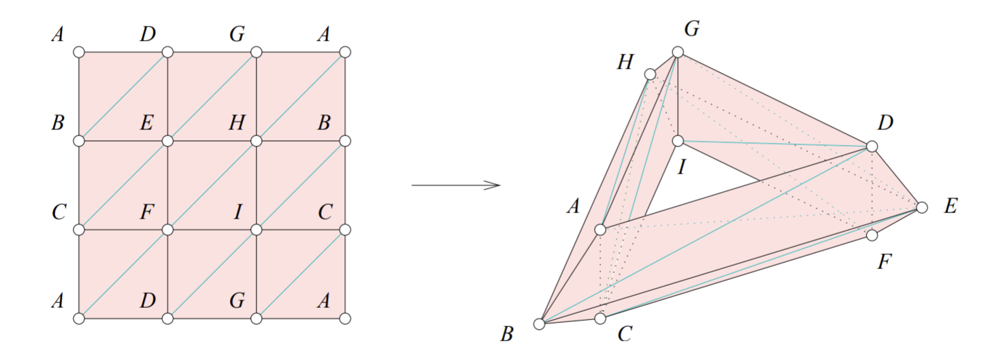
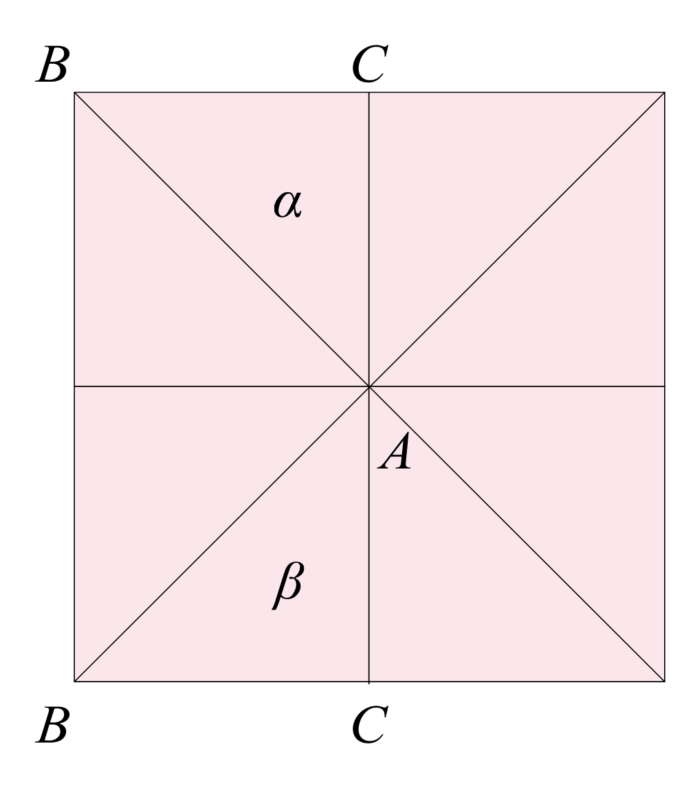
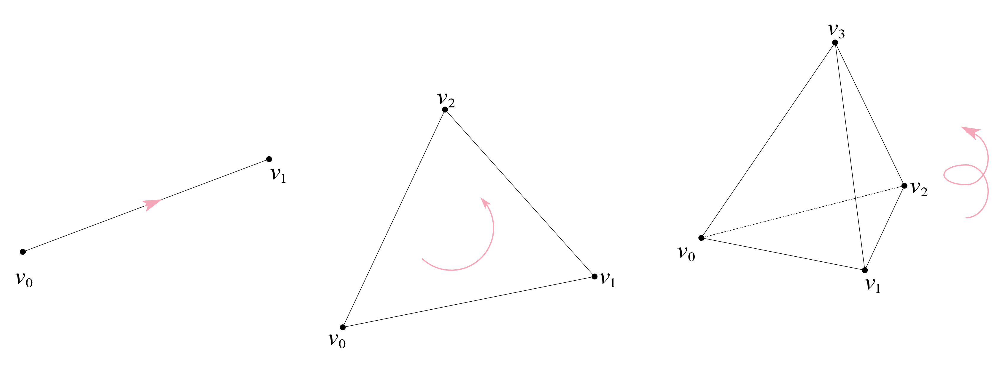
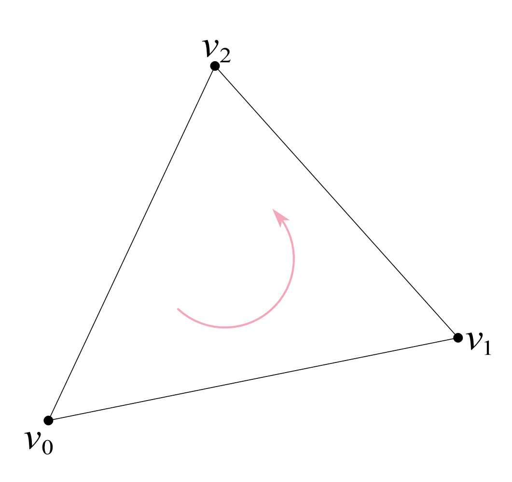
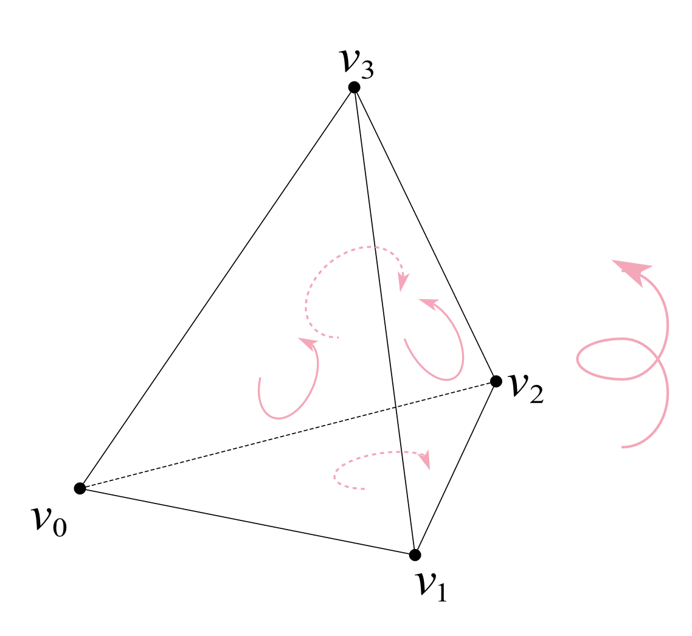
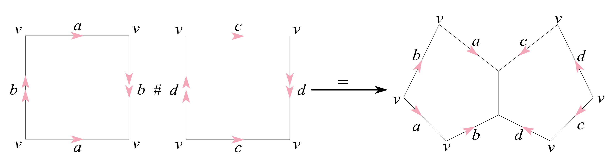
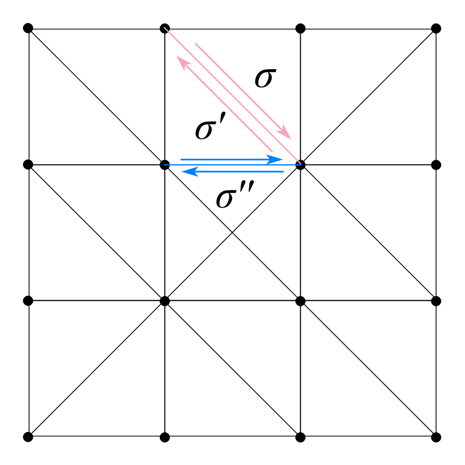
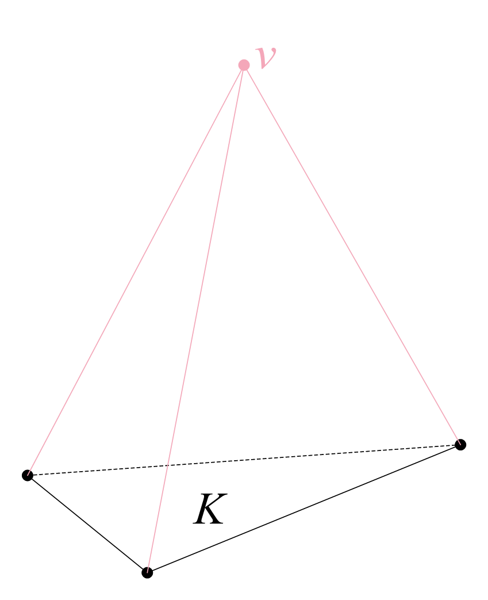

<problems>
- “$2$ 维闭曲面的同调群”一节的第一个引理中，第 (2) 条的条件 $d\in Z_2(K)$ 似乎应为 $d\in C_2(K)$（否则 $\partial d=0$，条件 $\partial d\in C_1(\operatorname{Bd} K)$ 是多余的）。
- “约化同调”一节中，关于 $\partial[v,c]$ 的引理的证明似乎与引理的陈述不完全对应：证明开头关于 $\tilde{H}_p(v*K)$ 的讨论似乎与该引理无关。
- “单纯映射诱导的链映射”一节的命题中，$f_*$ 的定义 $z_1+B_p(K)\mapsto f_\sharp(z_1)+B_p(K)$ 右侧似乎应为 $B_p(L)$。
</problems>

## 几何复形

首先声明我们主要讨论的基底空间 $ \mathbb{R}^\mathbb{N} $。记
\[
\mathbb{R}^\mathbb{N}:=\left\{ (x_1,x_2,\dots,x_n,\dots) : \text{至多有限个 } x_i \text{ 非零} \right\},
\]
在其上可以定义**凝聚拓扑**，即
\[
        A\subset\mathbb{R}^\mathbb{N}\text{ 是闭集}\Longleftrightarrow \forall n\in\mathbb{N},
\, A\cap\mathbb{R}^n\,\text{为}\,\mathbb{R}^n\,\text{中闭集}.
\]

考虑 $ a_0,\dots,a_p $ 是 $ \mathbb{R}^\mathbb{N} $ 中的 $ p+1 $ 个点，
称它们**几何独立**，若 $ \left\{ a_1-a_0,\dots,a_p-a_0 \right\} $ 线性无关。
这确定了一个 $ p $ 维线性空间
\[
P:=\operatorname{span}\left\{ a_1-a_0,\dots,a_p-a_0 \right\}=\left\{ \sum_{i=1}^p\lambda_i(a_i-a_0) : \lambda_i\in\mathbb{R} \right\},
\]
将其平移得到仿射空间 $ a_0+P $。此时
\[
a_0+P=\left\{ \left( 1-\sum_{i=1}^p\lambda_i \right)a_0+\sum_{i=1}^p\lambda_ia_i : \lambda_i\in\mathbb{R} \right\}
=\left\{ \sum_{i=0}^p\lambda_ia_i : \sum_{i=0}^p\lambda_i=1 \right\},
\]
其中 $ \lambda_0=1-\sum\limits_{i=1}^p\lambda_i $。
注意到几何独立的 $ p+1 $ 个点把空间划分成不同的区域，我们将依此定义单形。

::: definition [$ p $维单形、真面]
设 $ a_0,\dots,a_p $ 是 $ \mathbb{R}^\mathbb{N} $ 中几何独立，称
\[
(a_0,\dots,a_p):=\left\{ \sum_{i=0}^p\lambda_ia_i : \sum_{i=0}^p\lambda_i=1,\lambda_i\geqslant 0 \right\}
\]
是一个 $ \mathbb{R}^\mathbb{N} $ 中的 **$ p $维单形**。

若 $ \left\{ i_0,\dots,i_q \right\}\subset\left\{ 0,\dots,p \right\} $，
则 $ a_{i_0},\dots,a_{i_q} $ 几何独立，记
\[
\tau^q=(a_{i_0},\dots,a_{i_q})\prec(a_0,\dots,a_p)=\sigma^p.
\]
若 $ q<p $，称 $ \tau^q $ 是 $ \sigma^p $ 的一个**真面**。
:::

单形是最简单的几何体，单形的组合构成更复杂的几何体。

::: definition [复形]
设 $ K $ 是 $ \mathbb{R}^\mathbb{N} $ 中一些单形的集合，称 $ K $ 是一个 **（单纯）复形**，若

(1) 对任意 $ \sigma\in K $，$ \sigma $ 的任何面仍在 $ K $ 中；

(2) 对任意 $ \sigma,\tau\in K $，$ \sigma\cap\tau $ 或者是空集，
    或者是它们的公共面。

若 $ K $ 中的单形个数有限，则称 $ K $ 是**有限复形**。
:::

这说明由单形搭建复形是有一定规则的：例如下图中左图是复形而右图不是复形。

```tikz
\begin{tikzpicture}[x=0.75pt,y=0.75pt,yscale=-1,xscale=1]
        \draw  [fill={rgb, 255:red, 232; green, 122; blue, 144 }  ,fill opacity=0.3 ] (121.89,134) -- (79.89,62.67) -- (19.22,112.67) -- cycle ;
        \draw    (121.89,134) -- (153.22,118) ;
        \draw  [fill={rgb, 255:red, 232; green, 122; blue, 144 }  ,fill opacity=0.3 ] (194.56,42) -- (153.22,118) -- (201.22,145.33) -- (237.89,100) -- cycle ;
        \draw  [dash pattern={on 4.5pt off 4.5pt}]  (153.22,118) -- (237.89,100) ;
        \draw    (194.56,42) -- (201.22,145.33) ;
        \draw  [fill={rgb, 255:red, 232; green, 122; blue, 144 }  ,fill opacity=0.3 ] (421.89,134) -- (379.89,62.67) -- (319.22,112.67) -- cycle ;
        \draw    (421.89,134) -- (496.56,148) ;
    \end{tikzpicture}
```

::: definition [复形的维数]
设 $ K $ 是一个复形，称其**维数**为
\[
\dim K:=\sup_{\sigma\in K}\dim\sigma.
\]
有限复形必是有限维的，但反之不真。
:::

对一个单形 $ \sigma^p\in\mathbb{R}^\mathbb{N} $，可以从此出发构造复形
\[
K_{\sigma^p}:=\left\{ \tau : \tau\prec\sigma^p \right\}
\]
和其边界复形
\[
\mathrm{Bd}\,K_{\sigma^p}=K_{\partial\sigma^p}:=K_{\sigma^p}\setminus\left\{ \sigma \right\}.
\]
更具体一些，有复形的骨架的概念：

::: definition [骨架]
设 $ K $ 是一个复形，称
\[
K^{(p)}:=\left\{ \sigma\in K : \dim\sigma\leqslant p \right\}
\]
是 $ K $ 的 **$ p $维骨架**。于是 $ K^{(p)} $ 也是一个复形，
$ K^{(p)}\subset K $ 是 $ K $ 的一个子复形。
特别地，$ K^{(0)} $ 称作是 $ K $ 的**顶点集**，
其中的元素称作 $ K $ 的**顶点**。
:::

直观上当 $ p=1 $ 时，$1$维骨架就是直观上看起来的复形的“骨架”，
它只包含复形的$0$维子复形（即顶点）和$1$维子复形（即各边）。

设 $ K $ 是 $ \mathbb{R}^\mathbb{N} $ 的复形，称
\[
\left| K \right| =\bigcup_{\sigma\in K}\sigma
\]
是 $ K $ 的**几何实现**或**伴随多面体**。
此时 $ \left| K \right|  $ 成为 $ \mathbb{R}^\mathbb{N} $ 中的子集，
赋予拓扑 $ \mathcal{T}_{\left| K \right| } $ 是 $ \mathbb{R}^\mathbb{N} $ 上的子空间拓扑。

::: lemma {@lem:子复形几何实现的闭性}
设 $ L $ 是 $ K $ 的子复形，则 $ \left| L \right|  $ 是 $ \left| K \right|  $ 中的闭集。
:::

::: proof
设 $ A\subset\left| L \right|  $ 是闭集，对任意 $ \sigma\in K $，有
\[
\sigma\cap\left| L \right| =\bigcup_{\tau\prec\sigma,\tau\in L}\tau,
\]
故
\[
A\cap\sigma=\bigcup_{\tau\prec\sigma,\tau\in L}(A\cap\tau).
\]
而 $ A\cap\tau $ 是 $ \tau $ 中的闭集，且 $ \tau\prec\sigma $，
故 $ A\cap\tau $ 是 $ \sigma $ 中的闭集，
进而 $ A\cap\sigma $ 也是 $ \sigma $ 中的闭集。
由此可知 $ A $ 是 $ \left| K \right|  $ 中的闭集。

特别地，取 $ A=\left| L \right|  $ 即可证明引理。
:::

由此可以说明在 $ \left| K \right|  $ 上的拓扑在一般情形下是弱于 Euclid 拓扑的，
即使它可以被嵌入有限维空间。为此考虑复形
\[
K=\left\{ [m,m+1] : m\ne 0,\,m\in\mathbb{Z} \right\}
\cup\left\{ \Big[ \frac{1}{n+1},\frac{1}{n} \Big] : n\in\mathbb{Z}_+ \right\}
\cup\mathbb{Z}\cup\left\{ \frac{1}{n} : n\in\mathbb{Z}_+ \right\}.
\]
则 $ \left| K \right| =\mathbb{R} $，
且 $ L=\left\{ 1/n : n\in\mathbb{Z}_+ \right\} $ 是 $ K $ 的子复形。
由 @lem:子复形几何实现的闭性 可知 $ \left| L \right| =L $ 是 $ \left| K \right|  $ 中的闭集，
但在 $ \left| K \right|  $ 的 Euclid 拓扑下 $ \left| L \right|  $ 并不是闭集，
因它有聚点 $ 0\notin\left| L \right|  $。

::: definition [可三角剖分空间]
称拓扑空间 $ X $ **可三角剖分**，若存在复形 $ K $ 使得 $ X\cong\left| K \right|  $。
:::

所有的光滑流形都可以被三角剖分，一个例子是环面 $ \mathbb{T}^2 $ 可以被下图三角剖分：

{width=660}

但需要注意的是下图的剖分方式并不是三角剖分，
因标注 $ \alpha $ 和 $ \beta $ 的两个三角形同时相交于点 $ A $ 和线 $ BC $，
它们不是公共面（*因不连通*）。

{width=210}

## 单纯映射

单纯复形范畴可以看作偏序范畴的一种，考虑由真面诱导的偏序 $ \prec $，
那么 $ (K,\prec) $ 构成一个偏序集，因此我们需要保持偏序结构的态射：

::: definition [单纯映射]
称 $ f : K\to L $ 是一个**单纯映射**，若对任意 $ \sigma\in K $
都有 $ f(\sigma)\in L $，$ f $ 保持偏序关系，即
\[
\tau\prec\sigma\Longrightarrow f(\tau)\prec f(\sigma),
\]
同时要求 $ \dim f(\sigma)\leqslant\dim\sigma $。
:::

这与教材上的定义是等价的。$ \dim f(\sigma)\leqslant\dim\sigma $
保证了 $ f $ 将 $ K $ 的顶点 $ K^{(0)} $ 映到 $ L $ 的顶点 $ L^{(0)} $。
单形本质上就可以看作是一些顶点的集合（由习题1.1保证）。
于是单纯映射可以作为态射，构成一个范畴 $ \mathsf{SimComp} $，
称作是**单纯复形范畴**。

单纯映射 $ f : K\to L $ 诱导一个拓扑空间之间的映射 $ g_f $，它满足
\[
g_f : \left| K \right| \to\left| L \right| ,\qquad x=\sum_{i=0}^pt_i\sigma_i\mapsto \sum_{i=0}^pt_if(\sigma_i),
\]
它可以看作是一系列形如 $ g_f|_\sigma : \sigma\mapsto\left| L \right|  $ 拼接起来的映射。
在拓扑空间范畴 $ \mathsf{Top} $ 中，我们当然希望 $ g_f $ 是连续的，
从而导出一个 $ \mathsf{SimComp} $ 到 $ \mathsf{Top} $ 的函子。
为此先证明以下引理：

::: lemma
$ h : \left| K \right| \to X $ 连续当且仅当对任意 $ \sigma\in K $，
都有 $ h|_\sigma : \sigma\to X $ 连续。
:::

::: proof
*必要性。* 显然。

*充分性。* 任取 $ X $ 上的闭集 $ C $，对任意 $ \sigma\in K $，
只需要证明 $ h^{-1}(C)\cap\sigma $ 是 $ \sigma $ 中的闭集即可。而
\[
h^{-1}(C)\cap \sigma=(h|_\sigma)^{-1}(C)
\]
是闭的。
:::

由此得到：

::: proposition
$ F : K\mapsto\left| K \right| ,\ f\mapsto g_f $ 给出一个 $ \mathsf{SimComp} $
到 $ \mathsf{Top} $ 的函子。
:::

::: proof
只需验证 $ F $ 的函子性，首先 $ \mathrm{id}_K : K\to K $ 诱导出
$ F(\mathrm{id}_K)=\mathrm{id}_{\left| K \right| } : \left| K \right| \to\left| K \right|  $，
于是只需要证明图
\[
\begin{tikzcd}
    \left| K \right|  \arrow[r, "g_f"] \arrow[rd, "g_hg_f"'] & \left| L \right|  \arrow[d, "g_h"] \\
                                                   & \left| M \right|
\end{tikzcd}
\]
交换即可。这因
\[
g_{hf}(x)=\sum_{i=0}^pt_i(hf)(\sigma_i)
=g_h\sum_{i=0}^pt_if(\sigma_i)=g_hg_f(x).
\]
:::

对复形 $ K $，其中的单形 $ \sigma=(\sigma_0,\dots,\sigma_p) $
可以由顶点集 $ \left\{ \sigma_0,\dots,\sigma_p \right\} $ 描述，
因此 $ K $ 在某种程度上可以由 $ K^{(0)} $ 描述。

::: definition [抽象复形]
设 $ S $ 是一个集合，称 $ \mathcal{K}\subset 2^S $ 是一个**抽象复形**，若
\[
\forall s\in\mathcal{K}\,(t\subset s\Longrightarrow t\in\mathcal{K}).
\]
此时的 $ s $ 即为抽象单形，$ \dim s=\left| s \right| -1 $。
特别地，$ \dim\varnothing=-1 $。类似可定义抽象复形的维数
\[
\dim\mathcal{K}:=\sup_{s\in\mathcal{K}}\dim s.
\]
对抽象复形，
也可以定义骨架 $ \mathcal{K}^{(p)}:=\left\{ s\in\mathcal{K} : \dim s\leqslant p \right\} $。
:::

::: definition [几何实现复形]
称 $ K $ 是 $ \mathcal{K} $ 的**几何实现复形**，
若存在双射 $ f : K^{(0)}\to\mathcal{K}^{(0)} $ 使得
\[
(v_0,\dots,v_p)\in K\Longleftrightarrow \left\{ f(v_0),\dots,f(v_p) \right\}\in\mathcal{K}.
\]
:::

抽象复形 $ \mathcal{K} $ 的所有几何实现复形的伴随多面体都是分段线性同胚的，
因此之后我们不区分抽象复形和几何复形。

::: theorem
设 $ \mathcal{K}^n $ 是 $ n $ 维有限抽象复形，它必可在 $ \mathbb{R}^{2n+1} $ 上实现为几何复形。
:::

::: proof
考虑循环曲线
\[
\varPhi : \mathbb{R}\to\mathbb{R}^{2n+1},\qquad t\mapsto (t,t^2,\dots,t^{2n+1}),
\]
断言对于互不相同的 $ t_0,\dots,t_{2n+1} $，
有 $ \varPhi(t_0),\dots,\varPhi(t_{2n+1}) $ 几何独立。为此，考虑
\[
\det[\varPhi(t_1)-\varPhi(t_0),\dots,\varPhi(t_{2n+1})-\varPhi(t_0)]
=\begin{vmatrix}t_1-t_0 & \cdots & t_{2n+1}-t_0 \\
    \vdots & \ddots & \vdots \\
    t_1^{2n+1}-t_0^{2n+1} & \cdots & t_{2n+1}^{2n+1}-t_0^{2n+1}
\end{vmatrix}\ne 0
\]
即得断言。

令 $ \mathcal{K}^{(0)}=\left\{ s_1,\dots,s_N \right\}\setminus\left\{ \varnothing \right\} $，
几何复形 $ K $ 构造如下：
\[
\mathcal{K}^{0}\ni s_i\longleftrightarrow\varPhi(i)\in K^{(0)},
\]
则 $ s=\left\{ s_{i_1},\dots,s_{i_p} \right\}\in\mathcal{K} $ 当且仅当
$ (\varPhi(i_1),\dots,\varPhi(i_p))\in K $，其中 $ p\leqslant n $。
下面证明如此构造的 $ K $ 是一个几何复形，定义的第一条显然满足，
只需证明任意两个单形的交或者为空，或者是公共面即可。

任取 $ \sigma^p,\sigma^q\in K $，设它们有 $ r $ 个公共顶点，
则 $ \sigma^p $ 和 $ \sigma^q $ 共有 $ p+1+q+1-r $ 个不同的顶点，而
\[
p+q+2-r\leqslant 2n+2-r<2n+2,
\]
于是这些顶点几何独立，它们确定了一个 $ p+q+1-r $ 维单形 $ \gamma $，
满足 $ \sigma^p\prec\gamma $，$ \sigma^q\prec\gamma $。
因此由单形的定义可知它们的交或者为空，或者是公共面。
:::

::: corollary
设 $ K $ 是有限复形，且 $ \dim K=n $，
则一定存在嵌入 $ \left| K \right| \hookrightarrow\mathbb{R}^{2n+1} $。
:::

但是将上一推论的嵌入从 $ \mathbb{R}^{2n+1} $ 改为 $ \mathbb{R}^{2n} $ 后就不再成立了。
例如 $ K_{\sigma^{2n+2}}^{(n)} $ 就不能嵌入 $ \mathbb{R}^{2n} $。
最简单的情形，令 $ n=1 $，此时 $ K_{\sigma^4}^{(1)} $ 即为下图：

{width=240}

它就是完全图 $ K_5 $，是一类不可平面化的图，于是它不能嵌入 $ \mathbb{R}^2 $。

## 单纯同调群

对复形的定向无非是对顶点的排序，而排序本质上只有两种，即由偶置换确定的同构类。
对 $ \sigma $ 的顶点集 $ \left\{ v_0,\dots, v_p \right\} $，
定义它在偶置换下的同构类为 $ [v_0,\dots,v_p] $，
就称它是复形 $ \sigma $ 的一个**定向**。

特别地，约定 $0$ 维情形下，$ [a_0] $ 与 $ -[a_0] $ 是两种不同的定向。

{width=600}

::: definition [定向复形]
称 $ K $ 是一个**定向复形**，若 $ \forall \sigma\in K $，
$ \sigma $ 是有定向的。并记
\[
S_p^+(K):=\left\{ \sigma\in K : \dim\sigma=p \right\},\qquad
S_p(K)=\left\{ \pm\sigma : \sigma\in S_p^+(K) \right\}.
\]
:::

::: theorem
由 $ S_p^+(K) $ 作为生成元可以生成一个自由 Abel 群，记作
\[
C_p(K):=\left\{ \sum_{\sigma\in S_p^+(K)}n_\sigma\sigma \right\},
\]
并要求求和为有限和。
:::

::: proof
考虑映射 $ c_p : S_p(K)\to\mathbb{Z} $，其中 $ c_p $ 仅在 $ S_p(K) $ 中
有限个元素上取非零值，且 $ \forall\sigma\in S_p(K) $
都有 $ c_p(-\sigma)=-c_p(\sigma) $。称 $ c_p $ 是一个 **$ p $-链**。取
\[
C_p(K)=\left\{ c_p : S_p(K)\to\mathbb{Z} \right\},
\]
在它上面定义加法
\[
(c_p+c_p')(\sigma):=c_p(\sigma)+c_p'(\sigma),
\]
则 $ (C_p(K),+) $ 是一个 Abel 群，其中的零元 $ 0 : S_p(K)\to\mathbb{Z} $，
$ \sigma\mapsto 0 $，$ c_p $ 的逆 $ (-c_p)(\sigma):=-c_p(\sigma) $。

接下来证明它是由 $ S_p^+(K) $ 生成的自由 Abel 群。
我们需要做一点说明，对 $ \sigma\in S_p^+(K) $，定义
\[
c_p^\sigma(\tau)=\begin{cases}
    \pm 1, & \tau=\pm\sigma \\ 0, & \tau\ne\pm\sigma
\end{cases}
\]
则 $ \left\{ c_p^\sigma \right\}_{\sigma\in S_p^+(K)} $ 与 $ S_p^+(K) $ 之间
可以建立 1–1 对应，于是可以用 $ \sigma $ 替代 $ c_p^{\sigma} $。
$ \forall c_p\in C_p(K) $，$ \forall \sigma\in S_p^+(K) $，
记 $ c_p(\sigma)=n_\sigma $，那么构造的
\[
c_p'=\sum_{\sigma\in S_p^+(K)}n_\sigma c_p^\sigma
=\sum_{\sigma\in S_p^+(K)}n_\sigma\sigma
\]
自然是有限和。断言 $ c_p'=c_p $。

为此，对任意 $ \tau\in S_p(K) $，考虑
\[
c_p'(\tau)=\sum_{\sigma\in S_p^+(K)}n_\sigma c_p^\sigma(\tau)
\stackrel{\tau=\pm\sigma}{=}\pm n_\sigma=c_p(\pm\sigma)=c_p(\tau).
\]
再说明唯一性，令 $ c_p=\sum\limits_{\sigma\in S_p^+(K)}n_\sigma \sigma
        =\sum\limits_{\sigma\in S_p^+(K)}n_\sigma'\sigma $，则
\[
\sum_{\sigma\in S_p^+(K)}(n_\sigma-n_\sigma')\sigma=0_p.
\]
代入 $ \tau=\pm\sigma $ 得到
\[
\sum_{\sigma\in S_p^+(K)}(n_\sigma-n_\sigma')c_p^\sigma(\tau)
=\pm(n_\sigma-n_\sigma')=0_p(\tau)=0,
\]
即 $ n_\sigma=n_\sigma' $，断言得证。
:::

{width=240}

考虑以上 $2$ 维复形的边界，计算 $ \partial[v_0,v_1,v_2] $ 得到
\[
\partial[v_0,v_1,v_2]=[v_0,v_1]+[v_1,v_2]+[v_2,v_0]
=[v_0,v_1]-[v_0,v_2]+[v_1,v_2].
\]
并且注意到边界中的每一项符号与缺少的顶点标号有关。

{width=240}

再考虑 $3$ 维复形的边界：这里所有 $2$ 维面的定向都使用右手法则来确定。
计算 $ \partial[v_0,v_1,v_2,v_3] $ 得到
\[
\begin{aligned}
    \partial[v_0,v_1,v_2,v_3]& =[v_0,v_2,v_1]+[v_0,v_1,v_3]+[v_1,v_2,v_3]+[v_0,v_3,v_2]\\
    & =-[v_0,v_1,v_2]+[v_0,v_1,v_3]-[v_0,v_2,v_3]+[v_1,v_2,v_3].
\end{aligned}
\]
同样地，注意到边界中的每一项符号都与缺少的顶点标号有关。

由此可以归纳得到，
\[
\partial[v_0,\dots,v_p]=\sum_{k=0}^p(-1)^k[v_0,\dots,\hat{v}_k,\dots,v_p],
\]
其中 $ \hat{v}_k $ 表示缺少这一项。

::: definition [边缘算子]
称
\[
\partial : C_p(K)\to C_{p-1}(K),\qquad c_p
=\sum_{\sigma\in S_p^+(K)}n_\sigma\sigma\mapsto
\sum_{\sigma\in S_p^+(K)}n_\sigma\partial\sigma
\]
是 $ C_p(K) $ 上的**边缘算子**，有时为了强调也记作 $ \partial_p $。
它是 $ C_p(K) $ 到 $ C_{p-1}(K) $ 的群同态，其中 $ \partial\sigma $ 如下定义：
对 $ \sigma=[v_0,\dots,v_p] $，有
\[
\partial[v_0,\dots,v_p]=\sum_{k=0}^p(-1)^k[v_0,\dots,\hat{v}_k,\dots,v_p].
\]
:::

::: proposition
$ \partial^2=0 $。（*严格地讲，应该写成 $ \partial_{p-1}\partial_p=0 $*）
:::

::: proof
任取 $ \sigma=[v_0,\dots,v_p] $，计算
\[
\begin{aligned}
    \partial^2\sigma&=\partial\left( \sum_{k=0}^p(-1)^k[v_0,\dots,\hat{v}_k,\dots,v_p] \right)\\
    &=\sum_{j<k}(-1)^k(-1)^j[\dots,\hat{v}_j,\dots,\hat{v}_k,\dots]
    +\sum_{j>k}(-1)^k(-1)^{j-1}[\dots,\hat{v}_k,\dots,\hat{v}_j,\dots]\\
    &=\sum_{j<k}(-1)^{k+j}[\dots,\hat{v}_j,\dots,\hat{v}_k,\dots]
    +\sum_{j<k}(-1)^{k+j-1}[\dots,\hat{v}_j,\dots,\hat{v}_k,\dots]\\
    &=0.
\end{aligned}
\]
于是命题得证。
:::

::: definition [同调群]
对链复形 $ \mathcal{C}(K)=\left\{ (C_p(K),\partial_p) \right\} $，
\[
\begin{tikzcd}
    {} \arrow[r, "\partial_{p+1}"] & C_p(K) \arrow[r, "\partial_p"]
    & C_{p-1}(K) \arrow[r, "\partial_{p-1}"]
    & \cdots \arrow[r, "\partial_2"] & C_1(K) \arrow[r, "\partial_1"]
    & C_0(K) \arrow[r, "\partial_0"] & {}
\end{tikzcd}
\]
对 $ \partial_p : C_p(K)\to C_{p-1}(K) $，称

(1) $ Z_p(K):=\ker\partial_p=\left\{ c_p\in C_p(K) : \partial c_p=0 \right\} $
    是 $ K $ 的 **$ p $ 维闭链群**；

(2) $ B_p(K):=\mathrm{im}\,\partial_{p+1}=\left\{ \partial c_{p+1}\in C_p(K) : c_{p+1}\in C_{p+1}(K) \right\} $
    是 $ K $ 的 **$ p $ 维边缘链群**。

满足 $ B_p(K)\triangleleft Z_p(K) $，且 $ B_p(K) $ 和 $ Z_p(K) $ 仍是自由 Abel 群。称
\[
H_p(K)=\ker\partial_p/\mathrm{im}\,\partial_{p+1}=Z_p(K)/B_p(K)
\]
是 $ K $ 的 **$ p $ 阶同调群**。
:::

在 $ Z_p(K) $ 上可以定义等价关系：
\[
\begin{aligned}
    z_p\sim z_p' & \Longleftrightarrow z_p+B_p(K)=z_p'+B_p(K)\\
    & \Longleftrightarrow z_p-z_p'+B_p(K)=0
    \Longleftrightarrow \exists d\in C_{p+1}(K)\,(\partial d=z_p-z_p'),
\end{aligned}
\]
这一等价关系称作**同调关系**，确定的等价类 $ \bar{z}_p $ 称作**同调类**。
它可以不局限于闭链群，例如在 $ C_p(K) $ 上同样可以定义
\[
c_p\sim c_p'\Longleftrightarrow \exists d\in C_{p+1}(K)\,(\partial d=c_p-c_p').
\]
特别地，若 $ \partial d=c_p $，则 $ c_p\sim 0 $。

::: example
考虑以下的 $2$ 维复形，约定每一个 $2$ 维单形的定向都是逆时针。

{width=270}

取
\[
\begin{aligned}
    z_1&=[v_0,v_1]+[v_1,v_2]+[v_2,v_0]\in C_1(K)\\
    z_2&=[v_3,v_4]+[v_4,v_5]+[v_5,v_3]\in C_1(K),
\end{aligned}
\]

计算可得
\[
\partial z_1=\partial z_2=0,
\]
于是 $ z_1,z_2\in Z_1(K) $。而
\[
\partial\bigg(\sum_{\sigma\in K^{(2)}\setminus K^{(1)}}\sigma\bigg)=z_1-z_2,
\]
于是由同调关系的定义可知 $ z_1\sim z_2 $。
:::

将 $ \partial_p $ 限制到 $ \mathrm{im}\,\partial_p $ 上之后可知
\[
\partial_p : C_p(K)\twoheadrightarrow\mathrm{im}\,\partial_p=B_{p-1}(K)
\]
是一个满同态。于是由同态基本定理可知 $ C_p(K)/\ker\partial_p\simeq\mathrm{im}\,\partial_p $。

对复形 $ K $，$ v,w\in K^{(0)} $，则 $ v,w\in C_0(K) $。于是由同调关系的定义可知
\[
v\sim w\Longleftrightarrow\exists d\in C_1(K)\,(\partial d=w-v).
\]
在直观上，$ v\sim w $ 即是存在一列 $ \left\{ v_i \right\}_{i=0}^n $ 满足
$ v_0=v $，$ v_n=w $ 使得 $ v $ 与 $ w $ 可以经由 $ [v_i,v_{i+1}] $ 相连。

{width=510}

于是同调关系可以对 $ K^{(0)} $ 分类，以
$ \bar{v}:=\left\{ w\sim v : w\in K^{(0)} \right\} $ 记 $ v $ 所在的等价类，则
\[
K=\bigcup_{\bar{v}\in K^{(0)}/\sim}K_{\bar{v}}
=\bigcup_{\bar{v}\in K^{(0)}/\sim}\left\{ (v_0,\dots,v_p)\in K : \left\{ v_0,\dots,v_p \right\}\subset\bar{v} \right\}.
\]
进一步，其几何实现
\[
\left| K \right| =\bigcup_{\bar{v}\in K^{(0)}/\sim}\left| K_{\bar{v}} \right| ,
\]
且 $ \left| K_{\bar{v}} \right|  $ 是道路连通的。此时也称 $ K_{\bar{v}} $ 是道路连通的。

::: theorem
对复形 $ K $，$ H_p(K)=\bigoplus\limits_{\bar{v}\in K^{(0)}/\sim}H_p(K_{\bar{v}}) $，
即计算同调群只需分别计算各个道路连通分支的同调群即可。
:::

::: proof
首先 $ C_p(K)=\bigoplus\limits_{\bar{v}\in K^{(0)}/\sim}C_p(K_{\bar{v}}) $，
只需证明
\[
Z_p(K)=\bigoplus_{\bar{v}\in K^{(0)}/\sim}Z_p(K_{\bar{v}}),
\qquad B_p(K)=\bigoplus_{\bar{v}\in K^{(0)}/\sim}B_p(K_{\bar{v}})
\]
即可。注意到
\[
z_p\in Z_p(K)\triangleleft C_p(K)=\bigoplus_{\bar{v}\in K^{(0)}/\sim}C_p(K_{\bar{v}}),
\]
这导出 $ z_p=\sum\limits_{\bar{v}\in K^{(0)}/\sim}c_p^{\bar{v}} $。于是
\[
0=\partial z_p=\sum_{\bar{v}\in K^{(0)}/\sim}\partial c_p^{\bar{v}}
\]
导出 $ \partial c_p^{\bar{v}}=0 $。$ B_p(K) $ 的情形类似可证。
:::

让我们做些计算！设 $ X $ 是一个拓扑空间，$ H_0(X) $ 是其 $0$ 阶同调群。
取 $ C_0(X) $，它就是 $ X $ 中点的形式和。考虑边缘函数
\[
\partial : C_0(X)\to 0
\]
的核，$ \ker\partial $ 即为整个空间 $ C_0(X) $，这意味着每一个点都是一个“环”。
而 $ [b]-[a]=0 $ 当且仅当存在一个 $1$ 维链连结 $ a $ 和 $ b $，
于是这自然导向道路连通空间。

::: proposition {@prop:道路连通复形的0阶同调群}
设 $ K $ 是道路连通复形，则 $ H_0(K)=\mathbb{Z} $。
:::

::: proof
设 $ v\in K^{(0)} $，则 $ \forall w\in K^{(0)} $，因 $ K $ 是道路连通的，于是
\[
v\sim w\Longleftrightarrow v+B_0(K)=\left\{ v \right\}=\left\{ w \right\}=w+B_0(K),
\]
则对任意 $ \alpha=c_0+B_0(K)\in H_0(K) $，都有
\[
c_0+B_0(K)=\sum_{v\in K^{(0)}}n_vv+B_0(K)
\stackrel{\text{固定}\,v'}{=}nv'+B_0(K)=n\left\{ v' \right\},
\]
故
$ H_0(K)=\mathbb{Z}_{\left\{ v' \right\}}=\left\{ n\left\{ v' \right\} : n\in\mathbb{Z} \right\} $。
断言 $ \left\{ v' \right\} $ 是一个无限阶元。

为此，令 $ n\left\{ v' \right\}=0 $，也即 $ nv'+B_0(K)=0 $，则
\[
\exists c_1\in C_1(K)\,(\partial c_1=nv'),
\]
另一方面
\[
c_1=\sum n_{ij}[v_i,v_j],\qquad\partial[v_i,v_j]=v_j-v_i,
\]
故 $ \partial c_1=\sum\limits_{v\in K^{(0)}}n_vv $ 中的系数和
$ \sum\limits_{v\in K^{(0)}}n_v=0 $，
又由 $ \partial c_1=\sum\limits_{v\in K^{(0)}}n_vv=nv' $ 可知
\[
n_v=\begin{cases}
    n, & v=v' \\ 0, & v\ne v'
\end{cases}
\]
而系数和为零，于是只能 $ n=0 $，此即 $ H_0(K)=\mathbb{Z} $。
:::

::: corollary
$ \left| K \right|  $ 是道路连通的当且仅当 $ H_0(K)=\mathbb{Z} $。
:::

## $2$ 维闭曲面的同调群

::: example [$2$ 维闭曲面的代数表示]
$2$ 维闭曲面一共两类，一类是可定向的：

{width=720}

其中 $ \sharp $ 表示连通和。它在两个流形中各挖去一个球，
并将球面边界粘贴在一起得到。而不可定向的一类为
\[
\mathbb{RP}^2,\ \mathbb{RP}^2\sharp\mathbb{RP}^2,\ \cdots,\ \mathbb{RP}^2\sharp\cdots\sharp\mathbb{RP}^2,\cdots,
\]
其中 Klein 瓶实际上就是 $ \mathbb{RP}^2\sharp\mathbb{RP}^2 $。
由此，$2$ 维闭曲面的全体可以看作代数系
\[
\left\langle \mathbb{S}^2,\mathbb{T}^2,\mathbb{RP}^2;\sharp \right\rangle.
\]
（*当然，这里需要证明 $ \sharp $ 的确是一个代数运算。
首先对于可定向曲面，亏格 $ g $ 就是它的拓扑不变量。
对于不可定向曲面，无论做了多少次连通和，
它永远可以通过连续变形构成一个定向曲面和一个 Möbius 带的形式。*）

{width=720}
:::

为了应用所谓的 push off 方法，我们约定所有的 $2$ 维单形定向均为逆时针定向。
这有利于我们将复形推到它的边界上进行讨论。

::: lemma {@lem:推到边界复形}
设 $ K $ 是一个闭曲面，则

(1) 对 $ z_1\in Z_1(K) $，存在 $ z_1'\in Z_1(\operatorname{Bd} K) $
    使得 $ z_1\sim z_1' $；

(2) 对 $ d\in Z_2(K) $ 使得 $ \partial d\in C_1(\operatorname{Bd} K) $，
    有 $ d=l\left(\sum\limits_{\dim\sigma=2}\sigma\right) $。

:::

::: proof
(1) 因 $ z_1\in Z_1(K)\triangleleft C_1(K) $，$ z_1=\sum n_{ij}[v_i,v_j] $，
若一个非边界的 $ [v_i,v_j] $ 使得 $ n_{ij}\ne 0 $，
则可以取到一个使得 $ [v_i,v_j] $ 系数为负的 $2$ 维复形 $ \sigma_1 $：

{width=240}

此时
\[
\partial(n_{ij}\sigma_1)=n_{ij}\partial\sigma_1=-n_{ij}[v_i,v_j]+\cdots,
\]
注意到取边界并不影响 $ B_1(K) $，于是
\[
z_1+B_1(K)=z_1+\partial(n_{ij}\sigma_1)+B_1(K)=\cdots=z_1'+B_1(K)
\]
使得 $ z_1'\in Z_1(\operatorname{Bd} K) $。

(2) 由 $ d\in Z_2(K) $ 可知
\[
d=\sum_{\dim\sigma=2}n_\sigma\sigma,\qquad\partial d\in Z_1(\operatorname{Bd} K),
\]
由此，考虑非边界上的 $1$ 维边，如下图所示

{width=240}

于是对粉色边，应当有 $ n_\sigma=n_{\sigma'} $，
再对蓝色边讨论，有 $ n_{\sigma'}=n_{\sigma''} $，
由此进行下去可知 $ d $ 中所有的 $ n_\sigma $ 都相同。
:::

::: example [$ \mathbb{T}^2 $ 的同调群]
考虑 $ \mathbb{T}^2 $ 的三角剖分

{width=240}

对 $ p<0 $ 和 $ p>2 $ 自然有 $ H_p(\mathbb{T}^2)=0 $。

因 $ \mathbb{T}^2 $ 道路连通，由 @prop:道路连通复形的0阶同调群 可知
$ H_0(\mathbb{T}^2)=\mathbb{Z} $，于是只需要计算 $ H_1(\mathbb{T}^2) $ 和 $ H_2(\mathbb{T}^2) $。

对 $ \alpha\in H_1(\mathbb{T}^2) $，有
\[
\alpha=z_1+B_1(K)=\left\{ z_1 \right\},
\]
由 @lem:推到边界复形 的(1)可知存在 $ z_1'\in Z_1(\operatorname{Bd} K) $
使得 $ z_1\sim z_1' $。而
\[
\operatorname{Bd} K=\left\{ [a,b],[b,c],[c,a],[a,d],[d,e],[e,a] \right\}.
\]
设
\[
z_1'=\sum_{i,j}n_{i,j}[i,j],
\]
令
\[
\begin{aligned}
    0&=\partial z_1'\\
    &=(-n_{ab}+n_{ca}-n_{ad}+n_{ea})a+(n_{ab}-n_{bc})b
    +(n_{bc}-n_{ca})c+(n_{ad}-n_{de})d+(n_{de}-n_{ea})e,
\end{aligned}
\]
即
\[
n_{ab}=n_{bc}=n_{ca}=n,\qquad n_{ad}=n_{de}=n_{ea}=m.
\]

为此，记 $ w=[a,b]+[b,c]+[c,a] $，$ z=[a,d]+[d,e]+[e,a] $，则
\[
\left\{ z_1 \right\}=\left\{ z_1' \right\}=\left\{ nw+mz \right\}=nw+mz+B_1(K)=n\left\{ w \right\}+m\left\{ z \right\},
\]
故 $ H_1(\mathbb{T}^2)=\mathbb{Z}_{\left\{ w \right\}}+\mathbb{Z}_{\left\{ z \right\}} $。
下面证明这一和为直和，且 $ \left\{ w \right\} $ 和 $ \left\{ z \right\} $ 都是无限阶元。

令 $ n\left\{ w \right\}+m\left\{ z \right\}=0 $，则
\[
\begin{aligned}
    nw+mz+B_1(K)=0& \Longleftrightarrow \exists d\in C_2(K)\,(\partial d=nw+mz\in Z_1(\operatorname{Bd} K))\\
    & \Longrightarrow d=l\Big( \sum_{\dim\sigma=2}\sigma \Big).
\end{aligned}
\]
其中第二行的推出由 @lem:推到边界复形 的(2)得到。
此时 $ \partial\left(\sum\limits_{\dim\sigma=2}\sigma\right)=0 $
（*在三角剖分图中标注出定向即可看出*），即 $ \partial d=0 $，
从而 $ nw+mz=0\in Z_1(\operatorname{Bd} K) $，且 $ n=m=0 $。故
\[
H_1(\mathbb{T}^2)=\mathbb{Z}\oplus\mathbb{Z}.
\]

再计算 $ H_2(\mathbb{T}^2) $，注意到 $ C_3(\mathbb{T}^2)=0 $，故 $ B_2(\mathbb{T}^2)=0 $，
故 $ H_2(\mathbb{T}^2)=Z_2(\mathbb{T}^2) $。对 $ \alpha=z_2+B_2(K)=z_2\in Z_2(\mathbb{T}^2) $，有
\[
\begin{aligned}
    \partial z_2=0 & \Longrightarrow \partial z_2\in Z_1(\operatorname{Bd} K)\\
    & \Longrightarrow z_2=l\Big( \sum_{\dim\sigma=2}\sigma \Big)\\
    & \Longrightarrow H_2(\mathbb{T}^2)=\mathbb{Z}_{\left(\sum\limits_{\dim\sigma=2}\sigma\right)}\cong\mathbb{Z}.
\end{aligned}
\]
同样地，第二行的推出由 @lem:推到边界复形 的(2)得到。

由此，我们得到环面 $ \mathbb{T}^2 $ 的同调群如下：
\[
H_p(\mathbb{T}^2)=\begin{cases}
    \mathbb{Z}, & p=0,2\\ \mathbb{Z}\oplus\mathbb{Z}, & p=1 \\ 0, &\text{其他}
\end{cases}
\]
:::

::: example [Klein 瓶的同调群]
Klein 瓶 $ S $ 的三角剖分如下图所示：

{width=240}

类似地记
\[
w=[a,b]+[b,c]+[c,a],\qquad z=[a,d]+[d,e]+[e,a],
\]
类似于 $ \mathbb{T}^2 $ 的计算方法，对 $ \left\{ z_1 \right\}=z_1+B_1(S)=z_1'+B_1(S) $，
其中 $ z_1'\in Z_1(\operatorname{Bd} S) $，有
\[
\left\{ z_1' \right\}=mw+nz+B_1(S)=m\left\{ w \right\}+n\left\{ z \right\},
\]
也即 $ H_1(S)=\mathbb{Z}_{\left\{ w \right\}}+\mathbb{Z}_{\left\{ z \right\}} $。

令 $ m\left\{ w \right\}+n\left\{ z \right\}=0 $，则
\[
\begin{aligned}
    mw+nz+B_1(S)=0&\Longleftrightarrow \exists d\in C_2(S)\,(\partial d=mw+nz\in Z_1(S))\\
    &\Longrightarrow d=l\Big(\sum_{\dim\sigma=2}\sigma\Big),
\end{aligned}
\]
此时 $ \partial d=2lz $，记 $ 2lz=mw+nz=0 $，
这意味着 $ \left\{ z \right\} $ 是 $2$ 阶元。从而
\[
H_1(S)=\mathbb{Z}\oplus(\mathbb{Z}/2\mathbb{Z}).
\]

$2$ 阶同调群的情形，我们只需要注意到对唯一的 $2$ 维单形 $ d $
有 $ \partial d\ne 0 $ 即可得到 $ H_2(S)=0 $。

由此，我们得到 Klein 瓶的同调群如下：
\[
H_p(S)=\begin{cases}
    \mathbb{Z}, & p=0\\ \mathbb{Z}\oplus(\mathbb{Z}/2\mathbb{Z}), & p=1 \\ 0, &\text{其他}
\end{cases}
\]
:::

## 约化同调

对单纯复形 $ K $ 的链复形
\[
\begin{tikzcd}
        {} \arrow[r, "\partial_{p+1}"] & C_p(K) \arrow[r, "\partial_p"] & C_{p-1}(K) \arrow[r, "\partial_{p-1}"] & \cdots \arrow[r, "\partial_2"] & C_1(K) \arrow[r, "\partial_1"] & C_0(K) \arrow[r, "\partial_0"] & {}
    \end{tikzcd}
\]
它有增广链复形
\[
\begin{tikzcd}
        {} \arrow[r, "\partial"] & C_p(K) \arrow[r, "\partial"] & \cdots \arrow[r, "\partial"] & C_1(K) \arrow[r, "\partial"] & C_0(K) \arrow[r, "\varepsilon"] & \mathbb{Z} \arrow[r] & 0
    \end{tikzcd}
\]
为了使得 $ \varepsilon\circ\partial=0 $，
只需要将 $ v\in C_0(K) $ 映到 $ \varepsilon(v)=1 $ 即可。这由
\[
\varepsilon\partial[v_1,v_0]=\varepsilon(v_1)-\varepsilon(v_0)=0
\]
即可验证。而对抽象复形 $ K $，由于 $ \left\{ n\emptyset : n\in\mathbb{Z} \right\}
    =C_{-1}(K)\cong\mathbb{Z} $ 的存在，它与几何复形的增广链复形相同。

::: definition [约化同调]
称增广链复形导出的同调群 $ \tilde{H}_i(K) $ 是**约化同调群**，当 $ i>0 $ 时
\[
\tilde{H}_i(K)=H_i(K),
\]
而 $ i=0 $ 时 $ \tilde{H}_0(K)=\ker\varepsilon/\mathrm{im}\,\partial_1 $，
这里 $ \ker\varepsilon\leqslant C_0(K) $。
:::

::: proposition
$ H_0(K)\cong\tilde{H}_0(K)\oplus\mathbb{Z} $。
:::

::: proof
设 $ K=\coprod\limits_{i}K_i $，其中 $ K_i $ 是 $ K $ 的道路连通分支。
任取 $ v_i\in K_i^{(0)} $，有
\[
H_0(K)\cong\bigoplus_{i}\mathbb{Z}_{\left\{ v_i \right\}}\cong\bigoplus_{i}\mathbb{Z}.
\]
考虑约化同调群 $ \tilde{H}_0(K) $，
设 $ \left\{ z_0 \right\}=z_0+\mathrm{im}\,\partial_1\in\tilde{H}_0(K) $，
其中 $ z_0\in\ker\varepsilon $。

将 $ z_0+\mathrm{im}\,\partial_1 $ 在 $ C_0(K) $ 中观察得到
\[
z_0+\mathrm{im}\,\partial_1=\sum_{i}n_iv_i+\mathrm{im}\,\partial_1,
\]
在 $ \ker\varepsilon $ 中观察，得到
\[
0=\varepsilon z_0=\sum_{i}n_i\Longrightarrow n_0=-\sum_{i\ne 0}n_i,
\]
由此
\[
\tilde{H}_0(K)=\bigoplus_{i\ne 0}\mathbb{Z}_{\left\{ v_i-v_0 \right\}}.
\]
令 $ \sum\limits_{i\ne 0}n_i\left\{ v_i-v_0 \right\}=0\in\tilde{H}_0(K) $，
即 $ \sum\limits_{i\ne 0}n_i(v_i-v_0)+\mathrm{im}\,\partial_1 $，
故存在 $ d=\sum n_{uv}[u,v]\in C_1(K) $ 使得
\[
\sum n_vv=\sum_{i\ne 0}n_i(v_i-v_0).
\]
这里 $ \sum n_v=0 $，因注意到 $ \partial n_{uv}[u,v]=n_{uv}v-n_{uv}u $ 中
点的系数总是一正一负交替出现，比较上式两侧系数可知 $ n_i=0 $。
:::

::: definition [锥]
设 $ K $ 是一个复形，$ v\in\mathbb{R}^\mathbb{N} $。
对任意 $ \sigma=(v_0,\dots,v_p)\in K $，
若 $ v,v_0,\dots,v_p $ 几何独立，则它确定一个单形
\[
v*\sigma:=(v,v_0,\dots,v_p),
\]
它的定向由 $ [v,\sigma]:=[v,v_0,\dots,v_p] $ 确定。由此得到一个复形
\[
v*K=K\cup\left\{ v \right\}\cup\bigcup_{\sigma\in K}v*\sigma,
\]
称作在 $ v $ 处的**锥**。
:::

{width=240}

从几何上来看，容易得到 $ \left| v*K \right| \cong\mathrm{pt} $。

::: lemma
设 $ c $ 是 $ K $ 的单形，则
\[
\partial[v,c]=\begin{cases}
    c-[v,\partial c], & \dim c>0\\
    c-\varepsilon(c)v, & \dim c=0
\end{cases}
\]
:::

::: proof
计算 $ v*K $ 的约化同调 $ \tilde{H}_p(v*K) $，考虑
\[
            c_{p+1}=c_1+c_2\in C_{p+1}(K),\qquad c_1\in C_{p+1}(K),\quad
c_2=\sum_{\sigma\in K,\dim\sigma=p}n_\sigma(v*\sigma)
=\Bigg[ v,\sum_{\sigma\in K,\dim\sigma=p}n_\sigma\sigma \Bigg].
\]
对 $ p>0 $，有
\[
        \begin{aligned}
            \partial[v,v_0,\dots,v_p]
&=[v_0,\dots,v_p]+\sum_{i=0}^p(-1)^{i+1}[v,v_0,\dots,\hat{v}_i,\dots,v_p]\\
            &=[v_0,\dots,v_p]-\sum_{i=0}^p(-1)^i[v,v_0,\dots,\hat{v}_i,\dots,v_p]\\
            &=[v_0,\dots,v_p]-\left[ v,\sum_{i=0}^p[v,v_0,\dots,\hat{v}_i,\dots,v_p] \right]\\
            &=\sigma-[v,\partial\sigma].
        \end{aligned}
\]
对 $ p=0 $，有 $ \partial[v,v_0]=v_0-v $。
:::

::: theorem
锥 $ v*K $ 是零调的，即 $ \tilde{H}_p(v*K)=0 $。
:::

::: proof
对 $ p\leqslant 0 $ 和 $ p>\dim K $，显然 $ \tilde{H}_p(K)=0 $。

对 $ 1\leqslant p\leqslant\dim K $，取 $ z\in C_p(v*K) $
满足 $ \partial z=0 $，即 $ z\in Z_p(v*K) $。记 $ z=c_1+c_2 $，
其中 $ c_1\in C_p(K) $ 被 $ K $ 承载，$ c_2=[v,c_2'] $ 被 $ v*K $ 承载。
计算
\[
            0=\partial z=\partial c_1+\partial c_2
=\partial c_1+\partial[v,c_2']=\begin{cases}
                \partial c_1+c_2'-[v,\partial c_2'], & p>1\\
                \partial c_1+c_2'-\varepsilon(c_2')v, & p=1
            \end{cases}
\]
即 $ \partial c_1+c_2'=0 $，且 $ [v,\partial c_2']=0 $，
$ \varepsilon(c_2')v=0 $，导出 $ c_2'=-\partial c_1 $。故
\[
            z=c_1+[v,c_2']=c_1+[v,-\partial c_1]=c_1-[v,\partial c_1]
=\partial[v,c_1]\in B_p(v*K).
\]

从而 $ Z_p(v*K)=B_p(v*K) $，得到
\[
\tilde{H}_p(v*K)=\frac{Z_p(v*K)}{B_p(v*K)}=0.
\]
:::

::: example [$ \mathbb{B}^n $、$ \mathbb{S}^n $ 的同调群]
我们需要承认同调群是拓扑不变量。考虑
$ \mathbb{B}^n\cong\left| K_{\Delta^{n}} \right| =\Delta^n=(v_0,\dots,v_n) $，
将 $ K_{\Delta^n} $ 看作是 $ \left| v_0*K_{(v_1,\dots,v_n)} \right|  $，它是凸的。
于是 $ \tilde{H}_p(\mathbb{B}^n)=0 $。

再考虑 $ \mathbb{S}^n $ 的同调群：因
\[
            \mathbb{S}^n=\left| \operatorname{Bd} K_{\Delta^{n+1}} \right| ,\quad \mathbb{B}^{n+1}=\left| K_{\Delta^{n+1}} \right| ,\quad
\operatorname{Bd} K_{\Delta^{n+1}}=K_{\partial\Delta^{n+1}}=K_{\Delta^{n+1}}\setminus\left\{ \Delta^{n+1} \right\},
\]
故 $ C_{n+1}(K_{\Delta^{n+1}})\cong\mathbb{Z} $。由此得链复形
\[
\begin{tikzcd}
            & \mathbb{Z}                                                         &                                                                            &                              &                                                                            &                                                                &   \\
        0 \arrow[r] & C_{n+1}(K_{\Delta^{n+1}}) \arrow[r, "\partial"] \arrow[u, "\cong"] & C_n(K_{\Delta^{n+1}}) \arrow[r, "\partial"] \arrow[d, no head, Rightarrow, no head] & \cdots \arrow[r, "\partial"] & C_1(K_{\Delta^{n+1}}) \arrow[r, "\partial"] \arrow[d, no head, Rightarrow, no head] & C_0(K_{\Delta^{n+1}}) \arrow[r] \arrow[d, no head, Rightarrow, no head] & 0 \\
            & 0 \arrow[r]                                                        & C_n(K_{\partial\Delta^{n+1}}) \arrow[r, "\partial"]                        & \cdots \arrow[r, "\partial"] & C_1(K_{\partial\Delta^{n+1}}) \arrow[r, "\partial"]                        & C_0(K_{\partial\Delta^{n+1}}) \arrow[r]                        & 0
        \end{tikzcd}
\]
于是 $ p\ne n $ 时有 $ \tilde{H}_p(\mathbb{S}^n)=H_p(\mathbb{B}^{n+1}) $，当 $ p=n $ 时有
\[
            H_n(\mathbb{S}^n)=H_n(K_{\partial\Delta^{n+1}})=\ker\partial_n
=\mathrm{im}\,\partial_{n+1}=\left\{ l\partial\Delta^{n+1} : l\in\mathbb{Z} \right\}\cong\mathbb{Z},
\]
而
\[
H_p(\mathbb{B}^{n+1})=\frac{\ker\partial_p}{\mathrm{im}\,\partial_{p+1}}=0,
\]
于是
\[
H_p(\mathbb{S}^n)=\begin{cases}
    \mathbb{Z}, & p=0,n\\ 0, & \text{其他}
\end{cases}
\]
:::

## 单纯映射诱导的链映射

::: definition [（诱导）链映射]
设 $ f : K\to L $ 是单纯映射，则 $ f : \sigma\mapsto f(\sigma) $ 诱导
\[
            f_\sharp : C_p(K)\to C_p(L),\qquad
\sigma=[v_0,\dots,v_p]\mapsto f_\sharp(\sigma)=\begin{cases}
                [f(v_0),\dots,f(v_p)], & f(v_i)\,\text{两两不同}\\ 0, & \text{其他}
            \end{cases}
\]
称 $ f_\sharp $ 是 $ f $ **诱导的链映射**。
:::

::: lemma
设 $ f_\sharp $ 是 $ f $ 诱导的链映射，则对任何 $ p\in\mathbb{Z} $，
\[
\begin{tikzcd}
            C_p(K) \arrow[r, "f_\sharp"] \arrow[d, "\partial"'] & C_p(L) \arrow[d, "\partial"] \\
            C_{p-1}(K) \arrow[r, "f_\sharp"]                    & C_{p-1}(L)
        \end{tikzcd}
\]
交换。
:::

::: proof
即证对任意 $ \sigma=[v_0,\dots,v_p] $，有
$ \partial f_\sharp(\sigma)=f_\sharp(\partial\sigma) $。由定义可知
\[
\partial f_\sharp(\sigma)=\begin{cases}
    \tau=[f(v_0),\dots,f(v_p)], & \dim \tau=p\\ 0, &\dim\tau<p
\end{cases}
\]
而
\[
        f_\sharp(\partial\sigma)
=f_\sharp\left(\sum_{i=0}^p(-1)^i[v_0,\dots,\hat{v}_i,\dots,v_p]\right)
=\sum_{i=0}^p(-1)^i f_\sharp([v_0,\dots,\hat{v}_i,\dots,v_p]).
\]
当 $ \dim\tau=p $ 时易知 $ \partial f_\sharp(\sigma)=f_\sharp(\partial\sigma) $，
若 $ \dim\tau<p $，分两类情况讨论：

若 $ \dim\tau\leqslant p-2 $，则 $ \left\{ f(v_i) \right\} $ 中
或者至少有三个相同，或者至少有两对相同，这意味着去掉一个顶点之后确定的
$ f_\sharp([v_0,\dots,\hat{v}_i,\dots,v_p])=0 $ 总是成立的。
此时 $ \partial f_\sharp(\sigma)=f_\sharp(\partial\sigma)=0 $。

若 $ \dim\tau=p-1 $，不妨设 $ f(v_0)=f(v_1) $，
此时 $ \partial f_\sharp(\sigma)=0 $，
而展开 $ f_\sharp(\partial\sigma) $ 得到
\[
        f_\sharp(\partial\sigma)
=[f(v_1),f(v_2),\dots,f(v_p)]-[f(v_0),f(v_2),\dots,f(v_p)]=0.
\]
于是此时也有 $ \partial f_\sharp(\sigma)=f_\sharp(\partial\sigma)=0 $。
:::

::: proposition
对 $ f_\sharp $，它又可以诱导
\[
f_* : H_p(K)\to H_p(L),\qquad z_1+B_p(K)\mapsto f_\sharp(z_1)+B_p(K),
\]
且 $ f_\sharp(Z_p(K))\leqslant Z_p(L) $，$ f_\sharp(B_p(K))\leqslant B_p(L) $。
:::

::: proof
对任意 $ z_p\in Z_p(K) $，由
\[
\partial f_\sharp(z_p)=f_\sharp(\partial z_p)=f_\sharp(0)=0
\]
可知 $ f_\sharp(z_p)\in Z_p(L) $；对任意 $ b_p\in B_p(K) $，
由 $ \exists d\in C_{p+1}(K) $ 使得 $ b_p=\partial d $，
\[
f_\sharp(b_p)=f_\sharp(\partial d)=\partial f_\sharp(d)
\]
可知 $ f_\sharp(b_p)\in B_p(L) $。
:::

于是 $ f\mapsto f_* $ 的确给出了从 $ \mathsf{SimComp} $
到 $ \mathsf{Grp} $ 的一个函子：
只需要验证 $ (gf)_\sharp=g_\sharp f_\sharp $ 即可。
对 $ \sigma=[v_0,\dots,v_p] $，记 $ \tau=[f(v_0),\dots,f(v_p)] $，则
\[
    g_\sharp f_\sharp(\sigma)=\begin{cases}
        g_\sharp(\tau), &\dim\tau=p \\ 0, &\dim\tau<p
    \end{cases}=\begin{cases}
        [gf(v_0),\dots,gf(v_p)], &\dim g_\sharp(\tau)=p\\
0, &\dim g_\sharp(\tau)<p
    \end{cases}=(gf)_\sharp(\sigma).
\]

::: corollary
若 $ K,L $ 都是单纯复形，$ K\cong L $，则 $ H_p(K)\cong H_p(L) $。
:::

至此，我们完成了
\[
\begin{tikzcd}
        \mathsf{Top} & \mathsf{SimComp} \arrow[l, "F"'] \arrow[r, "G"] & \mathsf{Grp}
    \end{tikzcd}
\]
的刻画。
