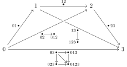

无穷范畴的概念并没有公认的统一定义。
这一概念可以由若干种不同的模型来描述，
无穷范畴的性质也需要通过这些模型来研究。
回忆上一节提到的图表：

{width=600}

在本文中，
我们主要考虑以下两种模型：拟范畴和 Kan 复形充实范畴，
即上图中的 $\mathsf{QCat}$ 和 $\mathsf{Cat}_{\mathsf{sSet}}$。
在前几节中，我们已经定义了这两种概念，
也说明了它们为什么能描述无穷范畴。
在本节中，我们研究这两种模型间的联系。
我们将说明，这两种模型是等价的，
这种等价由一个 Quillen 等价给出。

## 拟范畴

回忆（@def-拟范畴）
拟范畴是一个单纯集，其中所有内尖角都能填充。

设 $\mathsf{C}$ 为拟范畴，
设 $x,y\in\mathsf{C}_0$ 为两个点。
我们首先要定义态射空间 $\mathsf{C} (x, y)$。
和普通范畴论中不同，
这个态射空间不再是离散的集合，
而是一个同伦型，
以记录态射间的同伦、高阶同伦的信息，
这些信息也就是无穷范畴的高阶结构。

首先，我们引入一些关于拟范畴的术语，
这里拟范畴记为 $\mathsf{C}$。

- 若 $x\in\mathsf{C}_0$ 为 $0$ 维单形，
  则称 $x$ 为 $\mathsf{C}$ 的**对象**，
  并记 $x \in \mathsf{C}$。

- 若 $f\in\mathsf{C}_1$ 为 $1$ 维单形，
  $d_0f=x$，$d_1f=y$，
  则称 $f$ 为 $x$ 到 $y$ 的**态射**，
  并记 $f \colon x \to y$。

- 对象 $x\in\mathsf{C}$ 的**恒同态射** $\mathbb{1}_x \colon x \to x$
  是退化的 $1$ 维单形 $s_0(x)$。

- 设 $f\colon x\to y$ 和 $g\colon y\to z$ 为态射。
  称态射 $h\colon x\to z$ 为 $g$ 与 $f$ 的**复合**，
  若存在 $2$ 维单形 $\sigma\in\mathsf{C}_2$，使得
  \[
  d_0\sigma=g, \quad d_2\sigma=f, \quad d_1\sigma=h.
  \]
  也就是说，$\mathsf{C}$ 中有图表
  \[
  \begin{tikzcd}[row sep=3ex,column sep=.7em]
    & y\ar[dr,"g"] \\
    x\ar[ur,"f"]\ar[rr,"h"'] && z \rlap{\,.}
  \end{tikzcd}
  \]
  注意，拟范畴中态射的复合并非唯一。

- 设 $A\subset\mathsf{C}_0$ 为 $\mathsf{C}$ 中某些对象构成的集合。
  $A$ 张成的**满子范畴**是 $\mathsf{C}$ 的最大单纯子集，
  满足其包含的 $0$ 维单形均为 $A$ 中元素。

::: definition
设 $f,g\colon x\to y$ 为 $\mathsf{C}$ 中态射。
称 $f$ 与 $g$ **同伦**，
若以下等价的条件成立：

- 存在 $\mathsf{C}$ 中 $2$ 维单形
  \[
  \begin{tikzcd}[row sep=.5ex,column sep=1.5em]
    x\ar[dd,"1_x"']\ar[dr,pos=.3,"f"] \\
    & y \\
    x\ar[ur,pos=.3,"g"']
  \end{tikzcd}
  \]

- 存在 $\mathsf{C}$ 中 $2$ 维单形
  \[
  \begin{tikzcd}[row sep=.5ex,column sep=1.5em]
    x\ar[dd,"1_x"']\ar[dr,pos=.3,"g"] \\
    & y \\
    x\ar[ur,pos=.3,"f"']
  \end{tikzcd}
  \]

- 存在 $\mathsf{C}$ 中 $2$ 维单形
  \[
  \begin{tikzcd}[row sep=.5ex,column sep=1.5em]
    & y\ar[dd,"1_y"] \\
    x\ar[ur,pos=.7,"f"]\ar[dr,pos=.7,"g"'] \\
    & y
  \end{tikzcd}
  \]

- 存在 $\mathsf{C}$ 中 $2$ 维单形
  \[
  \begin{tikzcd}[row sep=.5ex,column sep=1.5em]
    & y\ar[dd,"1_y"] \\
    x\ar[ur,pos=.7,"g"]\ar[dr,pos=.7,"f"'] \\
    & y
  \end{tikzcd}
  \]

- 存在 $\mathsf{C}$ 中的方块
  \[
  \begin{tikzcd}[row sep=2.5ex,column sep=1.5em]
    x\ar[d,"1_x"']\ar[r,"f"] & y\ar[d,"1_y"] \\
    x\ar[r,"g"'] & y
  \end{tikzcd}
  \]
  其具体含义为映射 $\Delta[1]\times\Delta[1]\to\mathsf{C}$。

- 存在 $\mathsf{C}$ 中的方块
  \[
  \begin{tikzcd}[row sep=2.5ex,column sep=1.5em]
    x\ar[d,"1_x"']\ar[r,"g"] & y\ar[d,"1_y"] \\
    x\ar[r,"f"'] & y
  \end{tikzcd}
  \]

:::

上述等价性可以通过尖角
$\Lambda_1[3]$ 和 $\Lambda_2[3]$ 的填充性质来证明，
具体细节留给读者。

::: proposition
态射的同伦是等价关系，且被态射复合保持。
特别地，态射的复合在同伦意义下是唯一的。
:::

::: proof
留给读者。
:::

这一命题保证以下定义是合理的。

::: definition
拟范畴 $\mathsf{C}$ 的**同伦范畴**（homotopy category）
是普通范畴 $\operatorname{Ho}(\mathsf{C})$，定义如下：

- 其对象为 $\mathsf{C}$ 中对象。

- 其态射为 $\mathsf{C}$ 中态射的同伦类。

:::

范畴 $\operatorname{Ho}(\mathsf{C})$ 也就是忘掉 $\mathsf{C}$
的所有高阶结构而得到的普通范畴。

::: theorem [Joyal] {@thm-4-j}
设 $\mathsf{C}$ 为拟范畴。
则 $\mathsf{C}$ 是 Kan 复形当且仅当 $\operatorname{Ho}(\mathsf{C})$ 是群胚。
:::

容易看出，如果 $\mathsf{C}$ 是 Kan 复形，也就是 $\infty$-群胚，
那么 $\operatorname{Ho}(\mathsf{C})$ 是群胚。
但定理的另一边并不容易，我们略过其证明。

下面，我们来定义态射空间 $\mathsf{C} (x,y)$。
它是一个同伦型，以此记录态射间同伦、高阶同伦的信息。

::: definition
设 $\mathsf{C}$ 为拟范畴，设 $x,y\in\mathsf{C}$ 为对象。

- 单纯集 $\operatorname{Hom}^{\vartriangleright}_{\mathsf{C}}(x,y)$ 定义为
  \[
  \operatorname{Hom}^{\vartriangleright}_{\mathsf{C}}(x,y)_n=
  \bigl\{\sigma\in\mathsf{C}_{n+1}\bigm|\sigma|_{\Delta\{0,\dotsc,n\}}=x,\ \sigma(n+1)=y\bigr\},
  \]
  其中 $\sigma$ 视为映射 $\Delta[n+1]\to\mathsf{C}$，
  而 $\Delta\{0,\dotsc,n\}\subset\Delta[n+1]$
  是包含顶点 $0,\dotsc,n$ 的面。

- 类似地，单纯集 $\operatorname{Hom}^{\vartriangleleft}_{\mathsf{C}}(x,y)$ 定义为
  \[
  \operatorname{Hom}^{\vartriangleleft}_{\mathsf{C}}(x,y)_n=
  \bigl\{\sigma\in\mathsf{C}_{n+1}\bigm|\sigma(0)=x,\ \sigma|_{\Delta\{1,\dotsc,n+1\}}=y\bigr\}.
  \]

- 另一种态射空间是单纯集 $\operatorname{Hom}_{\mathsf{C}}^{\square}(x,y)$，定义为
  \[
  \operatorname{Hom}^{\square}_{\mathsf{C}}(x,y)_n=
  \bigl\{\sigma\colon\Delta[n]\times\Delta[1]\to\mathsf{C}\bigm|
  \sigma|_{\Delta[n]\times\{0\}}=x,\ \sigma|_{\Delta[n]\times\{1\}}=y\bigr\}.
  \]

:::

以上三种构造给出的单纯集不一定同构，
但我们将看到，它们都是 Kan 复形且同伦等价。
它们给出的同伦型记为 $\mathsf{C} (x,y)$，
称为 $x$ 到 $y$ 的**态射空间**的同伦型。

注意，无论使用上述三种构造中的哪一种，
都不能造出一个单纯集充实范畴，
原因是态射复合无法定义。
但我们稍后将构造第四种态射空间，
它将给出 Kan 复形充实范畴。

::: proposition
单纯集 $\operatorname{Hom}^{\vartriangleright}_{\mathsf{C}}(x,y)$、
$\operatorname{Hom}^{\vartriangleleft}_{\mathsf{C}}(x,y)$、
$\operatorname{Hom}^{\square}_{\mathsf{C}}(x,y)$ 都是 Kan 复形。
:::

::: proof
对 $\operatorname{Hom}^{\vartriangleright}_{\mathsf{C}}(x,y)$，
不难证明尖角 $\Lambda_i[n]$ $(0<i\leq n)$ 的填充性质。
因此，它是拟范畴。
并且，在其同伦范畴中，每个态射都有左逆。
这说明其同伦范畴是群胚，从而由 @thm-4-j，它是 Kan 复形。
同理，
$\operatorname{Hom}^{\vartriangleleft}_{\mathsf{C}}(x,y)$ 也是 Kan 复形。

对 $\operatorname{Hom}^{\square}_{\mathsf{C}}(x,y)$，
命题的证明需要用到 $\mathsf{sSet}$ 的 Joyal 模型结构，
因此我们暂时推迟这个证明。
:::

## 单纯范畴

我们曾经提到，充实于 $(n, r)$-范畴的范畴是 $(n+1, r+1)$-范畴[^1]。
按照此想法，充实于 $(\infty, 0)$-范畴的范畴是 $(\infty, 1)$-范畴。
也就是说，Kan 复形充实范畴应该是 $(\infty, 1)$-范畴的一种模型。

为便于使用模型范畴研究无穷范畴，
我们需要考虑一般的单纯集充实范畴，
而不只是 Kan 复形充实范畴。

::: definition
**单纯范畴**（simplicial category）
是充实于 $\mathsf{sSet}$ 的范畴。
:::

在单纯范畴中，我们也可以引入无穷范畴的术语：

- 态射空间的 $0$ 维单形称为 $1$-态射。

- 态射空间的 $1$ 维单形称为 $2$-态射，
  即 $1$-态射之间的同伦。

范畴 $\mathsf{sSet}$ 可以通过如下方式视为单纯范畴：

::: definition {@def-4-map}
单纯集 $X,Y$ 的**映射空间**
$\operatorname{Map}(X,Y)$
是一单纯集，其 $n$ 维单形对应于从
$X\times\Delta[n]$ 到 $Y$ 的映射。
:::

范畴 $\mathsf{Top}$ 也可视为单纯范畴，
因为其态射空间可赋予紧开拓扑，
再取其奇异单纯集。
等价地说，态射空间 $\mathsf{Top} (X, Y)$ 的 $n$ 维单形
对应于连续映射 $X \times \Delta^n \to Y$，
其中 $\Delta^n \in \mathsf{Top}$ 是标准 $n$ 维单形。

单纯范畴的同伦范畴可以非常直接地定义。

::: definition (构造)
设 $\mathsf{C}$ 为单纯范畴。在函子
\[
\mathsf{sSet}\xrightarrow{h}\mathsf{hCW}\xrightarrow{\pi_0}\mathsf{Set}
\]
作用下，
$\mathsf{C}$ 可以先对应于 $\mathsf{hCW}$-充实范畴 $h \mathsf{C}$，
再对应于普通范畴 $\operatorname{Ho}(\mathsf{C}) = \pi_0 h \mathsf{C}$。
后者称为 $\mathsf{C}$ 的**同伦范畴**。
:::

在单纯范畴中，映射复合唯一，
并满足严格（而非相差同伦意义下）的结合律。
但为了将它作为无穷范畴的模型，
我们并不关心严格的映射复合和结合律，
而只应关心“同伦意义下”的现象。
我们来举一个例子。

::: definition
**单纯群胚**（simplicial groupoid）
是一个单纯范畴，其中所有态射都具有同伦逆。

**单纯群**（simplicial group）
是只有一个对象的单纯群胚。
:::

这个定义并不要求单纯群胚中严格的逆映射，
也不要求单纯群中有严格的逆元。
因此，此二者并非群胚范畴、群范畴中的单纯对象。
读者也可以对比 @thm-4-j。

为了在拟范畴与单纯范畴之间进行转换，
我们将定义一对伴随函子
\[
\begin{tikzcd}
  \quad \mathsf{sSet}\ar[r,bend left,"\mathfrak C"]\ar[r,phantom,"\bot"] &
  \mathsf{Cat}_{\mathsf{sSet}}\rlap{\,.}\ar[l,bend left,"\mathfrak N"]
\end{tikzcd}
\]
我们将看到，
在两边取合适的模型结构后，
这一对函子将成为 Quillen 等价。

我们仍然使用 @con-3-a 的技术，
来得到这一对伴随函子。
根据该构造，我们只需指定 $\mathfrak C\Delta[n]$ 是什么。
直观地说，它应该是由 $n$ 个箭头构成的序列
\[
0 \to 1 \to \cdots \to n\ ,
\]
因为它的脉是 $\Delta[n]$。
然而，在这个范畴中，具有严格的复合律，
例如 $(0\to1\to2)=(0\to2)$。
因此，我们必须做一些修改，以使这样的复合律只在同伦意义下成立。
这是为了在任何单纯范畴中，同伦意义下的态射复合
总能够对应于 $\mathfrak C\Delta[n]$ 到该单纯范畴的函子。
上述讨论促使我们给出下面的定义。

::: definition (构造)
对整数 $n\geq0$，定义单纯范畴 $\mathfrak C^n$ 如下：

- 它有 $(n+1)$ 个对象，记为 $0,1,\dotsc,n$。

- 其态射空间定义为 $\mathfrak C^n (i,j)=\mathrm{N} (P_{ij})$，其中
  \[
  P_{ij} = \begin{cases}
    \varnothing, & i>j,\\
    \text{偏序集\ }\bigl\{ X \bigm| \{i, j\} \subset X \subset \{i, \dotsc, j\} \bigr\}, & i\leq j,
  \end{cases}
  \]
  其中偏序集自然地视为范畴。

- 其态射复合为 $\{ 0, \dotsc, n \}$ 子集的并。

:::

例如，$\mathfrak C^2$ 是如下图所示的单纯范畴：

{width=160}

其中，复合态射 $12\circ01$ 等于 $012\colon0\to2$，
它同伦于（但不等于）态射 $02\colon0\to2$。
我们将后者视为直接从 $0$ 走到 $2$，而不经过 $1$。

类似地，$\mathfrak C^3$ 是如下图所示的单纯范畴：

{width=400}

其中，态射空间 $N(P_{03})$ 同构于 $\Delta[1]\times\Delta[1]$，
其中的 $4$ 个点对应于沿着箭头从 $0$ 走到 $3$ 的 $4$ 种方式，
即
\[
\begin{aligned}
  & 0\to3, \\
  & 0\to1\to3, \\
  & 0\to2\to3, \\
  & 0\to1\to2\to3.
\end{aligned}
\]
这 $4$ 个从 $0$ 到 $3$ 的态射都是同伦的。

对一般的情况，态射空间 $\mathfrak C^n (i,j)$
由所有沿着箭头从 $i$ 走到 $j$ 的方式构成。
当 $i<j$ 时，该态射空间同构于 $\Delta{[1]}^{j-i-1}$。

::: definition
在 @con-3-a 的意义下，
$\mathsf{Cat}_{\mathsf{sSet}}$ 中的余单纯对象 $\mathfrak C^\bullet$ 定义了一对伴随函子
\[
\begin{tikzcd}
  \quad \mathsf{sSet}\ar[r,bend left,"\mathfrak C"]\ar[r,phantom,"\bot"] &
  \mathsf{Cat}_{\mathsf{sSet}}\ .\ar[l,bend left,"\mathfrak N"]
\end{tikzcd}
\]
其中，右伴随 $\mathfrak N$ 称为**单纯脉**（simplicial nerve）
或**同伦脉**（homotopy coherent nerve）函子。
:::

我们来证明，
在上述转换方式下，
Kan 复形充实范畴对应于拟范畴。

::: proposition
设 $\mathsf{C}$ 是 Kan 复形充实范畴。
则 $\mathfrak N\mathsf{C}$ 是拟范畴。
:::

::: proof
我们需要对 $0 < i < n$ 证明提升性质
\[
\begin{tikzcd}
  \Lambda_i[n] \ar[d] \ar[r] & \mathfrak{N}\mathsf{C} \\
  \Delta[n] \rlap{\ ,} \ar[ur,dashed]
\end{tikzcd}
\]
它等价于
\[
\begin{tikzcd}
  \mathfrak{C}\Lambda_i[n] \ar[d] \ar[r] & \mathsf{C} \\
  \mathfrak{C}\Delta[n] \rlap{\ .} \ar[ur,dashed]
\end{tikzcd}
\]
但对 $0<i<n$ 而言，
$\mathfrak{C}\Lambda_i[n]$ 与 $\mathfrak{C}\Delta[n]$
的唯一区别在于从 $0$ 到 $n$ 的态射空间。
并且，含入映射
\[
\mathfrak{C}\Lambda_i[n] (0,n)
\hookrightarrow
\mathfrak{C}\Delta[n] (0,n)
\]
是平凡余纤维化，
这可以通过仔细计算左边的单纯集是什么来验证。
而平凡余纤维化对 Kan 复形具有提升性质，
这就完成了证明。
:::

## 两种模型等价

对拟范畴或单纯范畴 $\mathsf{C}$，
我们已经定义了态射空间 $\mathsf{C} (x, y)$，其中 $x, y \in \mathsf{C}$。
事实上，在拟范畴与单纯范畴互相转换时，
态射空间的同伦型是保持不变的。

::: theorem {@thm-4-h}
- 设 $\mathsf{C}$ 是拟范畴。
  则对任意 $x, y \in \mathsf{C}$，有单纯集的弱等价
  \[
  \operatorname{Hom}_{\mathsf{C}}^{(*)}(x,y) \simeq \mathfrak C\mathsf{C} (x,y),
  \]
  其中 $(*)$ 可以是
  $\vartriangleleft$ 或 $\vartriangleright$ 或 $\square$。

- 设 $\mathsf{C}$ 是 Kan 复形充实范畴。
  则对任意 $x, y \in \mathsf{C}$，
  有 Kan 复形的同伦等价
  \[
  \mathsf{C} (x,y) \simeq \operatorname{Hom}_{\mathfrak N\mathsf{C}}^{(*)} (x,y),
  \]
  其中 $(*)$ 可以是
  $\vartriangleleft$ 或 $\vartriangleright$ 或 $\square$。

:::

定理的证明将在下一节给出。
这里，Kan 复形之间的弱等价一定是同伦等价，
这是由于 Whitehead 定理（@thm-2-w）。

::: definition
设 $\mathsf{C}$ 为拟范畴。
我们定义 $\mathsf{hCW}$-充实范畴 $h \mathsf{C}$
为 $h\mathfrak C\mathsf{C}$。
则其对象、态射空间都与 $\mathsf{C}$ 相同。
事实上，这一构造对任何单纯集 $\mathsf{C}$ 都有意义。
:::

接下来，我们说明，伴随函子 $(\mathfrak C\dashv\mathfrak N)$
实际上是 Quillen 等价，
从而无穷范畴的两种模型确实是等价的。

::: definition
设 $\mathsf{C},\mathsf{D}$ 为两个单纯集，或两个单纯范畴。
映射 $f\colon\mathsf{C}\to\mathsf{D}$ 称为**范畴等价**，
如果 $h(f)\colon h\mathsf{C}\to h\mathsf{D}$
是 $\mathsf{hCW}$-充实范畴的范畴等价，也就是说：

- $f$ 完全忠实，也就是诱导态射空间的弱等价。

- $f$ 本质满，也就是说，$\pi_0h(f)=\operatorname{Ho}(f)$
  是普通范畴间的本质满函子。

:::

::: remark
就像在普通范畴论中一样，
任何无穷范畴的性质都应该被范畴等价保持。
若不然，则该性质就不认为是良好定义的。
:::

我们回忆，普通范畴间的函子 $f\colon\mathsf{C}\to\mathsf{D}$
称为**同纤维化**（isofibration），
如果对任意 $x\in\mathsf{C}$，及 $\mathsf{D}$ 中任意同构 $\alpha\colon f(x)\to y$，
存在 $\mathsf{C}$ 中同构 $\tilde\alpha\colon x\to\tilde y$，
使得 $\alpha=f(\tilde\alpha)$。

::: theorem {@thm-4-e}
范畴 $\mathsf{sSet}$ 具有 **Joyal 模型结构**，描述如下：

- $\mathsf{W}=\{\text{范畴等价}\}$。

- $\mathsf{Cof}=\{\text{单射}\}$。

- 纤维性对象为拟范畴。

范畴 $\mathsf{Cat}_{\mathsf{sSet}}$ 具有 **Bergner 模型结构**，描述如下：

- $\mathsf{W}=\{\text{范畴等价}\}$。

- $\mathsf{Fib}=\{\text{同纤维化, 且诱导态射空间的纤维化}\}$。

- 纤维性对象为 Kan 复形充实范畴。

在这些模型结构下，伴随函子对
\[
\begin{tikzcd}
  \quad \mathsf{sSet}\ar[r,bend left,"\mathfrak C"]\ar[r,phantom,"\bot"] &
  \mathsf{Cat}_{\mathsf{sSet}}\ar[l,bend left,"\mathfrak N"]
\end{tikzcd}
\]
是 Quillen 等价。
:::

见 [@HTT, Theorem 2.2.5.1]。

这一结论可以写成以下更加直接的形式，
它说明拟范畴与 Kan 复形充实范畴之间可以相互转换。

::: corollary [两种模型的转换]
函子
\[
\begin{tikzcd}
  \mathsf{QCat}\ar[r,bend left,start anchor=north east,end anchor=north west,"R\mathfrak C"] &
  \mathsf{Cat}_{\mathsf{Kan}}\ar[l,bend left,start anchor=south west,end anchor=south east,"\mathfrak N"]
\end{tikzcd}
\]
在相差范畴等价的意义下互为逆，
其中 $R$ 是 $\mathsf{sSet}$ 的纤维性替换函子。
:::

::: proof
设 $\mathsf{C}$ 为拟范畴，$\mathsf{D}$ 为 Kan 复形充实范畴。
则单位函子和余单位函子
\[
\mathfrak NR\mathfrak C\mathsf{C}\to\mathsf{C}
\quad\text{和}\quad
\mathsf{D}\to\mathfrak CQ\mathfrak N\mathsf{D}
\]
都是范畴等价（@thm-2-z）。
这里 $Q$ 可以取成恒同函子，从而函子
\[
\mathfrak NR\mathfrak C\mathsf{C}\to\mathsf{C}
\quad\text{和}\quad
\mathsf{D}\to R\mathfrak C\mathfrak N\mathsf{D}
\]
都是范畴等价。
:::

::: remark
在研究拟范畴时，我们并不使用 $\mathsf{sSet}$ 的标准模型结构，
其原因是，我们不止需要单纯集的同伦型这一信息，
还需要更多一层信息，才能描述拟范畴的结构，
或者说，才能刻画拟范畴的范畴等价类。
例如，拟范畴 $\Delta [0]$ 和 $\Delta [1]$ 都具有可缩的同伦型，
但它们不范畴等价。
:::

## 例子

下面，我们以拟范畴为模型，
介绍几个 $(\infty,1)$-范畴的例子。

::: lemma {@thm-4-x}
设 $X,Y$ 为单纯集。

- 若 $Y$ 是 Kan 复形，
  则 $\operatorname{Map}(X,Y)$ 是 Kan 复形。

- 若 $Y$ 是拟范畴，
  则 $\operatorname{Map}(X,Y)$ 是拟范畴。

:::

::: proof
留给读者。
:::

::: example
**空间的拟范畴**定义为
\[
\mathsf{S} = \mathfrak N(\mathsf{Kan}),
\]
其中 $\mathsf{Kan}$ 是所有 Kan 复形构成的单纯范畴。
由 @thm-4-x，它是 Kan 复形充实范畴。
:::

::: example
$\mathsf{Kan}$-充实范畴 $\mathsf{QCat}$
定义如下：

- 其对象为拟范畴。

- 态射空间 $\mathsf{QCat} (\mathsf{C},\mathsf{D})$
  为单纯集 $\operatorname{Map}(\mathsf{C},\mathsf{D})$
  中最大的子 Kan 复形。

这里所说的最大子 Kan 复形存在，
因为由 @thm-4-x 及 @thm-4-j，
它就是所有可逆边张成的子单纯集，
即只包含这些边的最大子单纯集。

**拟范畴的拟范畴**定义为
\[
\mathsf{QCat}_{\infty} =
\mathfrak N(\mathsf{QCat}).
\]
:::

这里，我们取出态射空间的最大子 Kan 复形，
而不是取纤维性替代。
这是因为，态射空间中的边为自然变换，
我们应该丢弃那些不可逆的自然变换，
而不是加入新的自然变换以使它们变得可逆。

这意味着，要得到 $(\infty,1)$-范畴构成的 $(\infty,1)$-范畴，
我们需要丢弃一些信息。
其本质原因是，$(\infty,1)$-范畴实际上构成 $(\infty,2)$-范畴。
例如，在拟范畴的模型中，@thm-4-x 说明，
拟范畴的范畴充实于拟范畴，即充实于 $(\infty,1)$-范畴，
从而是 $(\infty,2)$-范畴。
（我们没有严格定义后者。）

::: example
设 $\mathsf{A}$ 为 Abel 范畴。
$\mathsf{A}$ 中的上链复形构成的单纯范畴 $\mathsf{Ch} (\mathsf{A})$ 定义如下。
我们回忆，对于上链复形间的映射 $f\colon X\to Y$（不一定是链映射），
我们定义了
\[
d f = [d, f] = d\circ f-(-1)^{|f|}f\circ d,
\]
其中 $|f|$ 为 $f$ 的次数。

- $\mathsf{Ch} (\mathsf{A}) \, (X, Y)$ 的 $0$ 维单形对应于映射 $f\colon X\to Y$，
  满足
  \[
  |f| = 0 \quad \text{且} \quad d f = 0.
  \]
  换言之，$0$ 维单形就是链映射。

- $\mathsf{Ch} (\mathsf{A}) \, (X, Y)$ 的 $1$ 维单形对应于映射 $a \colon X\to Y$，
  满足
  \[
  |a| = -1 \quad \text{且} \quad d a = f - g,
  \]
  其中 $f, g$ 为该 $1$ 维单形的两个端点。
  换言之，$1$ 维单形就是链同伦。

- 态射空间的 $n$ 维单形由 $(\sigma,\sigma_0,\dotsc,\sigma_n)$ 给出，
  其中每个 $\sigma_i$ 是 $(n-1)$ 维单形，
  $\sigma\colon X\to Y$ 是映射，满足
  \[
  |\sigma| = -n \quad \text{且} \quad
  d \sigma=\sigma_0-\sigma_1+\sigma_2-\cdots\pm\sigma_n.
  \]
  其中，$\sigma_i$ 是 $\sigma$ 的第 $i$ 个面。
  我们还要求这些 $\sigma_i$ 各自的面是相容的。
  换言之，$n$ 维单形就是映射
  \[
  C_\bullet^{\textrm{cell}}(\Delta^n)\to\mathscr{H}\mkern-3mu\mathit{om}(X,Y),
  \]
  其中左边是 $\Delta^n$ 的胞腔链复形，
  右边是 @eg-1-c 定义的链复形。

我们定义
\[
\mathsf{K}_\infty(\mathsf{A}) = \mathfrak N(\mathsf{Ch} (\mathsf{A}))
\]
为 $\mathsf{A}$ 中的**上链复形的拟范畴**。
如果 $\mathsf{Ch} ({\mathsf{A}})$ 还具有合适的模型结构，
例如 $\mathsf{A}$ 是某个环上的模范畴，则可以定义
\[
\mathsf{D}_\infty (\mathsf{A}) = \mathfrak N(\mathsf{Ch} (\mathsf{A})_{\mathrm{cf}})
\]
为 $\mathsf{A}$ 的**导出拟范畴**。
:::

::: remark {@rmk-4-locn}
我们知道，弱等价范畴经过局部化，能得到无穷范畴。
设 $\mathsf{C}$ 是一个模型范畴，并且 $\mathsf{C}$ 充实于单纯集，
其模型结构与充实结构满足一些相容条件。
一个奇妙的事实是，此时有拟范畴的等价
\[
\mathsf{C}[\mathsf{W}^{-1}]\simeq\mathfrak N(\mathsf{C}_{\mathrm{cf}}).
\]
在我们提到的所有例子中，
这样的单纯结构都是存在的。
因此，我们有
\[
\begin{aligned}
  \mathsf{S}&\simeq\mathsf{sSet}[\mathsf{W}^{-1}], \\
  \mathsf{D}_\infty(\mathsf{A})&\simeq\mathsf{Ch}(\mathsf{A})[\mathsf{W}^{-1}],
\end{aligned}
\]
这就是无穷范畴局部化的例子。
（这里 $\mathsf{A}$ 需要满足一些额外条件。）
这个构造将在后几节详细说明。
:::

[^1]: 这种方法有时能得到所有的 $(n+1, r+1)$-范畴，有时不能。
  例如，任何 $2$-范畴都等价于某个严格 $2$-范畴，而并非任何 $3$-范畴都等价于某个严格 $3$-范畴。
