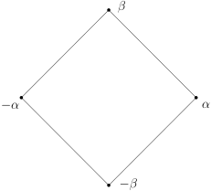

## 迹与范数 {@sec:trace-norm-exer}

$
  {L/K}
$是域的有限扩张，对任意的$x\in L$，考虑乘法映射：
\[
m_x\colon L\longrightarrow L,  \ \ y\mapsto x\cdot y.
\]
这是$K$-线性空间$L$上的$K$-线性映射，它的迹、行列式和特征多项式分别记作：
\[
{\rm Tr}_{_{
  {L/K}
}}(x)={\rm Tr}(m_x), \ {\rm N}_{_{
  {L/K}
}}(x)={\rm det}(m_x), \ \ P_{_{
  {L/K}
},x}(X)=\det(X\cdot I-m_x).
\]

1. 假设$x\in K$，试计算${\rm Tr}_{_{
  {L/K}
}}(x), {\rm N}_{_{
  {L/K}
}}(x)$和$P_{_{
  {L/K}
},x}(X)$。对一般的$x\in L$，证明$P_{_{
  {L/K}
},x}(X)\in K[X]$并且$P_{_{
  {L/K}
},x}(X)$在$L$中有根。

2. 假设$d\in K$但是$d\notin K^2$，$L=K(\sqrt{d})$，$x=a+b\sqrt{d}$。
   证明，存在唯一的域同构$\sigma\in {\rm Aut}_K(L)$，使得$\sigma(\sqrt{d})=-\sqrt{d}$并且
   \[
   {\rm Tr}_{_{
     {L/K}
   }}(x)=2a=x+\sigma(x), \ {\rm N}_{_{
     {L/K}
   }}(x)=a^2-db^2=x\cdot\sigma(x),\ P_{_{
     {L/K}
   },x}(X)=(X-x)(X-\sigma(x)).
   \]

3. 证明，以下映射为群同态：
   \[
   {\rm Tr}_{_{
     {L/K}
   }}\colon(L,+)\rightarrow (K,+), \ \  {\rm N}_{_{
     {L/K}
   }}\colon(L^\times,\cdot )\rightarrow (K^\times,\cdot ).
   \]

4. （迹的传递性）如果$K\subset M\subset L$是中间域。证明，
   \[
   {\rm Tr}_{_{
     {M/K}
   }}\circ {\rm Tr}_{_{
     {L/M}
   }}={\rm Tr}_{_{
     {L/K}
   }}.
   \]
   （提示：选取$\{e_i\}_{i\leqslant m}$和$\{f_j\}_{j\leqslant n}$分别为$
  {M/K}
$和$
  {L/M}
$的基，此时$\{e_if_j\}_{i\leqslant m, j\leqslant n}$为$
  {L/K}
$的基。那么，
   \[
   x\cdot f_j=\sum_{j'=1}^n m_{jj'}f_{j'}, \ m_{jj'}\in M; \ m_{jj'}\cdot e_i=\sum_{i'=1}^m k_{jj', ii'}e_{i'}, \ k_{jj',ii'}\in K.
   \]
   利用上述公式计算）

5. 对于$x\in L$，令$P_{_{\rm min}}(X)$为其在$K$上的极小多项式。证明，
   \[
   P_{_{
     {L/K}
   },x}(X)=P_{_{\rm min}}(X)^{[L:K(x)]}.
   \]
   （提示：选取$\{e_i\}_{i\leqslant m}$和$\{f_j\}_{j\leqslant n}$分别为$
  {K(x)/K}
$和$
  {L/K(x)}
$的基，此时$\{e_if_j\}_{i\leqslant m, j\leqslant n}$为$
  {L/K}
$的基）

6. 对于$x\in L$，$P_{_{\rm min}}(X)$为其在$K$上的极小多项式，
   $x_1,x_2,\cdots,x_d$为$P_{_{\rm min}}(X)$在$K$的某个分裂域中所有的根（即
   $P_{_{\rm min}}(X)=\prod_{i=1}^d(X-x_i)$）。证明，
   \[
   {\rm Tr}_{_{
     {L/K}
   }}(x)={[L:K(x)]}\big(\sum_{i=1}^d x_i\big), \ \ {\rm N}_{_{
     {L/K}
   }}(x)=\big(\prod_{i=1}^d x_i\big)^{[L:K(x)]}.
   \]

7. $
  {L/K}
$为有限可分扩张，$
  {\Omega/K}
$为域扩张并且$\Omega$是代数封闭的。那么，对任意的$x\in L$，
   \[
   {\rm Tr}_{_{
     {L/K}
   }}(x)=\sum_{\sigma\in {\rm Hom}_K(L,\Omega)}\sigma(x), \ {\rm N}_{_{
     {L/K}
   }}(x)=\prod_{\sigma\in {\rm Hom}_K(L,\Omega)}\sigma(x),
   \]
   以及
    \[
    P_{_{
      {L/K}
    },x}(X)=\prod_{\sigma\in {\rm Hom}_K(L,\Omega)}\big(X-\sigma(x)\big).
    \]

8. $
  {L/K}
$为有限扩张，$
  {\Omega/K}
$如上。那么，对任意的$x\in L$，
   \[
   {\rm Tr}_{_{
     {L/K}
   }}(x)=p^n\sum_{\sigma\in {\rm Hom}_K(L,\Omega)}\sigma(x), \ {\rm N}_{_{
     {L/K}
   }}(x)=\big(\prod_{\sigma\in {\rm Hom}_K(L,\Omega)}\sigma(x)\big)^{p^n},
   \]
   其中，$p^n=\frac{[L,K]}{[L,K]_s}$为扩张的不可分次数。

9. （迹和范数的传递性）如果$K\subset M\subset L$是中间域。证明，
   \[
   {\rm Tr}_{_{
     {M/K}
   }}\circ {\rm Tr}_{_{
     {L/M}
   }}={\rm Tr}_{_{
     {L/K}
   }}, \ \ {\rm N}_{_{
     {M/K}
   }}\circ {\rm N}_{_{
     {L/M}
   }}={\rm N}_{_{
     {L/K}
   }}.
   \]
   （为简单起见，你可以只对可分情形进行证明）

10. $K$是域，$P(X)\in K[X]$为首一的不可约多项式，$d=\deg(P)$，
    $\alpha$为$P$在$\overline{K}$中的一个根。证明，
    \[
    {\rm Disc}(P)=(-1)^{\frac{1}{2}d(d-1)}{\rm N}_{_{
      {K(\alpha)/K}
    }}(P'(\alpha)).
    \]
    以上，${\rm Disc}(P):=\prod_{i< j}(\alpha_i-\alpha_j)^2$，其中，
    $\{\alpha_i\}$为$P$在$\overline{K}$中的所有根（包括重根）。

11. $
  {L/K}
$为有限扩张，$x\in L$在$K$上不可分。证明，${\rm Tr}_{_{
  {L/K}
}}(x)=0$。

12. $
  {L/K}
$为有限扩张并且不是可分的。证明，${\rm Tr}_{_{
  {L/K}
}}\equiv 0$。

13. 考虑对称$K$-双线性的二次型
    \[
    L\times L \longrightarrow K, \ \ (x,y)\mapsto {\rm Tr}_{_{
      {L/K}
    }}(x\cdot y).
    \]
    对任意的$x\in L^\times$，存在$y\in L$，使得${\rm Tr}_{_{
  {L/K}
}}(x\cdot y)\neq 0$，我们就称这个二次型是**非退化的**，否则是**退化的**。
    证明，如果${\rm Char}(K)=0$，以上二次型非退化；如果$
  {L/K}
$不是可分的，以上二次型退化。

14. 假设$
  {L/K}
$是可分的，从而，$L=K(x)$，$n=[L:K]$。证明，${\rm Tr}_{_{
  {L/K}
}}(x^k)$中至少有一个非零，其中，$k=0,1,\cdots,n-1$。

15. 证明，$
  {L/K}
$是可分的等价于二次型
    \[
    L\times L \longrightarrow K, \ \ (x,y)\mapsto {\rm Tr}_{_{
      {L/K}
    }}(x\cdot y).
    \]
    非退化。

## 关于多项式的一个命题

$K$是域，$P\in K[X]$并且$\deg(P)=p$是素数。假设$P$满足如下性质：对任意的域扩张$
  {L/K}
$，如果$P$在$L$中有根，那么$P$在$L[X]$中可以分裂成一次多项式的乘积。证明，以下两种可能必居其一（可以同时发生）：

- $P$在$K[X]$中不可约；

- $P$在$K$上有根。

证明，在以下情形下，$P$均满足上述的性质：

1. ${\rm Char}(K)=p$，$P(X)=X^p-a$，$a\in K$；

2. ${\rm Char}(K)=p$，$P(X)=X^p-X-a$，$a\in K$；

3. ${\rm Char}(K)\neq p$，$P(X)=X^p-a$，$a\in K$并且存在$\xi\in K$使得$\xi^p=1$但是$\xi\neq 1$。

## 关于域扩张的一个命题

给定域扩张$
  {E/K}
$，$L_1$和$L_2$是中间域并且$[L_1:K]<\infty, [L_2:K]<\infty$。
\[
\begin{tikzcd}
 &E &\\
 &L_1 \cdot L_2 \arrow[u, dash] &\\
L_1 \arrow[ur, dash]  \arrow[uur, dash]    & &   L_2 \arrow[ul, dash]  \arrow[uul, dash]\\
 &K \arrow[ul, dash] \arrow[ur, dash] &
  \end{tikzcd}
\]

1. 证明，$[L_1\cdot L_2: L_1]\leqslant [L_2:K]$。

2. 证明，$[L_1\cdot L_2: K]\leqslant  [L_1:K][L_2:K]$。

3. 证明，如果$[L_1:K]$与$[L_2:K]$互素，那么$[L_1\cdot L_2: K]= [L_1:K][L_2:K]$。

4. 证明，如果$[L_1\cdot L_2: K]= [L_1:K][L_2:K]$，那么$L_1\cap L_2 =K$。

5. 上一命题的逆命题不成立：假设$\alpha,\beta\in {\mathbb{C}}$是$X^3-2$的两个不同的根，证明，
   ${\mathbb{Q}}(\alpha)\cap {\mathbb{Q}}(\beta)={\mathbb{Q}}$但是
   $[{\mathbb{Q}}(\alpha,\beta):{\mathbb{Q}}]<[{\mathbb{Q}}(\alpha):{\mathbb{Q}}][{\mathbb{Q}}(\beta):{\mathbb{Q}}]$。

## Wedderburn定理

$F$是可除环，即对任意非零的$a\in F$，存在$b\in F$，使得$a b=ba=1$。
我们证明有限可除环一定是交换环，从而$F$是域。以下我们假设$|F|<\infty$。

1. 令$Z=\{x\in F| \text{对任意的 $y\in F$，有}~xy=yx\}$为$F$的中心。证明，$Z$是域。
   令$q=|Z|$，证明，存在$n\geqslant 0$，使得$|F|=q^n$。

2. 对任意的$x\in F$，令$C_x=\{y\in F| xy=yx\}$。
   证明，$C_x$是$F$的子环并且存在整数$n_x$使得$|C_x|=q^{n_x}$。

3. 对于$x\in F^\times$，令${\rm Conj}(x)=\{yxy^{-1}|y\in F^\times\}$。
   证明，$|{\rm Conj}(x)|=\frac{q^n-1}{q^{n_x}-1}$并证明$n_x\mid n$。

4. 证明，如果$x\notin Z$，那么，$\Phi_n(q)$整除$|{\rm Conj}(x)|$，其中，
   $\Phi_n(X)$为第$n$个分圆多项式。

5. 证明，$\Phi_n(q)|q-1$从而$n=1$。

   （利用$F^\times$通过共轭作用在自身上的轨道分解）

## Artin-Schreier理论

Artin-Schreier理论是对循环扩张的Kummer理论的补充，它研究域特征为$p$且Galois群为$p$-阶循环群的情况。

- A) $K$是特征为$p$的域，$a\in K$，$P(X)=X^p-X-a$，$L$是$P$在$K$上的分裂域。

  1. 证明，如果$x\in L$是$P$的根，那么，
     \[
     P(X)=\big(X-x\big)\big(X-(x+1)\big)\cdots \big(X-(x+p-1)\big).
     \]

  2. 证明，$P$在$K[X]$中或者不可约或者可以写成一次因式的乘积。

  3. 假设$P$在$K[X]$中不可约，$x\in L$为$P$的一个根。证明，以下映射
     \[
     {\rm Gal}(
       {L/K}
     )\longrightarrow \mathbb{F}_p, \ \ g\mapsto g(x)-x
     \]
     是群同构。特别地，${\rm Gal}(
  {L/K}
)\simeq
  {\mathbb{Z}/p\mathbb{Z}}
$。

- B) $K$是特征为$p$的域，$
  {L/K}
$是Galois扩张并且${\rm Gal}(
  {L/K}
)\simeq
  {\mathbb{Z}/p\mathbb{Z}}
$，$\sigma$是${\rm Gal}(
  {L/K}
)$的一个生成元。

  1. 证明，存在$y \in L$，使得$\sum_{k=0}^{p-1}\sigma^k(y)=-1$。

  2. 令$x=\sum_{k=0}^{p-1}k\sigma^k(y)$，证明，$\sigma(x)=x+1$。

  3. 证明，$P(X)=\prod_{k=0}^{p-1}\big(X-\sigma^k(x)\big)$是$x$的极小多项式并且$a=x^p-x\in K$。

  4. 证明，$L$是$X^p-X-a$在$K$上的分裂域。

  利用以上的Artin-Schreier理论，即A)+B)，
  我们展示$p^{m-1}$阶的循环扩张与$p^{m}$阶的循环扩张之间的关系（$m\geqslant 2$）。
  从而，我们可以递归地研究阶为$p$的幂的循环扩张（总假设$K$的特征为$p$）。

- C) $K$是特征为$p$的域，$
  {L/K}
$是阶为$p^m$的循环扩张，$\sigma$是${\rm Gal}(
  {L/K}
)$的一个生成元，$\tau=\sigma^{p^{m-1}}$，$M=L^{\langle \tau\rangle}$。

  1. 证明，存在$\lambda \in M$，$P(X)=X^p-X-\lambda$在$L$中有根$\theta$并且$L=M(\theta)$，
     $\tau(\theta)=\theta+1$。

  2. 证明，存在$\beta\in M$，使得$\sigma(\theta)=\theta+\beta$。

  3. 证明，$K(\theta)=L$。

  4. 证明，$\sigma(\lambda)-\lambda=\beta^p-\beta$并且${\rm Tr}_{_{
  {M/K}
}}(\beta)=1$。

- D) $K$是特征为$p$的域，$
  {M/K}
$是阶为$p^{m-1}$的循环扩张（$m\geqslant 2$），$\sigma$是${\rm Gal}(
  {M/K}
)$的一个生成元。假设$\beta\in M$并且${\rm Tr}_{_{
  {M/K}
}}(\beta)=1$。[^1]

  1. 证明，存在$\lambda \in M$，使得$\sigma(\lambda)-\lambda=\beta^p-\beta$。
     （提示：使用Hilbert 90）

  2. $P(X)=X^p-X-\lambda$是$M[X]$中的不可约多项式。

  3. 令$L$为$P(X)$对$M$的分裂域，$\theta$为$P$在$L$中的一个根。
     证明，$
  {L/K}
$是阶为$p^m$的循环扩张并且存在$\sigma$在$L$上的延拓$\overline{\sigma}\in {\rm Gal}(
  {L/K}
)$使得$\overline{\sigma}$生成了${\rm Gal}(
  {L/K}
)$并且$\overline{\sigma}(\theta)=\theta+\beta$。

## 正十七边形的具体构造

令$\xi=e^{\frac{2\pi}{17}i}$，$K=\mathbb{Q}$，$L=\mathbb{Q}(\xi)$。
我们要通过具体计算$\cos(\frac{2\pi}{17})$来说明$e^{\frac{2\pi }{17}i}$是尺规可作的。

1. 证明，通过对$X^{17}-1$的根的作用，我们有群同构
   \[
   {\rm Gal}(
     {L/K}
   )\stackrel{\simeq}{\longrightarrow} \left(
     {\mathbb{Z}/17\mathbb{Z}}
   \right)^\times
   \]
   并且$\sigma\colon\xi\mapsto \xi^3$是${\rm Gal}(
  {L/K}
)$的一个生成元。

2. 以下是$H_0={\rm Gal}(
  {L/K}
)$的一个Jordan-Hölder滤链：
   \[
   H_0\rhd H_1\rhd H_2\rhd H_3\rhd H_4=1,
   \]
   其中，$H_j=\langle \sigma^{2^j}\rangle$，$j=1,2,3,4$。
   利用Galois对应证明，$e^{\frac{2\pi}{17}i}$是尺规可作的。

3. 令$a_0=\sum_{k=0}^7\sigma^{2k}(\xi)$，$a_1=\sum_{k=0}^7\sigma^{2k+1}(\xi)$，
   计算$a_0+a_1$和$a_0\cdot a_1$并给出$a_0$与$a_1$的值。

4. 令$b_j=\sum_{k=0}^3\sigma^{4k+j}(\xi)$，其中，$j=0,1,2,3$。
   计算$b_0+b_2$和$b_0\cdot b_2$并给出$b_0,b_1,b_2,b_3$的值。

5. 令$c_j=\sum_{k=0}^1\sigma^{8k+j}(\xi)$，其中，$j=0,1,\cdots,7$。
   计算$c_0+c_4$和$c_0\cdot c_4$并证明
   \[
   \cos(\frac{2\pi}{17})=\frac{1}{16}\left(-1+\sqrt{17}+\sqrt{34-2\sqrt{17}}+\sqrt{68+12\sqrt{17}-4\sqrt{34-2\sqrt{17}}-8\sqrt{34+2\sqrt{17}}}\right).
   \]

## 代数基本定理的证明

我们用Galois理论证明$\mathbb{C}=\mathbb{R}(i)$是代数封闭域。

1. 证明，每个奇数次的实系数多项式在$\mathbb{R}$上总有根。

2. 证明，每个$\mathbb{R}(i)$系数的二次多项式的根都在$\mathbb{R}(i)$中。

3. 假设$P(X)\in \mathbb{C}[X]$，证明，存在有限Galois扩张$
  {L/\mathbb{R}}
$，使得$L$包含$i$和$P$的所有根。

4. 令$H$为${\rm Gal}(
  {L/\mathbb{R}}
)$的Sylow $2$-子群，证明，$L^H=\mathbb{R}$。据此证明${\rm Gal}(
  {L/\mathbb{R}}
)$是$2$-群，即其元素个数是$2$的幂。

   （提示：将$L^H$写成单代数扩张）

5. 证明，存在子群$H'<{\rm Gal}(
  {L/\mathbb{R}}
)$，其指标为$2$并进一步证明$L^{H'}=\mathbb{R}(i)$。

6. 证明代数基本定理。

## Dirichlet定理的特例 {@sec:exer-Dirichlet}

经典的Dirichlet定理（1837）表明，对任意互素的正整数$a,b$，存在无限多个素数$p$，
使得$p \equiv b \mod a$。Dirichlet的证明用到了复解析函数。我们可以用分圆多项式给出$b=1$的情形。

1. 给定非常数的多项式$P(X)\in \mathbb{Z}[X]$，证明，以下集合是无限集合：
   \[
   \{d\in \mathbb{Z}|d\geqslant 0, \text{存在非负整数 $n$，使得}~d\mid P(n)\}.
   \]

2. 令$P(X)=\dfrac{X^a-1}{\Phi_a(X)}$。
   证明，存在素数$p$和整数$n$，使得$p\mid \Phi_a(n)$但是$p\nmid P(n)$。

   （提示：在$\mathbb{Q}[X]$中，存在$U(X),V(X)$，使得$U(X) P(X)+V(X)\Phi_a(X)=1$）

3. 计算$n$在$\left(
  {\mathbb{Z}/p\mathbb{Z}}
\right)^\times$中的阶。

4. 证明，存在素数$p$，使得$p \equiv 1 \mod a$。

5. 证明，存在无限个素数$p$，使得$p \equiv 1 \mod a$。（提示：对合适的$a$使用D4)的结论）

## 二次互反律

$p>2$是素数，对任意的$x\in \mathbb{Z}$，将它视作是$\mathbb{F}_p$中的元素。
如果$x\neq 0$，其Legendre符号$\left(\dfrac{x}{p}\right)$的定义如下[^2]：
\[
\left(\dfrac{x}{p}\right)=\begin{cases}
1,\ \ &\text{$x$ 是 $\mathbb{F}_p$ 中的完全平方;}\\
-1,\ \ &\text{$x$ 不是 $\mathbb{F}_p$ 中的完全平方。}
\end{cases}
\]

1. 证明，
   映射$\big(\mathbb{F}_p\big)^\times\rightarrow \{\pm 1\}, \ \ x\mapsto \left(\dfrac{x}{p}\right)$
   是满的群同态并且$\left(\dfrac{x}{p}\right)=x^{\frac{p-1}{2}}$（在$\mathbb{F}_p$中计算）。
   特别地，我们得到$\left(\dfrac{-1}{p}\right)=(-1)^{\frac{p-1}{2}}$。

2. 利用Galois理论计算$\left(\dfrac{2}{p}\right)$。
   令$\zeta$为$\overline{\mathbb{F}_p}$中$8$次本原单位根。

   - 证明，$(\zeta+\zeta^{-1})^2=2$。

   - 证明，$\left(\dfrac{2}{p}\right)=1$当且仅当${\rm Frob}(\zeta+\zeta^{-1})=\zeta+\zeta^{-1}$。

   - 证明，$\left(\dfrac{2}{p}\right)=(-1)^{\frac{(p-1)(p+1)}{8}}$。

3. $\ell>2$是素数并且$p\neq \ell$，$\xi$为$\overline{\mathbb{F}_p}$中$\ell$次本原单位根。
   由$\ell$给出的Gauss和为
   \[
   S=\sum_{x\in \mathbb{F}_\ell^\times} \left(\frac{x}{\ell}\right)\xi^x.
   \]
   证明，$S^2=(-1)^{\frac{\ell-1}{2}}\ell$。
   （提示：
   计算
   $S^2=\displaystyle\sum_{x\in \mathbb{F}_\ell^\times} \sum_{y\in \mathbb{F}_\ell^\times}\left(\dfrac{xy}{\ell}\right)\xi^{x+y}=\sum_{x\in \mathbb{F}_\ell^\times} \sum_{z\in \mathbb{F}_\ell^\times}\left(\dfrac{x^2z}{\ell}\right)\xi^{x+zx}$）

4. 证明，$S\in \mathbb{F}_p$等价于$\left(\dfrac{p}{\ell}\right)=1$。

5. 证明**二次互反律**：
   \[
   \left(\frac{p}{\ell}\right)\left(\frac{\ell}{p}\right)=(-1)^{\frac{p-1}{2}\frac{\ell-1}{2}}.
   \]

## 一个$6$次多项式分裂域的Galois群的计算

1. 证明，$X^2+X+1$是$\mathbb{F}_2[X]$中唯一一个二次不可约多项式。

2. 证明，$\mathbb{F}_2[X]$中每个三次不可约多项式都整除$X^8+X$。

3. 证明，在$\mathbb{F}_2[X]$中，$X^2+X+1$整除$X^8+X+1$。
   计算$P_2(X)=\frac{X^8+X+1}{X^2+X+1}$并证明$P_2(X)$是不可约的。

4. 令$T(X)=X^2+1\in \mathbb{Z}[X]$，$F_0(X)=X$，$F_n(X)=T\big(F_{n-1}(X)\big)$，其中，
   $n\geqslant 1$。
   证明，在$\mathbb{Z}[X]$中，$T(X)-X$整除$F_n(X)-F_{n-1}(X)$，其中，$n\geqslant 1$；进一步证明，
   在$\mathbb{Z}[X]$中，$T(X)-X$整除$F_3(X)-X$。

5. 证明，在$\mathbb{Z}[X]$中，
   计算$P(X)=\frac{F_3(X)-X}{T(X)-X}$（你可以用$P(10)=1143745$来检验答案的正确性）并证明$P(X)$是
   $\mathbb{Z}[X]$中的不可约多项式。

6. 令$\mathcal{R}=\big\{x\in\overline{\mathbb{Q}}\big|P(x)=0\big\}$为$P$根的集合，
   $L$为$P$在$\mathbb{Q}$上的分裂域（不妨假设$L\subset \overline{Q}\subset\mathbb{C}$），
   $G:={\rm Gal}(
  {L/\mathbb{Q}}
)$为其Galois群。证明，$\mathcal{R}$可以如下描述：
   \[
   \mathcal{R}=\big\{x\in\overline{\mathbb{C}}\big|T(T(T(x)))=x,\text{但是}~T(x)\neq x\big\}.
   \]

7. 证明，对任意的$x\in \mathcal{R}$，我们有$T(x)\in \mathcal{R}$，从而，以下映射是良好定义的：
   \[
   T\colon\mathcal{R}\longrightarrow \mathcal{R}.
   \]

8. 证明，$|\mathcal{R}|=6$并且可以将$\mathcal{R}$中的元素记作是
   \[
   \mathcal{R}=\{\alpha_1,\alpha_2,\alpha_3,\alpha_4,\alpha_5,\alpha_6\}=\underbrace{\{\alpha_1, \alpha_3,\alpha_5\}}_{\mathcal{R}_1}\cup \underbrace{\{\alpha_2, \alpha_4,\alpha_6\}}_{\mathcal{R}_2}.
   \]
   使得$T(\alpha_1)=\alpha_3,T(\alpha_3)=\alpha_5,T(\alpha_5)=\alpha_1$而
   $T(\alpha_2)=\alpha_4,T(\alpha_4)=\alpha_6,T(\alpha_6)=\alpha_2$。
   特别地，如果将$\mathfrak{S}_{\mathcal{R}}$与$\mathfrak{S}_6$等同，其中，
   $\alpha_i\in \mathcal{R}$对应着指标$i$，那么，$T$可以被视作是$(1,3,5)(2,4,6)\in \mathfrak{S}_6$。

9. 令$C_T=\big\{g\in  \mathfrak{S}_6| g\cdot T =T\cdot g\big\}$为$T$在$\mathfrak{S}_6$中的中心化子。
   证明，对任意的$g\in C_T$，
   我们有$g(\mathcal{R}_1)=\mathcal{R}_1, g(\mathcal{R}_2)=\mathcal{R}_2$或者
   $g(\mathcal{R}_1)=\mathcal{R}_2, g(\mathcal{R}_2)=\mathcal{R}_1$。
   据此，证明以下映射是**满的**群同态：
   \[
   \varepsilon\colon C_T \rightarrow\{\pm 1\}, \ \ \varepsilon(g)=\begin{cases}
   1, \ \ &\text{如果}~g(\mathcal{R}_1)=\mathcal{R}_1;\\
   -1, \ \ &\text{如果}~g(\mathcal{R}_1)=\mathcal{R}_2.
   \end{cases}
   \]
   其中，$\{\pm 1\}$是$2$阶循环群。

10. 证明，$|C_T|=18$。

11. 我们可以将$G:={\rm Gal}(
  {L/\mathbb{Q}}
)$视作是$\mathfrak{S}_{\mathcal{R}}=\mathfrak{S}_6$的子群。证明，$G<C_T$，$\varepsilon\big|_{G}\colon G\rightarrow \{\pm 1\}$也是满射并且$|G|=6$或$18$。

12. 令$\xi=\alpha_1+\alpha_3+\alpha_5,\eta=\alpha_2+\alpha_4+\alpha_6$，证明，
    $Q(X)=(X-\xi)(X-\eta)\in \mathbb{Q}[X]$。注意，不能使用本题后面的结论。

13. 证明，$Q(X)=X^2+X+3 \in \mathbb{Z}[X]$。

14. 令$H:={\rm Ker}\big(\varepsilon\big|_{G}\colon G\rightarrow \{\pm 1\}\big)$，证明，$L^H$是$
  {L/\mathbb{Q}}
$的唯一$2$次的中间域。进一步给出整数$d$，使得该中间域为$\mathbb{Q}(\sqrt{d})$。

15. 利用GaloisGPT软件，得到$P$的判别式${\rm Disc}(P)= -33$，请问它的结果是否正确并给出理由。

16. 令
    \[
    \begin{cases}
             \gamma_1&=\alpha_1\alpha_2+\alpha_3\alpha_4+\alpha_5\alpha_6,\\
                      \gamma_2&=\alpha_1\alpha_4+\alpha_3\alpha_6+\alpha_5\alpha_2,\\
    \gamma_3&=\alpha_1\alpha_6+\alpha_3\alpha_2+\alpha_5\alpha_4,                 \end{cases} \ \ \ \begin{cases}
             \delta_1&=\alpha_1\alpha_2+\alpha_3\alpha_6+\alpha_5\alpha_4,\\
                      \delta_2&=\alpha_1\alpha_4+\alpha_3\alpha_2+\alpha_5\alpha_6,\\
    \delta_3&=\alpha_1\alpha_6+\alpha_3\alpha_4+\alpha_5\alpha_2.                \end{cases}
    \]
    令$A(X)=(X-\gamma_1)(X-\gamma_2)(X-\gamma_3)$，$B(X)=(X-\delta_1)(X-\delta_2)(X-\delta_3)$。
    证明，$A(X),B(X)\in \mathbb{Q}[X]$。注意，不能使用本题后面的结论。

    利用Mathematica软件可以算得（正确的结果）
    \[
    A(X)=X^3-3X^2-6X-28,\ \ B(X)=X^3-3X^2-6X-1.
    \]

17. 证明，${\rm Disc}(A)= -2^2\cdot 3^6 \cdot 11$而${\rm Disc}(B)= 3^6$。
    我们可以利用如下公式：对于多项式$X^3+aX+b$，${\rm Disc}(X^3+aX+b)=-4a^3-27b^2$。

18. 证明，$G\simeq C_T$。

## 偶四次多项式的分裂域：Kaplansky定理

$P(X)=X^4+aX^2+b \in {\mathbb{Q}}[X]$是不可约多项式，
$\{\alpha,-\alpha,\beta,-\beta\}\subset \overline{{\mathbb{Q}}}$为其根，
$K$为$P$在${\mathbb{Q}}$上的分裂域，$G=\mathbf{Gal}\left(
  {K/{\mathbb{Q}}}
\right)$。

这个题目的目标是证明Kaplansky定理：
\[
G\simeq \begin{cases}
  {{\mathbb{Z}}/2{\mathbb{Z}}}
\times
  {{\mathbb{Z}}/2{\mathbb{Z}}}
, & \ \ \text{若 $b\in {\mathbb{Q}}^2$};\\
  {{\mathbb{Z}}/2{\mathbb{Z}}}
,& \ \ \text{若 $b(a^2-4b)\in {\mathbb{Q}}^2$};\\
\mathfrak{D}_4, & \ \ \text{其余情形}.
\end{cases}
\]
我们考虑如下的正方形：

1. 将$\mathfrak{D}_4$视为上述正方形的对称群。
   令$r$为绕其中心的对称，$s$为保持顶点$\beta$与$-\beta$的反射，那么，
   $\mathfrak{D}_4$的$8$个元素由如下映射给出：
   \[
   (*)\cdots\cdots
   \begin{cases}
   &1\colon \alpha\mapsto \alpha,  \ \beta\mapsto \beta; \ \ r\colon \alpha\mapsto \beta,  \ \beta\mapsto -\alpha;\ \ r^2\colon \alpha \mapsto -\alpha,  \ \beta\mapsto -\beta; \ \  r^3\colon \alpha\mapsto -\beta,  \ \beta\mapsto \alpha;\\
   &s\colon \alpha\mapsto -\alpha,  \ \beta\mapsto \beta; \ \ sr\colon \alpha\mapsto \beta,  \ \beta\mapsto \alpha;\ \ sr^2\colon \alpha \mapsto \alpha,  \ \beta\mapsto -\beta; \ \  sr^3\colon \alpha\mapsto -\beta,  \ \beta\mapsto -\alpha.
   \end{cases}
   \]
   证明，$\mathfrak{D}_4$的$4$阶子群如下：
   \[
   \{1,\sigma,\sigma^2,\sigma^3\},  \{1,s, sr^2, r^2\}, \{1,sr, sr^3,r^2\},
   \]
   其中，后两个子群共轭。

2. 证明，$\mathfrak{S}_4$的Sylow $2$-子群与$\mathfrak{D}_4$同构。

3. 证明，${\mathbf{Gal}}\left(
  {K/{\mathbb{Q}}}
\right)$只能是$
  {{\mathbb{Z}}/4{\mathbb{Z}}}
,
  {{\mathbb{Z}}/2{\mathbb{Z}}}
\times
  {{\mathbb{Z}}/2{\mathbb{Z}}}
$或$\mathfrak{D}_4$。

4. 证明，${\mathbf{Gal}}\left(
  {K/{\mathbb{Q}}}
\right)$在$\{\alpha,\beta,-\alpha,-\beta\}$上的作用可以被视作是
   $(*)$中作用的子群。

5. 证明，$\alpha^2-\beta^2\notin {\mathbb{Q}}$。

6. 证明，${\mathbf{Gal}}\left(
  {K/{\mathbb{Q}}}
\right)\simeq
  {{\mathbb{Z}}/4{\mathbb{Z}}}
$当且仅当$\frac{\alpha}{\beta}-\frac{\beta}{\alpha}\in {\mathbb{Q}}$。

7. 证明，${\mathbf{Gal}}\left(
  {K/{\mathbb{Q}}}
\right)\simeq
  {{\mathbb{Z}}/2{\mathbb{Z}}}
\times
  {{\mathbb{Z}}/2{\mathbb{Z}}}
$当且仅当${\alpha}{\beta}\in {\mathbb{Q}}$。

8. 证明Kaplansky定理。

9. 计算下列多项式的根并给出它们在${\mathbb{Q}}$上的分裂域的Galois群：

   - $X^4-4X^2-1$；

   - $X^4-6X^2+4$；

   - $X^4+5X^2+5$；

   - $X^4-7X^2+10$，此多项式与上述多项式有何不同？

## Galois扩张的正规基定理（无限域的情形）

假设$
  {L/K}
$是有限Galois扩张，$P\in K[X]$是首一、可分的$n$次多项式，$\alpha\in L$为$P$的根并且$L=K(\alpha)$（根据本原元素定理）。令$\mathbf{Gal}\left(
  {L/K}
\right)=\{g_1,\cdots,g_n\}$并且规定$g_1=1$。令$\alpha_i=g_i(\alpha)$，其中，$i=1,\cdots,n$。

1. （Lagrange插值公式）令$Q_i(X)=\dfrac{P(X)}{P'(\alpha_i)(X-\alpha_i)}\in L[X]$。证明，
   \[
   Q_1(X)+Q_2(X)+\cdots+Q_n(X)=1.
   \]

2. 证明，当$i\neq j$时，$P\mid Q_iQ_j$；当$i\neq j$时，$P\mid Q_iQ_j-Q_i$。

3. 证明，$L[X]$系数的矩阵$A=\big(\sigma_i \sigma_j(Q_1)\big)_{1\leqslant i,j\leqslant n}$，满足
   \[
   ^t A\cdot A= \mathbf{I} \ \ \mod P,
   \]
   其中，$\mathbf{I}$是单位矩阵。以上，对于$Q\in L[X]$和$\sigma\in \mathbf{Gal}\left(
  {L/K}
\right)$，$\sigma(Q)$是对其系数进行作用。

4. 以下假设$K$是无限域。
   证明，存在$\beta\in L$，使得$\det\Big[\sigma_i \sigma_j \big(g_1(\beta)\big)\Big]\neq 0$。

5. 证明，存在$\beta\in L$，$\{g_1(\beta),g_2(\beta),\cdots,g_n(\beta)\}$是Galois扩张$
  {L/K}
$的基。

::: exercise
$p$是素数，$l\geqslant 2$（还是要求$l$是偶数？），$q=p^l$，$K={\mathbb{F}}_q(T)$。
给定$\alpha$和$\beta$分别为$P(X)=X^{p^2}-TX+T$和$Q(X)=X^{p^2-1}-T$在$\overline{K}$中的根。

- 1\) 证明，$P$和$Q$在$K[X]$中不可约。（提示：对$Q(X+T)$用Eisenstein判别法）

- 2\) 证明，$P$的所有根为$\{\alpha, \alpha+\beta'|Q(\beta')=0\}$。

- 3\) 证明，$
  {K(\beta)/K}
$为Galois扩张并计算其Galois群。

- 4\) 令$L$为$P$在$K$上的分裂域。证明，$L=K(\alpha,\beta)$，$
  {K(\beta)/K}
$为Galois扩张并且其Galois群为$p^2(p^2-1)$阶的。

- 5\) 证明，${\mathbf{Gal}}\left(
  {L/K(\beta)}
\right)\simeq
  {{\mathbb{Z}}/p{\mathbb{Z}}}
\times
  {{\mathbb{Z}}/p{\mathbb{Z}}}
$。（提示：利用2)说明该群中的元素的阶至多为$p$）。

- 6\) 证明，$
  {L/K}
$是可解的（能否进一步写出$P$的根的具体表达式？）。

:::

## 练习题

1. 给定域扩张$
  {L/K}
$，其中，$K$是有限域并且$|K|=q$。
   证明，任意的映射$f\colon K\rightarrow L$都是多项式，即证明对任意的$x\in K$，
   \[
   f(x)=\sum_{a\in K}\big(f(a)(1-(x-a)^{q-1})\big).
   \]

2. $K$是域，考虑如下的域扩张：
   \[
   \begin{tikzcd}
   L= K(X)\arrow[d, dash]  \\
   M=K\left(\frac{X^3}{X+1}\right)\arrow[d, dash]  \\
   K
     \end{tikzcd}
   \]

   - 1\) 证明，$M\neq L$。

   - 2\) 令$f(X)=\frac{X^3}{X+1}$，证明，$M[T]$中的多项式$T^3-f\cdot T-f$不可约。

   - 3\) 计算$[L:M]$。

3. 试找出域扩张$
  {\mathbb{Q}(\sqrt[4]{7})/\mathbb{Q}}
$所有的中间域。

4. $
  {L/K}
$是代数扩张，$\alpha,\beta\in L$并且其在$K$上的极小多项式分别为$P(X),Q(X)\in K[X]$。证明，如果$\deg(P)$与$\deg(Q)$互素，那么，$\alpha$在$K(\beta)$上的极小多项式也是$P(X)$。据此，计算$
  {\mathbb{Q}(\sqrt{2},\sqrt[3]{2})/\mathbb{Q}}
$的次数。

5. 证明，$\mathbb{Q}(\sqrt{2}+\sqrt{3})=\mathbb{Q}(\sqrt{2},\sqrt{3})$，找出$
  {\mathbb{Q}(\sqrt{2},\sqrt{3})/\mathbb{Q}}
$所有的中间域并计算$\sqrt{2}+\sqrt{3}$在$\mathbb{Q}$上的极小多项式。

6. 计算$\sqrt{2}+\sqrt{3}+\sqrt{5}$在$\mathbb{Q}$上的极小多项式。

7. $p$是奇素数，试计算$
  {\mathbb{Q}(\cos(\frac{2\pi}{p}))/\mathbb{Q}}
$的扩张次数。

8. 给定单代数扩张$
  {K(x)/K}
$。证明，如果$[K(x):K]$是奇数，那么，$K(x)=K(x^2)$。

9. $K$是有限域，那么，$K$必然不是代数封闭的。（提示：参考Euclid关于有无穷多素数的证明）

10. $
  {L/K}
$是域扩张。

    - $M$是中间域，即$K\subset M \subset L$，$\alpha\in L$在$K$上是代数的。
      令$P_{\alpha,K}(X)$为$\alpha$在$K$上的极小多项式，
      $P_{\alpha,M}(X)$为$\alpha$在$M$上的极小多项式。
      证明，在$M[X]$中，我们有$P_{\alpha,M}(X)\mid P_{\alpha,K}(X)$。

    - 假设$
  {L/K}
$是代数的。如果每个$K$-系数多项式均在$L[X]$中分裂（成$1$次多项式之积），证明，$L$是$K$的一个代数闭包。

11. $K$是域，$P\in K[X]$并且$\deg(P)=n$，$L$是由$P(X)$给出的一个分裂域。证明，$[L:K]\mid n!$。

12. $K$是域并且是可数的。证明，$K[X]$也是可数的。
    我们记$K[X]=\{P_1,P_2,\cdots,P_n,\cdots\}$并归纳地定义$K_0=K$，
    $K_{n}$为$P_n(X)$在$K_{n-1}$上的分裂域。
    证明，$L:=\bigcup_{n\geqslant 1}K_n$是$K$的一个代数闭包。

13. 给定域$L$及其子域$K_1,K_2$，假设$
  {L/(K_1\cap K_2)}
$是代数扩张。证明，如果$
  {L/K_1}
$和$
  {L/K_2}
$是正规扩张，那么，$
  {L/(K_1\cap K_2)}
$也是正规扩张。[^3]

14. $K$是域，$P(X)\in K[X]-K$，$L$为$K$的分裂域。证明，$[L:K]\mid n!$，其中，$n=\deg(P)$。

15. $p$是素数，$P(X)=X^p-X+1\in \mathbb{F}_p[X]$，证明，$P$是不可约的。
    进一步计算$P(X)$的分裂域的次数。

    （提示：如果$\alpha\in \overline{\mathbb{F}}$是$P$的根，那么，对任意的$a\in \mathbb{F}_p$，
    $\alpha+a$也是根）

16. $
  {L/K}
$是正规扩张，$P(X)\in K[X]$是不可约，假设$P_1$与$P_2$是$P(X)$在$L[X]$中的两个首一的、不可约的因子。证明，存在$\sigma\in {\rm Aut}_K(L)$，使得$P^\sigma_1=P_2$。

17. $
  {L/K}
$是代数扩张。证明，$
  {L/K}
$是正规扩张当且仅当对任意的不可约多项式$P(X)\in K[X]$，它在$L[X]$中的不可约的因子的次数都是相同的。

18. $
  {L/K}
$是正规扩张，$P(X)\in K[X]$是不可约多项式，$Q_1(X), Q_2(X)$是$P(X)$在$L[X]$中的两个首一的不可约因子。证明，存在$\sigma\in \mathbf{Aut}_K(L)$，使得$(Q_1)^\sigma=Q_2$。请进一步给出反例：如果$
  {L/K}
$不是正规扩张，那么结论并不成立。

19. $
  {L/K}
$是代数扩张，那么$
  {L/K}
$是正规的等价于对任意的不可约多项式$P(X)\in K[X]$，$P(X)$在$L[X]$中的所有不可约因子的次数均相等。

20. 考虑如下扩张：
    \[
    \begin{tikzcd}
    {\mathbb{Q}} \arrow[r,  dash]& {\mathbb{Q}}(\sqrt{2},\sqrt[3]{2}) \arrow[r,  dash]& {\mathbb{C}}.
    \end{tikzcd}
    \]
    试计算$
  {{\mathbb{Q}}(\sqrt{2},\sqrt[3]{2})/{\mathbb{Q}}}
$在${\mathbb{C}}$中的正规闭包$N$并计算$[N:{\mathbb{Q}}]$。证明，$
  {N/{\mathbb{Q}}(\sqrt{2})}
$是正规扩张并给出所有$\mathbf{Aut}_{{\mathbb{Q}}(\sqrt{2})}(N)$中的元素。

21. 域$K$的特征为$p$，$
  {L/K}
$是有限扩张并且$L^p\subset K$。

    - 1\) 证明，$
  {L/K}
$是纯不可分扩张。

    - 2\) 如果存在$\{x_1,\cdots,x_n\}\subset L$，使得
      \[
      K\subsetneq K(x_1)\subsetneq K(x_1,x_2)\subsetneq \cdots \subsetneq K(x_1,x_2,\cdots,x_{n-1})\subsetneq K(x_1,x_2,\cdots,x_{n-1},x_n)=L,
      \]
      那么，$[L:K]=p^n$。特别地，满足以上条件的$\{x_1,\cdots,x_n\}$的元素个数由$
  {L/K}
$决定。

22. $K$是特征为$p$的完美域，$f\in K(X)$并且$f\notin K$。证明，$
  {K(X)/K(f)}
$是可分的当且仅当$f\notin K^p$。

23. 域$K$的特征为$p$，扩张$
  {L/K}
$是纯不可分的并且$[L:K]=p^n$。证明，对任意的$x\in L$，$x^{p^n}\in K$。

24. 给定域$K$和多项式$P(X)\in K[X]$，$L$为其分裂域，
    试计算$L,[L:K]$和$\left|\mathbf{Aut}_K(L)\right|$，其中

    - 1\) $K=\mathbb{F}_3, P(X)=X^3+2X+1$；

    - 2\) $K=\mathbb{F}_p, P(X)=X^{p^8}-1$；

    - 3\) $K=\mathbb{F}_3(T), P(X)=X^3-T$。

25. 证明，$
  {\mathbb{Q}(\sqrt{1+\sqrt{2}})/\mathbb{Q}}
$不是Galois扩张而$
  {\mathbb{Q}(\sqrt{2+\sqrt{2}})/\mathbb{Q}}
$是Galois扩张。

26. 证明，$\mathbb{Q}(\sqrt{2},\sqrt{3},\sqrt{5})=\mathbb{Q}(\sqrt{2}+\sqrt{3}+\sqrt{5})$。
    （提示：先计算$ \mathbf{Gal}\left(
  {\mathbb{Q}(\sqrt{2},\sqrt{3},\sqrt{5})/\mathbb{Q}}
\right)$）

27. 给定域扩张$\mathbb{Q}\subset K\subset \mathbb{C}$，$
  {K/\mathbb{Q}}
$是Galois扩张。证明，$K$在复共轭下不变。

28. 给定Galois扩张$
  {L/{K}}
$，$M$为其中间域，$N$为$M$在$L$中的正规闭包[^4]。证明，
    \[
    \mathbf{Gal}\left(
      {L/N}
    \right)=\bigcap_{\sigma\in \mathbf{Gal}\left(
      {L/K}
    \right)} \sigma \cdot\mathbf{Gal}\left(
      {L/M}
    \right)\cdot\sigma^{-1}.
    \]

29. 给定Galois扩张$
  {L/K}
$，$M$为其中间域，$H$为其在Galois对应下所对应的$\mathbf{Gal}\left(
  {L/K}
\right)$的子群，即$M=L^H$。
    令${\rm N}_{\mathbf{Gal}\left(
  {L/K}
\right)}(H)$为$H$在$\mathbf{Gal}\left(
  {L/K}
\right)$中的正规化子，
    $M_0=L^{{\rm N}_{\mathbf{Gal}\left(
  {L/K}
\right)}(H)}$。
    证明，$
  {M/M_0}
$为Galois扩张。进一步证明，若$M'\subset M$为$
  {M/K}
$的中间域并且$
  {M/M'}
$为Galois扩张，则$M'\supset M_0$。

30. $
  {L/K}
$是有限正规扩张。如果除了$L$和$K$之外，该扩张没有其它的中间域，证明，$[L:K]$是素数。

    给定某个$4$-次$\mathbb{Q}$-系数不可约多项式$P(X)$，使得其分裂域$
  {L/\mathbb{Q}}
$的Galois群同构于$\mathfrak{S}_4$。证明，存在其中间域$M$，使得$[M:K]=4$并且$
  {M/K}
$没有非平凡的中间域。

31. $K$是有限域。证明，对任意的$n\geqslant 1$，存在$n$-次不可约多项式。

32. $\mathbb{F}_q$是有$q$个元素的有限域，$I(d)$是$\mathbb{F}_q[X]$中$d$-次首一不可约多项式的个数。
    证明
    \[
    q^n=\sum_{d\mid n}d \cdot I(d).
    \]
    （提示：考虑$X^{q^n}-X$的因式分解）

33. $K$是域，$p$是素数，$P\in K[X]$是可分的、不可约多项式，$\deg(P)=p$。
    $L$是$K$的分式域，$\alpha$是$P$在$L$中的一个根。证明，存在${\rm Gal}(
  {L/K}
)$中的一个$p$阶元$\sigma$，使得
    \[
    P(X)=\big(X-\alpha\big)\big(X-\sigma(\alpha)\big)\cdots \big(X-\sigma^{p-1}(\alpha)\big).
    \]
    进一步证明，如果存在$P$的另一个根$\beta\in K(\alpha)$，那么，$L=K(\alpha)$。

34. $
  {L/\mathbb{Q}}
$是（有限）循环扩张并且包含$\mathbb{Q}(\sqrt{-d})$作为中间域，其中，$d$为正整数。证明，$4\nmid [L:\mathbb{Q}]$。

35. $K$是域，$P\in K[X]$是$n$次可分多项式，$L$为$P$在$K$上的分裂域。
    通过对$P$的根的作用，我们将$\mathbf{Gal}(
  {L/K}
)$视为$\mathfrak{S}_n$的子群。证明，
    \[
    {\rm Gal}(
      {L/K}
    )< \mathfrak{A}_n \ \ \Leftrightarrow \ \ {\rm Disc}(P)\in K^2.
    \]

36. $K$是域并且其特征不是$3$，$P\in K[X]$是$3$次不可约多项式，$L$为$P$在$K$上的分裂域。证明，
    \[
    {\rm Gal}(
      {L/K}
    )=\begin{cases}
    \mathfrak{A}_3, \ \ \text{如果 ${\rm Disc}(P)$ 是 $K$ 中的完全平方};\\
    \mathfrak{S}_3, \ \ \text{如果 ${\rm Disc}(P)$ 不是 $K$ 中的完全平方}.
    \end{cases}
    \]

37. $
  {L/K}
$是有限Galois扩张并且${\rm Gal}(
  {L/K}
)\simeq \mathfrak{S}_n$，其中，$n\geqslant 5$。任意给定$x\in L$，$P(X)\in K[X]$为其极小多项式。证明，如果$\deg(P)>2$，那么$\deg(P)\geqslant n$。如果$n=4$，是否有反例？

38. $K$是域，$P(X)\in K[X]$为可分的不可约多项式，$L$为$P$在$K$上的分裂域，假设${\rm Gal}(
  {L/K}
)$为交换群，$x\in L$为$P$的一个根。证明，$L=K(x)$。

39. 试计算以下$\mathbb{Q}$-系数多项式在$\mathbb{Q}$上分裂域（作为$\mathbb{Q}$的扩张）的Galois群：

    - 1\) $X^3-3X+1$；

    - 2\) $X^4+4$；

    - 3\) $X^8+1$；

    - 4\) $3X^5-12X^3+12X-1$；

40. $p_1,p_2,\cdots,p_d$是$d$个不同的素数，$L=\mathbb{Q}(\sqrt{p_1},\sqrt{p_2},\cdots,\sqrt{p_d})$。
    证明，$
  {L/\mathbb{Q}}
$是Galois扩张并计算其Galois群。据此证明，$\sqrt{15}\notin \mathbb{Q}(\sqrt{10},\sqrt{42})$。

[^1]: 根据$ {M/K} $是有限可分的以及${\rm Tr}_{_{ {M/K} }}\colon M\times M\rightarrow K$是非退化的，
  这种$\beta$总是存在。
[^2]: $x$ 是 $\mathbb{F}_p$ 中的完全平方，即存在$y\in \mathbb{F}_p$，使得$y^2=x$。
[^3]: 令$K=K_1\cap K_2$。
  对任意首一的、不可约多项式$P(X)\in K[X]$，假设$\alpha\in L$为$P$的一个根，
  为了证明$P$的所有根均在$L$中，我们对$P(X)$在$L[X]$中进行因式分解：
  \[
  P(X)=(X-\alpha_1)(X-\alpha_2)\cdots (X-\alpha_m)\cdot Q(X),
  \]
  其中，$\alpha_1=\alpha,\cdots,\alpha_m\in L$并且$Q(X)\in L[X]$在$L$中没有根。
  以上分解显然是唯一的，剩下只要说明$Q(X)=1$即可。
  我们在$K_1[X]$中分解$P(X)$为首一的不可约多项式之积：
  \[
  P(X)=R_1(X)^{\alpha_1}\cdots R_l(X)^{\alpha_l} Q_1(X)^{\beta_1}\cdots Q_k(X)^{\beta_k},
  \]
  其中，$R_1(X),\cdots,R_l(X),Q_1(X),\cdots,Q_k(X)$均为$K_1[X]$中首一的不可约多项式，
  指标$\alpha_1,\cdots,\alpha_l$和$\beta_1,\cdots,\beta_k$均大于$0$并且$R_1,\cdots,R_l$在$L$
  中有根但是$Q_1,\cdots,Q_k$在$L$中没有根。
  根据$ {L/K_1} $是正规扩张，
  则$R_1(X)^{\alpha_1}\cdots R_l(X)^{\alpha_l}$在$L$中分裂但是
  $Q_1(X)^{\beta_1}\cdots Q_k(X)^{\beta_k}$在$L$中没有根。
  利用以上$P$在$L[X]$中进行因式分解的唯一性，我们得到
  \[
  Q(X)=Q_1(X)^{\beta_1}\cdots Q_k(X)^{\beta_k}\in K_1[X].
  \]
  类似的，$Q(X)\in K_2[X]$，从而，$Q(X)\in K[X]$。
  若$Q\neq 1$，则$Q\mid P$，这与$P$是$K[X]$中的不可约多项式矛盾。
[^4]: 这是$L$中包含$M$并且在$K$上正规的最小子域，
  它由$K$添加上$M$中元素的在$K$上的极小多项式的所有根生成。
