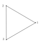

<problems>
- 定义共轭关系的注记中说 $\mathfrak{S}_n$ 的共轭类个数是将 $n$ 分拆成若干个“不同的”正整数之和的方式数，但随后的 $4=2+2$ 等分拆含有相同的部分，这里似乎应去掉“不同的”。
</problems>

这一节研究有限集$X$的对称群$\mathfrak{S}_X$。
不妨设$X=\{1,2,\cdots,n\}$并将$\mathfrak{S}_X$记为$\mathfrak{S}_n$。
按照定义，每个$g\in \mathfrak{S}_n$都是$\{1,2,\cdots,n\}$到自身的双射，即
\[
g\colon1\mapsto i_1, \ 2\mapsto i_2, \ \cdots, \ n\mapsto i_n,
\]
其中，$\{i_1,i_2,\cdots,i_n\}=\{1,2,\cdots,n\}$，
也就是说$(i_1,i_2,\cdots,i_n)$是$\{1,2,\cdots,n\}$的一个排列。
从而，$|\mathfrak{S}_n|=n!$。我们用下面的记号来表示$g$：
\[
g=\begin{pmatrix}
  1 &2&\cdots &n\\
 i_1 &i_2&\cdots &i_n
\end{pmatrix}
\]

::: example
$\mathfrak{S}_2$有$2$个元素，即$1$和$g=\begin{pmatrix}
  1 &2\\
 2 &1
\end{pmatrix}$。此时，$g^2=1$。从而，$\mathfrak{S}_2\simeq
  {{\mathbb{Z}}/2{\mathbb{Z}}}
$。
从$\mathfrak{S}_2$到$
  {{\mathbb{Z}}/2{\mathbb{Z}}}
$的同构映射为$\varphi\colon 1\mapsto \overline{0}, \ g\mapsto \overline{1}$。
:::

::: example
$\mathfrak{S}_3$有$6$个元素，罗列如下：
\[
\left\{1,r=\begin{pmatrix}
  1 &2 & 3\\
  2&3 & 1
\end{pmatrix}, \begin{pmatrix}
  1 &2 & 3\\
  3&1 & 2
\end{pmatrix},s=\begin{pmatrix}
  1 &2 & 3\\
  1&3 & 2
\end{pmatrix}, \begin{pmatrix}
  1 &2 & 3\\
  3&2 & 1
\end{pmatrix}, \begin{pmatrix}
  1 &2 & 3\\
  2&1 & 3
\end{pmatrix}\right\}.
\]
我们可以直接验证如下的乘积关系：
\[
r^2=\begin{pmatrix}
  1 &2 & 3\\
  3&1 & 2
\end{pmatrix},\ sr= \begin{pmatrix}
  1 &2 & 3\\
  3&2 & 1
\end{pmatrix}, \ sr^2=\begin{pmatrix}
  1 &2 & 3\\
  2&1 & 3
\end{pmatrix}
\]
并且$r^3=1=s^2$并且$srs=r^{-1}$。这与$\mathfrak{D}_3$群中元素乘法满足的关系一致。
我们据此断言$\mathfrak{S}_3$与$\mathfrak{D}_3$是同构的。实际上，考虑如下标号的正三角形：

对于$g\in \mathfrak{D}_3$，它把顶点$1$映射成顶点$i_1$，$2$映射成顶点$i_2$，$3$映射成顶点$i_3$，
从而，$g$可以被看作是$\mathfrak{S}_3$中的元素$\varphi(g)=\begin{pmatrix}
  1 &2 & 3\\
  i_1&i_2 & i_3
\end{pmatrix}$。这就定义了
\[
\varphi\colon\mathfrak{D}_3\longrightarrow \mathfrak{S}_3.
\]
这是群同态（这恰好是下一章群作用的观点）。
由于三角形的顶点的移动决定了三角形，以上$i_1,i_2,i_3$就决定了$g$。从而，$\varphi$是单射。
考虑到$|\mathfrak{S}_3|=|\mathfrak{D}_3|=6$，$\varphi$是群同构。
另外，
$\mathfrak{D}_3$的$r$（旋转$\frac{2\pi}{3}$）和$s$（以过点$1$
和对边中点的线为轴的对称）的作用恰好对应$\mathfrak{S}_3$中的$r$和$s$。
:::

我们考虑$\mathfrak{S}_n$中一种特殊的映射：**循环**。
给定$k\leqslant n$和$k$元子集$\{x_1,\cdots,x_k\}\subset \{1,\cdots,n\}$，
按如下方式定义$\{1,\cdots,n\}$到自身的双射$\sigma$：
\[
\sigma(x)=\begin{cases}
x, \ \ & x\notin \{x_1,\cdots,x_k\};\\
x_{i+1}, \ \  &x=x_i\in \{x_1,\cdots,x_{k-1}\};\\
x_1,\ \  &x=x_{k}.
\end{cases}
\]
映射$\sigma$可以如下形象地表示为$\{x_1,\cdots,x_k\}$的“轮换”（其他元素不变）：
\[
x_1\mapsto x_2 \mapsto \cdots x_k\mapsto x_1.
\]
这样的$\sigma$被称作是一个 **$k$-循环**并简记为$(x_1,x_2,\cdots,x_k)$，
$k$也被称作是$\sigma$的长度。**$2$-循环** $(x,y)$（总假设$x\neq y$）被称作是**对换**：
它把 $x$和$y$ 交换位置而保持其余位置不变。我们规定 **$1$-循环**就是恒等映射。

给定$k$-循环$\sigma=(x_1,x_2,\cdots,x_k)$和$l$-循环$\tau=(y_1,y_2,\cdots,y_l)$，
如果$\{x_1,\cdots,x_k\}\cap \{y_1,\cdots,y_l\}=\emptyset$，就称它们是**不交的**。
如果循环$\sigma$和$\tau$不交，那么它们交换，即$\sigma\cdot \tau=\tau\cdot \sigma$。

对任意$\sigma=\begin{pmatrix}
  1 &\cdots & n\\
  \sigma(1)&\cdots & \sigma(n)
\end{pmatrix}\in \mathfrak{S}_n$（这个记号即说明$\sigma\colon k\mapsto \sigma(k)$）。

从某个$x_1$出发，$x_1$被$\sigma$映射到$x_2$，$x_2$被$\sigma$映射到$x_3$，如此往复，存在这样的$k$，
使得$x_k$又被$\sigma$映射到$x_1$。我们还要求$k$是最小的。

我们再在集合$\{1,2,\cdots,n\}-\{x_1,\cdots,x_k\}$上重复以上过程，
即从某个$x_{k+1}$出发，$x_{k+1}$被$\sigma$映射到$x_{k+2}$，$x_{k+2}$被$\sigma$映射到$x_{k+3}$，
如此往复，使得第一次出现$l$，$x_{k+l}$被$\sigma$映射回$x_{k+1}$。
根据构造，我们显然有$\{x_1,x_2,\cdots,x_k\}\cap \{x_{k+1},x_{k+2},\cdots,x_{k+l}\}=\emptyset$。

继续以上过程，$g$的作用就与如下两两不相交的循环之积相同：
\[
g=(x_1,x_2,\cdots,x_k)(x_{k+1},x_{k+2},\cdots,x_{k+l})\cdots (x_{s},\cdots,x_{n}).
\]
根据构造，这些循环是由$g$唯一决定的。

::: proposition
$\mathfrak{S}_n$中每个元素均可唯一地（不计顺序）表示成两两不交的循环之积。
特别地，由循环构成的子集可生成$\mathfrak{S}_n$。
:::

::: remark
对于$g\in \mathfrak{S}_n$，把它分解为$g=\sigma_1 \cdot \sigma_2 \cdots \sigma_m$，其中，
$\sigma_1,\cdots,\sigma_m$分别是长度为$k_1,k_2,\cdots,k_m$的循环并且
$k_1\geqslant k_2\geqslant \cdots \geqslant k_m$并且$k_1+\cdots+k_m=n$（要求在$g$
作用下不动的数对应着$1$-循环）。按照以上规则，我们就称$g$是 **$(k_1,\cdots,k_m)$-型**的。
:::

::: example
考虑$\mathfrak{S}_8$中的元素：
\[
\alpha=\begin{pmatrix}
  1 &2& 3&4&5&6&7&8\\
2 &4& 6&5&1&3&7&8
\end{pmatrix},
\]
根据上面命题的推理过程，容易得到$\alpha=(1,2,4,5)(3,6)$，它这是$(4,2,1,1)$-型的。

我们还可以考虑
\[
\beta=\begin{pmatrix}
  1 &2& 3&4&5&6&7&8\\
2 &3& 7&8&1&6&4&5
\end{pmatrix},
\]
容易看出$\beta=(1,2,3,7,4,8,5)$，从而是$(7,1)$-型的。另外，我们还可以把$\beta$写成下面循环的乘积：
\[
\beta=(1,2,3,5)\cdot(3,7)\cdot(7,4,8).
\]
后两个循环是相交的，这和上述命题唯一性的部分不矛盾。
:::

::: remark [共轭的计算]
对$g\in \mathfrak{S}_n$，其共轭
\[
{\rm Int}(g)\colon  \mathfrak{S}_n\rightarrow  \mathfrak{S}_n,\ \ \sigma\mapsto g\sigma g^{-1},
\]
的计算是关于$\mathfrak{S}_n$研究中最基本的技术手段。

先研究$g$对$k$-循环$\sigma=(x_1,\cdots,x_k)$的共轭。
分情况计算$\big(g\cdot \sigma\cdot g^{-1}\big)(g(x))$：

- $x=x_j$。此时，
  \[
  \big(g\cdot \sigma\cdot g^{-1}\big)(g(x_j))=g(x_{j+1}), \ \  x_{k+1}=x_1.
  \]

- $x\notin \{x_1,\cdots,x_k\}$。此时，
  \[
  \big(g\cdot \sigma\cdot g^{-1}\big)(g(x))=g(x).
  \]

综上所述，我们得到共轭公式：
\[
g\cdot (x_1,\cdots,x_k) \cdot g^{-1}=\big(g(x_1),\cdots,g(x_k)\big).
\]
:::

::: exercise
证明，若$n\geqslant 3$，则$\mathfrak{S}_n$的中心是平凡的，即${\rm Z}(\mathfrak{S}_n)=1$。
:::

::: proposition
$\mathfrak{S}_n$中的元素$\alpha$和$\beta$共轭（即有$g\in \mathfrak{S}_n$，
使得$g\alpha g^{-1}=\beta$）当且仅当它们具有相同的型。
:::

::: proof
对于$(k_1,\cdots,k_m)$-型的$\sigma\in \mathfrak{S}_n$，
有$\sigma=\sigma_1\cdot \sigma_2\cdots \sigma_m$，其中，$\sigma_i$为$k_i$-循环。我们计算其共轭：
\[
{\rm Int}(g)(\sigma)=g \sigma_1 g^{-1}\cdot g\sigma_2g^{-1}\cdots g\sigma_mg^{-1}.
\]
上述公式表明$g \sigma_ig^{-1}$仍为$k_i$-循环，从而，${\rm Int}(g)(\sigma)$与$\sigma$具有相同的型。
反之，任给两个$(k_1,\cdots,k_m)$-型的元素：
\[
\begin{cases}\alpha=(x_1,\cdots,x_{k_1})(x_{k_1+1},\cdots,x_{k_1+k_2})\cdots (x_{k_1+\cdots+k_{m-1}+1},\cdots, x_n),\\
\beta=(y_1,\cdots,y_{k_1})(y_{k_1+1},\cdots,y_{k_1+k_2})\cdots (y_{k_1+\cdots+k_{m-1}+1},\cdots, y_n),
\end{cases}
\]
我们定义$g\in \mathfrak{S}_n$使得对$i=1,\cdots,n$，$g(x_i)=y_i$。
根据上述公式，$g\alpha g^{-1}=\beta$。
从而，
:::

::: remark
对于群$G$以及$x,y\in G$，如果存在$g\in G$，使得$gxg^{-1}=y$，就称 **$x$与$y$共轭**并记作$x\sim y$。
这显然是$G$上的一个等价关系。
给定$g\in G$，用${\rm Conj}(g)$表示与$g$共轭的元素的集合。
据此，我们可以把$G$分划成如下的共轭类的无交并：
\[
G=\coprod_{[g]\in
  {G/\sim}
} {\rm Conj}(g).
\]

根据上述命题，$\mathfrak{S}_n$的共轭类由其型决定，从而，
其共轭类的个数是将$n$分拆成若干个不同的正整数之和的方式的个数。

当$n=4$时，由于$4=3+1=2+2=2+1+1=1+1+1+1$，从而$\mathfrak{S}_4$有$5$个共轭类。

本节之末我们会用$\mathfrak{S}_n$的共轭类来研究其自同构群$\mathbf{Aut}(\mathfrak{S}_n)$。
:::

::: remark [对称群的共轭映射的意义]
给定$n$元集合$X$和$Y$并考虑相应的对称群$\mathfrak{S}_X$和$\mathfrak{S}_Y$，
它们分别是$X$和$Y$到自身的双射在映射复合作为乘法下所构成的群。

现在任意指定双射$f\colon X\rightarrow Y$，
据此可以构造$\mathfrak{S}_X$与$\mathfrak{S}_Y$之间的群同构，由如下交换图定义：
\[
\begin{tikzcd}
X \arrow[rr, "\sigma"] \arrow[d, "f",, swap]  & & X \arrow[d, "f"]\\
Y \arrow[rr, "~~f\circ\sigma\circ f^{-1}",dashed]  \arrow[u, bend right=60, "f^{-1}", dashed, swap]& &  Y  \end{tikzcd}
\]
即定义映射
\[
F_f\colon\mathfrak{S}_X\rightarrow \mathfrak{S}_Y, \ \ \sigma \mapsto F_f(\sigma)=f\circ\sigma\circ f^{-1}.
\]
容易证明$F_f$是群同构。

作为例子，选取$X=Y=\{1,2,\cdots,n\}$，$f=g\in \mathfrak{S}_n$，
则$g$可被视为$\mathfrak{S}_n$中的元素并具有明显的意义：将$1,2,\cdots,n$重新标号。
此时，上述$F_f$就是共轭${\rm Int}(g)$，
它的含义是将$\{1,2,\cdots,n\}$重新标注顺序后对$\mathfrak{S}_n$的影响。
:::

::: theorem
对换的集合$\{(x,y)\mid1\leqslant x<y\leqslant n\}$生成$\mathfrak{S}_n$，
即每个$\mathfrak{S}_n$中的元素可以写成对换之积。进一步，对于$\sigma\in \mathfrak{S}_n$，若
\[
\sigma=\sigma'_1 \cdot \sigma'_2\cdots \sigma'_k=\sigma''_1 \cdot \sigma''_2\cdots \sigma''_l,
\]
是把$\sigma$写成对换之积的两种方式，则$k-l$是偶数。
:::

::: proof
只要证明轮换可被写成对换之积即可。实际上，我们容易验证
\[
(x_1,x_2,\cdots, x_k)=(x_1,x_k)\cdots (x_1,x_3)\cdot(x_1,x_2),
\]
或者
\[
(x_1,x_2,\cdots, x_k)=(x_1,x_2)\cdot (x_2,x_3)\cdots (x_{k-1},x_{k}).
\]

现在证明$k-l$是偶数。
将等式$\sigma'_1 \cdot \sigma'_2\cdots \sigma'_k=\sigma''_1 \cdot \sigma''_2\cdots \sigma''_l$
左边的元素逐一取逆，我们得到
\[
1=\sigma''_1 \cdot \sigma''_2\cdots \sigma''_l\cdot\sigma'_k \cdots \sigma'_2\cdot \sigma'_1.
\]
所以，该命题等价于证明若$1$可以写成对换之积$1=\sigma_1 \cdot \sigma_2\cdots \sigma_m$，则$m$是偶数。

我们对$n$进行归纳。当$n=1$或$2$时，命题是明显的。
当$n\geqslant 3$，$1\leqslant i,j,k\leqslant n-1$并且$i,j,k$两两不同，我们有如下等式：
\[
\begin{cases}(a).& ~(i,n)(j,k)=(j,k)(i,n), \\ (b).& ~(i,n)(i,j)=(i,j)(j,n), \\ (c).& ~(i,n)(j,n)=(i,j)(i,n). \end{cases}
\]

- 1\) 若$\{\sigma_1,  \sigma_2,\cdots, \sigma_m\}$中没有形如$(i,n)$的对换，其中，$i<n$，
  则$\sigma$可以被视为$\mathfrak{S}_{n-1}$中的元素。根据归纳假设，$m$是偶数。

- 2\) 若$\{\sigma_1,  \sigma_2,\cdots, \sigma_m\}$中有形如$(i,n)$的对换（姑且称之为带$n$的对换），
  我们利用$(a)$和$(b)$将$(i,n)$型的对换挪向右边。
  在这个过程中，如果有$(i,n)$与$(j,n)$型的两个对换相邻，
  我们就用$(c)$消去其中的一个带$n$的对换或者用$(i,n)(i,n)=1$消去两个带$n$的对换。
  以上操作保证了$\{\sigma_1,  \sigma_2,\cdots, \sigma_m\}$中带$n$的对换的个数减少，
  直至最多有一个带$n$的对换并且（若存在）这个带$n$的对换只能是$\sigma_m$（在最右边）。
  现在证明，将$1$分解为对换之积，只有$\sigma_m$为不带$n$的对换是可能的。否则，考虑如下等式
  \[
  \sigma_m=\sigma_1 \cdot \sigma_2\cdots \sigma_{m-1}.
  \]
  左边$n$会被调到其它位置而右边所有对换都保持了$n$，矛盾。

  此时我们回到了1)的情况，可再次用归纳假设完成证明。

证毕。
:::

::: definition
若$\sigma\in \mathfrak{S}_n$是偶数个对换之积，就称$\sigma$为**偶置换**；否则称为**奇置换**。
据此，我们定义**指标映射**：
\[
\varepsilon\colon \mathfrak{S}_n\rightarrow \{\pm 1\}, \ \ \sigma\mapsto \begin{cases}
1, &\text{$\sigma$ 是偶置换；}\\
-1, &\text{$\sigma$ 是奇置换}.
\end{cases}
\]
将$\{\pm 1\}$等同为$2$阶循环群，则$\varepsilon$是群同态并且当$n\geqslant 2$时是满射。
另外，$n$阶**交错群**$\mathfrak{A}_n$被定义为：
\[
\mathfrak{A}_n={\rm Ker}\big(\varepsilon\colon\mathfrak{S}_n\rightarrow \{\pm 1\}\big).
\]
这是偶置换的集合。
:::

::: remark
我们有如下正合列
\[
1\rightarrow \mathfrak{A}_n\stackrel{\subset}{\longrightarrow} \mathfrak{S}_n\stackrel{\varepsilon}{\longrightarrow}  \{\pm 1\}\rightarrow 1.
\]
特别地，当$n\geqslant 2$时，$|\mathfrak{A}_n|=\frac{1}{2}n!$。
:::

::: example
$\sigma=(x_1,\cdots,x_k)$是$k$-循环，则$\varepsilon(\sigma)=(-1)^{k+1}$。
:::

::: proposition
令$n\geqslant 3$，$\mathfrak{A}_n$可以被如下子集生成：
\[
\begin{cases}A=\big\{(i,j)(k,l)\bigm| 1\leqslant i,j,k,l\leqslant n, i\neq j, k\neq l\big\}, \\ B=\big\{(i,j,k)\bigm| 1\leqslant i,j,k\leqslant n, i\neq j,i\neq k, k\neq j\big\}.\end{cases}
\]
:::

::: proof
根据$\mathfrak{A}_n$的定义，$\langle A\rangle =\mathfrak{A}_n$。
为了证明$B$可以生成$\mathfrak{A}_n$，只要证明每个形如$(i,j)(k,l)$的元素可被写成$3$-循环之积即可，
其中，$1\leqslant i,j,k,l\leqslant n$并且$i\neq j, k\neq l$。我们分情形讨论：

- 1\) $\big|\{i,j\}\cap \{k,l\}\big|=2$。此时，$(i,j)(k,l)=1$，结论显然成立。

- 2\) $\big|\{i,j\}\cap \{k,l\}\big|=1$，不妨设$j=k$。
  此时，$(i,j)(k,l)=(i,j)(j,l)=(i,j,l)$是$3$-循环。

- 3\) $\big|\{i,j\}\cap \{k,l\}\big|=0$。此时，我们有
  \[
  (i,j)(k,l)=(i,j)(j,k)(j,k)(k,l)=(i,j)(j,k)\cdot (j,k)(k,l).
  \]
  根据2)的结论，上式是两个$3$-循环之积。

综上所述，命题得证。
:::

::: example
$(1,2,3)$生成了$\mathfrak{A}_3$。特别地，$\mathfrak{A}_3\simeq
  {{\mathbb{Z}}/3{\mathbb{Z}}}
$。
:::

::: proposition
假设$n\geqslant 2$，则$\mathfrak{S}_n$可以被以下子集生成：

- $S_*=\big\{(k,k+1)\bigm|k=1,\cdots,n-1\big\}$，其中，$S_*$中的元素被称作是**基本对换**；

- $S_1=\big\{(1,k)\bigm|k=2,\cdots,n\big\}$；

- $S_2=\big\{(1,2),(1,2,\cdots,n)\big\}$。

:::

::: proof
对于$S_1$，根据共轭公式，对任意的$i<j$，$(i,j)=(1,i)(1,j)(1,i)$，从而，
$\langle S_1 \rangle$包含了所有对换，所以，$\langle S_1\rangle=\mathfrak{S}_n$。

对于基本对换的集合$S_*$，对$k$归纳来证明$(1,k)\in \langle S_*\rangle$。首先，$k=1,2$时结论显然成立。
假设$(1,k)\in \langle S_*\rangle$，根据共轭公式，有$(k,k+1)(1,k)(k,k+1)=(1,k+1)$，
这就完成了归纳证明。
所以，$S_1\subset \langle S_*\rangle$，根据上面的结论，$\langle S_*\rangle=\mathfrak{S}_n$。

对于$S_2$，令$g=(1,2,\cdots,n)$。对任意$k\leqslant n-2$，我们有
\[
g^{k}(1)=k+1, \ g^k(2)=k+2.
\]
利用共轭公式，我们有
\[
g^k \cdot (1,2) \cdot g^{-k}=(k+1,k+2), k=0,1,\cdots,n-2.
\]
所以，$S_*\subset \langle S_2\rangle$，从而$\langle S_2\rangle=\mathfrak{S}_n$。
:::

::: example [逆序对与最短的基本对换之积]
假设$n\geqslant 2$，对任意$g=\begin{pmatrix}
  1 &\cdots & n\\
  g(1)&\cdots & g(n)
\end{pmatrix}\in \mathfrak{S}_n$，定义
\[
\ell(g)=\big|\{(i,j)\bigm|1\leqslant i<j\leqslant n, g(i)>g(j)\}\big|.
\]
如果$1\leqslant i<j\leqslant n$而$g(i)>g(j)$，我们就说$(i,j)$是$g$的一个逆序对。
以上，$\ell(g)$为所有$g$的逆序对的个数。

任意$g\in \mathfrak{S}_n$，我们将$g=\sigma_1\cdots \sigma_m$写成基本对换的积，
即要求$\sigma_i\in S_*$。那么，$m\geqslant \ell(g)$并且可以将$g$写成$\ell(g)$个基本对换之积。

如果$\ell(g)=0$，只能有$g=1$，以上结论显然成立。
如果$\ell(g)>0$，必然存在$k$，使得$g(k)>g(k+1)$，此时，$g\cdot (k,k+1)$与$g$相比，
逆序对恰好减少$1$。
重复以上操作，就得到$m\geqslant \ell(g)$并给出了将$g$写成$\ell(g)$个基本对换之积的构造。

特别地，$g\in \mathfrak{A}_n$当且仅当$\ell(g)$是偶数。
:::

::: exercise
当$n\geqslant 3$时，证明，$|i_0-j_0|$与$n$互素，
则$\{(i_0,j_0),(1,2,\cdots,n)\}$生成$\mathfrak{S}_n$。
:::

::: example [$n\neq 2,6$，$\mathbf{Out}(\mathfrak{S}_n)=1$]
假设$n\geqslant 3$。
由于${\rm Z}(\mathfrak{S}_n)=1$，根据正合列 @eq:exact-seq-for-G-to-int-G，
$\mathfrak{S}_n$的内自同构群与$\mathfrak{S}_n$同构。
我们现在研究$\mathfrak{S}_n$的外自同构，请参考正合列 @eq:exact-seq-for-Aut-G-to-Out-G。

任意选定$\varphi \in \mathbf{Aut}(\mathfrak{S}_n)$，$\varphi$将共轭的元素映成共轭的元素，
将$\mathfrak{S}_n$的共轭类映成共轭类：对于共轭类${\rm Cong}(g)$，
$\varphi({\rm Cong}(g))$可能与${\rm Cong}(g)$不同；对不同的共轭类${\rm Cong}(g)$和${\rm Cong}(h)$，
一定有$\varphi({\rm Cong}(g))\neq \varphi({\rm Cong}(h))$。

考虑如下特殊的共轭类：
\[
T_k=\big\{g\in \mathfrak{S}_n\bigm| g\sim(1,2)(3,4)\cdots (2k-1,2k)\big\},
\]
其中，$2k\leqslant n$，$\sim$表示共轭关系。
对任意$\sigma \in T_1$，$\sigma^2=1$，从而$\varphi(\sigma)^2=1$。
通过考虑将$\varphi(\sigma)$分解为轮换：
\[
\varphi(\sigma)=(x_1,x_2,\cdots,x_k)(x_{k+1},x_{k+2},\cdots,x_{k+l})\cdots (x_{s},\cdots,x_{n}),
\]
容易看出只有每个循环的长度至多是$2$时，$\varphi(\sigma)^2=1$。
从而，$\varphi(\sigma)$落在某个$T_k$中。
据此，我们有双射$\varphi\colon T_1\rightarrow T_k$。现在来计算$T_k$中的元素个数：
\[
|T_k|=\frac{1}{k!}{n \choose 2}{n-2 \choose 2}\cdots {n-2k+2 \choose 2}=\frac{n(n-1)\cdots (n-2k+1)}{2^k k!}.
\]
我们现在考虑方程$|T_1|=|T_k|$：
\[
\frac{n(n-1)}{2}=\frac{n(n-1)\cdots (n-2k+1)}{2^k k!} \ \ \Leftrightarrow \ \ 2^{k-1} =(n-2)(n-3)\cdots (n-k+1){n-k \choose k}.
\]
除$1,2$之外，任何两个连续整数之积有奇素数因子，上式要求$n-2=n-k+1$，即$k=3$，此时，
\[
2^{2} =(n-2) {n-3 \choose 3} \ \ \Rightarrow \ \ n=6.
\]
所以，当$n\neq 6$时，$|T_1|=|T_k|$等价于$k=1$，$\varphi$将对换映射为对换。
考虑$\mathfrak{S}_n$的生成元的集合
\[
\big\{\sigma_1=(1,2),\sigma_2=(2,3),\cdots,\sigma_{n-1}=(n-1,n)\big\}
\]
并称$\sigma_{k-1}$和$\sigma_{k}$是相邻的。若以上两元素不相邻，则它们交换。假设
\[
\varphi\big((1,2)\big)=(x_1,x_2), \ \varphi\big((2,3)\big)=(y_1,y_2).
\]
由于$(1,2)$和$(2,3)$不交换，所以$(x_1,x_2)$和$(y_1,y_2)$不交换。
那么，$\{x_1,x_2\}\cap\{y_1,y_2\}\neq \emptyset$。通过重新标记，可以假设
\[
\varphi\big((1,2)\big)=(x_1,x_2), \ \varphi\big((2,3)\big)=(x_2,x_3).
\]
再考虑$\varphi\big((3,4)\big)=(z_1,z_2)$。类似的推理给出$\{x_2,x_3\}\cap\{z_1,z_2\}\neq \emptyset$。
另外，$(1,2)$和$(3,4)$交换，所以$(x_1,x_2)$和$(z_1,z_2)$交换。
据此，$\{x_2,x_3\}\cap\{z_1,z_2\}=\{x_3\}$。
通过重新标号，我们有$\varphi\big((3,4)\big)=(x_3,x_4)$，其中，$x_1,x_2,x_3,x_4$两两不同。
如此往复，我们最终得到
\[
\varphi\big((1,2)\big)=(x_1,x_2),   \varphi\big((2,3)\big)=(x_2,x_3),\cdots, \varphi\big((n-1,n)\big)=(x_{n-1},x_n).
\]
所以可选取
\[
\sigma=\begin{pmatrix}
  1 &2&\cdots &n\\
x_1 &x_2&\cdots &x_n
\end{pmatrix}\in \mathfrak{S}_n,
\]
使得，$\varphi\big((k-1,k)\big)={\rm Int}(\sigma)\big((k-1,k)\big)$。
这些关系在$\mathfrak{S}_n$的生成元集合上成立，从而，$\varphi={\rm Int}(\sigma)$。
综上所述，若$n\neq 6$，则$\mathfrak{S}_n$的每个自同构都是内自同构，即${\rm Out}(\mathfrak{S}_n)=1$。
:::

::: remark
当$n=6$时，公式
\[
2^{k-1} =(n-2)(n-3)\cdots (n-k+1){n-k \choose k}
\]
给出$k=3$。此时，可能存在$\varphi$，使得$\varphi(T_1)=T_3$。此时，必然有$\varphi(T_3)=T_1$。
通过复合，$\varphi^2(T_1)=T_1$。以上的推导对于$\varphi^2$仍成立，从而$\varphi^2$是内自同构。

进一步，任给$\varphi,\varphi'\in \mathbf{Aut}(\mathfrak{S}_6)$，
若$\varphi(T_1)=T_3$和$\varphi'(T_1)=T_3$，则$(\varphi\cdot \varphi')(T_1)=T_1$，
同样的理由表明$\varphi\cdot \varphi'$是内自同构。这说明$
  {\mathbf{Aut}(\mathfrak{S}_6)/{\rm Im}({\rm Int})}
$中至多有两个元素。从而，$\mathbf{Out}(\mathfrak{S}_6)=1$或者$
  {{\mathbb{Z}}/2{\mathbb{Z}}}
$。

我们之后会构造$\mathfrak{S}_6$的非共轭自同构，从而证明$\mathbf{Out}(\mathfrak{S}_6)\simeq
  {{\mathbb{Z}}/2{\mathbb{Z}}}
$。
:::
