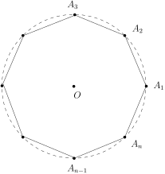
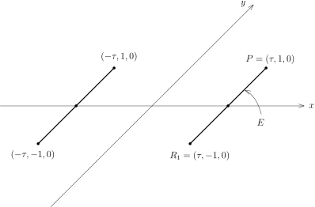
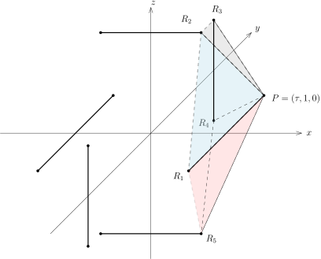

::: definition
$G$是非空集合，$e \in G$并且$G$上配有乘法：
\[
G\times G\rightarrow G,  \ \ (g_1,g_2)\mapsto g_1\cdot g_2,
\]
满足如下性质

- 1\) 对任意$g_1,g_2,g_3\in G$，有结合律$(g_1\cdot g_2)\cdot g_3=g_1\cdot (g_2 \cdot g_3)$；

- 2\) $e$是乘法单位元，即对任意$g\in G$，有$e\cdot g=g\cdot e=g$；

- 3\) 每个$g\in G$有逆元存在，即对任意$g$，存在$g^{-1}\in G$，使得$g\cdot g^{-1}=g^{-1}\cdot g=e$。

就称$(G,\cdot)$或者$G$是**群**。我们通常把$e$记为$1_{_G}$或$1$。
:::

::: remark
对任意$g\in G$，$g$的逆元存在唯一：假设$g'$也是逆元，则$g\cdot g^{-1} = g\cdot g'=e$。
对第一个等号左右两边同乘$g^{-1}$，利用结合律，我们有
\[
(g^{-1}\cdot g)\cdot g^{-1}=(g^{-1}\cdot g)\cdot g' \ \ \Rightarrow \ \ e\cdot g^{-1}=e\cdot g' \Rightarrow \ \ g^{-1}= g'.
\]

对任意$g\in G$和$n\geqslant 1$，我们将使用如下记号：
\[
g^n=\underbrace{g\cdot g\cdot \cdots \cdot g}_{n 个}， \ \ g^{-n}=\underbrace{g^{-1}\cdot g^{-1}\cdot \cdots \cdot g^{-1}}_{n 个},  \ \ g^0=1.
\]
:::

::: remark [几种群]
若对任意$g_1,g_2\in G$，$g_1\cdot g_2=g_2\cdot g_1$，就称$(G,\cdot)$是**交换群**或**Abel群**。
若$|G|$有限，就称$G$是**有限群**并把$|G|$称作是群的**阶**；否则称$G$为**无限群**。

若存在$g_0\in G$，使得对任意$g\in G$，存在$n\in \mathbb{Z}$，$g_0^n=g$，
就称$G$是**循环群**而$g_0$为其（一个）**生成元**。

只有一个元素的群（即$G=\{e\}$）被称为**平凡群**。简单起见，我们把平凡群直接写成$1$。
:::

::: example
令$G={\mathbb{Z}},{\mathbb{Q}},{\mathbb{R}}$或${\mathbb{C}}$，对任意$g_1,g_2\in G$，
定义$g_1\cdot g_2=g_1+g_2$，其中$+$是$G$自然的加法运算。那么，$G$是交换群，$0$是单位元。

当$G$是交换群时，我们习惯上把乘法符号$\cdot$写成$+$，把$g$的逆写成$-g$，把单位元记作$0$。
:::

::: example
整数集除$n$的同余类$
  {\mathbb{Z}/n\mathbb{Z}}
$，即$
  {\mathbb{Z}/n\mathbb{Z}}
=\big\{\overline{0},\overline{1},\cdots,\overline{n-1}\big\}$在加法$\overline{k}+\overline{l}=\overline{k+l}$下是交换群。

实际上，$(
  {\mathbb{Z}/n\mathbb{Z}}
,+)$是循环群，并且$\overline{k}$是生成元当且仅当$(k,n)=1$。
:::

::: example [域上的一般线性群]
$K$是域，$G=\mathbf{GL}(n;K)$是$K$上$n\times n$可逆矩阵的集合，令$\cdot$为矩阵的乘法，
$e$为单位矩阵，$\mathbf{GL}(n;K)$是群（被称为**一般线性群**）。
如果$n\geqslant 2$，$\mathbf{GL}(n;K)$不是交换群。
:::

::: exercise
$K$是有限域，$|K|=q$，试计算$\big|\mathbf{GL}(2;K)\big|$。
:::

::: example [集合的对称群]
$X$是集合，$X\neq \emptyset$，$\mathfrak{S}_X$为$X$到自身的双射的集合。
对任意$g_1,g_2\in\mathfrak{S}_X$，令$g_1\cdot g_2$为$g_1$与$g_2$的复合，即
\[
\begin{tikzcd}
X \arrow[r, "g_2"] \arrow[rd, "g_1\cdot g_2",swap] &  X \arrow[d, "g_1"]\\
   &    X \arrow[u, dash]  \end{tikzcd}
\]
那么，$(\mathfrak{S}_X,\cdot)$是群：单位映射是群的单位元而元素在群中的逆恰为其对应的映射的逆映射。
:::

::: example [二面体群$\mathfrak{D}_n, \ n\geqslant 3$]
$\Omega_n\subset {\mathbb{R}}^2$是正$n$边形，其中心是原点$O$，顶点$A_1=(1,0)$。
我们考虑如下$\mathbb{R}^2$到自身的双射：

- 以$O$为圆心、旋转$\frac{2k\pi}{n}$的变换（其中$k=0,1,\cdots,n-1$）可写成：
  \[
  \rho_k\colon{\mathbb{R}}^2\rightarrow {\mathbb{R}}^2, \ \ \begin{pmatrix}
    x \\
  y
  \end{pmatrix} \mapsto \begin{pmatrix}
    \cos\left(\frac{2k\pi}{n}\right) & -\sin\left(\frac{2k\pi}{n}\right)\\
  \sin\left(\frac{2k\pi}{n}\right) &\cos\left(\frac{2k\pi}{n}\right)
  \end{pmatrix}\begin{pmatrix}
    x \\
  y
  \end{pmatrix}.
  \]
  令$r=\rho_1$，那么，$\rho_k=r^k$。

- 若$n$是奇数，$R_k$是以过$A_k$与其对边中心的直线为反射轴的反射（$k=1,2,\cdots,n$）；若$n$是偶数，
  $R'_k$是以过$A_k$与$A_{n+k}$的直线为反射轴的反射，
  $R''_k$是以过$A_kA_{k+1}$的中点与$A_{\frac{n}{2}+k}A_{\frac{n}{2}+k+1}$
  的中点的直线为反射轴的反射（$k=1,2,\cdots,\frac{n}{2}$）。

  我们记以通过$A_1$的线为对称轴的反射为$s$，即$s(x,y)=(x,-y)$。

上述映射保持该正多边形，比如$n$为奇数时$R_k\colon \Omega_n\rightarrow  \Omega_n$是双射。
另外，每个对称的逆为其本身。至此，我们构造了正多边形$\Omega_n$的$2n$个对称（即变换）：
\[
\mathfrak{D}_n=\big\{\rho_k, R_{k}\big\} ~\text{或者}~ \big\{\rho_k, R'_{k},R''_k\big\}.
\]

由于$sr^k$为以过原点$O$和$e^{-\frac{k}{n}\pi i}$的直线为对称轴的反射。所以，
\[
\mathfrak{D}_n=\big\{1,r,\cdots,r^{n-1},s, sr,sr^2,\cdots,sr^{n-1}\}.
\]
另外，容易验证如下的复合关系：
\[
srs=r^{-1}.
\]
从而，$\mathfrak{D}_n$在映射的复合下成为群。
实际上，对于$x=r^ks$，$y=r^ls^b$，其中，$b=0$或$1$（若$x=r^k$，显然$xy\in \mathfrak{D}_n$）。
根据$srs=r^{-1}$，我们有
\[
x\cdot y=r^ks \cdot r^ls^b=r^k \cdot r^{-l}\cdot s\cdot s^b=r^{k-l}s^{1+b}.
\]
另外，$x^{-1}=x$（因为$x$是反射）。

另外，当$n\geqslant 3$时，$\mathfrak{D}_n$不是交换群。
:::

::: definition
给定群$G$，$H\subset G$为非空子集，如果$H$对乘法和取逆封闭，即对任意$h_1,h_2\in H$，
$h_1\cdot h_2\in H$以及对任意$h\in H$，$h^{-1}\in H$，就称$H$是$G$的**子群**并记作$H<G$。
:::

::: remark
给定群$G$，$H<G$是子群，则$1=g\cdot g^{-1}\in H$。我们在$H$上使用$G$的乘法，从而子群$H$是群。
:::

::: example
$G$是群，则$\{1\}$和$G$都是子群。我们称这两个子群是**平凡的子群**。
:::

::: example
自然数$\mathbb{N}$（包括$0$）不是$({\mathbb{Z}},+)$的子群，因为取逆不封闭。
:::

::: example
${\mathbb{C}}^\times$为全体非零复数，其群乘法为复数的乘法，这是群。
尽管${\mathbb{C}}^\times \subset {\mathbb{C}}$，
但$({\mathbb{C}}^\times,\cdot)$不是$({\mathbb{C}},+)$的子群。

$n\geqslant 1$，令$\mu^n({\mathbb{C}})$为${\mathbb{C}}$中 $n$次单位根的集合（$X^n-1=0$的所有根），
这是${\mathbb{C}}^\times$的子群。

${\mathbb{R}}^+$为全体正实数，它在实数乘法下构成群。
${\mathbb{R}}^+$是${\mathbb{R}}^\times$或${\mathbb{C}}^\times$的子群，
但不是$({\mathbb{R}},+)$的子群。
:::

::: example {@example:sylow-triangle}
可逆的$n$阶上三角矩阵的集合$\mathcal{T}$是$G=\mathbf{GL}(n;K)$的子群；
对角线上均为$1$的$n$阶上三角矩阵的集合$\mathcal{T}_1$也是$G=\mathbf{GL}(n;K)$的子群。

假设$|K|=q$，其中$q=p^m$，$p$是素数。此时，
\[
|\mathbf{GL}(n;K)|=\prod_{k=0}^{n-1}(q^n-q^k)=q^{\frac{n(n-1)}{2}}l, \ \  |\mathcal{T}_1|=q^{\frac{n(n-1)}{2}},
\]
其中，$(p,l)=1$。我们将看到，$\mathcal{T}_1$是$G$的Sylow $p$-子群。
:::

::: example [由子集生成的子群]
$G$是群。

- 1\) 假设$\{G_i\}_{i\in I}$是$G$的一族子群，那么，$\displaystyle\bigcap_{i\in I}G_i$是子群。

- 2\) 子集$S\subset G$并且$S\neq \emptyset$，根据上述，存在唯一的、包含$S$的、
  最小的（在包含关系下）子群，它被称作是**由$S$生成的子群**并记作$\langle S \rangle$。
  实际上，$\langle S \rangle$是包含$S$的所有子群之交。

- 3\) $S\subset G$，那么，$\langle S\rangle$具有如下描述：
  \[
  \langle S \rangle=\big\{s_1^{n_1}\cdot s_2^{n_2} \cdots s_{k}^{n_{k}}\bigm|k\in \mathbb{N}, s_i\in S, n_i\in \mathbb{Z}, s_i\neq s_{i+1}\big\}.
  \]
  如果$G$的某个子群包含$S$，它必然包含上述集合。所以，只要证明$\langle S \rangle$是子群即可。

  我们讨论$S$中元素的相乘。
  注意到如果$s_i=s_{i+1}$，我们可以把$s_i^{n_i}s_{i+1}^{n_{i+1}}$换成$s_i^{n_i+n_{i+1}}$。
  对于$s_1^{n_1} \cdots  s_{k}^{n_k}$和${s'}_1^{n'_1}\cdots {s'}_{k'}^{n'_{k'}}$，它们相乘得
  \[
  s_1^{n_1} \cdots  s_{k}^{n_{k}} \cdot {s'}_1^{n'_1}\cdots {s'}_{k'}^{n'_{k'}}.
  \]
  如果$s_{k} ={s'}_1$，我们可以将采取上述替换，然后再看是否还有相邻两项相同，
  如此往复一直到得到上述对于$\langle S\rangle$中元素的形式，这表明$\langle S\rangle$对乘法封闭。

  我们还有
  \[
  \big(s_1^{n_1}\cdot s_2^{n_2} \cdots s_{k}^{n_{k}}\big)^{-1}=s_{k}^{-n_{k}}\cdots s_2^{-n_2} \cdot s_1^{-n_1}.
  \]
  这表明$\langle S\rangle$对取逆封闭。

- 4\) 当$S=\{g\}$只有一个元素时，记它生成的子群为$\langle g\rangle$。
  很明显，$\langle g\rangle$是循环群并且
  \[
  \langle g\rangle=\{\cdots, g^{-2},g^{-1},1,g,g^2,\cdots\}.
  \]
  若有正整数$n$，使得$g^n=1$，
  就称$g$是**有限阶的元**（否则称之为**无限阶的元**）并用${\rm ord}(g)$
  来记最小的这种整数且称之为 **$g$的阶**。
  此时，$\langle g\rangle$是有限循环群并且$|\langle g\rangle|=n$。

  我们注意到

  - 若$g$是有限阶的元，$k,l\in {\mathbb{Z}}$，则$g^k=g^l$当且仅当${\rm ord}(g)\mid k-l$。

  - $G$是有限群，则所有$g\in G$均为有限阶的。

  在二面体群$\mathfrak{D}_n$中，$\langle r\rangle$生成的子群是$n$阶循环群，由所有旋转构成。

:::

::: exercise
$G$是群且每个元素均为有限阶的，$G$是否必为有限群？
:::

::: remark
假设$x,y\in G$的阶分别为$k,l$，其中，$(k,l)=1$并且$x\cdot y =y \cdot x$。
那么，$x\cdot y$的阶为$kl$。令$d={\rm ord}(x\cdot y)$，根据
\[
1=(xy)^{dk}=x^{dk}y^{dk}=y^{dk},
\]
我们有$l\mid d$。同理，$k\mid d$，所以，$kl\mid d$。据此，${\rm ord}(x\cdot y)=kl$。

如果不加$x$和$y$可交换的假设，则${\rm ord}(x\cdot y)$没有规律可言。
实际上，我们考虑$\mathbf{SL}(2;\mathbb{C})$，即行列式为$1$的$2\times 2$复矩阵构成的群。令
\[
A=\begin{pmatrix} \xi_a&0\\
0& \xi_a^{-1}\end{pmatrix}, \ \ B=\begin{pmatrix} 0&-1\\
1& \xi_b+\xi_b^{-1}\end{pmatrix}, \ \ U_t=\begin{pmatrix} 1&t\\
0& 1\end{pmatrix},
\]
其中，$t\in \mathbb{C}$待定，$\xi_a=e^{\frac{2\pi i}{a}},\xi_b=e^{\frac{2\pi i}{b}}$。

很明显，${\rm ord}(A)=a$；由于$B$的两个特征值为$\xi_b$和$\xi_b^{-1}$，从而，${\rm ord}(B)=b$；
特别地，$B_t=U_t \cdot B \cdot U_t^{-1}$的阶为$b$。

对于$B$的计算表明，
如果一个矩阵$C\in \mathbf{SL}(2;\mathbb{C})$（行列式为$1$）满足${\rm tr}(C)=\xi_c+\xi_c^{-1}$并且
$\xi_c^c=1$，其中，$c$是使得$\xi_c^c=1$成立的最小整数，那么，${\rm ord}(C)=c$。

现在考虑$A\cdot B_t$的阶。根据上面的讨论，我们计算
\[
{\rm tr}(A\cdot B_t)=(\xi_a-\xi^{-1}_{a})t+\xi_a^{-1}(\xi_b+\xi_b^{-1}).
\]
只要令选择$t$满足方程
\[
(\xi_a-\xi^{-1}_{a})t+\xi_a^{-1}(\xi_b+\xi_b^{-1})=\xi_c+\xi_c^{-1},
\]
我们就有${\rm ord}(A\cdot B_t)=c$，其中，$c$可以任意指定而${\rm ord}(A)=a, {\rm ord}(B_t)=b$。

我们还可以进一步找到有限群$G$，存在$A,B_t\in G$，
使得${\rm ord}(A)=a, {\rm ord}(B_t)=b$而${\rm ord}(A\cdot B_t)=c$，其中$c$是任意的。
根据Dirichlet定理，选取素数$p$，使得$p\equiv 1 \mod abc$。
根据初等数论中原根的存在性，${\mathbb{F}_p}^\times$是$p-1$阶循环群，从而，
存在$\xi_a,\xi_b$和$\xi_c$，使得$\xi_a^a=\xi_b^b=\xi_c^c=1$，其中，类似于前述，
我们要求$a,b,c$这三个指标都是最小的。此时，我们定义$\mathbf{SL}(2;{\mathbb{F}_p})$中的元素：
\[
A=\begin{pmatrix} \xi_a&0\\
0& \xi_a^{-1}\end{pmatrix}, \ \ B=\begin{pmatrix} 0&-1\\
1& \xi_b+\xi_b^{-1}\end{pmatrix}, \ \ U_t=\begin{pmatrix} 1&t\\
0& 1\end{pmatrix},
\]
其中，$t\in {\mathbb{F}_p}$。容易看出，以上对于$\mathbf{SL}(2;{\mathbb{C}})$的计算仍然成立。
:::

::: example [中心化子、群的中心]
$G$是群，$g\in G$，定义$g$的**中心化子**：
\[
{\rm C}_g(G)=\{h\in G\mid gh=hg\}.
\]
这是子群，由群中与$g$交换的元素构成。

$G$的**中心**${\rm Z(G)}$是群中与所有元素均交换的元素组成的子群，按定义，我们有
\[
{\rm Z(G)}=\bigcap_{g\in G}{\rm C}_g(G).
\]
:::

## 补充：正二十面体的对称 {@section:ica}

Euclid在*原本*的第十三卷讨论正二十面体。
在一条注解中，他说Theaetetus可能是第一个发现正二十面体的数学家。

考虑三维空间${\mathbb{R}}^3$。
在$z=0$定义的平面上放置两条线段：线段$E$与$y$-轴平行，端点为$P=(\tau,1,0)$和$R_1=(\tau,-1,0)$，
其中点落在$x$轴上；第二条线段与$E$关于$y$轴对称，其端点为$(-\tau,1,0)$和$(-\tau,-1,0)$。

对以上四个端点$(\pm\tau,\pm 1,0)$的$x,y,z$坐标进行轮换可以得到12个点：
\[
\{(\pm\tau,\pm 1,0), \ (\pm 1, 0,\pm \tau), \ (0, \pm\tau,\pm 1)\}
\]
考虑这12个点的凸包$\mathbf{I}$（$\mathbf{I}$是icosahedron的缩写）给出的多面体。
利用关于凸多面体的Euler定理（即$v-e+f=2$，其中，$v$是顶点个数，$e$是边数，$f$是面数），
它有12个顶点，30条边和20个面。请参考3维示意图：

图中与$P$相邻的五个点$R_1,\cdots,R_5$分别为
\[
R_1=(\tau,-1,0),\ R_2=(1,0,\tau), \ R_3=(0,\tau,1), \ R_4=(0,\tau,-1),\  R_5=(1,0,-\tau).
\]
注意到$|PR_1|=2$。为了保证$|PR_i|=2$，其中，$i=2,\cdots,5$，通过计算可知：
\[
\tau=\frac{\sqrt{5}+1}{2} \ \ \Rightarrow \ \ \tau^2-\tau-1=0.
\]
一个重要的观察是$R_1,R_2,\cdots,R_5$五点共面：实际上，它们的坐标均满足方程
\[
\tau x+ y=\tau.
\]
上述方程定义出${\mathbb{R}}^3$中的一个平面，直线$OP$与这个平面垂直，其中，$O$是原点。

- a) $\triangle PR_1R_2,\triangle PR_2R_3,\triangle PR_3R_4,\triangle PR_4R_5,\triangle PR_5R_1$
  是5个全等的正三角形（边长为$2$）。
  ${\mathbb{R}}^3$的以$OP$为旋转轴，
  旋转$\frac{2}{5}\pi,\frac{4}{5}\pi,\frac{6}{5}\pi,\frac{8}{5}\pi$以及$0\cdot \pi$
  保持该二十面体不变。共有$12$个顶点决定了$6$个旋转轴，从而共有$4\times 6=24$个这样的旋转。

- b) 变换$(x,y,z)\mapsto (y,z,x)$及它与自己复合$(x,y,z)\mapsto (z,x,y)$也可以被实现为旋转变换：
  第一个变换的旋转轴是过$O$以及$(1,1,1)$点的直线而旋转的角度为$\frac{2}{3}\pi$；
  第二个变换有同样的旋转轴而旋转的角度是$\frac{4}{3}\pi$。
  注意到旋转轴是过$O$与面$PR_2R_3$中心的直线。
  正二十面体的$20$个面决定了$10$个旋转轴，从而共有$2\times 10=20$个这样的旋转。

- c) 变换$(x,y,z)\mapsto (-x,-y,z)$也是旋转变换，其轴为$z$轴而旋转的角度是$\pi$。
  注意到旋转轴是$R_2$与$(-1,0,\tau)$所决定的边的中点与$O$的连线。
  正二十面体的$30$条边决定了$15$个旋转轴，从而有$1\times 15=15$个这样的旋转。

以上共有$24+20+15=59$个旋转，加上单位映射（旋转的角度为$0$），
给出了有$60$个元素的集合$G_{\mathbf{I}}$。

::: remark
我们将证明$G_{\mathbf{I}}$在映射复合下构成群并且这个群是阶最小的非交换单群。
:::

对于以上$c)$中的变换，还可以考虑如下变体

- c') 我们有$8$个变换$(x,y,z)\mapsto (\pm x,\pm y,\pm z)$。
  它们由反射映射$(x,y,z)\mapsto (- x, y, z)$，
  $(x,y,z)\mapsto (x, -y, z)$和$(x,y,z)\mapsto (x, y, -z)$复合得到，其中有$4$个不是旋转。

::: remark [正二十面体的定义]
在平面几何中，正多边形可以用如下直观来描述：我们可以通过旋转和对称把任何的边和顶点互换。
按照这种逻辑，我们现在解释$\mathbf{I}$是**正**二十面体。

令$(F,E,V)$为${\rm \bf I}$的一个（面边点）三元组，
即$F$为面，$E$为边，$V$为顶点并且$V\subset E\subset F$。
那么，对任意的三元组$(F',E',V')$，那么可以通过上述$a),b)$和$c')$中的变换以及它们的复合，使得
\[
F\mapsto F', \ E\mapsto E', \ V\mapsto V'.
\]
令$V_0=P$，$E_0=PR_1$，$F_0=PR_1R_2$，请参考上图中的淡蓝色三角形。
我们只要说明对任意的三元组$(F,E,V)$，可以通过$a),b)$和$c')$映射的复合实现
\[
F\mapsto F_0, \ E\mapsto E_0, \ V\mapsto V_0.
\]

- 1\) 通过$c')$中的$(x,y,z)\mapsto (-x,-y,-z)$，不妨假设$V\in \{P,R_1,R_2,R_3,R_4,R_5\}$。

- 2\) 再通过$a)$中的5个旋转（包括单位映射），不妨假设$V\in \{P,R_1\}$。

- 3\) 再通过$c')$中的$(x,y,z)\mapsto (x,-y,z)$，不妨假设$V=P$。

- 4\) 再通过$a)$中的5个旋转（包括单位映射），不妨假设$E=E_0=PR_1$，$V=P$（$P$在旋转下不动）。

- 5\) 经过以上四个步骤，$F=F_0$或者$PR_1R_5$（请参考上图中的淡红色三角形）。
  此时，我们可以通过$c')$中的$(x,y,z)\mapsto (x,y,-z)$把$PR_1R_5$映射成$F_0$。

:::

::: exercise
证明，对任意三元组$(F,E,V)$和$(F',E',V')$，可以通过$a),b)$和$c')$映射的复合给出的映射$\varphi$，使得
\[
\varphi\colon F\mapsto F', \ E\mapsto E', \ V\mapsto V'.
\]
（以上只证明了$(F',E',V')=(F_0,E_0,V_0)$的情形）
:::
