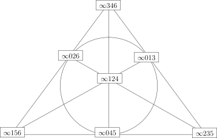

## 对称群$\mathfrak{S}_n$中的计算 {@sec:method-to-generate-s-n}

假设$n\geqslant 2$，那么，以下子集均生成$\mathfrak{S}_n$：

1. 假设$S=\big\{(i,j)\big\}$是一些对换（$2$-循环）的集合并且$S$生成$\mathfrak{S}_n$，那么，
   $|S|$的最小值是多少？

2. 假设$|i_0-j_0|$与$n$互素。证明，$S_4=\big\{(i_0,j_0),(1,2,\cdots,n)\big\}$生成$\mathfrak{S}_n$。

3. 假设$n\geqslant 5$。证明，$\mathfrak{A}_n$中的所有$3$-循环是（在$\mathfrak{A}_n$中）相互共轭的。

4. 证明，
   $\mathfrak{A}_5$可以被双对换$\{(i,j)(k,l)|1\leqslant i,j,k,l \leqslant 5\text{且两两不同}\}$
   生成。

5. （$\mathfrak{A}_5$的自同构群）令 $G=\mathfrak{A}_5$。

   - a) 假设 $x=(12)(34)\in G$，$y\in G$ 是一个 $3$ 阶元。
     证明，$xy$ 的阶为 $5$ 当且仅当 $y$ 的两个不动点一个在 $\{1,2\}$ 中并且另一个在 $\{3,4\}$ 中。

   - b) 令 $X=\{(u,v)\in G\times G\big|u,v,uv~\text{的阶分别为}~2,3,5\}$，证明，$|X|=120$。

   - c) $\mathbf{Aut}(G)$ 作用在 $X$ 上，证明，这个作用是自由的。
     据此，$|\mathbf{Aut}(G)|\leqslant 120$。
     由于 $\mathbf{Aut}(G)$ 包含 $\mathfrak{S}_5$，从而 $\mathbf{Aut}(G)=\mathfrak{S}_5$。

6. （$\mathfrak{A}_4$的自同构群）用$(2,3,3)$（元素的阶）替换$(2,3,5)$，
   试用类似的方法证明$\mathbf{Aut}(\mathfrak{A_4})=\mathfrak{S}_4$。

7. （$\mathfrak{S}_4$的自同构群）用 $(2,3,4)$（元素的阶）替换 $(2,3,5)$，
   试用类似的方法证明 $\mathbf{Aut}(\mathfrak{S_4})=\mathfrak{S}_4$。

8. 试用上面关于$\mathfrak{A}_4$的自同构群的结论直接证明上一结果。

## 交错群$\mathfrak{A}_n$（$n\geqslant 5$）是单群 {@homework:An-simple}

如果群$G$除了$1$和本身之外没有其它的正规子群，我们就称$G$是**单群**。
很明显，循环群只有在其阶为素数时为单群。

1. 给出$\mathfrak{A}_3$和$\mathfrak{A}_4$的正规子群。

2. 我们按照以下步骤证明$\mathfrak{A}_5$是单群：

   - 假设$N\lhd \mathfrak{A}_5$是正规子群并且$N\neq 1$。
     假设$N$包含一个双置换（两个不交的置换之积），不妨设为$\sigma=(1,2)(3,4)$，证明，
     $\tau=(1,5)(3,4)$在$\mathfrak{A}_5$中与$\sigma$共轭。
     特别地，证明$\sigma\tau$是$3$-循环。

   - 假设$N\lhd \mathfrak{A}_5$是正规子群并且$N\neq 1$。
     假设$N$包含一个$5$-循环，不妨设为$\sigma=(1,2,3,4,5)$，证明，
     $\tau=(2,3,1,4,5)$在$\mathfrak{A}_5$中与$\sigma$共轭。
     特别地，证明$\tau\sigma^2$是$3$-循环。

   - 假设$N\lhd \mathfrak{A}_5$是正规子群并且$N\neq 1$。
     证明，$N$包含所有的$3$-循环，从而，$\mathfrak{A}_5$是单群。

3. 我们还可以按照以下步骤证明$\mathfrak{A}_5$是单群：

   - 证明，$\mathfrak{A}_5$有五个共轭类并且每个共轭类中的元素个数分别为$1,12,12,15$和$20$。

   - 子群$N\subset \mathfrak{A}_5$在$\mathfrak{A}_5$的共轭下不变。
     证明，$|N|$只能等于$1,13,16,21,25,28,33,36,40,45,48$和$60$。

   - 证明，$\mathfrak{A}_5$是单群。

4. 以下假设$n\geqslant 6$并且$\mathfrak{A}_{n-1}$是单群。
   假设$N\lhd\mathfrak{A}_{n}$是正规子群并且$N\neq 1$，$N\neq \mathfrak{A}_n$。

   - 如果存在$\sigma \in N-\{1\}$使得$\sigma(n)=n$，证明，$N=\mathfrak{A}_{n}$。

   - 证明，对任意的$\sigma \in N-\{1\}$，只要$\{i,j\}\cap\{\sigma(n),n\}=\emptyset$，那么，
     $\tau \sigma \tau^{-1} \sigma=1$，其中，$\tau=(i,j)(n,\sigma(n))$。

   - 同上，证明，$\sigma^2=1$并且$\sigma\colon\{i,j\}\rightarrow \{i,j\}$。
     （提示：考虑$\sigma^{-1}\tau \sigma \tau^{-1}$）

   - 证明，$\sigma=\big(n,\sigma(n)\big)$从而得到矛盾。据此，$\mathfrak{A}_{n}$是单群。

5. 假设$n\geqslant 5$，$G\lhd \mathfrak{S}_n$为正规子群，证明，如果$G\neq 1$，
   $G\neq \mathfrak{S}_n$，那么，$G=\mathfrak{A}_n$。

6. 证明，
   $N=\{1,(1,2)(3,4),(1,3)(2,4),(1,4)(2,3)\}$是$\mathfrak{S}_4$的正规子群并且$N\lhd\mathfrak{A}_4$。
   $
  {\mathfrak{S}_4/N}
$是哪一个群？

7. 假设$n\geqslant 5$，$H< \mathfrak{S}_n$为子群，$d=[\mathfrak{S}_n:H]$。
   证明，存在群同态$\varphi\colon\mathfrak{S}_n\rightarrow \mathfrak{S}_d$，
   使得${\rm Ker}(\varphi)<H$。
   据此证明，如果$H\neq \mathfrak{A}_n,\mathfrak{S}_n$，那么，$d\geqslant n$。

8. 证明，对于$n\geqslant 2$，
   存在单的群同态$\mathfrak{S}_n\rightarrow \mathfrak{A}_{n+2}$（从而$\mathfrak{S}_n$可被视作是
   $\mathfrak{A}_{n+2}$的子群）但是不存在单的群同态$\mathfrak{S}_n\rightarrow \mathfrak{A}_{n+1}$。

## $\mathbf{PSL}(2;\mathbb{F}_2)\simeq \mathfrak{S}_3, \mathbf{PSL}(2;\mathbb{F}_3)\simeq \mathfrak{A}_4$

循环群只有在其阶为素数时为单群。

1. 证明，
   $\mathbf{GL}(2;\mathbb{F}_2)\simeq \mathbf{PGL}(2;\mathbb{F}_2)\simeq \mathbf{SL}(2;\mathbb{F}_2)\simeq \mathbf{PSL}(2;\mathbb{F}_2)$。

2. $\mathbf{GL}(2;\mathbb{F}_2)$在$\mathbb{P}^1(\mathbb{F}_2)$的自然的作用给出同态
   \[
   \varphi\colon \mathbf{GL}(2;\mathbb{F}_2)\longrightarrow \mathfrak{S}_{\mathbb{P}^1(\mathbb{F}_2)}\simeq \mathfrak{S}_3,
   \]
   其中，后一个同构由以下对应给出$[1:0]\rightarrow 1, [1:1]\rightarrow 2, [0:1]\rightarrow 3$。
   证明，$\varphi$是群同构。

3. $\mathbf{GL}(2;\mathbb{F}_3)$在$\mathbb{P}^1(\mathbb{F}_3)$上自然的作用给出同态
   \[
   \varphi\colon \mathbf{GL}(2;\mathbb{F}_3)\longrightarrow \mathfrak{S}_{\mathbb{P}^1(\mathbb{F}_3)}\simeq \mathfrak{S}_4,
   \]
   其中，
   后一个同构由以下对应给出
   $[1:0]\rightarrow 1, [1:1]\rightarrow 2, [1:2]\rightarrow 3, [0:1]\rightarrow 4$。
    计算${\rm Ker}(\varphi)$并证明$\varphi$诱导出同构
   \[
   \overline{\varphi}\colon \mathbf{PGL}(2;\mathbb{F}_3)\stackrel{\simeq}{\longrightarrow}  \mathfrak{S}_4.
   \]

4. 证明，对$n\geqslant 2$，$\mathfrak{S}_n$的指标为$2$的子群必为$\mathfrak{A}_n$。
   据此，利用$\mathbf{PSL}(2;\mathbb{F}_3)$在$\mathbb{P}^1(\mathbb{F}_3)$上的自然作用证明：
   \[
   \mathbf{PSL}(2;\mathbb{F}_3)\simeq \mathfrak{A}_{4}.
   \]

5. 证明，
   \[
   \mathbf{SL}(2;\mathbb{F}_4)\simeq\mathbf{PSL}(2;\mathbb{F}_4)\simeq \mathfrak{A}_{5}.
   \]
   （提醒：对任意的$x\in \mathbb{F}_4$，$2x=0$。特别地，$1=-1$。）

6. $n\geqslant 5$，$H<\mathfrak{S}_n$是指标为$n$的子群。证明，$H\simeq \mathfrak{S}_{n-1}$。
   据此，利用$\mathbf{PGL}(2;\mathbb{F}_5)$在$\mathbb{P}^1(\mathbb{F}_5)$上的自然作用证明：
   \[
   \mathbf{PGL}(2;\mathbb{F}_5)\simeq \mathfrak{S}_{5}.
   \]

7. 一个不同构的结论。

   - 证明，$\mathbf{SL}(3;\mathbb{F}_4)$中恰有一个共轭类使得其元素的阶为$2$。
     进一步，这个共轭类中的元素均恰为剪切映射。

   - 证明，
     自然的映射$\mathbf{SL}(3;\mathbb{F}_4)\rightarrow \mathbf{PSL}(3;\mathbb{F}_4)$
     给出了这两个群中阶为$2$的元素的一一对应。

   - 证明，$\mathfrak{A}_8$与$\mathbf{PSL}(3;\mathbb{F}_4)$是具有$20160$个元素但是不同构的单群。

## $60$阶的单群

$G$是群，其阶为$60$，$s_p$为其Sylow $p$-子群的个数，如果$s_5\neq 1$，那么$G$是单群。
我们用反证法证明这个结论。假设$H\lhd G$并且$H\neq 1, H \neq G$。

1. 证明，$s_2\in \{1,3,5,15\},\ s_3\in \{1,4,10\}, \ s_5=6$。

2. 假设$|H|$是$5$的倍数，证明，$|H|=30$；进一步证明，$H$只有一个Sylow $5$-子群。据此推出矛盾。

3. 假设$|H|\leqslant 4$。证明，$
  {G/H}
$只有一个Sylow $5$-子群；进一步证明存在$H'\lhd G$，$H'\neq G$并且$|H'|$是$5$的倍数。据此推出矛盾。

4. 假设$|H|=6$或者$|H|=12$。证明，$H$只有一个Sylow $2$-子群或只有一个Sylow $3$-子群。据此推出矛盾。

   以下假设$G$是阶为$60$的单群，$s_p$为其Sylow $p$-子群的个数。

5. $H<G$是子群并且$H\neq G$。证明，$[G:H]\geqslant 5$。
   进一步证明，如果$[G:H]=5$，那么，$G\simeq \mathfrak{A}_5$。

6. 证明，$s_2\in \{5,15\},\ s_3=4, \ s_5=6$。

7. 假设$s_2=5$，证明，$G\simeq \mathfrak{A}_5$。

8. 假设$s_2=15$，证明，存在Sylow $2$-子群$P$和$Q$，使得$|P\cap Q|=2$。
   进一步证明$P\cap Q$的正规化子的指标为$5$，即$[G:{\rm N}_G(P\cap Q)]=5$。

9. 证明，阶为$60$的单群在同构的意义下只能是$\mathfrak{A}_5$并计算$s_2$的值。

## 不存在$180$阶的单群

$G$是群，其阶为$180$，那么，$G$不是单群。我们用反证法证明这个结论。
以下$s_p$为$G$的Sylow $p$-子群的个数。

1. （常用结论）证明，$p^2$阶的群必然是交换群，其中，$p$是素数。

2. 证明，$s_3=10$。

3. 证明，$s_5=36$。

4. $P$和$Q$是不同的Sylow $3$-子群，证明，$P\cap Q=1$。
   （提示：假设$g\in P\cap Q-\{1\}$，考虑其中心化子$C_g(G)$）

5. 据上述结论推出矛盾。

## 与Sylow $p$-子群相关的补充

1. $G$是有限群，$S<G$是一个Sylow $p$-子群。证明，$[G: {\rm N}_G(S)]\equiv 1 \ \ ({\rm mod} ~p)$。

2. $G$是有限群，$S<G$是一个Sylow $p$-子群，$H\lhd G$是正规子群。
   证明，$S\cap H$是$H$的Sylow $p$-子群。

3. $G$是有限群，$H\lhd G$是正规子群，$\pi\colon G\rightarrow
  {G/H}
$是自然投影。证明，如果$S<G$是Sylow $p$-子群，那么，$\pi(S)$是$
  {G/H}
$的Sylow $p$-子群；反之，如果$S'<
  {G/H}
$是Sylow $p$-子群，那么，存在$G$的Sylow $p$-子群$S$，使得$\pi(S)=S'$。

4. （Frattini技巧）

   - 群$G$作用在集合$X$上，$H<G$是子群，那么，
     $^{G\curvearrowright} X$诱导出$^{H\curvearrowright} X$。
     假设$^{H\curvearrowright} X$是传递的，证明，对任意的$x\in X$，$G=H\cdot {\rm Stab}_{G}(x)$。

   - （Frattini）$G$是群，$H\lhd G$是有限的正规子群，$S<H$是$H$的一个Sylow $p$-子群。
     证明，$G=H\cdot {\rm N}_G(S)$。

5. $G$是有限群，$S<G$是一个Sylow $p$-子群，$H<G$是子群并且$H\supset {N}_G(S)$。
   证明，$H= {\rm N}_G(H)$。

6. $G$是有限群，$S<G$是一个Sylow $p$-子群。证明，$ {\rm N}_G(S)= {\rm N}_G( {\rm N}_G(S))$。

## $\mathbf{PSL}(2;\mathbb{F}_7)$与$\mathbf{GL}(3;\mathbb{F}_2)$同构

我们记$\mathbf{P}^1({\mathbb{F}_p})$为${\mathbb{F}_p}\cup\{\infty\}$，对于$g=\begin{pmatrix}
a& b\\
c& d
\end{pmatrix}\in {\mathbf{GL}}(2;{\mathbb{F}_p})$，它通过分式线性变换在$\mathbf{P}^1({\mathbb{F}_p})$上作用：
\[
g\cdot x =\frac{ax+b}{cx+d}.
\]
这给出了单的群同态
\[
{\mathbf{PGL}}(2;{\mathbb{F}_p})\longrightarrow \mathfrak{S}_{\mathbf{P}^1({\mathbb{F}_p})}\simeq \mathfrak{S}_{p+1}.
\]
从而，
我们可以把${\mathbf{PGL}}(2;{\mathbb{F}_p})$视为$\mathfrak{S}_{p+1}$（因为
$\big|\mathbf{P}^1({\mathbb{F}_p})\big|=p+1$）中阶为$p^3-p$并且在$\{1,2,\cdots,p+1\}$
上传递作用的子群。
考虑群${\mathbf{PGL}}(2;{\mathbb{F}_p})$通过分式线性变换在$\mathbf{P}^1({\mathbb{F}_p})$上的作用，
令$\mathbf{Aff}_1({\mathbb{F}}_p)={\rm Stab}(\infty)$。
容易看出，
$\mathbf{Aff}_1({\mathbb{F}}_p)$在${\mathbb{F}_p}=\mathbf{P}^1({\mathbb{F}_p})-\{\infty\}$
上的作用是双传递的并且$\left\langle \mathbf{Aff}_1({\mathbb{F}}_p), \begin{pmatrix}
0&1\\
1& 0
\end{pmatrix}\right\rangle ={\mathbf{PGL}}(2;{\mathbb{F}_p})$。Zassenhaus有一个有意思的结果：令$X=\mathbf{P}^1({\mathbb{F}_p})$，$G<\mathfrak{S}_X$的阶为$p^3-p$并且在$X$上传递作用，那么，存在$\sigma\in \mathfrak{S}_X$，使得$\sigma G\sigma^{-1} ={\mathbf{PGL}}(2;{\mathbb{F}_p})
$。我们对$p = 3\mod 4$的情形证明该结论，证明的想法是逐步在$G$中构造出
$\mathbf{Aff}_1({\mathbb{F}}_p)$以及$\begin{pmatrix}
0&1\\
1& 0
\end{pmatrix}$所对应的对象。

我们使用如下的约定与假设：
\[
G<\mathfrak{S}_X, \ |G|=p^3-p,\ {\mathbf{PGL}}(2;{\mathbb{F}_p})<\mathfrak{S}_X, \ \alpha(x)=x+1\in \mathbf{Aff}_1({\mathbb{F}}_p),
\]
并且$G$在$X$上的作用是传递的。

1. 证明，$G$包含$p$-循环从而存在$\sigma\in G$，使得$\alpha\in \sigma G \sigma^{-1}$。

   自此，假设$\alpha\in G$。

2. 令$G_\infty=\big\{g\in G\big|g(\infty)=\infty\big\}$。
   证明，$|G_\infty|=p^2-p$，$P=\langle \alpha\rangle \lhd G_\infty$并且对任意$g\in G_\infty$，
   存在$a\in [1,p)$，使得$g\cdot \alpha=\alpha^a\cdot g$（$a$当然依赖于$g$）。

3. 证明，$G_\infty=\mathbf{Aff}_1({\mathbb{F}}_p)$。

4. 证明，$G$在$X$上的作用是$3$-传递的并且若$g\in G$固定任$3$个不同的点则$g=1$。

   以下选取$\gamma\in G$使得
   $\gamma(0)=\infty, \gamma(\infty)=0, \gamma(1)=1$（我们希望它对应着$\begin{pmatrix}
0&1\\
1& 0
\end{pmatrix}$）并令
   \[
   \begin{cases}&C=\big\{g\in G\big|g(\infty)=\infty,g(0)=0\big\},\\
   &C'={\rm C}_{\mathfrak{S}_X}(C)=\big\{g\in G\big|gc=cg, \forall c\in C\big\}.
   \end{cases}
   \]

5. 证明，$C$是阶为$p-1$的循环群并由某个（$\mathfrak{S}_X$中的）$p-1$循环生成；
   $C'=\langle C, (0,\infty)\rangle$，其中，$(0,\infty)$是$\mathfrak{S}_X$中的对换。

6. 证明，若$G$中有对换，则$G=\mathfrak{S}_X$，从而$p=2$或$3$。

   自此，假设$p\geqslant 5$并且$(0,\infty)\notin G$。

7. 证明，$C'\cap G=C$并且
   \[
   {\rm Int(\gamma)}\colon G\rightarrow G, \ g\mapsto \gamma g \gamma^{-1}
   \]
   是阶为$2$的自同构。

8. 证明，存在$n\in [2,p-2]$，使得$n^2= 1\mod p-1$并且对任意的$c\in C$，${\rm Int}(\gamma)(c)=c^n$；
   对任意的$x\in X-\{\infty\}$，$\gamma\cdot x=x^n$，其中，
   $x^n$是在$X-\{\infty\}={\mathbb{F}_p}$中的运算。

9. 证明，$n\equiv -1\mod \frac{p-1}{2}$。（提示：$\gamma$至多有两个不动点）

10. 证明，如果$p= 3\mod 4$，那么，$n+1=0\mod p-1$并且$G={\mathbf{PGL}}(2;{\mathbb{F}_p})$。

    至此，我们在$p= 3\mod 4$的假设下证明了Zassenhaus的结论。

11. （应用）$G$是群，$p$是素数，$|G|=p^3-p$。
    我们做如下假设：如果$H\lhd G$并且$|H|$整除$p^2-p$，那么$H=1$。

    1. 证明，$G$有$p+1$个Sylow $p$-子群。

    2. 证明，$G$通过共轭在Sylow $p$-子群的集合上的作用是忠实的。

    3. 证明，若$p= 3\mod 4$，则$G\simeq {\mathbf{PGL}}(2;{\mathbb{F}_p})$。

12. （$\mathbf{GL}(3;\mathbb{F}_2)\simeq \mathbf{PSL}(2;\mathbb{F}_7)$）令
    $N={\mathbf{GL}}(3;\mathbb{F}_2)$，则$A\in N$为$3\times 3$的矩阵。定义$
  {{\mathbb{Z}}/2{\mathbb{Z}}}
$在$N$上的作用为：
    \[
    \psi\colon
      {{\mathbb{Z}}/2{\mathbb{Z}}}
    \rightarrow \mathbf{Aut}(N), \ \ 1\mapsto \left(A\mapsto {}^t A^{-1}\right).
    \]
    令$G=N \rtimes_\psi
  {{\mathbb{Z}}/2{\mathbb{Z}}}
$。

    1. 证明，不存在$M\in \mathbf{GL}(3;\mathbb{F}_2)$，
       使得对任意的$A\in \mathbf{GL}(3;\mathbb{F}_2)$，
       ${}^t A M A=M$并进一步证明$G$的正规子群的指标不等于$2$。

    2. 证明，$G$只有一个非平凡正规子群$N\times \{0\}=\big\{(A,0) \in N \rtimes_\psi
  {{\mathbb{Z}}/2{\mathbb{Z}}}
\big|A\in N\big\}\simeq N$。

    3. 证明，$G\simeq {\mathbf{PGL}}(2;{\mathbb{F}}_7), N\simeq {\mathbf{PGL}}(2;{\mathbb{F}}_7)$。
       这就证明了$\mathbf{GL}(3;\mathbb{F}_2) \simeq \mathbf{PSL}(2;\mathbb{F}_7)$。

## 最少的生成元个数

$G$是群，如果存在有限个$x_1,\cdots,x_n$，使得$G=\langle x_1,\cdots, x_n\rangle$，
我们就称$G$是**有限生成的**。
以上最小可能的$n$被称作是$G$的**最少的生成元个数**，记作${\rm min_{gen}}(G)$。
我们规定${\rm min_{gen}}(\{1\})=0$。

1. 证明，${\rm min_{gen}}(G)=1$等价于$G$是非平凡的循环群。

2. 假设$n\geqslant 3$。证明，${\rm min_{gen}}(\mathfrak{S}_n)=2$。

3. $p$是素数，$r$是自然数，$G=\left(
  {\mathbb{Z}/p\mathbb{Z}}
\right)^r=\underbrace{
  {\mathbb{Z}/p\mathbb{Z}}
 \times \cdots \times
  {\mathbb{Z}/p\mathbb{Z}}
}_{r~\text{个}}$。证明，${\rm min_{gen}}(G)=r$。

   （提示：将$G$视为$
  {\mathbb{Z}/p\mathbb{Z}}
$-线性空间）

4. $G$是有限生成群，假设有**满的**群同态$\varphi\colon G\longrightarrow G'$。
   证明，$G'$是有限生成群并且
   \[
   {\rm min_{gen}}(G')\leqslant {\rm min_{gen}}(G).
   \]

5. $G$是群，$H\lhd G$是正规子群。证明，如果$H$和$
  {G/H}
$是有限生成的，那么，$G$也是并且
   \[
   {\rm min_{gen}}(G)\leqslant {\rm min_{gen}}\left(
     {G/H}
   \right)+{\rm min_{gen}}(H).
   \]

6. 对于群$A=\displaystyle\prod_{i=1}^s
  {\mathbb{Z}/d_i\mathbb{Z}}
$，其中，$s\in \mathbb{Z}_{\geqslant 1}, d_1,\cdots,d_s\in \mathbb{Z}_{\geqslant 2}$，使得$d_s \mid d_{s-1},d_{s-1}\mid d_{s-2},\cdots,d_2\mid d_1$。证明，${\rm min_{gen}}(A)=s$。

7. 对于群$A=\mathbb{Z}^r=\underbrace{\mathbb{Z}\times \cdots \times\mathbb{Z}}_{r~\text{个}}$。
   证明，${\rm min_{gen}}(A)=r$。据此证明，如果$\mathbb{Z}^r\simeq \mathbb{Z}^{r'}$，那么，$r=r'$。

8. （子群生成元个数可以更多）对任意的$n\geqslant 3$，给出如下的例子：$G$是群，$H<G$是子群，
   ${\rm min_{gen}}(G)=2$而${\rm min_{gen}}(H)=n$。

9. （有限生成群的子群未必有限生成）令$G=\left\langle\begin{pmatrix}
  1 &1\\
  0&1
\end{pmatrix},  \begin{pmatrix}
  2 &0\\
  0&1
\end{pmatrix}\right\rangle<\mathbf{GL}(2;\mathbb{Q})$是由两个元素生成的群。证明，$H=\left\{\begin{pmatrix}
  1 &\frac{m}{2^k}\\
  0&1
\end{pmatrix}\Big|k\in \mathbb{Z}_{\geqslant 0}, m\in \mathbb{Z}\right\}$是$G$的子群并且不是有限生成的。

10. （有限生成交换群子群的生成元个数）$G$是有限生成交换群，$H<G$是子群。证明，
    \[
    {\rm min_{gen}}(H)\leqslant {\rm min_{gen}}(G).
    \]
    （提示：找一个$g\in G$，使得${\rm min_{gen}}\left(
  {G/\langle g\rangle}
\right)<{\rm min_{gen}}(G)$）

11. $r\geqslant 1$，$A$是$\mathbb{Z}^r$的子群。
    证明，存在$r'\leqslant r$，使得$A\simeq\mathbb{Z}^{r'}$。

## 阶为$p^3$的群有$5$个，$p\neq 2$

假设$p$是奇素数。用$\mathbb{F}_p$表示$p$个元素的有限域，用$
  {\mathbb{Z}/p\mathbb{Z}}
$表示其加法群。

1. 在同构意义下，写下所有阶为$2^3$的群和阶为$p^2$的群。

2. 我们在课上用对角线均为$1$的上三角矩阵给出了$\mathbf{GL}(2;\mathbb{F}_p)$一个Sylow子群。
   计算$\mathbf{GL}(2;\mathbb{F}_p)$中Sylow $p$-子群的个数。

3. 给定两个非平凡的群同态$\varphi\colon
  {\mathbb{Z}/p\mathbb{Z}}
\longrightarrow \mathbf{GL}(2;\mathbb{F}_p)$和$\varphi'\colon
  {\mathbb{Z}/p\mathbb{Z}}
\longrightarrow \mathbf{GL}(2;\mathbb{F}_p)$。对任意的整数$k$，令$\varphi_k(x)=\varphi(kx)$，其中，$x\in
  {\mathbb{Z}/p\mathbb{Z}}
$。证明，存在$A\in \mathbf{GL}(2;\mathbb{F}_p)$和$k=1,2,\cdots,p-1$，使得对任意的$x\in
  {\mathbb{Z}/p\mathbb{Z}}
$，有
   \[
   \varphi'(x)=A\cdot \varphi_k(x)\cdot A^{-1}.
   \]

4. 在同构的意义下，可能的半直积$\left(
  {\mathbb{Z}/p\mathbb{Z}}
\times
  {\mathbb{Z}/p\mathbb{Z}}
\right)\rtimes_\psi
  {\mathbb{Z}/p\mathbb{Z}}
$恰有两个。进一步证明，其中恰有一个是非交换群并且其中心同构于$
  {\mathbb{Z}/p\mathbb{Z}}
$。

5. $G$是群，$|G|=p^3$。假设$G$不是循环群并且存在$g\in G$使得${\rm ord}(g)=p^2$。
   证明，$\langle g\rangle\lhd G$。

6. 证明，在同构的意义下，上一个小问题中的群恰好两个。

7. 在同构意义下，写下所有阶为$p^3$的群。

## 射影几何、Fano平面与${\mathbf{GL}}(3;{\mathbb{F}}_2)$

给定非空集合$\Pi$和$\Lambda$，我们把$\Pi$中的元素$p$称作**点**，$\Lambda$中的元素$l$称作**线**。
集合$\Pi$和$\Lambda$之间**重合关系**（incidence relation）指的是乘积集合的子集
$I\subset \Pi\times \Lambda$。
对任意的$(p,l)\in \Pi\times \Lambda$，若$(p,l)\in I$，我们就说**点$p$在线$l$上**或**线$l$过点$p$**。
进一步，如果以下三条公理成立：

- 公理1 两点确定一条线，即对任两个不同的点$p,p'\in \Pi$，存在唯一的线$l\in \Lambda$，
  使得$l$过$p$且过$p'$；

- 公理2 两线交于一个点，即对任两条不同的线$l,l'\in \Lambda$，存在唯一的点$p\in \Pi$，
  使得$l$和$l'$均过$p$；

- 公理3 存在四个不同的点$p_1,p_2,p_3,p_4\in \Pi$，任意的$l\in \Lambda$不能同时过其中的三点。

我们就称$\big(\Pi,\Lambda;I\big)$或$\Pi$为**射影平面**。
在公理2的条件下，我们还称$p$是$l$与$l'$的**交点**。

$\big(\Pi,\Lambda;I\big)$和$\big(\Pi',\Lambda';I'\big)$为射影平面，如果存在双射
\[
\varphi\colon\Pi\rightarrow \Pi', \ \ \psi\colon\Lambda\rightarrow \Lambda',
\]
使得$(p,l)\in I$当且仅当$(\varphi(p),\psi(l))\in I'$，
就称$(\varphi,\psi)$是$\big(\Pi,\Lambda;I\big)$与$\big(\Pi',\Lambda';I'\big)$之间的**同构**。
令$\mathbf{Aut}\big(\Pi,\Lambda;I\big)$为$\big(\Pi,\Lambda;I\big)$到自身同构的集合，
它在映射的复合下是群。

1. **第一部分，射影平面与Fano平面**

   $K$是域，$V$是$3$维$K$-线性空间，$V^*$为其对偶。令$\Pi=\mathbf{P}(V), \Lambda=\mathbf{P}(V^*)$。
   我们要把$\mathbf{P}(V)$中的线定义为$V$中的$2$维线性子空间：对任意的$p\in \Pi$，
   不妨选取$p\in V$作为其代表；对任意的$l\in \Lambda$，不妨选取$l\in V^*$作为其代表，我们定义
   \[
   I=\big\{(p,l)\big|l(p)=0\big\}.
   \]
   证明，以上是良好定义的并且$\big(\Pi,\Lambda;I\big)$为射影平面。

2. $\big(\Pi,\Lambda;I\big)$为射影平面。
   证明，存在四条不同的线$l_1,l_2,l_3,l_4\in \Lambda$，任意的$p\in \Pi$不能同时在其中的三条线上。
   据此构造重合关系$I^*\subset \Lambda\times \Pi$，使得$\big(\Lambda,\Pi;I^*\big)$为射影平面。

3. （元素个数最小的射影平面的构造）令$\Pi=\mathbf{P}^2({\mathbb{F}}_2)$，则$|\Pi|=7$，
   每个点均对应$({\mathbb{F}}_2)^3$中非零向量
   \[
   v_1=(0,0,1),  v_2=(0,1,0),  v_3=(0,1,1), v_4=(1,0,0),  v_5=(1,0,1),  v_6=(1,1,0),  v_7=(1,1,1).
   \]

   

   上图中有$6$条直线段和一个圆，每个这样的图形上有三个点，它们对应着$\Lambda$。
   这个射影平面被称作是**Fano平面**。

   1. $\big(\Pi,\Lambda;I\big)$为射影平面，$p_1,p_2,p_3,p_4\in \Pi$满足公理3。
      令$l_{ij}$为过$p_i$与$p_j$的直线，其中，$1\leqslant i,j\leqslant 4$；
      令$p_5,p_6,p_7$分别为$l_{12}$与$l_{34}$、$l_{13}$与$l_{24}$以及$l_{14}$与$l_{23}$的交点。
      证明，$\{p_1,\cdots,p_7\}$这$7$个点两两不同。

   2. $\big(\Pi,\Lambda;I\big)$为射影平面并且$|\Pi|=7$。
      假设$p_1,p_2,p_3,p_4\in \Pi$满足公理3，
      以上已经构造了$6$条线$l_{ij}$并且$\{p_1,\cdots,p_7\}=\Pi$。
      令$l_\infty$为过$p_5,p_6$的线，证明，$l_\infty$过$p_7$。
      进一步证明，
      $\Lambda=\{l_{ij},l_\infty, 1\leqslant i,j\leqslant 4\}$恰有$7$条线并且每条线恰好过$3$个点。

   3. 证明，以下映射
      \[
      \begin{cases}&p_1\mapsto (1,1,1), \ \ p_2\mapsto(1,0,1),\ \ p_3\mapsto(1,1,0),\\
      &p_4\mapsto(1,0,0), \ \ p_5\mapsto(0,1,0),\ \ p_6\mapsto(0,0,1),\ \ p_7\mapsto(0,0,1).
      \end{cases}
      \]
      可以给出$\big(\Pi,\Lambda;I\big)$到Fano平面的同构。

   以上证明了Fano平面是元素个数最小的唯一的（在同构意义下）射影平面。

4. **第二部分，群${\mathbf{GL}}(3;{\mathbb{F}}_2)$中Fano平面的结构**

   ${\mathbf{GL}}(3;{\mathbb{F}}_2)$在Fano平面的点集$\Pi$上有自然作用；
   ${\mathbf{GL}}(3;{\mathbb{F}}_2)$在Fano平面的线集$\Lambda$上也有自然作用（把直线映射成直线）。
   所以，${\mathbf{GL}}(3;{\mathbb{F}}_2)$可以自然地作用在$\Pi\times \Lambda$上。
   这个作用有几个轨道？

5. 在 ${\mathbf{GL}}(3;{\mathbb{F}}_2)$中的**标准Borel子群**$B$是对角线上均为$1$的上三角矩阵的集合，
   包含$B$的子群被称作是**标准抛物子群**，比如下述的$P,Q<{\mathbf{GL}}(3;{\mathbb{F}}_2)$：
   \[
   B=\left\{ \begin{pmatrix}
   1& * &*\\
   0& 1 &*\\
   0& 0 &1
   \end{pmatrix}\right\}, \ \ P=\left\{ \begin{pmatrix}
   *& * &*\\
   *& * &*\\
   0& 0 &1
   \end{pmatrix}\right\}, \ \ Q=\left\{ \begin{pmatrix}
   1 & * &*\\
   0 & * &*\\
   0& * &*
   \end{pmatrix}\right\}.
   \]
   我们注意到$P\cap Q=B$，$Q={\rm Stab}\big((1,0,0)\big)$，其中，$p=(1,0,0)\in \Pi$。
   试找出直线$l\in \Lambda$，使得$P={\rm Stab}(l)$。
   证明，与$P$和$Q$共轭的矩阵恰好都是$7$个并且$P$与$Q$不共轭。

6. 假设$P'<{\mathbf{GL}}(3;{\mathbb{F}}_2)$与$P$共轭，
   $Q'<{\mathbf{GL}}(3;{\mathbb{F}}_2)$与$Q$共轭。
   证明，存在$(p',l')\in \Pi\times \Lambda$，使得$P'$和$Q'$分别为$l'$与$p'$的稳定化子并且
   \[
   |P'\cap Q'|=\begin{cases}
   8, \ \ \text{若 $p'$ 在 $l'$ 上};\\
   6, \ \ \text{若 $p'$ 不在 $l'$ 上}.
   \end{cases}
   \]

7. 按如下方式定义$P$和$Q$的子群：
   \[
   M=\left\{ \begin{pmatrix}
   *& * &0\\
   *& * &0\\
   0& 0 &1
   \end{pmatrix}\right\}, \ \ U=\left\{ \begin{pmatrix}
   1 & 0 &*\\
   0 & 1 &*\\
   0& 0 &1
   \end{pmatrix}\right\}, \ \ N=\left\{ \begin{pmatrix}
   1& 0 &0\\
   0& * &*\\
   0& * &*
   \end{pmatrix}\right\}, \ \ V=\left\{ \begin{pmatrix}
   1 & * &*\\
   0 & 1 &0\\
   0& 0 &1
   \end{pmatrix}\right\}.
   \]
   证明，$U\lhd P$并且$P=U\rtimes M$；$V\lhd Q$并且$Q=V\rtimes N$。

8. 证明，$U$和$V$在${\mathbf{GL}}(3;{\mathbb{F}}_2)$中不共轭；
   每个${\mathbf{GL}}(3;{\mathbb{F}}_2)$中同构于$
  {{\mathbb{Z}}/2{\mathbb{Z}}}
\times
  {{\mathbb{Z}}/2{\mathbb{Z}}}
$的子群都共轭于$U$或者$V$；$U$和$V$在${\mathbf{GL}}(3;{\mathbb{F}}_2)$中各有$7$个与之共轭的子群，
它们被记作
   \[
   \Pi'=\{U_1,U_2,\cdots,U_7\}, \ \ \Lambda'=\{V_1,V_2,\cdots,V_7\}.
   \]

9. 证明，对任意$U'\in \Pi',V'\in \Lambda'$，若$U'\cap V'\neq \emptyset$，则$U'\cap V'=\{1,z\}$，
   其中，$z\in {\mathbf{GL}}(3;{\mathbb{F}}_2)$是一个$2$阶元。
   进一步，
   $z$的中心化子${\rm C}(z):={\rm C}_{{\mathbf{GL}}(3;{\mathbb{F}}_2)}(z)$是
   ${\mathbf{GL}}(3;{\mathbb{F}}_2)$的包含$U'$和$V'$的Sylow $2$-子群。

10. 证明，${\mathbf{GL}}(3;{\mathbb{F}}_2)$中恰有$21$个$2$阶元并且它们两两共轭。
    进一步证明以下映射是双射：
    \[
    \big\{\text{${\mathbf{GL}}(3;{\mathbb{F}}_2)$ 中的 $2$ 阶元}\big\}\longrightarrow \big\{\text{${\mathbf{GL}}(3;{\mathbb{F}}_2)$ 的 Sylow 2-子群}\big\},\ \ z\mapsto {\rm C}(z).
    \]

11. 定义$\Pi'$和$\Lambda'$上的重合关系：
    \[
    I'=\big\{(U',V')\in \Pi'\times\Lambda'\big| U'\cap V'\neq \emptyset\big\}
    \]
    证明，$(\Pi',\Lambda',I')$是Fano平面。

12. **第三部分，应用：${\mathbf{PSL}}(2;{\mathbb{F}}_7)\simeq {\mathbf{GL}}(3;{\mathbb{F}}_2)$**

    证明，${\mathbf{PSL}}(2;{\mathbb{F}}_7)$中的$2$阶元有$21$个并且以下为其（矩阵表示的）清单：
    \[
    \begin{aligned}
    &z_1=\begin{pmatrix}
    4 &3 \\
    6 & 3
    \end{pmatrix},
    z_2=\begin{pmatrix}
    1 &1 \\
    5 & 6
    \end{pmatrix},
    z_3=\begin{pmatrix}
    1&6 \\
    2 & 6
    \end{pmatrix},
    z_4=\begin{pmatrix}
    1 &4 \\
    3 & 6
    \end{pmatrix},
    z_5=\begin{pmatrix}
    1 &5 \\
    1 & 6
    \end{pmatrix},
    z_6=\begin{pmatrix}
    4&2 \\
    2 & 3
    \end{pmatrix}, \\
    &z_7=\begin{pmatrix}
    1&3 \\
    4& 6
    \end{pmatrix},
    z_8=\begin{pmatrix}
    0 &2 \\
    3 & 0
    \end{pmatrix},
    z_9=\begin{pmatrix}
    0 &4 \\
    5 &0
    \end{pmatrix},
    z_{10}=\begin{pmatrix}
    2&1 \\
    2 & 5
    \end{pmatrix},
    z_{11}=\begin{pmatrix}
    4 &4 \\
    1 & 3
    \end{pmatrix},
    z_{12}=\begin{pmatrix}
    4 &5 \\
    5 & 3
    \end{pmatrix}, \\
    &z_{13}=\begin{pmatrix}
    2&2 \\
    1 & 5
    \end{pmatrix},
    z_{14}=\begin{pmatrix}
    4&6\\
    3& 3
    \end{pmatrix},
    z_{15}=\begin{pmatrix}
    2 &4 \\
    4 & 5
    \end{pmatrix},
    z_{16}=\begin{pmatrix}
    1 &2 \\
    6 &6
    \end{pmatrix},
    z_{17}=\begin{pmatrix}
    2&5 \\
    6 & 5
    \end{pmatrix},
    z_{18}=\begin{pmatrix}
    0 &1 \\
    6& 0
    \end{pmatrix}, \\
    &z_{19}=\begin{pmatrix}
    2 &6 \\
    5 &5
    \end{pmatrix},
    z_{20}=\begin{pmatrix}
    4&1 \\
    4& 3
    \end{pmatrix},
    z_{21}=\begin{pmatrix}
    2&3\\
    3& 5
    \end{pmatrix}.
    \end{aligned}
    \]

13. 证明，${\mathbf{GL}}(3;{\mathbb{F}}_2)$中同构于$
  {{\mathbb{Z}}/2{\mathbb{Z}}}
\times
  {{\mathbb{Z}}/2{\mathbb{Z}}}
$的子群共有$14$个，每个群以及群中的元素由如下清单给出：
    \[
    \Pi''=\left\{ \begin{aligned}
    &\{1,z_1,z_8,z_{10}\}, \{1,z_2,z_7,z_{17}\}\\
    &\{1,z_3,z_{16},z_{21}\}, \{1,z_{4},z_{5},z_{19}\},\\
    &\{1,z_{6},z_{11},z_{20}\},\{1,z_{9},z_{13},z_{14}\},\\
    &\{1,z_{12},z_{15},z_{18}\}
    \end{aligned}
    \right\}, \ \ \Lambda''=\left\{ \begin{aligned}
    &\{1,z_1,z_{12},z_{14}\}, \{1,z_2,z_5,z_{15}\}\\
    &\{1,z_3,z_{4},z_{13}\}, \{1,z_{6},z_{8},z_{21}\},\\
    &\{1,z_{7},z_{10},z_{16}\},\{1,z_{8},z_{11},z_{19}\},\\
    &\{1,z_{9},z_{17},z_{20}\}
    \end{aligned}
    \right\},
    \]
    并且以上$\Pi''$与$\Lambda''$恰好是这些群的共轭类。

14. 定义$\Pi''$和$\Lambda''$上的重合关系：
    \[
    I''=\big\{(p,l)\in \Pi''\times\Lambda''\big| p\cap l\neq \emptyset\big\}.
    \]
    证明，$(\Pi'',\Lambda'',I'')$是Fano平面。

15. 证明，${\mathbf{PSL}}(2;{\mathbb{F}}_7)\simeq {\mathbf{GL}}(3;{\mathbb{F}}_2)$。

16. **第四部分，
    利用交比构造Fano平面来证明
    ${\mathbf{PSL}}(2;{\mathbb{F}}_7)\simeq {\mathbf{GL}}(3;{\mathbb{F}}_2)$**

    对任意四个不同的$z_1,z_2,z_3,z_4\in \mathbf{P}^1({\mathbb{F}_p})={\mathbb{F}_p}\cup\{\infty\}$，
    定义其交比为
    \[
    [z_1,z_2;z_3,z_4]=  \begin{array}{c}
      \frac{z_1-z_3}{z_1-z_4} \\
      \hline
      \frac{z_2-z_3}{z_2-z_4}
    \end{array}=\frac{z_1-z_3}{z_1-z_4}\cdot \frac{z_2-z_4}{z_2-z_3}.
    \]
      证明，$[z_1,z_2;z_3,z_4]$在${\mathbf{PGL}}(2;{\mathbb{F}_p})$的作用下不变，
      即对任意$g\in {\mathbf{PGL}}(2;{\mathbb{F}_p})$，
      \[
      [g(z_1),g(z_2);g(z_3),g(z_4)]=[z_1,z_2;z_3,z_4].
      \]
      （提示：先证明${\mathbf{PGL}}(2;{\mathbb{F}_p})$可由形如$\begin{pmatrix}
1&*\\
0& 1
\end{pmatrix}, \begin{pmatrix}
*&0\\
0& *
\end{pmatrix}$和$\begin{pmatrix}
0&1\\
1& 0
\end{pmatrix}$的矩阵生成）

17. 给定四个不同的$z_1,z_2,z_3,z_4\in {\mathbb{F}_p}\cup\{\infty\}$，令$\lambda=[z_1,z_2;z_3,z_4]$。
    考虑对称群$\mathfrak{S}_4$在集合$\{z_1,z_2,z_3,z_4\}$上的作用：
    对任意$\sigma\in \mathfrak{S}_4$，$\sigma(z_{i})=z_{\sigma(i)}$，其中，$i=1,2,3,4$。
    证明，
    $\{\sigma(\lambda)=[z_{\sigma(1)},z_{\sigma(2)};z_{\sigma(3)},z_{\sigma(4)}]\big|\sigma\in \mathfrak{S}_4\big\}$
    所有可能的取值为
    $\lambda, \frac{1}{\lambda},1-\lambda,\frac{1}{1-\lambda},\frac{\lambda}{1-\lambda},\frac{1-\lambda}{\lambda}$。
    令
    \[
    H=\{1,(1,2)(3,4),(1,3)(2,4), (1,4)(2,3)\}<\mathfrak{S}_4,
    \]
    证明，对任意的$\sigma\in H$，$\sigma(\lambda)=\lambda$。

18. 证明，恰好有$28$个四元子集$\{z_1,z_2,z_3,z_4\}\subset {\mathbb{F}}_7\cup\{\infty\}$，
    使得$[z_1:z_2:z_3:z_4]=3$。
    特别地，通过计算证明含有$\infty$的子集有$14$个，它们由如下两个集合给出：
    \[
    \Pi_*=\left\{\begin{aligned}&\{\infty,0,1,3\},\{\infty,0,2,6\},\\
    &\{\infty,0,4,5\},\{\infty,1,2,4\}\\
    &\{\infty,1,5,6\},\{\infty,2,3,5\}\\
    &\{\infty,3,4,6\}
    \end{aligned}\right\}, \ \ \Lambda_*=\left\{\begin{aligned}&\{\infty,0,2,3\},\{\infty,0,1,5\},\\
    &\{\infty,0,4,6\},\{\infty,1,3,4\}\\
    &\{\infty,1,2,6\},\{\infty,2,4,5\}\\
    &\{\infty,3,5,6\}
    \end{aligned}\right\}
    \]

19. 我们定义$\Pi_*$与$\Lambda_*$之间的重合关系为
    \[
    I_*=\big\{(p,l)\in \Pi_*\times \Lambda_*\big| |p\cap l|=3\big\}.
    \]

    

    证明，$(\Pi_*,\Lambda_*,I_*)$是Fano平面。

20. 证明，$\{p, \overline{p}, l,\overline{l}\big|p\in \Pi_*,l\in \Lambda_*\}$，
    ${\mathbf{PSL}}(2;{\mathbb{F}}_7)\simeq {\mathbf{GL}}(3;{\mathbb{F}}_2)$恰好给出了所有交比为$3$
    的$28$个集合，其中，
    $\overline{p}$和$\overline{l}$分别为$p$和$l$在$\mathbf{P}^1({\mathbb{F}}_7)$中的补集。
    从而，
    ${\mathbf{PSL}}(2;{\mathbb{F}}_7)$可以作用在
    $\{\{p, \overline{p}\}, \{l,\overline{l}\}\big|p\in \Pi_*,l\in \Lambda_*\}$上给出同构
    ${\mathbf{PSL}}(2;{\mathbb{F}}_7)\simeq {\mathbf{GL}}(3;{\mathbb{F}}_2)$。

## 练习题

1. 证明，除了阶为$1$和$2$的群外，每个群都有非平凡的自同构。

2. （交换性的一个有用判据）$G$是群。证明，$G$是交换群等价于$
  {G/{\rm Z}(G)}
$是循环群。

3. （对称群指标的另一种定义）定义映射
   \[
   \varepsilon'\colon  \mathfrak{S}_n\rightarrow \{\pm\}, \ \ \sigma\mapsto \varepsilon'(\sigma)=\prod_{1\leqslant i<j\leqslant n}\frac{\sigma(i)-\sigma(j)}{i-j}.
   \]
   证明，$\varepsilon'$是群同态并且与之前定义的指标映射$\varepsilon$一致。

4. $G$是有限群，$h$为其共轭类的个数。令$C=\{(x, y)\in G\times G|xy=yx\}$，证明，$|C| = h|G|$。

5. 有限群$G$作用在有限集$X$上。
   证明，如果$^{G\curvearrowright} X$是忠实的，那么，$|G|$整除$|X|!$；
   如果$^{G\curvearrowright} X$是自由的，那么，$|G|$整除$|X|$。

6. （C.Jordan的定理）有限群$G$作用在有限集$X$上。
   证明，如果$^{G\curvearrowright} X$是传递的，那么存在$g\in G$，使得对任意的$x\in X$，
   $g\cdot x\neq x$。

7. （Ore的定理）$G$是有限群，$p$是$|G|$的最小素因子，$H<G$是子群。
   如果其指标$[G:H]=p$，证明，$H$是正规子群。

8. 不用单群的概念来证明

   - 存在唯一非平凡的群同态$\mathfrak{S}_n\rightarrow
  {\mathbb{Z}/2\mathbb{Z}}
$。

   - 不存在非平凡的群同态$\mathfrak{A}_n\rightarrow
  {\mathbb{Z}/2\mathbb{Z}}
$。

   - $\mathfrak{A}_n$是$\mathfrak{S}_n$中唯一的指标为$2$的子群。

   - $\mathfrak{A}_4$没有$6$阶子群。

9. $p$是素数，$H<\mathfrak{S}_p$是$p$-阶子群。

   - 证明，恰有一个$\sigma\in H$，使得$\sigma(1)=2$。

   - 证明，$\mathfrak{S}_p$有$(p-2)!$个Sylow $p$-子群。

10. $p$是奇素数，$p\leqslant n<p^2$。证明，$\mathfrak{S}_n$的Sylow $p$-子群是交换群。

11. $p$是奇素数，$n=p^2$。证明，$\mathfrak{S}_n$的Sylow $p$-子群不交换。

12. $n\geqslant 2$，子群$H<\mathfrak{S}_n$的指标为$n$。证明，$H\simeq \mathfrak{S}_{n-1}$。

13. 证明，四元数群$\mathbf{Q}_8$不能写成两个非平凡子群的半直积。

14. $N$是群，$K$是循环群，
    $\varphi\colon K\rightarrow {\rm Aut}(N)$和$\psi\colon K\rightarrow {\rm Aut}(N)$是群同态。
    证明，如果$\varphi(K)=\psi(K)$，那么，$N\rtimes_\varphi K\simeq N\rtimes_\psi K$。
    （提示：请参考第四周讲义关于$pq$阶群分类的讨论）

15. $G$是$p$-群，$|G|=p^k$。证明，对任意的$l\leqslant k$，存在正规子群$H\lhd G$，使得$|H|=p^l$。
    （提示：利用${\rm Z}(G)\neq 1$以及$G\rightarrow
  {G/{\rm Z}(G)}
$进行归纳）

16. $A$是交换群。
    证明，$A$是有限生成的交换群当且仅当存在整数$n$以及满的群同态$\mathbb{Z}^n\rightarrow A$。

17. $A$是交换群。我们定义$A$中的**挠元素**为下面集合中的元：
    \[
    A^{\rm tor}=\{x\in A| \text{存在}~n \in \mathbb{Z}, ~\text{使得}~nx=0\}.
    \]
    证明，$A^{\rm tor}$是$A$的子群。
    进一步证明如果$A$是有限生成的，那么，
    $A^{\rm tor}$是有限群并且$A\simeq A^{\rm tor}\times \mathbb{Z}^{r}$，其中，$r$是$A$的秩。

18. $A$和$B$是交换群。证明，$(A\times B)^{\rm tor} \simeq A^{\rm tor}\times B^{\rm tor}$。

19. $A$是有限交换群。证明，如果$A$不是循环群，那么，存在素数$p$和$A$的子群$H$，使得$H\simeq
  {\mathbb{Z}/p\mathbb{Z}}
\times
  {\mathbb{Z}/p\mathbb{Z}}
$。

20. $G$是有限群并且对任意的$g\in G$，有$g^2=1$。
    证明，存在非负整数$n$，使得$\displaystyle G\simeq \prod_{\text{$n$个}}
  {\mathbb{Z}/2\mathbb{Z}}
$。

21. 对任意的$n\geqslant 1$。
    证明，存在${\mathbb{R}}$的子群$G$，使得$\displaystyle G\simeq \prod_{\text{$n$个}}\mathbb{Z}$。

22. $A,B$和$C$是有限生成的交换群。证明如下两个结论：
    \[
    1) \ A\times A\simeq B\times B \ \Rightarrow \ A\simeq B; \ 2)\  \ A\times C\simeq B\times C \ \Rightarrow A\simeq B.
    \]
