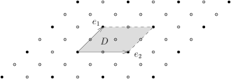

我们用$+$表示交换群$A$中的乘法。
若有有限个$x_1,\cdots,x_n\in A$，使得$A=\langle x_1,\cdots, x_n\rangle$，
则称$(A,+)$是**有限生成的交换群**。这些元素$\{x_i\}_{i\leqslant n}$被称作是$A$的一组生成元。

::: example
${\mathbb{Z}}$和${
  {\mathbb{Z}/n\mathbb{Z}}
}$是循环群，它们均由一个元素生成，从而是有限生成的交换群。
我们将证明一些${\mathbb{Z}}$与${
  {\mathbb{Z}/n\mathbb{Z}}
}$的乘积给出所有的有限生成交换群。
:::

::: example
有限交换群是有限生成的交换群。
:::

::: example
有限个有限生成交换群之积是有限生成的交换群。
特别地，
${\mathbb{Z}}^r=\underbrace{{\mathbb{Z}}\oplus \cdots \oplus {\mathbb{Z}}}_{\text{$r$个}}$
是有限生成的交换群。
:::

::: remark
有限生成的交换群的商群是有限生成的。

实际上，令$B<A$为子群，那么，陪集$x_1 B,\cdots, x_n B$生成了$
  {A/B}
$。
:::

::: remark
$A$是交换群，则$A$是有限生成的当且仅当存在非负整数$n$以及满同态${\mathbb{Z}}^n\rightarrow A$。

由于通过满同态${\mathbb{Z}}^n\rightarrow A$可以把$A$视作是${\mathbb{Z}}^n$的商群，所以，
$A$是有限生成的；反之，若$A$由$x_1,\cdots,x_n$生成，则可定义满的群同态
\[
{\mathbb{Z}}^n\longrightarrow A,  \ \ (\lambda_1,\cdots,\lambda_n)\mapsto \sum_{i=1}^n \lambda_i x_i.
\]
:::

::: remark
给定交换群的正合列，
\[
0\rightarrow B\stackrel{\iota}{\longrightarrow} A \stackrel{\pi}{\longrightarrow} C\rightarrow 0.
\]
若$B$和$C$均为有限生成的交换群，$A$亦然。特别地，对于交换群$A$，如果其子群$B$与商群$
  {A/B}
$均为有限生成的，则$A$也是有限生成的。

实际上，令$\{b_1,\cdots,b_k\}$和$\{c_1,\cdots,c_l\}$分别是$B$和$C$的生成元，对$i\leqslant l$，
任选$a_i\in \pi^{-1}(c_i)\subset A$。那么，$a_1,\cdots,a_l,\iota(b_1),\cdots,\iota(b_k)$生成$A$。
实际上，对任意的$x\in A$，存在$\lambda_1,\cdots, \lambda_l\in {\mathbb{Z}}$，使得
\[
\pi(x)=\sum_{i=1}^l \lambda_i c_i \ \ \Leftrightarrow \ \ \pi\left(x-\sum_{i=1}^l \lambda_i a_i \right)=0.
\]
从而，$x-\displaystyle\sum_{i=1}^l \lambda_i a_i \in {\rm Ker}(\pi)={\rm Im}(\iota)$。
从而，存在$\lambda'_1,\cdots,\lambda'_k\in {\mathbb{Z}}$，使得
\[
x-\sum_{i=1}^l \lambda_i a_i=\sum_{j=1}^k \lambda'_j \iota(b_j) \ \ \Leftrightarrow \ \ x=\sum_{i=1}^l \lambda_i a_i+\sum_{j=1}^k \lambda'_j \iota(b_j).
\]
:::

::: remark {@rem-subgroup-of-finite-generated-abel}
有限生成的交换群的子群是有限生成的。

直接用定义证明这个命题需要对$A$的生成元个数$n$进行归纳。
若$n=1$，则$A$为循环群，其子群均为循环群，命题显然成立。假设命题对$n=k$成立。
现在考虑$A=\langle x_1,\cdots,x_k,x_{k+1}\rangle$以及子群$A'=\langle x_1,\cdots,x_k\rangle$
和任意一个子群$B<A$。

由于$B\cap A'\subset {\rm Ker}(B\hookrightarrow A \rightarrow
  {A/{A'}}
)$，所以，$
  {B/(B\cap A')}
$可以被视作是$
  {A/A'}
$的子群。由于$
  {A/{A'}}
$可以由一个元素生成，从而，$
  {B/(B\cap A')}
$可由一个元素生成。我们于是得到如下正合列的交换图：
\[
\begin{tikzcd}
1 \arrow[r] &  A' \arrow[r, "\subset"] & A \arrow[r, "\pi"] &
  {A/A'}
\arrow[r] &1\\
1 \arrow[r] &  A'\cap B \arrow[r, "\subset"]  \arrow[u, "\subset"] &B \arrow[r, "\pi"]  \arrow[u, "\subset"] &
  {B/(B\cap A')}
\arrow[r]  \arrow[u, "\subset"] &1
 \end{tikzcd}
\]
归纳假设表明$A'\cap B$是有限生成的。根据第二行的正合列，$B$是有限生成的。

以上证明表明，$B$的生成元个数不超过$A$的生成元个数。特别地，如果有单同态
\[
\varphi\colon{\mathbb{Z}}^m\longrightarrow {\mathbb{Z}}^n,
\]
则$m\leq n$。
:::

::: remark {@tech:mod-p}
若有满的群同态$\psi\colon{\mathbb{Z}}^m\twoheadrightarrow{\mathbb{Z}}^n$，则$m\geqslant n$。

我们用所谓$\bmod~p$的技巧来证明此命题。考虑自然的同态
\[
\bmod~p\colon{\mathbb{Z}}^n\longrightarrow \left({
  {\mathbb{Z}/p\mathbb{Z}}
}\right)^n,  \ \  (k_1,\cdots,k_n)\mapsto (k_1 \bmod p, \cdots, k_n\bmod p).
\]
很明显，$p{\mathbb{Z}}^n = {\rm Ker}(\bmod~p)$，所以，$
  {{\mathbb{Z}}^n/p{\mathbb{Z}}^n}
\simeq \left({
  {\mathbb{Z}/p\mathbb{Z}}
}\right)^n$。
现在考虑如下交换图：
\[
\begin{tikzcd}
  {\mathbb{Z}}^m \arrow[r, "\psi"]\arrow[d, "\bmod p"]  & {\mathbb{Z}}^n \arrow[d, "\bmod p"] \\
 \left({
  {\mathbb{Z}/p\mathbb{Z}}
}\right)^m=
  {{\mathbb{Z}}^m/p{\mathbb{Z}}^m}
  \arrow[r, "\overline{\psi}", dashed]  &\left({
  {\mathbb{Z}/p\mathbb{Z}}
}\right)^n\end{tikzcd}
\]
由于上图右边的$\bmod~p$映射是满射，所以，$\overline{\psi}\colon\left({
  {\mathbb{Z}/p\mathbb{Z}}
}\right)^m\rightarrow \left({
  {\mathbb{Z}/p\mathbb{Z}}
}\right)^n$是满射。
注意到，这是${\mathbb{F}_p}$-线性空间之间的线性映射，根据维数的关系，就有$m\geqslant n$。
:::

::: example [最重要的例子：格点子群]
$V$是$n$维${\mathbb{R}}$-线性空间，其中$n\geqslant 1$。
假设$G<V$是一个**离散子群**（作为$V$的加法子群），即对任意的$g\in G$，存在开集$O\subset V$，
使得$G\cap O=\{g\}$。
根据定义，$G<V$是离散子群当且仅当对任意的紧集$K\subset V$，$G\cap K$是有限的。

任选$V$的基$\mathfrak{e}=(e_1,\cdots,e_n)$，定义$\mathfrak{e}$的格点集为
\[
\Gamma_\mathfrak{e}=\bigoplus_{i=1}^n {\mathbb{Z}} e_i=\left\{\sum_{i=1}^n k_ie_i\bigm| k_i\in \mathbb{Z}\right\}.
\]
这是$V$的离散子群。

如果只考虑$\mathfrak{e}$中的部分元所生成的格点，比如对$m<n$，考虑$\{e_1,\cdots,e_m\}$所生成的
\[
\bigoplus_{i=1}^m {\mathbb{Z}} e_i=\left\{\sum_{i=1}^m k_ie_i\bigm| k_i\in \mathbb{Z}\right\}.
\]
这也是$V$的离散子群。
:::

上述格点集给出了$V$的所有的离散子群：

::: theorem
$V$是$n$维${\mathbb{R}}$-线性空间，$G<V$是离散子群并且${\rm span}_{{\mathbb{R}}}(G)=V$。
那么，存在$V$的基$\mathfrak{e'}=(e'_1,\cdots,e'_n)$，使得$G=\Gamma_{\mathfrak{e}'}$。
:::

::: proof
对维数$n$归纳。

$n=1$时，不妨设$e_1\in G$并且$e_1>0$。由于$G$是离散子群，所以$G\cap [0,e_1]$是有限集。
特别地，$G\cap (0,e_1]$是非空的有限集。
令$e'_1=\min G\cap (0,e_1] $。
用$e'_1$对$e_1$进行带余除法，则存在正整数$l$和$r\in [0,e_1')$，使得$e_1=l\cdot e'_1+r$。
由于$G$是群，所以$r\in G$。根据$e'_1$的最小性，$r=0$，这表明$e_1=l\cdot e'_1\in\mathbb{Z}$。
类似地，每个$g\in G$均为$e'_1$的倍数，从而$G={\mathbb{Z}} \cdot e'_1$。

假设对小于$n$的所有维数命题成立。选取$e_1,\cdots,e_n\in G$作为$V$的一组基并考虑如下的基本区域
\[
D=\{\lambda_1e_1+\cdots+\lambda_ne_n\mid \lambda_1,\cdots,\lambda_n\in [0,1)\}.
\]

对任意$v\in V$，仿照以上的带余除法，它唯一地表达为$\Gamma_{\mathfrak{e}}$与$D$的元素之和：
\[
\begin{aligned}
v&=v_1e_1+\cdots+v_ne_n\\
&=\underbrace{\left(\lfloor{v_1}\rfloor e_1+\cdots+\lfloor{v_n}\rfloor e_n\right)}_{v_\Gamma}+\underbrace{\left(\{v_1\}e_1+\cdots+\{v_n\}e_n\right)}_{v_D},
\end{aligned}
\]
其中，$\lfloor{x}\rfloor$为不超过$x$的最大整数，$\{x\}=x-\lfloor{x}\rfloor$。所以，
\[
G=\Gamma_{\mathfrak{e}}+G\cap D.
\]
根据$G$为离散子群，$G\cap D\subset G\cap \overline{D}$是有限集。定义线性映射
\[
\pi_1\colon V\longrightarrow {\mathbb{R}}, \ \ v_1e_1+\cdots+v_ne_n\mapsto v_1.
\]
那么，$\pi_1$为满射并且${\rm Ker}(\pi_1)=V'={\rm span}(e_2,\cdots,e_n)$。
此时，$\pi_1(G)<{\mathbb{R}}$是子群。我们断言$\pi_1(G)$是${\mathbb{R}}$的离散子群。
根据$G=\Gamma_{\mathfrak{e}}+G\cap D$，我们有
\[
\pi_1(G)=\pi_1(\Gamma_{\mathfrak{e}})+\pi_1(G\cap D)=\langle \pi_1(e_1)\rangle +\pi_1(G\cap D).
\]
由于$\pi_1(G\cap D)$是有限集，所以$\pi_1(G)$在${\mathbb{R}}$中和任何紧集的交有限。
特别地，$\pi_1(G)$由某个$\pi_1(e'_1)$生成，其中，$e'_1\in G$。
至此，我们有$G$的子群$\langle e_1'\rangle$和$G\cap V'$。
很显然，
$\langle e_1'\rangle\cap \big(G\cap V'\big)=0$并且$\langle e_1'\rangle+ \big(G\cap V'\big)=G$。
这表明，$G\simeq \big(G\cap V'\big)\times \mathbb{Z}e_1'$。对$\big(G\cap V'\big)$用归纳假设即可。
:::

::: theorem [有限生成交换群的结构] {@prop:classification-of-finitely-generated-abelian-groups}
对每个有限生成的交换群$A$，存在唯一一组整数$r\geqslant 0, d_1,\cdots,d_s\geqslant 2$，
使得$d_s \mid d_{s-1},d_{s-1}\mid d_{s-2},\cdots,d_2\mid d_1$并且
\[
A\simeq {\mathbb{Z}}^r\times \prod_{i=1}^s
  {{\mathbb{Z}}/d_i{\mathbb{Z}}}
.
\]
我们称$r$为$A$的**秩**，称$(d_1,\cdots,d_s)$为$A$的**不变因子**。
:::

::: lemma
$\{x_1,\cdots, x_n\}$是有限生成的交换群$A$的一组生成元，
$k_1,\cdots,k_n\in\mathbb{Z}$且其最大公约数为$1$。那么，存在$y_2,\cdots,y_n\in A$，使得
$\{k_1x_1+\cdots+k_nx_n, y_2,\cdots, y_n\}$也是$A$的一组生成元。
:::

::: proof
不妨假设$|k_1|\geqslant |k_2|\geqslant \cdots \geqslant |k_n|$。通过调整正负号，还可以假设$k_1>0$。

我们对$k=\displaystyle\sum_{i=1}^n |k_i|$进行归纳，具体的归纳假设如下：
对任意生成元$\{x'_1,\cdots, x'_n\}$和任意$k'_1,\cdots,k'_n\in\mathbb{Z}$，
若$k'_1,\cdots,k'_n$的最大公约数为$1$且$\displaystyle\sum_{i=1}^n |k'_i|<k$，就可以把
$k'_1x'_1+\cdots+k'_nx'_n$扩充为$A$的总数不超过$n$个的一组生成元。

若$k=1$，则$k_1x_1+\cdots+k_nx_n=\pm x_1$，此时选取$y_2=x_2,\cdots,y_n=x_n$即可。

现在证明$k$的情形。此时，$k_1\geqslant |k_2|$，根据$k_2$的符号$\varepsilon$，我们可以做如下的调整：
\[
k_1x_1+\cdots+k_nx_n = (k_1-\varepsilon\cdot k_2)x_1+ k_2(x_2+\varepsilon\cdot x_1)+k_3x_3\cdots+k_nx_n.
\]
此时，$x_1,x_2+\varepsilon x_1,x_3,\cdots,x_n$仍然是$A$的总数不超过$n$个的一组生成元。
注意到$k_2\neq 0$（否则$k_2=\cdots=k_n=0$，根据$k_1,\cdots,k_n$的最大公约数为$1$，就有$k_1=1$，
所以这是$k=1$的情况），从而
\[
|k_1-\varepsilon\cdot k_2|+|k_2|+\cdots+|k_n|<k.
\]
根据归纳假设，命题得证。
:::

::: lemma
有限生成的交换群$A$具有**仿基**，即存在生成元集$\{x_1,\cdots,x_n\}\subset A$，使得
\[
\sum_{i=1}^n k_i x_i=0 \ \ \Leftrightarrow \ \ k_ix_i=0, \ i=1,\cdots,n.
\]
:::

::: proof
选取$A$生成元集$\{x_1,\cdots,x_n\}$使得生成元个数$n$是最小的并在此前提下要求${\rm ord}(x_1)$
是最小的（可以是$\infty$）。
考虑$A$的子群$A_0=\langle x_1\rangle$和$A_1=\langle x_2,\cdots,x_n\rangle$以及群同态：
\[
\varphi\colon A_0\times A_1\rightarrow A, \ \ (a_0,a_1)\mapsto a_0\cdot a_1.
\]
特别地，我们有$\varphi\big((x_1,1)\big)= x_1$，$\varphi\big((1,x_i)\big)= x_i$，其中，
$i\geqslant 2$。
从而，${\rm Im}(\varphi)$包含$A$的生成元集，从而为满射。

现在证明$\varphi$是单射：假设$\varphi\left(m_1x_1, \displaystyle\sum_{i=2}^nm_ix_i\right)=0$，其中，
不妨假设$0\leqslant m_1<{\rm ord}(x_1)$。
我们的目标是证明$m_1x_1=0$（从而$ \displaystyle\sum_{i=2}^nm_ix_i=0$），所以不妨设$m_1\geqslant 1$。
考察这组数的最大公约数$d=(m_1,\cdots,m_n)$，则
\[
d\big(k_1x_1+k_2x_2+\cdots+k_nx_n\big)=0,  \ \ k_i=\frac{m_i}{d},  \ (k_1,\cdots,k_n)=1.
\]
根据上一引理，
可以选取$y_1=k_1x_1+ \displaystyle\sum_{i=2}^nk_ix_i$和$y_2,\cdots,y_n$作为生成元的集合，但是
\[
{\rm ord}(y_1)\leqslant d\leqslant m_1<{\rm ord}(x_1).
\]
这与${\rm ord}(x_1)$的最小性矛盾。

以上推理证明了$\langle x_1\rangle \times A_1\stackrel{\simeq}{\longrightarrow}A$并且$A_1$
的生成元数目不超过$n-1$。特别地，$A_1$的生成元数目严格小于$A_0$的最少生成元。
我们再对$A_1$进行以上的分解并将此过程继续下去就可以得到一组拟基。
:::

::: remark
以上证明表明，$A$可以写成一些循环群$A_i$的乘积。特别地，$A$与${\mathbb{Z}}^r\times \prod_{i=r+1}^n
  {{\mathbb{Z}}/m_i{\mathbb{Z}}}
$形式的群同构。
:::

::: remark [有限生成交换群结构定理的存在性部分的证明] {@rem:proof-uniquness-abel}
根据上述仿基的命题，可假设$A\simeq{\mathbb{Z}}^r\times \prod_{i=r+1}^n
  {{\mathbb{Z}}/m_i{\mathbb{Z}}}
$的。此时，我们需要对$
  {{\mathbb{Z}}/m_i{\mathbb{Z}}}
$这些因子进行分解和重排。实际上，根据$m_i$的素因子分解，我们有[^1]
\[
m_i=\prod_{p} p^{\alpha_i(p)} \ \ \Rightarrow \ \
  {{\mathbb{Z}}/m_i{\mathbb{Z}}}
=\prod_{p}
  {{\mathbb{Z}}/p^{\alpha_i(p)}{\mathbb{Z}}}
.
\]
从而，
\[
A\simeq {\mathbb{Z}}^r\times \prod_p \prod_{i=1}^s
  {{\mathbb{Z}}/p^{\alpha_i(p)}{\mathbb{Z}}}
.
\]
现在将上面的乘积重新组合。
首先定义$d_1$：对每个$p$，令$\beta(p)=\max\{\alpha_i(p)\}_{i}$，
则令$d_1=\prod_{p}\beta(p)$并将这一个$\beta(p)$从$\{\alpha_i(p)\}_{i}$中删除。
其次定义$d_2$，
令$\gamma(p)=\max\{\alpha_i(p)\}_{i}$以及$d_2=\prod_{p}\gamma(p)$并将这一个$\gamma(p)$从
$\{\alpha_i(p)\}_{i}$中删除。以此类推，我们自然有$d_2\mid d_1,d_3\mid d_2\cdots$。从而，
\[
A\simeq {\mathbb{Z}}^r \times\big(\prod_{p}
  {{\mathbb{Z}}/p^{\beta(p)}{\mathbb{Z}}}
\big)\times \big(\prod_{p}
  {{\mathbb{Z}}/p^{\gamma(p)}{\mathbb{Z}}}
\big)\times \cdots ={\mathbb{Z}}^r\times \prod_{i=1}^s
  {{\mathbb{Z}}/d_i{\mathbb{Z}}}
.
\]
这就完成了定理中存在性的证明。
:::

为了证明唯一性，只要说明$r,d_1,\cdots,d_s$可以完全由$A$本身计算即可。先证明关于循环群的一个性质：

::: lemma
$A$是循环群，$p$是素数，那么，
\[
  {p^{k-1}A/p^{k}A}
=\begin{cases}
 0,\ \ & \text{若 }|A|<\infty, \ \ p^k \nmid |A|;\\
 {
  {\mathbb{Z}/p\mathbb{Z}}
}, \ \ &\text{其余情况。}
 \end{cases}
\]
:::

::: proof
设$x$为$A$的生成元，则$p^{k-1}x$是$p^{k-1}A$的生成元并且$p\cdot p^{k-1}x\in p^{k}A$。从而，
\[
  {p^{k-1}A/p^{k}A}
\simeq {
  {\mathbb{Z}/p\mathbb{Z}}
} \  \text{或} \ 0.
\]
引理对$A\simeq{\mathbb{Z}}$是显然的，以下假设$A$是有限循环群，即$A\simeq {
  {\mathbb{Z}/n\mathbb{Z}}
}$，并且$n=p^d \cdot m$，其中，$(m,p)=1$。那么，$A\simeq
  {{\mathbb{Z}}/p^d {\mathbb{Z}}}
\times
  {{\mathbb{Z}}/m {\mathbb{Z}}}
=A'\times
  {{\mathbb{Z}}/m {\mathbb{Z}}}
$，其中，$A'=
  {{\mathbb{Z}}/p^d {\mathbb{Z}}}
$。由于$(m,p)=1$，所以对任意的$l$，群同态
\[
  {{\mathbb{Z}}/m {\mathbb{Z}}}
\rightarrow
  {{\mathbb{Z}}/m {\mathbb{Z}}}
, \ \ \overline{a}\mapsto p^l \overline{a},
\]
是同构。取$l=k-1,k$，我们有$p^{k-1}\cdot
  {{\mathbb{Z}}/m {\mathbb{Z}}}
=
  {{\mathbb{Z}}/m {\mathbb{Z}}}
$，$p^{k}\cdot
  {{\mathbb{Z}}/m {\mathbb{Z}}}
=
  {{\mathbb{Z}}/m {\mathbb{Z}}}
$。从而，
\[
  {p^{k-1}A/p^{k}A}
\simeq
  {p^{k-1}A'/p^{k}A'}
.
\]
此时，我们可以专注于$
  {p^{k-1}A'/p^{k}A'}
$，其中，$A'=
  {{\mathbb{Z}}/p^d {\mathbb{Z}}}
$：

- 如果$d<k$，即$p^k \nmid |A|$，那么，$k-1\geqslant d$。从而，$p^{k-1}A'=p^{k-1}\cdot
  {{\mathbb{Z}}/p^d {\mathbb{Z}}}
=0$。这就给出$
  {p^{k-1}A'/p^{k}A'}
\simeq 0$；

- 如果$d\geqslant k$，那么，$p^{k-1}x'\neq 0$（在$A'$中），其中$x'$为$A'$的生成元。
  很明显，$p^{k-1}x'\notin p^{k}A'$，所以，$
  {p^{k-1}A'/p^{k}A'}
\simeq {
  {\mathbb{Z}/p\mathbb{Z}}
}$。

综合上述，我们就完成了引理的证明。
:::

::: proof [有限生成交换群结构定理的唯一性部分的证明]
任给存在性部分的一个分解$\displaystyle A\simeq {\mathbb{Z}}^r\times \prod_{i=1}^s
  {{\mathbb{Z}}/d_i{\mathbb{Z}}}
$，我们有
\[
  {p^{k-1}A/p^{k}A}
\simeq \big({
  {\mathbb{Z}/p\mathbb{Z}}
}\big)^r\times \prod_{i=1}^s
  {p^{k-1}\big({{{\mathbb{Z}}/d_i{\mathbb{Z}}}}\big)/p^{k}\big({{{\mathbb{Z}}/d_i{\mathbb{Z}}}}\big)}
.
\]
上述群的阶为$p^{r+s(k)}$，其中，$s(k)$为$d_1,\cdots,d_s$中能被$p^k$整除的数的个数。
根据$d_s\mid d_{s-1} \mid \cdots \mid d_1$，这些数恰好是前面的$d_1,\cdots, d_{s(k)}$。
这样，当$k$取遍$\{1,2,\cdots,\}$时，我们可以通过$s(k)$的值决定$d_1,\cdots,d_s$所含$p$因子的幂，
从而决定$d_1,\cdots,d_s$。
通过选取$p$与所有$d_1,\cdots,d_s$互素，我们知道$
  {A/pA}
\simeq \big({
  {\mathbb{Z}/p\mathbb{Z}}
}\big)^r$决定了$r$。
所以，秩$r$和不变因子$d_1,\cdots,d_s$完全由群$A$本身决定。这就给出了唯一性。
:::

::: example
我们研究$A=
  {{\mathbb{Z}}/4{\mathbb{Z}}}
\times
  {{\mathbb{Z}}/6{\mathbb{Z}}}
$的分解。根据分类定理，我们应该把它写成：
\[
\begin{aligned}
A&\simeq
  {{\mathbb{Z}}/4{\mathbb{Z}}}
\times
  {{\mathbb{Z}}/6{\mathbb{Z}}}
\simeq
  {{\mathbb{Z}}/2{\mathbb{Z}}}
\times
  {{\mathbb{Z}}/2^2{\mathbb{Z}}}
\times
  {{\mathbb{Z}}/3{\mathbb{Z}}}
.
\end{aligned}
\]
此时，根据上述构造过程，$d_1=2^2\times 3$，$d_2=2$。从而，
\[
A\simeq
  {{\mathbb{Z}}/12{\mathbb{Z}}}
\times
  {{\mathbb{Z}}/2{\mathbb{Z}}}
.
\]
:::

[^1]: 参考习题中的[“乘积结构”](@section:product)。
