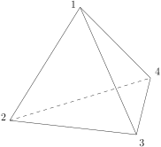
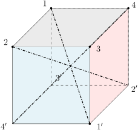
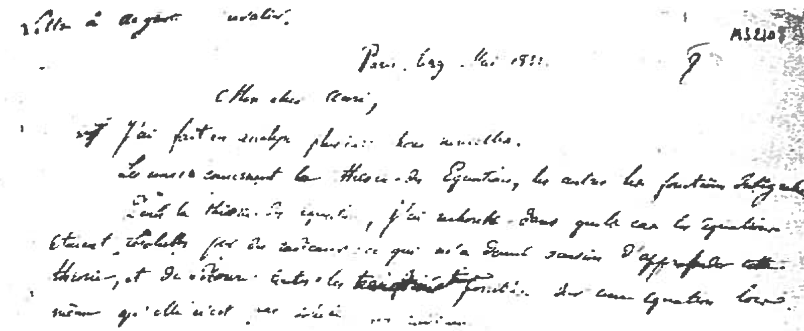
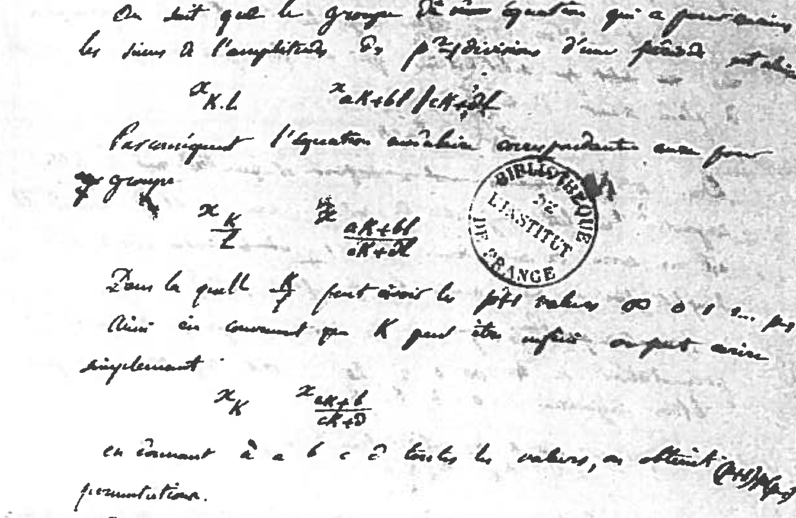

## 双传递性与单群的Iwasawa判定

假设$G$是群，$X$是集合，$|X|\geqslant 2$并且$G$作用在$X$上。那么，$G$自然地作用在$X\times X$上：
\[
G\times (X\times X)\rightarrow X\times X, \ \ \big(g,(x,y)\big)\mapsto (g\cdot x,g\cdot y).
\]
令$\Delta$为$X\times X$的对角线，即$\Delta=\{(x,x)|x\in X\}$。
若$G$在$X\times X-\Delta$上的作用是传递的，则称$G$在$X$上的作用是**双传递的**。
换而言之，双传递的群作用满足如下要求：对任意$x_1,x_2\in X,y_1,y_2\in X$，$x_1\neq y_1$，
$x_2\neq y_2$，存在$g\in G$，使得$gx_1=x_2$，$gy_1=y_2$。
特别地，我们知道$^{G\curvearrowright} X$是传递的。
另外，
双传递的定义等价于说$^{G\curvearrowright} \left(X\times X\right)$恰好有两个轨道$\Delta$和
$X\times X-\Delta$。

::: exercise
给定传递的群作用$^{G\curvearrowright} X$，其中，$|X|\geqslant 2$。
证明，该作用是双传递的等价于存在$x\in X$，使得${\rm Stab}(x)$在$X-\{x\}$上的作用是传递的。
:::

::: theorem [Iwasawa判据]
群$G$作用在集合$X$上，$|X|\geqslant 2$并且该作用是双传递的。
假设存在$x\in X$以及$A<{\rm Stab}(x)$使得

- 1\) $A$是${\rm Stab}(x)$的交换的正规子群；

- 2\) $\{gAg^{-1}|g\in G\}$生成$G$。

那么，对任意正规子群$N\lhd G$，
$\mathbf{D}(G)<N$或$N<{\rm Ker}(G\rightarrow \mathfrak{S}_X)$二者必居其一。
:::

::: remark
定理中的$\mathbf{D}(G)$是$G$的**换位子群**或**导出子群**，
它是由$G$中所有形如$ghg^{-1}h^{-1}$的元素生成的子群。我们显然有${\mathbf{D}}(G)\lhd G$。
:::

我们可以计算对称群$\mathfrak{S}_n$和交错群$\mathfrak{A}_n$的换位子群。
以下，我们忽略$n=1,2$这个两个平凡的情形。

::: example [${\mathbf{D}(\mathfrak{S}_n)}=\mathfrak{A}_n, n\geqslant 3$]
我们显然有${\mathbf{D}(\mathfrak{S}_n)}\lhd \mathfrak{A}_n$（${\mathbf{D}(\mathfrak{S}_n)}$
中的元是偶置换）。现在证明${\mathbf{D}(\mathfrak{S}_n)}=\mathfrak{A}_n$。
注意到，对于$i,j,k\leqslant n$，有
\[
\big((i,j),(j,k)\big)=(k,j,i).
\]
从而，${\mathbf{D}(\mathfrak{S}_n)}$包含所有的$3$-循环。
:::

::: example [${\mathbf{D}(\mathfrak{A}_n)}=\mathfrak{A}_n, n\geqslant 5$]
当$n\geqslant 5$时，${\mathbf{D}(\mathfrak{A}_n)}$中的$3$-循环是相互共轭的。
特别地，$\sigma =(i,j,k)$与$\sigma^2 =(i,k,j)$共轭（实际上，由于$n\geqslant 5$，
不妨假设$i,j,k\neq 1,2$，此时，用$(1,2)(j,k)$对$\sigma$共轭即可），即有$g\in \mathfrak{A}_n$，
使得$g\sigma g^{-1}=\sigma^2$。从而，
\[
\sigma=g\sigma g^{-1} \sigma^{-1}\in {\mathbf{D}(\mathfrak{A}_n)}.
\]
从而，${\mathbf{D}(\mathfrak{A}_n)}$包含所有的$3$-循环。
:::

::: proof [Iwasawa判据的证明]
假设$N\not\subset{\rm Ker}(G\rightarrow \mathfrak{S}_X)$，其中，$N\lhd G$。
我们的目标是说明$N\supset \mathbf{D}(G)$。

- 第一步，证明$N$在$X$上作用是传递的。对任意$x\in X$，它在$N$的作用下的轨道为$N x=\{nx|n\in N\}$。
  那么，

  - 选取$x\in X$，使得$N\cdot x\neq \{x\}$。

    由于$N\not\subset{\rm Ker}(G\rightarrow \mathfrak{S}_X)$，
    所以有$n\in N$以及$x\in X$使得$nx\neq x$。

  - $N\cdot x$在${\rm Stab}(x)$的作用下不变，即对任意的$g\in {\rm Stab}(x)$，$gNx\subset Nx$。

    实际上，对任意的$nx\in Nx$，其中，$n\in N$，我们有
    \[
    gnx=gng^{-1} gx=gng^{-1} x\in Nx,
    \]
    以上我们用到了$N\lhd G$以及$g\in {\rm Stab}(x)$。

  - ${\rm Stab}(x) N\cdot x \supset X-\{x\}$。

    由于$G$的作用是双传递的，所以，${\rm Stab}(x)(Nx-\{x\})\supset X-\{x\}$。

  综上所述，$N\cdot x\supset X-\{x\}$，所以，$N$在$X$上作用是传递的。

- 第二步，证明$\{nAn^{-1}|n\in N\}$生成$G$。

  - $G=N\cdot {\rm Stab}(x)={\rm Stab}(x)\cdot N$（因为$N$是正规的）。

    对任意$g\in G$，由于$N$的作用是传递的，存在$n\in N$，使得$nx=gx$，即$g^{-1}nx=x$。
    所以，$g^{-1}n=h \in {\rm Stab}(x)$。从而，$g=nh^{-1}\in N{\rm Stab}(x)$。

  - $\{gAg^{-1}|g\in G\}=\{nAn^{-1} | n\in N\}$。

    实际上，我们把$g$写成$g=n h$。由于$A\lhd {\rm Stab}(x)$，从而，
    \[
    gAg^{-1}=n \cdot h A h^{-1}\cdot n^{-1}=nAn^{-1}.
    \]

综合以上讨论，
我们有$G=\langle \{nAn^{-1} | n\in N\}\rangle = AN$（因为$nan^{-1}=a (a^{-1} n a) n^{-1}\in AN$）。
特别地，群同态
\[
A\hookrightarrow G\longrightarrow
{G/N}
\]
是满射。由于$A$是交换群，所以，$
  {G/N}
$是交换群。特别地，任意$ghg^{-1}h^{-1}\in G$都落在$N={\rm Ker}(G\rightarrow
  {G/N}
)$，即$\mathbf{D}(G)\subset N$。
:::

如果群$G$除了$1$和$G$外没有其它正规子群，就称$G$是**单群**。应用Iwasawa判据，我们可以证明：

::: example [$\mathfrak{A}_5$是单群]
在上述定理中，我们选取$G=\mathfrak{A}_5$，$X=\{1,2,3,4,5\}$，那么，
${\rm Ker}(G\rightarrow \mathfrak{S}_X)=1$并且$^{G\curvearrowright} X$是双传递的。

选取$x=5$，此时，${\rm Stab}(x)=\mathfrak{A}_4$并选取
\[
A=\{1, (1,2)(3,4), (1,3)(2,4), (1,4)(2,3)\}\simeq
  {{\mathbb{Z}}/2{\mathbb{Z}}}
\times
  {{\mathbb{Z}}/2{\mathbb{Z}}}
.
\]
这是$\mathfrak{A}_4$中的交换的正规子群。
我们现在说明$\{gAg^{-1}|g\in \mathfrak{A}_5\}$生成$\mathfrak{A}_5$：
通过考虑$(1,2,5)(1,2)(3,4)(1,2,5)^{-1}=(2,5)(3,4)$，$\{gAg^{-1}\}$包含了所有的$(i,j)(k,l)$型元素，
其中，$i,j,k,l$两两不同。
另外，通过考虑$(1,2)(3,4)\cdot (1,5)(3,4)=(1,5,2)$，我们知道所有的$3$-循环都可以生成，
从而可以生成$\mathfrak{A}_5$。

假设$N\lhd \mathfrak{A}_5$，Iwasawa判据表明$N\subset {\rm Ker}(G\rightarrow
  {G/N}
)=1$或者$N\supset \mathbf{D}(\mathfrak{A}_5)=\mathfrak{A}_5$，从而，$\mathfrak{A}_5$为单群。
:::

::: example [剪切映射与${\mathbf{SL}}(n;K)$的导出子群]
$K$是域，$V$是$n$-维$K$-线性空间，$t\in {\mathbf{SL}}(V)$，如果$\dim {\rm Ker}(t-1)=n-1$，
就称$t$是**剪切映射**。根据定义，${\rm rank}(t-1)=1$。

选取$V$的基$\{e_1,\cdots,e_{n-1},e_n\}$，使得$e_1,\cdots,e_{n-1}\in {\rm Ker}(t-1)$，
由于$\det(t)=1$，所以
\[
t(e_n)=e_n+ x_1e_1+\cdots+x_{n-1}e_{n-1}
\]
据此，$t$可以用如下矩阵表示
\[
t=\begin{pmatrix}
  1&   &  & x_1\\
 & \ddots &\\
 &  & 1 &x_{n-1}\\
 &  &    & 1
\end{pmatrix}=\begin{pmatrix}
  \mathbf{I}_{n-1}&   x\\
 0 & 1
\end{pmatrix},
\]
其中，$x= x_1e_1+\cdots+x_{n-1}e_{n-1}$。通过调换$1,\cdots,n-1$，不妨假设$x_{n-1}\neq 0$。
令$e'_i=\begin{cases}e_i, \ i\neq n-1;\\ x, \ i=n-1.\end{cases}$。在$\{e_i'\}$下，$t$的矩阵表示为
\[
t_n\coloneqq\begin{pmatrix}
1&   &  & 0\\
& \ddots & &0\\
 &  & 1 &1\\
 &  &    & 1
\end{pmatrix}.
\]
特别地，以上讨论表明在${\mathbf{GL}}(n;K)$中，所有剪切映射均与$t_n$共轭。

当$n>2$时，为了在${\mathbf{SL}}(n;K)$中讨论剪切映射$t$的共轭，
我们用$g\in {\mathbf{GL}}(n;K)$进行共轭，从而，$gtg^{-1}=t_n$。由于$n>2$，令
\[
h=\begin{pmatrix}
\det(g)^{-1}  & & &\\
&1&   &  \\
& & \ddots &\\
& &  & 1
\end{pmatrix}.
\]
那么，$(hg)t(hg)^{-1}=t_n$并且$hg\in {\mathbf{SL}}(n;K)$。

在${\mathbf{SL}}(n;K)$中，我们有一大类剪切映射的例子：
$t_{i,j}(\lambda)=1+\lambda E_{i,j}$是剪切映射，其中，$\lambda\in K^\times$，
$E_{i,j}$是在第$i$行第$j$列为$1$而其余位置均为$0$的矩阵。另外，在${\mathbf{SL}}(2;K)$中，我们有
\[
\begin{pmatrix}
1& a\\
0& 1
\end{pmatrix}
\begin{pmatrix}
1& 0\\
b& 1
\end{pmatrix}
\begin{pmatrix}
1& c\\
0& 1
\end{pmatrix}=\begin{pmatrix}1+ab& abc+a+c\\
b& 1+cb\end{pmatrix}.
\]
令$a=c=-b^{-1}$，则$\begin{pmatrix}
0& -b^{-1}\\
b& 0
\end{pmatrix}$可以被剪切映射生成；进而$\begin{pmatrix}
0& 1\\
-1& 0
\end{pmatrix}\begin{pmatrix}
0& -b^{-1}\\
b& 0
\end{pmatrix}=\begin{pmatrix}
b& 0\\
0& b^{-1}
\end{pmatrix}$也可以被生成。
据此，我们知道${\mathbf{SL}}(V)$可以被剪切映射的集合生成，
这是因为以上$\{t_{i,j}(\lambda)\}\subset{\mathbf{SL}}(n;K)$以及所构造出的矩阵都对应着初等变换而每个
$g\in {\mathbf{SL}}(n;K)$都可以通过初等变换变成单位矩阵。

作为以上讨论的总结，我们有如下结论：

- 对任意的$n\geqslant 2$，${\mathbf{SL}}(n;K)$可以被剪切映射生成；

- 对任意的$n\geqslant 3$，${\mathbf{SL}}(n;K)$中的剪切映射是相互共轭的。
:::

::: lemma
当$n\geqslant 3$或$n=2,|K|\geqslant 4$时，有
\[
\mathbf{D}\big({\mathbf{GL}}(n;K)\big)={\mathbf{SL}}(n;K), \ \ \mathbf{D}\big({\mathbf{SL}}(n;K)\big)={\mathbf{SL}}(n;K).
\]
:::

::: proof
只要证明${\mathbf{SL}}(n;K)\subset \mathbf{D}\big({\mathbf{SL}}(n;K)\big)$即可。
我们证明一个充分条件：存在某个剪切$t\in {\mathbf{SL}}(n;K)$，它形如$t=xyx^{-1}y^{-1}$，其中，
$x,y\in {\mathbf{SL}}(n;K) $。
在此条件下，根据以上讨论，对任意的剪切$t'$，存在$g\in {\mathbf{GL}}(n;K)$，使得
\[
t'=gtg^{-1}=gxg^{-1}\cdot gyg^{-1}\cdot \left(gxg^{-1}\right)^{-1}\cdot \left(gyg^{-1}\right)^{-1}.
\]
其中，$gxg^{-1}, gyg^{-1}\in {\mathbf{SL}}(n;K)$。
这表明 $\mathbf{D}\big({\mathbf{SL}}(n;K)\big)$包含所有剪切映射，从而，
${\mathbf{SL}}(n;K)\subset \mathbf{D}\big({\mathbf{SL}}(n;K)\big)$。

当$n=2$时，我们计算
\[
\begin{pmatrix}
a& 0\\
0& a^{-1}
\end{pmatrix}
\begin{pmatrix}
1& 1\\
0& 1
\end{pmatrix}
\begin{pmatrix}
a& 0\\
0& a^{-1}
\end{pmatrix}^{-1}
\begin{pmatrix}
1&1 \\
0& 1
\end{pmatrix}^{-1}=\begin{pmatrix}1& a^2-1\\
0& 1\end{pmatrix}.
\]
当$|K|\geqslant 4$时，存在$a\in K^\times$，使得$a^2-1\neq 0$，上式就给出一个剪切映射。

当$n\geqslant 3$时，我们计算
\[
\begin{pmatrix}
g& 0\\
0& 1
\end{pmatrix}
\begin{pmatrix}
\mathbf{I}_{n-1}& v\\
0& 1
\end{pmatrix}
\begin{pmatrix}
g& 0\\
0& 1
\end{pmatrix}^{-1}
\begin{pmatrix}
\mathbf{I}_{n-1}& v\\
0& 1
\end{pmatrix}^{-1}=\begin{pmatrix}1& g(v)-v\\
0& 1\end{pmatrix}.
\]
其中，$g\in {\mathbf{SL}}(n-1;K), v\in K^{n-1}$。
由于$n-1\geqslant 2$，只要选取剪切映射$g\in {\mathbf{SL}}(n-1;K)$以及$g(v)-v\neq 0$即可。
:::

::: proposition
当$n\geqslant 3$或$n=2,|K|\geqslant 4$时，${\mathbf{PSL}}(n;K)$是单群。
:::

::: proof
当$n\geqslant 2$时，$G={\mathbf{SL}}(n;K)$在$X=\mathbb{P}^{n-1}(K)$上的作用是双传递的：
对任意的$v_1, w_1, v_2,w_2\in K^n$，其中，$v_i$与$w_i$不共线，显然有矩阵$g\in G$使得$g(v_1)=v_2$，
$g(w_1)=w_2$。

令$x=[0:0:\cdots:1]\in\mathbb{P}^{n-1}(K)$，则${\rm Stab}(x)$中的矩阵形如
\[
P_{g,v}=\begin{pmatrix}g& v\\
0& \det(g)^{-1}\end{pmatrix},  \ g\in {\mathbf{GL}}(n-1;K), v\in K^{n-1}.
\]
那么，
\[
A=\left\{P_{1,v}=\begin{pmatrix} 1 & v\\
0& 1\end{pmatrix},  \  v\in K^{n-1}\right\}\simeq K^{n-1}
\]
是${\rm Stab}(x)$的交换的正规子群。

当$n\geqslant 3$时，我们已经证明了$P_{1,v}=t_n$的共轭可以给出所有剪切映射，其中，$v=(0,\cdots,1)$。
由于剪切映射生成了${\mathbf{SL}}(n;K)$，从而，$\{gAg^{-1}|g\in G\}$生成$G$。

当$n=2$时，利用$\begin{pmatrix} 1 & a\\
0& 1\end{pmatrix} \in A$，我们计算共轭
\[
\begin{pmatrix}
0& -1\\
1& 0
\end{pmatrix}
\begin{pmatrix}
1& a\\
0& 1
\end{pmatrix}
\begin{pmatrix}
0& -1\\
1& 0
\end{pmatrix}^{-1}=\begin{pmatrix}1& 0\\
-a& 1\end{pmatrix}.
\]
我们已经证明了形如$\begin{pmatrix}
1& *\\
0& 1
\end{pmatrix}$和$\begin{pmatrix}
1& 0\\
*& 1
\end{pmatrix}$的矩阵生成${\mathbf{SL}}(2;K)$。

另外，我们有
\[
{{\rm Ker}}\big({\mathbf{SL}}(n;K)\rightarrow\mathfrak{S}_{\mathbb{P}^{n-1}(K)}\big)=\mu_n(K)
\]
以及$\mathbf{D}({\mathbf{SL}}(n;K))={\mathbf{SL}}(n;K)$。

根据Iwasawa判据，若$N\lhd{\mathbf{SL}}(n;K)$并且$N\neq {\mathbf{SL}}(n;K)$，那么，
$N\subset \mu_n(K)$。从而，根据
\[
  {{\mathbf{SL}}(n;K)/\mu_n(K)}
\stackrel{\simeq}{\longrightarrow} {\mathbf{PSL}}(n;K),
\]
我们知道${\mathbf{PSL}}(n;K)$的正规子群必为$1$或${\mathbf{PSL}}(n;K)$。
:::

## Burnside引理

我们证明如下关于轨道个数的计算公式：

::: proposition [Burnside]
假设有限群$G$作用在有限集$X$上，那么该作用的轨道个数是不动点个数的平均值，即

```math {@eq:Burnside}
\big|
  {G\backslash X}
\big| = \frac{1}{|G|} \sum_{g\in G} |X^g|.
```

其中，对任意的$g\in G$，$X^g =\{x\in X| g\cdot x=x\}$。
:::

::: proof
我们考虑集合$G\times X$的子集：
\[
S=\big\{(g,x)\in G\times X\bigm|g\cdot x=x\big\}.
\]
我们有两种方式来数$S$的元素个数。首先，根据$S=\coprod_{g\in G} X^g$，我们有
\[
|S|=\sum_{g\in G}|X^g|.
\]
其次，根据$S=\coprod_{x\in X} {\rm Stab}(x)$，我们有
\[
|S|=\sum_{ x\in X}|{\rm Stab}(x)|=\sum_{ x\in X}\frac{|G|}{|{\rm orb}(x)|}.
\]
所以，
\[
\sum_{ x\in X}\frac{1}{|{\rm orb}(x)|}=\frac{1}{|G|}\sum_{g\in G}|X^g|.
\]
另外，我们有
\[
\sum_{ x\in X}\frac{1}{|{\rm orb}(x)|}=\sum_{{\rm orb}(x_i)\in
  {G\backslash X}
}\big(\sum_{x\in {\rm orb}(x_i)} \frac{1}{|{\rm orb}(x)|}\big)=\sum_{{\rm orb}(x_i)\in
  {G\backslash X}
}1=\big|
  {G\backslash X}
\big|.
\]
这就给出了证明。
:::

::: example
有多少个4个顶点的简单图（顶点之间至多连一条边）？

固定$4$个点，在它们之间连或者不连边，这样构成的可能的图有$2^{4 \choose 2}=64$种，
这是我们的构形空间$X$。
对于$G=\mathfrak{S}_4$，通过对4个顶点的置换（从而置换相应的边），$\mathfrak{S}_4$作用在$X$上，
我们要计算$
  {\mathfrak{S}_4\backslash X}
$。

$\mathfrak{S}_4$中的$24$个元素可以分成如下几类

- $1$；共$1$个。
  此时，所有$X$中元素在此元素作用下不变，从而，$|X^g|=64$。

- 对换$(ab)$；共$6$个。
  根据对称性，考虑$g=(12)$，此时，从$1$出发到$2$，$3$或者$4$的边就确定了从$2$出发到$1$，
  $3$或者$4$的边，从而，我们有$2^3\times 2=16$个不动点，即$|X^g|=16$，
  这里后面的$\times 2$是考虑$3$和$4$之间是否连接一条边。

- 双对换$(ab)(cd)$；共$3$个。与上面类似，对于这样的$g$，我们有$|X^g|=16$。

- 3-轮换$(abc)$；共$8$个。
  不妨考虑$g=(123)$，对于$1$而言，它和$2$以及$4$的连线情况决定了所有的可能，从而，$|X^g|=4$。

- 4-轮换$(abcd)$；共$6$个。
  不妨考虑$g=(1234)$，对于$1$而言，它和$2$以及$3$的连线情况决定了所有的可能，从而，$|X^g|=4$。

根据Burnside引理，我们就有
\[
\big|
  {\mathfrak{S}_4\backslash X}
\big|=\frac{1}{24}\left(64+6\times 16+3\times 16+8\times 4+6\times 4\right)=11.
\]
所以，一共有$11$个四顶点的简单图。
:::

::: example
单位圆上平均分布着$n$个点，每个点可以染$m$种颜色。
如果通过旋转，两个图像是一样的，我们就认为这两个染色方式是一样的。试问一共有多少种不同的染色？

对这$n$个点任意进行$m$-染色，共有$m^n$种方式，这是构形空间$X$。对于这$n$个点的旋转对称群$G=
  {{\mathbb{Z}}/n{\mathbb{Z}}}
$，通过对顶点的置换，$G$作用在$X$上，我们要计算$
  {G\backslash X}
$。

对于$
  {{\mathbb{Z}}/n{\mathbb{Z}}}
$中的元素$g=\overline{k}$，其中，$k\in\{0,1,\cdots,n-1\}$，在$g$作用下不变的染色一共有$m^{(n,k)}$，其中，$(n,k)$为这两个数的最大公约数。
根据Burnside引理，我们就有
\[
\big|
  {G\backslash X}
\big|=\frac{1}{n}\sum_{k=0}^{n-1} m^{(n,k)}.
\]
特别地，如果$n=4$，$m=3$，那么，
\[
\big|
  {G\backslash X}
\big|=\frac{1}{4}\big(3^4+3^1+3^2+3^1\big)=24.
\]
:::

## Sylow定理

::: definition
$G$是有限群，$p$是素数，$|G|=n=p^k m$，其中，$k\geqslant 1$，$(p,m)=1$。
如果$S<G$是子群并且$|S|=p^k$，就称$S$是$G$的Sylow $p$-子群或是 **$p$-Sylow子群**。
:::

$S<G$是子群，则$S$为Sylow $p$-子群当且仅当$S$为$p$-群且$[G:S]$与$p$互素。

::: remark [群作用的一个例子]
Sylow $p$-子群$S$的共轭，即形如$gSg^{-1}$的群，仍是Sylow $p$-子群。
特别地，$G$可以（通过共轭）作用在Sylow $p$-子群的集合上。
:::

我们给出了两个具体的Sylow $p$-子群的例子：

::: example
令$G={
  {\mathbb{Z}/n\mathbb{Z}}
}$，其中 $n=p^km$，$p\nmid m$。我们有自然同构[^1]
\[
{
  {\mathbb{Z}/n\mathbb{Z}}
} \simeq
  {\mathbb{Z}/p^k \mathbb{Z}}
\times
  {\mathbb{Z}/m\mathbb{Z}}
.
\]
上式中右边第一个因子（在乘积中形如$(*,1)$的元素）$
  {\mathbb{Z}/p^k \mathbb{Z}}
$是唯一的Sylow $p$-子群。

从上式左边来看，该Sylow $p$-子群中的元素恰为${
  {\mathbb{Z}/n\mathbb{Z}}
}$中$\bmod~m$得$1$的元素，这因为上述同构由如下映射给出：
\[
{
  {\mathbb{Z}/n\mathbb{Z}}
} \rightarrow
  {\mathbb{Z}/p^k \mathbb{Z}}
\times
  {\mathbb{Z}/m\mathbb{Z}}
, \ \ \overline{a}\mapsto \big(a \ (\bmod~p^k), a \ (\bmod~m)\big).
\]
:::

::: example {@example:sylow-triangle-new}
请参考 @example:sylow-triangle。$K$是域且$|K|=q$，其中$q=p^m$，$p$是素数。此时，
\[
|\mathbf{GL}(n;K)|=\prod_{k=0}^{n-1}(q^n-q^k)=q^{\frac{n(n-1)}{2}}l, \ \  |\mathcal{T}_1|=q^{\frac{n(n-1)}{2}},
\]
其中，$\mathcal{T}_1$为对角线上全为$1$的上三角矩阵所构成的子群。
由于$l= \displaystyle\prod_{i=1}^n(q^i-1)$，从而，$(p,l)=1$。
所以，$\mathcal{T}_1$是$\mathbf{GL}(n;K)$的Sylow $p$-子群。
:::

::: example {@exam:sylow-p-of-Sp}
$p$是素数，考察$\mathfrak{S}_p$的Sylow $p$-子群。
由于$|\mathfrak{S}_p|=p(p-1)!$并且$\big(p,(p-1)!\big)=1$，
由$p$-循环$(x_1,x_2,\cdots,x_p)$生成的循环群给出了$\mathfrak{S}_p$中所有的Sylow $p$-子群。
容易看出，一共有$(p-1)!\div (p-1)=(p-2)!$个这样的Sylow $p$-子群。

另外，根据下面即将证明的Sylow定理，Sylow $p$-子群 的个数模$p$余$1$，即$(p-2)!\equiv 1 \pmod{p}$，
这是初等数论中的Wilson定理。
:::

::: remark
根据Cayley定理[^2]，每个有限群均可视为某个对称群$\mathfrak{S}_n$的子群。
实际上，还可以把有限群实现为一般线性群$ {\mathbf{GL}}(n;K)$的子群，其中，$K$为任意给定的域。

设群$G$的阶为$n$，根据Cayley定理的证明，通过左乘法$G$可以在自身上作用，
从而嵌入对称群$\mathfrak{S}_G \simeq \mathfrak{S}_n$。
我们再把$\mathfrak{S}_n$嵌入$\mathbf{GL}(n;K)$中：
给定$(e_i)_{1\leqslant i \leqslant n}$为$K^n$的标准的基，对任意的$\sigma \in \mathfrak{S}_n$，
我们把$\sigma$映射成线性变换$e_i \mapsto e_{\sigma(i)}$，其中，$i=1,\cdots,n$。
容易验证，这个对应方式给出了（单的）群同态$\mathfrak{S}_n \hookrightarrow \mathbf{GL}(n;K)$。
综上所述，我们把$G$实现为$\mathbf{GL}(n;K)$的子群。

以上构造可以用群代数的语言表达：群代数$K[G]$是$K$线性空间，
它具有基$\{e_g\}_{g\in G}$并且满足乘法$e_g\cdot e_{g'}=e_{gg'}$。我们定义
\[
G\longrightarrow {\mathbf{GL}}(K[G]),  \ \ g \mapsto (  e_{g'}\mapsto e_{gg'}).
\]
这是单的群同态，它将$G$实现为$ {\mathbf{GL}}(K[G])$的子群。

在应用时，我们通常选取$K={\mathbb{F}_p}$。
:::

::: proposition {@prop:subgroup-has-p-sylow}
$G$是有限群，$|G|=p^k m$，其中，$p$是素数并且$(p,m)=1$。
假设$S$是$G$的Sylow $p$-子群，$H<G$为子群，则存在$g\in G$，
使得$H \cap g S g^{-1}$是$H$的Sylow $p$-子群。
换而言之，通过对大群的Sylow $p$-子群 共轭可得到子群的Sylow $p$-子群。
:::

::: proof
证明的思想是考虑群作用在由自身所构造的对象上，请参考 @exam:group-acts-on-left-coset。

令$H$通过左乘法在$X=
  {G/S}
$上的作用。由于$S$是Sylow $p$-子群，所以$|X|$的元素个数与$p$互素。由于$X$是以上作用的轨道的并，必存在某个轨道$\mathbf{O}=H\cdot x=H\cdot gS$，其元素个数不是$p$的倍数。

对群作用$^{H\curvearrowright} X$，$x=gS$的稳定化子为$H \cap g S  g^{-1}$，由于$S$是Sylow $p$-子群，
所以$H \cap g S  g^{-1}$是$p$-群。
根据$|\mathbf{O}||H \cap g S  g^{-1}|= |H|$，则$[H:H \cap g S  g^{-1}] = |\mathbf{O}|$与$p$互素。
这表明$H \cap g S  g^{-1}$是$H$的Sylow $p$-子群。
:::

作为应用，我们有

::: theorem [Sylow第一定理] {@first-Sylow}
有限群有Sylow $p$-子群。
:::

::: proof
给定有限群$G$，$G$可视为${\mathbf{GL}}(n;{\mathbb{F}}_p)$的子群。
根据 @example:sylow-triangle-new，${\mathbf{GL}}(n;{\mathbb{F}}_p)$有Sylow $p$-子群，
从而$G$有Sylow $p$-子群。
:::

利用群作用在由自身所构造的对象上的观点，我们还可以构造其它的群作用给出Sylow定理的证明：

**Sylow定理的另一证明（Miller-Wielandt）：**
假设$|G|=qm=p^k m$，其中，$q=p^k$是$p$的幂，$p\nmid m$。用$X$表示群$G$的$q$元子集所构成的集合：
\[
X=\big\{A\subset G\bigm| |A|=q\big\}.
\]
那么，$|X|=\displaystyle{qm \choose q}$。我们有如下$\bmod~p$的同余关系：[^3]
\[
{qm \choose q} \equiv m  \pmod{p},
\]
其中，$q$是$p$的幂，$p\nmid m$。

群$G$通过左乘法作用于$X$，即
\[
G\times X\rightarrow X,  \ \ (g,A)\mapsto gA=\{ga\mid a\in A\}.
\]
由于$|X|$与$p$互素，存在$^{G\curvearrowright} X$的轨道$\mathbf{O}$，其元素数目与$p$互素。
任选$A\in \mathbf{O}$，令$S={\rm Stab}(A)$为$A$的稳定化子。
根据$|\mathbf{O}|=[G:S]$，这表明$p\nmid [G:S]$，从而，$|S|$已包含了$|G|$中所有$p$的幂，
即$q\mid |S|$。

另外，任选$a\in A$，由于$S$是$A$的稳定化子，所以以下映射是良好定义的：
\[
S\longrightarrow A, \ \ g\mapsto ga.
\]
这显然是单射，从而，$|S|\leqslant |A|=q$。再根据$q\mid |S|$，$q=|S|$，所以$S$为Sylow $p$-子群。

::: corollary [Cauchy] {@Cauchy}
若$p$整除$|G|$，则$G$有阶为$p$的元素。
:::

::: proof
$S$是$G$的Sylow $p$-子群，任选非单位元$x\in S$，它的阶整除$|S|$，不妨假设这个阶为$p^m$，
其中$m\geqslant 1$。那么，$x^{p^{m-1}}$的阶为$p$。
:::

::: remark
进一步分析以上证明中的轨道分解，可以给出关于Sylow $p$-子群 的更多性质。

考虑$^{G\curvearrowright} X$的轨道分解$X = \displaystyle\coprod_i \mathbf{O}_i$并对每个$i$，
选取$A_i \in \mathbf{O}_i$，从而，$\mathbf{O}_i=   G \cdot A_i$。
令$S_i={\rm Stab}(A_i)$为$A_i$的稳定化子，那么，$|\mathbf{O}_i| |S_i|= |G|$。
上述推理已经证明了$|S_i| \leqslant p^k$。现在考虑以下两种可能：

- 1\) $|S_i| < p^k$，那么，$p \mid |\mathbf{O}_i|$；

- 2\) $|S_i| = p^k$，那么该稳定化子群$S_i$是Sylow $p$-子群。

  反之亦然：假设$S$是Sylow $p$-子群，则对任意$g\in G$，$S\cdot g \in X$并且其稳定化子恰为$S$。
  实际上，如果Sylow $p$-子群$S$保持某个$A\in X$不变，即$S A \subset A$，则$A=Sa$，
  其中$a\in A$（因为$S  a \subset A$并且两个集合同阶）。
  这表明$S$恰为$X$中形如$S  a$的元素的稳定化子。这些元素恰好是$S$的右陪集，所以共有$|
  {G/S}
| = m$个。

以上给出了所有Sylow $p$-子群 的刻画。我们现在利用轨道来计算$X$的元素个数：
综上所述，有
\[
\begin{aligned}
 |X| &=  \sum_{ |S_i|< p^k}|\mathbf{O}_i|+ \sum_{|S_i|= p^k}|\mathbf{O}_i|\\
&\equiv 0+ s  m \pmod{p}.
\end{aligned}
\]
其中，$s$是Sylow $p$-子群 的个数。对于$|S_i|= p^k$的情形，每个轨道恰好有$m$个元素。
由于$|X|\equiv m \pmod{p}$，所以$s\equiv 1 \pmod{p}$。这表明Sylow $p$-子群 的个数除$p$余$1$。
:::

::: remark
上述等式
\[
\begin{aligned}
 |X| \equiv 0+ s  m \pmod{p}.
\end{aligned}
\]
的推导并未用到$G$的具体结构，
所以$s$模$p$只依赖于$|G|$（这里不需要使用${qm \choose q} \equiv m  \pmod{p}$）。特别地，群$
  {\mathbb{Z}/|G|\mathbb{Z}}
$只有一个Sylow $p$-子群，所以$s\equiv 1 \pmod{p}$。

我们以下将给出有限群Sylow $p$-子群 的个数除$p$余$1$的另一个证明。
:::

::: theorem [Sylow第二定理] {@second-Sylow}
$G$是有限群，则其每个$p$-子群都包含在某个Sylow $p$-子群 中。
另外，$G$的Sylow $p$-子群 两两共轭并且其个数模$p$余$1$。
:::

::: lemma {@lemma-fixed-point}
$G$是$p$-群并且作用在有限集$X$上，令
\[
X^G=\big\{x\in X\bigm|gx=x, \forall g\in G\big\}.
\]
那么，$|X|\equiv |X^G| \pmod{p}$。
:::

::: proof
$X^G$中的元素恰对应只有一个元素的轨道，而集合$X-X^G$是那些元素个数大于$1$的轨道的并。
由于$G$是$p$-群，后一种轨道的元素个数是$p$的倍数。所以，$|X|\equiv |X^G| ~({\rm mod} ~p)$。
:::

::: proof [Sylow第二定理的证明]
先证明第一个结论：假设$P$是$G$的$p$-子群，任选Sylow $p$-子群$S$，令$X=
  {G/S}
$。考虑$P$通过左乘法在$X$上的作用。根据上述引理，
\[
|X^P|\equiv |X|\neq 0 \pmod{p}.
\]
这表明有$gS\in X$，使得对任意的$h\in P$，$hgS=gS$，即$g^{-1}Pg\subset S$。
从而，$P<gSg^{-1}$而$gSg^{-1}$显然是Sylow $p$-子群。

另外，若$P$是Sylow $p$-子群，通过比较元素个数，$P<gSg^{-1}$意味着$P = g S g^{-1}$，
这证明了所有的Sylow $p$-子群 均共轭。
:::

现在给出定理中关于Sylow $p$-子群 个数的新证明，它依赖于下述引理：

::: lemma
若$S$和$S'$是$G$的Sylow $p$-子群 并且$S'$正规化$S$，即对任意$s'\in S'$，有$s'Ss'^{-1}<S$，则$S=S'$。
:::

::: proof
由于$S'$正规化$S$，所以$S'$是$S$的正规化子[^4]
${\rm N}_G(S)$的Sylow $p$-子群。另外，$S$也是${\rm N}_G(S)$的
Sylow $p$-子群 并且${\rm N}_G(S)$在$S$上共轭作用是平凡的，根据定理中的第二个结论，
$S$是${\rm N}_G(S)$中唯一的Sylow $p$-子群。所以，$S=S'$。
:::

现在令$X$为$G$的全体Sylow $p$-子群 的集合，$S$可以通过共轭作用在$X$上，即
\[
S\times X\rightarrow X,  \ \ (g, S')\mapsto gS'g^{-1}.
\]
上述引理表明$S\in X$是唯一一个被$S$固定的元素。
根据 @lemma-fixed-point，$|X|\equiv 1 ~({\rm mod}~p)$。

::: remark
令$X$为$G$的全体Sylow $p$-子群 的集合，$G$可以通过共轭作用于$X$。
Sylow第二定理表明该作用是传递的，所以Sylow $p$-子群 的个数必能整除$|G|$。
:::

::: example [$\mathfrak{S}_6$非共轭自同构另一个构造]
先考察$\mathfrak{S}_5$的Sylow 5-子群。根据 @exam:sylow-p-of-Sp，共有$s=(5-2)!=6$个这样的子群。
我们也可以利用Sylow定理的结论来计算，由于$s$除$5$余$1$，我们枚举以下可能性：
\[
s=1,6,11,16,21,26,31,36,41,46,51,56,61,\cdots.
\]
另外，根据$|\mathfrak{S}_5|=120$，$s\mid 120$，据此，$s=1$或者$6$。
另外，$5$-循环$(1,2,3,4,5)$和$(2,1,3,4,5)$生成了两个不同的Sylow 5-子群，所以$s\geqslant 2$，
从而$s=6$。

我们还可以利用$\mathfrak{S}_5$的唯一非平凡正规子群为$\mathfrak{A}_5$来排除$s=1$的情形：若不然，
Sylow第二定理表明这个Sylow 5-子群是正规子群，矛盾。

令$X=\{S_1,\cdots,S_6\}$是Sylow 5-子群的集合。通过共轭，$\mathfrak{S}_5$在$X$上给出了传递的群作用：
\[
\varphi\colon\mathfrak{S}_5\rightarrow \mathfrak{S}_X\simeq \mathfrak{S}_6.
\]
根据传递性，$|{\rm Ker}(\varphi)|\leqslant 120\div 6=20<60=|\mathfrak{A}_5|$，
根据$\mathfrak{S}_5$的唯一非平凡正规子群为$\mathfrak{A}_5$，我们可以断言${\rm Ker}(\varphi)=1$，
即$\varphi$是单射。
令$H={\rm Im}(\varphi)$，那么，
$H<\mathfrak{S}_X\simeq \mathfrak{S}_6$是有$120$个元素的子群并且$^{H\curvearrowright} X$是传递的。

这里的构造满足 @exam:S6-out 中的条件。
:::

## 正多面体的对称群

### 正四面体的对称群是$\mathfrak{A}_4$

用$\mathbf{SO}(3)$表示$3\times 3$的行列式为$1$的正交矩阵的集合，
这是${\mathbb{R}}^3$中旋转的所构成的群。
对任意$g\in \mathbf{SO}(3)$，若$g\neq 1$，则$g$的不动点只有其旋转轴。

给定中心在原点的正四面体$\mathbf{T}$并对其顶点如下标号：



现在考虑$\mathbf{T}$的对称群：
\[
{\rm Sym}^+(\mathbf{T})\coloneqq\big\{g\in \mathbf{SO}(3)\bigm| g\big(\mathbf{T}\big)=\mathbf{T}\big\}
\]
这是$\mathbf{SO}(3)$的子群并自然地作用在$\mathbf{T}$上。
我们证明${\rm Sym}^+(\mathbf{T})\simeq \mathfrak{A}_4$。

每个$g\in {\rm Sym}^+(\mathbf{T})$把正四面体的顶点映到顶点，通过标号，
我们认为$g$给出了$\varphi(g)\in \mathfrak{S}_4$。
例如，以过顶点$1$及其对面中心为轴的角度为$\frac{2\pi}{3}$的旋转$g$，把顶点$2$映成$3$、$3$映成$4$、
$4$映成$2$，所以，$\varphi(g)=(2,3,4)\in \mathfrak{S}_4$。
据此${\rm Sym}^+(\mathbf{T})$作用在顶点集合$\{1,2,3,4\}$上，从而有群同态：
\[
\varphi\colon {\rm Sym}^+(\mathbf{T})\longrightarrow   \mathfrak{S}_4.
\]
另外，若$g$固定了所有的顶点，则$g=1$，从而$\varphi$是单射。
我们现在来决定$\varphi$的像${\rm Im}(\varphi)<\mathfrak{S}_4$。
实际上，绕着过顶点以及其对面中心为轴的旋转给出了所有的$3$-循环，它们生成了$\mathfrak{A}_4$。
所以，$\mathfrak{A}_4<{\rm Im}(\varphi)<\mathfrak{S}_4$。
若${\rm Im}(\varphi)\neq \mathfrak{A}_4$，则${\rm Im}(\varphi)=\mathfrak{S}_4$，从而存在$g$，
使得$\varphi(g)=(3,4)$，从而，$g(1)=1,g(2)=2$，从而$g$在旋转轴外有不动点，这不可能。

### 正六面体的对称群是$\mathfrak{S}_4$

考虑中心在原点的正六面体$\mathbf{C}$：
把一个面上的顶点标号为$1,2,3,4$而与它们中心对称的顶点则标号为$1',2',3',4'$。



它的对称群为
\[
{\rm Sym}^+(\mathbf{C})\coloneqq\big\{g\in \mathbf{SO}(3)\bigm| g\big(\mathbf{C}\big)=\mathbf{C}\big\}
\]
这是$\mathbf{SO}(3)$的子群并自然地作用在$\mathbf{C}$上。

对$a=1,2,3,4$，用$X$表示过$a$与$a'$的直线$\ell_a$的集合，即$X=\{\ell_1,\ell_2,\ell_3,\ell_4\}$。
每个$g\in {\rm Sym}^+(\mathbf{C})$把$\ell\in X$映射成某个$\ell'\in X$，从而有群作用
\[
\varphi\colon {\rm Sym}^+(\mathbf{C})\rightarrow   \mathfrak{S}_X.
\]
$\varphi$显然是单射。
它的像${\rm Im}(\varphi)$包含所有绕某个$\ell_i$的角度为$\frac{2\pi}{3}$和$\frac{4\pi}{3}$的旋转，
即所有$3$-循环，从而$\mathfrak{A}_4<{\rm Im}(\varphi)$。
另外，以对边中点为轴、以$\pi$为角度的旋转给出$\mathfrak{S}_X$中的一个对换，从而，
${\rm Im}(\varphi)$包含$
\mathfrak{A}_4$之外的元素。根据$[\mathfrak{S}_4:\mathfrak{A}_4]=2$，${\rm Im}(\varphi)=\mathfrak{S}_4$。

### 正二十面体的对称群是$\mathfrak{A}_5$

考虑正二十面体$\mathbf{I}$：


其中，我们可以参考 @section:ica 中正二十面体的定义。它的对称群定义是$\mathbf{SO}(3)$的子群：
\[
{\rm Sym}^+(\mathbf{I})\coloneqq\big\{g\in \mathbf{SO}(3)\bigm| g\big(\mathbf{I}\big)=\mathbf{I}\big\}.
\]
除单位元外，我们罗列出${\rm Sym}^+(\mathbf{I})$的**部分**（可能是所有）元素：

- a) 绕以过对顶点的直线为轴、角度为$\frac{2k}{5}\pi$的旋转（$k=1,2,3,4$），共有$24$个。

- b) 绕以过对面中心的直线为轴、角度为$\frac{2k}{3}\pi$的旋转（$k=1,2$），共有$20$个。

- c) 绕以过对边中点的直线为轴、角度为$\pi$的旋转，共有$15$个。

连同单位映射，以上给出了${\rm Sym}^+(\mathbf{I})$中$60$个元素$G_{\mathbf{I}}$。
首先证明$\langle G_{\mathbf{I}} \rangle = {\rm Sym}^+(\mathbf{I})$。
给定$g\in {\rm Sym}^+(\mathbf{I})$，令$P'=g\cdot P$。

- 如果$P'\notin \{P,R_1,R_2,R_3,R_4,R_5\}$，可选取$\sigma\in G_{\mathbf{I}}$，
  使得$\sigma P'\in \{P,R_1,R_2,R_3,R_4,R_5\}$：实际上，不妨设$P'\in \{-P,-R_1\}$，
  选以$z$轴为对称轴、旋转角度为$\pi$的旋转$\sigma$，则$\sigma(P')\in \{R_1,P'\}$。
  所以，通过复合$G_{\mathbf{I}}$中元素，我们可以假设$g P'\in \{P,R_1,R_2,R_3,R_4,R_5\}$。

- 进一步复合以过面$PR_kR_{k+1}$及其对面的中心为轴的旋转，我们可以假设$g P=P$。
  此时，$g$的旋转轴为过$P$与$-P$的直线，所以只能是某个绕以过$P$和$-P$的直线为轴、
  角度为$\frac{k}{5}\pi$的旋转的旋转。

这就证明了${\rm Sym}^+(\mathbf{I})=\langle  G_{\mathbf{I}}\rangle$。

其次，我们证明${\rm Sym}^+(\mathbf{I})=G_{\mathbf{I}}$。
考虑${\rm Sym}^+(\mathbf{I})$作用在$\mathbf{I}$的$12$个顶点集上，这个作用是传递的。
顶点$P$的稳定化子${\rm Stab}(x)$恰有$5$个元素。从而，
\[
|{\rm Sym}^+(\mathbf{I})|=|{\rm Stab}(x)|\times 12=60.
\]
特别地，我们有${\rm Sym}^+(\mathbf{I})=G_{\mathbf{I}}$。

最终，我们研究${\rm Sym}^+(\mathbf{I})$的群结构。
一个**三线组**指的是过原点的三条相互垂直的直线并且每条直线都通过$\mathbf{I}$的某对边的中点，
比如$x,y,z$三个轴组成这样的一个三线组。
令$X$是三线组的集合，则$|X|=5$（每个三线组对应$\mathbf{I}$的$6$条边）。
${\rm Sym}^+(\mathbf{I})$中的元素保持${\mathbb{R}}^3$中间直线的正交性并且把$\mathbf{I}$
的边的中点映射为边的中点，所以，${\rm Sym}^+(\mathbf{I})$自然地作用在$X$上：
\[
\varphi\colon{\rm Sym}^+(\mathbf{I})\longrightarrow \mathfrak{S}_X\simeq \mathfrak{S}_5.
\]
以下证明$\varphi$是单射：

::: lemma
对$g\in {\rm Sym}^+(\mathbf{I})-\{1\}$（用$\ell_g$表示其旋转轴），
存在$\mu(g)\in {\rm Sym}^+(\mathbf{I})$（未必唯一），
使得$\ell_{\mu(g)}\perp \ell_g$并且$\mu(g)^2=1$（即$\mu(g)$为绕过对边中点的直线为轴的旋转）。
:::

::: proof
对${\rm Sym}^+(\mathbf{I})$的元素进行枚举证明：

- 1\) 绕以过对顶点的直线为轴的旋转：比如轴是过$P$的直线，选取$\mu(g)$为以$z$轴为轴的旋转。

- 2\) 绕以过对面中心的直线为轴的旋转，比如轴过$(1,1,1)$（面$PR_2R_3$的中心），
  则选取$\mu(g)$为以过$R_1R_5$的中点的轴垂直，这因为
  \[
  R_1=(\tau,-1,0),  R_5=(1,0,-\tau)  \ \ \Rightarrow \ \ \frac{1}{2}\big(R_1+R_5\big)=\frac{1}{2}(1+\tau,-1,-\tau).
  \]

- 3\) 绕以过对边中点的直线为轴的旋转，比如轴是$z$轴，则选$\mu(g)$为以$y$或$x$轴为轴的旋转。

以上罗列所有的可能，命题得证。
:::

如果$g\in {\rm Ker}(\varphi)$并且$g\neq 1$。那么，$g$固定三线组$x,y,z$。
从而，$g$给出了$\{x,y,z\}$到自身的映射。
特别地，$g^5\neq 1$（因为$\langle g\rangle$作用在$3$个元素的集合上，若$g$的阶是$5$，
则$g(x)=x,g(y)=y,g(z)=z$，这表明$g$为$1$或者$-1$，矛盾），从而$g$不是$5$阶的旋转。

根据引理中的构造，$\mu(g)$所的轴$\ell_{\mu(g)}$一定是某个三线组的元素，
记此三线组为$\{\ell_{\mu(g)},\ell_2,\ell_3\}$。根据$g\in {\rm Ker}(\varphi)$，有
\[
g\colon\{\ell_{\mu(g)},\ell_2,\ell_3\}\longrightarrow \{\ell_{\mu(g)},\ell_2,\ell_3\}
\]
另外，因为$\ell_g\perp \ell_{\mu(g)}$，$\ell_{\mu(g)}$在$g$的作用下一定改变，从而$g^2= 1$：
如若不然，$g^3=1$，
则$\ell_{\mu(g)}, g\big(\ell_{\mu(g)}\big),g^2\big(\ell_{\mu(g)}\big)$是与$\ell_g$
垂直的平面上的三条不同的直线，
但是
$\{\ell_{\mu(g)}, g\big(\ell_{\mu(g)}\big),g^2\big(\ell_{\mu(g)}\big)\}= \{\ell_{\mu(g)},\ell_2,\ell_3\}$
是两两垂直的，矛盾。

此时，唯一可能为$g^2=1$，不妨设$g$为以$z$轴为轴的旋转，
它把$R_1R_2$的中点$\frac{1}{2}(\tau+1,-1,\tau)$映射成$\frac{1}{2}(-\tau-1,+1,\tau)$，它们的内积为
\[
\frac{1}{2}(\tau+1,-1,\tau)\cdot \frac{1}{2}(-\tau-1,+1,\tau)=-\frac{1}{2}\left(\tau+1\right)
\]
这表明$g$把过$R_1R_2$的中点的线所在的三线组映射成另外的三线组，与$g\in {\rm Ker}(\varphi)$矛盾。

综上所述，$\varphi\colon{\rm Sym}^+(\mathbf{I})\longrightarrow \mathfrak{S}_X$是单射，
从而$\varphi\big({\rm Sym}^+(\mathbf{I})\big)$是$\mathfrak{S}_5$的$60$阶的子群。
我们已构造$20$个$3$阶元，
它们的像必然是$\mathfrak{S}_5$中的$3$-循环并且$\mathfrak{S}_5$中共有$20$个$3$-循环。
所以，$\varphi\big({\rm Sym}^+(\mathbf{I})\big)$包含$3$-循环生成的子群，
从而$\varphi\big({\rm Sym}^+(\mathbf{I})\big)=\mathfrak{A}_5$。

::: remark
还可以利用习题 @homework:An-simple 的想法先证明${\rm Sym}^+(\mathbf{I})$是单群来说明$\varphi$
是单射。

注意到如果$g\in \mathbf{SO}(3)$是以直线$\ell$为旋转轴、角度为$\theta$的旋转，那么，
对任意$h\in \mathbf{SO}(3)$，$h\cdot g\cdot h^{-1}$是以直线$h(\ell)$为旋转轴、角度为$\theta$的旋转。
据此，对任意的$g,g'\in \mathbf{SO}(3)$，$g$与$g'$共轭当且仅当它们的旋转角度相同。

利用以上的观察不难说明，${\rm Sym}^+(\mathbf{I})$一共有如下几个共轭类：

| 旋转角度 | $0$ | $\frac{2}{5}\pi$ | $\frac{4}{5}\pi$ | $\frac{2}{3}\pi$ | $\pi$ |
| --- | --- | --- | --- | --- | --- |
| 元素个数 | $1$ | $12$ | $12$ | $20$ | $15$ |

由于${\rm Sym}^+(\mathbf{I})$的非平凡正规子群一定是以上若干个共轭类的并，
所以其元素个数只能是以下集合中的某个数：
\[
\{13,16,21,25,28,33,36,40,45,48\},
\]
但它们不是$60$的约数，从而，${\rm Sym}^+(\mathbf{I})$是单群。
:::

::: remark
正二十面体的$3$组对边中点连线给出一个正八面体，一共有$5$个这样的正八面体。
${\rm Sym}^+(\mathbf{I})$在这些八面体构成的集合上的作用给出它到$\mathfrak{A}_5$的同构。
:::

## ${\mathbf{PSL}}(2;K)$与分式线性变换以及Galois的一个命题

$K$是域，规定$K\cup \{\infty\}$的运算法则：
\[
a\pm \infty = \infty,  \ \frac{b}{\infty}=0,  \  c \cdot \infty =\infty, \  \frac{c} {\infty} =0, \ \frac{\infty}{\infty}=1, \ 0\cdot \infty =0,
\]
其中，$a,b,c\in K$并且$c\neq 0$。

固定如下双射
\[
\Phi\colon K\cup \{\infty\}\longrightarrow \mathbf{P}^1(K), \ \ \ \ \ \ \ \ k\mapsto [k:1],\ k\in K;\ \ \
\infty\mapsto [1:0].
\]
我们定义${\mathbf{GL}}(2;K)$在$K\cup \{\infty\}$上的作用（直接计算可以证明这是群作用），
\[
{\mathbf{GL}}(2;K)\times K\cup \{\infty\} \longrightarrow K\cup \{\infty\}, \ \ \left(\begin{pmatrix}
a& b\\
c& d
\end{pmatrix},x\right)\mapsto \begin{pmatrix}
a& b\\
c& d
\end{pmatrix}
\cdot x = \frac{ax+b}{cx+d}.
\]
由于$k\cdot \begin{pmatrix}
1& 0\\
0& 1
\end{pmatrix}$的作用是平凡的，其中，$k\in K^\times$，以上诱导出群作用
\[
{\mathbf{PGL}}(2;K)\times K\cup \{\infty\} \longrightarrow K\cup \{\infty\}.
\]
特别地，以上定义的${\mathbf{PGL}}(2;K)\longrightarrow \mathfrak{S}_{K\cup \{\infty\}}$是单射。

::: remark
以上的群作用与${\mathbf{GL}}(2;K)$在$\mathbf{P}^1(K)$的作用是同构的，
请参考 @definition-morphism-of-action。实际上，$\Phi^{-1}([x:y])=\frac{x}{y}$（如果$y\neq 0$）。
固定$g=\begin{pmatrix}
a& b\\
c& d
\end{pmatrix}$，我们有
\[
g \cdot [x:y]= [ax+by:cx+dy].
\]
所以，
\[
\Phi^{-1}\left(g \cdot [x:y]\right)=\frac{ax+by}{cx+dy}=\frac{a\frac{x}{y}+b}{c\frac{x}{y}+d}=g\cdot \Phi^{-1}([x:y]).
\]
:::

::: example [$\infty$的稳定化子]
我们有
\[
{\rm Stab}(\infty)=\left\{\begin{pmatrix}
a& b\\
0& 1
\end{pmatrix}\in {\mathbf{PSL}}(2;K)\right\}
\]
它们对应的分式线性变换为$x\mapsto ax+b$，
这是 @exam:affine-transformation-group 中定义的$1$维的仿射变换群。
总之，${\rm Stab}(\infty)=\mathbf{Aff}_1(K)$。
:::

::: example
我们有
\[
{\mathbf{Scal}}\coloneqq{\rm Stab}(\infty)\cap {\rm Stab}(0)=\left\{x\mapsto k x\bigm|k\in K^\times\right\},
\]
这是以$0$为中心的伸缩变换。注意到$\mathbf{Scal}$不是${\rm Stab}(\infty)$的正规子群。

平移变换子群为
\[
{\mathbf{Parellel}}=\left\{\begin{pmatrix}
1& b\\
0& 1
\end{pmatrix}\Bigm| b\in K\right\}.
\]
这是${\rm Stab}(\infty)$的子群并且是正规子群。另外，$\mathbf{Parellel}\cap \mathbf{Scal}=1$。

矩阵$\begin{pmatrix}
0& 1\\
1& 0
\end{pmatrix}$对应着反演映射$\mathbf{Inv}\colon x\mapsto \frac{1}{x}$。
:::

::: example
利用矩阵的行列变换可以看出子群$\mathbf{Parellel}$与反演映射生成了所有分式线性变换，
即$\langle \mathbf{Parellel},\mathbf{Inv}\rangle={\mathbf{PSL}}(2;K)$。
:::

::: proposition
${\mathbf{PGL}}(2;K)$在$K\cup \{\infty\}$上的作用是$3$-传递的，即对任意的$(x,y,z)$和$(x',y',z')$，
其中，$\{x,y,z\}\subset K\cup \{\infty\}$两两不同，$\{x',y',z'\}\subset K\cup \{\infty\}$两两不同，
存在唯一的$g\in {\mathbf{PGL}}(2;K)$，使得$g(x)=x',g(y)=y',g(z)=z'$。
:::

::: proof
实际上，对任意的$\{x_1,y_1,z_1\}\subset K\cup \{\infty\}$，映射
\[
x\mapsto \frac{y_1-z_1}{y_1-x_1}\frac{x-x_1}{x-z_1}
\]
是唯一使得$g(x_1)=0,g(y_1)=1,g(z_1)=\infty$的分式线性变换。
:::

1832年5月29日，也就是那场著名决斗的前夜，
Galois把构思已久的几个定理写在给挚友Auguste Chevalier的信里：



“$\cdots$我的研究有了新的进展，部分关于方程的理论而另一部分涉及函数的积分。
在方程方面，通过研究何种情形方程可通过根式解出，我可以真正深入理论来描述对一个方程所有可能的变换，
即使该方程的解不能通过根式给出。

这些想法可以写成三篇文章。
第一篇已完成，Poisson教授对此有不同见解，但我仍坚持它的重要性并进行了必要的修正。
第二篇包含了一些相当有趣的应用。以下是最重要内容的总结：

$\cdots\,\cdots$

我一生中常常敢于提出一些自己不确定的命题，但在这里的内容在我却反复思考了一年有余$\cdots$

恳求你公开邀请Jacobi或Gauss发表意见，不是对这些定理的正确性，而是对它们的重要性$\cdots$”

注意到，
${\mathbf{PGL}}(2;{\mathbb{F}_p})$可以自然地作用在具有$p+1$个元素的集合
$\mathbf{P}^1({\mathbb{F}_p})$上。
在绝笔信中，
Galois想理解${\mathbf{PGL}}(2;{\mathbb{F}_p})$是否能作用在一个元素个数不超过$p$的集合上，
他的思考可以给出如下有趣的性质：

::: proposition
${\mathbf{PGL}}(2;{\mathbb{F}}_{11})$有一个同构于$\mathfrak{A}_5$的子群。
:::

首先注意到$\big|{\mathbf{PGL}}(2;{\mathbb{F}}_{11})\big|=1320=2^3\times 3\times 5\times 11$。
通过实现为分式线性变换，
我们将${\mathbf{PGL}}(2;{\mathbb{F}}_{11})$视作是$\mathfrak{S}_{{\mathbb{F}}_{11}\cup\{\infty\}}$
的子群并尝试把${\mathbf{PGL}}(2;{\mathbb{F}}_{11})$中的元素写成
$\mathfrak{S}_{\{0,1,2,\cdots,10,\infty\}}$中循环的分解。

对于$g_1=\begin{pmatrix}
2& 0\\
0& 2^{-1}
\end{pmatrix}$，它对应着${\mathbb{F}}_{11}$中乘$4$的运算。从而，
\[
g_1=(1,4,5,9,3)(10,7,6,2,8).
\]
对于$g_2=\begin{pmatrix}
7& 1\\
1& 5
\end{pmatrix}$，我们可以计算
\[
g_2=(0,9,3)(1,5,8)(2,10,4)(7,6,\infty).
\]
实际上，利用在${\mathbb{F}}_{11}$中$2\times 6=3\times 4=5\times 9=7\times 8=10^2=1$，计算是简单的。
现在考虑如下的正二十面体，其中，我们用${\mathbb{F}}_{11}\cup\{\infty\}$对其顶点进行标记：


此时，$g_1$对应着绕过$0$和$\infty$的轴而角度为$\frac{2\pi}{5}$的旋转；
$g_2$对应着绕过面$0,9,3$和面$7,6,\infty$的中心为轴而角度为$\frac{2\pi}{3}$的旋转。

将${\rm Sym}^+(\mathbf{I})$和${\mathbf{PGL}}(2;{\mathbb{F}}_{11})$视作是
$\mathfrak{S}_{\{0,\cdots,10,\infty\}}$的子群，那么，$g_1,g_2\in {\rm Sym}^+(\mathbf{I})$。
特别地，
$S=\langle g_1,g_2\rangle \subset  {\rm Sym}^+(\mathbf{I})\simeq \mathfrak{A}_5$并且自然有
$S<{\mathbf{PGL}}(2;{\mathbb{F}}_{11})$。
由于$g_1$和$g_2$的阶分别是$5$和$3$，从而，$|S|\geqslant 15$。
特别地，$[{\rm Sym}^+(\mathbf{I}):S]\leqslant 4$。
我们考虑${\rm Sym}^+(\mathbf{I})$通过左乘法作用在$X=
  {({\rm Sym}^+(\mathbf{I}))/S}
$上，这给出了群同态
\[
\varphi\colon{\rm Sym}^+(\mathbf{I})\longrightarrow \mathfrak{S}_X.
\]
由于$|X|\leqslant 4$，$|{\rm Sym}^+(\mathbf{I})|=60>24\geqslant|\mathfrak{S}_X|$。
所以，${\rm Ker}(\varphi)\neq 1$。
又因为${\rm Sym}^+(\mathbf{I})\simeq\mathfrak{A}_5$是单群，所以，$\varphi$是平凡的，从而，
$S= {\rm Sym}^+(\mathbf{I})$。
这就证明了${\rm Sym}^+(\mathbf{I})<{\mathbf{PGL}}(2;{\mathbb{F}}_{11})$。

另外，注意到$g_1$与$g_2$的行列式为$1$，
我们实际上找到了${\mathbf{PSL}}(2;{\mathbb{F}}_{11})$的同构于$\mathfrak{A}_5$的子群。
实际上，还可以考虑映射的复合：
\[
\begin{tikzcd}
\mathfrak{A}_5 \arrow[r, "\subset"] \arrow[rd, "\varphi",swap]  &  {\mathbf{PGL}}(2;{\mathbb{F}}_{11}) \arrow[d, "\pi"] \\
 &{\mathbf{PSL}}(2;{\mathbb{F}}_{11})\end{tikzcd}
\]
由于$\mathfrak{A}_5$是单群，不难看出${\rm Ker}(\varphi)=1$，从而，
$\varphi$给出了$\mathfrak{A}_5$到${\mathbf{PSL}}(2;{\mathbb{F}}_{11})$的嵌入。

::: remark
Galois在信中利用分式线性变换来讨论群（每个群都应被视作是变换群！）：



他也明确写下了$(1,4,5,9,3)$与$(10,7,6,2,8)$这两个循环。请参考以下用tex重新录入的原文：

<http://denise.vella.chemla.free.fr/transc-Galois-Lettre-a-Chevalier.pdf>
:::

[^1]: 参考 @section:product。
[^2]: 请参见[练习题](@section:group-exer)一节。
[^3]: 在多项式环$\mathbb{F}_p[T]$中进行计算。
  由于当$k\neq 0,p$时，$p\mid {p\choose k}$，对任意多项式$f(T),g(T)\in {\mathbb{F}}_p[T]$，
  根据二项式公式，有
  \[
  \big(f+g\big)^p=f^p+g^p.
  \]
  从而，对任意的$f_1(T),\cdots, f_l(T)\in {\mathbb{F}}_p[T]$，有
  \[
  \big(\sum_{i=1}^l f_i(T)\big)^p=\sum_{i=1}^l f_i(T)^p.
  \]
  我们利用上述公式计算$(1+T)^{qm}$：
  \[
  (1+T)^{qm}=(1+T^q)^{m}=1+mT^q+\cdots.
  \]
  如果直接对$(1+T)^{qm}$进行二项式展开，$T^q$的系数是${qm \choose q}$，所以在${\mathbb{F}_p}$中，
  ${qm \choose q} = m $。
[^4]: $H$是群$G$的子群，
  $H$在$G$中的**正规化子**被定义为${\rm N}_G(H)=\big\{g\in G\bigm| gHg^{-1}=H\big\}$。
