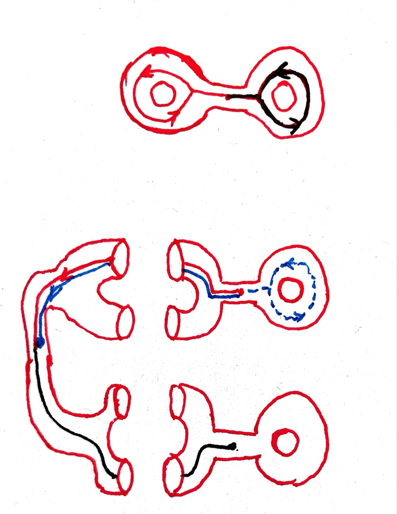

<problems>
- 本节主要定理（商空间的基本群同构于 $G$）的证明中，$B$ 似乎指商空间 ${}_G\backslash X$；证明满同态时取的 $\gamma \in \pi_{1}(X,x)$ 似乎应为 $\gamma \in \pi_{1}(B,p(x))$。
- 严格同伦提升的命题中，“$\widetilde{b} \in B$ 为 $E$ 上的点”似乎应为 $b \in B$、$\widetilde{b} \in E$。
- 提升定理证明中的记号似乎不一致：引理的证明里 $U\times \{y\}$ 似乎应为 $U\times \{y_1\}$，$U_1$ 似乎应为 $U'$；证明 $C(x_0)$ 闭时的 $V_1$ 似乎应为 $V'$，$C_0(x_0)$ 似乎应为 $C(x_0)$。
</problems>

这一小节介绍如何用覆盖空间来计算基本群。
我们先节选一段 Analysis Situs 关于基本群的原文。

\(\ldots\) Il est clair que l'on peut imaginer un groupe \(G\)
satisfaisant aux conditions suivantes :

1. A chaque contour fermé correspondra une substitution \(S\) du groupe;

2. La condition nécessaire et suffisante pour que S
   se réduise à la substitution identique, c'est que
   \[
   M_0 BM_0\equiv 0 ;
   \]

3. Si \(S\) et \(S'\) correspondent aux contours de \(C\) et \(C'\) et si
   \[
   C''\equiv C+C',
   \]
   la substitution correspondant à \(C''\) sera \(SS'\).

Le groupe \(G\) s'appellera le groupe fondamental de la variété \(V\).

Comparons-le au groupe \(g\) des substitutions subies par les fonctions \(F\).

Le groupe \(g\) sera isomorphe à \(G\)[^1].

L'isomorphisme pourra être holoédrique[^2].
Il pourra être mériédrique si un contour fermé \(M_0BM_0\)
non décomposable en lacets ramène les fonctions F à leurs valeurs primitives.

Poincaré 在 Analysis Situs 对基本群的定义基于**多值函数（multiform）**。
多值解析函数可以沿着道路解析延拓。
沿着回路延拓所返回的值与开始的值通常会有差别，即多值函数的分支产生了变换。
这些分支的变换构成了一个群（引言中的“\(g\)”）。
所有这些群都满足的关系就是基本群（引言中的满同态“\(G \to g\)”）。
上述引言的最后一段，用现代的话说，
就是如果 \(F\) 沿着互不同伦的回路延拓都产生不同的变换的话，
那么 \(G \to g\) 是单同态。

当代已不再使用多值函数或者**单值函数（uniform）** 这些术语，
所有函数按定义都是单值的。多值函数的概念则化身为“覆盖空间”。
Poincaré 最后的这个断言告诉我们可以使用一种特殊的覆盖空间来计算基本群，
即它的“分支”一一对应于基本群中元素。这样的覆盖空间叫做“万有覆盖空间”。
在这一小节中，我们只介绍这个原理的最基本例子，
即 @theorem:covering-pi-1-group-action。
而覆盖空间的完整理论则将在下一节中发展。

## 覆盖空间与基本群

::: definition {@definition:covering-space}
令 \(p\colon E \to B\) 为拓扑空间之间的连续映射。
称 \(p\) 为**覆盖映射（covering map）**，
或 \((E,p)\) 为 \(B\) 上的**覆盖空间（covering space）**，
如果存在 $B$ 的开覆盖 $\mathscr{U}$，使得对任意 \(\mathscr{U}\) 中成员
$U$，下面条件成立：

(EV) \(p^{-1}(U) = \bigcup_{i\in I} U_{i}\)
     其中 \(U_i\) 是 \(E\) 的互不相交的开子空间，且
     \(p|_{U_i} \colon U_i \to U\) 是同胚。

特别地，覆盖映射是局部同胚。

我们称拓扑空间 \(B\) 上的两个覆盖空间 \((E,p)\)，\((E',p')\)
是**同构**的，如果存在连续 \(B\)-映射 \(f: (E,p)\to (E',p')\)
（即 \(p'\circ f = p\)），
并且 \(f\) 是一个同胚。
:::

::: remark
在上述定义中，我们不要求 \(p\) 为满射。
事实上，如果 \(V\) 是与 \(p(E)\) 不相交的开集，
那么 \(p^{-1}(V)\) 是空集，指标集合 \(I\) 为空集，
于是条件 (EV)“真空”地成立。
:::

::: remark [平凡覆盖] {@example:trivial-covering}
令 \(F\) 为任意离散空间。则投影映射
\(\mathrm{pr}_{B}\colon B \times F \to B\)
是覆盖映射。如果一个 \(B\)-空间 \((E,p)\) 同构于
\((B\times F,\mathrm{pr}_B)\)，我们就称 \((E,p)\)
为一个 \(B\) 上的以 \(F\) 为纤维的**平凡覆盖（trivial covering）**。
:::

::: remark [均匀作用的商映射是覆盖映射] {@example:even-action}
令 \(X\) 是拓扑空间。
\(G\) 是一个群。群的左作用
\[
\mu: G \times X \to X, \quad \mu(g,x) = g\cdot x
\]
叫做一个**均匀的作用**，如果它满足如下条件：
对任意 \(y \in X\)，存在 \(y\) 的邻域 \(U\)，
使得 \((gU)_{g\in G}\) 是互不相交的，即
\[
g_1 U \cap g_2 U \neq \emptyset
\; \Longrightarrow \;
g_1 = g_2.
\]
:::

::: proposition {@proposition:even-action-covering-space}
如果 \(G\) 在 \(X\) 上的作用是均匀的，那么商映射
\[
p : X \to {}_{G} \backslash X
\]
是覆盖映射。
:::

::: proof
考虑 \(\bigcup_{g\in G} gU\)。
它是一个 \(X\) 的饱和的开集。
令 \(V = p\left( \bigcup_{g\in G} gU \right)\)。
则 \(V\) 是 \({}_{G}\backslash X\) 的开集。
由于作用是均匀的，\(V\) 中的点在每个 \(gU\)
中有且仅有一个原像。映射
\[
v \mapsto v \text{\;决定的轨道与\;} U \text{\;的交点}
\]
与 \(p\) 的复合是 \(U\) 的恒等映射，因此连续。
故而它是 \(p|_U\) 上的逆映射。从而 \(p|_U: U \to V\)
是同胚。这就证明了 \(p\) 是覆盖映射。
:::

这一节的主要结果是如下定理。

::: theorem {@theorem:covering-pi-1-group-action}
设 \(X\) 是一个道路单连通的拓扑空间。
设 \(G\) 是一个群，\(\mu:G \times X \to X\)
为 \(G\) 在 \(X\) 上的一个均匀左作用。
则商映射 \(p: X \to {}_G\backslash X\) 是覆盖映射，并且
\(\pi_{1}\left({}_G\backslash X, p(x)\right)\) 同构于 \(G\)。
:::

### 一些例子*

1. 群 \(\mathbb{Z}\) 通过
   \((n, x) \mapsto x + n\)
   作用于 \(\mathbb{R}\)。这个作用是均匀的，
   商空间是圆周 \(\mathbb{S}^{1}\)。
   因此我们再度验证了 \(\pi_{1}(\mathbb{S}^{1}) \cong \mathbb{Z}\)。

2. 设 \(n \geq 2\)，
   二阶循环群 \(\mathbb{Z}/(2) = \{\pm 1\}\)
   通过 \((\pm 1, x) \mapsto \pm x\) 作用于道路单连通空间 \(\mathbb{S}^{n}\)。
   这个作用是均匀的，
   它的商空间是实射影空间 \(\mathbb{R}\mathrm{P}^{n}\)。因此，我们有
   \[
   \pi_{1}(\mathbb{R}\mathrm{P}^{n}) \cong \mathbb{Z}/(2) \quad (n\geq 2).
   \]

3. 令 \(G\) 为拓扑群。令 \(\Gamma\) 为 \(G\) 的离散子群，即 \(\Gamma\) 从
   \(G\) 继承的子空间拓扑是离散拓扑。那么 \(\Gamma\) 在 \(G\) 上的作用
   \[
   \Gamma \times G \to G, (\gamma,g) \mapsto\gamma\cdot g
   \]
   是均匀的。

   首先，我们构造 \(e\) 在 \(G\) 中的邻域 \(U\)，使得
   \(\gamma U \cap U =\emptyset\) 对一切 \(\gamma \in \Gamma \setminus\{e\}\) 成立。
   由于 \(\Gamma\) 离散，存在 \(e\) 的邻域 \(V\)，使得
   \(V \cap \Gamma = \{e\}\)。由于映射
   \[
   \varphi: G \times G \to G, \quad (g,h) \mapsto gh^{-1}
   \]
   连续，并且 \(\varphi(e,e) = e\)，存在 \(e\) 的邻域 \(U\)，使得
   \(\varphi(U\times U) \subset V\)。则这个 \(U\) 就满足我们的要求。
   如果 \(\gamma \in \Gamma\)，\(u_1, u_2 \in U\) 满足
   \(\gamma u_1 = u_2\)，则 \(\gamma = \varphi(u_2,u_1) \in V\)，
   故而 \(\gamma = e\)。

   其次，对任意 \(g \in G\)，\(Ug = \{ug : u \in U\}\)
   是 \(g \in G\) 的邻域。根据上一段的论述，除非 \(\gamma_1 = \gamma_2\)，
   我们有 \(\gamma_{1}(Ug) \cap \gamma_{2}(Ug) =\emptyset\)。这就说明了
   \(\Gamma\) 在 \(G\) 上的作用是均匀的。

4. 作为上一款的特例，考虑特殊酉群 \(\mathrm{SU}(2)\)。
   容易验证，它同胚于三维球面 \(\mathbb{S}^{3}\)，因此是道路单连通的。
   由于 \(\mathbb{S}^{3}\) 是紧拓扑空间，\(\mathrm{SU}(2)\)
   的离散子群都是有限的。事实上，这些有限子群可以被分类：

   | 有限子群 | Dynkin 图 |
   | --- | --- |
   | \(\mathbb{Z}/(n+1)\) | \(A_n\) |
   | 双正二面体群 | \(D_n\) |
   | 双正四面体群 | \(E_6\) |
   | 双正八面体群 | \(E_7\) |
   | 双正十二面体群 | \(E_8\) |

   在图表里，双正 \(n\) 面体群是指 \(\mathbb{R}^{3}\)
   中正 \(n\) 面体（“柏拉图立体”）的对称群
   （它们是 \(\mathrm{SO}(3)\) 的有限子群）在标准同态
   \(\rho : \mathrm{SU}(2) \to \mathrm{SO}(3)\)（@exercise:su2-2-so3）下的逆像。
   根据 @theorem:covering-pi-1-group-action，
   这些有限子群在 \(\mathrm{SU}(2) \cong \mathbb{S}^{3}\)
   作用的商空间的基本群就被完全决定了。

   在几何学中，这些商空间有另一种化身：
   它们也是所谓 du Val 奇异点（或谓典则奇异点）的“链环”。
   单边 Dynkin 图则作为这些奇异点极小消解中 Riemann 球面的“对偶图”出现。
   建议读者参考
   [McKay 对应](https://ncatlab.org/nlab/show/McKay+correspondence)。

   在 @exercise:a1-sing-and-rp3 中，
   我们已经注意到了 \(\mathbb{R}\mathrm{P}^{3}\) 与群 \(\mathbb{Z}/(2)\)
   的联系（表中第一行 \(n=1\) 的情况）。
   在 @exercise:d4-singularty 中，我们将详细描绘上图中第二行
   \(n=4\) 的情况。
   类似的联系对上面表格中的所有群都成立。最有趣的例子是表格中最后一行，
   它的一个化身（Poincaré 同调球面）将在本节最后一个小节中描述。

5. 令 \(\mathfrak{h} = \{z \in \mathbb{C} : \mathrm{Im}(z) > 0\}\)
   为 Poincaré 上半平面。
   模群 \(\mathrm{SL}_{2}(\mathbb{Z})/\{\pm 1\}\)
   通过线性分式变换作用于 \(\mathfrak{h}\)：
   \[
   \left(\begin{bmatrix} a & b \\ c & d \end{bmatrix} , z\right)
   \mapsto
   \frac{az + b}{cz +d}
   \]
   这个作用不是均匀的。

## @theorem:covering-pi-1-group-action 的证明

如果我们认为拓扑空间 \(B\) 上面的“多值函数”
应该被理解为 \(B\) 的某个覆盖空间上面的函数的话，那么
Poincaré 所说的“通过延拓而产生的函数的变换”，应该如下理解。

::: proposition {@proposition:path-lifting-property}
令 \(p: E \to B\) 为覆盖映射。
令 \(c: [0,1] \to B\) 为一条道路，\(c(0) = b\)。
设 \(\widetilde{b}\) 为 \(E\) 上的点，
满足 \(p(\widetilde{b}) = b\)。
则存在唯一的 \(E\) 上的道路
\[
\widetilde{c} : [0,1] \to E,  \;使得 \quad \widetilde{c}(0) = \widetilde{b},
\quad p\circ\tilde{c}=c.
\]
:::

道路 \(\widetilde{c}\) 叫做 \(c\) 沿着 \(p\) 的一个**提升（lifting）**。

如果 \(f: E \to \mathbb{C}\) 是 Poincaré 所说的多值函数，取定 \(\widetilde{b}\)
相当于决定了 \(f\) 的一个“多值分支”，而 \(f\circ \widetilde{c}\)
就是 \(f\) 沿着道路 \(c\) 的“延拓”。如果 \(c(1) = c(0)\)，则
\(\widetilde{c}(1) \in p^{-1}(b)\)，然而未必有
\(\widetilde{c}(1) = \widetilde{b}\)（读者此时可以思考一下圆周上的角度函数的变化），
因此 \(f(\widetilde{c}(1))\) 被 Poincaré 认为是 \(f\)“延拓后产生了一个变换”。

Poincaré 注意到沿着所谓“发卡型回路（lacets ramène）”延拓不产生变换。
用今天的话说就是零伦的回路所给出的道路提升起点和终点一致。
这断言可以由下面的命题推出。

::: proposition {@proposition:homotopy-lifting}
令 \(p: E \to B\) 为覆盖映射。
\(\sigma \colon [0,1] \times [0,1] \to B\)
为道路 \(c_0\colon [0,1] \to B\) 与 \(c_1\colon [0,1] \to B\) 之间的严格同伦。
设 \(\widetilde{b} \in B\) 为 \(E\) 上的点，满足 \(p(\widetilde{b}) = b\)。
则始于 \(\widetilde{b}\) 的提升 \(\widetilde{c}_{0}\) 与 \(\widetilde{c}_1\)
也是严格同伦的。特别地，\(\widetilde{c}_0(1) = \widetilde{c}_{1}(1)\)。
:::

::: example
@proposition:homotopy-lifting 可以帮助我们区分基本群中的元素是否相等。
考虑 \(\mathbb{R}^{3}\) 中嵌入的具有两个环柄的曲面 \(S\)，它的一个覆盖空间如下图所示。

{width=150}

在 \(S\) 上，黑色的回路的同伦类记为 \(\alpha\)，而红色记为 \(\beta\)。
我们断言 \(\alpha\beta \neq \beta\alpha\)。事实上，利用图示的覆盖空间，
\(\alpha\beta\) 的提升的终点是左侧环柄的中间的点，而 \(\beta\alpha\)
的提升的终点是下方环柄的中点。因此 \(\alpha\beta \neq \beta\alpha\)。
:::

有了上述有关提升的命题，
我们就可以证明 @theorem:covering-pi-1-group-action 了。

::: proof [@theorem:covering-pi-1-group-action 的证明]
令 \(x \in X\)。
定义 \(\varphi: G \to \pi_{1}(B,p(x))\) 如下。
对 \(g \in G\)，令 \(c\) 为连结 \(x\) 和 \(g(x)\) 的一条道路。
令 \(\varphi(g) = [p\circ c]\)。
由于 \(X\) 道路单连通，这样的道路 \(c\) 存在，并且都严格同伦
（@corollary:pi-1-trivial-path-trivial）。
因此，映射 \(\varphi\) 良好定义。

验证 \(\varphi\) 是同态。
令 \(g_1, g_2 \in G\)。令 \(c\) 为连结 \(x\) 和 \(g_1(x)\)
的道路，\(d\) 为连结 \(x\) 和 \(g_{2}(x)\) 的道路。
则 \(g_{1} \circ d\) 是连结 \(g_1(x)\) 和 \(g_1(g_2(x))\)
的道路。因此，利用 \(p \circ g_1 = p\)，可知
\[
\varphi(g_1 g_2) = [p \circ (c \ast (g_1 \circ d))] = \varphi(g_1) \varphi(g_2).
\]
于是 \(\varphi\) 是群同态。

验证 \(\varphi\) 是单同态。
如果 \(\varphi(g)\) 是平凡的同伦类，则连结  \(x\) 与 \(g(x)\)
的道路 \(c\) 是平凡同伦类的提升。根据 @proposition:homotopy-lifting，
\(gx = c(1) = x\)。由于 \(G\) 是均匀作用，\(g\) 必然是群的幺元。

验证 \(\varphi\) 是满同态。
令 \(\gamma \in \pi_{1}(X,x)\)。
根据 @proposition:path-lifting-property，存在从 \(x\)
出发的道路 \(c\)，提升了代表 \(\gamma\) 的道路。
由于 \(p(c(1)) = p(c(0))\)，存在 \(g \in G\)，使得 \(gx = c(1)\)。
于是 \(\varphi(g) = [p\circ c] = \gamma\)。
:::

## 提升引理的证明

回忆，拓扑空间之间的连续映射 \(p\colon E \to B\)
称为**局部同胚（local homeomorphism）**，
如果任何 \(E\) 上的点都有邻域 \(U\)，使得 \(p(U)\) 是 \(B\)
的开集，并且\(p|_U\colon U \to p(U)\) 是同胚。
我们在 @exercise:local-homeo 证明过，
连续映射 \(p\) 是局部同胚的必要且充分条件是 \(p\)
是开映射，并且对角线映射 \(\Delta_{E/B} \colon E \to E\times_B E\) 是开嵌入。

拓扑空间之间的连续映射 \(p \colon E \to B\)
叫做**分离映射（separated map）**，如果对任何 \(b \in B\)，
任何不同的两点 \(x, y \in p^{-1}(b)\)，存在 \(E\) 的开子集 \(U, V\)，
满足：\(x \in U, y \in V\)，\(U \cap V = \emptyset\)。
连续映射 \(p\) 是分离的必要且充分条件是对角线映射
\(\Delta_{E/B}\colon E \to E\times_B E\) 是闭嵌入（@exercise:sep-map）。

覆盖映射按照定义是分离的局部同胚。因此 @proposition:path-lifting-property
中的唯一性由下面的引理保证。

::: proposition {@proposition:uniqueness-lifting}
令 \(p\colon E \to B\) 为分离的局部同胚。
令 \(f_1, f_2\) 为拓扑空间 \(T\) 到 \(E\) 的连续映射，
满足 \(p\circ f_1 = p \circ f_2\)。
则 \(\{x \in T : f_1(x) = f_2(x)\}\)
是 \(T\) 的既开又闭的子空间。
:::

::: proof
由于 \(p\) 是分离的局部同胚，\(\Delta_{E/B}(E)\)
是纤维积 \(E \times_B E\) 的既开又闭的子空间。
因此
\[
(f_1 \times f_2)^{-1}(\Delta_{E/B}(E)) = \{x \in T : f_1(x) = f_2(x)\}
\]
是 \(T\) 的既开又闭的子空间。
:::

为了证明提升的存在性，我们首先证明闭区间上的覆盖空间都是平凡的。

::: proposition {@proposition:covering-space-over-interval-trivial}
设 \(p\colon E \to [0,1]\) 是覆盖映射。则 \((E,p)\)
作为 \([0,1]\) 上的空间同构于 \([0,1] \times F\)，其中 \(F\)
是离散空间。
:::

::: proof
证明分为两步。
先证明如下断言：设 \((E,p)\) 是拓扑空间 \(B\) 上的覆盖空间。
\(B = B_1 \cup B_2\)，其中 \(B_i\) 是 \(B\) 的闭子集，\(B_1 \cap B_2 = \{b\}\)
为单点集合。设 \(p^{-1}(B_1) \to B_1\) 与 \(p^{-1}(B_2) \to B_2\)
都是可平凡化的覆盖映射，那么 \((E,p)\) 也是可平凡化的。

断言的证明。固定同构 \(\varphi_1: p^{-1}(B_1) \to B_1 \times F_1\)，
\(\varphi_2: p^{-1}(B_2) \to B_2 \times F_2\)。
由于 \(E_{b}\) 同时是 \(p^{-1}(B_i) \to B_i\) 的纤维，
映射 \(\psi = \varphi_1 \circ \varphi_2^{-1}\)
是 \(F_2\) 到 \(F_1\) 的一一映射。
定义
\[
f: B \times F_2 \to E, \quad
\begin{cases}
  f(u,x) = \varphi_1^{-1}(u,\psi(x)), & u \in B_1; \\
  f(u,x) = \varphi_2^{-1}(u,x),  & u \in B_2.
\end{cases}
\]
根据粘贴引理，@proposition:pasting-lemma，
可验证 \(f\) 与 \(f^{-1}\) 都连续。

命题的证明。
利用覆盖空间的局部平凡性，以及 Lebesgue 数引理（@proposition:lebesgue-number），
可以找到 \(0 = t_0 < \cdots < t_n = 1\)，使得 \(p^{-1}([t_i,t_{i+1}])\) 作为
\([t_i,t_{i+1}]\) 上的空间同构于 \(([t_i,t_{i+1}]\times F, \mathrm{pr}_1)\)。
累次使用断言中的结论，就能说明 \(E \to [0,1]\) 是可平凡化的。
:::

::: proof [@proposition:path-lifting-property 的证明]
设 \(c\colon[0,1] \to B\) 为 \(B\) 上的道路，
\((E,p)\) 为 \(B\) 上的覆盖空间。则底变换
\(E' = [0,1] \times_{B,c} E\) 是 \([0,1]\) 上的覆盖空间，
因此 \(E'\) 可平凡化。

对任何 \(x \in E_{c(0)}\)，令 \(x' \in E'\) 为它的投影映射
\(c'\colon E' \to E\) 的一个原像。则我们有带基点的拓扑空间构成的交换图：
\[
\begin{tikzcd}
  (E',x') \ar{d} \ar{r}{c'} & (E,x) \ar{d} \\
  {([0,1],0)} \ar[bend left = 60,dashed]{u}{s} \ar{r}{c} &  (B,c(0))
\end{tikzcd}.
\]
由于 \(E'\) 可平凡化，存在截面
\(s\colon[0,1]\to E'\)，使得 \(s(0) = x'\)。则 \(c'\circ s\) 就是所需的提升。
:::

接下来我们来讨论同伦的提升。
为此我们可以仿照 @proposition:path-lifting-property
的证明，对方块使用 Lebesgue 数引理。
但喜欢给自己添麻烦的我们则宁愿证明一个稍微更一般一点的定理。

::: theorem {@theorem:lifting}
设 \(X, Y, Z\) 为拓扑空间，
\(f\colon Z \to X \times Y\) 为分离的局部同胚，\(y_0 \in Y\)。
设 \(s\colon X \times Y \to Z\) 为映射（不假设连续），满足如下性质：

1. \(f\circ s = \mathrm{Id}_{X\times Y}\)，

2. \(s|_{X\times\{y_0\}}\) 连续，

3. 对任意 \(x \in X\)，\(s|_{\{x\}\times Y}\) 连续。

如果 \(Y\) 连通且局部连通，则 \(s\) 连续。
:::

虽然接下来的证明有点长，但只是我写的罗嗦而已。证明的大意是：一开始给出来的截面横着竖着都连续，
而分离局部同胚的截面的提升唯一性允许我们把已有的整体不知道连续不连续截面和局部的连续截面做比较。
在局部利用横竖的连续性可以验证局部截面和整体的相等，从而完成证明。

::: proof [@proposition:homotopy-lifting 的证明]
在 @theorem:lifting 中，取 \(X = [0,1]\)，\(Y=[0,1]\)，
\(y_0 = \{0\} \in Y\)，\(Z = (X \times Y)\times_{B,\sigma} E\)。
则找到所需的提升等价于找到 \(Z \to X \times Y\) 的连续截面。

对任何 \(x\in X\)，@proposition:path-lifting-property 保证了在
\(\{x\} \times Y\) 上可以定义连续截面；由于作为集合有
\(X \times Y = \bigcup_{x\in X} \{x\} \times Y\)，
这些截面定义了 @theorem:lifting 中的映射 \(s\)，
并且自动满足条件 (1)，(3)。
由于给定的同伦是严格的，\(s(X \times \{y_0\})\) 必须是常数，
因此 (2) 也被满足了。因此我们找到了所需的截面，因此提升存在。
:::

#### @theorem:lifting 的证明*

::: lemma
如果 \(U\) 是 \(X\) 的开集，
\(V\) 是 \(Y\) 的连通开集，
\((x_1,y_1) \in U \times V\)。
若 \(s|_{U \times \{y_1\}}\) 连续，
\(\sigma\) 是 \(U \times V\) 上关于 \(f\)
的连续截面，满足 \(\sigma(x_1,y_1) = s(x_1,y_1)\)，
则存在 \(x_1\) 的邻域 \(U' \subset U\)，使得
\(s|_{U'\times V} = \sigma|_{U'\times V}\)。
特别地，\(s\) 在 \(U'\times V\) 上连续。
:::

::: proof [引理的证明]
由于 \(f\) 是局部同胚，\(s\) 和 \(\sigma\) 都给出 \(U\times \{y\}\)
到 \(Z\) 的连续映射，存在 \(x_1\) 的邻域 \(U'\) 使得 \(s\) 和 \(\sigma\)
在 \(U_1 \times \{y\}\) 上相等。
对任何 \(x \in U_1\)，
在集合 \(\{x\} \times V\) 上我们有两个连续截面：\(s\) 和 \(\sigma\) 的限制。
它们已经在 \((x,y_1)\) 上相等了。
因此根据 @proposition:uniqueness-lifting，
\(s|_{\{x\} \times V} = \sigma|_{\{x\}\times V}\)。
由于 \(x\) 是随便在 \(U'\) 里选的，
\(s|_{U'\times V} = \sigma|_{U' \times V}\)。
:::

有了引理之后我们就可以完成套娃很多层的证明了。
首先证明 \(s\) 在 \(X \times \{y_0\}\) 的任何点的某个邻域连续。
对 \(x_0 \in X\)，利用 \(f\) 的局部同胚性以及\(Y\) 的局部连通性，
存在 \(x_0\) 的邻域 \(U\)，\(y_0\) 的某个邻域 \(V\)，
使得 \(U\times V\) 上存在 \(f\) 的连续截面 \(\sigma\)。
根据引理，\(\sigma\) 在某个 \((x_0,y_0)\) 的邻域上与 \(s\)
相等，因此 \(s\) 在 \(X \times \{y_0\}\) 的任何点的某个邻域连续。

其次，对任意 \(x_0\)，令 \(C(x_0)\) 为
\[
C(x_0) = \{
y \in Y : \exists (x_0,y) \text{\; 的邻域\;} W,
s|_{W} \text{\;连续}
\}.
\]
按定义，\(C(x_0)\) 是 \(Y\) 的开集。
由 \(Y\) 的连通性，只需再证明 \(C(x_0)\) 是闭集就能完成证明了。

证明 \(C(x_0)\) 闭。
设 \(y_1\) 属于 \(C(x_0)\) 的闭包。
利用局部同胚性，我们可以找到 \(x_0\) 的邻域 \(U\)，
\(y_1\) 的连通邻域 \(V\)，以及 \(f\) 在 \(U \times V\)
上的连续截面 \(\sigma\)，满足 \(\sigma(x_0,y_1) = s(x_0,y_1)\)。
由于 \(s|_{\{x_0\} \times Y}\) 连续，利用 \(f\) 是局部同胚以及 \(Y\)
的局部连通性，可知存在
\(y_1\) 的连通邻域 \(V' \subset V\) 使得 \(s|_{\{x_0\}\times V_1}\)
与 \(\sigma|_{\{x_0\} \times V_1}\) 相等。
由于 \(y_1\) 属于 \(C_0(x_0)\) 的闭包，
\(V' \cap C(x_0)\) 非空。
设 \((x_0,y_2) \in V' \cap C(x_0)\)。则对 \((x_0,y_2)\) 使用引理，
我们得知存在 \((x_0,y_2)\) 的邻域 \(U' \times V'\)，使得 \(s\)
在 \(U' \times V'\) 上连续。特别地，\(s\) 与 \(\sigma\)
在 \(U' \times V'\) 上相等。于是 \(y_1 \in C(x_0)\)。

## 习题

::: exercise
令 \(E=\mathbb{C}\setminus\{\frac{\pi}{2} + k\pi:k\in \mathbb{Z}\}\)，
\(B=\mathbb{C}\setminus\{\pm1\}\)。

1. 证明 \(\sin:E \to B\) 是覆盖映射。

2. 考虑下列 \(B\) 中基于 \(0\) 的道路：
   \[
   \begin{aligned}
     u: [0,1] \to B,& \quad t\mapsto 1-\exp(2\pi\mathrm{i}t), \\
     v: [0,1] \to B,& \quad t\mapsto -1+\exp(2\pi\mathrm{i}t).
   \end{aligned}
   \]
   令 \(w_1\) 为 \(u\ast v\) 满足 \(w_1(0)=0\) 的提升，\(w_2\) 为 \(v\ast u\)
   满足 \(w_2(0)=0\) 的提升。证明 \(w_1(1)=2\pi\)，\(w_2(1)=-2\pi\)。
   由此推出，
   在 \(\pi_1(B,0)\) 中 \([u] \cdot [v] \neq [v] \cdot [u]\)。

:::

::: exercise {@exercise:su2-2-so3}
考虑下面的复方阵。
\[
\mathbf{1} =
\begin{bmatrix} 1 & 0 \\ 0 & 1 \end{bmatrix},
\quad
\mathbf{i} =
\begin{bmatrix} \mathrm{i} & 0 \\ 0 & -\mathrm{i} \end{bmatrix},
\quad
\mathbf{j} =
\begin{bmatrix} 0 & 1 \\ -1 & 0 \end{bmatrix},
\quad
\mathbf{k} =
\begin{bmatrix} 0 & \mathrm{i} \\ \mathrm{i} & 0 \end{bmatrix}.
\]
令
\[
\mathbb{H} = \{a \mathbf{1}+b\mathbf{i}+c\mathbf{j}+d \mathbf{k} \in \mathrm{M}_{2}(\mathbb{C}): a,b,c,d \in \mathbb{R} \}.
\]
\(\mathbb{H}\) 叫做 Hamilton 的**四元数代数（quaternion algebra）**，
它由爱尔兰数学家 W. R. Hamilton 引入。

1. 四元数
   \(q=a \mathbf{1}+b\mathbf{i}+c\mathbf{j}+d \mathbf{k}\)
   的**范数（norm）** \(|q|\) 定义为
   \[
   \sqrt{|a|^2 + |b|^2 + |c|^{2} + |d|^{2}}.
   \]
   证明 \(|q_1 q_2| = |q_1|\cdot |q_2|\)。

2. 证明 \(\mathbb{H}\) 在矩阵的加法与乘法之下
   构成了一个非交换的环，并且任何非零元素都有乘法逆元
   （这样的代数结构叫做**斜域（skew field）**）。

3. 范数等于 \(1\) 的四元数在矩阵乘法下构成群 \(\mathrm{Sp}(1)\)
   （“第一个紧辛群”）。
   解释为何 \(\mathrm{Sp}(1)\) 就“是”特殊酉群 \(\mathrm{SU}(2)\)。
   特别地，我们获得了同胚 \(\mathrm{SU}(2) \cong \mathbb{S}^{3}\)。

4. 将实三维空间 \(\mathbb{R}^{3}\) 等同“纯虚四元数”：
   \[
   \varphi:
   \mathscr{I} = \{y \mathbf{i} + z \mathbf{j} + w \mathbf{k} \in \mathbb{H}: y,z,w \in \mathbb{R}\}
   \to \mathbb{R}^{3};
   \quad
   y \mathbf{i} + z \mathbf{j} + w \mathbf{k} \mapsto (y,z,w).
   \]
   证明对 \(q \in \mathscr{I}\)，\(\varphi(q)\) 的长度等于 \(|q|\)。

5. 记号同上一款。对 \(q \in \mathrm{Sp}(1)\)，\(p \in \mathscr{I}\)，证明
   \(qpq^{-1} \in \mathscr{I}\)。特别地，\(p \mapsto \rho_{q}=qpq^{-1}\) 通过映
   射 \(\varphi\) 给出了一个 \(\mathscr{I}\) 的线性变换 \(\rho_{q}\)，满足
   \[
   |\rho_{q}(p) | = |p|.
   \]
   由此得到了“标准同态”\(\rho:\mathrm{Sp}(1) = \mathrm{SU}(2) \to \mathrm{O}(3)\)。证明
   \(\rho(\mathrm{Sp}(1))\subset \mathrm{SO}(3)\)。

6. 证明 \(\mathrm{Ker}(\rho) = \{\pm \mathbf{1}\}\)。
   证明 \(\rho\) 是满同态。

:::

::: exercise [\(D_4\) 奇异点链环的基本群] {@exercise:d4-singularty}
令 \(X = \{(x,y,z) \in \mathbb{C}^3: x^2 - y^2 z + 4z^3 = 0\}\)。
在这个习题里，我们来计算三维流形
\[
\Sigma = X \cap \mathbb{S}^{5}
\]
的基本群。

1. 验证 \(\Sigma\) 的确是一个三维流形。

2. 考虑 \(\mathbb{C}^{2}\) 上的线性变换：
   \[
   \begin{aligned}
     \alpha: (u,v) & \mapsto  (\mathrm{i}u, -\mathrm{i}v), \\
     \beta: (u,v) & \mapsto  (v,-u).
   \end{aligned}
   \]
   验证最小的包含 \(\alpha,\beta\) 的 \(\mathrm{GL}_{2}(\mathbb{C})\)
   的子群是一个八阶有限群。这个群叫做八阶**双二面体群（binary dihedral group）**，
   记作 \(\mathrm{BD}_{8}\)。

3. 证明 \(\mathrm{BD}_{8}\) 同构于四元数
   \(\{\pm\mathbf{1}, \pm \mathbf{i},\pm \mathbf{j}, \pm\mathbf{k}\}\)
   在四元数乘法下构成的群。它因此自然地是单位四元数构成的乘法群
   （\(\mathbb{S}^{3} \cong \mathrm{SU}(2)\)）的子群。特别地，\(\mathrm{BD}_{8}\)
   在 \(\mathbb{S}^{3}\) 上诱导的作用是均匀的。

4. 验证多项式 \(f_1(u,v)=(u^4-v^4)uv\)，\(f_2(u,v)=u^4+v^4\)，
   \(f_3(u,v)=u^{2}v^{2}\) 在 \(\mathrm{BD}_{8}\) 的轨道上是常值。
   并且映射
   \[
   f(u,v) = (f_1(u,v),f_2(u,v),f_3(u,v))
   \]
   是 \(\mathbb{C}^{2}\setminus\{0\}\) 到 \(X\setminus\{0\}\) 的商映射。

5. 考虑 \(X \setminus \{0\}\) 上群 \(\mathbb{R}_{>0}\) 的作用
   \[
   (x,y,z) \cdot r = (r^6 x , r^4 y , r^4 z).
   \]
   验证每个轨道与 \(\Sigma\) 相交且仅交一点。由此推出 \(\Sigma\)
   同胚于商空间 \((X\setminus\{0\})/\mathbb{R}_{>0}\)。

6. 考虑复合映射
   \[
   p\colon \mathbb{S}^{3} \xrightarrow{f|_{\mathbb{S}^{3}}} X \setminus \{0\}
   \xrightarrow{\text{商映射}} (X\setminus\{0\})/\mathbb{R}_{>0}.
   \]
   证明 \(p\) 诱导了商空间的同胚
   \(\overline{p}\colon{}_{\mathrm{BD}_{8}}\backslash\mathbb{S}^{3}\to (X\setminus\{0\})/\mathbb{R}_{>0}\)。
   结合上一款，说明 \(\pi_{1}(\Sigma) \cong \mathrm{BD}_{8}\)。

:::

[^1]: Poincaré 在使用十九世纪术语。
  “$H$ est isomorphe à un groupe $G$”的摩登的意思是“存在满同态 $G \to H$”。
[^2]: “Holoédrique”是“单”的意思；“mériédrique”是不单的意思。
