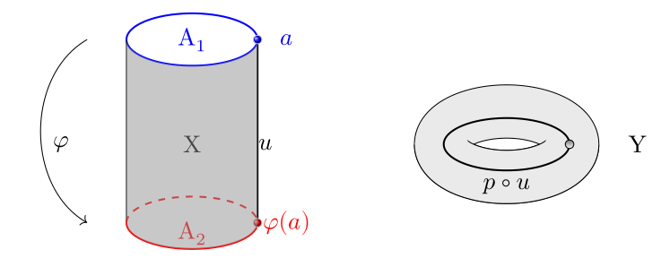
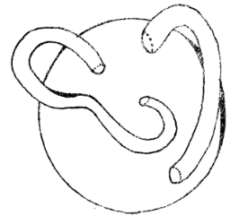
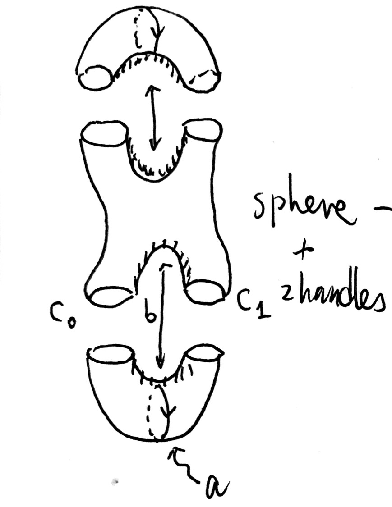
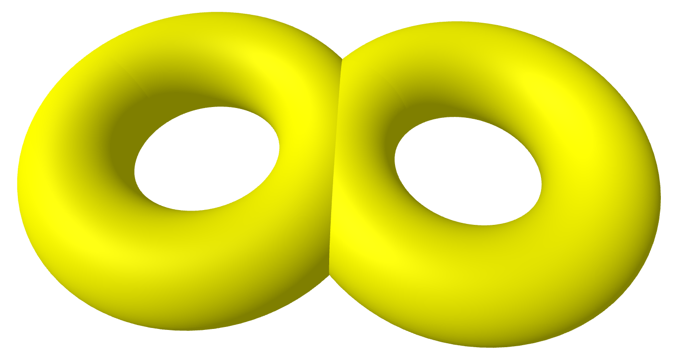

<problems>
- “闭版本的 van Kampen 定理”一节的第二个应用中，用恒等映射粘贴柱面两端得到的似乎是环面而不是 Klein 瓶；与其后的 $c=\iota_{A\ast}\gamma = \iota_{B\ast}\gamma^{-1}$ 相符的粘贴映射似乎应为反射。
- “安装环柄”一段中 $S'$ 的定义里 $\amalg_{C_1\amalg C_2}$ 似乎应为 $\amalg_{C_0\amalg C_1}$。
- “Brieskorn 流形”习题第 1 款中的 $\mathbb{S}^{5}$ 似乎应为 $\mathbb{S}^{7}$；题后说明中与 $\Sigma$ 的锥同胚的集合所在的 $\mathbb{C}^{3}$ 似乎应为 $\mathbb{C}^{4}$。
</problems>

::: remark* (定理的历史) [A. Gramain，[“Le théorème de Van Kampen”](http://www.numdam.org/item/?id=CTGDC_1992__33_3_237_0)]
Cet énoncé a été démontré en 1931 par H. SEIFERT, non pour
des ouverts $U_1$ et $U_2$, mais pour des sous-complexes d’un complexe simplicial
$Y$. En 1933, E. VAN KAMPEN retrouve cet énoncé comme cas particulier
d’une situation plus compliquée, issue d’un problème de géométrie algébrique.
:::

## 定理的陈述

在这一小节中，我们介绍计算基本群的一个工具，Seifert–van Kampen 定理。
我们首先固定一些记号。
令 \(U_1\)，\(U_2\) 为拓扑空间 \(X\) 的开子空间。设：

- \(X = U_1 \cup U_2\)，

- \(U_1\)，\(U_2\) 道路连通，以及

- \(U_1 \cap U_2\) 非空且道路连通。

令 \(j_1\colon U_1 \to X\)，\(j_{2}\colon U_2 \to X\)，
\(\iota_1 \colon U_1 \cap U_2 \to U_1\)，与
\(\iota_2 \colon U_1 \cap U_2 \to U_2\) 为相应的包含映射。

根据基本群的“自然性”，下面的图表是交换的
\[
\begin{tikzcd}
  \pi_1(U_1 \cap U_2,x_0) \ar{r}{\iota_{1\ast}} \ar{d}{\iota_{2\ast}} & \pi_1(U_1,x_0) \ar{d}{j_{1\ast}} \\
  \pi_1(U_2,x_0) \ar{r}{j_{2\ast}} & \pi_1(X,x_0)
\end{tikzcd}.
\]

根据自由积的泛性质，同态
\(j_{1\ast}\)，\(j_{2\ast}\) 给出了同态
\[
\rho\colon \pi_1(U_1,x_0) \ast \pi_1(U_2,x_0) \to \pi_1(X,x_0).
\]
它满足，对 \(i=1,2\)，
\(\rho\) 与典则的包含同态
\(\pi_1(U_i,x_0) \hookrightarrow \pi_1(U_1,x_0) \ast \pi_1(U_2,x_0)\)
的复合与 \(j_{i\ast}\) 相等。Seifert–van Kampen 定理的第一部分断言 \(\rho\)
是满同态。

由于 \(j_{1\ast}\circ \iota_{1\ast}=j_{2\ast}\circ \iota_{2\ast}\)，
对任何 \(\gamma \in \pi_1(U_1 \cap U_2,x_0)\)，我们有
\[
\rho(\iota_{1\ast}(\gamma)) = \rho(\iota_{2\ast}(\gamma)).
\]
换言之，对任意 \(\gamma \in \pi_1(U_1 \cap U_2,x_0)\)，
\(\iota_{1\ast}(\gamma) \cdot \iota_{2\ast}(\gamma^{-1}) \in \mathrm{Ker}(\rho)\)。
Seifert–van Kampen 定理的第二部分断言上述关系在自由积
\(\pi_1(U_1,x_0) \ast \pi_1(U_2,x_0)\) 中
生成的正规子群就是 \(\mathrm{Ker}(\rho)\)。

::: theorem {@theorem:seifert-van-kampen-open}
记号如上。

1. 自然同态
   \[
   \rho  \colon \pi_{1}(U_1,x_0) \ast \pi_1(U_2,x_0) \to \pi_1(X,x_0)
   \]
   是满同态。

2. 我们有
   \[
   \mathrm{Ker}(\rho) = \langle \!\langle \iota_{1\ast}(\gamma) \cdot \iota_{2\ast}(\gamma^{-1}) : \gamma \in \pi_1(U_1\cap U_2,x_0) \rangle\! \rangle
   \]

结合两部分断言以及同态基本定理，我们有
\[
\pi_1(X,x_0) \cong \frac{\pi_1(U_1,x_0) \ast \pi_1(U_2,x_0)}
{\langle \!\langle \iota_{1\ast}(\gamma) \cdot \iota_{2\ast}(\gamma^{-1}) : \gamma \in \pi_1(U_1\cap U_2,x_0) \rangle\! \rangle}.
\]
:::

::: corollary {@corollary:1-conn-intersection-van-kampen}
记号如上。如果 \(U_1 \cap U_2\) 道路单连通，则
\(\pi_1(X,x_0) \cong \pi_1(U_1,x_0) \ast \pi_1(U_2,x_0)\)。
:::

由于我们关心的大多数空间（流形，胞腔空间）具有良好的“局部”性质，
我们将在下一章对这些“好”空间证明 @theorem:seifert-van-kampen-open。

我们可以利用泛性质重新陈述 Seifert–van Kampen 定理。
如果对某个群 \(G'\)，我们有下面的交换图
\[
\begin{tikzcd}
  \pi_1(U_1 \cap U_2,x_0) \ar{r}{\iota_{1\ast}} \ar{d}{\iota_{2\ast}} & \pi_1(U_1,x_0) \ar{d}{\phi_1} \\
  \pi_1(U_2,x_0) \ar{r}{\phi_2} & G'
\end{tikzcd}.
\]
那么上一段的讨论表明：

- 存在自然同态
  \(\rho' \colon \pi_1(U_1,x_0) \ast \pi_1(U_2,x_0) \to G'\)，

- 正规子群
  \(\langle\!\langle\iota_{1\ast}(\gamma)\cdot\iota_{2\ast}(\gamma^{-1}):\gamma\in\pi_1(U_1\cap{U_2},x_0)\rangle\!\rangle\)
  包含于 \(\mathrm{Ker}(\rho')\) 中。

根据同态基本定理，存在唯一同态
\[
u\colon \pi_1(X,x_0) \cong \frac{\pi_1(U_1,x_0) \ast \pi_1(U_2,x_0)}
{\langle\!\langle\iota_{1\ast}(\gamma)\cdot\iota_{2\ast}(\gamma^{-1}):\gamma\in\pi_1(U_1\cap{U_2},x_0)\rangle\!\rangle}
\to G'
\]
满足 \(u \circ \rho = \rho'\)。换言之，
给定下面的图表，存在唯一的虚箭头使得整个图都交换：
\[
\begin{tikzcd}[row sep=small]
  \pi_1(U_1 \cap U_2,x_0) \ar{r}{\iota_{1\ast}} \ar{dd}{\iota_{2\ast}} & \pi_1(U_1,x_0) \ar{dd}{j_{1\ast}} \ar[bend left]{dddr}{\phi_1}\\
  \\
  \pi_1(U_2,x_0) \ar{r}{j_{2\ast}} \ar[bend right=20]{drr}{\phi_2} & \pi_1(X,x_0) \ar[dotted]{rd}{u} \\
  & & G'
\end{tikzcd}.
\]

这就是 Seifert–van Kampen 利用泛性质的重述。将上述泛性质提炼出来，
我们得到了群映射的**推出（pushout）** 的概念。

::: definition {@definition:pushout}
令 \(a_1 \colon H \to G_1\)，
\(a_2\colon H \to G_2\) 为群同态。
则 \(G_i\)沿着 \(a_i\) 的推出，记为 \(G_1 \ast_H G_2\)，
是三元组 \((G,b_1\colon G_1 \to G,b_2\colon G_2\to G)\)，
其中 \(G\) 是群，\(b_i\) 是群同态。它们满足：\(b_1\circ a_1=b_2\circ a_2\)，
以及下述泛性质。

(PO) 若同态 \(\phi_1\colon G_1 \to G'\)
     \(\phi_2 \colon G_2 \to G'\)
     满足 \(\phi_1\circ a_1 = \phi_2\circ a_2\)，则存在唯一
     同态 \(\phi\colon G \to G'\)，使得 \(\phi_i = \phi\circ b_i\)。

换言之，下面的图表可以被唯一的虚箭头变成交换图：
\[
\begin{tikzcd}[row sep=small]
  H \ar{r}{a_1}\ar{dd}{a_{2}} & G_1 \ar{dd}{b_{1}} \ar[bend left]{dddr}{\phi_1}\\
  \\
  G_2 \ar{r}{b_{2}} \ar[bend right=20]{drr}{\phi_2} & G \ar[dotted]{rd}{\phi} \\
  & & G'
\end{tikzcd}.
\]
无歧义时，我们也用 \(G_1\ast_H G_2\) 代表推出中的群 \(G\)。
:::

::: theorem [Seifert–van Kampen 利用泛性质的重述]
记号如前，我们有
\[
\pi_1(X,x_0) \cong
\pi_1(U_1,x_0) \ast_{\pi_1(U_1\cap U_2,x_0)}\pi_1(U_2,x_0).
\]
:::

## Seifert–van Kampen 定理的简单应用 {@situation:apply-open-seifert-van-kampen}

### 空间的一点并*

考虑带基点的拓扑空间 \((X,x)\) 与 \((Y,y)\)。
它们的**一点并**，或**楔和（wedge sum）**
\((X,x) \vee (Y,y)\) 是商空间
\[
\frac{X \amalg Y}{x \sim y}
\]
并以 \(x\) 在其中的像为基点。我们假设：\(x\) 在 \(X\) 中有一个开邻域 \(U\)，且
\(U\) 以 \(x\) 为形变收缩核；\(y\) 在 \(Y\) 中有一个开邻域 \(V\)，且
\(V\) 以 \(y\) 为形变收缩核。在此条件下，我们断言
\[
\pi_{1}((X,x) \vee (Y,y)) \cong \pi_{1}(X,x) \ast \pi_{1}(Y,y).
\]
事实上，\(X \vee V\) 与 \(U \vee Y\) 构成了 \(X \vee Y\) 的一个开覆盖。
它们的交 \(U \vee V\) 以 \(x\) 的像为形变收缩核，
而这两个开集分别以 \(X\) 和 \(Y\) 为形变收缩核。
这些观察与 @corollary:1-conn-intersection-van-kampen 便推出了上述断言。
特别地，若干个圆周的一点并的基本群是自由群。

### 安装胞腔*

令 \(X\) 为道路连通拓扑空间。\(\varphi\colon \mathbb{S}^{n-1} \to X\) 为连续映射。
令 \(Y = X \amalg_{\varphi} D^{n}\) 为向空间 \(X\) 沿着 \(\varphi\)
安装 \(n\) 维胞腔得到的空间。我们来计算 \(Y\) 的基本群。

- 如果 \(n=1\)，
  我们有 \(\pi_{1}(Y) \cong \pi_{1}(X) \ast \mathbb{Z}\)
  （证明留给读者，比如这个结论可以用下一节中的“闭版本”的 van Kampen 定理推出）。

- 如果 \(n=2\)，则 \(Y\) 可以写成两个空间的并：
  \[
  Y = U \cup V,
  \]
  其中 \(U\) 同胚于 \(\varphi\) 的映射柱，而 \(V\) 同胚于 \(D^2\)，
  \(U \cap V\) 以 \(\mathbb{S}^{1}\) 为形变收缩核。
  应用 @theorem:seifert-van-kampen-open，我们得到
  \[
  \pi_{1}(Y) \cong \pi_{1}(X)/\langle\!\langle\varphi_{\ast}(\gamma)\rangle\! \rangle
  \]
  其中 \(\gamma\) 是 \(\mathbb{S}^{1}\) 的基本群的一个生成元。

- 如果 \(n \geq 3\)，重复上面的论证，但使用 \(\mathbb{S}^{n-1}\)
  的道路单连通性，我们就得到 \(\pi_{1}(Y) \cong \pi_{1}(X)\)。

我们用这个方法来（再度）
计算实射影空间 \(\mathbb{R}\mathrm{P}^{n}\) 的基本群。
由于对 \(n\geq 3\)，
\(\mathbb{R}\mathrm{P}^{n}\) 是累次向 \(\mathbb{R}\mathrm{P}^{2}\)
安装高维胞腔得到的，我们有
\(\pi_{1}(\mathbb{R}\mathrm{P}^n) \cong \pi_1(\mathbb{R}\mathrm{P}^{2})\)。
而 \(\mathbb{R}\mathrm{P}^{2}\) 是向 \(\mathbb{S}^{1}\) 用 \(z\mapsto z^2\)
安装二维胞腔得到的，我们有
\[
\pi_1(\mathbb{R}\mathrm{P}^{2}) \cong \mathbb{Z} / (2).
\]

## 闭版本的 van Kampen 定理

许多人（谁）嘲笑上述 Seifert–van Kampen 定理不足以计算圆周的基本群。
然而 @theorem:seifert-van-kampen-open
只是从 van Kampen 的论文中撷取的一部分。
他的文章中还包含了所谓的“闭的 van Kampen 定理”（以及更一般的论述）。这个版本的 van Kampen
定理可以用来计算圆周的基本群。
为了陈述它，我们设计一下记号。

令 \(A_1\) 与 \(A_2\) 为道路连通拓扑空间 \(X\) 的互不相交的道路连通闭子空间。
令 \(\iota_{1}\colon A_1 \to X\)，\(\iota_{2}\colon A_2 \to X\) 为包含映射。
设存在包含 \(A_{i}\) 的开集 \(U_i\)，满足：

- \(A_i\) 是 \(U_i\) 的形变收缩核，

- \(U_1 \cap U_2 = \emptyset\)。

给定同胚 \(\varphi\colon A_1 \to A_2\)，
令
\[
Y = \frac{X}{[a\sim\varphi(a),\forall a \in A_1]}
\]
为用 \(\varphi\) 粘合 \(A_1, A_2\) 得到的拓扑空间。

{width=400}

令 \(p:X \to Y\) 为商映射。
对 \(a \in A_1\)，令 \(u\) 为一条从 \(a\) 到 \(\varphi(a)\) 的道路。
对 \(\gamma \in \pi_1(A_1,a)\)，我们仍然用 \(\gamma\) 来表示它在
\(\pi_{1}(X,a)\) 中的像，用 \(\gamma^{\varphi}\) 来表示回路
\(u\cdot \iota_{2}\varphi_{\ast}(\gamma)\cdot u^{-1} \in \pi_{1}(X,a)\)。

::: theorem {@theorem:van-kampen-closed}
记号如上。我们有
\[
\pi_1(Y,p(a)) \cong \frac{\pi_{1}(X,a) \ast t^{\mathbb{Z}}}{N}
\]
（\(t^{\mathbb{Z}}\) 代表由 $t$ 生成的自由群），
其中 \(N\) 是由一切
\[
t \cdot \gamma^{\varphi} \cdot t^{-1} \cdot \gamma^{-1}
\quad (\gamma \in \pi_{1}(A_1,a)),
\]
生成的正规子群。
:::

我们仍然只对有良好局部性质的空间证明 @theorem:van-kampen-closed。

下面是 @theorem:van-kampen-closed 的两个简单应用：

1. \(\mathbb{S}^{1} = [0,1]/(0\sim 1)\)。由于 \(\{0\}, \{1\}, [0,1]\)
   的基本群都是平凡的，我们有 \(\pi_{1}(\mathbb{S}^1,o) \cong t^{\mathbb{Z}}\)
   是一个文字的自由群。

2. 考虑 Klein 瓶 \(U\)。它是将柱面 \(\mathbb{S}^{1} \times [0,1]\)
   的两个子空间 \(A=\mathbb{S}^{1} \times \{0\}\) 和 \(B=\mathbb{S}^{1}\times\{1\}\)
   用恒等映射粘贴起来的。如果 \(\gamma\) 是 \(\mathbb{S}^{1}\) 的基本群的生成元，
   那么在 \(\mathbb{S}^{1} \times [0,1]\) 中，
   \(c:=\iota_{A\ast}\gamma = \iota_{B\ast}\gamma^{-1}\)。因此，
   \[
   \pi_{1}(U,o) \cong \frac{c^{\mathbb{Z}} \ast t^{\mathbb{Z}}}{\langle\!\langle tc^{-1}t^{-1}c^{-1} \rangle\!\rangle}
   \]
   于是 \(\pi_{1}(U,o)^{\mathrm{ab}} \cong \mathbb{Z} \oplus \mathbb{Z}/(2)\)。

## 闭曲面的基本群

**闭曲面**是指紧连通二维流形。
球面 \(\mathbb{S}^2\)，环面
\(\mathbb{S}^1\times\mathbb{S}^1\)，射影平面 \(\mathbb{R}\mathrm{P}^2\)，
和上面说的 Klein 瓶都是闭曲面。它们的基本群分别是
\[
\{1\}, \; \mathbb{Z}\oplus \mathbb{Z}, \; \mathbb{Z}/(2),\;
\frac{c^{\mathbb{Z}} \ast t^{\mathbb{Z}}}{\langle\!\langle tc^{-1}t^{-1}c^{-1} \rangle\!\rangle}
\]
在接下来的段落里，我们引入一些新的曲面的例子，并且来计算它们的基本群。

#### 安装环柄*

令 \(S\) 为闭曲面。
\(S\) 上的一个**小碟子**是一个 \(S\) 的闭子空间，它是某个 \(S\) 同胚于 \(\mathbb{R}^2\) 的开集里
由
\[
\{(x,y) \in \mathbb{R}^2 : x^2 + y^2 \leq 1\}.
\]
定义的子空间的逆像。

向 \(S\) 安装环柄是这样的操作：
先挑两个互不相交的小碟子 \(B_0\)，\(B_1\)，令
\(C_0\)，\(C_1\) 是它们的边界圆周，
定义
\[
S' = (S \setminus (B^{\circ}_0 \cup B_1^{\circ})) \amalg_{C_1\amalg C_2} S^{1} \times [0,1]
\]
其中 \(S^{1} \times \{0\}\) 被等同于 \(C_0\)，
\(S^{1} \times \{1\}\) 被等同于 \(C_1\)。
下图是安装了两个环柄的球面的示意图（从 Zeeman 的讲义中偷窃而来）：

{width=200}

留给读者验证安装环柄了之后得到的拓扑空间仍然是闭曲面。

::: proposition {@proposition:fundamental-group-sphere-adding-handles}
令 \(\mathbb{T}_g\) 为向 \(\mathbb{S}^2\) 安装了 \(g\) 个不同环柄得到的空间。
则 \(\mathbb{T}_g\) 的基本群有如下表现：
\[
\pi_1(\mathbb{T}_g) = \langle a_1,\ldots,a_g,b_1,\ldots,b_g \mid [a_1,b_1] [a_2,b_2] \cdots [a_g,b_g]  \rangle.
\]
其中，\(a_i\) 是绕着第 \(i\) 个管子的圆周给出的道路同伦类，
\(b_i\) 是穿越了第 \(i\) 个管子表面的道路同伦类，如下图所示。
:::

{width=300}

这个命题通常是利用通过曲面的平面模型和利用“安装胞腔”一节的结论予以证明。
我们则故意选择使用闭版本的 van Kampen 来证。

::: proof [证明的梗概]
不难看出 \(\mathbb{T}_g\) 可以如下得到：
先从球面上移走 \(2g\) 个小碟子的内部，得到“带边”曲面 \(S_0\)，
然后用同伦于 \(-\mathrm{Id}\) 的映射粘贴
\(C_0^{(i)}\)，\(C_1^{(i)}\)（思考：为什么定向被搞反了？）。

则 \(S_0\) 具有 \(2g-1\) 个 \(\mathbb{S}^1\) 的一点并同伦型，
并且它的基本群有如下表现：
\[
\pi_1(S_0) \cong \langle a_0^{(1)},a_1^{(1)},\ldots, a_0^{(g)},a_1^{(g)} \mid a_0^{(1)} a_1^{(1)} \cdots a_{0}^{(g)} a_1^{(g)} \rangle.
\]
这里 \(a_j^{(i)}\) 是绕着圆周 \(C_{j}^{(i)}\) 按照诱导定向走一圈决定的回路。
从 \(S_0\) 到 \(\mathbb{T}_g\)，我们可以把粘合一下子全搞定，也可以一步步来：
先用 \(\varphi_1\) 粘合 \(C_0^{(1)}\)，\(C_1^{(1)}\)，
再用 \(\varphi_2\) 粘合 \(C_0^{(2)}\)，\(C_1^{(2)}\)，
等等。中间第 \(m\) 步得到的曲面记作 \(S_m\)。

由于粘合映射 \(\varphi_1\) 反定向，我们有
\((a_0^{(1)})^{\varphi_1} = (a_1^{(1)})^{-1}\)。闭版本的 van Kampen 推出
\[
\pi_1(S_1) = \frac{\pi_1(S_0) \ast b_1^{\mathbb{Z}}}{\langle \! \langle b_1 (a_1^{(1)})^{-1}b_{1}^{-1} (a_{0}^{(1)})^{-1} \rangle \!\rangle}
\]
于是变量 \(b_1, a_1:=a_{1}^{(1)}\) 可以用来代表 \(a_{0}^{(1)}\)。
在表现里我们可以把 \(a_{0}^{(1)}\) 消去，从而得到新的表现：
\[
\pi_1(S_1) = \langle a_1,b_1, a_0^{(2)}, a_1^{(2)},\ldots \mid [a_1,b_1] \cdot a_0^{(2)} a_1^{(2)} \cdots  \rangle.
\]
继续搞下去，读者应该就能够发现一般规律并且结束证明了。
:::

::: corollary
对于闭曲面 $\mathbb{T}_g$，有
\[
\frac{\pi_1(\mathbb{T}_g)}{[\pi_1(\mathbb{T}_g),\pi_1(\mathbb{T}_g)]} \cong \mathbb{Z}^{2g}.
\]
:::

因此它们两两不同胚。

#### 安装错帽*

设 \(S\) 是闭曲面，则向 \(S\) 安装一个**错帽（cross-cap）**
是如下操作。选择 \(S\) 上小碟子 \(B\)。
将 \(B\) 内部拿掉，并沿着它的边界圆周 \(C\) 以及 Möbius 带的外圈圆周
粘贴上 Möbius 带 \(M\)：
\[
(S \setminus B^{\circ}) \amalg_{C} M.
\]

::: proposition {@proposition:h-cross-cap}
令 \(\mathbb{U}_h\) 是向 \(\mathbb{S}^2\) 安装了 \(h\)
个不同错帽得到的空间。则 \(\pi_1(\mathbb{U}_h)\)
有如下表现：
\[
\pi_1(\mathbb{U}_h) =
\langle b_1 ,\ldots,b_h \mid b_1^2 \cdots b_h^2 \rangle
\]
:::

::: proof [证明概要]
首先将 \(\mathbb{S}^{2}\) 挖去 \(h\) 个小碟子，得到带边流形 \(S_0\)。
\(S_0\) 的基本群具有表现
\[
\langle a_1,\ldots,a_h \mid a_1 \cdots a_h \rangle,
\]
其中 \(a_i\) 是碟子边界的圆周 \(C_i\) 的按诱导定向跑的回路。
先安装第一个错帽，得到带边曲面 \(S_1\)。此时根据标准的 van Kampen 定理，
有
\[
S_1 = \frac{\pi_1(S_0) \ast b_1^{\mathbb{Z}}}{\langle\!\langle a_1 b_1^{-2} \rangle\!\rangle}.
\]
因此 \(S_1\) 的基本群具有表现
\[
\langle b_1, a_2,\ldots,a_h \mid b_1^2 a_2 \cdots a_h \rangle.
\]
继续安装错帽就得到了所需的结果。
:::

::: corollary {@corollary:homology-non-orientable-surface}
我们有
\[
\frac{\pi_1(\mathbb{U}_h)}{[\pi_1(\mathbb{U}_h),\pi_1(\mathbb{U}_h)]}
\cong \mathbb{Z}/(2) \oplus \mathbb{Z}^{h-1}.
\]
:::

特别地，\(\mathbb{U}_h\)，\(\mathbb{T}_g\) 两两不同胚。

今后我们将会证明，任何闭曲面要么同胚于 $\mathbb{T}_g$，
要么同胚于 \(\mathbb{U}_h\)。

## 习题

::: exercise
利用闭版本的 van Kampen 定理计算 Poincaré 第六个例子的基本群。
（我们在课上用了覆盖空间的方法。）
令 \(\mathbb{T}^{2} = \mathbb{R}^{2}/\mathbb{Z}^{2}\) 为环面。
定义
\[
V_A=\frac{\mathbb{T}^{2}\times[0,1]}{(x,0)\sim(f_A(x),1)}.
\]
其中 \(f_A: \mathbb{T}^2 \to \mathbb{T}^{2}\) 是线性映射
\[
A  =
\begin{bmatrix}
  \alpha & \beta \\ \gamma & \delta
\end{bmatrix}
\in \mathrm{SL}_{2}(\mathbb{Z}) = \{ A \in \mathrm{M}_{2}(\mathbb{Z}) : \det A = 1\}
\]
诱导的 \(\mathbb{T}^2\) 的同胚：
\[
\tag{\(\ast\)}
f_{A}([(x,y)^{T}]) = [A \cdot (x,y)^{T}].
\]

1. 证明 \(V_{A}\) 的基本群有如下表现：
   \[
   \left\langle t_1, t_2, g_{A} \; \Big\vert \;
     \substack{t_1 t_2= t_2 t_1, \\ g_At_1g_A^{-1} =  t_1^\alpha t_2^\gamma,
     \\ g_At_2g_A^{-1} = t_1^\beta t_2^\delta}
   \right\rangle.
   \]

2. 计算 \(\pi_{1}(V_A)\) 的 Abel 化。
   找出两个矩阵 \(A\)，\(A'\)，说明 \(V_{A}\) 不同胚于 \(V_{A'}\)。

:::

::: exercise [Heegaard 分解的基本群] {@exercise:pi-1-heegaard-decomposition}
考虑一个“亏格”为 \(g\)（下图的 \(g=2\)）的实心三维环柄 \(\Sigma\)。
这是一个 \(\mathbb{R}^{3}\) 中的带边流形，它的“边界”
\(\partial \Sigma\) 是一个“亏格”为 \(g\) 的
\(\mathbb{R}^{3}\) 中的曲面。

{width=200}

1. 证明 \(\Sigma\) 的基本群是 \(g\) 个文字的自由群。

2. 如果 \(\Sigma'\) 是另一个三维环柄。
   设 \(\varphi:\partial\Sigma \to \partial\Sigma'\)
   为一个同胚。用 Seifert–van Kampen 定理解释如何计算
   \(V = \Sigma \amalg_{\partial \Sigma,\varphi} \Sigma'\)
   的基本群。

3. 假设 \(\Sigma\) 的亏格为 \(1\)，\(\varphi\) 是由 \(\mathrm{SL}_2(\mathbb{Z})\)
   中元素
   \[
   \begin{bmatrix}\alpha& \beta \\ \gamma &\delta\end{bmatrix}
   \]
   决定的环面之间的“线性映射”。
   证明 \(V\) 的基本群同构于
     \(\mathbb{Z}/(\gamma)\)。

事实上，任何紧三维流形都可以通过第二款的方式得到。将三维流形拆成环柄后，
沿着边界曲面粘贴的方法叫做三维流形的
[**Heegaard 分解**](http://analysis-situs.math.cnrs.fr/Decomposition-en-anses-diagramme-de-Heegaard.html)。
上述习题第三款描述了[透镜空间的 Heegaard 分解](http://analysis-situs.math.cnrs.fr/Lentilles-et-scindement-de-Heegaard-des-espaces-lenticulaires.html)。
:::

::: exercise
令 \(f(z_0,z_1,\ldots,z_n) = \sum_{i=1}^{n} z_i^2\)。

1. 如果 \(n \geq 2\)，证明
   \(Y = \{(z_0,\ldots,z_n) \in \mathbb{C}^{n+1} : f(z) = 1\}\)
   是道路单连通空间。

2. 证明对任何 \(n \geq 2\)，
     \(H_n = \{[z_0,\ldots,z_n] \in \mathbb{C}\mathrm{P}^{n} : f(z) = 0\}\)
   是道路单连通空间。

3. 如果 \(n \geq 2\)，证明俨开集
     \(U_f = \{[z_0,\ldots,z_n] \in \mathbb{C}\mathrm{P}^{n} : f(z) \neq 0\}\)
   的基本群是 \(\mathbb{Z}/(2)\)。

4. 求 \(\mathbb{C}^{n+1} \setminus \{z \in \mathbb{C}^{n+1}:f(z) = 0\}\)
   的基本群。

:::

::: exercise [Brieskorn 流形[^1]]
令 \(X = \{(z_0,z_1,z_2,z_3) \in \mathbb{C}^{4} : z_0^3=z_1^2+z^2_2+z_3^2\}\)。
令 \(\Sigma = X \cap \mathbb{S}^{7} \subset \mathbb{C}^{4}\)。
在这个习题中，我们来证明 \(\Sigma\) 为道路单连通空间。

1. 考虑群 \(\mathbb{R}_{>0}\) 在 \(X \setminus \{0\}\) 上的作用
   \[
   (r,z) \mapsto (r^{\frac{1}{3}}z_0, r^{\frac{1}{2}} z_1,r^{\frac{1}{2}} z_2,r^{\frac{1}{2}} z_3).
   \]
   证明 \(\mathbb{S}^{5}\) 与任何等价类都只有一个交点。由此说明 \(\Sigma \cong
    X/\mathbb{R}_{>0}\)。

2. 考虑映射
   \[
   \pi : X \setminus \{0\} \to \mathbb{C}^{3} \setminus\{0\},
   \quad
   z \mapsto (z_1,z_2,z_3).
   \]
   证明在集合 \(Y = \{z \in \mathbb{C}^{3} : z_1^2 + z_2^2 + z_3^2 = 0\}\)
   之外，\(\pi\) 是覆盖映射。由于 \(\pi\) 尊重显然的
   \(\mathbb{C}^{3} \setminus\{0\}\) 上的 \(\mathbb{R}_{>0}\) 作用，
   它诱导了商空间之间的连续映射
   \[
   p: \Sigma \to \mathbb{S}^{5}.
   \]

3. 令 \(D = \mathbb{S}^{5} \cap Y\)。
   证明 \(p\) 诱导了覆盖映射
   \(\Sigma\setminus p^{-1}(D) \to \mathbb{S}^{5} \setminus D\)。
   通过这个映射计算 \(\Sigma\setminus p^{-1}(D)\)
   的基本群。

4. 描述 \(D\) 在 \(\mathbb{S}^{5}\) 中的开邻域。用 Seifert–van Kampen
   定理来计算 \(\Sigma\) 的基本群。

由 S. Smale 所证明的**广义 Poincaré 猜想**断言，
任何维数 \(\geq 5\) 的道路单连通“同调球面”都同胚于球面。
使用基本的同调的计算手段可以证明 \(\Sigma\) 是同调球面。
因此 \(\Sigma\) 同胚于 \(\mathbb{S}^{5}\)。另一方面，
\(\{z \in \mathbb{C}^{3} : z_0^3 = z_1^2 + z_2^2 + z_3^2, |z|\leq 1\}\)
同胚于 \(\Sigma\) 的锥，故同胚于 \(D^6\)。因此，尽管原点是超曲面
\(X\) 的“复解析奇异点”，\(X\) 作为拓扑空间仍然是六维流形。
与此相反的现象是 D. Mumford 关于复曲面的定理：
一个“正规”的复曲面（实四维）在它的复解析奇异点附近不是流形[^2]。

类似的计算也可以用来处理
多项式 \(z_0^3 = \sum_{i=1}^{n} z_i^{2}\) 所定义出来的空间 \(X\)。
当 \(n=5\) 时，\(X \cap \mathbb{S}^{11}\) 同胚于 \(\mathbb{S}^{9}\)，
但是它的自然微分结构不同于 \(\mathbb{S}^{9}\) 的标准微分结构
（“Kervaire 9维怪球”）。建议读者参考 F. Hirzebruch 的 Bourbaki 报告
[“Singularities and exotic spheres”](http://www.numdam.org/item/?id=SB_1966-1968__10__13_0)。

在对大量例子进行细致分析后，J. Milnor 在他的书
[“Singular points of complex hypersurfaces”](https://www.jstor.org/stable/j.ctt1bd6kvv)
中证明了更一般的定理：复维数 \(\geq 3\)
的“超曲面奇异点”的链环都是单连通的。

:::

::: exercise
令 \(F\) 为拓扑空间。\(\mathbb{S}^{n}_{+}\)，\(\mathbb{S}^{n}_{-}\)
分别是 \(\mathbb{S}^{n}\) 去掉南北极后得到的空间。一个 \(\mathbb{S}^n\) 上具有
纤维型 \(F\) 的**纤维空间**是一个 \(\mathbb{S}^n\)上的空间 \((E,p)\)，且存在同胚
\(\varphi_{\pm}\colon p^{-1}\mathbb{S}^n_{\pm} \cong \mathbb{S}^{n}_{\pm}\times F\)
满足 \(p|_{p^{-1}\mathbb{S}_{\pm}^n} = \mathrm{pr}_{1}\circ \varphi_{\pm} \)。
令 \(E_{\pm} = p^{-1}(\mathbb{S}_{\pm}^n)\)。

1. 假设 $F$ 道路连通。若 \(n \geq 3\)，计算 \(\pi_1(E)\)。
   若 $n=2$，情况如何？

2. 令 \(\mathrm{SO}(n)\) 为特殊正交群。设 \(n\geq 2\)，
   证明 \(p\colon \mathrm{SO}(n) \to \mathbb{S}^{n-1}\)，
   \(p(A) = A\) 的第一列
   将 \(\mathrm{SO}(n)\) 实现为 \(\mathbb{S}^{n-1}\) 上的纤维空间。
   它的纤维型是什么？据此，计算 \(\mathrm{SO}(n)\) 的基本群。

3. 考虑上一问 \(n=3\) 的情况。我们给出 Poincaré 髪球定理的又一证明。
   假设 \(\mathbb{S}^2\) 存在处处不为零的切向量场。
   证明 \(\mathrm{SO}(3) \to \mathbb{S}^{2}\) 存在截面，
   并由此导出 \(\mathbb{S}^{2} \times \mathrm{SO}(2)\) 同胚于
   \(\mathrm{SO}(3)\)。这与 \(\mathrm{SO}(3)\) 基本群为 \(\mathbb{Z}/(2)\) 矛盾。

:::

[^1]: Brieskorn, Egbert V. (1966), “[Examples of singular normal complex spaces which are topological manifolds](https://doi.org/10.1073/pnas.55.6.1395)”, *Proceedings of the National Academy of Sciences*, **55** (6): 1395–1397.
[^2]: [The topology of normal singularities of an algebraic surface and a criterion for simplicity](http://www.numdam.org/item/PMIHES_1961__9__5_0/),  Inst. Hautes Études Sci. Publ. Math. No. 9 (1961), 5–22.
