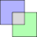
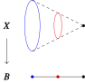
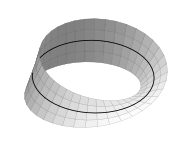

<problems>
- “空间上的空间”一节 Möbius 带例子的脚注中，参数化的 $z$ 分量 $z=0.5u\sin(u/2)$ 似乎应为 $z=0.5u\sin(v/2)$。
</problems>

## 积空间

在这一节中，我们从两个拓扑空间 \(X\) 和 \(Y\) 出发，构造它们笛卡儿积
\(X \times Y\) 上的一个拓扑。在定义结束之后我们就能够说 \(\mathbb{R}^{2}\) 的标准
拓扑就是 \(\mathbb{R}\) 与自己的“笛卡儿积”上的积拓扑。

令 \(X\) 与 \(Y\) 为拓扑空间。
设 \(U\) 是 \(X\) 的开集，
\(V\) 是 \(Y\) 的开集。如果我们希望在 \(X \times Y\) 上定义拓扑，自然而然地我们
希望 \(U \times V\) 应该是这个拓扑的开集。但是有一点微妙的地方应该注意，子集族
\[
\{U \times V \colon U \text{ 是 } X \text{ 的开集}, V \text{ 是 } Y \text{ 的开集}\}
\]
**不能**构成一个拓扑。如果我们直观地将形如 \(U\times V\) 的子集叫做
“开箱子（[openbox](http://openbox.org/wiki/Main_Page)）”[^1] 的话，
那么开箱子的并不一定是开箱子（图 1）。

{width=150}

为了弥补这一点，我们强行**定义积拓扑**的开集为
一堆开箱子的并。即：\(W\subset X \times Y\) 为开，如果存在一族 \(X\) 的开集
\((U_i)_{i \in I}\)，一族 \(Y\) 的开集 \((V_i)_{i \in I}\)，
使得 \(W = \bigcup_{i\in I} U_i \times V_i\)。

按照这个定义，开集的并一定是开集。我们来验证两个开集的交是开集：
设
\[
\begin{aligned}
  W &= \bigcup_{i\in I} U_{i} \times V_{i}, \\
  W' &= \bigcup_{j\in J} U'_{j} \times V'_{j}.
\end{aligned}
\]
则
\[
W \cap W' =
\bigcup_{(i,j) \in I \times J} \left( U_{i} \cap U'_{j}\right) \times \left( V_{i}\cap V'_{j}\right)
\]
仍然是开箱子的并。

我们约定，今后若无特别申明，若 \(X\)，\(Y\) 为拓扑空间，记号 \(X \times Y\) 总代
表笛卡儿积上的积拓扑，并称它为**积空间**。

积空间 \(X \times Y\) 上有两个自然的**投影映射**
\[
\begin{tikzcd}[row sep=tiny]
   & X \times Y \ar{rd}{\mathrm{pr}_Y} \ar{ld}[swap]{\mathrm{pr}_X}& \\
  X & & Y \\
  x& (x,y) \ar[mapsto]{l} \ar[mapsto]{r} & y
\end{tikzcd},
\]
这两个映射都是连续的。它们满足如下**泛性质**。

::: proposition [积空间的泛性质] {@proposition:universal-property-product-space}
令 \(X\)、\(Y\)、\(Z\) 为拓扑空间。
令 \(p_X: Z \to X\)，\(p_{Y}: Z \to Y\) 为连续映射。
则存在唯一连续映射 \(p:Z \to X \times Y\)，
使得 \(p_{X} = \mathrm{pr}_{X} \circ p\) 与
\(p_{Y} = \mathrm{pr}_{Y} \circ p\) 成立。
:::

::: proof
定义 \(p(z) = (p_X(z), p_{Y}(z))\)。
为了证明 \(p\) 连续，只需证明
\(p^{-1}(U\times V)\) 为开集，其中 \(U\) 是 \(X\) 的开集，
\(V\) 是 \(Y\) 的开集。今有
\[
p^{-1}(U \times V) = p_{X}^{-1}(U) \cap p_{Y}^{-1}(V).
\]
因 \(p_{X}\)，\(p_{Y}\) 连续，
\(p_{X}^{-1}(U)\) 及 \(p_{Y}^{-1}(V)\) 为开。
因此 \(p_{X}^{-1}(U) \cap p_{Y}^{-1}(V)\)，
为开。

映射 \(p\) 只能如上述定义：条件
\(p_X=\mathrm{pr}_{X}\circ p\) 迫使 \(p(z)\) 的第一分量为
\(p_{X}(z)\)，第二分量同理。
:::

::: remark [抽象的废话] {@situation:abstract-nonsense}
设 \(X\)，\(Y\) 和 \(Z\) 是三个拓扑空间。
按照上面的操作，我们可以定义 \((X \times Y) \times Z\)
以及 \(X \times (Y \times Z)\) 上面的积拓扑。我们一定会默许地认为这两个空间是
“显然地”同胚的。我们也可以按照上面的构造，定义三个空间的积空间
\(X \times Y \times Z\)，并且认为
\((X \times Y) \times Z\) 以及
\(X \times (Y \times Z)\) 都“显然地”与 \(X \times Y \times Z\)
同胚。在数学里，我们常常会碰到这样“平凡”的问题。而使用“泛性质”则能够让
我们不必分析具体的构造而断言“平凡”的问题有确定的回答。

具体到上述问题，我们来考虑一个大交换图
\[
\begin{tikzcd}[column sep=tiny, row sep=small]
  & & & (X\times Y) \times Z \ar[swap]{lld}{\mathrm{pr}_{X\times Y}}
  \ar[dotted,shift left]{ddd}{\Phi}
  \ar{rd}{\mathrm{pr}_{Z}} \\
  & X \times Y \ar{rd}{\mathrm{pr}_{Y}} \ar[swap]{ld}{\mathrm{pr}_X} & & &Z\\
  X & & Y \\
  & & & X \times Y \times Z \ar[bend right=15]{lu}{\mathrm{pr}_{Y}}
  \ar[bend left=20]{lllu}{\mathrm{pr}_{X}} \ar[swap,bend right=20]{ruu}{\mathrm{pr}_{Z}}
  \ar[dashed,bend left]{lluu}{\Upsilon} \ar[shift left,dashed,bend left=15]{uuu}{\Psi}
\end{tikzcd}
\]
在这个图里，\(\Upsilon\)，\(\Phi\) 与 \(\Psi\) 都是由泛性质诱导的。
通过“图上追踪”，我们能够验证
\(\mathrm{pr}_{\bullet}\circ\Phi\circ\Psi=\mathrm{pr}_{\bullet}\)，对
\(\bullet=X,Y,Z\) 都成立。因此由 \(X\times Y \times Z\) 的泛性质的唯一性，我们
知道必有 \(\Phi\circ\Psi = \mathrm{Id}_{X\times Y\times Z}\)。类似可以验证
\(\Psi\circ\Phi=\mathrm{Id}_{(X\times Y)\times Z}\)。

\({}^{\star}\)
在这个论证过程中，“什么严肃的数学都没有发生”，我们不需要进行思考。
因此这样的论证叫做“抽象的废话”。
关于抽象废话的标准教材是 S. Mac Lane 的书
“数学工作者必知的范畴学”。
\({}_{\star}\)
:::

## 基与子基

在积拓扑的构造中，开箱子起到了决定性的作用。
使用一些具有特别特性的集合来构造开集在拓扑中十分常见。
我们因此从中抽出一个特别的概念：拓扑基。

令 \(X\) 为集合。
令 \(\mathcal{B}\) 为 \(X\) 的一个子集族。
我们称 \(\mathcal{B}\) 是 \(X\) 上的一个**拓扑基**，
如果它满足如下属性：

- 对任何 \(x \in X\)，存在 \(U \in \mathcal{B}\)，
  使得 \(x \in U\)。

- 若 \(U, V \in \mathcal{B}\)，则存在一族 \(\mathcal{B}\) 中元素
  \((W_{i})_{i\in I}\)，使得 \(U \cap V = \bigcup_{i\in I} W_{i}\)。

比如，在积拓扑的定义中，开箱子的全体虽然不构成拓扑，但构成了一个拓扑基。

如果 \(X\) 是一个集合，\(\mathcal{B}\) 是 \(X\) 上的一个拓扑基，我们定义
**由\(\mathcal{B}\) 决定**的拓扑如下：\(X\) 的子集 \(W\) 叫做开集，如果它是
\(\mathcal{B}\) 中一族元素的并。按照定义，开集的并是开集；拓扑基定义的第一条性质保证了
\(X\) 是开集；取 \(I=\emptyset\)，我们知道空集是开集。
最后，拓扑基定义的第二个条件保证了两个开集的交也是开集，事实上，如果
\(W=\bigcup_{i\in I} U_i\)，
\(W'=\bigcup_{j\in J} V_j\)，
\(U_i \cap V_j = \bigcup_{k\in K} W_{ij,k}\)，
其中 \(U_i, V_j, W_{ij,k} \in \mathcal{B}\)，则
\[
W \cap W' = \bigcup_{(i,j,k)\in I\times J\times K} W_{ij,k}.
\]
是开集。

如果 \((X,\mathscr{T})\) 是一个拓扑空间，\(\mathcal{B}\) 是 \(X\) 的一个拓扑基。
如果 \(\mathcal{B}\) 决定的拓扑就是 \(\mathscr{T}\)，那么我们就说 \(\mathcal{B}\)
生成了 \(\mathscr{T}\)。

::: example

1. 开箱子生成了两个空间的积拓扑。

2. 如果 \(X\) 是度量空间，那么 \(X\) 的一切开球
   \(\{B(x;\epsilon):x \in X, \epsilon\in \mathbb{R}_{>0}\}\)
   生成了度量拓扑。事实上，选择 \(\epsilon\in \mathbb{Q}\) 便足矣。

3. 若 \(\mathcal{S}\) 是 \(X\) 一族子集。
   令
   \[
   \mathcal{B_S} = \left\{\bigcap_{i \in I}U_i: I \text{ 有限}, U_i \in \mathcal{S}\right\}.
   \]
   根据集合相交的约定，\(\bigcap_{A\in\emptyset}A = X\)，\(\mathcal{B_S}\) 是
   \(X\) 上的一个拓扑基。我们称 \(\mathcal{S}\) 是 \(X\) 的一个**拓扑子基**。
   注意，任何 \(X\) 的子集族都可以看作某个拓扑的子基。

:::

::: proposition {@proposition:continuity-via-subbasis}
令 \(f: X \to Y\) 为拓扑空间之间的一个映射。
\(\mathcal{S}\) 是 \(Y\) 的拓扑的一个子基。
则 \(f\) 为连续的必要且充分条件是对任何 \(U \in \mathcal{S}\)，
\(f^{-1}(U)\) 是开集。
:::

## 始拓扑

令 \(X\) 是集合，
\((X_{i})_{i \in I}\) 是一族拓扑空间，
\((f_i: X \to X_{i})_{i\in I}\) 是一族映射。
定义
\[
\mathcal{S} = \{f_i^{-1}(U) : U \subset X_i \text{ 开集}, i\in I\}.
\]
以 \(\mathcal{S}\) 为子基生成的拓扑叫做
**集合 \(X\) 关于映射 \((f_i)_{i\in I}\) 的始拓扑**。

::: proposition {@proposition:initial-topology-universal-property}
记号如上。赋予 \(X\) 始拓扑。
则对任何拓扑空间 \(T\)，任何映射 \(g: T \to X\)，
\(g\) 连续的必要且充分条件是对任何 \(i \in I\)，
\(f_i \circ g\) 是连续映射。
:::

这是 @proposition:continuity-via-subbasis 的直接推论。
令 \(T=X\)，\(g=\mathrm{Id}_{X}\)，我们可以说 \(X\) 的始拓扑是令 \(f_i\) 都连续
的最粗的拓扑。

使用始拓扑可以很方便地定义任意多个空间的积拓扑。
设 \((X_{i})_{i\in I}\) 是一族拓扑空间。
我们定义 \(\prod_{i\in I}X_{i}\) 的**积拓扑**
为投影映射 \(\mathrm{pr}_j : \prod_{i\in I} X_i \to X_j\)
的始拓扑。于是 @proposition:initial-topology-universal-property
推出如下**积拓扑的泛性质**。

::: proposition {@proposition:universal-property-product-space-arbitrary}
令 \((X_i)_{i\in I}\) 为一族拓扑空间。
赋予 \(\prod_{i\in I}X_{i}\) 积拓扑。
令 \((p_i: Z \to X_i)_{i\in I}\) 为一族连续映射。
则存在唯一连续映射 \(p:Z \to \prod_{i\in I}X_i\)，
使得 \(p_{i} = \mathrm{pr}_{i} \circ p\)。
这映射 \(p\) 通常用记号 \(\prod_{i\in I}p_{i}\) 来代表。
:::

今后，除非特别申明，但凡使用记号 \(\prod X_i\)，我们总是使用积拓扑。

注意，如果我们展开始拓扑的定义，那么积拓扑的一组基是一种特殊的开箱子：
\[
\prod_{i\in I} U_{i},
\]
其中 \(U_i \subset X_i\) 是开集，但是只有有限个 \(U_i\) 不等于 \(X_i\)。
我们把这样的开箱子叫做“好箱子”。只选择好箱子做基而抛弃了其它箱子似乎不太自然。
但是 @proposition:universal-property-product-space-arbitrary 告诉我们实
际上如果我们希望乘积映射 \(p(z)=\prod_{i\in I}p_i(z)\) 对任何 \(p_i\) 都连续的话，我们只能使
用好开箱子做基。

使用一切开箱子做基也决定了一个拓扑，叫做“箱拓扑”。箱拓扑是一般拓扑学里常见
的反例，但是对于我们的课程并不重要。

## 空间上的空间

令 \(B\) 为一个拓扑空间。一个 **\(B\) 上的空间（space over \(B\)）**，或
**\(B\)-空间（\(B\)-space）**，是指偶对 \((X,p)\)，其中 \(X\) 为拓扑空间，
\(p: X \to B\) 为一个连续映射。

我们可以想象一个 \(B\)-空间为一族空间 \((X_{b})_{b\in B}\)，其中
\(X_{b}=p^{-1}(b)\)（叫做点 \(b\) 的**纤维（fiber）**），
并且 \(X_{b}\)“随着 \(b\) 连续变化”（图 2）。

{width=250}

采取此观点时，一般习惯性将 \(B\) 叫做**底空间（base space）**，
\(X\) 叫做**全空间（total space）**，并且我们在黑板上一般用竖着的箭头
\[
\begin{tikzcd}
  X \ar{d} \\
  B
\end{tikzcd}
\]
来表示。

::: example [平凡 \(B\)-空间]
令 \(F\) 为任一拓扑空间。则积空间 \(\mathrm{pr}_B:B\times F \to B\)
可以看作一个 \(B\)-空间。同胚于积空间的 \(B\)-空间叫做**平凡 \(B\)-空间**。
平凡 \(B\)-空间的特点是所有的纤维都是 \(F\)，并且它们的“相对位置”没有产生变化。
:::

::: example [Möbius 带] {@example:mobius-strip}
图 3 描述了著名的 **Möbius 带** \(M\)。

{width=250}

即使我们没有明显地写出它在 \(\mathbb{R}^{3}\) 中的方程[^2]，读者应
该能够想象出它的子空间拓扑结构。图中的黑线是一个与 \(\mathbb{S}^1\) 同胚的空间。
将 \(M\)上一个点“沿着竖线移动”可以定义出一个
从 \(M\) 到 \(\mathbb{S}^{1}\) 的连续映射。映射 \(\pi: M \to \mathbb{S}^{1}\)
的任何一个纤维都同胚于闭区间\(\mathbf{I}\)，但是我们今后会证明，\(M\) 不同胚于
\(\mathbf{I}\times \mathbb{S}^{1}\)，也就是说 \(M\) 不是一个平凡的
\(\mathbb{S}^1\)-空间。
:::

::: example
令 \(B = \mathbb{C}^{n}\)，
令
\[
X = \{(x,a_1,\ldots,a_n) \in \mathbb{C} \times B : x^n + a_1 x^{n-1} + \cdots + a_n = 0\},
\]
以及令 \(p(x,a) = a\)。
则 \((X,p)\) 是一个 \(B\)-空间。对于 \(a \in B\)，\(X_a\) 是多项式
\[
f_a(x) = x^n + a_1 x^{n-1} + \cdots + a_n
\]
的根的全体。因此，\((X,p)\) 这个 \(B\)-空间“描述了”当参数
\(a\)“连续变化”时，\(f_a\) 的根如何随着 \(a\) 相应地变化。
:::

如果 \((X,p)\)，\((X',p')\) 是两个 \(B\)-空间。一个从 \((X,p)\) 到 \((X',p')\)
的 **连续 \(B\)-映射** 是指一个连续映射 \(f: X \to X'\)，
满足 \(p'\circ f=p\)。因此，连续 \(B\)-映射恰好是那些保持纤维
（即把 \(X_b\) 映入\(X'_b\)）的连续映射。

如果 \((X_i, p_i)_{i\in I}\) 是一族 \(B\)-空间。
则我们定义 \(X_i\) 关于 \(B\) 的**纤维积**（fiber product）
如下。作为集合，它是
\[
\prod_{i\in I}{}_{_B} (X_{i},p_i)
=
\left\{(b,(x_i){}_{i\in I}) \in B \times \left( \prod_{i\in I} X_i \right) : p_{i}(x_i) = b, \forall i \in I\right\}.
\]
令 \(\mathrm{pr}_{B,i}\) 为
\(\mathrm{pr}_i:B\times \prod_{i} X_i \to X_i\)
在子集
\(\mathop{{\prod\limits_{i\in I}}\!{}_B} (X_{i},p_i)\)
的限制。我们赋予
\[
\prod_{i\in I}{}_{_B} (X_{i},p_i)
\]
关于 \(\mathrm{pr}_{B,i}\) 的始拓扑。

**注意**。
记号
\[
\prod_{i\in I}{}_{_B} (X_{i},p_i)
\]
过于繁琐，在没有歧义时，我们通常只使用记号
\[
\prod_{i\in I}{}_{_B} X_{i}.
\]
两个 \(B\)-空间 \((X,p)\)，\((Y,q)\) 的纤维积通常用记号 \(X\times_{p,B,q}Y\)，
或者更简略的 \(X \times_B Y\) 来表示。

如果我们把每个 \((X_{i},p_i)\) 看作“一族由 \(B\) 参数化的连续变化的空间”
\((X_{i,b})_{b\in B}\)，那么纤维积则对应了“逐个纤维取积空间”
\((\prod_{i\in I}X_{i,b})_{b\in B}\)。

::: proposition [纤维积的泛性质] {@proposition:universal-property-fiber-product}
令 \((X_i,p_i){}_{i\in I}\) 为一族 \(B\)-空间。
令 \(\big(f_i:(Y,q) \to (X_i,p_i)\big)\) 为一族连续
\(B\)-映射。则存在唯一的连续 \(B\)-映射
\[
f: (Y,q) \to \left( \prod_{i}{}_{_B} X_{i}, \mathrm{pr}_B\right)
\]
使得 \(\mathrm{pr}_{i}\circ f = f_i\)。
:::

当 \(B\) 是一个点的时候，纤维积就是通常的积空间。

如果 \((X,p)\) 是一个 \(B\)-空间，那么 \(\mathrm{Id}_X: X \to X\)
就诱导了连续 \(B\)-映射 \(\Delta_{X/B}: X \to X \times_B X\)
\[
\begin{tikzcd}
  X \ar[dashed]{rd}{\Delta_{X/B}}
  \ar[bend left]{rrd}{\mathrm{Id}_X} \ar[bend right,swap]{rdd}{\mathrm{Id}_X} \\
  & X \times_B X \ar{d}\ar{r} & X \ar{d}{p} \\
  & X \ar{r}{p} & B
\end{tikzcd},
\]
这个映射被形象地叫做**对角线映射（diagonal map）**。

设 \((X,p)\) 是一个 \(B\)-空间。
设 \(f: B' \to B\) 是另一个 \(B\)-空间。
令 \(X' = X \times_B B'\)。
则我们有如下交换图：
\[
\begin{tikzcd}
  X' \ar{r} \ar{d} & X \ar{d}{p} \\
  B' \ar{r}{f} & B
\end{tikzcd}.
\]
注意，如果 \(f(b') = b\)，则有 \(X'_{b'} = X_b\)。
因此，如果我们将 \(X'\) 看作 \(B'\)-空间，\(X'\) 叫做 \(B\)-空间 \((X,p)\)
（通过 \(f\)）的**底变换（base change）**。

## Hausdorff 空间

我们一直在讨论空间和映射的定义。
现在我们来介绍一个“拓扑性质”。
我们称一个拓扑空间 \(X\) 是 **Hausdorff 空间**，
如果对任何 \(X\) 上的两个不同点 \(x, y\)，存在 \(x\) 的邻域 \(U\)，\(y\) 的邻域
\(V\)，使得 \(U \cap V = \emptyset\)。

读者应该能够验证下面的断言。

::: proposition {@proposition:hausdorff-one-point-closed}

1. Hausdorff 空间的单点子空间都是闭集。

2. 与 Hausdorff 空间同胚的空间是 Hausdorff 的。

3. 度量空间是 Hausdorff 空间。

4. 离散空间是 Hausdorff 空间。

5. Hausdorff 空间的子空间也是 Hausdorff 空间。

6. Sierpiński 空间不是 Hausdorff 空间。

:::

::: proposition {@proposition:hausdorff-diagonal-closed}
设 \(X\) 为拓扑空间。
则 \(X\) 为 Hausdorff 当且仅当对角线映射
\[
\Delta: X \to X \times X
\]
的像是 \(X\times X\) 的闭子集。
:::

::: proposition {@proposition:equality-of-maps-with-hausdorff-target-define-closed}
令 \(f_0,f_1: X_{1} \rightrightarrows X_0\) 为连续映射。
设 \(X_0\) 为 Hausdorff 空间。
则
\[
\{x \in X_1 : f_0(x) = f_1(x)\}
\]
是 \(X_{1}\) 的闭子集。
:::

::: proof
连续映射 \(f_0, f_1\) 诱导了连续映射
\[
f_0 \times f_1: X_1 \to X_0 \times X_0
\]
（@proposition:universal-property-product-space）
集合 \(\{x\in X_1:f_0(x)=f_1(x)\}\) 是
\(X_0\times X_0\) 中对角线在 \(f_0\times f_1\) 下的逆像。
由于对角线在 \(X_0\times X_0\) 闭
（@proposition:hausdorff-diagonal-closed），
它在 \(f_0\times f_1\) 下的逆像 \(\{x\in X_1:f_0(x)=f_1(x)\}\) 也是闭集。
:::

**本节所学概念与例子**

- 积拓扑 product topology
- 拓扑基 basis for a topology
- 拓扑子基 subbasis
- 始拓扑 initial topology
- \(B\)-空间 \(B\)-space
- 纤维 fiber
- Möbius 带
- 纤维积 fiber product
- 底变换 base change
- 对角线映射 diagonal map
- Hausdorff 空间 Hausdorff space

## 习题

::: exercise [序列的极限] {@exercise:limit-of-sequence}
令 \(X\) 为拓扑空间。令 \(\{x_n\}{}_{n\in \mathbb{N}}\) 是 \(X\) 中的一列点。
我们称 \(x_n\) 收敛于 \(x\)（或者 \(x\) 是 \((x_n)_{n\in \mathbb{N}}\) 的一个
极限），记做 \(x_n \to x\)，
如果对任何 \(x\) 的邻域 \(U\)，存在 \(N \in \mathbb{N}\)，
使得 \(n\geq N \Rightarrow x_{n} \in U\)。

1. 举例说明在一般的拓扑空间中，一个序列可以有多于一个极限。

2. 证明在 Hausdorff 空间中，序列的极限有至多一个极限。

:::

::: exercise [第一可数空间] {@exercise:first-countable-continuity}
拓扑空间 \(X\) 叫做 **第一可数（first countable）**，如果下述性质成立：
对任何 \(p \in X\)，存在一族 \(p\) 的邻域
\(\{U_{n}\}_{n\in \mathbb{N}}\)，使得任何 \(p\) 的邻域 \(U\)
都包含某个 \(U_{n}\)。

1. 证明度量空间是第一可数的。

2. 设 \(X\) 为第一可数，\(f:X \to Y\) 为拓扑空间之间映射。
   证明 \(f\) 连续的必要充分条件是：
   对任意 \(x \in X\)，任意收敛于 \(x\) 的 \(X\) 上序列 \(\{x_{n}\}\)，都有
   \(f(x_{n})\to f(x)\)。

:::

::: exercise [第二可数空间] {@exercise:second-countable-space}
一个拓扑空间 \(X\) 叫做**第二可数（second countable）** 的，如果它有一个
拓扑基 \(\mathcal{B}\)，且 \(\mathcal{B}\) 是个可数集合。

1. {@item:2nd-countable-routine} 判断下列空间是否第二可数

   1. 度量空间，

   2. 具有可数稠密子集的度量空间。

   3. 第二可数空间的可数乘积。

   4. 积空间 \(\mathbb{R}^{I}=\prod_{i\in I}\mathbb{R}\)，
      其中 \(I\) 不可数。\(\boxed{\dagger}\)

   5. {@item:subspace-2nd-countable} 第二可数空间的子空间。

2. 证明下述 Lindelöf 定理：若 \(X\) 第二可数，
   \((U_{i}){}_{i\in I}\) 是 \(X\) 的开覆盖，则存在
   \(I\) 的可数子集 \(J\)，使得 \(X = \bigcup_{j\in J}U_{j}\)。

:::

::: exercise [非分歧映射] {@exercise:unramified-map}
连续映射 \(f:X \to Y\) 叫做**非分歧的（unramified map）**，
如果对任意 \(x \in X\)，都存在它的邻域 \(U\)，使得
\(f|_{U}\) 是单射。

1. 若 \(f\) 非分歧，则对任意 \(y\in Y\)，
   \(f^{-1}(y)\) 是 \(X\) 的离散子空间。

2. 映射 \(t\mapsto t^{2}:\mathbb{C} \to \mathbb{C}\)
   有离散的纤维，但它不是非分歧的。

3. \(f\) 为非分歧的必要且充分条件是对角映射
   \(\Delta:X \to X\times_Y X\) 是开嵌入。

:::

::: exercise [局部同胚] {@exercise:local-homeo}
连续映射 \(f:X \to Y\) 叫做
**局部同胚（local homeomorphism）**（或 **平展映射（étale map）**），
如果任何
\(x\in X\) 都有邻域 \(U\)，使得 \(f(U)\) 是 \(Y\) 的开子空间，
且 \(f|_U:U\to f(U)\) 是同胚。

1. 局部同胚是开映射。

2. 令 \(U\) 与 \(V\) 都是 \(\mathbb{R}^{n}\) 的开集。
   令 \(f: U \to V\) 为具有处处可逆 Jacobi 的可微映射。
   则[[反函数定理]]推出 \(f\) 是局部同胚。\(\boxed{\dagger}\)

3. {@item:local-homeo-unramified} 证明 \(f:X \to Y\) 是局部同胚的必要且充分条件是 \(f\)
   是非分歧的开映射
   （见 @exercise:open-map，@exercise:unramified-map）。
   我们将在 @exercise:nodal-cubic-unramified
   提供一个不是局部同胚的非分歧满射的例子。

:::

::: exercise [分离映射] {@exercise:sep-map}
连续映射 \(f:X \to Y\) 叫做
**分离映射（separated map）**，
如果对角线映射 \(\Delta_{X/Y}: X \to X \times_Y X\) 是闭嵌入。
特别地，如果 \(Y\) 是单点集合，那么 \(X \to Y\) 分离当且仅当 \(X\) 为
Hausdorff 空间。

1. 证明下列断言等价。

   1. \(f: X \to Y\) 为分离映射。

   2. 对任何两个从拓扑空间 \(W\) 映入 \(X\) 的满足条件 \(f\circ g_1 = f\circ g_2\)
      的连续映射 \(g_1, g_2\)，\(W\) 的子空间
      \[
      \{w \in W \colon g_1(w) = g_2(w)\}
      \]
      是 \(W\) 的闭子空间。

   3. 对任意的两个 \(X\) 上的满足 \(f(x_1) = f(x_2), x_1 \ne x_2 \) 的点 \(x_1, x_2\)，
      存在 \(x_1\) 在 \(X\) 中的邻域 \(V_1\)，\(x_2\) 在 \(X\) 中的邻域 \(V_2\)，
      满足 \(V_1 \cap V_2 = \emptyset\)。

2. 设 \(f:X \to Y\) 以及 \(g: Y \to Z\) 是两个连续映射。

   1. 若 \(f\)，\(g\) 都分离，则 \(g\circ f\) 也分离。

   2. 举例说明，即使 \(f\) 分离，\(g\circ f\) 和 \(g\)
      也可以都不分离。

   3. 若 \(g\circ f\) 分离，则 \(f\) 分离。

   4. 若 \(g\circ f\) 分离，\(g\) 是否一定分离？

3. 若 \((p_i: X_i \to B)_{i\in I}\) 是一族分离映射，
   则典则映射 \(\prod\limits_{i\in I}{}_{_B}(X_i,p_i) \to B\) 是分离映射。
   特别地，Hausdorff 空间的积空间是 Hausdorff 空间。

4. 若 \(p: X \to B\) 是分离映射。令 \(B' \to B\) 为连续映射，则底变换
   \(p': X\times_B B' \to B'\) 是否一定是分离映射？

5. 若连续映射 \(p: X \to B\) 的所有纤维都是 Hausdorff 空间，
   \(p\) 是否一定分离？

:::

::: exercise [Zariski 拓扑] {@exercise:zariski-top}
集合 \(\mathbb{C}^{n}\) 的子集 \(Z\) 叫做**Zariski 闭集**，
如果存在 \(\mathbb{C}[x_1,\ldots,x_n]\) 中多项式 \((P_{i}){}_{i\in I}\)，
使得 \(Z = \{z\in \mathbb{C}^{n}:P_{i}(z)=0,\forall i \in I\}\)。
如果 \(U \subset \mathbb{C}^n\) 的补集是 Zariski 闭集，
那么我们称 \(U\) 是 Zariski 开集。

1. \(\mathbb{C}^{n}\) 的 Zariski 开集构成了一个拓扑，称为 Zariski 拓扑。

2. 对于 \(m<n\)，我们可以把 \(\mathbb{C}^{m}\) 看作 \(\mathbb{C}^{n}\)
   的线性子空间。验证 \(\mathbb{C}^m\) 的 Zariski 拓扑与它从 \(\mathbb{C}^{n}\)
   那里继承的 Zariski 子空间拓扑是一样的。

3. “俨开集（distinguished open）”
   \(U_{f} = \{x \in \mathbb{C}^{n} : f(x) \neq 0\}\)，
   其中 \(f \in \mathbb{C}[x_1,\ldots,x_n]\)，
   构成了 \(\mathbb{C}^{n}\) 上 Zariski 拓扑的一个拓扑基。

4. 令 \(f_1,\ldots,f_m\) 为 \(\mathbb{C}[x_1,\ldots,x_n]\) 中多项式。
   证明映射
   \[
   (x_1,\ldots,x_n) \mapsto (f_1(x),\ldots,f_m(x)): \mathbb{C}^{n}\to\mathbb{C}^{m}
   \]
   关于定义域和靶空间 Zariski 拓扑连续。

5. \(\mathbb{C}^{2}\) 上的 Zariski 拓扑是否 \(\mathbb{C}\)
   的 Zariski 拓扑的积拓扑？

:::

::: exercise [[H. Furstenberg](https://en.wikipedia.org/wiki/Hillel_Furstenberg) 关于素数无限性的拓扑证明[^3]]
对整数 \(a,b\)，定义 \(S(a,b) = \{an+b:n\in \mathbb{Z}\}\)。
以 \(S(a,b)\) 为子基决定的集合 \(\mathbb{Z}\) 上的一个拓扑 \(\mathscr{T}\)。

1. 证明每个 \(S(a,b)\) 关于拓扑 \(\mathscr{T}\) 既开又闭。

2. 证明有限子集在拓扑 \(\mathscr{T}\) 下非开。

3. 证明
   \(\mathbb{Z}\setminus\{\pm 1\} = \bigcup_{p\text{ prime}}S(p,0)\)。
   由此推出有无限个素数。

:::

::: exercise [Hilbert 空间 \(\ell^{2}(\mathbb{N})\)] {@exercise:hilbert-cube}
令 \(\ell^{2}(\mathbb{N})\) 为一切满足
\[
\sum_{n=0}^{\infty}|a(n)|^{2} < \infty.
\]
的映射
\(a:\mathbb{N} \to \mathbb{R}\) 构成的集合。

1. 定义
   \[
   d(a,b) = \sqrt{\sum_{n\in \mathbb{N}} |a(n) - b(n)|^{2}}.
   \]
   验证 \(d\) 是 \(\ell^{2}(\mathbb{N})\) 的度量。

2. 证明
   \((\alpha,a)\mapsto \alpha \cdot a: \mathbb{R} \times \ell^2(\mathbb{N}) \to \ell^{2}(\mathbb{N})\)
   与
   \((a,b)\mapsto a+b : \ell^2(\mathbb{N}) \times \ell^{2}(\mathbb{N}) \to \ell^{2}(\mathbb{N})\)
   是连续映射。
   [因此 \(\ell^{2}(\mathbb{N})\) 是一个**拓扑向量空间（topological vector space）**。]

3. 证明 \(\ell^{2}(\mathbb{N})\) 是第二可数 Hausdorff 空间。

4. 证明 **Hilbert 方块**
   \(I^{\infty}=\{a\in \ell^{2}(\mathbb{N}):|a(n)| \leq 1/n\}\)
   在 \(\ell^{2}(\mathbb{N})\) 中内部为空。

5. 证明 \(I^{\infty}\) 同胚于积空间
   \(\prod_{n\in\mathbb{N}}[0,1]\)。\(\boxed{\dagger}\)

:::

[^1]: “开”在这里是形容词，不是动词。
[^2]: 图 3 所画的 \(M\) 是从 \(\mathbb{R}^2\) 到 \(\mathbb{R}^3\) 的映射
  \[
  x=(1+(0.5)u\cos(v/2))\cos(v), y=(1+0.5u\cos(v/2))\sin(v), z=0.5u\sin(u/2)
  \]
  的像。黑色的 \(\mathbb{S}^1\) 是 \(\mathbb{R}^{2}\) 子空间 \(u=0\) 的像。
[^3]: [*On the infinitude of primes*](https://doi.org/10.2307%2F2307043). American Mathematical Monthly. 62 (5): 353. 1955.
