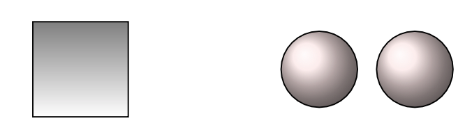
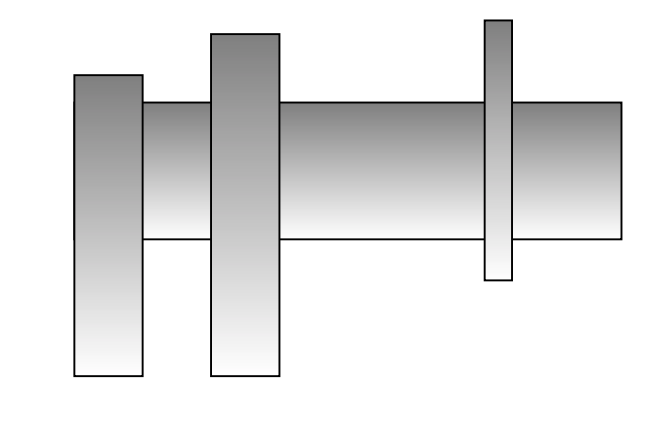
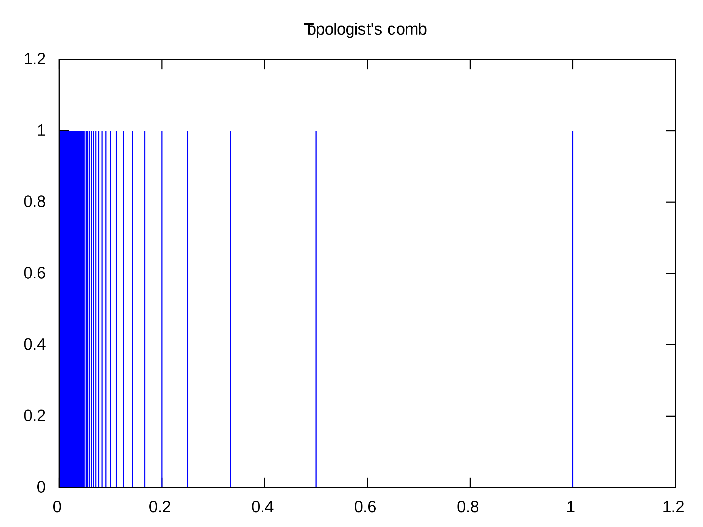

<problems>
- “连通性与商映射”一节开头“连续映射的商空间是连通的”似乎应为“连通空间的商空间是连通的”。
</problems>

::: remark* (一句大实话)
The most intuitively evident topological invariant of a space is the number
of connected pieces into which it falls.

<align right>
——R. Bott，杜武亮\
*Differential Forms in Algebraic Topology*
</align>
:::

到目前为止，我们已经熟悉了拓扑空间的概念，并且掌握了相当多的构造拓扑空间的方法。
但是我们并没有很好的办法证明何时两个空间不同胚。比如，我们不知道为何
\(\mathbb{R}^{n}\) 与 \(\mathbb{R}^{m}\) 不同胚。在本节中，
我们将介绍一个颇为直观的拓扑性质，连通性。连通性及它的“高级”推广，将产生拓扑学中极微妙的不变量
——同伦群。

## 连通空间

拓扑空间 \(X\) 叫做**连通的（connected）**，
如果它非空，并且它不是两个非空不交开子集的并。
直观地说，图 1。
左侧的方块是连通的，右侧的两个球（作为一个空间）是不连通的。

{width=200}

从定义可知，非空的拓扑空间 \(X\) 为连通等价于下述任何一款断言：

- \(X\) 的既开又闭又非空的子集只有 \(X\)；

- \(X\) 不能写成互不相交的非空闭子集的并。

最直观的连通空间是实数轴 \(\mathbb{R}\)。

::: proposition {@proposition:real-line-connected}
实数轴 \(\mathbb{R}\) 在它的标准拓扑下是连通的。
:::

::: proof
用反证法。
如果 \(A \subset \mathbb{R}\) 是 \(\mathbb{R}\) 的真子集，既开又闭又非空。
设 \(x \notin A\)。
则我们可以将 \(A\) 写作两个开子集的互不相交的并：
\[
A = A_{>x} \cup A_{<x},
\]
其中 \(A_{>x} = \{a \in A : a > x\}\)。类似定义 \(A_{<x}\)。

由于 \(A\) 非空，\(A_{>x}\) 与 \(A_{<x}\) 之一非空。无妨设 \(A_{>x}\) 非空。
由实数的性质，存在 \(b \in \mathbb{R}\)，使得 \(b\) 是 \(A_{>x}\) 的下确界。
由于 \(A\) 是 \(\mathbb{R}\) 的闭集，\([b,\infty[\)
是 \(\mathbb{R}\) 的闭集，我们知道
\(A_{>x} = A \cap [b,\infty[\)
是 \(\mathbb{R}\) 的闭集。
根据下确界的含义，任何包含 \(b\) 的开区间都与 \(A_{>x}\) 相交。
由于 \(A_{>x}\) 闭，我们有 \(b \in A_{>x}\)。

但是 \(A_{>x} = A \cap ]{x},{\infty}[\) 也是开的。
因此 \(b \in A_{>x}\) 推出存在开区间
\(]b-\epsilon,{b+\epsilon}[\subset A_{>x}\)。
这样，我们就找到了比 \(b\) 更小的数落在 \(A_{>x}\) 中，产生了矛盾。
:::

::: proposition {@proposition:continuous-image-connected-is-connected}
设 \(X\) 为连通空间，\(f\colon X \to Y\) 为连续映射。
则 \(\mathrm{Im}(f)\) 是连通的。
:::

::: proof
若 \(\mathrm{Im}(f)\) 有一个既开又闭又非空的真子空间 \(V\)，
由于 \(f\colon X \to \mathrm{Im}(f)\) 为连续满射，我们知道
\(f^{-1}(V)\) 在 \(X\) 中既开又闭又非空，
且它不是整个空间 \(X\)，因此 \(X\) 不连通。
:::

同胚于连通空间的空间于是自然是连通的。由于 \(\mathbb{R}\) 是连通的，所以
\(\mathbb{R}\) 中的开区间都是连通的。

::: proposition {@proposition:dense-closure}
设 \(X\) 是拓扑空间。
\(X' \subset X\) 是 \(X\) 的稠密连通子空间。
则 \(X\) 连通。
:::

::: proof
如果 \(V\) 是 \(X\) 的既开又闭又非空的子空间，
由于 \(X'\) 在 \(X\) 中稠密，\(V \cap X'\) 非空。
因此 \(V \cap X'\) 作为 \(X'\) 的子空间既开又闭又非空。
由于 \(X'\) 连通，\(V \cap X' = X'\)。
因此 \(V\) 是包含了一个稠密子集的 \(X\) 的闭子集。
因此 \(V = X\)。
:::

::: example [\(\mathbb{R}\) 的连通子集] {@example:interval-connected}
由于开区间在它所决定的闭区间和半开半闭区间中稠密，
我们得知 *\(\mathbb{R}\) 的一切区间都是连通的*。
反之，*任何 \(\mathbb{R}\) 的连通子空间都一定是区间（我们把单点集也权且看作区间）*。
事实上，如果 \(A\) 连通，但是存在 \(x\)，\(\inf A < x < \sup A\)，
\(x \notin A\)，那么 \(A \cap ]{-\infty},{x}[\)
就是 \(A\) 的一个既开又闭又非空的真子集，矛盾。

由区间的连通性，我们就可以推出微分学里的介值定理：
若 \(f\colon [a,b] \to \mathbb{R}\) 为连续函数，
\(r\) 为介于 \(f(a), f(b)\) 之间的数。
则存在 \(c \in [a,b]\)，\(f(c) = r\)。
事实上，由于 \(f([a,b])\) 连通，我们知道 \(f([a,b])\)
是 \(\mathbb{R}\) 中的区间。由于 \(f(a)\)，\(f(b)\) 落在这个区间里，
它们之间的任何数也落在这个区间里，因此可以被某个 \(c\) 映射到。
:::

在 19 世纪，数学家对连通性已经很熟悉了。
Bernhard Riemann（以及受他影响的 Enrico Betti）
已经能够熟练地使用连通性来区分不同的空间了。
仿照他们的方法，我们来解释为何球面 \(\mathbb{S}^{2}\)
与环面 \(\mathbb{S}^{1} \times \mathbb{S}^{1}\)
不同胚。为此，我们要使用 Camille Jordan 著名的分离定理：
设 \(\varphi\colon \mathbb{S}^{1} \to \mathbb{S}^{2}\)
是嵌入，那么 \(\mathbb{S}^{2} \setminus \mathbb{S}^{1}\)
不连通。如果环面同胚于 \(\mathbb{S}^{2}\)，
那么从它上面除去任何一个嵌入的 \(\mathbb{S}^{1}\)
之后应该得到不连通的空间。但是
\(\mathbb{S}^1 \times \mathbb{S}^{1} \setminus \{\ast\} \times \mathbb{S}^{1} \cong \mathbb{R} \times \mathbb{S}^{1}\)
仍然连通。

一个“闭曲面”是指一个可以被实现为某个 \(\mathbb{R}^{n}\) 的有界闭子集的 2 维流形。
如果从一个闭曲面上除去 \(b+1\) 条嵌入的 \(\mathbb{S}^{1}\) 能使得曲面不连通，但
是除去任何 \(b\) 条嵌入的 \(\mathbb{S}^1\) 仍然连通，
我们就说这个闭曲面的**连通数** 是 \(b\)。
Jordan 分离定理说明，球面的连通数是 0。
直观上，环面的连通数是 \(2\)。
然而，按照摩登的标准，很难用上述定义对此予以严格证明。
Henri Poincaré 在 20 世纪初引入了同调的概念，
我们将会学习 Poincaré 的理论，并用此计算曲面的连通数。

## 连通性与局部常值函数

一个刻画连通性的方式是使用空间上的连续函数。
我们称从拓扑空间 \(X\) 上取值于集合 \(\Lambda\) 的
**局部常值函数（locally constant function）**
是一个连续映射\(f\colon  X \to \Lambda\)，
其中我们赋予 \(\Lambda\) 离散拓扑。
说映射 \(f\colon  X \to \Lambda\) 是局部常值函数等价于说对任何 \(x \in X\)，
存在 \(x\) 的邻域 \(U \subset X\)，使得 \(f|_{U}\) 只取一个值。

局部常值函数看起来是个非常平凡的概念。
在我们这个课程范围之内不会被进一步探讨。
我们仅满足于知道如下简单的结果，它的证明留给读者
（@exercise:locally-const-on-conn）。

::: proposition {@proposition:locally-constant-on-connected}
令 \(\Lambda\) 为至少含有两个元素的集合。
令 \(X\) 为拓扑空间。
则 \(X\) 连通的必要且充分条件是任何 \(X\) 上的取值在
\(\Lambda\) 中的局部常值函数都是常值。
:::

作为 @proposition:locally-constant-on-connected
的应用，我们来证明如下结果。

::: proposition {@proposition:union-connected}
令 \(X\) 为拓扑空间。
令 \((A_i){}_{i\in I}\) 为一族 \(X\) 的连通子空间。
若存在 \(X\) 的连通子空间 \(B\) 使得
\(B \cap A_{i} \neq \emptyset\) 对一切 \(i \in I\) 成立。
那么 \(B \cup \left(\bigcup_{i\in I} A_{i}\right)\) 连通。
:::

这个命题在直观上是“显然”的，见图 2。

{width=150}

::: proof
令 \(Y=B\cup\left( \bigcup_{i\in I} A_{i} \right)\)，
赋予子空间拓扑。
令 \(f\colon Y \to \{0,1\}\) 为局部常值函数。
则 \(f|_{A_i}\) 与 \(f|_B\) 都是为局部常值函数。
因为 \(B\) 与诸 \(A_i\) 都连通，
\(f|_B\) 与 \(f|_{A_i}\) 都是常值。
固定 \(b \in B\)。
对于任意 \(y \in Y\)，要么 \(y \in B\)，要么 \(y\) 属于某个 \(A_i\)。
在前一种情形中，\(f(y)=f(b)\)；在后一种情形中，\(f(y)=f(y_i)=f(b)\)，
其中 \(y_i \in A_i \cap B\)。总而言之，我们有 \(f(y) = f(b)\)，
因而 \(f\) 是常值。
:::

::: corollary {@corollary:any-two-point-connected-imply-connected}
若非空拓扑空间 \(X\) 的任何两点 \(x,y\) 都含于一个连通子集中，那么 \(X\) 是连通的。
:::

::: proof
固定 \(x \in X\)。
令 \(D_y\) 为包含 \(x,y\) 的连通子空间。则
\[
X = \{x\} \cup \bigcup_{y \in X} D_{y}.
\]
由于单点集合为连通集合，\(\{x\} \cap D_{y} = \{x\}\)，
应用 @proposition:union-connected 即得。
:::

::: corollary {@corollary:two-product-connected}
若 \(X\) 与 \(Y\) 为连通拓扑空间。
则 \(X\times Y\) 也连通。
:::

::: proof
取定 \(y \in Y\)。
则
\[
X \times Y = (X\times\{y\}) \cup \left( \bigcup_{x\in X} \{x\}\times Y \right).
\]
而右侧的每一项都是连通的。应用 @proposition:union-connected
即可。
:::

无穷个连通空间的积空间也是连通的。证明稍微复杂一点。

::: proposition {@proposition:product-connected}
令 \((X_{i}){}_{i\in I}\) 为一族非空拓扑空间。
则 \(\prod_{i\in I} X_{i}\) 连通的必要且充分条件是对任何 \(i \in I\)，
\(X_{i}\) 是连通的。
:::

::: proof
必要性是 @proposition:continuous-image-connected-is-connected 的推论。
我们来证明充分性。
令 \(X = \prod_{i\in I} X_{i}\)。
设每个 \(X_i\) 都连通。
取定点 \(x_i \in X_{i}\)。
我们先来考虑一个辅助空间：

- 令 \(\prod'_{i\in I} X_{i}\) 为“限制性乘积”，
  它的元素是点 \((y_i){}_{i\in I}\)，满足性质：
  对除了有限个 \(i \in I\)，有 \(y_i=x_{i}\)；

- 对有限子集 \(A\subset I\)，令 \(\prod'_{A}X_{i}\) 为
  \(\prod'_{i\in I} X_{i}\) 的子空间，它的元素是
  \((y_i){}_{i\in I}\)，它满足：如果 \(i\notin A\)，那么 \(y_{i} = x_{i}\)。
  每一个 \(\prod'_{A}X_{i}\) 都同胚于有限乘积。
  \(\prod_{i\in A}X_{i}\)。

应用归纳法和 @corollary:two-product-connected，我们知道每个
\(\prod_{A}'X_{i}\) 都连通。

应用 @proposition:union-connected，
\(\prod'_{i\in I}X_{i} = \bigcup_{A\subset I} \prod'_{A}X_{i}\)，以及
\((x_{i}){}_{i\in I} \in \prod'_{A}X_{i}\) 对一切 \(A\subset I\) 成立，
我们得知 \(\prod_{i\in I}'X_{i}\) 为连通。

最后，我们注意到 \(\prod'_{i\in I}X_{i}\)
在积空间 \(\prod_{i\in I}X_{i}\) 中稠密
（@exercise:restricted-prod-dense）。
应用 @proposition:dense-closure 即完成了证明。
:::

## 连通性与商映射

根据 @proposition:continuous-image-connected-is-connected，
连续映射的商空间是连通的。在这一段里，
我们来证明商空间的连通性加上纤维的连通性可以推出全空间的连通性。

::: proposition {@proposition:quotient-map-connectedness}
令 \(f\colon  X \to Y\) 为商映射。
假设 \(Y\) 连通，且 \(f\) 的纤维都是连通的。
则 \(X\) 连通。
:::

::: proof
若 \(X = U \amalg V\) 为两个不交的开集的并。
令 \(y \in Y\)，记 \(X_{y}\) 为纤维 \(f^{-1}(y)\)。
则 \(X_{y} = (X_{y} \cap U) \amalg (X_{y} \cap V)\)。
由于 \(X_{y}\) 连通，\(X_{y}\) 要么包含于 \(U\)，要么包含于 \(V\)
于是 \(U = f^{-1}(f(U))\)，\(V=f^{-1}(f(V))\)。
于是 \(f(U)\) 与 \(f(V)\) 是 \(Y\) 的开集，互不相交，
且 \(f(U)\cup f(V) = Y\)。
由 \(Y\) 的连通性，\(f(U) = \emptyset\) 或者
\(f(V) = \emptyset\)。因此要么 \(U=\emptyset\)，
要么 \(V=\emptyset\)。于是 \(X\) 连通。
:::

::: example {@example:son-connected}
*特殊正交群 \(\mathrm{SO}(n)\) 是连通的。*
*酉群 \(\mathrm{U}(n)\) 是连通的。*
:::

::: proof
我们只证明特殊正交群的情形，酉群的论证留给读者。
根据 @example:sphere-homogeneous，
我们有商映射 \(\mathrm{SO}(n) \to \mathbb{S}^{n-1}\)。
它的纤维都同胚于小一阶的特殊正交群 \(\mathrm{SO}(n-1)\)。
由归纳法即可
（奠基的情形是 \(\mathrm{SO}(2)\)，它同胚于 \(\mathbb{S}^{1}\)）。
:::

## 道路连通空间

连通性的一个变体是道路连通性。
我们称一个拓扑空间 \(X\) 是**道路连通的（path connected）**，
如果对 \(x_0, x_1 \in X\)，
存在连续映射 \(\gamma\colon [0,1] \to X\)，
使得 \(\gamma(0) = x_0, \gamma(1) = x_1\)
（\(\gamma\) 称为一个从 \(x_0\) 到 \(x_1\) 的**道路（path）**）。

::: proposition {@proposition:path-connected-imply-connected}
若 \(X\) 是道路连通拓扑空间，那么 \(X\) 是连通的。
:::

::: proof
固定 \(x \in X\)。
令 \(D_y = \gamma([0,1])\)，其中 \(\gamma\) 是连结 \(x, y\) 的道路。
根据 @example:interval-connected
和 @proposition:continuous-image-connected-is-connected，
\(D_y\)为包含 \(x,y\) 中的连通子集。
我们应用 @corollary:any-two-point-connected-imply-connected
便证明了命题。
:::

下面的断言留给读者验证。

::: proposition {@proposition:path-connected-image}
道路连通空间的连续像是道路连通的。
:::

::: proposition {@proposition:product-path-connected}
如果 \((X_i)_{i\in I}\) 是一族道路连通拓扑空间，
那么积空间 \(\prod_{i\in I} X_i\) 是道路连通的。
:::

::: example {@example:path-connected-spaces}
1. Sierpiński 空间
   （@example:obvious-space 的 @item:sierpinski-example）
   是道路连通的。事实上，映射
   \[
   c\colon [0,1] \to \{0,\eta\}, \quad 0\mapsto 0, 0\neq t\mapsto \eta
   \]
   是连结了 \(0\) 和 \(\eta\) 的连续道路。

2. \(\mathbb{R}^{n}\) 是道路连通的。任何两点 \(p,q \in \mathbb{R}^{n}\)
   可以使用道路 \(t\mapsto t\cdot p+(1-t) \cdot q\) 连结。
   事实上，使用分段的折线，可以证明当 \(n\geq 2\) 时，对任何的有限集 \(F\)，
   \(\mathbb{R}^{n} \setminus F\) 是道路连通的。
   由此，我们可以推出 \(\mathbb{R}\) 与 \(\mathbb{R}^{n}\) 不同胚：
   \(\mathbb{R}\) 挖掉任何一个点都变得不连通了。

3. \(\mathbb{S}^{n}\) 在 \(n \geq 1\) 时是道路连通的。事实上，对任意两个点
   \(p,q \in \mathbb{S}^{n}\)，选择 \(N \neq p,q\)。
   令 \(\pi\colon \mathbb{S}^{n}\setminus\{N\} \to \mathbb{R}^{n}\) 为球极投影。
   如果 \(c\colon [0,1] \to \mathbb{R}^{n}\) 连结了 \(\pi(p),\pi(q)\)，
   那么
   \[
   [0,1] \xrightarrow{c} \mathbb{R}^{n} \xrightarrow{\pi^{-1}}
   \mathbb{S}^{n} \setminus \{N\} \hookrightarrow \mathbb{S}^{n}
   \]
   就是连结了 \(p\)，\(q\) 的道路。
   注意，\(\mathbb{S}^{1}\) 挖掉一个点同胚于一个开区间，
   于是 \(\mathbb{S}^{1}\) 也不同胚于 \(\mathbb{R}\)。

4. 由于有商映射 \(\mathbb{S}^{n} \to \mathbb{R}\mathrm{P}^{n}\)，
   实射影空间都是道路连通的。类似地，复射影空间 \(\mathbb{C}\mathrm{P}^{n}\) 也是道路连通的。

:::

## 连通分支与道路连通分支

设 \(X\) 是非空拓扑空间，我们称 \(X\) 中两个点 \(x,y\)
是**互相连通**的，如果存在 \(X\) 的连通子集 \(U\) 包含 \(x,y\)。
根据 @proposition:union-connected，互相连通是一个等价关系。
这个关系的等价类叫做 \(X\) 的**连通分支（connected component）**。

::: proposition {@proposition:connected-component-is-connected}
如果 \(Z\) 是拓扑空间 \(X\) 的一个连通分支，它是 \(X\) 的连通子空间。
:::

::: proof
我们固定 \(x \in Z\)，对任何 \(y \in Z\)，令 \(U_{y}\) 为包含
\(x,y\) 的一个连通子集。则 \(U_{y} \subset Z\)，于是
\[
Z = \{x\} \cup \bigcup_{y\in Z} U_{y}.
\]
根据 @proposition:union-connected，\(Z\) 自己也连通。
:::

::: corollary {@corollary:connected-component-largest-connected-subset}
如果 \(Z\) 是拓扑空间 \(X\) 的一个连通分支，\(z \in Z\)。
则 \(Z\) 是包含 \(z\) 的最大的 \(X\) 的连通子集。
:::

::: proposition {@proposition:connected-component-closed}
如果 \(Z\) 是拓扑空间 \(X\) 的一个连通分支，它是 \(X\) 的闭子空间。
:::

::: proof
根据 @proposition:dense-closure，
\(\overline{Z}\) 是连通的。根据
@corollary:connected-component-largest-connected-subset，
我们有 \(\overline{Z} \subset Z\)。
:::

::: example
字母 \(\mathsf{X}\) 与闭区间 \([0,1]\)
不同胚。因为抹掉 \(\mathsf{X}\) 的“叉点”，
剩下的空间有四个连通分支。
但是闭区间 \([0,1]\) 抹掉任何点，剩下的空间都至多有两个连通分支。
:::

与连通分支有关的另一个概念是道路连通分支。
令 \(X\) 为拓扑空间。
我们定义 \(X\) 上的关系 \(\sim\) 如下：\(x \sim y\)
当且仅当存在从 \(x\) 到 \(y\) 的道路 \(\gamma: [0,1] \to X\)，
使得 \(\gamma(0)=x\)，\(\gamma(1)=y\)。
我们来验证这是一个等价关系。

1. \(\boxed{x\sim x}\)：
   使用**常值道路（constant path）**
   \(t\mapsto x, \forall t\in [0,1]\)。

2. \(\boxed{x\sim x'\Rightarrow x'\sim x}\)。
   设 \(\gamma\) 是从 \(x\) 到 \(x'\) 的道路。那么它的**相反道路（inverse path）**
   \[
   t\mapsto \gamma(1-t): [0,1] \to  X
   \]
   是从 \(x'\) 到 \(x\) 的道路。

3. \(\boxed{x\sim x' \text{ 且\ }x\sim x'' \Rightarrow x\sim x''}\)。
   令 \(\gamma_1\) 为从 \(x\) 到 \(x'\) 的道路，
   令 \(\gamma_2\) 为从 \(x'\) 到 \(x''\) 的道路。
   它们的**乘积道路（product path）** 为
   \[
   (\gamma_2 \ast \gamma_1) (t) =
   \begin{cases}
     \gamma_1(2t) & 0\leq t \leq 1/2 \\
     \gamma_2(2t-1) & 1/2 \leq t \leq 1
   \end{cases}
   \]
   这是一个从 \(x\) 到 \(x''\) 的道路。它的连续性由粘贴引理，
   @proposition:pasting-lemma 所保证。

等价关系 \(\sim\) 的一个等价类叫做 \(X\)
的一个**道路连通分支（path connected component）**。
根据定义，道路连通分支是道路连通的。

## 拓扑学家的梳子 {@sec:comb}

在这一节里，我们举一个例子来阐发连通性和道路连通性的差别。
在本节中，我们用 \(\mathbf{I}\) 来代表闭区间 \([0,1]\)，
装备了标准拓扑。

令 \(K = \{1/n : n\in \mathbb{N}\} \subset \mathbb{R}\)。
我们定义**梳子空间（comb space）**
\[
C = \underbrace{(\{0\}\times \mathbf{I})\cup (K\times \mathbf{I})}_{\text{梳子齿}}
\cup \overbrace{(\mathbf{I}\times \{0\})}^{\text{梳子柄}} \subset \mathbb{R}^2,
\]
赋予它子空间拓扑。见图 3。图中蓝色部分叫做梳子齿，
下面的横坐标轴叫做梳子柄。

{width=300}

而**简约的梳子空间（deleted comb space）**
是 \(C\) 的子空间
\[
D = (\{0\}\times \{0,1\})\cup (K\times \mathbf{I})
\cup (\mathbf{I}\times \{0\}).
\]
它把 \((0,0)\) 上面的梳子齿除了最顶端的点 \(p=(0,1)\) 之外的点都删除了。

我们有如下断言

1. \(C\) 道路连通，

2. \(D\) 连通，

3. 任何经过 \(p=(0,1)\) 的 \(D\) 上道路都是常值道路，因此

4. \(D\) 不是道路连通的。

首先，\(C\) 是道路连通的。每个梳子齿上的点可以沿着梳子齿移动到梳子柄，并且沿着梳
子柄与点 \((0,0)\) 相连。因此在道路连通的等价关系下，所有点都等价于原点。因此梳
子空间 \(C\) 是道路连通的。

约化的梳子空间 \(D\) 含有一个稠密的道路连通子空间（“开梳子”）
\(C_{o}=(K\times \mathbf{I})\cup (\mathbf{I}\times \{0\})\)，
根据 @proposition:dense-closure
和 @proposition:path-connected-imply-connected，
\(D\) 是连通的。

接下来，我们证明任何经过点 \(p=(0,1)\) 的道路都是常值道路。
设 \(\gamma:\mathbf{I}\to D\) 是一条这样的道路。
由于集合 \(\{p\}\) 是闭集，\(\gamma^{-1}(p)\) 在 \(\mathbf{I}\) 中闭。
我们断言，\(\gamma^{-1}(p)\) 也是开的。若如此，使用 \(\mathbf{I}\)
的连通性（@example:interval-connected）便得知\(\gamma\) 是常值映射。

令 \(V\) 是 \(p\) 的任意邻域，并且它与 \(x\) 轴不交。
那么 \(\gamma^{-1}(V)\) 是 \(\mathbf{I}\) 的非空开集。
令 \(U \subset \gamma^{-1}(V)\) 为一个开区间。
则对任意正无理数 \(r\)，\(V\) 可以写作并集
\[
V = V_{>r} \cup V_{<r}, \quad V_{>r} = V \cap \{(x,y) \in \mathbb{R}^2: x>r\}, \text{类似定义\ } V_{<r}.
\]
由于 \(\gamma(U)\) 连通，且包含 \(p\)，它必须完全落入 \(V_{<r}\)。
这包含关系对任意无理数 \(r\) 都对。令 \(r \to 0\) 便推出 \(\gamma(U)=\{p\}\)，
即 \(U\subset \gamma^{-1}(p)\)。这就证明了 \(\gamma^{-1}(p)\) 是开集。

在上面的论证中，我们顺道证明了 \(p\in D\) 的任何充分小（比如与 \(x\) 轴不相交的）
的邻域 \(V\) 都不连通。这是因为我们总可以选择一个合适的无理数，
使得 \(V\) 分为两个互不相交的非空开集的并\(V = V_{>r} \cup V_{<r}\)。

## 局部连通性与局部道路连通性

简约的梳子空间当然不是我们在几何课中会感兴趣的空间类型。
仔细分析上面的例子，我们发现它的病态集中在点 \(p\) 附近，
虽然 \(D\) 本身是连通空间，\(p\) 的任何充分小邻域都不连通。
在这一小节，我们介绍局部连通性，这一性质被许多
“几何上有意义的空间”所满足。

令 \(X\) 为拓扑空间。
我们称 \(X\) 在 \(x \in X\) 处**局部连通（locally connected at \(x\in X\)）**，
如果对任何 \(x\) 的邻域 \(U\)，\(U\) 包含了 \(x\) 的一个连通邻域 \(V\)。
我们称 \(X\) 是**局部连通（locally connected）** 的，如果它在任何点处都局部连通。

::: proposition {@proposition:open-connected-component-local-connected}
令 \(X\) 为拓扑空间。
则下面陈述等价。

1. \(X\) 局部连通，

2. 对每个 \(X\) 的开集 \(U\)，
   \(U\) 的连通分支都是开集。

特别地，局部连通空间的连通分支是开集。
:::

::: proof
若 \(X\) 局部连通。
设 \(U\) 为 \(X\) 的开集。
若 \(E\) 为 \(U\) 的一个连通分支。
则对 \(x \in E\)，局部连通性保证了 \(x\)
存在一个连通邻域 \(V \subset U\)。
按照连通分支的定义，\(V\) 包含于 \(E\)。
因此 \(E\) 为开集。

若 \(X\) 的每个开集的连通分支都是开集，那么对任何 \(x \in X\)，
任何 \(x\) 的邻域 \(U\) 都包含了 \(x\) 在 \(U\) 中的连通分支 \(E\)，
而 \(E\) 按假设为开集。因此 \(X\) 在 \(x\) 处局部连通。
:::

类似于局部连通性，我们可以引入局部道路连通性。
对于拓扑空间 \(X\)，
我们说它在点 \(x\) 处**局部道路连通（locally path connected at \(x\)）**，
若任何 \(x\) 的邻域都包含了一个 \(x\) 的道路连通邻域。
我们称 \(X\) 是**局部道路连通（locally path connected）** 空间
如果它在每一点处都局部道路连通。

下面命题的证明与 @proposition:open-connected-component-local-connected
完全平行。

::: proposition {@proposition:open-path-component-local-path-connected}
令 \(X\) 为拓扑空间。
则下面陈述等价。

1. \(X\) 局部道路连通，

2. 对每个 \(X\) 的开集 \(U\)，
   \(U\) 的道路连通分支都是开集。

:::

::: corollary {@corollary:local-path-conn-imply-component-same}
若 \(X\) 局部道路连通，则 \(X\) 的连通分支与道路连通分支一致。
:::

::: proof
设 \(E\) 为 \(X\) 的一个道路连通分支。
由于 \(E\) 连通，存在 \(X\) 的唯一包含 \(E\) 的连通分支 \(F\)。
由于 \(X\) 局部道路连通，它一定局部连通，因之 \(F\) 是 \(X\) 的开子空间。
如果 \(x \notin E\)，那么任何的道路连通分支与 \(E\) 都不交。
因此 \(F \setminus E\) 是 \(F\) 的开集。因此 \(E\) 是\(F\)的闭集。
@proposition:open-path-component-local-path-connected
保证了 \(E\) 是 \(F\) 的开集。
则 \(E\) 是 \(F\) 的既开又闭又非空的子集，\(F\) 的连通性保证了 \(E = F\)。
:::

流形是局部道路连通的。

**本节所学概念与例子**

- 连通空间 connected space

- \(\mathbb{R}\) 的连通子集是区间

- 连通集合的闭包也连通

- \(\mathbb{R}^{n\geq 2}\setminus \text{有限集}\) 是连通的

- 局部常值函数 locally constant function

- 连通性与商空间和纤维的关系

- 道路连通空间 path connected space

- 连通分支 connected component

- 道路连通分支 path connected component

- 梳子空间 comb space

- 局部连通空间 locally connected space

- 局部道路连通空间  locally path connected space

## 习题

::: exercise
设 \(A\) 是 \(\mathbb{R}^{n}\)（\(n>0\)）的不是单点集的连通子空间。
证明集合 \(A\) 是不可数的。
:::

::: exercise [齐性引理] {@exercise:homogeneity-lemma}
令 \(M\) 连通流形，\(p,q \in M\) 是两个点。
证明存在同胚 \(\varphi:M \to M\) 使得
\(\varphi(p)=q\)。
:::

::: exercise {@exercise:nodal-cubic-unramified}
令 \(C=\{(x,y)\in \mathbb{R}^2:y^2=x^2(x+1)\}\)。
证明映射
\(t \mapsto (t^{2}-1,t(t^{2}-1)):\mathbb{R}\to C\)
非分歧（@exercise:unramified-map），但是它不是局部同胚
（@exercise:local-homeo）。
:::

::: exercise {@exercise:locally-const-on-conn}
证明 @proposition:locally-constant-on-connected。
:::

::: exercise {@exercise:restricted-prod-dense}
令 \((X_{i})_{i\in I}\) 是一族非空拓扑空间。取定点 \(x_i \in X_i\)。证明限制性乘积
\[
\prod_{i\in I}\!{}' X_{i} = \left\{(y_i)_{i\in I} \in \prod_{i\in I} X_i : x_i = y_i\;
  \text{对除了有限个 } i \text{ 成立}
  \right\}
\]
在积空间 \(\prod_{i\in I} X_i\) 中稠密。
:::

::: exercise
1. 证明一个集合上的有限补拓扑
   （@example:obvious-space 的 @item:finite-complement）
   是连通的。

2. 它是否道路连通？\(\boxed{\dagger}\)

:::

::: exercise
证明 \(\mathbb{C}^{n}\) 和 \(\mathbb{C}\mathrm{P}^{n}\)
关于它们的 Zariski 拓扑
（@exercise:zariski-top，@exercise:zariski-topology-on-cpn）
是连通的。它们是否道路连通？
:::

::: exercise [二次超曲面]
令
\(H_n = \{[z_0,\ldots,z_n] \in \mathbb{C}\mathrm{P}^{n} : z_0^2 + \cdots + z_n^2 = 0\}\)。
我们可以赋予它 \(\mathbb{C}\mathrm{P}^{n}\) 的通常的拓扑或 Zariski 拓扑
（@exercise:zariski-topology-on-cpn）的子空间拓扑。

1. 证明 \(H_n\)（关于通常拓扑）是一个流形。

2. 证明 \(H_2\)（关于通常拓扑）同胚于 \(\mathbb{S}^{2}\)。

3. 证明 \(H_3\)（关于通常拓扑）同胚于 \(\mathbb{S}^{2}\times \mathbb{S}^{2}\)。

4. 证明 \(H_n\) 关于通常拓扑与 Zariski 拓扑都是连通的。

:::

::: exercise
令 \(Q\) 是 \(\mathbb{R}^{n}\) 中的一个可数集合。
证明，若 \(n\geq 2\)，则 \(\mathbb{R}^{n} \setminus Q\) 是道路连通的。
:::

::: exercise
我们知道 \(\mathbb{R}^{n} \setminus  \{(x_1,\ldots,x_n) \in \mathbb{R}^{n} : \sum x_i^2 = 1\}\)
不连通。但是证明
\(\mathbb{C}^{n} \setminus \{(x_1,\ldots,x_n) \in \mathbb{C}^{n} : \sum x_i^2 = 1\}\)
是连通的。一般地，对任何多项式 \(f(x_1,\ldots,x_n)\)，证明
\[
\mathbb{C}^{n} \setminus \{x \in \mathbb{C}^n : f(x) = 0\}
\]
在标准拓扑与 Zariski 拓扑（@exercise:zariski-top）下都连通。
:::

::: exercise
设 \(n\geq 1\)。证明商映射 \(\mathbb{R}^{n+1} \setminus \{0\} \to \mathbb{R}\mathrm{P}^{n}\)
不存在截面（@exercise:_3_8_3）。（事实上，商映射
\(\mathbb{C}^{n+1} \setminus \{0\} \to \mathbb{C}\mathrm{P}^{n}\) 也不存在截面，
但是它的证明需要一点点代数拓扑的知识。）
:::

::: exercise
对 \(a = (a_1,\ldots,a_n) \in \mathbb{C}^{n}\)，
定义多项式 \(f_{a}(x) = x^n + a_1 x^{n-1} + \cdots + a_{n-1} x + a_n\)。
定义
\[
X = \{(a,x) \in \mathbb{C}^{n} \times \mathbb{C} : f_{a}(x) = 0\}.
\]
则我们有连续映射 \(p: X \to \mathbb{C}^{n}\)，\(p(a,x) = a\)。
证明当 \(n\geq 2\) 时 \(p\) 没有截面。
也就是说，不存在一种方法，能够“连续”地给任何一个大于等于二次的复系数多项式选择一个它的根。
:::

::: exercise
令 \((A_{n})_{n=1}^{\infty}\) 为 \(\mathbb{R}^{2}\) 的一族连通闭子集。
设 \(A_{n} \subset A_{n-1}\) 对一切 \(n>1\) 成立。
设 \(E=\bigcap_{n=1}^{\infty} A_{n}\) 非空。\(E\)
是否一定连通？
:::

::: exercise
设 \(X\) 为第一可数
（@exercise:first-countable-continuity）
的局部道路连通空间。
令 \(f\colon X \to Y\) 为映射。设对任何道路
\(c\colon [0,1] \to X\)，\(f\circ c\) 为连续映射。
证明 \(f\) 连续。
:::

::: exercise
令 \(X\) 为道路连通 Hausdorff 空间。
对 \(X\) 上两个不同的点 \(a, b\)，
证明存在连续单射 \(c\colon [0,1] \to X\)
使得 \(c(0)=a\)，\(c(1)=b\)。
:::

::: exercise [完全不连通空间] {@exercise:q-totally-disconnected}
拓扑空间 \(X\) 叫做**完全不连通（totally disconnected）**
如果它的连通分支都是单点集合。

1. 离散空间是完全不连通的。

2. 有理数集 \(\mathbb{Q}\) 是 \(\mathbb{R}\) 的完全不连通子空间。

3. Cantor 三分集 \(K\)（@exercise:cantor-set）完全不连通。

:::

::: exercise [拓扑学家的正弦曲线] {@example:connected-not-path-connected}
令 \(S^{\ast}\) 为 \(\mathbb{R}^{2}\) 的原点与函数
\(f(x) = \sin(1/x)\)（其中 \(0<x\leq1\)）的图像的并，赋予子空间拓扑。
证明 \(S^{\ast}\) 连通，但不局部连通，也不道路连通。

这个空间及其变体是数学家 Karol Borsuk 最早提出的。
由于 Borsuk 那时居住在波兰华沙，\(S^{\ast}\) 也被称为华沙曲线。
:::

::: exercise
设拓扑空间 \(X\) 局部连通（相应地，局部道路连通）。
令 \(f\colon  X \to Y\) 为商映射。
则 \(Y\) 局部连通（相应地，局部道路连通）。
如果我们把商映射换成连续满射，这还对吗？
:::
