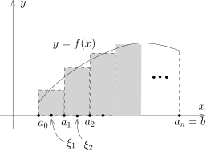
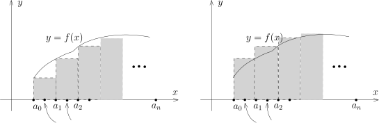

我们介绍如何利用经典的Riemann和以及Darboux上下和的观点来研究Riemann可积的函数。
值得强调的是，
Riemann和（以及上节课用阶梯函数来定义积分的方式）对于在赋范线性空间中取值的函数可以定义，
然而Darboux上下和只对实数值的函数可行（原因是我们需要用到实数域上的序结构）。

任意给定分划 $\sigma\in \mathcal{S}$，假设 $\sigma=\{a=a_0<a_1<\cdots<a_{n-1}<a_n=b\}$，
我们在每一小段上面选取 $\xi=(\xi_1,\cdots,\xi_n)$，使得 $\xi_i \in [a_{i-1},a_i]$。
为了简单起见，我们用 $\xi$ 表示这些 $\xi_i$，
用 $(\sigma,\xi)$ 表示给定了分划 $\sigma$ 并在每一段中选好 $\xi$。
我们将 $(\sigma,\xi)$ 的全体记作 $\mathcal{S}'=\mathcal{S}'(I)$。

给定函数 $f\colon I\rightarrow \mathbb{R}$ 和 $(\sigma,\xi)\in \mathcal{S}'$，
我们定义所谓的Riemann和
\[
S(f;\sigma,\xi)=(a_1-a_0)f(\xi_1)+(a_2-a_1)f(\xi_2)+\cdots+(a_n-a_{n-1})f(\xi_n).
\]

我们证明，对于Riemann可积的函数 $f$，在正确的意思下，有
\[
\lim_{|\sigma|\rightarrow 0}S(f;\sigma,\xi) =\int_{a}^b f.
\]

::: theorem {@thm:121}
假设 $I\subset \mathbb{R}$ 是有界闭区间，$f\in \mathcal{R}(I)$。
对任意的 $\varepsilon>0$，存在 $\delta>0$，使得对任意的 $(\sigma,\xi)\in \mathcal{S}'(I)$，
如果其步长 $|\sigma|<\delta$，那么
\[
\Bigl|S(f;\sigma,\xi)-\int_{a}^b f\Bigr|<\varepsilon.
\]
:::

::: proof
根据Riemann可积的定义，我们选定阶梯函数 $F \in \mathcal{E}(I)$ 和 $\psi\in \mathcal{E}(I)$，
使得 $|f(x)-F(x)|\leqslant \psi(x)$ 并且 $\displaystyle\int_{a}^b\psi(x)<\frac{\varepsilon}{4}$。
我们进一步假设 $F$ 和 $\psi$ 都对应着分划 $\sigma_0=\{b_0<b_1<\cdots<b_m \}$，
即它们在每一段 $(b_i,b_{i+1})$ 上的限制都是常数。

现在，任意选取分划 $\sigma=\{a=a_0<a_1<\cdots<a_{n-1}<a_n=b\}$，
我们要求 $|\sigma|$ 比 $\sigma_0$ 中最短区间的长度还要小。利用积分的线性，我们有
\[
\begin{aligned}
\Bigl|S(f;\sigma,\xi)-\int_{a}^b f\Bigr|&\leqslant \sum_{i=1}^n\Bigl|\int_{a_{i-1}}^{a_i}f(x)-f(\xi_i)\Bigr|
\end{aligned}
\]
我们想逐项地控制上面右端的的每一个积分项
$\displaystyle\Bigl|\int_{a_{i-1}}^{a_i}f(x)-f(\xi_i)\Bigr|$。
为此，我们需要讨论两个分划 $\sigma_0$ 和 $\sigma$ 之间的相对关系。对每个 $i$，我们有两种情况：

- 情形1：$[a_{i-1},a_i]$ 中不包含 $\sigma_0$ 的任何一个分割点 $b_k$。

  此时，$\psi$ 和 $F$ 在 $(a_{i-1},a_i)$ 都是常数。所以，对任意的 $x\in (a_{i-1},a_i)$ 上，我们有
  \[
  \begin{aligned}
  |f(x)-f(\xi_i)|&\leqslant |f(x)-F(x)|+|F(x)-f(\xi_i)|\\
  &= |f(x)-F(x)|+|F(\xi_i)-f(\xi_i)|\\
  &\leqslant \psi(x)+\psi(\xi_i)=2|\psi(x)|.
  \end{aligned}
  \]
  所以，我们有
  \[
  \big|\int_{a_{i-1}}^{a_i}f(x)-f(\xi_i)\big|\leqslant 2\int_{a_{i-1}}^{a_i}\psi.
  \]

- 情形2：$[a_{i-1},a_i]$ 中包含某个 $\sigma_0$ 的某一个分割点 $b_{k_0}$。
  （我们注意到，由于 $|\sigma|$ 比 $\sigma_0$ 中的最短区间的长度还小，
  所以 $[a_{i-1},a_i]$ 恰好只包含 $b_{k_0}$ 的这一个 $\sigma_0$ 中的分割点。）
  这样的区间的个数不会超过 $2m+1$ 个，因为 $\sigma_0$ 的分割点一共就 $m+1$ 个。

  此时，我们用 $\|f\|_{\infty}$ 来控制 $f(x)$，从而有
  \[
  \begin{aligned}
  \big|\int_{a_{i-1}}^{a_i}f(x)-f(\xi_i)\big|&\leqslant |a_i-a_{i-1}|\|f\|_\infty + |a_i-a_{i-1}||f(\xi_i)| \\
  &\leqslant 2|\sigma|\|f\|_\infty.
  \end{aligned}
  \]

综合上面的讨论，当 $|\sigma|<|\sigma_0|$ 时，我们有
\[
\begin{aligned}
\big|S(f;\sigma,\xi)-\int_{a}^b f\big|&\leqslant \underbrace{2\sum \int_{a_{i-1}}^{a_i}\psi}_{\text{第一种情况}}+\underbrace{2 (2m+1) |\sigma|\|f\|_\infty}_{\text{第二种情况}}\\
&\leqslant 2\int_{a}^b \psi + 2(2m+1)|\sigma|\|f\|_\infty\\
&\leqslant \frac{1}{2}\varepsilon+ 2(2m+1)|\sigma|\|f\|_\infty.
\end{aligned}
\]
由于 $m$ 是固定的，当 $|\sigma|$ 足够小的时候，上面的式子明显小于 $\varepsilon$，证明完毕。
:::

::: remark*
我们通常将定理写作 $\displaystyle \lim_{|\sigma|\rightarrow 0}S(f;\sigma,\xi)=\int_{a}^b f$，
其中 $f\in \mathcal{R}(I)$。
实际上，任意选取一个序列 $\{(\sigma_n,\xi_n)\}_{n\geqslant 1}\subset \mathcal{S}'(I)$，
上面的定理表明只要当 $|\sigma_n|\rightarrow 0$，
我们就有 $\lim_{n\rightarrow \infty}S(f;\sigma_n,\xi_n)=\int_{a}^b f$。
根据这个定理，我们可以选择方便计算的Riemann和来计算积分。
另外，这个定理还提供了一个很重要的观点用来计算极限：如果某个极限过程是某个Riemann和取极限的话，
那么我们可以利用积分算极限（当然，这需要我们有足够好的手段来计算积分）。
:::

下面来定义所谓的上积分和下积分的概念。
假设 $f\colon I\rightarrow \mathbb{R}$ 是在 $\mathbb{R}$ 中取值的有界函数，
我们要利用 $\mathbb{R}$ 中序关系。定义
\[
\begin{aligned}
\overline{\mathcal{E}_f}(I)&=\{\varphi \in \mathcal{E}(I)\mid \varphi(x)\geqslant f(x)\}, \\
\underline{\mathcal{E}_f}(I)&=\{\varphi \in \mathcal{E}(I)\mid \varphi(x)\leqslant f(x)\}.
\end{aligned}
\]
由于 $f$ 是有界函数，所以这两个集合是非空的：假设对任意的 $x\in I$，$-M\leqslant f(x)\leqslant M$，
那么常值函数 $M\in \overline{\mathcal{E}_f}(I)$，常值函数 $-M\in \underline{\mathcal{E}_f}(I)$。
据此，我们定义
\[
\overline{\int_{a}^b}f=\inf_{\varphi \in \overline{\mathcal{E}_f}(I)}\int_a^b \varphi, \ \ \ \ \underline{\int}_{a}^bf=\sup_{\varphi \in \underline{\mathcal{E}_f}(I)}\int_a^b \varphi.
\]
由于对任意的 $\varphi \in \overline{\mathcal{E}_f}(I)$，$\varphi(x)\geqslant -M$，
所以 $\displaystyle\int_{a}^b \varphi \geqslant -M(b-a)$，
这说明 $\overline{\displaystyle\int_{a}^b}f$ 是良好定义的；类似地，
$\underline{\displaystyle\int}_{a}^bf$ 也是良好定义的。
这两个式子分别被称作是有界函数 $f$ 的**上积分**和**下积分**。按照定义，我们有如下平凡的不等式：
\[
\overline{\int_{a}^b}f\geqslant \underline{\int}_{a}^bf.
\]

现在引入Darboux上下和的概念：假设 $f\colon I \rightarrow \mathbb{R}$ 是有界函数，
$\sigma\in \mathcal{S}(I)$ 是一个分划，其中 $\sigma=\{a=a_0<a_1<\cdots<a_{n-1}<a_n=b\}$。
根据 $f$ 有界，对每个 $i=1,2,\cdots,n$，我们令
\[
M_i=\sup_{x\in [a_{i-1},a_i]}f(x),\ \ m_i=\inf_{x\in [a_{i-1},a_i]}f(x),
\]
据此，可以定义
\[
\overline{S}(f;\sigma)=\sum_{i=1}^n(a_i-a_{i-1})M_i, \ \ \ \underline{S}(f;\sigma)=\sum_{i=1}^n(a_i-a_{i-1})m_i.
\]
我们把这两个和式称作是有界函数 $f$ 对于分划 $\sigma$ 的**Darboux上和**和**Darboux下和**，
我们可以用下面的示意图来表示：

上图中，左边代表的是Darboux下和，右边代表的是Darboux上和。很明显，我们有
\[
\overline{S}(f;\sigma)\geqslant \underline{S}(f;\sigma).
\]
实际上，我们有更强的结论：

::: lemma
对于任意两个分划 $\sigma, \sigma' \in \mathcal{S}(I)$，我们有
\[
\underline{S}(f;\sigma)\leqslant \overline{S}(f;\sigma').
\]
:::

::: proof
事实上，我们只需要证明当 $\sigma\prec \sigma'$ 时，我们有
\[
\underline{S}(f;\sigma)\leqslant \overline{S}(f;\sigma'), \ \ \underline{S}(f;\sigma')\leqslant \overline{S}(f;\sigma),
\]
即可。我们把这个性质的证明留作作业。
:::

另外，当 $\sigma\prec \sigma'$ 时，我们有
\[
\overline{S}(f;\sigma)\leqslant \overline{S}(f;\sigma'), \ \ \underline{S}(f;\sigma)\geqslant \underline{S}(f;\sigma').
\]
这个的证明也是显然的。

我们定义
\[
\overline{D}(f)=\inf_{\sigma\in \mathcal{S}(I)} \overline{S}(f;\sigma), \ \ \underline{D}(f)=\sup_{\sigma\in \mathcal{S}(I)} \underline{S}(f;\sigma).
\]
下面的命题将Darboux上下和与上下积分联系起来：

::: proposition {@prop:Darboux_sum_and_integral}
假设 $f\colon I\rightarrow \mathbb{R}$ 是有界函数，那么
\[
\overline{D}(f)=\overline{\int_{a}^b}f, \ \ \underline{D}(f)=\underline{\int}_{a}^bf.
\]
:::

::: proof
根据对称性，我们证明 $\displaystyle \underline{D}(f)=\underline{\int}_{a}^bf$ 即可。证明分为两步。

- 按照定义，对任意的 $\sigma$，
  我们定义函数 $\phi\big|_{[a_{i-1},a_i)}=m_i~(1\leqslant i \leqslant n)$，$\phi(b)=m_n$，
  从而 $\phi\in \underline{\mathcal{E}_f}(I)$。
  另外，我们有 $\displaystyle \underline{S}(f;\sigma)=\int_a^b \phi$。
  按照下积分的定义，我们有 $\displaystyle \int_{a}^b \phi \leqslant \underline{\int}_{a}^b f$，
  从而 $\displaystyle \underline{S}(f;\sigma) \leqslant \underline{\int}_{a}^bf$。
  再用 $\underline{D}(f)$ 的定义（对 $\sigma$ 取上确界），我们得到
  \[
  \displaystyle \underline{D}(f) \leqslant \underline{\int}_{a}^bf.
  \]

- 其次，对任意选定的 $\varepsilon$，按照下极限的定义，
  我们可以选取 $\psi\in \underline{\mathcal{E}_f}(I)$（其中 $\sigma_0=\{b_0<b_1<\cdots<b_\ell\}$
  是相应的分划），使得
  \[
  \underline{\int}_{a}^bf \leqslant \varepsilon+\int_a^b \psi.
  \]
  按照定义，我们知道 $\psi(x)\leqslant f(x)$。
  我们现在任意选取 $I$ 的分划 $\sigma=\{a_0<a_1<\cdots<a_n\}$，
  我们想要比较 $\displaystyle\int_a^b \psi$ 和 $\underline{S}(f;\sigma)$：
  \[
  \int_a^b \psi - \underline{S}(f;\sigma)=\sum_{i=1}^n \int_{a_{i-1}}^{a_i}(\psi-m_i)
  \]

  现在有两个分划 $\sigma_0$ 和 $\sigma$，我们需要讨论它们之间的相对关系。
  假设 $i$ 是固定的，那么我们有两种情况：

  - 情形1：$[a_{i-1},a_i]$ 中不包含 $\sigma_0$ 的任何一个分割点 $b_k$。
    此时，$\psi$ 在 $[a_{i-1},a_i]$ 的取值是常数。
    特别地，根据 $\psi(x)\leqslant f(x)$，
    我们知道 $\psi(x)\leqslant \displaystyle \inf_{[a_{i-1},a_i]}f(x)=m_i$，从而
    \[
    \int_{a_{i-1}}^{a_i}(\psi(x)-m_i)\leqslant 0.
    \]

  - 情形2：$[a_{i-1},a_i]$ 中包含某个 $\sigma_0$ 的（恰好一个，
    如果我们假设 $|\sigma|$ 足够小）一个分割点 $b_{k_0}$。
    此时，我们用 $M=\displaystyle\sup_{x\in I}f(x)$ 来控制 $\psi(x)$，从而有
    \[
    \big|\int_{a_{i-1}}^{a_i}\psi(x)-m_i\big| \leqslant (a_i-a_{i-1})(M-m)\leqslant |\sigma|(M-m).
    \]
    其中 $m=\displaystyle\inf_{x\in I}f(x)$。

  综合上述两种情况，我们得到
  \[
  \begin{aligned}
  \int_a^b \psi - \underline{S}(f;\sigma)& \leqslant \underbrace{0}_{\text{第一种情况}}+\underbrace{2\overbrace{(2\ell+1)}^{\text{第二种区间的个数}}|\sigma|(M-m)}_{\text{第二种情况}}.
  \end{aligned}
  \]
  只要取得 $|\sigma|$ 足够小，我们就得到
  \[
  \int_a^b \psi \leqslant \underline{S}(f;\sigma)+\varepsilon\leqslant \underline{D}(f)+\varepsilon,
  \]
  即
  \[
  \displaystyle \underline{\int}_{a}^bf \leqslant  \underline{D}(f)  +2\varepsilon.
  \]
  令 $\varepsilon\rightarrow 0$，我们得到
  \[
  \displaystyle \underline{D}(f) \geqslant \underline{\int}_{a}^bf.
  \]

命题得到了证明。
:::

::: remark*
课后，有同学讲第二步可以很简单地证明：

对任意的 $\varphi \in  \underline{\mathcal{E}_f}(I)$，
选取与 $\varphi$ 相容的分划 $\sigma=\{a_0<a_1<\cdots<a_n\}$，此时，
由于 $\varphi\big|_{(a_{i-1},a_{i})}\equiv \varphi_i$ 是常数并且 $\varphi\leqslant f$，所以，
$\varphi_i\leqslant m_i$。据此，我们知道
\[
\int_a^b\varphi =\sum_{i=1}^n \varphi_i(a_i-a_{i-1}) \leqslant \sum_{i=1}^n (a_i-a_{i-1}) m_i=\underline{S}(f;\sigma).
\]
从而，对任意的 $\varphi\in  \underline{\mathcal{E}_f}(I)$
\[
\int_a^b\varphi\leqslant \sup_{\sigma\in\mathcal{S}(I)}\underline{S}(f;\sigma)=\underline{D}(f).
\]
再对所有可能的 $\varphi$ 取上确界即可。
:::
