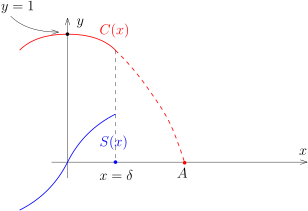

## $x \mapsto \exp(xA)$ 的导数

按照导数的定义，如果 $(V,\|\cdot\|)$ 是赋范线性空间，$f\colon \mathbb{R} \rightarrow V$ 是映射，
我们可以定义导数
\[
f'(x_0)=\lim_{x\rightarrow x_0}\frac{f(x)-f(x_0)}{x-x_0}.
\]
（如果极限存在的话）特别地，$f'(x_0)\in V$。
我们来研究我们最爱的例子：$\exp$。
令 $V=\mathbf{M}_n(\mathbb{R})$ 为矩阵的空间（复数系数的矩阵的证明是一致的），
$A$ 是一个给定的 $n\times n$ 的矩阵，考察映射
\[
f\colon \mathbb{R}\rightarrow \mathbf{M}_n(\mathbb{R}), \ x \mapsto e^{xA}.
\]
我们计算 $f'(x_0)$。按定义，我们有
\[
\begin{aligned}
\frac{f(x_0+h)-f(x_0)}{h}=\frac{e^{(x_0+h)A}-e^{x_0A}}{h}=e^{x_0A}\frac{e^{hA}-1}{h},
\end{aligned}
\]
其中我们用到了矩阵 $x_0A$ 与 ${hA}$ 可交换。
由此可见（在证明 $\bigl(e^x\bigr)'=e^x$ 的时候也做了同样的事情），只要计算 $f'(0)$ 即可。
利用定义，我们有
\[
\begin{aligned}
\frac{e^{hA}-1}{h}=\sum_{k=1}^\infty \frac{1}{k!}h^{k-1}A^k=A + \sum_{k=1}^\infty \frac{1}{(k+1)!}h^{k}A^{k+1}.
\end{aligned}
\]
根据矩阵乘法对于范数的关系（$\|A\cdot B\|\leqslant c \|A\|\|B\|$，
其中 $\|\cdot\|$ 是任意一个指定的范数），我们有
\[
\|\sum_{k=1}^\infty \frac{1}{(k+1)!}h^{k}A^{k+1}\|\leqslant  h \sum_{k=1}^\infty \frac{1}{(k+1)!}c^k\|A\|^{k+1}\leqslant  \frac{h}{c}e^{c\|A\|}.
\]
从而，$f'(0)=A$。进一步，我们知道
\[
f'(x)=Ae^{xA}=Af(x).
\]

## 中值定理的应用

上一次最后提到了Lagrange中值定理的一个推论[^1]：

::: corollary [常微分方程解的存在唯一性-儿童版本] {@coro:80}
$f\in C([a,b])$ 并且 $f$ 在 $(a,b)$ 上可微，如果 $f'(x)\equiv 0$ 并且 $f(a)=c$，
那么 $f(x)\equiv c$。换而言之，如下的常微分方程
\[
\begin{cases}
&f'(x)=0,\\
&f\big|_{x=a}=c,
\end{cases}
\]
存在唯一的解 $f(x)=c$。
:::

::: proof
用反证法：如果存在某个 $x_1\in (a,b)$ 使得 $f(x_1)\neq c$，那么，
在 $[a,x_1]$ 上使用Lagrange中值定理，就有 $x_0\in (a,x_1)$，使得
\[
f'(x_0)=\frac{f(x_1)-c}{x_1-a}\neq 0.
\]
矛盾。
:::

这个推论实际上对于在赋范线性空间中取值的映射也成立：

::: proposition
给定映射 $f\in C([a,b];V)$，$f$ 在 $(a,b)$ 上可微。
如果 $f'(x)\equiv 0$，$f(a)=c$，那么对任意的 $x\in [a,b]$，$f(x)= c$。
:::

我们满足于 $V=\mathbb{R}^n$ 是有限维的情形，此时，
$f\colon \mathbb{R}\rightarrow \mathbb{R}^n$ 可以用分量 $\bigl(f_1(x),\cdots,f_n(x)\bigr)$ 表达并且
\[
f'(x)=\bigl(f_1'(x),\cdots,f_n'(x)\bigr)=0 \ \ \Leftrightarrow \ \ f'_k(x)\equiv 0, \ \ \text{任意的}~k=1,\cdots,n.
\]
所以，利用 $1$ 维的情况就可以得到结论。

如果 $V$ 是无限维的赋范线性空间，比如说 $\Bigl(C\bigl([0,1]\bigr),\|\cdot\|_\infty\Bigr)$，
我们一方面没有Lagrange中值定理，所以不能用本来的证明；
一方面想把问题约化成 $1$ 维的情况的做法不是很容易推广（我们的确能做到这一点）。
然而，我们不打算在这个问题上继续深入（除非我们想仔细的研究一下微分方程理论），
有限维的情况对我们就足够用了。

作为应用，我们仍然回到 $\exp$ 这个例子：
考虑可微映射 $f\colon \mathbb{R}\rightarrow \mathbf{M}_n(\mathbb{R})$，假设它满足如下的微分方程
\[
\begin{cases}
&f'(x)=A\cdot f(x),\\
&f\big|_{x=0}=\mathbf{I}_n,
\end{cases}
\]
其中，$\mathbf{I}_{n}$ 为 $n\times n$ 的矩阵。我们知道，$x\mapsto e^{xA}$ 是这个方程的一个解。
我们现在说明，这是唯一的解。实际上，我们有
\[
e^{-xA}(f'-Af)=0\Rightarrow e^{-xA}f'+ \bigl(e^{-xA}\bigr)'f=0.
\]
**如果**我们有Leibniz法则的话（两个函数相乘之后求导数的法则），那么就有
\[
\bigl(e^{-xA}f\bigr)'=0.
\]
这是把一个表达式写成全微分的技巧。
根据唯一性的命题，我们知道 $e^{-xA}f(x)\equiv \mathbf{I}$，
所以我们就证明了 $f(x)=e^{xA}$（因为 $e^{A}e^{-A}=\mathbf{I}_n$）。

回到Leibniz法则的问题，如果 $f$ 和 $g$ 是 $n\times n$ 矩阵中取值的函数，我们有
\[
\begin{aligned}
(f\cdot g)'(x_0)&=\lim_{h\rightarrow 0} \frac{f(x_0+h)g(x_0+h)-f(x_0)g(x_0)}{h}\\
&=\lim_{h\rightarrow 0} \frac{f(x_0+h)\bigl(g(x_0+h)-g(x_0)\bigr)}{h}+\lim_{h\rightarrow 0} \frac{\bigl(f(x_0+h)-f(x_0)\bigr)g(x_0)}{h}\\
&=f(x_0)g'(x_0)+f'(x_0)g(x_0).
\end{aligned}
\]
这个证明和最基本的函数版本的证明没有任何的区别。

利用Lagrange中值定理，我们可以进一步联系单调性和导数：

::: corollary
假设实值函数 $f\in C^0([a,b])$ 并且 $f$ 在 $(a,b)$ 上可微。那么，下面的两条性质是等价的：

- 1\) $f'(x)\geqslant 0$。

- 2\) $f(x)$ 是递增的。

特别地，如果对任意 $x$，$f'(x)>0$，那么函数是严格递增的（反之不然）。
:::

::: proof
2\) $\Rightarrow$ 1) 用导数的定义即可：由于 $f(x)$ 递增，所以 $f(x+h)-f(x)$ 与 $h$ 的符号是一致的，
从而
\[
\frac{f(x+h)-f(x)}{h}\geqslant 0.
\]
令 $h\rightarrow 0$ 即可。

1\) $\Rightarrow$ 2) 用反证法：如若不然，存在 $x_1<x_2$，使得 $f(x_1)>f(x_2)$，
根据Lagrange中值定理，存在 $x_0\in [x_1,x_2]$，使得
\[
f'(x_0)=\frac{f(x_2)-f(x_1)}{x_2-x_1}<0.
\]
矛盾。

如果 $f'(x)>0$，为了说明函数是严格递增的，我们仍然用反证法：如若不然，存在 $x_1<x_2$，
使得 $f(x_1)\geqslant f(x_2)$，根据Lagrange中值定理，存在 $x_0\in [x_1,x_2]$，使得
\[
f'(x_0)=\frac{f(x_2)-f(x_1)}{x_2-x_1}\leqslant 0.
\]
矛盾。
:::

我们现在证明导函数的介值定理。

::: corollary [Darboux]
假设 $f$ 在 $[a,b]$ 上可微，$f'(a)<f'(b)$。
那么，对于任意的 $c \in (f'(a),f'(b))$，都存在 $x_0\in (a,b)$，使得 $f'(x_0)=c$。
:::

::: remark*
存在在 $[a,b]$ 上可微的函数 $f$，它的导数不一定连续（因此不能直接使用连续函数的介值定理）：
\[
f(x)=\begin{cases}
x^2\sin(\frac{1}{x}), \ \ & x\neq 0;\\
0, \ \ &x=0
\end{cases}
\]
很明显，我们有
\[
f'(x)=\begin{cases}
2x\sin(\frac{1}{x})-\cos(\frac{1}{x}), \ \ & x\neq 0;\\
0, \ \ &x=0
\end{cases}
\]
我们来说明 $f'(x)$ 在 $0$ 处不连续。
实际上，我们考虑两个点列 $\{x_n\}_{n\geqslant 1}$ 和 $\{y_n\}_{n\geqslant 1}$，其中
\[
x_n=\frac{1}{2n\pi}, \ \ y_n = \frac{1}{(2n+1)\pi}.
\]
我们有 $\displaystyle \lim_{n\rightarrow \infty}x_n= \lim_{n\rightarrow \infty}y_n=0$，但是，
\[
\displaystyle \lim_{n\rightarrow \infty}f'(x_n)=-1,\ \  \lim_{n\rightarrow \infty}f'(y_n)=1.
\]
:::

::: proof
通过把 $f$ 换为 $f(x)-cx$，我们不妨假设 $c=0$，$f'(a)<0<f'(b)$。
在这种假设下，$f$ 连续但是不是单调的函数（因为导数是改变符号的），根据介值定理，$f$ 不能是单射。
所以，存在 $x_1,x_2\in [a,b]$，使得 $f(x_1)=f(x_2)$，那么，Rolle中值定理就给出了 $c$ 的存在性。
:::

另一个版本的中值定理叫做Cauchy中值定理，描述了两个不同函数之间关系：

::: proposition [Cauchy中值定理]
假设有实值函数 $f,g\in C([a,b])$ 并且 $f$ 和 $g$ 均在 $(a,b)$ 上可微。
假设对任意的 $x\in (a,b)$，$g'(x)\neq 0$。那么，存在 $x_0\in (a,b)$，使得
\[
\frac{f'(x_0)}{g'(x_0)}=\frac{f(b)-f(a)}{g(b)-g(a)}.
\]
:::

我们注意到，结合Darboux的定理，$g'(x)\neq 0$ 这个条件意味着 $g'(x)$ 要么恒为正，要么恒为负，
所以函数是严格单调的。特别地，这说明 $g(a)\neq g(b)$，从而上式右边是良好定义的。

尽管这个命题可能在一些较难的习题中大显身手，
但就本身的深刻程度而言不过是Rolle中值定理的一个无关痛痒的推广。
然而，我们给出两个不同的证明并且解释怎么理解这个命题。
对一个命题有（编）一个感性的认识在学习数学中是非常重要的。

::: proof
- 1\. 我们定义如下的函数：
  \[
  F(x)=f(x)-f(a)-\frac{f(b)-f(a)}{g(b)-g(a)}\bigl(g(x)-g(a)\bigr).
  \]
  因为 $F(b)=F(a)=0$，所以Rolle中值定理可用。
  这是一个技术性的证明，想法和Lagrange中值定理的证明如出一辙。
  （很多习题册上的题目都是根据这个想法来编的，作业中我们会见到几个例子（比较有技巧性，
  但其实没有多大意思））。

- 2\. 这个证明比第一个证明复杂很多，然而在概念的层次上要更清晰也包含了更多的理解。

  首先，我们观察到如果 $g(x)=x$，那么这个定理就是Lagrange中值定理。
  证明的主旨是将一般的 $g$ 的情况化为这个已知情况，只需要微分几何中一些最朴素的想法。

  利用 $g'(x)\neq 0$，我们知道 $g\colon I=[a,b]\rightarrow J=[g(a),g(b)]$ 是同胚，
  即连续的双射并且逆映射也是连续的。我们需要将 $g$ 想成用 $I$ 来重新参数化 $J=[g(a),g(b)]$。

  **注。** 比方说，给定 $\mathbb{R}$ 上的区间 $J=[0,1]$，我们假设 $\mathbb{R}$ 上用的坐标是 $y$，
  那么，我们可以用 $y$ 来表示（参数化）$I$ 中的点。考虑映射
  \[
  g\colon [0,2]\rightarrow [0,1], \ \ x\mapsto \frac{x}{2}.
  \]
  此时，我们可以用通过 $g$ 用 $x\in [0,2]$ 来（参数化）描述 $J$ 中的点：
  $x=1$ 对应的是 $J$ 中的 $0.5$ 这个点。

  我们现在认为 $J=[g(a),g(b)]$ 是基本的几何对象。
  本来 $f$ 是 $I$ 上的函数，我们可以通过上述参数化将 $f$（通过复合）视作是 $[g(a),g(b)]$ 上的函数：
  \[
  \begin{tikzcd}
    J \ar[r, "g^{-1}"] \ar[dr, "f\circ g^{-1}" description]
    & I \ar[d, rightarrow, "f"]\\
  &Y
  \end{tikzcd}
  \]
  我们要考虑 $f(g^{-1})(y)=f\circ g^{-1}$ 这个函数。
  根据Lagrange中值定理（对 $f\circ g^{-1}\colon J\rightarrow \mathbb{R}$ 来用），我们有
  \[
  \frac{f\circ g^{-1}(g(a))-f\circ g^{-1}(g(b))}{g(a)-g(b)}=\bigl(f\circ g^{-1}\bigr)'(c).
  \]
  不难认出，这就是要证明的等式。
  这个证明表明，Cauchy中值定理实际上是Lagrange中值定理在不同的参数化下的表述（从这个角度看，
  $f$ 和 $g$ 的位置不是对等的）。

:::

另外，我们会问这个定理直观上说了什么（有没有比较容易记住的方式）？这里可以看出向量值函数的威力：
考虑映射
\[
F\colon [a,b]\rightarrow \mathbb{R}^2,  \  x\mapsto {f(x)\choose g(x)}.
\]
这个映射的像是 $\mathbb{R}^2$ 上的一条曲线段。
Cauchy中值定理说的是存在曲线上的点 $x_0$，
使得其切线方向 $F'(x_0)$ 和两个端点的连线 ${f(b)\choose g(b)}-{f(a)\choose g(a)}$ 是同方向的。
在图上看起来这与Rolle/Lagrange中值定理的几何直观是一致的。事实上，我们还可以定义
\[
\widehat{F}\colon  [a,b]\rightarrow \mathbf{S}^1, \ \  x\mapsto \frac{\bigl(f'(x),g'(x)\bigr)}{\sqrt{f'(x)^2+g'(x)^2}}.
\]
这个是切线的方向的函数，
由于 ${f(b)\choose g(b)}-{f(a)\choose g(a)}$ 也决定了 $\mathbf{S}^1$ 中的一个方向，
这个定理的叙述变得类似于这种情况下的介值定理（$\mathbf{S}^1$ 是 $1$ 维的）。
此时，我们很自然地看到为什么需要研究在其它空间上取值的函数（映射）。

## 三角函数的研究

由于有了导数作为新的工具，我们可以来研究 $\sin x$ 和 $\cos x$ 的周期性了。
三角函数是解析的方式来定义的，即用级数来定义：
\[
\cos x  = \sum_{k=0}^\infty \frac{(-1)^k x^{2k}}{(2k)!},\ \ \sin x=\sum_{k=0}^\infty \frac{(-1)^k x^{2k+1}}{(2k+1)!}.
\]
它们具有周期性是一个很深刻的事实。我们令
\[
F\colon  \mathbb{R} \rightarrow \mathbb{R}^2,  \ \  x\mapsto F(x)={\sin x \choose \cos x}.
\]
用 $J$ 表示矩阵 $\displaystyle J={~0 \ ~1 \choose -1 \ 0}$。
那么，根据 $(\cos x)'=-\sin x$ 和 $(\sin x)'=\cos x$，我们发现 $F$ 满足如下的微分方程
\[
\begin{cases}
&F'=J F,\\
&F\big|_{x=0}=\displaystyle {0 \choose 1}.
\end{cases}
\]
我们还把 $F(x)$ 写成
\[
F(x)=\bigl(S(x),C(x)\bigr), \ \ S(x)=\sin(x), \ \ C(x)=\cos(x).
\]

::: remark*
如果你采取其它方式定义 $\sin x$ 和 $\cos x$ 的话，比如说按照中学的方式定义的 $\sin x$ 和 $\cos x$，
你应该也能证明 $\sin x$ 和 $\cos x$ 满足上述的关系，根据解的唯一性，
我们就知道这两种定义方式是一致的。
:::

三角函数的解析表达式没有给出它们更多的信息，
我们利用函数的微分来研究 $\cos x$ 和 $\sin x$ 在 $\mathbb{R}_{\geqslant 0}$ 上的行为：

由于 $S'(0)=C(0)=1$，根据连续性，
$S$ 在某个 $[-\delta,\delta]$ 上面是严格递增的（$\delta$ 是较小的正数）。
在区间 $(0,\delta)$ 上，由于 $C'(x)=-S(x)< 0$，从而，$C(x)$ 是严格递减的；在区间 $(-\delta,0)$ 上，
由于 $S(x)< 0$，从而 $C(x)$ 是严格递增的。
这表明 $0$ 是 $C(x)$ 的一个局部最大点（这不意外，因为 $|C(x)|\leqslant 1$ 且 $C(0)=1$）。
这一段推导可以用如下的图像来表示：

我们下面要证明说一定能找到一个 $A>0$，使得在 $[0,A]$ 上，
$C(x)$ 是单调递减的并且在 $A$ 处 $C(x)$ 变成了 $0$。
考虑使得 $C$ 在 $[0,A)$ 上都 $> 0$ 的最大可能的 $A$。

我们先说明 $A\neq +\infty$。如若不然，如果 $S'=C>0$，所以 $S$ 是 $(0,+\infty)$ 是严格递增的函数。
在 $x=\delta$，我们令 $s=S(\delta)>0$，从而，当 $x\geqslant \delta$ 时，$S(x)\geqslant s>0$。
我们考虑如下的代数变形（此时，如果有积分的语言的话会更自然）：
\[
S(x)\geqslant s \ \Leftrightarrow \bigl(C(x)+sx\bigr)'<0.
\]
这是把一个表达式写成全微分的技巧。
这表明函数 $C(x)+sx$ 在 $[\delta,\infty)$ 上递减，所以，对任意的 $x\geqslant \delta$，
由于我们假设了 $C(x)>0$，所以我们有
\[
C(\delta)+s \delta \geqslant C(x)+sx > sx.
\]
令 $x\rightarrow +\infty$，这自然是不可能的！

此时，上面所描述的 $A<\infty$ 存在。根据连续性，在 $A$ 处，有 $C(A)=0$。
根据 $C\big|_{[0,A]}\geqslant 0$，我们知道 $S$ 在 $[0,A]$ 上上升，所以 $S(A)>0$。
我们现在计算 $S(A)$ 的值。
为此，我们证明对任意满足上述微分方程的 $S(x)$ 和 $C(x)$，
都有 $\bigl(S(x)\bigr)^2+\bigl( C(x)\bigr)^2\equiv 1$。
证明是利用导数判别：一个函数是常数当且仅当它的导数恒为零。
\[
\left(\bigl(S(x)\bigr)^2+\bigl(C(x)\bigr)^2\right)'=2S(x)S'(x)+2C(x)C'(x)=0.
\]
而 $\left(\bigl(S(x)\bigr)^2+\bigl( C(x)\bigr)^2\right)\Big|_{x=0}=1$。据此，我们知道 $S(A)=1$。

作为上面推导的总结，我们知道存在常数 $A$，使得 $S(0)=0$，$S(A)=1$ 并且 $S$ 在 $[0,A]$ 上严格递增；
$C(0)=1$，$C(A)=0$ 并且 $C$ 在 $[0,A]$ 上严格递减。

重复上面的推导（请同学自己补充细节），我可以找到 $B>0$，使得 $S(A)=1$，
$S(A+B)=0$ 并且 $S$ 在 $[A,A+B]$ 上严格递减；$C(A)=0$，
$C(A+B)=-1$ 并且 $C$ 在 $[A,A+B]$ 上严格递减。

我们定义 $\overline{\pi}=A+B$，按照上面的推导，它是 $S(x)=\sin x$ 在正实轴上第一个零点。

此时，
考虑函数
$\displaystyle {\overline{S}(x)\choose \overline{C}(x)} = -{S(x+\overline{\pi})\choose C(x+\overline{\pi})}$。
很明显，
$\displaystyle {\overline{S}\choose \overline{C}}$ 和 $\displaystyle {S \choose C}$
解一样的微分方程（同样的初值），所以根据唯一性，我们得到
\[
S(x)=\overline{S}(x)=-S(x+\overline{\pi}), \ \ C(x)=\overline{C}(x)=-C(x+\overline{\pi}).
\]
从而，
\[
S(x)=S(x+2\overline{\pi}), \ \ C(x)=C(x+2\overline{\pi}).
\]
这说明 $2\overline{\pi}$ 是 $S$ 和 $C$ 的周期。
另外，$S$ 在 $[0,\overline{\pi}]$ 上面为正，在 $[\overline{\pi},2\overline{\pi}]$ 上面为负。
这表明 $2\overline{\pi}$ 是 $S$ 的最小周期；类似地，$2\overline{\pi}$ 是 $C$ 的最小周期。

[^1]: 上传者注：事实上讲义上并没有提到，疑似是课堂上提到过。
