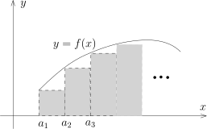

## 基本习题

### 习题A：连续，一致连续和一致收敛

A1) 证明，函数 $e^x$ 在 $\mathbb{R}$ 上不是一致连续的而在 $(-\infty,0]$ 上是一致连续的。

A2) 证明，
    幂函数映射 $\mathbb{R}_{>0}\times \mathbb{R}, \ \ (x,\alpha)\mapsto x^\alpha$ 是
    $\mathbb{R}_{>0}\times \mathbb{R}$ 上的连续函数。

A3) 证明，第九次课中定义的幂函数满足如下的性质：对任意 $x,y>0$ 和 $\alpha, \beta$，
    我们有 $(xy)^\alpha=x^\alpha y^\alpha$，$(x^\alpha)^\beta=x^{\alpha \beta}$；$a^{\log_a x} =x$；
    如果 $x>0$，$y>0$，那么 $a^{x+y}=a^x a^y$，$\log_a(x\cdot y)=\log_a(x)+\log_a(y)$。

A4) 在 $[0,1)$ 区间上考虑连续函数的序列 $\{f_n(x)\}_{n\geqslant 1}$，其中 $f_n(x)=x^n$。
    证明，对任意的 $a<1$，$\{f_n(x)\}_{n\geqslant 1}$ 在 $[0,a]$ 上一致收敛到 $0$ 这个函数；
    但是 $\{f_n(x)\}_{n\geqslant 1}$ 在 $[0,1)$ 上不一致收敛。

A5) 在 $\mathbb{R}$ 上考虑连续函数的序列 $\{f_n(x)\}_{n\geqslant 1}$，
    其中 $f_n(x)=\dfrac{nx}{1+n^2x^2}$。
    证明，
    $\{f_n(x)\}_{n\geqslant 1}$ 在 $\mathbb{R}$ 上逐点收敛到 $0$ 这个函数但是
    $\{f_n(x)\}_{n\geqslant 1}$ 在 $\mathbb{R}$ 上不一致收敛。

A6) 在 $\mathbb{R}$ 上考虑连续函数的序列 $\{f_n(x)\}_{n\geqslant 1}$，
    其中 $f_n(x)=\begin{cases}\dfrac{nx^2}{1+nx}, \ &x>0;\\
& \\
\dfrac{nx^3}{1+nx^2}, \ &x\leqslant 0
\end{cases}$。试研究 $\{f_n(x)\}_{n\geqslant 1}$ 在 $\mathbb{R}$ 上逐点收敛性和一致收敛性。

A7) 给定连续函数 $\varphi\colon \mathbb{R}_{\geqslant 0}\rightarrow \mathbb{R}$，
    满足 $\varphi(0)=0$，
    $\displaystyle \lim_{x\rightarrow \infty}\varphi(x)=0$ 并且 $\varphi$ 不恒为零。
    证明，
    $\mathbb{R}_{\geqslant 0}$ 上的连续函数的序列 $\{f_n(x)\}_{n\geqslant 1}$ 和
    $\{g_n(x)\}_{n\geqslant 1}$ 逐点收敛到 $0$ 这个函数但是不一致收敛，其中 $f_n(x)=\varphi(nx)$，
    $g_n(x)=\varphi\left(\dfrac{x}{n}\right)$。

A8) \* （一致连续性的应用：积分的定义）$[a,b]$ 是有限闭区间，
    $f\in C\bigl([a,b]\bigr)$ 是实数值的函数。给定 $n\geqslant 1$，我们将 $[a,b]$ 均分为 $n$ 份：
    \[
    [a,b]=[a_1,b_1]\cup [a_2,b_2]\cup \cdots \cup [a_n,b_n],  \ \ a_1=a, b_k=a_{k+1}~(k=1,\cdots, n-1), b_n=b,
    \]
    其中对于 $k=1,2,\cdots,n$，$a_k=a+\dfrac{k-1}{n}(b-a)$。我们定义
    \[
    S_n=\sum_{k=1}^n \frac{b-a}{n}f(a_k).
    \]
    证明，$\{S_n\}_{n\geqslant 1}$ 收敛，
    我们用 $\displaystyle \int_{a}^b f $ 这个符号来记极限
    $\displaystyle \lim_{n\rightarrow \infty}S_n$。进一步证明，映射
    \[
    \int_{a}^b\colon  C\bigl([a,b]\bigr)\rightarrow \mathbb{R}, \ \ f\mapsto \int_{a}^b f
    \]
    是线性映射并且如果我们在 $C\bigl([a,b]\bigr)$ 用距离函数 $d_\infty$ 来考虑，那么这是连续映射。

::: remark*
和式 $S_n$ 直观上计算的是下图中阴影柱形表的面积：

所以，如果 $f$ 是正函数，我们认为 $\displaystyle \int_{a}^b f$ 表示的是 $f$ 的图像下的面积。

另外，就算是选取 $f(x)=x^m$ 这样简单的函数，$\displaystyle \int_{a}^b f$ 的计算都很复杂，
课程后面关于积分的理论的一个重点是如何计算积分。
:::

（提示：为了证明 $\{S_n\}_{n\geqslant 1}$ 是Cauchy列，
我们可以将 $S_{n}$ 和 $S_m$ 都与 $S_{nm}$ 做比较）

A9) \* 证明Cauchy的一个定理：任给函数 $f\colon  [a,+\infty) \to \mathbb{R}$，
    我们假设 $f$ 任意闭子区间 $[a,b]$ 上有界（上界可能依赖于 $b$），
    那么下面两个式子当等号右边极限存在时成立：
    \[
    \begin{aligned}
    \lim_{x \to +\infty} \frac{f(x)}{x} &= \lim_{x \to + \infty} [f(x+1) - f(x)],\\
    \lim_{x \to + \infty}  [f(x)]^{1/x} &= \lim_{x \to + \infty} \frac{f(x+1)}{f(x)},  \ \ \text{进一步假设对任意的 $x \in [a,\infty)$，$f(x) \geqslant c > 0$}.
    \end{aligned}
    \]

### 习题B：一致连续性

研究下列函数 $f$ 在区间 $I$ 上的一致连续性：

B1) $f(x) = \sqrt[3]{x}$， $I = (0,\infty)$。

B2) $f(x) = \log x$，$I = (0,1)$。

B3) $f(x) = \cos\dfrac{1}{x}$，$I = (0,1)$。

B4) $f(x) = x\cos\dfrac{1}{x}$，$I = (0,\infty)$。

### 习题C：极限存在性

研究下列函数极限的存在性：

C1) $\displaystyle\lim_{x \to 1} \frac{\ln x}{(x-1)^\alpha}$，$\alpha > 0$。

C2) $\displaystyle \lim_{x \to 1} \frac{e^x - e}{(x-1)^\alpha}$，$\alpha > 0 $。

C3) $\displaystyle \lim_{x \to 1} \frac{x^x - 1}{(x-1)^\alpha}$，$\alpha > 0$。

C4) $\displaystyle \lim_{x\to 1} \frac{\sqrt[3]{1-\sqrt{x}}}{(x-1)^\alpha}$，$\alpha > 0$。

C5) $\displaystyle \lim_{x\to 0} \frac{\sqrt{1+x^2}-1}{1-\cos x}$。

C6) $\displaystyle \lim_{x\to 0} \frac{\sqrt{1+x^4}-1}{1-\cos^2 x}$。

C7) $\displaystyle \lim_{x\to 1} \frac{(x-1)^\alpha}{\sin (\pi x)}$, $\alpha > 0$。

### 习题D：和一致连续性相关的问题

D1) 如果连续函数 $f$ 在开区间（有限或无限）$I \subset \mathbb{R}$ 上是单调并且有界的，
    那么 $f$ 在 $I$ 上一致连续。

D2) $I$ 是长度有限的区间（不一定是闭的）。
    证明，
    $I$ 上的实值函数 $f$ 一致连续的*充分必要条件*是 $f$ 把Cauchy列映成Cauchy列（即如果
    $\{x_n\}_{n \geqslant 1} \subset I$ 是Cauchy列，
    那么 $\{f(x_n) \}_{n \geqslant 1}$ 也是Cauchy列）。

D3) $f$ 在 $\mathbb{R}$ 上一致连续。
    证明，存在 $a, b \in \mathbb{R}_{>0}$，使得对任意的 $x\in \mathbb{R}$，我们都有
    \[
    |f(x)| \leqslant a |x| + b.
    \]

D4) 假设函数 $f$ 在 $[0,\infty)$ 上一致连续并且对任意的 $x \in [0,1]$，
    我们都有 $\displaystyle \lim_{n \rightarrow +\infty}f(x+n) = 0$（这里 $n$ 是整数）。证明，
    \[
    \lim_{x \to +\infty}f(x) = 0.
    \]
    如果我们将条件减弱为 $f$ 在 $[0,\infty)$ 连续，结论是否依然成立？证明或举出反例。

D5) 假设 $X$ 是区间，$f\colon  X \rightarrow \mathbb{R}$ 是连续函数。
    如果存在正常数 $L$，使得对任意的 $x, y \in X$，都有
    \[
    |f(x) - f(y)| \leqslant L|x-y|,
    \]
    我们就称 $f$ 在 $X$ 上满足Lipschitz条件。

    1. 证明，$f$ 在 $X$ 上满足Lipschitz条件是 $f$ 在 $X$ 一致连续的充分条件。

    2. 判断上述条件是否是必要条件？证明或举出反例。

    3. 假设 $f$ 在 $[a,+\infty)$ 上满足Lipschitz条件，其中 $a > 0$，
       试证明 $\dfrac{f(x)}{x}$ 在 $[a,+\infty)$ 一致连续。

### 习题E：利用连续性研究方程根的存在性

E1) 证明，方程 $x^3+2x-1 = 0$ 在 $\mathbb{R}$ 上有唯一的根且此根在 $(0,1)$ 内。

E2) 设 $0 \leqslant \lambda < 1$，$b>0$，试判断方程 $x - \lambda \sin x = b$ 的实根的存在性。

E3) 证明，方程 $\sin x = \dfrac{1}{x}$ 有无穷多个实根。

E4) 假设实数值函数 $f \in C([0,2])$ 并且 $f(0) = f(2)$。
    证明，方程 $f(x) - f(x+1) = 0$ 在 $[0,1]$ 上有一个根。

### 习题F：计算极限

试计算下面函数的极限：
\[
\begin{aligned}
  & F1) \lim_{x \to \pi} \frac{\sin mx}{\sin nx}, \quad m,n \in \mathbb{Z}_{\geqslant 0}, && F2)  \lim_{x \to 0} \frac{1 - \cos x \sqrt[2]{\cos 2x} \sqrt[3]{\cos 3x}  }{x^2} \\
  & F3) \lim_{x \to + \infty} \sin \sqrt{1 + x} - \sin \sqrt{x} && F4) \lim_{x \to 0} \frac{\sqrt{1 + x \sin x} - 1}{e^{x^2} - 1}\\
  & F5) \lim_{n \to \infty} \underbrace{\sin \sin \cdots \sin x}_{n \text{个}} &&
  \end{aligned}
\]

## 思考题（不交作业）

### 问题G

连续函数 $f\colon \mathbb{R}\rightarrow \mathbb{R}$ 满足如下性质：对任意的 $\delta>0$，我们都有
\[
\displaystyle \lim_{n\rightarrow \infty} f(n\delta)=0.
\]
证明，$\displaystyle \lim_{x\rightarrow +\infty} f(x)=0$。

### 问题H

连续函数 $\varphi\colon \mathbb{R}\rightarrow \mathbb{R}$ 满足如下两个性质：

- 1\) 它在无穷远的行为如下：
  $\displaystyle \lim_{x\rightarrow +\infty}\bigl( \varphi(x)-x\bigr)=+\infty$。

- 2\) $\varphi$ 的不动点集 $\bigl\{x\in \mathbb{R}\bigm| \varphi(x)=x\bigr\}$ 是非空的有限集。

证明，如果 $f\colon \mathbb{R}\rightarrow \mathbb{R}$ 是连续函数并且满足 $f\circ \varphi =f$，
那么 $f$ 一定是常值函数。

### 问题I

连续函数 $f\colon \mathbb{R}_{\geqslant 0}\rightarrow \mathbb{R}$ 满足
$\displaystyle \lim_{x\rightarrow +\infty} \frac{f(x)}{x}=0$。
假设 $\{a_n\}_{n\geqslant 1}$ 是一列非负实数的数列并且数列 $\{\dfrac{a_n}{n}\}_{n\geqslant 1}$
是有界的，证明，$\displaystyle \lim_{n\rightarrow \infty} \frac{f(a_n)}{n}=0$

## 课外补充：拓扑空间的定义

本节也不交作业。

::: definition [拓扑空间]
$X$ 是集合，$\mathcal{T}=\{U\mid U\subset X\}$ 是 $X$ 的某些子集所组成的集合。如果下面三个条件成立

- 1\) $\emptyset \in \mathcal{T}$，$X \in \mathcal{T}$。

- 2\) 对任意的 $\{U_{\alpha}\}_{\alpha \in \mathcal{A}}\subset \mathcal{T}$，
  其中 $\mathcal{A}$ 为指标集合，
  我们有 $\displaystyle\bigcup_{\alpha \in \mathcal{A}}U_\alpha \in \mathcal{T}$。

- 3\) 对任意有限个 $U_1,U_2,\cdots, U_m \in \mathcal{T}$，
  我们有 $\displaystyle\bigcap_{1\leqslant i\leqslant m}U_i \in \mathcal{T}$。

我们就称 $\mathcal{T}$ 是 $X$ 上的一个**拓扑**，
每个 $U\in \mathcal{T}$ 都被称作是（拓扑 $\mathcal{T}$ 下的）**开集**。
我们把二元组 $(X,\mathcal{T})$ 称作是一个**拓扑空间**。
:::

给定拓扑空间 $(X,\mathcal{T})$，考虑子集 $F\subset X$，
如果其补集 $X-F$ 是开集（即 $X-F\in \mathcal{T}$），
我们就称 $F$ 是（在拓扑 $\mathcal{T}$ 下的）**闭集**。对于闭集，我们有如下的性质（简单的练习）：

- 1\) $\emptyset$ 和 $X$ 都是闭集。

- 2\) 任意多闭集的交集是闭集。

- 3\) 有限个闭集的并集是闭集。

### 娱乐问题：素数无限多的拓扑证明（Furstenberg，1955）

考虑 $X=\mathbb{Z}$ 为全体整数的集合，对于 $a,b \in \mathbb{Z}$，其中 $a\geqslant 1$，
我们定义 $U_{a,b}=\{ka+b\mid k \in \mathbb{Z}\}$（就是以 $b$ 为某一项的双边的等差数列）。
我们定义 $X$ 的子集的集合 $\mathcal{T}$：$U\in \mathcal{T}$ 当且仅当 $U=\emptyset$，
或者 $U$ 可表作一些 $U_{a,b}$ 的并集。

- 1\) $U\in \mathcal{T}$。证明，$x\in U$ 当且仅当存在 $a\geqslant 1$，使得 $U_{a,x}\subseteq U$。

- 2\) 证明，$\mathbb{Z} \in \mathcal{T}$。

- 3\) 证明，对于任意的 $\{U_i\}_{i \in I}\subset \mathcal{T}$，有 $\bigcup U_i\in \mathcal{T}$。

- 4\) 证明，如果 $U,V\in \mathcal{T}$，那么 $U\cap V\in \mathcal{T}$。
  因此 $\mathcal{T}$ 是 $X$ 上的拓扑。

- 5\) 证明，在此拓扑下，任何非空有限集合都不是开集；任何补集非空有限的集合都不是闭集。

- 6\) 证明，$U_{a,b}$ 既是开集也是闭集。

- 7\) 证明，$\displaystyle\mathbb{Z}-\{-1,1\}=\bigcup_{p~\text{是素数}}U_{p,0}$。

- 8\) 综上，用反证法证明，存在无限多个素数。

::: remark* (寄语)
As for everything else, so for a mathematical theory: beauty can be perceived but not explained.

<align right>
——A. Cayley
</align>
:::
