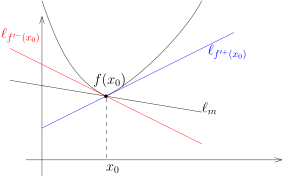

## 凸函数的性质和 Jensen 不等式

我们给出凸函数的五种刻画：

::: theorem
$I$ 是 $\mathbb{R}$ 上的区间，给定 $I$ 上定义的实值函数 $f\colon I\rightarrow \mathbb{R}$。
那么，五个性质是等价的：

- 1\) 对任意的 $x,y \in I$，任意的 $t\in [0,1]$，我们有
  \[
  f\bigl(tx+(1-t)y\bigr)\leqslant tf(x)+(1-t)f(y).
  \]
  从图形上来看，任给 $f$ 的图像上两个点，这两个点之间的函数图像落在这两个点所连线段的下方。

  

- 2\) 对任意的 $x,y,z\in I$，如果 $x<y<z$，那么
  \[
  \frac{f(y)-f(x)}{y-x}\leqslant \frac{f(z)-f(x)}{z-x}\leqslant \frac{f(z)-f(y)}{z-y}.
  \]
  我们可以通过函数图像形象的记忆这一串不等式：

  

- 3\) 对任意 $a\in I$，如下定义的函数
  \[
  I-\{a\}\rightarrow \mathbb{R}, \ x\mapsto \frac{f(x)-f(a)}{x-a},
  \]
  是变量 $x$ 的增函数。

- 4\) 对任意的 $x,y,z\in I$，如果 $x<y<z$，那么
  \[
  \operatorname{det} \left( \begin{array}{ccc}
  1 & 1 & 1 \\
  x & y & z\\
  f(x) & f(y)  & f(z)
  \end{array} \right)\geqslant 0.
  \]

- 5\) 集合
  $\Gamma_{\geqslant f}=\Bigl\{(x,y)\bigm| x\in I, y\geqslant f(x)\Bigr\}\subset \mathbb{R}^2$（即函数图像上方的部分）是凸集。

如果函数 $f$ 满足上述条件之一，我们就称 $f$ 是**凸函数**。
如果 $-f$ 是凸函数，我们就称 $f$ 是**凹函数**。
:::

::: remark*
$V$ 是 $\mathbb{R}$-线性空间，$C\subset V$ 是子集。
如果对任意的 $x,y \in C$，任意的 $t\in [0,1]$，$tx+(1-t)y \in C$，
即 $x$ 和 $y$ 所连线段落在 $C$ 中，我们就称 $C$ 是**凸集**。
:::

::: remark*
上述对凸性的刻画本质上是几何的，叙述中并没有涉及到函数的连续性等。
有意思的是，凸性的几何定义可以推出函数的若干分析性质，比如连续性、可微性之类的。
:::

::: proof
我们转一圈来证明前面四个命题之间的等价性：

- $1) \Rightarrow 2)$ 由于 $y\in (x,z)$，所以存在 $t\in (0,1)$，使得 $y=t x+ (1-t) z$，
  其中 $t=\dfrac{y-z}{x-z}$。所以，
  \[
  f(y)\leqslant tf(x)+(1-t)f(z)=\dfrac{y-z}{x-z}f(x)+\dfrac{x-y}{x-z}f(z).
  \]
  这个不等式等价于2) 中的不等式（直接计算）。

- $2) \Leftrightarrow 3)$ $2)$ 中左侧的不等式讲的就是这个函数是递增的。

- $3) \Rightarrow 4)$ 我们注意到
  \[
  \operatorname{det} \left( \begin{array}{ccc}
  1 & 1 & 1 \\
  x & y & z\\
  f(x) & f(y)  & f(z)
  \end{array} \right)=(z-x)(y-x)\Bigl(\frac{f(z)-f(x)}{z-x}-\frac{f(y)-f(x)}{y-x}\Bigr).
  \]
  利用 3) 中的单调性，这个值明显是非负的。

- $4) \Rightarrow 1)$ 我们不妨设 $x\leqslant y$，我们对下面的式子展开：
  \[
  \operatorname{det} \left( \begin{array}{ccc}
  1 & 1 & 1 \\
  x & tx+(1-t)y & y\\
  f(x) & f(tx+(1-t)y)  & f(y)
  \end{array} \right)\geqslant 0.
  \]
  这等价于
  \[
  (y-x)\left((1-t)\bigl(f(y)-f(x)\bigr)-\bigl(f(tx+(1-t)y)-f(x)\bigr)\right)\geqslant 0.
  \]
  整理立得。

最终，我们来证明 $5) \Leftrightarrow 1)$：假设 $\Gamma_{\geqslant f}$ 是凸集，
那么对任意的 $x,y\in I$，我们有 $(x,f(x)),(y,f(y))\in \Gamma_{\geqslant f}$，所以，
对任意的 $t\in[0,1]$，我们有
\[
(tx+(1-t)y,tf(x)+(1-t)f(y))\in \Gamma_{\geqslant f}.
\]
按照 $\Gamma_{\geqslant f}$ 的定义，我们有 $f(tx+(1-t)y)\leqslant tf(x)+(1-t)f(y))$。

反之，假设1)成立，任选 $(x_1,y_1),(x_2,y_2)\in \Gamma_{\geqslant f}$，
按照定义 $y_1\geqslant f(x_1)$，$y_2\geqslant f(x_2)$。
考虑这两个点所连线段上的任意一个点 $(x,y)=t(x_1,y_1)+(1-t)(x_2,y_2)$，其中 $t\in [0,1]$。
根据1)，我们知道
\[
f(x)\leqslant tf(x_1)+(1-t)f(x_2)\leqslant ty_1+(1-t)y_2=y,
\]
所以 $(x,y)\in \Gamma_{\geqslant f}$。
:::

根据等价定义中的第一条，我们可以证明：

::: proposition [Jensen不等式]
假设 $f\colon I\rightarrow \mathbb{R}$ 是凸函数，
那么对任意的 $x_1,\cdots,x_n \in I$ 和任意的 $t_1, \cdots, t_n \in [0,1]$，
其中 $t_1+t_2+\cdots+t_n=1$，我们有
\[
f(t_1x_1+\cdots +t_nx_n)\leqslant t_1f(x_1)+\cdots +t_nf(x_n).
\]
:::

::: proof
我们对 $n$ 进行归纳。$n=2$ 时，这是定义；假设对 $n$ 成立，考虑 $n+1$ 的情形。
对任意给定的 $x_1,\cdots,x_{n+1} \in I$，$t_1, \cdots, t_{n+1} \in [0,1]$，
其中 $t_1+t_2+\cdots+t_{n+1}=1$，我们有
\[
\begin{aligned}
f(t_1x_1+\cdots +t_nx_n+t_{n+1}x_{n+1})&=f\bigl((1-t_{n+1}) \frac{t_1x_1+\cdots +t_nx_n}{1-t_{n+1}}+t_{n+1}x_{n+1}).
\end{aligned}
\]
不难看出，$\dfrac{t_1x_1+\cdots +t_nx_n}{1-t_{n+1}} \in I$，此时我们用等价定义中的第一条，就得到
\[
\begin{aligned}
f(t_1x_1+\cdots +t_nx_n+t_{n+1}x_{n+1})&\leqslant (1-t_{n+1}) f\bigl(\frac{t_1}{{1-t_{n+1}}}x_1+\cdots +\frac{t_n}{1-t_{n+1}}x_n\bigr)+t_{n+1}f(x_{n+1})\\
 &\leqslant (1-t_{n+1})\left(\frac{t_1}{{1-t_{n+1}}} f(x_1)+\cdots +\frac{t_n}{1-t_{n+1}}f(x_n)\right)+t_{n+1}f(x_{n+1})\\
&= t_1f(x_1)+\cdots +t_{n+1}f(x_{n+1}).
\end{aligned}
\]
这就完成了证明。
:::

::: remark*
我们会利用这个命题来证明很多经典的不等式。
:::

一个凸函数可以不连续，比如说下图所示的函数

它在左端点处不连续。然而，这是一个凸函数可能不连续的唯一方式：

::: theorem
$I\subset \mathbb{R}$ 是区间，$f\colon I\rightarrow \mathbb{R}$ 是凸函数，
我们令 $\mathring{I}$ 为 $I$ 的内部（对于 $I=[a,b],[a,b),(a,b]$ 或 $(a,b)$，
那么 $\mathring{I}=(a,b)$），那么

- 1\) $f\in C(\mathring{I})$。

- 2\) 对任意的 $x_0\in \mathring{I}$，
  $f$ 在 $x_0$ 处的左导数 $f^{\prime-}(x_0)$ 和右导数 $f^{\prime+}(x_0)$ 存在。进一步，它们满足
  \[
  f^{\prime-}(x_0) \leqslant f^{\prime+}(x_0).
  \]

- 3\) 对任意的 $x,y\in \mathring{I}$，如果 $x<y$，那么我们有
  \[
  f^{\prime-}(x)\leqslant \frac{f(y)-f(x)}{y-x} \leqslant f^{\prime+}(y).
  \]

- 4\) 左右导数 $f^{\prime\pm}\colon \mathring{I}\rightarrow \mathbb{R}$ 是递增的函数。

:::

::: proof
任意选定 $x_0\in \mathring{I}$。
存在 $h_1,h_2>0$，$x_0-h_1,x_0+h_2\in \mathring{I}$，
对三个点 $x_0-h_1,x_0$ 和 $x_0+h_2$ 用凸性的第二个等价定义，我们得到
\[
\frac{f(x_0)-f(x_0-h_1)}{h_1}\leqslant \frac{f(x_{0}+h_2)-f(x_0)}{h_2},
\]
根据凸性的第三个等价定义，由于上述不等式的右边是 $h_2$ 的增函数，令 $h_2\rightarrow 0$，
我们立即得到右导数的存在性；类似地，如果令 $h_1\rightarrow 0$，我们就得到左右导数存在性。
既然左右导数都存在，那么，$f$ 自然在 $\mathring{I}$ 上连续。

为了证明3)，我们先令 $h_2\rightarrow 0$，从而，
\[
\frac{f(x_0)-f(x_0-h_1)}{h_1}\leqslant f^{\prime +}(x_0),
\]
令 $x_0=y$，$x_0-h_1=x$，我们就得到了3)中不等式的右边；左边类似可得。

为了证明4)，我们考虑3)中的不等式
\[
f^{\prime-}(x)\leqslant \frac{f(x)-f(z)}{x-z}\leqslant  \frac{f(z)-f(y)}{z-y},
\]
其中 $x<z<y$，后一个不等式是运用凸性的第三个等价定义。再令 $z\rightarrow y$（$z<y$）就证明了结论。
:::

上述分析性质基本上刻画了凸函数：

::: theorem
假设 $I$ 是开区间，$f\colon I\rightarrow \mathbb{R}$ 是函数。如下两个性质等价：

- 1\) $f$ 是凸函数；

- 2\) $f$ 是连续函数，$f$ 的右导数处处存在并且是增函数。

:::

::: proof
只要说明2)$\Rightarrow$1)即可：我们固定 $I$ 中的三个点 $x<y<z$，对任意的 $t\in [y,z]$，
我们有 $f^{\prime+}(y)\leqslant f^{\prime+}(t)\leqslant f^{\prime+}(z)$。我们定义函数
\[
g\colon [y,z]\rightarrow \mathbb{R}, \ \ t\mapsto f(t)-tf^{\prime+}(y).
\]
那么，对于 $t\in (y,z)$，
$g$ 在 $t$ 处的右导数 $g^{\prime+}(t)=f^{\prime+}(t)-f^{\prime+}(y)\geqslant 0$。
把这个和导数的性质做类比，我们想说明 $g$ 是 $t\in (y,z)$ 的增函数：

**引理。** 假设 $g\colon [a,b]\rightarrow \mathbb{R}$ 是连续函数并且右导数在每个点处都定义。
如果对任意的 $t\in (a,b)$，我们都有 $g^{\prime+}(t)\geqslant 0$，那么 $g(a)\leqslant g(b)$。

先假设引理是成立的，那么我们有 $g(z)\geqslant g(y)$，经过整理，我们得到
\[
f^{\prime+}(y)\leqslant \frac{f(z)-f(y)}{z-y}.
\]
类似地，我们可以证明
\[
f^{\prime+}(y)\geqslant \frac{f(y)-f(x)}{y-x}.
\]
从而，
\[
\frac{f(y)-f(x)}{y-x}\leqslant \frac{f(z)-f(y)}{z-y}.
\]
所以，我们有
\[
\operatorname{det} \left( \begin{array}{ccc}
1 & 1 & 1 \\
x & y & z\\
f(x) & f(y)  & f(z)
\end{array} \right)=\operatorname{det} \left( \begin{array}{ccc}
1 & 0 & 0 \\
x & y-x & z-y\\
f(x) & f(y)-f(x)  & f(z)-f(y)
\end{array} \right)\geqslant 0.
\]
这表明 $f$ 是凸函数。
:::

::: proof [引理的证明]
（证明的重要想法：退 $\varepsilon$-步海阔天空）任意选定 $\varepsilon>0$，令
\[
\varphi_\varepsilon\colon [a,b]\rightarrow \mathbb{R}, x\mapsto -(g(x)-g(a))-\varepsilon(x-a).
\]
此时，$\varphi_\varepsilon^{\prime+}\leqslant -\varepsilon<0$，我们实质上想证明这是一个递减的函数，
如果成立的话，那么
\[
\varphi_\varepsilon(a)\geqslant \varphi_\varepsilon(b)\  \Rightarrow \ \underbrace{0 \geqslant \varphi_\varepsilon(b)}_{\text{过渡的结论}} \  \Rightarrow \ g(b)-g(a)\geqslant -\varepsilon(b-a).
\]
令 $\varepsilon \rightarrow 0$ 就得到了要证明的结论。

我们现在直接证明上述过渡的结论。为此，定义[^1]
\[
X_{\varepsilon_1} =\bigl\{x\in [a,b]\bigm| \varphi_\varepsilon(x)\leqslant \varepsilon_1\bigr\}
\]
由于 $X_{\varepsilon_1}=[a,b]\cap (\varphi_\varepsilon)^{-1}\bigl((-\infty,\varepsilon_1]\bigr)$
是闭集，所以它的上确界 $c=\sup X_{\varepsilon_1} \in X_{\varepsilon_1}$。
我们想证明 $b\in X$（从而，$\varepsilon_1 \geqslant \varphi_\varepsilon(b)$，
令 $\varepsilon_1\rightarrow 0$，过渡性结论就成立了），即要证明 $c=b$。

因为 $\varphi_\varepsilon(a)=0$，所以 $a\in X_{\varepsilon_1}$。
特别地，根据 $\varphi_\varepsilon(x)$ 的连续性，存在 $\delta>0$，
使得 $[a,a+\delta) \subset X_{\varepsilon_1}$。所以 $X_{\varepsilon_1} \neq \emptyset$ 并且 $c>a$。

我们用反证法证明 $c=b$：如若不然，我们假设 $c<b$。
先说明 $\varphi_\varepsilon(c)=\varepsilon_1$，
这因为按照定义 $\varphi_\varepsilon(c)\leqslant \varepsilon_1$，如果等号不成立，
那么 $\varphi_\varepsilon(c)< \varepsilon_1$，根据 $\varphi_\varepsilon(x)$ 的连续性，
存在比 $c$ 略大的数使得其值仍然不超过 $\varepsilon_1$，这就与 $c=\sup X_{\varepsilon_1}$ 矛盾。

其次根据右导数的信息，$\varphi_\varepsilon^{\prime+}(c)\leqslant -\varepsilon$，利用右导数的定义，
存在 $h_0>0$，使得当 $h\in [0,h_0)$ 时，我们有
\[
\frac{\varphi_\varepsilon(c+h)-\varphi_\varepsilon(c)}{h}<-\frac{1}{2}\varepsilon.
\]
从而，
\[
\varphi_\varepsilon(c+h)<\varepsilon_1-\frac{1}{2}\varepsilon h<\varepsilon_1.
\]
这表明 $[c,c+h_0)\subset X_\varepsilon$，这和 $c$ 是上确界矛盾。
:::

::: corollary
假设 $I\subset \mathbb{R}$ 是开区间，$f$ 是 $I$ 上二次可微的实值函数。如下两个陈述是等价的：

- 1\) $f$ 是凸函数；

- 2\) $f''\geqslant 0$。

:::

::: proof
这是上面定理的直接推论。
:::

::: remark*
这个推论是最常用的来判断凸性的工具，因为函数二阶导数通常容易计算。
:::

::: corollary [函数图像的支撑直线]
$f\colon I\rightarrow \mathbb{R}$ 是区间 $I$ 上的凸函数，$x_0\in \mathring{I}$。
考虑 $\mathbb{R}^2$ 上的过 $(x_0,f(x_0))$ 直线
\[
\ell_m=\{(x,y)\in \mathbb{R}^2\mid y=m(x	-x_0)+f(x_0)\},
\]
其中斜率 $m\in \mathbb{R}$。
那么，$\ell_m$ 在 $f$ 的图像之下当且仅当 $f^{\prime-}(x_0)\leqslant m \leqslant f^{\prime+}(x_0)$。
:::

::: proof
定理的证明过程表明，当 $x>x_0$ 时，我们有
\[
f^{\prime+}(x_0)\leqslant \frac{f(x)-f(x_0)}{x-x_0} \ \Rightarrow \ f(x)\geqslant f(x_0)+(x-x_0)f^{\prime+}(x_0).
\]
反过来，当 $x<x_0$ 时，我们有
\[
f(x)\geqslant f(x_0)+(x-x_0)f^{\prime-}(x_0).
\]
据此，当 $m \leqslant f^{\prime+}(x_0)$ 时，在 $x_0$ 的右边，该直线在 $f$ 的图像之下；
当 $m \geqslant f^{\prime-}(x_0)$ 时，在 $x_0$ 的左边，该直线在 $f$ 的图像之下。

反之，假设 $\ell_m$ 在 $f$ 的图像之下，在 $x_0$ 处的右边的时候，
我们有 $f(x)\geqslant m(x-x_0)+f(x_0)$，从而
\[
f^{\prime+}(x_0)=\lim_{x\rightarrow x_0^+}\frac{f(x)-f(x_0)}{x-x_0}\geqslant m.
\]
类似地，我们可以证明另一边的不等式。
:::

## 用凸函数证明常见的不等式

我们给出两个例子：Minkowski不等式和算术-几何平均值不等式。

- 1\) 假设 $p\geqslant 1$，对于 $x\in [0,1]$，函数 $f(x)=(1-x^{\frac{1}{p}})^p$ 是凸函数，这因为
  \[
  f'(x)=-x^{\frac{1}{p}-1}\bigl(1-x^{\frac{1}{p}}\bigr)^{p-1}
  \]
  是递增的函数（求两次导数的表达式不是很简单）。
  假设 $a_i,b_i\in \mathbb{R}_{\geqslant 0}$ 并且假设 $a_i+b_i\neq 0$，其中 $i=1,2,\cdots, n$。
  我们令
  \[
  x_i=\frac{a_i^p}{(a_i+b_i)^p}, \ \  t_i= \dfrac{(a_i+b_i)^p}{\displaystyle\sum_{k=1}^n(a_k+b_k)^p}.
  \]
  Jensen不等式给出了如下所谓的Minkowski不等式：
  \[
  \Bigl(\sum_{k=1}^n (a_k+b_k)^p\Bigr)^{\frac{1}{p}} \leqslant \Bigl(\sum_{k=1}^n a_k^p\Bigr)^{\frac{1}{p}}+\Bigl(\sum_{k=1}^n b_k^p\Bigr)^{\frac{1}{p}}.
  \]
  作为推论，对于线性空间 $V=\mathbb{R}^n$，我们定义
  \[
  \|x\|_{p}= \Bigl(\sum_{k=1}^n x_k^p\Bigr)^{\frac{1}{p}},
  \]
  其中，$x=(x_1,\cdots,x_n)$。此时，Minkowski不等式讲的是
  \[
  \|x\|_p+\|y\|_p\geqslant \|x+y\|_p.
  \]
  这表明 $\|x\|_p$ 是范数（$p=2$ 或者 $1$ 我们更熟悉）。另外，我们还可以采取如下的范数：
  \[
  \|x\|_{\infty}= \sup_{k \leqslant n}|x_k|.
  \]

- 2\) 函数 $-\log x$ 是 $\mathbb{R}_{>0}$ 上的凸函数，这因为
  \[
  (-\log x\bigr)''=\frac{1}{x^2}\geqslant 0
  \]
  假设 $x_1,\cdots, x_n$ 是正数，根据Jensen不等式，我们有
  \[
  -\log\left(\frac{1}{n}x_1+\cdots+\frac{1}{n}x_n\right) \leqslant -\frac{1}{n}\log(x_1)-\cdots-\frac{1}{n}\log(x_n).
  \]
  这个等价于算术-几何平均值不等式：
  \[
  \frac{1}{n}\bigl(x_1+\cdots+x_n\bigr)\geqslant \bigl(x_1\cdots x_n\bigr)^{\frac{1}{n}}.
  \]

[^1]: 上传者注：原讲义此处的 $\varepsilon, \varepsilon_1$ 都是同一个小量 $\varepsilon$，
  逻辑上说不通。这里分成了两个，不过也可以只采用同一个 $\varepsilon$，只需要修改过渡结论即可。
