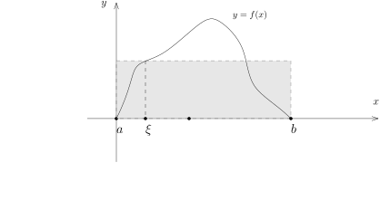

## 最速降线问题

从点 $(x,f(x))$ 到 $(x+\Delta x,f(x+\Delta x))$ 的距离是 $\sqrt{1+f'(x)^2}\Delta x$。
根据重力势能到动能的转化（能量守恒），我们知道
\[
\frac{1}{2}mv^2 =  -mG f(x).
\]
在 $(x,f(x))$ 处，小球的速度应该是 $\sqrt{-2Gf(x)}$，
所以从 $(x,f(x))$ 到 $\bigl(x+\Delta x,f(x+\Delta x)\bigr)$ 所需要的时间是
\[
\Delta t= \frac{\sqrt{1+f'(x)^2}\Delta x}{\sqrt{-2Gf(x)}}
\]
这样，如果曲线 $\gamma_s$ 由函数 $f_s(x)=f(x,s)$ 给出，即
\[
\gamma_s\colon x \in [0,a] \mapsto (x,f_s(x)).
\]
小球经过整个曲线需要的时间为
\[
T(s)=\int_{0}^a \sqrt{\frac{1+f'(x,s)^2}{-2Gf(x,s)}} dx.
\]
其中，$f'$ 指的是对 $f(x,s)$ 的 $x$ 变量求导数。为了保证曲线的两个端点是固定的，我们还要求
\[
f(0,s)\equiv 0, \ \ f(a,s)\equiv -h.
\]
对于最速降线 $f_0$ 而言，我们必然有
\[
\frac{d}{ds}T(s)\Big|_{s=0}=0.
\]
为此，我们假设 $L(f,f')=\sqrt{\frac{1+f'(x,s)^2}{-2Gf(x,s)}}$，即在函数
\[
L(X,V)=\sqrt{\frac{1+V^2}{-2GX}}
\]
中代换变量 $X=f$，$V=f'$。此时，我们有（我们总是假设足够的光滑性使得积分与导数可以交换）：
\[
\begin{aligned}
\frac{d}{ds}T(s)&=\int_{0}^a \frac{d}{ds}\bigl(L(f_s,f_s')\bigr)dx\\
&=\int_{0}^a (\frac{dL}{dX}\bigr)(f_s,f_s') \frac{d}{ds}f(x,s)+(\frac{dL}{dV}\bigr)(f_s,f_s') \frac{d}{ds}f'(x,s) dx
\end{aligned}
\]
最后一项中，我们利用两个导数可以交换（下学期），
所以 $\dfrac{d}{ds}f'(x,s)=\left(\dfrac{d}{ds}f(x,s)\right)'$。令 $s=0$ 并记 $f=f_0$，我们就有
\[
\begin{aligned}
\frac{d}{ds}T(s)\Big|_{s=0}&=\int_{0}^a (\frac{dL}{dX}\bigr)(f,f') \frac{d}{ds}f(x,0)+(\frac{dL}{dV}\bigr)(f,f') \left(\dfrac{d}{ds}f(x,s)\Big|_{s=0}\right)'dx\\
&=\int_{0}^a\left( (\frac{dL}{dX}\bigr)(f,f') -\dfrac{d}{dx}(\frac{dL}{dV}\bigr)(f,f')\right)\frac{df(x,0)}{ds}dx.
\end{aligned}
\]
最后一步分部积分的过程中，我们用到了 $f(0,s)\equiv 0$，$f(a,s)\equiv -h$，从而
\[
\frac{d}{ds}f(0,s)\equiv0, \  \frac{d}{ds}f(a,s)\equiv 0.
\]
另外，对任意的函数 $g$（$g(0)=g(a)=0$），我们通过定义 $f(x,s)=f(x)+sg(x)$ 就可以使得
\[
\frac{d}{ds}f(x,s)\Big|_{s=0}=g(x).
\]
所以，通过选取
\[
g(x)=\varphi(x) \Bigl[(\frac{dL}{dX}\bigr)(f,f') -\dfrac{d}{dx}(\frac{dL}{dV}\bigr)(f,f')\Bigr],
\]
我们就得到了 $f$ 必须满足的方程（这被称作是Euler–Lagrange方程）：
\[
(\frac{dL}{dX}\bigr)(f,f') -\dfrac{d}{dx}\left(\bigl(\frac{dL}{dV}\bigr)(f,f')\right)=0.
\]
假设上述方程成立，那么
\[
\begin{aligned}
\frac{d}{dx}\left((V\frac{dL}{dV}-L)(f,f')\right)&=\frac{d}{dx}\left(f'\frac{dL}{dV}(f,f')-L(f,f')\right)\\
&=f''\frac{dL}{dV}(f,f')+f'\frac{d}{dx}\left(\frac{dL}{dV}(f,f')\right)-f'\frac{dL}{dX}(f,f')-f''\frac{dL}{dV}(f,f')\\
&=0.
\end{aligned}
\]
这表明，存在常数 $C$，使得
\[
(V\frac{dL}{dV}-L)(f,f')\equiv C
\]
按照定义，我们有
\[
\frac{dL}{dX}=G\frac{(1+V^2)^\frac{1}{2}}{(-2GV)^\frac{3}{2}},  \ \ \frac{dL}{dV}=\frac{V}{\bigl(-2GX(1+V^2)\bigr)^{\frac{1}{2}}}.
\]
所以，
\[
\frac{(f')^2}{\bigl(-2Gf(1+(f')^2)\bigr)^{\frac{1}{2}}}-\sqrt{\frac{1+(f')^2}{-2Gf}}=C, \ \ \Leftrightarrow \ \ f\bigl(1+(f')^2)=-C_1.
\]
我们令 $f(x)=-g(x)$，那么，我们就有
\[
g'(x)=\sqrt{\frac{C_1-g}{g}}
\]
如果把 $g$ 看作参数，$x=x(g)$，那么，根据反函数的导数的计算，我们有
\[
\dfrac{dx}{dg}=\sqrt{\frac{g}{C_1-g}}
\]
从而，作为原函数，我们有
\[
x(t)=\int \sqrt{\frac{t}{C_1-t}}dt.
\]
为了能积分出这个函数，我们做变量替换
\[
t=C_1\sin^2\theta,
\]
从而，
\[
x(\theta)=2C_1\int \tan\theta\cdot  \cos\theta \cdot \sin\theta d\theta=C_1(\theta-\frac{1}{2}\sin(2\theta)).
\]
这样子，我们就得到了这条曲线的参数方程（原函数差一个常数 $C_2$）
\[
\theta\mapsto\bigl(\frac{C_1}{2}(2\theta-\sin(2\theta))+C_2, -\frac{C_1}{2}(1-\cos(2\theta))\bigr)
\]
重新参数化之后，我们得到一条曲线
\[
\gamma\colon  [\theta_1,\theta_2]\rightarrow \mathbb{R}^2,  \ \ \theta \mapsto \bigl(c(\theta-\sin \theta)+C, -c(1-\cos \theta)\bigr)
\]
这种曲线被称作是摆线或者旋轮线。
我们注意到，初始时刻 $y(\theta_1)=0$，所以，$\cos\theta_1=1$，这表明 $\theta_1=2k \pi$，
$C=-2ck\pi$，通过再次调整 $\theta\mapsto \theta-2k\pi$，我们可以假设 $\theta_1=0$，$C=0$，
所以我们要找的参数曲线为
\[
\gamma\colon  [0,\Theta]\rightarrow \mathbb{R}^2,  \ \ \theta \mapsto \bigl(c(\theta-\sin \theta), -c(1-\cos \theta)\bigr)
\]
从而，
\[
c(\Theta-\sin \Theta)=a, \ \ -c(1-\cos \Theta)=-h
\]
可以确定 $\Theta\in [0,\dfrac{\pi}{2}]$ 和 $c$。

::: proposition [等时性，Huygens]
考虑摆线
\[
\gamma\colon  [0,\frac{\pi}{2}]\rightarrow \mathbb{R}^2,  \ \ \theta \mapsto \bigl(c(\theta-\sin \theta), -c(1-\cos \theta)\bigr).
\]

那么，从任意一点 $\gamma(\theta_0)$ 出发的小球滚动到 $\gamma(\pi)=(c\pi,-2c)$ 的时间都是一样的。
:::

::: proof
实际上，小球在 $\gamma(\theta)$ 到 $\gamma(\theta+\Delta\theta)$ 处要经过的距离为：
\[
\Delta=|\gamma'(\theta)|\Delta \theta=c\sqrt{2-2\cos\theta}\Delta \theta
\]
小球的速度为：
\[
v=\sqrt{2Gc(\cos\theta_0-\cos\theta)}.
\]
所以，从 $\gamma(\theta_0)$ 滑到底一共需要
\[
\begin{aligned}
T(\theta_0)&=\sqrt{\frac{c}{G}}\int_{\theta_0}^{\pi}\sqrt{\frac{1-\cos\theta}{\cos\theta_0-\cos\theta}} d\theta\\
&=\sqrt{\frac{c}{G}}\int_{\theta_0}^{\pi}\frac{\sin\left(\frac{\theta}{2}\right)}{\sqrt{\cos^2\left(\frac{\theta_0}{2}\right)-\cos^2\left(\frac{\theta}{2}\right)}} d\theta
\end{aligned}
\]
我们可以令 $s=\cos\left(\frac{\theta}{2}\right)$ 进行换元积分，据此，
得到 $T(\theta_0)\equiv \pi\sqrt{\dfrac{c}{G}}$。
:::

## 积分中值定理

::: theorem [第一积分中值定理]
$[a,b]$ 是有界闭区间，$f, g\in \mathcal{R}([a,b])$ 是实值Riemann可积函数。
我们假设对任意的 $x\in [a,b]$，$g(x)\geqslant 0$。令
\[
m=\displaystyle \inf_{x\in I} f(x), \ \ M=\displaystyle \sup_{x\in I} f(x).
\]
那么，存在 $\ell \in [m,M]$，使得
\[
\int_a^b fg= \ell \int_{a}^b g.
\]
特别地，如果进一步要求 $f$ 是连续函数，那么存在 $\xi \in [a,b]$，使得
\[
\displaystyle \int_a^b fg= f(\xi) \int_{a}^b g.
\]
:::

::: proof
由于 $m\leqslant f(x)\leqslant M$，根据 $g\geqslant 0$ 以及积分保持不等号的性质，我们有
\[
m\int_{a}^b g\leqslant \int_{a}^b fg\leqslant M \int_{a}^b g.
\]
如果 $\displaystyle \int_{a}^b g \neq 0$，显然存在 $\ell \in [m,M]$ 使得命题成立；
如果 $\displaystyle \int_a^b g = 0$，由于 $g\geqslant 0$，所以 $g$ 在一个零测集之外恒为 $0$，
从而 $fg$ 在一个零测集之外都是 $0$，从而 $\displaystyle \int_{a}^b fg = 0$，所以 $\ell$ 可以任意选。

如果 $f$ 是连续的，所以 $f$ 在 $[a,b]$ 可以取到最大值 $M$ 和最小值 $m$，即有 $x_1,x_2\in [a,b]$，
使得 $f(x_1)=m$，$f(x_2)=M$，根据连续函数的中值定理，存在 $x_1$ 与 $x_2$ 之间的数 $\xi$，
使得 $f(\xi)=\ell$。
:::

::: corollary
假设 $f$ 是连续函数，那么存在 $\xi\in [a,b]$，使得 $\displaystyle \int_a^b f= f(\xi)(b-a)$。
:::

::: proof
只要取 $g\equiv 1$ 即可。
:::

