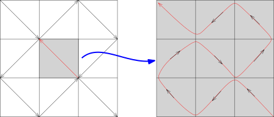
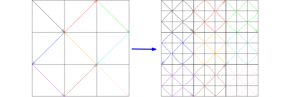

## 空间填充曲线

利用一致收敛的想法，我们可以构造一个很有趣的（很重要的反例）例子：
令 $I=\bigl\{x\in \mathbb{R}\bigm| 0\leqslant x \leqslant 1\bigr\}$，
$C=\bigl\{(x,y)\in \mathbb{R}^2\bigm| 0\leqslant x \leqslant 1, 0\leqslant y\leqslant 1\bigr\}$，
我们按照如下的图像来定义映射
\[
f_1\colon  I\rightarrow C,
\]

我们对每一个小的正方形根据箭头的方向构造同样的映射，以中间这个灰色的为例子，
我们要把刚才第一个图中的格子转 $180^\circ$，这样得到下面的图像：

其中，我们把 $I$ 这个线段映射为图中所画的9段折线，折线走的方向如第二个图所示。
这样子，我们把 $C$ 分成了 $81$ 个格子，并且构造出一条 $81$ 段的折线：

上面这个图对应着映射：
\[
f_2\colon  I\rightarrow C,
\]
重复上面的操作，我们就得到了一串连续映射：
\[
f_n\colon  I\rightarrow C,
\]
其中 $n\geqslant 1$，并且这是一个 $9^{n}$ 段的折线。
按照这些映射的构造方式，我们知道，对任意的 $N\geqslant 1$，对任意的 $n,m\geqslant N$，
$f_n$ 和 $f_m$ 都是对 $f_N$ 的每个边长为 $3^{-N}$ 的方块里面进行修改，特别地，对任意的 $x\in I$，
我们就知道 $f_n(x)$ 和 $f_m(x)$ 都落在同一个边长为 $3^{-N}$ 的方块里，所以
\[
|f_n(x)-f_m(x)|\leqslant \sqrt{2}\cdot 3^{-N},
\]
即
\[
\|f_n-f_m\|_{L^\infty}\leqslant \sqrt{2}\cdot 3^{-N},
\]
这表明 $\{f_n\}_{n\geqslant 1}$ 是 $\Bigl(C(I;\mathbb{R}^2),\|\cdot\|_\infty\Bigr)$ 中的Cauchy列，
从而存在连续映射
\[
f_\infty\colon  I\rightarrow C,
\]
使得 $\displaystyle f_n\stackrel{C(I;\mathbb{R}^2)}{\longrightarrow } f_\infty$。
根据 $f_n$ 的构造，对任意的 $p\in C$，$p$ 一定落在 $f_n$ 所对应的 $9^n$ 个小方块中的某一个，
所以有 $x\in I$，使得 $p$ 和 $f_n(x)$ 的距离不超过 $\sqrt{2}\cdot 3^{-n}$，据此，
我们知道 $f_\infty$ 的像 $f_\infty(I)\subset C$ 是稠密的。
由于 $I$ 是紧集，所以它在连续映射下的像是紧的，从而是闭的，再用稠密性，我们就知道 $f_\infty(I)=C$。
最终，我们得到连续的满射：
\[
f_\infty\colon  I\rightarrow C.
\]

## L'Hôpital法则

我们回到导数的学习，上次课证明了Cauchy中值定理：
实值函数 $f,g\in C^0([a,b])$ 并且 $f$ 和 $g$ 均在 $(a,b)$ 上可微，若对任意的 $x\in (a,b)$，
$g'(x)\neq 0$。那么，存在 $x_0\in (a,b)$，使得
\[
\frac{f'(x_0)}{g'(x_0)}=\frac{f(b)-f(a)}{g(b)-g(a)}.
\]

Cauchy中值定理的重要应用是用来证明L'Hôpital法则：

::: proposition [L'Hôpital法则]
假设 $f$ 和 $g$ 是区间 $(a,b)$ 上的可微实值函数，我们假设 $f(x),g(x)=o(1)\,(x \to a)$，即
\[
\displaystyle \lim_{x\rightarrow a^+} f(x)=0, \displaystyle \lim_{x\rightarrow a^+} g(x)=0.
\]
我们假设对任意的 $x\in (a,b)$，$g'(x)\neq 0$。
如果极限 $\displaystyle \lim_{x\rightarrow a^+} \dfrac{f'(x)}{g'(x)}$ 存在（可以是 $\pm \infty$），
那么
\[
\lim_{x\rightarrow a^+} \frac{f(x)}{g(x)}=\lim_{x\rightarrow a^+} \frac{f'(x)}{g'(x)}.
\]
:::

::: proof
根据 $f(x),g(x)=f(x),g(x)=o(1)\,(x \to a)$，我们知道对任意的 $x\in (a,b)$，
$f$ 和 $g$ 在区间 $[a,x]$ 上连续并且在 $(a,x)$ 上可微。
所以，利用Cauchy中值定理，存在 $\xi(x)\in (a,x)$，使得
\[
\frac{f(x)}{g(x)}=\frac{f(x)-f(a)}{g(x)-g(a)}=\frac{f'(\xi(x))}{g'(\xi(x))}.
\]
特别地，当 $x\rightarrow a^+$ 时，由于 $a<\xi(x)<x$，所以 $\xi(x)\rightarrow a^+$。
对上面的式子取极限，我们就得到：
\[
\lim_{x\rightarrow a^+}\frac{f(x)}{g(x)}=\frac{f(x)-f(a)}{g(x)-g(a)}=\lim_{x\rightarrow a^+}\frac{f'(\xi(x))}{g'(\xi(x))}=\lim_{x\rightarrow a^+} \frac{f'(x)}{g'(x)}.
\]
命题得证。
:::

我们还有一个版本L'Hôpital法则：

::: corollary [L'Hôpital法则]
实值函数 $f$ 和 $g$ 在区间 $(a,+\infty)$ 上可微并且
\[
\lim_{x\rightarrow +\infty} f(x)=0,  \lim_{x\rightarrow +\infty} g(x)=0.
\]
假设对任意的 $x\in (a,+\infty)$，$g'(x)\neq 0$。
如果极限 $\displaystyle \lim_{x\rightarrow +\infty} \dfrac{f'(x)}{g'(x)}$ 存在（可以是
$\pm \infty$），那么我们有
\[
\lim_{x\rightarrow +\infty} \frac{f(x)}{g(x)}=\lim_{x\rightarrow +\infty} \frac{f'(x)}{g'(x)}.
\]
:::

::: proof
不妨假设 $a>0$，考虑坐标变换：
\[
\varphi\colon  (0,\frac{1}{a})\rightarrow (a,\infty),  \ \ x\mapsto \frac{1}{x}.
\]
从而，$\widetilde{f}=f\circ \varphi$ 是 $(0,\frac{1}{a})$ 上的函数，
即 $\widetilde{f}(x)=f\left(\dfrac{1}{x}\right)$；类似地，
我们定义 $(0,\frac{1}{a})$ 上的函数 $\widetilde{g}=g\circ \varphi$。
由于 $x\rightarrow +\infty$ 等价于 $\varphi(x)\rightarrow 0^+$，所以
\[
\lim_{x\rightarrow 0^+} \widetilde{f}(x)=0,  \lim_{x\rightarrow 0^+}  \widetilde{g}(x)=0.
\]
此时，我们有
\[
\lim_{x\rightarrow 0^+} \frac{\widetilde{f}'(x)}{\widetilde{g}'(x)}=\lim_{x\rightarrow +\infty} \frac{-\frac{f'(1/x)}{x^2}}{-\frac{g'(1/x)}{x^2}}=\lim_{x\rightarrow +\infty} \frac{f'(x)}{g'(x)}.
\]
所以，根据前一版本的L'Hôpital法则，我们有
\[
\lim_{x\rightarrow +\infty} \frac{f(x)}{g(x)}=\lim_{x\rightarrow 0^+} \frac{\widetilde{f}(x)}{\widetilde{g}(x)}=\lim_{x\rightarrow +\infty} \frac{f'(x)}{g'(x)}.
\]
这就证明了命题。
:::

::: corollary
$n\geqslant 1$ 是整数，$f$ 和 $g$ 是区间 $(a,b)$ 上 $n$-次可微的实值函数。
假设对任意的 $0\leqslant k \leqslant n-1$，都有
\[
\displaystyle \lim_{x\rightarrow a^+} f^{(k)}(x)=0, \ \ \lim_{x\rightarrow a^+} g^{(k)}(x)=0,
\]
并且极限 $\displaystyle \lim_{x\rightarrow a^+} \dfrac{f^{(n)}(x)}{g^{(n)}(x)}$ 存在（可以是
$\pm \infty$）。如果对 $x\in (a,b)$，$g^{(n)}(x)\neq 0$，那么
\[
\lim_{x\rightarrow a^+} \frac{f(x)}{g(x)}=\lim_{x\rightarrow a^+}\dfrac{f^{(n)}(x)}{g^{(n)}(x)}.
\]
:::

::: proof
我们对 $n$ 用归纳法就立即得到了证明，但是每次都要检验导数不为零的条件：由于 $g^{(n)}(x)\neq 0$，
根据Darboux介值定理，$g^{(n)}(x)$ 恒正或者恒负，所以 $g^{(n-1)}$ 严格单调。
由于 $\displaystyle\lim_{x\rightarrow a^+}g^{(n-1)}(x)=0$，所以 $g^{(n-1)}(x)$ 恒为正或者恒为负。以此类推，所有导数都非零。
:::

我们还有其它两个类型的L'Hôpital法则：

::: corollary [L'Hôpital法则]
假设 $f$ 和 $g$ 是区间 $(a,b)$ 上的可微实值函数，我们假设
\[
\displaystyle \lim_{x\rightarrow a^+} |f(x)|=\infty, \displaystyle \lim_{x\rightarrow a^+} |g(x)|=\infty.
\]
我们假设对任意的 $x\in (a,b)$，$g'(x)\neq 0$。
如果极限 $\displaystyle \lim_{x\rightarrow a^+} \dfrac{f'(x)}{g'(x)}$ 存在（可以是 $\pm \infty$），
那么
\[
\lim_{x\rightarrow a^+} \frac{f(x)}{g(x)}=\lim_{x\rightarrow a^+} \frac{f'(x)}{g'(x)}.
\]
:::

::: corollary [L'Hôpital法则]
实值函数 $f$ 和 $g$ 在区间 $(a,+\infty)$ 上可微并且
\[
\lim_{x\rightarrow +\infty} |f(x)|=\infty,  \lim_{x\rightarrow +\infty} |g(x)|=\infty.
\]
假设对任意的 $x\in (a,+\infty)$，$g'(x)\neq 0$。
如果极限 $\displaystyle \lim_{x\rightarrow +\infty} \dfrac{f'(x)}{g'(x)}$ 存在（可以是
$\pm \infty$），那么我们有
\[
\lim_{x\rightarrow +\infty} \frac{f(x)}{g(x)}=\lim_{x\rightarrow +\infty} \frac{f'(x)}{g'(x)}.
\]
:::

这两个推论的证明我们留成本次作业。

L'Hôpital法则可以用来计算极限：

::: example*
我们举几个例子：

- 1\) 计算 $\displaystyle \lim_{x\rightarrow 0} \frac{\sin x}{x}$：
  \[
  \lim_{x\rightarrow 0} \frac{\sin x}{x}=\lim_{x\rightarrow 0}\frac{\cos x}{1}=1.
  \]

- 2\) 计算 $\displaystyle \lim_{x\rightarrow 0} \frac{e^x-x-1}{x^2}$：
  \[
  \lim_{x\rightarrow 0} \frac{e^x-x-1}{x^2}=\lim_{x\rightarrow 0}\frac{e^x-1}{2x}=\lim_{x\rightarrow 0}\frac{e^x}{2}=\frac{1}{2}.
  \]

- 3\) 证明 $\displaystyle \lim_{x\rightarrow \infty} \frac{x^n}{e^x}=0$：
  \[
  \lim_{x\rightarrow \infty} \frac{x^n}{e^x}=\lim_{x\rightarrow \infty} \frac{nx^{n-1}}{e^x}=\lim_{x\rightarrow \infty} \frac{n(n-1)x^{n-2}}{e^x}=\cdots=\lim_{x\rightarrow \infty} \frac{n!}{e^x}=0.
  \]

- 4\) 计算 $\displaystyle \lim_{x\rightarrow \infty} \frac{ x}{\sqrt{x^2+1}}$。

  第一次运用L'Hôpital法则，我们就会有
  \[
  \lim_{x\rightarrow \infty} \frac{ x}{\sqrt{x^2+1}}= \lim_{x\rightarrow \infty} \frac{1}{\frac{x}{\sqrt{x^2+1}}}=\lim_{x\rightarrow \infty} \frac{\sqrt{x^2+1}}{x}.
  \]
  再用一次就得到
  \[
  \lim_{x\rightarrow \infty} \frac{\sqrt{x^2+1}}{x}= \lim_{x\rightarrow \infty} \frac{ x}{\sqrt{x^2+1}}.
  \]
  所以一直不会停止。对于这个例子L'Hôpital法则并不好用。

- 5\) 计算 $\displaystyle \lim_{x\rightarrow 0} \frac{\sin x}{e^x}$。
  如果我们不检验 $f(x)$ 和 $g(x)$ 在 $0$ 处是否是零而直接运用L'Hôpital法则，我们就会有
  \[
  \lim_{x\rightarrow 0} \frac{\sin x}{e^x}=\lim_{x\rightarrow 0}  \frac{\cos x}{e^x}=1.
  \]
  这个结论自然是错误的！

:::

## Taylor展开

L'Hôpital法则只是一种计算极限的方法，
它之所以有用（更多是做习题的时候）主要因为它可以把求极限这种分析上的操作转化为求导数的问题，
而求导数的操作一般而言都是代数操作（因为我们可以**背过**很多导数）。
然而，对于微积分的学习，这个法则似乎无关主旨，我们应该尽量早的学习Taylor展开的技术，
这才是真正要紧的东西：

::: theorem [Taylor展开公式：用多项式逼近]
我们给出Taylor展开的三种不同余项的叙述：

- 1\) **Peano余项。** 假设函数 $f\colon [a,b]\rightarrow \mathbb{R}$（或者 $\mathbb{C}$）在 $a$
  处的一直到 $n$-次导数 $f'(a),\cdots,f^{(n)}(a)$ 都存在。那么，当 $x\rightarrow a^+$ 时，我们有
  \[
  f(x)=\sum_{k=0}^n \frac{f^{(k)}(a)}{k!}(x-a)^k+o\bigl((x-a)^{n}\bigr).
  \]

- 2\) **Lagrange余项。** 假设函数 $f\in C^n\bigl([a,b]\bigr)$（在 $\mathbb{R}$ 或 $\mathbb{C}$
  中取值），特别地，$f$ 在 $a$ 处的 $n$-次导数 $f'(a)$、$\cdots$、$f^{(n)}(a)$ 都存在。
  如果 $f$ 在 $(a,b)$ 上 $n+1$ 次可导。那么，我们有
  \[
  f(x)=\sum_{k=0}^n \frac{f^{(k)}(a)}{k!}(x-a)^k+R_n(x),
  \]
  其中 $R_n(x)=\dfrac{f^{(n+1)}(\xi)}{(n+1)!}(x-a)^{n+1}$，$\xi \in [a,x]$ 由 $x$ 决定（未必唯一）。

- 3\) **Cauchy余项。** 假设函数 $f\in C^n\bigl([a,b]\bigr)$（在 $\mathbb{R}$ 或 $\mathbb{C}$
  中取值），特别地，$f$ 在 $a$ 处的 $n$-次导数 $f'(a)$、$\cdots$、$f^{(n)}(a)$ 都存在。
  如果 $f$ 在 $(a,b)$ 上 $n+1$ 次可导。那么，我们有
  \[
  f(x)=\sum_{k=0}^n \frac{f^{(k)}(a)}{k!}(x-a)^k+\overline{R}_n(x),
  \]
  其中 $\overline{R}_n(x)=\dfrac{f^{(n+1)}(\xi)}{n!}(x-\xi)^{n}(x-a)$，
  $\xi \in [a,x]$ 由 $x$ 决定（未必唯一）。

:::

::: remark*
Peano余项的公式只在 $a$ 的附近成立，而Lagrange和Cauchy的情况是整体的公式。

我们注意到当 $n=1$ 时，Peano余项的公式就是导数的定义。

当 $n=0$ 时，Lagrange余项的公式就是Lagrange中值定理。

另外，如果要求 $f$ 是 $n$-次连续可微的并且 $n+1$ 次导数存在，
那么Lagrange余项（或者Cauchy余项）的公式成立，此时，根据连续性，Peano余项的公式明显成立。
:::

::: proof
- 1\) Peano余项公式等价于证明
  \[
  \lim_{x\rightarrow a^+}\frac{f(x)-\displaystyle\sum_{k=0}^n \frac{f^{(k)}(a)}{k!}(x-a)^k}{(x-a)^{n}}=0.
  \]
  我们利用L'Hôpital法则逐次求导数（容易验证该法则所要求的条件）：
  \[
  \begin{aligned}
  \lim_{x\rightarrow a^+}\frac{f(x)-\displaystyle\sum_{k=0}^n \frac{f^{(k)}(a)}{k!}(x-a)^k}{(x-a)^{n}}&=\cdots=\lim_{x\rightarrow a^+}\frac{f^{(n-1)}(x)- f^{(n-1)}(a)- f^{(n)}(a)(x-a)}{n!(x-a)}\\
  &=\frac{1}{n!}\lim_{x\rightarrow a^+}\Bigl(\frac{f^{(n-1)}(x)- f^{(n-1)}(a)}{x-a}-f^{(n)}(a)\Bigr)\\
  &=0.
  \end{aligned}
  \]
  最后一步是利用导数的定义。

- 2\) 将 $x$ 视作是固定的，我们定义
  \[
  F(t)=\sum_{k=0}^n\frac{f^{(k)}(t)}{k!}(x-t)^k=f(t)+\sum_{k=1}^n\frac{f^{(k)}(t)}{k!}(x-t)^k.
  \]
  我们对 $t$ 求导数得到：
  \[
  \begin{aligned}
  F'(t)&=f'(t)+\sum_{k=1}^n\frac{f^{(k+1)}(t)}{k!}(x-t)^k+\sum_{k=1}^n\frac{(-1)f^{(k)}(t)}{(k-1)!}(x-t)^{k-1}\\
  &=f'(t)+\sum_{k=1}^n\frac{f^{(k+1)}(t)}{k!}(x-t)^k-\sum_{\ell=0}^{n-1}\frac{f^{(\ell+1)}(t)}{\ell!}(x-t)^{\ell}.
  \end{aligned}
  \]
  所以，
  \[
  F'(t)=\frac{f^{(n+1)}(t)}{n!}(x-t)^n.
  \]
  现在考虑另一个关于 $t$ 的函数（定义在 $[a,x]$ 上）：
  \[
  G(t)=\Bigl(\frac{x-t}{x-a}\Bigr)^{n+1}
  \]
  很明显，$G'(t)$ 在 $(a,x)$ 上不是零。根据Cauchy中值定理，存在 $\xi \in (a,x)$，使得
  \[
  \frac{F'(\xi)}{G'(\xi)}=\frac{F(x)-F(a)}{G(x)-G(a)}.
  \]
  即
  \[
  \frac{\frac{f^{(n+1)}(\xi)}{n!}(x-\xi)^n}{\frac{-(n+1)(x-\xi)^n}{(x-a)^{n+1}}}=\frac{F(x)-F(a)}{-G(a)}=-(F(x)-F(a))=-f(x)+\sum_{k=0}^n\frac{f^{(k)}(a)}{k!}(x-a)^k.
  \]
  整理即得Lagrange余项的公式。

- 3\) 为了证明Cauchy余项的公式，我们同样考虑上述的 $F(t)$，但是我们将选取一个不同的 $G$：
  \[
  G(t)=\frac{x-t}{x-a}
  \]
  很明显，$G'(t)$ 在 $(a,x)$ 上不是零。根据Cauchy中值定理，存在 $\xi \in (a,x)$，使得
  \[
  \frac{F'(\xi)}{G'(\xi)}=\frac{F(x)-F(a)}{G(x)-G(a)}.
  \]
  即
  \[
  \frac{\frac{f^{(n+1)}(\xi)}{n!}(x-\xi)^n}{\frac{-1}{x-a}}=\frac{F(x)-F(a)}{-G(a)}=-(F(x)-F(a))=-f(x)+\sum_{k=0}^n\frac{f^{(k)}(a)}{k!}(x-a)^k.
  \]
  整理即得Cauchy余项的公式。

:::

上面Lagrange余项的证明很有技巧性，（我）很难理解。如果有了积分作工具，我们可以给出一个最自然的证明。
我们现在给出另一个证明：我们知道，当 $n=1$ 时Lagrange余项的公式是Lagrange中值定理，
我们下面利用中值定理证明的方法，来给出一个相对自然的（容易记住）证明。
为此，首先推广Rolle定理到高阶导数的情形：

::: lemma
假设 $f\in C^n\bigl([a,b]\bigr)$ 并且在 $(a,b)$ 上 $n+1$ 次可导。
如果 $f$ 在 $a$ 处的 $n$-次导数全为零，即 $f'(a)=0,\cdots,f^{(n)}(a)=0$ 并且 $f(a)=f(b)$，
那么存在 $x_0\in (a,b)$，使得 $f^{(n+1)}(x_0)=0$。
:::

::: proof
我们只要不停地用Rolle中值定理即可：由于 $f(a)=f(b)$，根据Rolle中值定理，存在 $x_1\in(a,b)$，
使得 $f'(x_1)=0$；由于 $f'(a)=f'(x_1)=0$，再用Rolle中值定理，我们就找到 $x_2\in(a,x_1)$，
使得 $f''(x_2)=0$；如此下去，我们得到 $f''(x_2)=f'''(x_3)=\cdots =0$。
最后一步，就得到了 $f^{(n+1)}(x_{n+1})=0$。选取 $x_0=x_{n+1}$ 即可。
:::

我们仿照Lagrange中值定理的证明：先构造多项式 $P(x)$，使得 $P(a)=f(a)$，$P'(a)=f'(a)$，$\cdots$，
$P^{(n)}(a)=f^{(n)}(a)$，比如，我们取
\[
P_n(x)=\sum_{k=0}^n \frac{f^{(k)}(a)}{k!}(x-a)^k.
\]

::: exercise*
证明，如果多项式 $P(x)$ 的次数 $\leqslant n$，那么满足上面条件的多项式是唯一的。
:::

为了应用高阶导数的Rolle定理，我们对 $P_n(x)$ 略加改造：选取 $\lambda\in \mathbb{R}$（存在且唯一），
使得 $P(b)=f(b)$，其中 $P(x)=P_n(x)+\lambda (x-a)^{n+1}$，
$\lambda=\dfrac{f(b)-P_n(b)}{(b-a)^{n+1}}$。
我们现在考虑函数 $f(x)-P(x)$，它满足高阶导数Rolle定理的条件，所以存在 $c\in (a,b)$，使得
\[
f^{(n+1)}(c)-P^{(n+1)}(c)=0.
\]
利用 $\lambda$ 的表达式，我们得到
\[
f^{(n+1)}(c)-(n+1)!\dfrac{f(b)-P_n(b)}{(b-a)^{n+1}}=0.
\]
如果改写为 $c=\xi$，$b=x$，这就是Lagrange余项的Taylor公式。

::: remark*
满足Peano余项的Taylor展开公式是唯一的，
即若假设函数 $f\colon [a,b]\rightarrow \mathbb{R}$（或者 $\mathbb{C}$）在 $a$ 处的一直到 $n$-次导数
$f'(a),\cdots,f^{(n)}(a)$ 都存在。
那么，如果存在次数不超过 $n$ 的多项式 $P(x)$，使得当 $x\rightarrow a^+$ 时，我们有
\[
f(x)=P(x)+o\bigl((x-a)^{n}\bigr).
\]
那么，
\[
P(x)=\sum_{k=0}^n \frac{f^{(k)}(a)}{k!}(x-a)^k.
\]
令 $Q(x)=P(x)-\displaystyle\sum_{k=0}^n \frac{f^{(k)}(a)}{k!}(x-a)^k$，
实际上按照Peano余项的Taylor展开公式，我们必然有
\[
\lim_{x\rightarrow a^+}\frac{Q(x)}{(x-a)^n}=\lim_{x\rightarrow a^+}\frac{P(x)-\sum_{k=0}^n \frac{f^{(k)}(a)}{k!}(x-a)^k}{(x-a)^n}=0.
\]
由于 $\deg Q\leqslant n$，所以 $Q=0$。

由此可见，如果限定的多项式的次数 $\leqslant n$，
那么 $\displaystyle\sum_{k=0}^n \frac{f^{(k)}(a)}{k!}(x-a)^k$ 是在 $a$ 附近对 $f(x)$ 最佳的逼近。
:::

::: example*
我们有两个比较极端的例子：

- 1\) 正弦函数 $\sin x$：我们可以在 $x=0$ 处计算其导数（偶数次的导数都是零），
  从而得到它的Peano展开为：
  \[
  \sin x=\sum_{k=0}^n \frac{(-1)^k x^{2k+1}}{(2k+1)!}+o(|x|^{2n+2}).
  \]
  这和 $\sin x$ 的解析表达式之间*似乎*是一致的（我们暂时不研究这一点）。

- 2\) 我们考虑如下的函数
  \[
  f(x)=\begin{cases}
  e^{-\frac{1}{x^2}}, \ \ &x> 0;\\
  0,\ \ &x\leqslant 0
  \end{cases}
  \]
  那么函数在 $0$ 点处的所有导数都是 $0$，从而对任意的 $n\geqslant 1$，
  \[
  f(x)=o(|x|^{n}).
  \]
  当然，$f(x)$ 不是零。

:::
