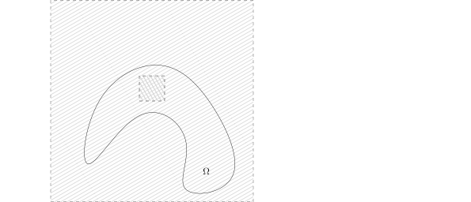

我们可以将上述紧算子的理论应用到Dirichlet问题之上
（我们在这个章节并不需要区域是光滑的，
$\Omega\subset \mathbb{R}^n$只要是有界的开集即可，
而我们只在$H_0^1(\Omega)$中研究问题而不再关心函数在边界$\partial \Omega$上的限制）。
为此，我们给出一个紧算子的例子。从某种意义上说，这是最重要的一类紧算子的例子：

::: theorem
任意给定有界开区域$\Omega\subset \mathbb{R}^n$，那么，自然的嵌入映射
\[
\iota\colon H^1_0(\Omega)\rightarrow L^2(\Omega), \ \ u \mapsto u,
\]
是紧算子。
:::

::: proof
我们将利用Fourier级数的理论来证明这个重要的定理。
首先，我们不妨假设$\overline{\Omega}\subset \subset (0,2\pi)^n$
（否则，我们可以把$\overline{\Omega}$放到更大的一个$\mathbb{R}^n$中的一个盒子中去，
从而用一个周期与$2\pi$不同的Fourier级数即可）。

我们可以把$C_0^\infty(\Omega)$中的函数在$\mathbb{R}^n-\Omega$中用$0$来延拓，这给出连续映射
\[
{\rm Ext}\colon C_0^\infty(\Omega)\rightarrow H^1(\mathbb{R}^n).
\]
其中，上述连续性之所以成立是因为我们可以在$\Omega$上运用Poincaré不等式。
根据$C_0^\infty(\Omega)$在$H^1_0(\Omega)$中的稠密性，我们就得到了等距嵌入
\[
\iota\colon \big(H_0^1(\Omega),\|\cdot\|_{H^1}\big)\hookrightarrow H^1(\mathbb{R}^n).
\]
由于$\overline{\Omega} \subset (0,2\pi)^n$是相对紧的，
我们选取$\chi\in C^\infty_0\big((0,2\pi)^n\big)$，
使得$\chi\big|_\Omega \equiv 1,0\leqslant\chi\leqslant1$。我们现在证明映射
\[
T_\chi\colon H^1(\mathbb{R}^n) \rightarrow L^2(\mathbb{R}^n), \ \ f(x)\mapsto \chi(x)f(x),
\]
是紧算子。我们注意到，作为$L^2\left((0,2\pi)^n\right)$中的函数，利用Fourier级数的展开，我们有
\[
\begin{aligned}
\chi(x)f(x)&=\chi(x)\sum_{k\in \mathbb{Z}^n}c_k e^{ik\cdot x}\\
&=\chi(x)\sum_{k\in \mathbb{Z}^n}\left(\frac{1}{(2\pi)^n}\int_{(0,2\pi)^n} f(y)e^{-ik\cdot y}\,dy\right) e^{ik\cdot x}\\
&=\underbrace{\sum_{|k|< N}c_k \chi(x)e^{ik\cdot x}}_{=T_{\chi,N} (f)}+\underbrace{\chi(x)\sum_{|k|\geqslant N}c_k e^{ik\cdot x}}_{=R_{\chi,N}(f)}.
\end{aligned}
\]
我们把$T_\chi$分解成两个算子的和，其中，
\[
T_{\chi,N}\colon H^1(\mathbb{R}^n) \rightarrow L^2(\mathbb{R}^n), \ \ f(x)\mapsto \sum_{|k|< N}c_k \chi(x)e^{ik\cdot x},
\]
而
\[
R_{\chi,N}\colon H^1(\mathbb{R}^n) \rightarrow L^2(\mathbb{R}^n), \ \ f(x)\mapsto\chi(x)\sum_{|k|\geqslant N}c_k e^{ik\cdot x}.
\]
这里，整数$N$是待定的。由于$T_{\chi,N}$的像完全落在$\{e^{ik\cdot x}\}_{|k|< N}$
这有限多个函数所生成的有限维线性空间中，所以它是有限秩的算子，从而，$T_{\chi,N}$是紧算子。

为了研究$R_{\chi,N}$，我们将利用$\nabla f$也是$L^2$的函数这个事实。实际上，我们有
\[
\begin{aligned}
\|R_{\chi,N}(f)\|^2_{L^2(\mathbb{R}^n)}\leqslant&\left\|\sum_{|k|\geqslant N}c_k e^{ik\cdot x}\right\|^2_{L^2\left((0,2\pi)^{n}\right)}
\leqslant \frac{1}{N^2}\sum_{|k|\geqslant N}|k|^2|c_k|^2\\
&\leqslant \frac{1}{N^2}\|\nabla f\|^2_{L^2}.
\end{aligned}
\]
其中，我们把导数转化为频率空间上衰减。
这表明，$T_\chi$这个算子可以用一列紧算子$T_{\chi,N}$来逼近，
其中，$N\rightarrow\infty$，所以$T_\chi$为紧算子。

最后，我们把嵌入
\[
\iota\colon H^1_0(\Omega)\rightarrow L^2(\Omega)
\]
写成如下两个连续线性映射的复合：
\[
H^1_0(\Omega)\rightarrow H^1(\mathbb{R}^n)\stackrel{T_\chi}{\longrightarrow} L^2(\Omega) \subset L^2(\mathbb{R}^n).
\]
由于任何算子与紧算子复合之后是紧算子，所以我们就证明了$\iota$也是紧算子。
:::

我们现在考虑如下的交换图表：
\[
\begin{tikzcd}
 H^{-1}(\Omega) \ar[r,"(-\triangle)^{-1}"]
  & H^{1}_0(\Omega)\ar[d,hook, "\iota"]\\
L^2(\Omega) \ar[u,hook, "\iota"]  \ar[r,"(-\triangle)^{-1}",dashed] &L^2(\Omega)
\end{tikzcd}
\]
据此，通过复合，我们就可以定义
\[
(-\triangle)^{-1}\colon L^2(\Omega)\longrightarrow L^2(\Omega).
\]
从此之后，当我们谈论$(-\triangle)^{-1}$的时候，我们总假设它的定义域和值域都是$L^2(\Omega)$。

由于右边竖列的箭头是紧算子，复合之后的算子$(-\triangle)^{-1}$也是紧的。
我们现在验证$(-\triangle)^{-1}$是自伴算子：对任意的$f_1,f_2\in L^2(\Omega)$，
令$u_1=(-\triangle)^{-1}f_1$，$u_2=(-\triangle)^{-1}f_2$，
我们知道，$u_1,u_2\in H_0^1(\Omega)$，所以，
\[
((-\triangle)^{-1}f_1,f_2)=-(u_1, \triangle u_2)=(\nabla u_1, \nabla u_2),
\]
这里，我们用到了$u_1\in H_0^1(\Omega)$事实，请参考 @lem:int-by-parts-in-H_0^1。类似地，我们还有
\[
(f_1, (-\triangle)^{-1}f_2)=(\nabla u_1, \nabla u_2).
\]
这就证明了自伴性。此时，就可以对$(-\triangle)^{-1}$使用抽象的紧算子理论了。

另外，我们之前还证明了$(-\triangle)^{-1}$是连续的正线性算子，即对任意的$f \in L^2(\Omega)$，我们有
\[
\left((-\triangle)^{-1}f,f\right)_{L^2}\geqslant 0.
\]
这个不等式中等号成立当且仅当$f=0$。这表明，$(-\triangle)^{-1}$的所有特征值都是正实数（没有$0$！）。

运用Hilbert–Schmidt定理，那么，我们可把$(-\triangle)^{-1}$的特征值的集合写成
\[
\sigma((-\triangle)^{-1})=\{\mu_k\}_{k\geqslant 1}
\]
使得
\[
\mu_1 \geqslant \mu_2 \geqslant \mu_3\geqslant \cdots, \ \ \lim_{k\rightarrow \infty}\mu_k=0.
\]
我们用$\varphi_k(x)\in L^2(\Omega)$表示与$\mu_k$相对应的长度（$L^2$-范数）
为$1$的特征函数。我们再令$\lambda_k=\mu_k^{-1}$，所以，
\[
-\triangle \varphi_k =\lambda_k \varphi_k.
\]
由于$\varphi_k\in L^2(\Omega)$，根据Dirichlet问题的解，
我们知道$\varphi_k \in H_0^1(\Omega)$。
综上所述，我们证明了如下关于$(-\triangle)^{-1}$的谱分解定理：

::: theorem
假设$\Omega\subset \mathbb{R}^n$是有界的开区域，那么，存在单调上升的无界序列
\[
0<\lambda_1\leqslant \lambda_2\leqslant \lambda_3\leqslant \cdots, \ \  \lim_{k\rightarrow \infty}\lambda_k=+\infty,
\]
以及$L^2(\Omega)$的一组Hilbert基$\{\varphi_k\}_{k\geqslant 1}$，使得
\[
-\triangle \varphi_k =\lambda_k \varphi_k.
\]
进一步，对任意的$k\geqslant 1$，我们有$\varphi_k \in H^1_0(\Omega)$。
:::

::: remark*
这个定理的证明没有用到$\Omega$边界的正则性。
:::

::: example*
我们现在考虑$\Omega = (0,d)^n$是一个正方体的情况，其中$d>0$是常数。
（我们注意到$\Omega$的边界并不是光滑的。）
我们要详细地计算$-\triangle$在$\Omega$上的所有特征值和特征函数。
根据Fourier级数的理论，$L^2(\Omega)$的一族Hilbert基可以取作
\[
\left\{d^{-\frac{n}{2}}e^{\frac{2\pi i}{d}k\cdot x}\right\}_{k\in \mathbb{Z}^n}.
\]
由于我们要求$\varphi\big|_{\partial \Omega}=0$，所以，我们希望选取$\sin$型的函数。

先研究$n=1$的情形，
我们选取$\left\{\sin\left(\dfrac{k\pi }{d}x\right)\right\}_{k\in \mathbb{Z}_{\geqslant 1}}$
作为备选。
我们指出这里和Fourier级数的不同之处：指数中的$2\pi$变成了$\pi$。很明显，我们有

- $-\triangle\Big( \sin\big(\dfrac{k\pi }{d}x\big)\Big)=\frac{\pi^2k^2}{d^2}\sin\big(\dfrac{k\pi }{d}x\big)$；

- $\sin\big(\dfrac{k\pi }{d}x\big)\Big|_{\partial(0,d)}=0$，
  所以，根据一维的$H^1_0$空间的描述，
  我们有$\sin\big(\dfrac{k\pi }{d}x\big)\in H^1_0\big((0,d)\big)$；

- 当$k\neq l$时，我们有如下的正交性：
  \[
  \left(\sin\big(\frac{k\pi }{d}x\big),\sin\big(\frac{l \pi }{d}x\big)\right)_{L^2}
  =\int_{0}^d \sin\big(\frac{k\pi }{d}x\big)\sin\big(\frac{l\pi }{d}x\big)dx = 0.
  \]

为了说明这给出了$-\triangle = -\dfrac{d^2}{dx^2}$的**所有**特征函数，
我们在区间$(0,d)$上解（常）微分方程
\[
-u''=\lambda^2 u,
\]
其中$\lambda>0$。注意到，我们要找的$u$满足$u\in H^1_0\big((0,d)\big)$，
根据Sobolev嵌入定理，$u\in C^0\big((0,d)\big)$。
据此，根据方程，$u''\in C^0$，所以，$u\in C^2$，
再代入方程，$u''\in C^2$，所以，$u\in C^4$。如此迭代，我们知道$u$是足够光滑的函数，
从而可以能用经典的常微分方程理论（解存在唯一）。所以，这个方程的通解可写成
\[
u(x)=Ae^{i\lambda x}+Be^{-i\lambda x},
\]
其中，$A,B$是复数。再利用$u(0)=u(d)=0$，我们有
\[
A+B=0, \ \ Ae^{i\lambda d}+Be^{-i\lambda d}=0,
\]
这说明
\[
B=-A, \ \ A\sin\left(\lambda d\right)=0.
\]
由于$A\neq 0$，所以，
\[
u(x)=C \sin\big(\frac{\pi }{d}k  x\big).
\]
这说明，我们已经列出了所有的特征函数和特征值。

现在假设维数是$n$，我们记$k=(k_1,\cdots,k_n)\in \left(\mathbb{Z}_{\geqslant 1}\right)^n$，那么
\[
\left\{\prod_{j=1}^n\sin\big(\frac{\pi}{d}k_j\cdot x_j\big)\right\}_{(k_1,\cdots,k_n)\in  \left(\mathbb{Z}_{\geqslant 1}\right)^n}
\]
是所有的特征函数。

我们首先计算
\[
-\triangle\Big( \prod_{j=1}^n\sin\big(\frac{\pi}{d}k_j\cdot x_j\big)\Big)
=\frac{\pi^2|k|^2}{d^2}\prod_{j=1}^n\sin\big(\frac{\pi}{d}k_j\cdot x_j\big).
\]
其次，我们仍然有正交关系：当$k\neq k'$时，我们就有
\[
\int_{(0,d)^n} \prod_{j=1}^n\sin\big(\frac{\pi}{d}k_j\cdot x_j\big)
\prod_{j=1}^n\sin\big(\frac{\pi}{d}k'_j\cdot x_j\big)dx = 0.
\]
对于$k\in  \left(\mathbb{Z}_{\geqslant 1}\right)^n$，我们定义
\[
\varphi_{k}=\prod_{j=1}^n\sin\big(\frac{\pi}{d}k_j\cdot x_j\big),
\]
我们来证明$\varphi_{k}\in H^1_0\left((0,d)^n\right)$：
这显然是一个$H^1\left((0,d)^n\right)$中的函数，下面用光滑的有紧支集的函数来逼近它：
由于对每个$j$，$\sin\left(\dfrac{\pi}{d}k_j\cdot x\right)\in H^1_0((0,d))$，
所以，存在$\{\varphi_j^{(p)}(x)\}_{p\geqslant 1}\subset C^\infty_0((0,d))$，使得
\[
\lim_{p\rightarrow \infty}\left\|\varphi_j^{(p)}(x)-\sin\left(\dfrac{\pi}{d}k_j\cdot x\right)\right\|_{H^1}=0.
\]
记 $f_j=\varphi_j^{(p)}$，$g_j(x)=\sin\left(\dfrac{\pi}{d}k_j\cdot x\right)$。
对 $(0,d)$ 上的函数 $h_1,\cdots,h_n$，直接计算可知 $\bigl\|\prod_{j=1}^n h_j(x_j)\bigr\|_{H^1}\leqslant \prod_{j=1}^n\|h_j\|_{H^1}$。
逐个替换因子，并注意到 $\|f_j\|_{H^1}$ 关于 $p$ 有界，我们有
\[
\begin{aligned}
\Bigl\|\prod_{j=1}^n f_j(x_j)-\prod_{j=1}^n g_j(x_j)\Bigr\|_{H^1}
&=\Bigl\|\sum_{i=1}^n \prod_{j<i}f_j(x_j)\,\bigl(f_i-g_i\bigr)(x_i)\prod_{j>i}g_j(x_j)\Bigr\|_{H^1}\\
&\leqslant \sum_{i=1}^n \prod_{j<i}\|f_j\|_{H^1}\,\|f_i-g_i\|_{H^1}\prod_{j>i}\|g_j\|_{H^1}\rightarrow 0.
\end{aligned}
\]
最终，为了证明这是所有的特征函数，
我们来证明$\{\varphi_k(x)\}_{k\in \left(\mathbb{Z}_{\geqslant 1}\right)^n}$
构成$L^2$的Hilbert基。我们假设$n\geqslant 2$（$n=1$的情形已经完成），
只要证明与$\{\varphi_{k}\}_{k\in \left(\mathbb{Z}_{\geqslant 1}\right)^n}$
都垂直的函数只有$0$即可（这表明这些函数所张成的空间的闭包是整个$L^2$）。
这与证明高维的Fourier级数是一组基是完全一样的（利用Fubini定理），请参考上学期5月14日的讲义。

我们现在研究$\Omega = (0,d)^n$上Laplace算子的特征值分布问题。我们定义
\[
\Psi(\lambda)=\left|\{\lambda_k\mid\lambda_k\leqslant \lambda\}\right|.
\]
按照上述计算，我们有
\[
\Psi(\lambda)=\left| \big\{(k_1,\cdots,k_n)\bigm|k_i\geqslant 1, k_1^2+\cdots+k_n^2\leqslant \frac{d^2}{\pi^2}\lambda\big\}\right|.
\]
这是在圆内的整点问题（Gauss）：$\Psi(\lambda)$是
半径为$\dfrac{d}{\pi}\sqrt{\lambda}$的球在第一卦限中的整点的个数，从而
\[
\Psi(\lambda)\sim c_n \lambda^{\frac{n}{2}} \ \ \Leftrightarrow \ \ \lim_{\lambda\rightarrow \infty} \frac{\Psi(\lambda)}{c_n \lambda^{\frac{n}{2}}}=1,
\]
其中$c_n$是只依赖于维数的常数，实际上，
通过计算半径为$\dfrac{d}{\pi}\sqrt{\lambda}$的球在第一卦限中的体积，我们知道
\[
c_n=\frac{|B_n(1)|d^n}{(2\pi)^n},
\]
其中$|B_n(1)|=\dfrac{\pi^{\frac{n}{2}}}{\Gamma(\frac{n}{2}+1)}$
是$\mathbb{R}^n$中单位球的体积，所以，
\[
\Psi(\lambda)\sim \frac{d^n}{(2\sqrt{\pi})^n{\Gamma(\frac{n}{2}+1)}} \lambda^{\frac{n}{2}}.
\]

我们考虑$\lambda_k$的渐近大小，其中$k\rightarrow \infty$。
我们在上式中取$\lambda=\lambda_k$，按照定义，$\Psi(\lambda_k)=k$，从而
\[
k \sim \frac{d^n}{(2\sqrt{\pi})^n{\Gamma(\frac{n}{2}+1)}} \lambda_k^{\frac{n}{2}}
=\frac{|\Omega|}{(2\sqrt{\pi})^n{\Gamma(\frac{n}{2}+1)}} \lambda_k^{\frac{n}{2}}.
\]
所以，
\[
\lambda_k \sim \frac{(2\pi)^2}{|B_n(1)|^{\frac{2}{n}}|\Omega|^{\frac{2}{n}}} k^{\frac{2}{n}}, \ \ k \rightarrow \infty.
\]
我们将证明，这个公式对于一般的区域$\Omega$都成立，这就是所谓的Weyl渐近公式。
:::

::: remark*
如果 $\Omega$ 是连通的，我们可以证明$\lambda_1<\lambda_2$，也就是说第一特征值的重数是$1$。

对于上面的例子，这一点很容易验证。
在这个例子中，我们还看到，$\lambda_2=\lambda_3=\cdots=\lambda_{n+1}$。
:::

::: remark*
我们现在说明，特征函数$\varphi_k(x)$是$\Omega$上的光滑函数。

由于光滑性是局部性质，所以，我们只要证明对任意的$\chi \in C^\infty_0(\Omega)$，
我们都有$\chi(x)\varphi_k(x)\in C^\infty(\Omega)$即可。
为了书写方便，我们令$u=\varphi_k(x)$并且$\lambda=\lambda_k$，所以，
\[
-\triangle u =\lambda u.
\]
所以，
\[
-\triangle(\chi\cdot u) = \chi\lambda u-2\nabla \chi \cdot \nabla u -u \triangle \chi
=\underbrace{\left(\lambda\chi-\triangle \chi\right) u}_{\in L^2}
-\underbrace{2\nabla \chi \cdot \nabla u}_{\in L^2}.
\]
按照定义，由于$u\in H^1(\Omega)$，所以右边都是$L^2$的函数，
根据$\triangle$的正则性（注意到，由于$\chi\cdot u$的支集远离$\partial \Omega$，
我们不妨假设$\partial \Omega$是光滑的即可），我们知道$\chi\cdot u\in H^2$。
所以，根据$\chi$选取的任意性，$u$限制在任意的紧集$K\subset \Omega$上都是$H^2$的。

重复这个做法，由于
\[
-\triangle(\chi\cdot u) =\underbrace{\left(\lambda\chi-\triangle \chi\right) u}_{\in H^1}-\underbrace{2\nabla \chi \cdot \nabla u}_{\in H^1},
\]
所以，$u$限制在任意的紧集$K\subset \Omega$上都是$H^3$的。

以此类推，对任意的$\chi \in C^\infty_0(\Omega)$，$\chi\cdot u\in H^k(\mathbb{R}^n)$。
根据Sobolev嵌入定理，我们就知道$\chi\cdot u $是光滑的。
:::

我们可以对$-\triangle$的特征值进行如下的变分表述：

::: theorem
假设$u\in H^1_0(\Omega)$并且$u\neq 0$，我们令
\[
R(u)=\frac{\langle -\triangle u,\overline{u}\rangle_{L^2}}{\|u\|^2}\stackrel{\text{形式上}}{=}\frac{(-\triangle u,u)_{L^2}}{\|u\|^2}.
\]
上面的定义之所以有意义是因为$-\triangle u \in H^{-1}(\Omega)$
而$u\in H_0^1(\Omega)$。记$H=H^1_0(\Omega)$，那么，我们有

- 1\) 对于$\lambda_1$，我们有
  \[
  \lambda_1=\inf_{u \in H, u\neq 0}R(u).
  \]

- 2\) 对于$k\geqslant 2$，我们有
  \[
  \displaystyle \lambda_k=\inf_{u \perp \varphi_1,\cdots,u\perp \varphi_{k-1},\atop u\neq 0}R(u),
  \]
  其中，上面的垂直关系是（可以是）用$L^2$-内积来定义的。

- 3\) 令${\rm Gr}_{k-1}(H)$为$H$的所有$k-1$维线性子空间所构成的集合，
  其中$k\geqslant 1$。对于$P\in {\rm Gr}_{k-1}(H)$，令
  \[
  \mu(P)=\displaystyle \inf_{u \perp P, u\neq 0}R(u).
  \]
  那么，
  \[
  \lambda_k = \sup_{P\in {\rm Gr}_{k-1}(H)}\mu(P).
  \]

- 4\) 对于$Q\in {\rm Gr}_{k}(H)$，定义
  \[
  \nu(Q)=\displaystyle \sup_{u \in Q, u\neq 0}R(u).
  \]
  那么，
  \[
  \lambda_k = \inf_{Q\in {\rm Gr}_{k}(H)}\nu(Q).
  \]

:::

::: proof
我们先证明1)和2)：

考虑$u=\displaystyle \sum_{j\geqslant 1} \alpha_j \varphi_j \in L^2(\Omega)$。
由于$u\perp \varphi_1,\cdots,u\perp \varphi_{k-1}$，所以，
\[
u =\sum_{j\geqslant k}\alpha_j \varphi_j.
\]
从而，（根据定理之前的注记，）我们可以计算
\[
\begin{aligned}
R(u)&=\frac{\lambda_k |\alpha_k|^2+\lambda_{k+1} |\alpha_{k+1}|^2+\cdots}{|\alpha_k|^2+|\alpha_{k+1}|^2+\cdots}\\
&\geqslant \frac{\lambda_k |\alpha_k|^2+\lambda_{k} |\alpha_{k+1}|^2+\cdots}{|\alpha_k|^2+|\alpha_{k+1}|^2+\cdots}\\
&=\lambda_k.
\end{aligned}
\]
另外，$R(\varphi_k)=\lambda_k$，这就给出了1)和2)。

为了证明3)，我们先选取$P_k=\varphi_1\wedge\cdots \wedge \varphi_{k-1}$，
这个符号代表的是由$\varphi_1,\cdots,\varphi_{k-1}$所张成的$k-1$-维线性子空间。
根据上面的计算，我们知道
\[
\mu(P_k)=\lambda_k.
\]
所以，
\[
\sup_{P\in {\rm Gr}_{k-1}(H)}\mu(P) \geqslant \lambda_k.
\]
为了证明反过来的不等式，我们利用下面的观察：

- 对每一个$P\in {\rm Gr}_{k-1}(H)$，总有不全为零的 $\alpha_1,\cdots,\alpha_k$，
  使得$\alpha_1\varphi_1+\cdots +\alpha_k \varphi_k \perp P$。

这是一道标准的线性代数习题：
为了让$\alpha_1\varphi_1+\cdots +\alpha_k \varphi_k \perp P$，
我们假设$v_1,\cdots,v_{k-1}$是$P$的一组基，那么，这个垂直的条件等价于
\[
\begin{cases}
\alpha_1\cdot (\varphi_1,v_1)+\cdots +\alpha_k\cdot (\varphi_k,v_1)=0,\\
\cdots \ \ \cdots,\\
\alpha_1\cdot (\varphi_1,v_{k-1})+\cdots +\alpha_k\cdot (\varphi_k,v_{k-1})=0.
\end{cases}
\]
这是$k$个未知数$k-1$个方程，所以有解。

利用这个观察，我们有
\[
\begin{aligned}
\mu(P)&\leqslant R(\alpha_1\varphi_1+\cdots +\alpha_k \varphi_k)\\
&=\frac{\lambda_1 |\alpha_1|^2+\cdots+\lambda_{k} |\alpha_{k}|^2}{|\alpha_1|^2+\cdots+|\alpha_{k}|^2}\\
&\leqslant \frac{\lambda_k |\alpha_1|^2+\cdots+\lambda_{k} |\alpha_{k}|^2}{|\alpha_1|^2+\cdots+|\alpha_{k}|^2}=\lambda_k.
\end{aligned}
\]
所以，
\[
\sup_{P\in {\rm Gr}_{k-1}(H)}\mu(P) \leqslant \lambda_k.
\]
这就证明了3)。

最后，我们来证明4)。通过选取$Q_k=\varphi_1\wedge\cdots \wedge \varphi_{k}$，那么，我们有
\[
\begin{aligned}
\nu(Q_k)&=\sup_{\alpha_1,\cdots,\alpha_k \in \mathbb{C}} \frac{\big(-\triangle (\sum_{j\leqslant k}\alpha_j \varphi_j),\sum_{j\leqslant k}\alpha_j \varphi_j\big)}{ \big(\sum_{j\leqslant k}\alpha_j \varphi_j,\sum_{j\leqslant k}\alpha_j \varphi_j\big)}\\
&=\sup_{\alpha_1,\cdots,\alpha_k \in \mathbb{C}}\frac{\lambda_1 |\alpha_1|^2+\cdots+\lambda_{k} |\alpha_{k}|^2}{|\alpha_1|^2+\cdots+|\alpha_{k}|^2}\\
&\leqslant \sup_{\alpha_1,\cdots,\alpha_k \in \mathbb{C}}\frac{\lambda_k |\alpha_1|^2+\cdots+\lambda_{k} |\alpha_{k}|^2}{|\alpha_1|^2+\cdots+|\alpha_{k}|^2}\\
&=\lambda_k.
\end{aligned}
\]
又因为$\varphi_k$可以实现上面的最大值，所以
\[
\nu(Q_k)=\lambda_k.
\]
从而，
\[
\inf_{Q\in {\rm Gr}_{k}(H)}\nu(Q) \leqslant \lambda_k.
\]
为了证明反过来的不等式，我们利用下面的线性代数事实（证明仿照前述）：

- 对每一个$Q\in {\rm Gr}_{k}(H)$，总有不为零的$u \in Q$，
  使得$u\perp \varphi_1,\cdots, u\perp \varphi_{k-1}$。

据此以及1)和2)证明的过程，我们有
\[
\begin{aligned}
\nu(Q)&\geqslant R(u) \geqslant \lambda_k.
\end{aligned}
\]
也就是说，
\[
\inf_{Q\in {\rm Gr}_{k}(H)}\nu(Q) \geqslant \lambda_k.
\]
这就完成了证明。
:::

::: remark* [$\lambda_1$与Poincaré不等式]
根据1)，我们知道对任意的$u \in H^1_0(\Omega)$，有
\[
\|\nabla u\|_{L^2(\Omega)}^2\geqslant \lambda_1 \|u\|_{L^2(\Omega)}^2.
\]
这表明$\lambda_1$是使得Poincaré不等式成立的最佳常数。
:::

::: corollary [相互包含区域的特征值比较]
给定两个有界开区域$\Omega_1 \subset \Omega_2\subset \mathbb{R}^n$，对于每个$k\geqslant 1$，我们都有
\[
\lambda_k(\Omega_1)\geqslant \lambda_k(\Omega_2).
\]
:::

::: proof
通过将函数用零来延拓，我们已经构造了自然的（连续）嵌入映射：
\[
\iota\colon H^1_0(\Omega_1)\rightarrow H^1_0(\Omega_2).
\]
我们用$\{\varphi_j\}_{j\geqslant 1}$表示Laplace算子在小区域$\Omega_1$上的特征函数。
根据上面的定理，我们有
\[
\begin{aligned}
\lambda_k(\Omega_1) &= \sup_{u \in \varphi_1\wedge \cdots \wedge \varphi_k\atop u\neq 0}R(u)= \sup_{u \in \iota(\varphi_1) \wedge \cdots \wedge \iota(\varphi_k)\atop u\neq 0}R(u).
\end{aligned}
\]
其中，第二个等号已经开始在$H^1_0(\Omega_2)$中进行计算。所以，
\[
\begin{aligned}
\lambda_k(\Omega_1) &=\sup_{u \in \iota(\varphi_1) \wedge \cdots \wedge \iota(\varphi_k)\atop u\neq 0}R(u)\\
&=\nu\big( \iota(\varphi_1) \wedge \cdots \wedge \iota(\varphi_k)\big)\\
&\geqslant \lambda_k(\Omega_2).
\end{aligned}
\]
最后一个等号利用的是$\lambda_k(\Omega_2)$在4)中的表述。证明完毕。
:::

::: corollary [弱化版本的Weyl渐近公式]
对任意的有界开区域$\Omega$，我们可以找到常数$c_1$和$c_2$，
使得当$k\rightarrow \infty$时，我们有
\[
c_1 k^{\frac{2}{n}} \leqslant \lambda_k(\Omega) \leqslant c_2 k^{\frac{2}{n}}, \ \ k\rightarrow \infty.
\]
:::

::: proof
由于$\Omega$是有界开区域，所以我们总能找到$d,D>0$，
使得$(0,d)^n\subset \Omega\subset (0,D)^n$（通过平行移动，这不改变特征值）。
从而，根据特征值的比较定理，我们有
\[
\lambda_k\left((0,D)^n\right)\leqslant \lambda_k(\Omega)\leqslant \lambda_k\left((0,d)^n\right).
\]
根据我们之前的例子，
\[
\lambda_k\left((0,D)^n\right)\sim  \frac{(2\pi)^2}{|B_n(1)|^{\frac{2}{n}}D^{2}} k^{\frac{2}{n}},
\ \ \lambda_k\left((0,d)^n\right)\sim  \frac{(2\pi)^2}{|B_n(1)|^{\frac{2}{n}}d^{2}} k^{\frac{2}{n}},
\]
所以，我们选取
\[
c_1= \frac{(2\pi)^2}{|B_n(1)|^{\frac{2}{n}}D^{2}} , \ \ c_2= \frac{(2\pi)^2}{|B_n(1)|^{\frac{2}{n}}d^{2}}
\]
即可。
:::
