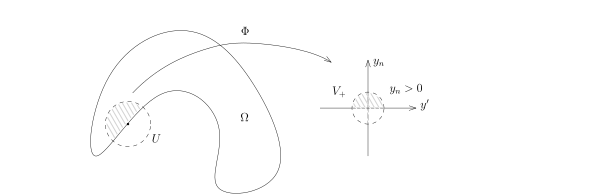

作为这些函数空间理论的应用，我们可以精确地叙述Dirichlet边值问题（指的是边界值为$0$）：
对于光滑的带边区域$\Omega\subset \mathbb{R}^n$，对任意的$f\in H^{-1}(\Omega)$，
我们已经证明了存在$u\in H^{1}_0(\Omega)$，使得
\[
-\triangle u \stackrel{\mathcal{D}'}{=} f.
\]
根据我们对${\rm Res}$的了解，我们知道
\[
u\big|_{\partial\Omega}:={\rm Res}(u)=0.
\]
所以，我们证明了如下的定理：

::: theorem
对于有界光滑的带边区域$\Omega\subset \mathbb{R}^n$，对任意的$f\in H^{-1}(\Omega)$，
存在唯一的$u\in H^{1}(\Omega)$解如下的Dirichlet边值问题
\[
\begin{cases}
-\triangle u = f,\\
u\big|_{\partial\Omega}=0.
\end{cases}
\]
:::

我们还有如下关于边值问题的定理：

::: theorem
对于有界光滑的带边区域$\Omega\subset \mathbb{R}^n$，
对任意的$g\in H^{\frac{1}{2}}(\partial \Omega)$，
存在唯一的$u\in H^{1}(\Omega)$，使得
\[
\begin{cases}
-\triangle u = 0,\\
u\big|_{\partial\Omega}=g.
\end{cases}
\]
:::

::: proof
由于
\[
{\rm Res}\colon H^{1}(\Omega)\twoheadrightarrow H^{ \frac{1}{2}}(\partial\Omega)
\]
是满射，我们选取$v\in H^{1}(\Omega)$，使得$v\big|_{\partial \Omega}=g$。所以，上述的问题转化为求解
\[
\begin{cases}
-\triangle \widetilde{u} = \widetilde{f},\\
\widetilde{u}\big|_{\partial\Omega}=0.
\end{cases}
\]
其中，$\widetilde{u}=u-v$，$\widetilde{f}=\triangle v\in H^{-1}(\Omega)$。
此时，我们运用Dirichlet边值问题的结论即可。
:::

::: theorem [位势方程的椭圆正则性定理]
$\Omega\subset \mathbb{R}^n$是有界光滑带边区域，$k\geqslant 1$是整数。
假设$u\in H^{1}(\Omega)$满足如下的边值问题：
\[
\begin{cases}
-\triangle u = f,\\
u\big|_{\partial\Omega}=g.
\end{cases}
\]
如果$f\in  H^{k-1}(\Omega)$并且$g\in H^{k+\frac{1}{2}}(\partial \Omega)$，那么，
$u\in H^{k+1}(\Omega)$。
:::

::: proof
我们先对问题做如下的化简：

- 约化为Dirichlet边值：根据我们限制的正合列，我们可以选取$\widetilde{g}\in H^{k+1}(\Omega)$，
  使得$\widetilde{g}\big|_{\partial \Omega}=g$。
  通过考虑$u-\widetilde{g}$（特别地，$\triangle \widetilde{g}\in H^{k-1}(\Omega)$），
  我们可以在这个问题中假设$g\equiv 0$。

- 局部化：我们可以假设$u$的支集很小。
  实际上，我们可以选取之前用过的$\Omega$的开覆盖以及相应的单位分解$\{\chi_j\}_{j\leqslant N}$，
  只要说明$\chi_j \cdot u\in  H^{k+1}(\Omega)$即可，这是因为，此时我们仍有
  \[
  \chi_j\cdot u\big|_{\partial\Omega}=0
  \]
  并且
  \[
  -\triangle (\chi_j\cdot u) = \chi_j \cdot f-2\nabla \chi_j\cdot \nabla u-\triangle\chi_j\cdot u.
  \]
  我们之后的证明是对$k$进行归纳。
  $k=0$这个命题是成立的，如果我们假设了对于一切$\leqslant k-1$的整数命题成立，此时，利用归纳假设，
  $u\in  H^{k+1}(\Omega)$，所以，$\nabla \chi_j\cdot \nabla u, \chi_j\cdot \triangle u\in H^{k-1}$，
  我们仍然有
  \[
  -\triangle (\chi_j\cdot u) \in H^{k-1},
  \]
  所以，我们只要对这种情况进行证明即可。

我们现在假设$\operatorname{supp}(u)\subset U$，其中$U\subset \mathbb{R}^n$是一个开集。
利用局部化的结论，我们只要考虑两种情况：$U\cap \partial \Omega=\emptyset$；$U$是某个边界点处的开集。
第一种情况的证明可以被第二种情况的证明过程所包含（请在下面的证明中注意这一点），
所以我们只考虑第二种情况。

此时，我们选取微分同胚$\Phi\colon U\cap \Omega \rightarrow V_+\subset \mathbb{H}^n$，
我们要把问题转化为半空间上的问题（下面的证明非常值得推敲）。

我们令$v=u\circ \Phi^{-1}$，那么，$u\in  H^{k+1}(\Omega)$等价于$v\in H^{k+1}(V_+)$。
然而，我们注意到，此时，方程的形式发生了很大的变化：$v$在分布的意义下所满足的方程为
\[
\sum_{1\leqslant i,j\leqslant N}\delta^{ij}\partial_i\partial_j v(\Phi(x))=f(\Phi(x)),
\]
亦即
\[
\sum_{1\leqslant i,j\leqslant n}\delta^{ij}\sum_{1\leqslant k,l\leqslant n}\left(\frac{\partial \Phi^k}{\partial x^i}\big(\Phi(x)\big)\frac{\partial \Phi^l}{\partial x^i}\big(\Phi(x)\big)\frac{\partial^2 v}{\partial y_k\partial y_l}\big(\Phi(x)\big)+\frac{\partial^2 \Phi^k}{\partial x^i\partial x^j}\big(\Phi(x)\big)\frac{\partial v}{\partial y_k}\big(\Phi(x)\big)\right)=f(\Phi(x)).
\]
这是一个变系数的二阶微分方程，它看起来很不友好。
实际上，我们对于问题的理解都是在分布意义下的，所以，
我需要在分布意义下（或者变分意义下）理解解的变化，上面的复杂方程实际上对我们没有用处。

我们的解有如下刻画：对任意的$\varphi \in H_0^1(\Omega)$，我们都有
\[
\int_{\Omega}\nabla u(x)\cdot\overline{\nabla\varphi(x)}dx=\int_{\Omega}f(x)\overline{\varphi(x)}dx.
\]
通过转换为$V_+$上$y$的坐标系并且令$\psi(y)=\varphi(\Phi^{-1}(y))$，我们有
\[
\int_{V^+}\nabla_k (v\circ \Phi(x)) \cdot \nabla_k (\psi\circ \Phi(x)) |{\rm Jac}_{\Phi^{-1}}(y)|dy=\int_{V^+}f(\Phi^{-1}(y))\varphi(\Phi^{-1}(y))|{\rm Jac}_{\Phi^{-1}}(y)|dy.
\]
即
\[
\sum_{1\leqslant j,k,l\leqslant n}\int_{V^+}\frac{\partial \Phi^k(x)}{\partial x_j}\frac{\partial \Phi^l(x)}{\partial x_j}\frac{\partial v(y)}{\partial y_k} \overline{\frac{\partial \psi(y)}{\partial y_l}} |{\rm Jac}_{\Phi^{-1}}(y)|dy=\int_{V^+}f(\Phi^{-1}(y))\overline{\varphi(\Phi^{-1}(y))}|{\rm Jac}_{\Phi^{-1}}(y)|dy.
\]
我们令
\[
\begin{aligned}
b^{kl}(y)&=\sum_{1\leqslant j\leqslant n} \frac{\partial \Phi^k(\Phi^{-1}(y))}{\partial x_j}\frac{\partial \Phi^l(\Phi^{-1}(y))}{\partial x_j}|{\rm Jac}_{\Phi^{-1}}(y)|\in C^\infty(V_+),\\
F(y)&=f(\Phi^{-1}(y))|{\rm Jac}_{\Phi^{-1}}(y)|\in H^{k-1}(V_+),
\end{aligned}
\]
我们有
\[
\boxed{\sum_{1\leqslant k,l\leqslant n}\int_{V^+}b^{kl}(y)\frac{\partial v(y)}{\partial y_k} \overline{\frac{\partial \psi(y)}{\partial y_l}} dy=\int_{V^+}F(y)\overline{\psi(y)}dy,}
\]
其中，上面的等式对任意的$\psi(y)\in H^1_0(V_+)$都成立，
这是因为$\psi(y)=\varphi(\Phi^{-1}(y))$可以表示任意$H_0^1(V_+)$中的元素。
上面的方框是我们对换坐标之后的表述。我们把方框的左边用一个二次型来记：
\[
B(v,\psi)=\sum_{1\leqslant k,l\leqslant n}\int_{V^+}b^{kl}(y)\frac{\partial v(y)}{\partial y_k} \overline{\frac{\partial \psi(y)}{\partial y_l}} dy
\]
另一个重要的观察是矩阵$\left(b^{kl}\right)_{1\leqslant k,l\leqslant n}$是正定矩阵，实际上，
\[
\left(b^{kl}\right)=~{}^t\left({\rm Jac}(\Phi)\right)\cdot I \cdot \left({\rm Jac}(\Phi)\right).
\]
所以，存在常数$c>0$，使得$\left(b^{kl}(y)\right)$的所有特征值都至少是$c$（对任意的$y\in V_+$成立）。
这是问题所谓的椭圆性。特别地，对于$w\in H_0^1(V_+)$，我们就有
\[
B(w,w)\geqslant c\|w\|^2_{H^{1}_0}.
\]

我们现在来证明$v$的正则性，我们先对$k=1$来证明（$k=0$的情况已经完成），然后对$k$进行归纳。
我们要证明$v\in H^2(V_+)$。这个证明的方法通常被称作是差分方法。

我们考虑平行方向的导数$\partial_{y_j} v(y',y_n)$，其中，$j\leqslant n-1$（当$j=n$时，
我们将利用方程的结构）。不妨假设$j=1$，那么，根据分布的知识，我们知道
\[
\partial_1 v \stackrel{\mathcal{D}'}{=}\lim_{t\rightarrow 0}\frac{\tau_t v-v}{t},
\]
其中，
\[
\tau_t v(y_1,\cdots, y_{n-1},y_n)=v(y_1+t,\cdots, y_{n-1},y_n).
\]
我们的目标是控制$\|\partial_1 v\|_{H^1}$（从而，$v$才可能落在$H^2$中）。

我们要把$\dfrac{\tau_t v-v}{t}$代入到方框中的方程里，所以，我们先计算
\[
\begin{aligned}
B(\tau_t v,\psi)&=\sum_{1\leqslant k,l\leqslant n}\int_{V^+}b^{kl}(y)\frac{\partial v(y_1+t,\cdots)}{\partial y_k} \overline{\frac{\partial \psi(y)}{\partial y_l}} dy\\
&=\sum_{1\leqslant k,l\leqslant n}\int_{V^+}b^{kl}(y_1-t,\cdots)\frac{\partial v(y)}{\partial y_k} \overline{\frac{\partial \psi(y_1-t,\cdots)}{\partial y_l}} dy\\
&=\sum_{1\leqslant k,l\leqslant n}\int_{V^+}b^{kl}(y)\frac{\partial v(y)}{\partial y_k} \overline{\frac{\partial \tau_{-t}\psi(y)}{\partial y_l}} dy\\
& \ \ \ +\sum_{1\leqslant k,l\leqslant n}\int_{V^+}\left(\tau_{-t}b^{kl}(y)-b^{kl}(y)\right)\frac{\partial v(y)}{\partial y_k} \overline{\frac{\partial \tau_{-t}\psi(y)}{\partial y_l}} dy.
\end{aligned}
\]
从而，
\[
\begin{aligned}
B\left(\frac{\tau_t v-v}{t},\psi\right)&=B\left(v,\frac{\tau_{-t} \psi-\psi}{t}\right) +\underbrace{\sum_{1\leqslant k,l\leqslant n}\int_{V^+}\left(\tau_{-t}b^{kl}(y)-b^{kl}(y)\right)\frac{\partial v(y)}{\partial y_k} \overline{\frac{\partial \tau_{-t}\psi(y)}{\partial y_l}} dy}_{I_{t}}.
\end{aligned}
\]
利用$b$的光滑性，$v,\psi \in H^1$以及Cauchy–Schwarz不等式，我们得到如下的一致估计：
\[
|I_t|\leqslant C \|v\|_{H^1}\|\psi\|_{H^1}.
\]
所以，根据
\[
B\left(v,\frac{\tau_{-t} \psi-\psi}{t}\right)=\int_{V_+}F(y)\overline{\frac{\tau_{-t} \psi(y)-\psi(y)}{t}}dy,
\]
我们就有
\[
\begin{aligned}
B\left(\frac{\tau_t v-v}{t},\psi\right)&\leqslant \left|B\left(v,\frac{\tau_{-t} \psi-\psi}{t}\right)\right| +I_t\\
&\leqslant C\left( \|v\|_{H^1}\|\psi\|_{H^1}+\|F\|_{L^2}\left\|\frac{\tau_{-t} \psi(y)-\psi(y)}{t}\right\|_{L^2}\right).
\end{aligned}
\]
利用Fourier变换，我们有
\[
\begin{aligned}
\left\|\frac{\tau_{-t} \psi(y)-\psi(y)}{t}\right\|_{L^2}^2&\leqslant \int_{\mathbb{R}^n}\left|\frac{e^{it\xi_1}-1}{t}\right|^2|\widehat{\psi}(\xi)|^2d\xi\\
&\leqslant \int_{\mathbb{R}^n}|\xi_1|^2|\widehat{\psi}(\xi)|^2d\xi\leqslant \|\psi\|_{H_0^1}^2.
\end{aligned}
\]
从而，对任意的$\psi\in H^1_0(V_+)$，我们都有如下的不等式
\[
\begin{aligned}
B\left(\frac{\tau_t v-v}{t},\psi\right)&\leqslant C\left( \|v\|_{H^1}+\|F\|_{L^2}\right)\|\psi\|_{H_0^1}.
\end{aligned}
\]
由于$v\in H^1_0(V_+)$，我们知道$\dfrac{\tau_t v-v}{t} \in H^1_0(V_+)$，
我们在上面把$\psi$取成$\dfrac{\tau_t v-v}{t}$，利用椭圆性，我们就有
\[
c\left\|\frac{\tau_t v-v}{t}\right\|_{H_0^1}^2\leqslant C\left( \|v\|_{H^1}+\|F\|_{L^2}\right)\left\|\frac{\tau_t v-v}{t}\right\|_{H_0^1}.
\]
从而，存在常数$C'$，使得对任意的$t$，我们都有
\[
\left\|\frac{\tau_t v-v}{t}\right\|_{H_0^1}\leqslant C'\left( \|v\|_{H^1}+\|F\|_{L^2}\right).
\]
为了让$t\rightarrow 0$，我们考虑配对
\[
\left|\left\langle \frac{\tau_t \partial_k v-\partial_k v}{t},\psi\right\rangle\right|
\leqslant \left\|\frac{\tau_t \partial_k v-\partial_k v}{t}\right\|_{L^2}\|\psi\|_{L^2}\leqslant C\|\psi\|_{L^2},
\]
其中，$\psi$是试验函数，$k\leqslant n$。
从而，当$t\rightarrow 0$时（此时在分布的意义下有极限），我们得到
\[
\left|\left\langle \partial_1\partial_k v,\psi\right\rangle\right| \leqslant C\|\psi\|_{L^2}.
\]
根据Riesz表示定理，$\partial_1\partial_k v\in L^2(V_+)$。

综合上述，我们证明$\partial_j \partial_k v \in L^2(V_+)$，其中$j\neq n$。
我们现在证明$\partial_n \partial_n v \in L^2(V_+)$：注意到，$v$所满足的方程为
\[
\sum_{1\leqslant i,j\leqslant n}\delta^{ij}\sum_{1\leqslant k,l\leqslant n}\left(\frac{\partial \Phi^k}{\partial x^i}\big(\Phi(x)\big)\frac{\partial \Phi^l}{\partial x^i}\big(\Phi(x)\big)\frac{\partial^2 v}{\partial y_k\partial y_l}\big(\Phi(x)\big)+\frac{\partial^2 \Phi^k}{\partial x^i\partial x^j}\big(\Phi(x)\big)\frac{\partial v}{\partial y_k}\big(\Phi(x)\big)\right)=f(\Phi(x)).
\]
利用矩阵$\left(b^{kl}\right)$，我们有
\[
\sum_{1\leqslant k,l\leqslant n}\left(b^{kl}(y)\frac{\partial^2 v}{\partial y_k\partial y_l}(y)+\underbrace{\sum_{i=1}^n\frac{\partial^2 \Phi^k}{\partial x_i^2}\big(y\big)\frac{\partial v}{\partial y_k}\big(y\big)}_{\in L^2}\right)=\underbrace{f(y)}_{\in L^2}.
\]
所以，
\[
b^{nn}(y)\frac{\partial^2 v}{\partial y_n^2}(y)+\sum_{k,l\neq (n,n)} b^{kl}(y)\frac{\partial^2 v}{\partial y_k\partial y_l}(y) \in L^2.
\]
由于$\partial_j \partial_k v \in L^2(V_+)$，
其中$j\neq n$并且$\left(b^{kl}\right)$的正定性意味着$b^{nn}(y)$是有正的下界的光滑函数，
所以$\partial_n^2 v\in L^2(V_+)$。

这就完成了$k=1$的情况的证明。

对于一般的$k$，我们进行归纳：假设对于$\leqslant k-1$的时候，命题都成立，利用方程
\[
\sum_{1\leqslant k,l\leqslant n}\left(b^{kl}(y)\frac{\partial^2 v}{\partial y_k\partial y_l}(y)+ \sum_{i=1}^n\frac{\partial^2 \Phi^k}{\partial x_i^2}\big(y\big)\frac{\partial v}{\partial y_k}\big(y\big) \right)= f(y),
\]
对任意的$j\leqslant n-1$，我们都有
\[
\sum_{1\leqslant k,l\leqslant n} b^{kl}(y)\frac{\partial^2 (\partial_j v)}{\partial y_k\partial y_l}(y)=-\sum_{1\leqslant k,l\leqslant n}\left(\partial_jb^{kl}\right)(y)\frac{\partial^2 v}{\partial y_k\partial y_l}(y)-\partial_j\left( \sum_{i=1}^n\frac{\partial^2 \Phi^k}{\partial x_i^2}\big(y\big)\frac{\partial v}{\partial y_k}\big(y\big)\right) +\partial_j f(y).
\]
根据归纳假设$v\in H^{k}(V_+)\cap H^{1}_0(V_+)$，
这表明上面表达式的右边落在空间$H^{k-2}(V_+)$中；
由于$\partial_j$是和边界$\partial V_+$平行方向的导数，
我们有$\partial_j v \in H^{1}_0(V_+)$，
这是因为对于任意的$\varphi\in C^{\infty}(\mathbb{R}^n)\cap H^1(\mathbb{H}^n)$，对于我们有
\[
{\rm Res}\circ \partial_j =\partial_j \circ {\rm Res},
\]
（这个等式对于$j=n$不成立）利用${\rm Res}$连续性及我们所证明的正合列，
如果$v \in H^{1}_0(V_+)$，那么，${\rm Res}\left(\partial_j v\right)=0$，
所以$\partial_j v \in H^{1}_0(V_+)$。此时，$\partial_j v\in H^1_0(V_+)$满足如下的方程：
\[
\sum_{1\leqslant k,l\leqslant n} b^{kl}(y)\frac{\partial^2 (\partial_j v)}{\partial y_k\partial y_l}(y)\in H^{k-2}(V_+),
\]
并且这个函数满足归纳假设的要求（特别是$\partial_j v\in H^1_0(V_+)$），从而，
对任意的$j\leqslant n-1$，我们都有$\partial_j v\in H^k(V_+)$。
最终，为了说明$ v\in H^k(V_+)$，只需要证明（只差了这一个导数的控制）$\partial_n^{k+1}v\in L^2$。
我们再次利用方程：
\[
b^{nn}(y)\frac{\partial^2 v}{\partial y_n\partial y_n}(y)=-\sum_{(k,l)\neq(n,n)} b^{kl}(y)\frac{\partial^2 v}{\partial y_k\partial y_l}(y)- \sum_{1\leqslant k,l,i\leqslant n}\frac{\partial^2 \Phi^k}{\partial x_i^2}\big(y\big)\frac{\partial v}{\partial y_k}\big(y\big)+f(y).
\]
对这个方程求$k-1$次$\partial_n$方向的导数，除了$b^{nn}(y)\partial^{k+1}_nv(y)$之外，
其余的项都落在$L^2$中，这就完成了证明。
:::

::: corollary
$\Omega\subset \mathbb{R}^n$是有界光滑带边区域，$u\in H^{1}(\Omega)$满足如下的边值问题：
\[
\begin{cases}
-\triangle u = f,\\
u\big|_{\partial\Omega}=g.
\end{cases}
\]
如果$f\in C^\infty(\Omega')$，其中$\Omega'$是包含$\overline{\Omega}$的开集，
$g\in C^{\infty}(\partial \Omega)$，那么，$u\in C^\infty(\Omega)$。
:::
