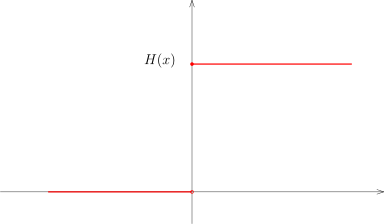
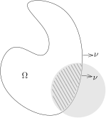

## 分布的操作

在微积分的学习中，我们可以对一个函数做特定的操作，比如可以把一个函数限制到比较小的定义域上、
可以对一个函数求导数、两个函数可以相乘等等。我们现在讨论如何对分布做一些特定的操作。

### 分布的限制

假设 $\Omega'\subset \Omega$ 是开子集，那么，我们可以定义限制映射
\[
\operatorname{Res}\colon \mathcal{D}'(\Omega)\rightarrow \mathcal{D}'(\Omega'), u\mapsto \operatorname{Res}(u).
\]
其中，对于每个 $\varphi \in \mathcal{D}(\Omega')$，它自然可以看作是 $\mathcal{D}(\Omega)$ 中的元素，
从而，我们可以要求
\[
\langle \operatorname{Res}(u),\varphi\rangle = \langle u, \varphi\rangle.
\]
为了方便起见，除了个别场合，我们总是用 $u$ 来直接表示 $\operatorname{Res}(u)$。

### 求偏导数

我们先考虑一个足够光滑的函数，比如说，$u\in C^1(\mathbb{R})$。
$u$ 和 $u'$ 都是局部可积分的函数，我们可以把它们视作是分布。通过分部积分，我们有
\[
\begin{aligned}
\langle u',\varphi \rangle &=\int_\mathbb{R} u'(x)\varphi(x)dx=-\int_\mathbb{R} u(x)\varphi'(x)dx \\
&= -\langle u,\varphi' \rangle.
\end{aligned}
\]
这个计算启发我们：对于 $u\in \mathcal{D}'(\mathbb{R})$，我们可以用下面的等式来定义它的导数：
\[
\begin{aligned}
\langle u',\varphi \rangle \coloneqq -\langle u,\varphi' \rangle.
\end{aligned}
\]

::: definition
假设 $\Omega\subset \mathbb{R}^n$ 是有界开集，给定 $u \in \mathcal{D}'(\Omega)$，
对于任意的多重指标 $\alpha$，我们定义
\[
\langle\partial^\alpha u, \varphi \rangle = (-1)^{|\alpha|}\langle u, \partial^\alpha \varphi \rangle.
\]
:::

我们必须说明 $\partial^\alpha u$ 定义了 $\Omega$ 上的分布：根据分布的定义，
对任意的紧集 $K\subset \Omega$，存在非负整数 $p$ 和正常数 $C$（$p$ 和 $C$ 依赖于 $K$），
使得对任意的 $\varphi\in C_K^\infty(\Omega)$，都有
\[
\begin{aligned}
|\langle \partial^\alpha u,\varphi \rangle|&=|\langle  u, \partial^\alpha\varphi \rangle|\\
&\leqslant C \sup_{|\beta|\leqslant p}\|\partial^\beta \partial^\alpha\varphi\|_{L^\infty(K)}\\
&\leqslant C \sup_{|\gamma|\leqslant p+|\alpha|}\|\partial^\gamma\varphi\|_{L^\infty(K)}.
\end{aligned}
\]
这表明我们对任意的分布都可以求导数，即对任意的多重指标 $\alpha$，我们有（连续）线性映射：
\[
\partial^\alpha\colon \mathcal{D}'(\Omega)\rightarrow \mathcal{D}'(\Omega).
\]
我们研究两个经典的例子：

::: example* [Heaviside 函数]
我们定义Heaviside函数
\[
{H}(x)=\mathbf{1}_{x\geqslant 0}.
\]

直观上，这个函数在 $0$ 之外的导数是 $0$，在 $0$ 处函数有很大的跳跃，导数应该是无穷大。我们证明
\[
{H}(x)'=\delta_0.
\]
按照定义，我们有
\[
\begin{aligned}
\langle H'(x),\varphi(x) \rangle&=-\langle H(x),\varphi'(x) \rangle=-\int_0^\infty \varphi'(x)dx\\
&=-\left(\varphi(\infty)-\varphi(0)\right)=\varphi(0)\\
&=\langle \delta_0, \varphi\rangle.
\end{aligned}
\]
:::

::: example*
我们考虑 $\mathbb{R}$ 上的 $\log$ 函数，注意到
\[
\log|x| \in L^1_{\rm loc}(\mathbb{R}).
\]
我们证明，作为分布，有
\[
\bigl(\log|x|\bigr)'\stackrel{\mathcal{D'}}{=}\operatorname{vp}\frac{1}{x}.
\]
实际上，
\[
\begin{aligned}
\langle \bigl(\log|x|\bigr)',\varphi \rangle&=-\lim_{\varepsilon\rightarrow 0}\Bigl(\int_{-\infty}^{-\varepsilon}\varphi'\log|x|dx+\int^{\infty}_{\varepsilon}\varphi'\log|x|dx\Bigr)\\
&=\lim_{\varepsilon\rightarrow 0}\Bigl(\varphi(-\varepsilon)\log(\varepsilon)+\int_{-\infty}^{-\varepsilon}\frac{1}{x}\varphi dx-\varphi(\varepsilon)\log(\varepsilon)+\int^{\infty}_{\varepsilon}\frac{1}{x}\varphi dx\Bigr).
\end{aligned}
\]
我们注意到
\[
\varphi(-\varepsilon)-\varphi(\varepsilon)=O(\varepsilon).
\]
所以，
\[
\lim_{\varepsilon\rightarrow 0}\varphi(-\varepsilon)\log(\varepsilon)-\varphi(\varepsilon)\log(\varepsilon)=0.
\]
从而，
\[
\begin{aligned}
\langle \bigl(\log|x|\bigr)',\varphi \rangle&=\lim_{\varepsilon\rightarrow 0}\Bigl(\int_{-\infty}^{-\varepsilon}\frac{1}{x}\varphi dx+\int^{\infty}_{\varepsilon}\frac{1}{x}\varphi dx\Bigr)\\
&=\langle \operatorname{vp}\frac{1}{x},\varphi\rangle.
\end{aligned}
\]
:::

::: example*
我们计算 $\mathbb{R}$ 上的Dirac函数 $\delta_a$ 的导数，其中 $a\in \mathbb{R}$。
任给 $\varphi\in \mathcal{D}(\mathbb{R})$，我们有
\[
\begin{aligned}
\langle \delta_a',\varphi\rangle=-\langle \delta_a,\varphi'\rangle = -\varphi'(a).
\end{aligned}
\]
:::

### $C^\infty(\Omega)$-模结构

对光滑函数 $f\in C^\infty(\Omega)$ 和分布 $u \in \mathcal{D}'(\Omega)$，
我们可以定义它们的乘积 $f\cdot u$：
\[
\langle f\cdot u,\varphi \rangle\coloneqq\langle u,f\varphi \rangle.
\]
其中，$\varphi$ 是试验函数。
由于 $f\varphi$ 仍然是 $\mathcal{D}(\Omega)$ 中的函数，所以上面的等式是良好定义的。
为了说明 $f\cdot u \in \mathcal{D}'(\Omega)$，要对 $u$ 来用分布的定义：
对任意的紧集 $K\subset \Omega$，存在非负整数 $p$ 和正常数 $C$（$p$ 和 $C$ 依赖于 $K$），
使得对任意的 $\varphi\in C_K^\infty(\Omega)$，都有
\[
|\langle f\cdot u,\varphi \rangle|\leqslant C \sup_{|\alpha|\leqslant p}\|\partial^\alpha(f\cdot \varphi)\|_{L^\infty(K)}.
\]
根据Leibniz法则，我们有
\[
\partial^\alpha(f\cdot \varphi)=\sum_{\beta+\gamma=\alpha}\partial^\beta f \cdot \partial^\gamma \varphi.
\]
所以，
\[
\begin{aligned}
|\langle f\cdot u,\varphi \rangle|&\leqslant C \sup_{|\alpha|\leqslant p}\sum_{\beta+\gamma=\alpha}\|\partial^\beta f \|_{L^\infty(K)}\|\partial^\gamma \varphi \|_{L^\infty(K)}\\
&\leqslant \underbrace{C\sum_{|\beta|\leqslant p}\|\partial^\beta f \|_{L^\infty(K)}}_{\text{新的常数}~C'}\times \sup_{|\gamma|\leqslant p}\|\partial^\gamma \varphi \|_{L^\infty(K)}.
\end{aligned}
\]
这表明 $f\cdot u \in \mathcal{D}'(\Omega)$。

::: example*
我们有
\[
x\cdot \operatorname{vp}\frac{1}{x}=1.
\]
对任意的 $\varphi\in \mathcal{D}(\mathbb{R})$，我们知道 $x\varphi(x)\big|_{x=0}=0$。
根据第一次作业题的A6)，我们有
\[
\begin{aligned}
\langle x\cdot  \operatorname{vp}\frac{1}{x},\varphi \rangle&=\langle  \operatorname{vp}\frac{1}{x},x\varphi \rangle\\
&=\int_{\mathbb{R}}\frac{1}{x} \cdot x\varphi(x)dx=\int_{\mathbb{R}}1\cdot \varphi(x)dx.
\end{aligned}
\]
这就证明了命题。
:::

### 分布的平移和变量替换

对于 $x_0\in\mathbb{R}^n$，我们有如下的平移变换：
\[
\tau_{x_0}\colon \mathbb{R}^n\rightarrow \mathbb{R}^n, \ \ x\mapsto x+x_0.
\]
对于局部可积的函数 $f\in L^1_{\rm loc}(\mathbb{R}^n)$，我们可以定义（这是一种特殊的变量替换）：
\[
\bigl(\tau_{x_0} f \bigr)(x) := f(x+x_0).
\]
如果将 $f$ 视为是分布，对于试验函数 $\varphi$ 而言，我们有
\[
\begin{aligned}
\langle f(\cdot+x_0),\varphi(\cdot)\rangle&=\int_{\mathbb{R}^n}f(x+x_0)\varphi(x)dx=\int_{\mathbb{R}^n}f(x)\varphi(x-x_0)dx\\
&=\langle f(\cdot),\varphi(\cdot-x_0)\rangle=\langle f(\cdot),(\tau_{-x_0}\varphi)(\cdot)\rangle.
\end{aligned}
\]
对于一般的分布 $u\in \mathcal{D}'(\mathbb{R}^n)$，$x_0\in \mathbb{R}^n$，我们定义
\[
\langle \tau_{x_0} u,\varphi \rangle\coloneqq\langle  u,\varphi(x-x_0) \rangle.
\]
容易验证，$\tau_{x_0} u$ 给出了一个分布。
实际上，我们稍后在进行变量替换的时候，也会给出这个命题的证明。

下面的命题给出了在分布意义下方向导数的另一个（直观）刻画：

::: proposition
给定分布 $u \in \mathcal{D}'(\mathbb{R}^n)$，给定向量 $v=(v_1,\cdots, v_n)\in \mathbb{R}^n$，
在分布意义下，我们有
\[
\lim_{t\rightarrow 0}\frac{\tau_{t v}u-u}{t} \stackrel{\mathcal{D}'}{=} \sum_{j=1}^n v_j\partial_j u.
\]
:::

::: proof
按照定义，我们有
\[
\begin{aligned}
\langle \frac{\tau_{t v}u-u}{t}- \sum_{j=1}^n v_j\partial_j u,\varphi\rangle&=\langle u, \underbrace{\frac{\varphi(x-t v)-\varphi(x)}{t}+\sum_{j=1}^n v_j\partial_j\varphi(x)}_{\varphi_t}\rangle.
\end{aligned}
\]
根据带有积分余项的 Taylor 展开，我们有
\[
\varphi_t(x)=-\sum_{j=1}^n \int_{0}^{1}v_j\Bigl(\partial_j\varphi(x-t s v)-\partial_j\varphi(x)\Bigr)ds.
\]
由于 $t$ 很小，上述函数 $\varphi_t(x)$ 的支撑集是紧的，从而第一个等式的右边是良好定义的。
我们来证明在 $\mathcal{D}(\mathbb{R}^n)$ 中，上述 $\varphi_t(x)$ 的极限是 $0$，
也就是说对任意的多重指标 $\alpha$，
我们有 $\partial^\alpha \varphi_t(x)\stackrel{L^\infty}{\longrightarrow}0$：
根据Lebesgue控制收敛定理（的推论，积分与求导数可交换，请参考上学期笔记），我们有
\[
\begin{aligned}
\|\partial^\alpha \varphi_t(x)\|_{L^\infty}&=\Big\|\sum_{j=1}^n \int_{0}^{1}v_j\Bigl(\partial_j\partial^\alpha\varphi(x-t s v)-\partial_j\partial^\alpha\varphi(x)\Bigr)ds\Big\|_{L^\infty}\\
&\leqslant\Big\|\sum_{j=1}^n \int_{0}^{1}{|v_j|}{|v|}\|\partial^{|\alpha|+2}\varphi\|_\infty t ds\Big\|_{L^\infty}.
\end{aligned}
\]
其中，最后一步我们用到了Lagrange中值定理。再次利用Lebesgue控制收敛定理，上面的极限为 $0$。命题得证。
:::

给定 $\mathbb{R}^n$ 的两个开集 $\Omega_1$ 和 $\Omega_2$，我们假定
\[
\Phi\colon \Omega_1\rightarrow \Omega_2
\]
是微分同胚。
对任意一个 $\Omega_2$ 上的局部可积的函数 $f$ 和 $\Omega_1$ 上的试验函数 $\varphi$，
根据换元积分公式，我们有
\[
\begin{aligned}
\langle \Phi^*f, \varphi(x)\rangle&=\int_{\Omega_1}f(\Phi(x))\varphi(x)dx=\int_{\Omega_2}f(y)\varphi(\Phi^{-1}(y))|\mathbf{J}_{\Phi^{-1}}(y)|dy\\
&=\int_{\Omega_2} f(y) \frac{\varphi(\Phi^{-1}(y))}{|\mathbf{J}_{\Phi}\bigl(\Phi^{-1}(y)\bigr)|} dy\\
&=\left\langle f, \frac{\varphi(\Phi^{-1}(y))}{|\mathbf{J}_{\Phi}\bigl(\Phi^{-1}(y)\bigr)|} \right\rangle.
\end{aligned}
\]
根据这个计算，我们定义：
\[
\Phi^*\colon \mathcal{D}'(\Omega_2)\rightarrow \mathcal{D}'({\Omega_1}), \ \ u\mapsto \Phi^*u.
\]
其中，对于 $u\in \mathcal{D}'(\Omega_2)$ 和 $\varphi\in \mathcal{D}(\Omega_{1})$，
我们定义 $\Phi^* u$ 如下：
\[
\langle \Phi^* u, \varphi(x) \rangle\coloneqq\langle u, \varphi(\Phi^{-1}(y))|\mathbf{J}_{\Phi^{-1}}(y)|\rangle=\left\langle u, \frac{\varphi(\Phi^{-1}(y))}{|\mathbf{J}_{\Phi}\bigl(\Phi^{-1}(y)\bigr)|}\right\rangle.
\]
为了证明 $ \Phi^* u$ 的确定义了 ${\Omega_1}$ 上的一个分布，我们利用定义：
对任意的紧集 $K\subset \Omega$，存在非负整数 $p$ 和正常数 $C$（$p$ 和 $C$ 依赖于 $K$），
使得对任意的 $\varphi\in C_K^\infty(\Omega)$，都有
\[
|\langle \Phi^* u,\varphi \rangle|\leqslant C \sup_{|\alpha|\leqslant p}\Big\|\partial^\alpha \left( \frac{\varphi(\Phi^{-1}(y))}{|\mathbf{J}_{\Phi}\bigl(\Phi^{-1}(y)\bigr)|}\right)\Big\|_{L^\infty(K)}.
\]
我们需要利用链式法则多次求导数。
重要的观察是上述导数最多给出 $\varphi$ 的不超过 $p$ 次的导数的线性组合，其中，
这些线性系数都是 $\Phi(y)$ 的不超过 $p+1$ 阶的导数的多项式。
由于我们限制在紧集 $K$ 上，所以这些系数是一致有界的（这个界可能依赖于 $K$），从而，
通过改变一下上面不等式中的常数 $C$，我们最终得到
\[
|\langle \Phi^* u,\varphi \rangle|\leqslant C' \sup_{|\alpha|\leqslant p}\|\partial^\alpha\varphi\|_{L^\infty(K)}.
\]

::: remark* [记号]
因为在光滑函数情况下，$\Phi^*u$ 就是函数的复合，我们还把上面的拉回映射写成
\[
u\circ \Phi = \Phi^*u.
\]
:::

给定微分同胚 $\Phi\colon \Omega_1\rightarrow \Omega_2$，它把 $\Omega_2$ 上的Dirac函数拉回，
得到 $\Omega_1$ 上的Dirac函数，这给出了Jacobi行列式的一个精确的解释：这是一点处体积的变化。

::: example*
假设 $x_0\in \Omega_1$，$y_0\in \Omega_2$ 并且 $\Phi(x_0)=y_0$。那么，我们有
\[
\Phi^*\delta_{y_0}=\frac{1}{|\mathbf{J}_\Phi(x_0)|}\delta_{x_0}.
\]
实际上，利用定义，对于任意的 $\varphi\in \mathcal{D}(\Omega_1)$，我们有
\[
\langle \Phi^* \delta_{y_0}, \varphi(x) \rangle=\left\langle \delta_{y_0}, \frac{\varphi(\Phi^{-1}(y))}{|\mathbf{J}_{\Phi}\bigl(\Phi^{-1}(y)\bigr)|}\right\rangle= \frac{\varphi(\Phi^{-1}(y_0))}{|\mathbf{J}_{\Phi}\bigl(\Phi^{-1}(y_0)\bigr)|}= \frac{\varphi(x_0)}{|\mathbf{J}_{\Phi}(x_0)|}.
\]
很明显，
\[
\frac{\varphi(x_0)}{|\mathbf{J}_{\Phi}(x_0)|}=\left\langle \frac{1}{|\mathbf{J}_\Phi(x_0)|}\delta_{x_0}, \varphi\right\rangle.
\]
:::

给定微分同胚 $\Phi$，如果 $u$ 是 $C^1$ 的函数，我们可以对求导数运算运用链式法则：
\[
\partial_j (u \circ \Phi)= \sum_{k=1}^n \partial_j\Phi_k(x_1,\cdots,x_n)\cdot \bigl(\partial_k u\circ\Phi\bigr)(x_1,\cdots,x_n).
\]
对于一般的分布 $u$，我们实际上（后来）可以先用光滑函数逼近这个分布，
然后上面的链式法则在极限的情况下仍然成立。

我们现在给出一个直接的证明：设 $\Psi=\Phi^{-1}$ 是 $\Phi$ 的逆映射。
按照分布与一个微分同胚的复合的定义，我们有
\[
\begin{aligned}
\left\langle \sum_{k=1}^n \frac{\partial\Phi_k}{\partial x_j}\cdot \frac{\partial{u}}{\partial y_k}\circ\Phi,\varphi\right\rangle&=\sum_{k=1}^n \left\langle \frac{\partial{u}}{\partial y_k}\circ\Phi, \frac{\partial\Phi_k}{\partial x_j}\cdot\varphi\right\rangle\\
&=\sum_{k=1}^n \left\langle \frac{\partial{u}}{\partial y_k}, \Bigl(\frac{\partial\Phi_k}{\partial x_j}\circ\Psi\Bigr)\bigl(\varphi\circ\Psi\bigr)|J_\Psi|\right\rangle\\
&=-\sum_{k=1}^n \left\langle u, \frac{\partial}{\partial y_k}\Bigl[\Bigl(\frac{\partial\Phi_k}{\partial x_j}\circ\Psi\Bigr)\bigl(\varphi\circ\Psi\bigr)|J_\Psi|\Bigr]\right\rangle
\end{aligned}
\]
另外，对任意 $g\in C_0^\infty(\Omega)$，我们有
\[
\begin{aligned}
0&=\int_{\Omega_1} \frac{\partial}{\partial x_j}\bigl(g\circ\Phi\bigr)dx=\sum_{k=1}^n\int_{\Omega_1} \frac{\partial \Phi_k}{\partial x_j}\cdot \frac{\partial g}{\partial y_k}\circ\Phi\,dx\\
&=\sum_{k=1}^n\int_{\Omega_2} \frac{\partial \Phi_k}{\partial x_j}\circ \Psi \cdot \frac{\partial g}{\partial y_k}\cdot|{\mathbf{J}}_\Psi(y)|dy\\
&=-\sum_{k=1}^n\int_{\Omega_2} g\frac{\partial }{\partial y_k}\Bigl(\frac{\partial \Phi_k}{\partial x_j}\circ \Psi \cdot|\mathbf{J}_\Psi(y)|\Bigr)dy
\end{aligned}
\]
根据 $L^1_{\rm loc}(\Omega)$ 到 $\mathcal{D}'(\Omega)$ 嵌入的单射性，上面的等式等价于说
\[
\sum_{k=1}^n\frac{\partial }{\partial y_k}\Bigl(\frac{\partial \Phi_k}{\partial x_j}\circ \Psi \cdot|\mathbf{J}_\Psi(y)|\Bigr)=0.
\]
从而
\[
\begin{aligned}
\left\langle \sum_{k=1}^n \frac{\partial\Phi_k}{\partial x_j}\cdot \frac{\partial{u}}{\partial y_k}\circ\Phi,\varphi\right\rangle&=-\sum_{k=1}^n \left \langle u, \frac{\partial}{\partial y_k}\bigl(\varphi\circ\Psi\bigr) \Bigl[\Bigl(\frac{\partial\Phi_k}{\partial x_j}\circ\Psi\Bigr)|\mathbf{J}_\Psi|\Bigr] \right\rangle\\
&=-\left\langle u, \frac{\partial \varphi}{\partial x_j}\circ \Psi  |\mathbf{J}_\Psi| \right\rangle\\
&=-\left\langle u\circ \Phi, \frac{\partial \varphi}{\partial x_j} \right\rangle.
\end{aligned}
\]
这就证明如下关于分布的链式法则：
\[
\partial_j (\Phi^*u )= \sum_{k=1}^n \partial_j\Phi_k \cdot \Phi^*\left(\bigl(\partial_k u\bigr)\right).
\]

## 关于分布的Stokes公式

我们用分布的语言来表述Stokes公式。我们上个学期证明了：

::: theorem [Stokes公式]
假设 $\Omega$ 是一个有界带边光滑区域，
$\nu(x)=(\nu_1(x),\cdots,\nu_n(x))$ 为 $\partial \Omega$ 的单位外法向量，
$d\sigma$ 为 $\partial \Omega$ 上的曲面测度。
对任意的 $\varphi\in C^1(\mathbb{R}^n,\mathbb{C})$，我们有
\[
\int_\Omega \frac{\partial \varphi}{\partial x_i}(x)~dx = \int_{\partial \Omega} \varphi(x) \nu_i(x) ~d\sigma.
\]
:::

给定了上面Stokes公式中所述的 $\Omega$，
它的边界 $\partial \Omega$ 的曲面测度 $d\sigma$ 在如下的意义下定义了 $\mathbb{R}^n$ 上一个分布：
\[
d\sigma\colon  \mathcal{D}(\mathbb{R}^n)\rightarrow \mathbb{C}, \ \ \varphi\mapsto \int_{\partial \Omega} \varphi(x)d\sigma(x).
\]
这是一个 $0$ 阶的分布，我们把证明的细节留给不放心的同学来验证。
类似地，对每一个 $i\leqslant n$，如下的公式也定义了一个分布：
\[
\nu_i d\sigma\colon  \mathcal{D}(\mathbb{R}^n)\rightarrow \mathbb{C}, \ \ \varphi\mapsto \int_{\partial \Omega} \varphi(x) \nu_i(x)d\sigma(x).
\]

我们可以把Stokes公式改写成如下的形式：
\[
\langle  \mathbf{1}_{\Omega}, \partial_i\varphi\rangle= \int_{\mathbb{R}^n} \mathbf{1}_{\Omega}(x)\frac{\partial \varphi}{\partial x_i}(x)~dx = \int_{\partial \Omega} \varphi(x) \nu_i(x) ~d\sigma.
\]
所以，用分布的语言来写，我们有

::: theorem [Stokes公式]
假设 $\Omega$ 是一个有界带边光滑区域，
$\nu(x)=(\nu_1(x),\cdots,\nu_n(x))$ 为 $\partial \Omega$ 的单位外法向量，
$d\sigma$ 为 $\partial \Omega$ 上的曲面测度，作为分布，我们有等式
\[
\partial_i \mathbf{1}_\Omega \stackrel{\mathcal{D}'(\mathbb{R}^n)}{=} -\nu_i d\sigma.
\]
如果用向量值分布的语言（可以望文生义地定义）来写，我们有
\[
\nabla \mathbf{1}_\Omega \stackrel{\mathcal{D}'(\mathbb{R}^n)}{=} -\nu \, d\sigma.
\]
:::

我们现在回到$1$维的情形，此时的Stokes公式就是Newton–Leibniz公式。

::: lemma
对于 $f(x)\in L^1\bigl((a,b)\bigr)$，我们定义其原函数为
\[
F(x)= \int_{a}^x f(y)dy.
\]
那么，$F(x)$ 是连续函数。在分布的意义下，我们有
\[
F(x)'\stackrel{\mathcal{D}'}{=}f(x).
\]
:::

::: proof
为了证明 $F$ 是连续的，我们把它写成
\[
F(x)= \int_{[a,b]} f\cdot \mathbf{1}_{(a,x]}d\mu,
\]
其中 $d\mu$ 是Lebesgue测度。
对任意的 $x_k\rightarrow x$，
我们知道 $f\cdot \mathbf{1}_{(a,x_k]}$ 逐点地收敛到 $f\cdot \mathbf{1}_{(a,x]}$，
利用 $|f|$ 作为控制函数，Lebesgue控制收敛定理告诉我们
\[
\lim_{k\rightarrow \infty}F(x_k)=F(x).
\]

我们用定义计算 $F'$。对于任意的试验函数 $\varphi \in \mathcal{D}\bigl((a,b)\bigr)$，我们有
\[
\begin{aligned}
\langle F',\varphi\rangle&=-\langle F,\varphi'\rangle= \int_{(a,b)}\left(\int_{(a,b)} f\cdot \mathbf{1}_{(a,x]}(y)dy\right)\varphi'(x)dx\\
&=\int\!\!\!\int_{(a,b)\times (a,b)}\mathbf{1}_{A}(x,y)f(y)\varphi'(x)dxdy.
\end{aligned}
\]
这里，
$A=\bigl\{(x,y)\in (a,b)\times (a,b)\bigm| y\leqslant x\bigr\}$ 并且我们是利用了Fubini定理把它化成了
$2$维的积分。再次利用Fubini定理，我们先对 $x$ 积分再对 $y$ 积分，就有
\[
\begin{aligned}
\langle F',\varphi\rangle&=\int_{(a,b)}f(y)\left(\int_{a}^y\varphi'(x)dx\right)dy\\
&=\int_{a}^b f(y)\varphi(y) dy =\langle T_f, \varphi\rangle.
\end{aligned}
\]
其中，我们用到了 $\varphi(a)=0$（因为 $\operatorname{supp}(\varphi)\subset (a,b)$）。
这就是说，在分布的意义下，$F'=f$。
:::
