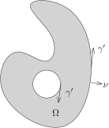

## 跳跃公式

上次课的最后利用Fubini定理，我们证明了：对于 $f(x)\in L^1\bigl((a,b)\bigr)$，我们定义其原函数为
\[
F(x)= \int_{a}^x f(y)dy.
\]
那么，$F(x)$ 是连续函数。在分布的意义下，我们有
\[
F(x)'\stackrel{\mathcal{D}'}{=}f(x).
\]

::: lemma
给定分布 $u\in \mathcal{D}'\bigl((a,b)\bigr)$，如果在分布的意义下 $u'=0$，那么，在分布的意义下，
$u$ 为常数，即存在 $c\in \mathbb{C}$，使得
\[
u\stackrel{\mathcal{D}'}{=}c.
\]
:::

::: remark*
请参考第一学期的 @coro:80。
:::

::: proof
我们任意选定一个 $\chi \in C_0^\infty\bigl((a,b)\bigr)$，
使得 $\displaystyle \int_a^b \chi(x) dx =1$。令 $c=\langle u,\chi\rangle$。

对于任意一个试验函数 $\varphi\in \mathcal{D}\bigl((a,b)\bigr)$，我们定义
\[
g(x)=\varphi(x)-\bigl(\int_{-\infty}^\infty\varphi(y)dy\bigr)\chi(x),
\]
那么，我们有
\[
\int_\mathbb{R} g(x)dx =0.
\]
我们定义函数
\[
\psi(x)=\int_{a}^x g(y)dy.
\]
利用 $g$ 的积分消失的性质，我们容易说明（证明支集是紧的）$\psi \in \mathcal{D}\bigl((a,b)\bigr)$。
特别地，我们可以用 $\psi$ 作为试验函数。由于 $u'=0$，所以
\[
\begin{aligned}
0&=-\langle u, \psi' \rangle=-\langle u, \varphi(x)-\bigl(\int_\mathbb{R}\varphi(y)dy\bigr)\chi(x)\rangle\\
&=\langle u,\varphi\rangle - c\int_\mathbb{R} \varphi(x)dx.
\end{aligned}
\]
所以，
\[
\langle u,\varphi\rangle = \int_\mathbb{R} c \cdot \varphi(x)dx =\langle c, \varphi\rangle.
\]
这说明，作为分布，我们有 $u=c$。
:::

综合上面的两个命题，我们有如下的性质：

::: proposition
假定 $f\in L^1\bigl((a,b)\bigr)$，那么关于分布的常微分方程
\[
u'=f
\]
在 $\mathcal{D}'\bigl((a,b)\bigr)$ 中所有的解均形如
\[
u = c+ \int_{a}^x f(y)dy,
\]
其中 $c\in \mathbb{C}$ 为常数。
:::

我们现在来证明所谓的跳跃公式：

::: theorem [跳跃公式]
给定连续函数 $g\in C(\mathbb{R})$，我们假设它的分布导数 $g'\in L_{\rm loc}^1(\mathbb{R})$。
那么，对任意的 $-\infty<a<b<+\infty$，在分布的意义下，我们有
\[
\frac{d}{dx}\bigl(g(x)\mathbf{1}_{(a,b)}(x)\bigr)\stackrel{\mathcal{D}'}{=}g'(x)\mathbf{1}_{(a,b)}(x)-g(b)\delta_b+g(a)\delta_a.
\]
:::

::: proof
根据上一个命题，我们有（作为分布或者连续函数）
\[
g(x)=g(a)+\int_a^x g'(y)dy.
\]
按定义，对任意的试验函数 $\varphi$，我们还有
\[
\begin{aligned}
 \left\langle \frac{d}{dx}\bigl(g(x)\mathbf{1}_{(a,b)}(x)\bigr), \varphi \right\rangle&=-\int_{a}^b g(x)\varphi'(x)dx\\
&=-g(a)\int_a^b\varphi'(x)dx +\int_a^b\left[\int_a^x g'(y)dy\right](-\varphi'(x))dx\\
&\stackrel{Fubini}{=}-g(a)\int_a^b\varphi'(x)dx -\int_a^b\left[\int_y^b \varphi'(x)dx\right] g'(y)dy\\
&=-g(a)\underbrace{\int_a^b\varphi'(x)dx}_{\varphi(b)-\varphi(a)}-\varphi(b)\underbrace{\int_a^b g'(x)dx}_{g(b)-g(a)} +\int_a^b \varphi(y)g'(y)dy.
\end{aligned}
\]
将上面最后一行合并同类项即得。
:::

## 分布与Stokes理论的第一个应用：Cauchy积分公式

考虑复平面 $\mathbb{C}$ 上的开区域 $\Omega$。
函数（映射）$F$ 在 $\Omega$ 上定义并且在 $\mathbb{C}$ 中取值：
\[
F\colon \Omega \rightarrow \mathbb{C}
\]
我们假设 $F$ 是连续可微的（$F\in C^1$）。

如果把 $F$ 视作是从 $\Omega$ 到 $\mathbb{R}^2$ 的映射，我们通常将它写作
\[
F(z)=F(x,y)= f(x,y)+ig(x,y).
\]
我们定义微分算子：
\[
\overline{\partial} = \frac{\partial}{\partial \overline{z}}=\frac{1}{2}\left(\frac{\partial }{\partial x}+i\frac{\partial }{\partial y}\right).
\]
所以，$\overline{\partial}$ 对 $F$ 的作用为：
\[
\overline{\partial}F =\frac{1}{2}\left(\frac{\partial f}{\partial x }-\frac{\partial g}{\partial y}\right)+\frac{i}{2}\left(\frac{\partial g}{\partial x }+\frac{\partial f}{\partial y}\right).
\]
我们现在定义 $F$在复解析意义下的导数（如果极限存在的话）：
\[
F'(z_0)=\lim_{z\rightarrow z_0}\frac{F(z)-F(z_0)}{z-z_0}.
\]
其中，$z_0\in \Omega$ 是给定的一点。

::: definition
如果 $F'(z)$ 在 $\Omega$ 上处处有定义并且是连续函数，我们就称 $F$ 为 $\Omega$ 上的**复解析函数**。
:::

我们现在证明

::: theorem
函数 $F\colon \Omega \rightarrow \mathbb{C}$ 是复解析函数当且仅当 $\overline{\partial}{F}=0$。
特别地，$F(x,y)=f(x,y)+ig(x,y)$ 在 $\Omega$ 上是复解析的当且仅当如下的偏微分方程组在 $\Omega$ 上成立
\[
\begin{cases}
\displaystyle\frac{\partial f}{\partial x }-\frac{\partial g}{\partial y}=0;\\
\displaystyle\frac{\partial g}{\partial x }+\frac{\partial f}{\partial y}=0.
\end{cases}
\]
这个方程组是所谓的Cauchy–Riemann方程。
:::

::: proof
假设 $F$ 在 $z_0$ 处的复解析导数可定义，我们令它为
\[
F'(z_0)=\lim_{z\rightarrow z_0}\frac{F(z)-F(z_0)}{z-z_0}=a+bi.
\]
根据极限的定义，当 $z\rightarrow z_0$ 时，我们有
\[
F(z)-F(z_0)-F'(z_0)(z-z_0) = o(|z-z_0|).
\]
把 $F$ 看作是从 $\Omega$ 到 $\mathbb{R}^2$ 的映射，用映射微分的语言来写（参考上学期第一部分内容），
我们有
\[
F(x,y)-F(x_0,y_0)-\begin{pmatrix}
 a& -b\\ b& a
\end{pmatrix} \begin{pmatrix}
 x-x_0\\ y-y_0
\end{pmatrix}=o(|x-x_0|+|y-y_0|),
\]
其中 $z=x+y\sqrt{-1}$，$z_0=x_0+y_0 \sqrt{-1}$。这表明矩阵 $\begin{pmatrix}
 a& -b\\ b& a
\end{pmatrix}$ 是映射 $F$ 在 $(x_0,y_0)$ 处的微分，从而是这个映射在这个点处的Jacobi矩阵。所以，
\[
\begin{pmatrix}
 a& -b\\ b& a
\end{pmatrix}={\rm Jacobi}~\text{矩阵}=\begin{pmatrix}
 \frac{\partial f}{\partial x }& \frac{\partial f}{\partial y }\\ \frac{\partial g}{\partial x }& \frac{\partial g}{\partial y }
\end{pmatrix}.
\]
比较系数，我们有
\[
\frac{\partial f}{\partial x }=a=\frac{\partial g}{\partial y}=0, \ \ \frac{\partial g}{\partial x }=b=-\frac{\partial f}{\partial y}=0.
\]
所以，Cauchy–Riemann方程成立。

反之，上述计算表明我们只要取
\[
F'(z_0) = \frac{\partial f}{\partial x}(x_0,y_0)+i\frac{\partial g}{\partial x}(x_0,y_0)
\]
作为极限
\[
\lim_{z\rightarrow z_0}\frac{F(z)-F(z_0)}{z-z_0}
\]
的取值即可。
:::

我们现在研究Cauchy–Riemann方程的基本解，关于基本解这个概念我们后面会进一步阐明。
我们考虑在 $\mathbb{C}$ 上几乎处处定义的映射
\[
\mathbb{C}-\{0\},\ \ z\mapsto \frac{1}{z}.
\]
我们把这个复值函数就记作 $z^{-1}$ 或者 $\dfrac{1}{z}$。
由于 $\left|\dfrac{1}{z}\right|\leqslant \dfrac{1}{r}$，其中，$r$ 为平面上的极坐标系中的半径函数，
根据换元积分公式，我们很容易看出
\[
\displaystyle \frac{1}{z} \in L^1_{\rm loc}(\mathbb{C}).
\]

::: lemma
将 $\dfrac{1}{z}$ 视作是 $\mathbb{C}=\mathbb{R}^2$ 上的分布。那么，在分布的意义下，我们有
\[
\overline{\partial}\left(\frac{1}{\pi z}\right)\stackrel{\mathcal{D}'}{=}\delta_0.
\]
特别地，对于任意的 $z_0\in \mathbb{C}$，我们有
\[
\overline{\partial}\left(\frac{1}{\pi (z-z_0)}\right)=\delta_{z_0}.
\]
用偏微分方程的语言来描述，$\displaystyle\frac{1}{\pi z}$ 为算子 $\overline{\partial}$ 的基本解。
:::

在证明之前，我们先陈述两个关于分布收敛的基本事实，它们的证明留作作业（请参考第2次作业）：

- 假设 $\{f_p\}_{p\geqslant 1}$ 是 $\Omega$ 上的一列局部可积的函数，$f\in L^1_{\rm loc}(\Omega)$。
  如果对任意的紧集 $K\subset \Omega$，我们有
  \[
  \lim_{p\rightarrow \infty}f_p\big|_K \stackrel{L^1(K)}{=}f\big|_K,
  \]
  那么，作为分布，我们有
  \[
  \lim_{p\rightarrow \infty}f_p \stackrel{\mathcal{D}'}{=}f.
  \]

- 假设 $\{u_p\}_{p\geqslant 1}$ 是 $\Omega$ 上分布的序列，$u\in \mathcal{D}'(\Omega)$。如果
  \[
  \lim_{p\rightarrow \infty}u_p \stackrel{\mathcal{D}'}{=}u.
  \]
  那么，对任意的多重指标 $\alpha$，在分布的意义下，我们有
  \[
  \lim_{p\rightarrow \infty}\partial^\alpha u_p \stackrel{\mathcal{D}'}{=}\partial^\alpha u.
  \]

另外，我们还有

- 对于任意的 $f\in C^\infty(\Omega)$ 和 $u\in \mathcal{D}'(\Omega)$，对任意的 $k\leqslant n$，我们有
  \[
  \partial_k(f\cdot u) \stackrel{\mathcal{D}'}{=} \partial_k f \cdot u+ f\cdot \partial_k u.
  \]

证明也留作习题。

::: proof
为此，我们定义
\[
 f_\varepsilon(z)=\begin{cases}
\displaystyle\frac{1}{\pi z}, \ |z|\geqslant \varepsilon;\\
\\
\displaystyle\frac{\overline{z}}{\pi \varepsilon^2}, \ |z|< \varepsilon.
\end{cases}
\]
所以，
\[
g_{\varepsilon}(z)=f_\varepsilon(z)-\frac{1}{\pi z}=\mathbf{1}_{|z|<\varepsilon}(z)\cdot\left(\frac{|z|^2-\varepsilon^2}{\pi \varepsilon^2 z}\right).
\]
当 $\varepsilon\rightarrow 0$ 时，$g_\varepsilon$ 是逐点（几乎处处）收敛到 $0$ 的；
我们还可以用 $\dfrac{2}{\pi |z|}\mathbf{1}_{|z|\leqslant 1}(z)$ 作为 $\varepsilon\leqslant 1$
时的控制函数。所以，根据Lebesgue控制收敛定理，我们有
\[
g_{\varepsilon}(z)\stackrel{L^1}{\longrightarrow}0, \ \ \varepsilon \rightarrow 0.
\]
所以，
\[
f_\varepsilon \stackrel{\mathcal{D}'}{\longrightarrow} \displaystyle\frac{1}{\pi z},  \ \ \varepsilon \rightarrow 0.
\]
从而，
\[
\overline{\partial} f_\varepsilon \stackrel{\mathcal{D}'}{\longrightarrow} \overline{\partial}\left(\frac{1}{\pi z}\right),  \ \ \varepsilon \rightarrow 0.
\]
现在我们来计算 $\overline{\partial} f_\varepsilon$。
我们把 $f_\varepsilon$ 写作
\[
f_\varepsilon(z)=\frac{\overline{z}}{\pi \varepsilon^2}\cdot \mathbf{1}_{|z|\leqslant \varepsilon}(z)+\frac{1}{\pi z}\cdot \mathbf{1}_{|z|\geqslant \varepsilon}(z).
\]
根据分布意义下的Stokes公式，我们有
\[
\begin{aligned}
\overline{\partial}f_\varepsilon(z)&=\frac{1}{\pi \varepsilon^2}\cdot \mathbf{1}_{|z|\leqslant \varepsilon}(z)-\frac{\overline{z}}{\pi \varepsilon^2}\cdot d\sigma_{|z|=\varepsilon}+\frac{1}{\pi z}\cdot d\sigma_{|z|=\varepsilon}\\
&=\frac{1}{\pi \varepsilon^2}\cdot \mathbf{1}_{|z|\leqslant \varepsilon}(z).
\end{aligned}
\]
其中，我们用到了
\[
\overline{\partial}(\overline{z})=1, \ \  \overline{\partial}\left(\frac{1}{z}\right)=0, z\neq 0.
\]
我们把这两个计算留作习题。我们现在对
\[
\overline{\partial}f_\varepsilon(z)=\frac{1}{\pi\varepsilon^2}\mathbf{1}_{|z|\leqslant \varepsilon}(z),
\]
取极限。我们发现这就是
\[
\frac{1}{\varepsilon^2}h\left(\frac{1}{\varepsilon}\right), \ \ h(z)=\frac{1}{\pi }\mathbf{1}_{|z|\leqslant 1}(z),
\]
的极限，其中 $h\in L^1(\mathbb{R}^2)$ 并且积分为 $1$。根据我们之前已经学过的例子，我们有
\[
\frac{1}{\pi\varepsilon^2}\mathbf{1}_{|z|\leqslant \varepsilon}(z) \stackrel{\mathcal{D}'}{\longrightarrow}  \delta_0, \ \ \varepsilon\rightarrow 0.
\]
这就证明了引理。
:::

这个公式是所谓的Cauchy积分公式在一个点处的情况。
为了叙述Cauchy积分公式，我们先讨论一下复变量（复值）函数在曲线上的积分。

假定 $\gamma\colon [0,a]\rightarrow \mathbb{C}$ 是一个分段光滑（$C^1$）的连续曲线，也就是说，
存在 $t_0=0<t_1<t_2<\cdots<t_{n-1}<a=t_n$，
使得 $\gamma\colon (t_{k-1},t_k)\rightarrow \mathbb{C}$ 是 $C^1$ 的。在每段上面，我们有
\[
s\mapsto \gamma(s)=x(s)+iy(s).
\]
对于复函数 $F(z)$，我们定义
\[
\begin{aligned}
\int_\gamma F(z)dz &= \sum_{k=1}^{n}\int_{t_{k-1}}^{t_k} F(\gamma(s))\gamma'(s)ds\\
&=\sum_{k=1}^{n}\Bigl(\int_{t_{k-1}}^{t_k} F(\gamma(s))x'(s)ds+i\int_{t_{k-1}}^{t_k} F(\gamma(s))y'(s)ds\Bigr).
\end{aligned}
\]
我们要区分一下这个定义与我们上学期定义的曲线积分的关系。实际上，如果我们假设 $\gamma'(s)\neq 0$，有
\[
\int_{\gamma}F(z)d\sigma = \int_{\gamma}F(\gamma(s))|\gamma'(s)|ds.
\]
所以，这里的区别在于考虑的曲线的方向：比如说，我们考虑另一条曲线 ${\gamma}^{-1}$，
它是 $\gamma$ 沿着反方向来走，即
\[
{\gamma}^{-1}\colon [0,a]\rightarrow \mathbb{C}, \ \ s\mapsto \gamma(a-s).
\]
那么，
\[
\int_\gamma F(z)dz =-\int_{{\gamma}^{-1}} F(z)dz.
\]

::: example*
作为例子，我们来计算
\[
\displaystyle \frac{1}{2\pi i}\int_{|z|=r_0}z^{k}dz, \ \  k\in \mathbb{Z}, r_0>0.
\]
我们用
\[
[0,2\pi]\rightarrow \mathbb{C}, \ \ \vartheta \mapsto r_0e^{i\vartheta},
\]
来参数化 $|z|=r_0$，所以，我们有
\[
\begin{aligned}
\frac{1}{2\pi i}\int_{|z|=r_0}z^{k}dz&=\frac{1}{2\pi i}\int_{0}^{2\pi}(r_0)^k e^{ik\vartheta} (-r_0\sin\vartheta+r_0i\cos\vartheta)d\vartheta\\
&=\frac{1}{2\pi }\int_{0}^{2\pi}(r_0)^{k+1} e^{i(k\vartheta+1)}d\vartheta\\
&=\begin{cases}
1, \ \ &k=-1;\\
0, \ \ &k\neq -1.
\end{cases}
\end{aligned}
\]
:::

我们可以对一个复函数用Green公式。
假定紧集 $\Omega$ 的边界是 $\gamma$，其中我们是按照逆时针或者顺时针来标记其方向的，
但是要求区域要在这个切向量的左手边。

我们用弧长参数来参数化边界曲线。我们有
\[
\begin{aligned}
\int_\Omega \overline{\partial}F(z)dxdy&=\frac{1}{2}\int_\Omega\overbrace{\frac{\partial }{\partial x}F(z)+\frac{\partial }{\partial y}(iF(z))}^{\text{散度形式}}dxdy\\
&=\frac{1}{2}\int_\gamma (F,iF)\cdot \underbrace{(-i)(\gamma'_x+i\gamma'_y)}_{\text{外法向量}}d\sigma\\
&=\frac{1}{2}\int_\gamma (F,iF)\cdot (\gamma'_y,-\gamma'_x)d\sigma\\
&=\frac{1}{2i}\int_\gamma F(z)dz.
\end{aligned}
\]

我们现在来证明 Cauchy 积分公式：

::: theorem [Cauchy 积分公式]
假设 $\Omega\subset \mathbb{C}$ 是开集，$K\subset \Omega$ 是有界带边区域（特别地，$K$ 是紧的），
其边界 $\gamma=\partial K$ 是 $C^1$ 曲线（可以有多个连通分支）。$F(z)$ 是 $\Omega$ 上的复解析函数。
那么，对于 $z_0\in \mathring{K}$（$K$ 的内部），我们有
\[
F(z_0)=\frac{1}{2\pi i}\int_\gamma \frac{F(z)}{z-z_0}dz.
\]
:::

::: proof
选取一个支集在 $z_0$ 附近小邻域中的试验函数 $\theta$，
要求 $\theta$ 在 $z_0$ 的一个邻域内恒为 $1$ 并且 $\operatorname{supp}(\theta)\subset \mathring{K}$。
利用上面的Stokes公式，我们有
\[
\frac{1}{2i}\int_{\gamma}\frac{(1-\theta(z))F(z)}{z-z_0}dz=\int_K\overline{\partial}\Bigl(\bigl(1-\theta(z)\bigr)\frac{F(z)}{z-z_0}\Bigr)dxdy.
\]
由于 $\operatorname{supp}(\theta)\subset \mathring{K}$，所以 $1-\theta$ 在 $\gamma$ 上恒等于 $1$，
从而
\[
\frac{1}{2i}\int_{\gamma}\frac{F(z)}{z-z_0}dz=\int_K\overline{\partial}\Bigl(\bigl(1-\theta(z)\bigr)\frac{F(z)}{z-z_0}\Bigr)dxdy.
\]
根据Leibniz公式，我们就有
\[
\begin{aligned}
\frac{1}{2i}\int_{\gamma}\frac{F(z)}{z-z_0}dz&=\int_K-\overline{\partial}\theta(z)\frac{F(z)}{z-z_0}dxdy+\int_K(1-\theta(z))\underbrace{\overline{\partial}\left(\frac{F(z)}{z-z_0}\right)}_{\equiv 0}dxdy\\
&=-\left\langle \frac{F(z)}{z-z_0},\overline{\partial}\theta(z)\right\rangle=\left\langle \overline{\partial}\bigl(\frac{F(z)}{z-z_0}\bigr),\theta(z)\right\rangle\\
&=\pi \langle F(z_0)\delta_{z_0},\theta(z)\rangle=\pi F(z_0).
\end{aligned}
\]
这就给出了证明。
:::
