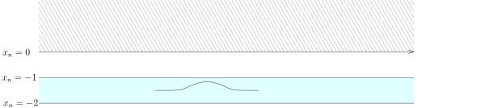

## $H^1$ 的扩张

我们用$\mathbb{H}^n$代表上半空间：
\[
\mathbb{H}^n=\big\{(x',x_n)\in \mathbb{R}^n\bigm| x'=(x_1,\cdots, x_{n-1})\in \mathbb{R}^{n-1}, x_n >0\big\}.
\]

::: lemma [用全空间上的连续函数逼近上半空间上的$H^1$函数]
对任意的$u\in H^1(\mathbb{H}^n)$，存在$\{\varphi_k\}_{k\geqslant 1}\subset C^\infty(\mathbb{R}^n)$，
使得

- 1\) 对任意的$k\geqslant 1$，$\varphi_k\big|_{\mathbb{H}^n}\in H^1(\mathbb{H}^n)$；

- 2\) $u$可以被$\varphi_k\big|_{\mathbb{H}^n}$逼近：
  \[
  \lim_{k \rightarrow \infty} \left\|\varphi_k\big|_{\mathbb{H}^n}-u\right\|_{H^1(\mathbb{H}^n)}=0.
  \]

:::

::: proof
我们首先把$u$延拓成为$\mathbb{R}^n$上的平方可积函数：
\[
\widetilde{u}(x)=\begin{cases}u(x), \ \ & x_n>0;\\
0, \ \ & x_n\leqslant 0.\end{cases}
\]
我们再把$\partial_j u$延拓成为$\mathbb{R}^n$上的平方可积函数，其中$j\leqslant n$：
\[
\widetilde{\partial_j u}(x)=\begin{cases}\partial_j u(x), \ \ & x_n>0;\\
0, \ \ & x_n\leqslant 0.\end{cases}
\]
现在选取截断函数$\chi$使得
$\operatorname{supp}(\chi)\subset \big\{(x',x_n)\big| -2\leqslant x_n \leqslant -1\big\}$并且
$\displaystyle\int_{\mathbb{R}^n}\chi(x) dx=1$（这个积分的条件保证了各种卷积的收敛性）。

对任意的$\varepsilon>0$，令
\[
\chi_\varepsilon(x)=\frac{1}{\varepsilon^n}\chi\left(\frac{x}{\varepsilon}\right).
\]
我们定义
\[
\varphi_\varepsilon(x)=\chi_\varepsilon * \widetilde{u}.
\]
那么，对任意的$j\leqslant n$，我们有
\[
\left(\partial_j\varphi_\varepsilon\right)(x)=\left(\chi_\varepsilon * \left(\partial_j\widetilde{u}\right)\right)(x)=\int_{\mathbb{R}^n}\chi_\varepsilon(x-y) \partial_j\widetilde{u}(y)dy.
\]
当$x\in \mathbb{H}^n$时，即$x_n>0$时，
上面的积分中由于$ -2\varepsilon<x_n-y_n<-\varepsilon$（否则贡献为$0$），所以，
\[
y_n>x_n+\varepsilon.
\]
这表明积分项中我们可以只考虑$y_n>0$的情况。此时，我们有
\[
\left(\partial_j\varphi_\varepsilon\right)(x)=\int_{\mathbb{R}^n}\chi_\varepsilon(x-y) \widetilde{\partial_j u}(y)dy=\left(\chi_\varepsilon *  \widetilde{\partial_j u}\right)(x).
\]
由于
\[
\begin{aligned}
\varphi_\varepsilon&=\chi_\varepsilon * \widetilde{u}\stackrel{L^2(\mathbb{R}^n)}{\longrightarrow} \widetilde{u}, \\
\partial_j\varphi_\varepsilon&=\chi_\varepsilon * \widetilde{\partial_j u}\stackrel{L^2(\mathbb{R}^n)}{\longrightarrow} \widetilde{\partial_j u},
\end{aligned}
\]
所以，限制到$\mathbb{H}^n$上，我们就有
\[
\varphi_\varepsilon\big|_{\mathbb{H}^n} \stackrel{L^2(\mathbb{H}^n)}{\longrightarrow} u, \ \ \partial_j\varphi_\varepsilon\big|_{\mathbb{H}^n}\stackrel{L^2(\mathbb{R}^n)}{\longrightarrow}  \partial_j u.
\]
这就给出了证明。
:::

我们现在再证明一个$H^1$的函数从$\mathbb{H}$到$\mathbb{R}^n$的扩张定理：
\[
\begin{tikzcd}
H^1\left(\mathbb{H}^n\right)\ar[r,"\rm Ext_{_{\rm Sym}}",hook] \ar[dr, "{\rm id} "']
  & H^1\left(\mathbb{R}^n\right)\ar[d,"{\rm Res}",dashed]  \\
  &H^1\left(\mathbb{H}^n\right)\end{tikzcd}
\]

::: lemma [从$H^1(\mathbb{H}^n)$到$H^1(\mathbb{R}^n)$扩张]
限制映射
\[
{\rm Res}\colon H^1\left(\mathbb{R}^n\right)\rightarrow H^1\left(\mathbb{H}^n\right)
\]
是连续的满的线性映射并且存在连续线性的扩张映射
\[
{\rm Ext_{_{\rm Sym}}}\colon H^1\left(\mathbb{H}^n\right)\rightarrow H^1\left(\mathbb{R}^n\right)
\]
使得
\[
{\rm Res} \circ{\rm Ext_{_{\rm Sym}}}={\rm id}_{H^1(\mathbb{H}^n)}.
\]
:::

为了证明这个命题，我们将Stokes公式略加推广：假设$\Omega$是一个有界带边光滑区域，
$\nu(x)=(\nu_1(x),\cdots,\nu_n(x))$为$\partial \Omega$的单位外法向量，
$d\sigma$为$\partial \Omega$上的曲面测度，作为分布，我们有等式
\[
\partial_k \mathbf{1}_\Omega \stackrel{\mathcal{D}'(\mathbb{R}^n)}{=} -\nu_k d\sigma,
\]
其中$k\leqslant n$。

::: proposition [跳跃公式]
假设$\Omega\subset \mathbb{R}^n$是一个有界带边光滑区域，$\nu(x)$为$\partial \Omega$的单位外法向量，
$d\sigma$为$\partial \Omega$上的曲面测度。
假设$f\in C^\infty ({\mathbb{R}^n})$（只要在$\Omega$的一个邻域上定义即可）并且对某个
$k_0\leqslant n$，我们有$\partial_{k_0}f \in L^1_{\rm loc}$。那么，在分布的意义下，我们有
\[
\partial_{k_0} \left(f \cdot \mathbf{1}_\Omega \right) \stackrel{\mathcal{D}'(\mathbb{R}^n)}{=}\left(\partial_{k_0}f\right) \cdot \mathbf{1}_\Omega -\left(\nu_{k_0}\cdot  f\right) d\sigma.
\]
:::

::: proof
定理的证明是一系列逼近的过程。
首先，我们选取$\psi\in C^\infty_0(\mathbb{R}^n)$，
使得$\psi\big|_{\Omega_\delta}\equiv 1$（$\Omega_\delta$是到$\Omega$的距离小于$\delta$
的点所组成的集合），我们再令$g=\psi \cdot f$，这是一个连续函数，我们首先说明，
在$L^1(\mathbb{R}^n)$中，有
\[
\partial_{k_0}g \stackrel{L^1(\mathbb{R}^n)}{=}f \partial_{k_0}\psi +\psi\partial_{k_0} f.
\]
实际上，左右两边的项都落在$L^1(\mathbb{R}^n)$，所以只要在分布的意义下验证上述式子即可，这是平凡的。

根据上面的公式，在$\Omega$上，我们有
\[
f\equiv g, \ \ \partial_{k_0}f \cdot \mathbf{1}_{\Omega}\equiv \partial_{k_0}g \cdot \mathbf{1}_{\Omega},
\]
所以只要对$g$证明跳跃公式即可。

我们用$g_\varepsilon=\chi_\varepsilon * g$来逼近$g$，其中$\chi_\varepsilon$是最常用的单位逼近，
此时，由于$g$是连续有紧支集的函数，所以，$g_\varepsilon$一致地收敛到$g$。
由于$g_\varepsilon$是光滑的，所以，根据Stokes公式，
我们很容易得到（把$g_{\varepsilon}$放到分布配对的右边直接验证即可）：
\[
\begin{aligned}\partial_{k_0} \left(g_\varepsilon \cdot \mathbf{1}_\Omega \right) &\stackrel{\mathcal{D}'(\mathbb{R}^n)}{=}\left(\partial_{k_0}g_\varepsilon\right) \cdot \mathbf{1}_\Omega -\left(\nu_{k_0}\cdot  g_\varepsilon\right) d\sigma.
\end{aligned}
\]
根据$g_\varepsilon$一致地收敛到$g$，我们有
\[
g_\varepsilon \cdot \mathbf{1}_\Omega   \stackrel{\mathcal{D}'(\mathbb{R}^n)}{\longrightarrow} g \cdot \mathbf{1}_\Omega , \ \  \left(\nu_{k_0}\cdot  g_\varepsilon\right) d\sigma \stackrel{\mathcal{D}'(\mathbb{R}^n)}{\longrightarrow}\left(\nu_{k_0}\cdot  g\right) d\sigma,
\]
所以，
\[
\partial_{k_0}  g_\varepsilon \cdot \mathbf{1}_\Omega   \stackrel{\mathcal{D}'(\mathbb{R}^n)}{\longrightarrow} \partial_{k_0} g \cdot \mathbf{1}_\Omega , \ \  \left(\nu_{k_0}\cdot  g_\varepsilon\right) d\sigma \stackrel{\mathcal{D}'(\mathbb{R}^n)}{\longrightarrow}\left(\nu_{k_0}\cdot  g\right) d\sigma,
\]
只要证明上面等式中右边第一项收敛即可，实际上，我们只要证明下面的等式即可：
\[
\partial_{k_0}g_\varepsilon  \stackrel{L^1(\mathbb{R}^n)}{\longrightarrow} \partial_{k_0} g.
\]
这是因为
\[
\partial_{k_0}g_\varepsilon =\left(\partial_{k_0}g\right)*\chi_\varepsilon,
\]
而与$\chi_\varepsilon$卷积在$L^1$中是收敛的。
:::

::: proof [扩张引理的证明]
限制映射的连续性是显然的。

先假设$u$是$\mathbb{R}^n$上的一个光滑函数$F$的限制（根据上一个引理，
这样的函数在$H^1(\mathbb{H}^n)$里面是稠密的）：$u=F\big|_{\mathbb{H}^n}$。利用对称扩张，我们现在构造
\[
{\rm Ext_{_{\rm Sym}}}\colon C^\infty\left(\mathbb{R}^n\right)\cap H^1\left(\mathbb{H}^n\right)\rightarrow H^1\left(\mathbb{R}^n\right),  \ \ u \mapsto  \widetilde{u}(x',x_n)=\begin{cases}u(x',x_n), \ &x_n\geqslant 0;\\
u(x',-x_n), \ &x_n\leqslant 0.\end{cases}
\]
我们注意到$\widetilde{u}$是连续映射并且：

- $\widetilde{u}\big|_{x_n\geqslant 0}$是光滑函数$F(x',x_n)$的限制；

- $\widetilde{u}\big|_{x_n\leqslant 0}$是光滑函数$F(x',-x_n)$的限制；

特别地，上面这两个限制都将满足跳跃公式中的要求。
那么，
\[
{\rm Res} \circ{\rm Ext_{_{\rm Sym}}}={\rm id}_{H^1(\mathbb{H}^n)},
\]
明显成立。特别地，如果${\rm Ext_{_{\rm Sym}}}$是连续映射，这个等式表明限制映射${\rm Res}$是满射。

我们下面证明${\rm Ext_{_{\rm Sym}}}$是连续线性映射。

此时，根据跳跃公式，我们显然有
\[
\partial_k \left({\rm Ext_{_{\rm Sym}}}(u)\right) = {\rm Ext_{_{\rm Sym}}}\left(\partial_k u\right), \ \  k=1,2,\cdots,n-1.
\]
我们现在计算$\partial_n \left({\rm Ext_{_{\rm Sym}}}(u)\right)$：
\[
\begin{aligned}
\partial_n \left({\rm Ext_{_{\rm Sym}}}(u)\right)&=\partial_n \left(\widetilde{u}(x',x_n)\mathbf{1}_{x_n>0}+\widetilde{u}(x',-x_n)\mathbf{1}_{x_n<0}\right)\\
&=\left(\partial_n F(x',x_n)\mathbf{1}_{x_n>0}+Fdx'\right)-\left(\partial_n F(x',-x_n)\mathbf{1}_{x_n>0}+Fdx'\right)\\
&=\left(\mathbf{1}_{x_n>0}-\mathbf{1}_{x_n<0}\right)\left({\rm Ext_{_{\rm Sym}}}(\partial_n u)\right).
\end{aligned}
\]
综合上面的两个等式，我们自然有
\[
\|{\rm Ext_{_{\rm Sym}}}(u)\|_{H^1(\mathbb{R}^n)}\leqslant \sqrt{2}\|u\|_{H^1(\mathbb{H}^n)}.
\]
由于$C^\infty(\mathbb{R}^n)\cap H^1(\mathbb{H}^n)$在$H^1(\mathbb{H}^n)$是稠密的，

\[
\begin{tikzcd}
C^\infty\left(\mathbb{R}^n\right)\cap H^1\left(\mathbb{H}^n\right)\arrow[r,"\iota",hook] \arrow[dr, "{\rm Ext}_{_{\rm Sym}} "swap]
  & H^1\left(\mathbb{H}^n\right)\arrow[d,"{\rm Ext}_{_{\rm Sym}}",dashed]  \arrow[dd,bend left=75, "{\rm id}"]\\
&H^1\left(\mathbb{R}^n\right) \arrow[d,"{\rm Res}"]\\
&H^1\left(\mathbb{H}^n\right)\end{tikzcd}
\]
所以上面${\rm Ext_{_{\rm Sym}}}$可以被延拓成$H^1(\mathbb{H}^n)$的连续线性映射。证毕。
:::

## $H^1$ 的限制

我们下面要定义到边界上的限制映射
\[
{\rm Res}\colon H^1(\mathbb{H}^n)\rightarrow H^\frac{1}{2}\left(\partial (\mathbb{H}^n)\right).
\]
由于$H^1(\mathbb{H}^n)$中的函数在边界$\partial \mathbb{H}^n$（由$x_n=0$所定义）上就没有定义，所以，
如何正确地写下这个映射需要一些仔细的论证。

实际上，对于每一个$u\in H^1(\mathbb{H}^n)$，按照上面的扩张定理，我们可以找到它在全空间上的扩张
\[
{\rm Ext_{_{\rm Sym}}}(u)\in H^1(\mathbb{R}^n),
\]
所以，我们可以定义
\[
{\rm Res}(u)={\rm Ext_{_{\rm Sym}}}(u)\big|_{x_n=0}.
\]
我们注意到，尽管我们在定义中要求${\rm Ext_{_{\rm Sym}}}(u)(x',0)=0$，但是，
${\rm Ext_{_{\rm Sym}}}(u)\big|_{x_n=0}$未必是$0$。
当然，这样的定义也带来了其他的疑问：我们的扩张映射是人为选取的（用对称的方法），如果换一个扩张，
那么得到的结论可能不一样。

我们还有另外一种定义限制映射的方式：直观上，对于$t>0$，我们应该不难定义
\[
{\rm Res}(u)= u\big|_{x_n=t}\in H^1(\mathbb{R}^{n-1}).
\]
这样，我们得到了映射
\[
\mathbb{R}_{t>0}\rightarrow H^1(\mathbb{R}^{n-1}),  \ \ t\mapsto u\big|_{x_n=t},
\]
如果我们可以说明这个映射对$t$是连续的，那么，我们希望能用下面的极限定义限制映射：
\[
{\rm Res}(u)\stackrel{H^1(\mathbb{R}^{n-1})}{=} \lim_{t\rightarrow 0^+}u \big|_{x_n=t}.
\]
我们将看到，
这两种途径在一定意义上是一致的（第二种途径显然不依赖于扩张的选取而第一种途径更容易计算）。

我们定义如下的空间：
\[
C^0_b\left(\mathbb{R},H^{s}(\mathbb{R}^{n-1})\right)=\big\{u\colon \mathbb{R}\rightarrow H^{s}(\mathbb{R}^{n-1}) \text{ 连续}\bigm| \text{对任意 $t\in \mathbb{R}$，存在 $M$，使得 $\|u(t)\|_{ H^{s}(\mathbb{R}^{n-1})}<M$}\big\}.
\]
这里，由于$H^{s}(\mathbb{R}^{n-1})$是（完备）距离空间，
这里连续性指的就是两个距离空间之间的连续映射。

我们还可以在$C^0_b\left(\mathbb{R},H^{s}(\mathbb{R}^{n-1})\right)$上定义如下的范数，其中，
对任意的$u\in C^0_b\left(\mathbb{R},H^{s}(\mathbb{R}^{n-1})\right)$，我们令
\[
{\left\vert\kern-0.25ex\left\vert\kern-0.25ex\left\vert u \right\vert\kern-0.25ex\right\vert\kern-0.25ex\right\vert}_s =\sup_{t\in R}\|u(t)\|_{ H^{s}(\mathbb{R}^{n-1})}.
\]
在这个范数下，
我们得到了一个完备的赋范线性空间
$\left(C^0_b\left(\mathbb{R},H^{s}(\mathbb{R}^{n-1})\right),{\left\vert\kern-0.25ex\left\vert\kern-0.25ex\left\vert \cdot \right\vert\kern-0.25ex\right\vert\kern-0.25ex\right\vert}_s\right)$。
实际上，
这是如下抽象结论的推论（取
$X=H^{s}(\mathbb{R}^{n-1})$）（这就是一年级关于有界闭区间上连续函数空间是完备的简单推广）：

::: lemma
假设$(X,\|\cdot\|)$是完备的赋范线性空间，我们定义
\[
C^0_b\left(\mathbb{R},X\right)=\big\{u\colon \mathbb{R}\rightarrow X\text{ 连续}\bigm| \text{对任意 $t\in \mathbb{R}$，存在 $M$，使得 $\|u(t)\|<M$}\big\}.
\]
我们在$C^0_b\left(\mathbb{R},X\right)$上定义范数：
\[
{\left\vert\kern-0.25ex\left\vert\kern-0.25ex\left\vert u \right\vert\kern-0.25ex\right\vert\kern-0.25ex\right\vert} =\sup_{t\in R}\|u(t)\|_{X},
\]
其中$u\in C^0_b\left(\mathbb{R},X\right)$，那么，
$\left(C^0_b\left(\mathbb{R},X\right),{\left\vert\kern-0.25ex\left\vert\kern-0.25ex\left\vert \cdot \right\vert\kern-0.25ex\right\vert\kern-0.25ex\right\vert}\right)$
是完备的赋范线性空间。
:::

::: proof
验证
$\left(C^0_b\left(\mathbb{R},X\right),{\left\vert\kern-0.25ex\left\vert\kern-0.25ex\left\vert \cdot \right\vert\kern-0.25ex\right\vert\kern-0.25ex\right\vert}\right)$
是赋范线性空间是平凡的，我们现在来证明它的完备性。
根据第二学期（五月七日的课）关于完备性的级数判定，
我们任选绝对收敛的级数$\displaystyle \sum_{k=1}^\infty u_k(t)$，其中，对任意的$k\geqslant 1$，
$u_k(t)\in C^0_b\left(\mathbb{R},X\right)$，并且
\[
\sum_{k=1}^\infty {\left\vert\kern-0.25ex\left\vert\kern-0.25ex\left\vert u_k(t) \right\vert\kern-0.25ex\right\vert\kern-0.25ex\right\vert}<\infty,
\]
我们要证明$\displaystyle \sum_{k=1}^\infty u_k(t)$在$C^0_b\left(\mathbb{R},X\right)$收敛即可。

首先，对任意固定的$t_0\in \mathbb{R}$，
按照
${\left\vert\kern-0.25ex\left\vert\kern-0.25ex\left\vert \cdot \right\vert\kern-0.25ex\right\vert\kern-0.25ex\right\vert}$
的定义，我们有
\[
\sum_{k=1}^\infty \|u_k(t_0)\|\leqslant \sum_{k=1}^\infty {\left\vert\kern-0.25ex\left\vert\kern-0.25ex\left\vert u_k \right\vert\kern-0.25ex\right\vert\kern-0.25ex\right\vert},
\]
所以，
\[
u(t_0)=\sum_{k=1}^\infty u_k(t_0)\in X
\]
是良好定义的（用到了$X$的完备性）。

现在证明映射
\[
u\colon\mathbb{R}\rightarrow X, \ \ t\mapsto u(t)
\]
是连续的：实际上，对任意的$t_0, \delta \in R$，我们有
\[
\begin{aligned}
u(t_0+\delta)-u(t_0)&=\sum_{k=1}^\infty \left(u_k(t_0+\delta)-u_k(t_0)\right)\\
&=\underbrace{\sum_{k=1}^N \left(u_k(t_0+\delta)-u_k(t_0)\right)}_{\text{对 $\delta\rightarrow 0$ 是连续的}}+\underbrace{\sum_{k\geqslant N+1}^\infty\left(u_k(t_0+\delta)-u_k(t_0)\right)}_{\displaystyle\|\cdot\|\leqslant 2\sum_{k\geqslant N+1} {\left\vert\kern-0.25ex\left\vert\kern-0.25ex\left\vert u_k \right\vert\kern-0.25ex\right\vert\kern-0.25ex\right\vert}}.
\end{aligned}
\]
对任意的$\varepsilon>0$，利用级数$\displaystyle \sum_{k=1}^\infty u_k$的一致收敛性，存在$N$，使得
\[
\sum_{k\geqslant N+1} {\left\vert\kern-0.25ex\left\vert\kern-0.25ex\left\vert u_k \right\vert\kern-0.25ex\right\vert\kern-0.25ex\right\vert}<\frac{\varepsilon}{4}.
\]
固定这个$N$。
利用$u_k(t)$在$t_0$处的连续性，存在$\delta_0>0$，使得当$|\delta|<\delta_0$时，对每个$k\leqslant N$，
我们有
\[
\|u_k(t_0+\delta)-u_k(t_0)\|<\frac{\varepsilon}{2N}.
\]
据此，对任意的$\varepsilon>0$，存在$\delta_0>0$，使得当$|\delta|<\delta_0$时，我们有
\[
\begin{aligned}
\|u(t_0+\delta)-u(t_0)\|<N \times \frac{\varepsilon}{2N}+2\times \frac{\varepsilon}{4}=\varepsilon.
\end{aligned}
\]
这就证明了$u(t)$的连续性。很明显，对任意的$t$，我们还有
\[
\|u(t)\|\leqslant  \sum_{k=1}^\infty {\left\vert\kern-0.25ex\left\vert\kern-0.25ex\left\vert u_k \right\vert\kern-0.25ex\right\vert\kern-0.25ex\right\vert}.
\]
从而，$u(t)\in C_b^0(X)$。

最终，我们还要说明部分和的收敛：
\[
\lim_{N\rightarrow \infty}{\left\vert\kern-0.25ex\left\vert\kern-0.25ex\left\vert u(t)-\sum_{k=1}^N u_k(t) \right\vert\kern-0.25ex\right\vert\kern-0.25ex\right\vert}=0.
\]
这是因为对于每个$t$，我们有一致的上界：
\[
\left\|u(t)-\sum_{k=1}^N u_k(t)\right\|=\left\|\sum_{k\geqslant N+1} u_k(t)\right\|\leqslant \sum_{k\geqslant N+1} {\left\vert\kern-0.25ex\left\vert\kern-0.25ex\left\vert u_k \right\vert\kern-0.25ex\right\vert\kern-0.25ex\right\vert}.
\]
命题得证。
:::

我们下面说明$C^0_b\left(\mathbb{R},H^{s}(\mathbb{R}^{n-1})\right)$中元素可以被视作是缓增的分布，
实际上，我们有嵌入
\[
C^0_b\left(\mathbb{R},H^{s}(\mathbb{R}^{n-1})\right)\hookrightarrow \mathcal{S}'(\mathbb{R}^n).
\]
首先，对任意的$u\in C^0_b\left(\mathbb{R},H^{s}(\mathbb{R}^{n-1})\right)$，
对任意的$\varphi \in \mathcal{D}(\mathbb{R}^{n-1}\times \mathbb{R})$，我们定义
\[
\langle u,\varphi\rangle =\int_{\mathbb{R}} \langle u(x_n), \varphi(\cdot,x_n)\rangle dx_n.
\]
根据$H^s$与$H^{-s}$之间的对偶性，我们有
\[
\begin{aligned}
\left|\langle u,\varphi\rangle\right| \leqslant \int_{\mathbb{R}} \|u(x_n)\|_{H^{s}(\mathbb{R}^{n-1})}\|\varphi(x',x_n)\|_{H^{-s}(\mathbb{R}_{x'}^{n-1})} dx_n.
\end{aligned}
\]
此时，我们知道
\[
\|\varphi(x',x_n)\|_{H^{-s}(\mathbb{R}_{x'}^{n-1})}\leqslant \frac{1}{x_n^2+1}N_{\left\lfloor {-s} \right\rfloor+2n+4}(\varphi).
\]
所以，
\[
\begin{aligned}
\left|\langle u,\varphi\rangle\right| \leqslant \int_{\mathbb{R}} {\left\vert\kern-0.25ex\left\vert\kern-0.25ex\left\vert u(x_n) \right\vert\kern-0.25ex\right\vert\kern-0.25ex\right\vert}_s   \frac{1}{x_n^2+1} N_{\left\lfloor {-s} \right\rfloor+2n+4}(\varphi) dx_n=C{\left\vert\kern-0.25ex\left\vert\kern-0.25ex\left\vert u(x_n) \right\vert\kern-0.25ex\right\vert\kern-0.25ex\right\vert}_s  N_{\left\lfloor {-s} \right\rfloor+2n+4}(\varphi).
\end{aligned}
\]
这说明上述定义的配对$\langle u,\varphi\rangle$不仅是分布还是缓增的分布。

下面证明，$C^0_b\left(\mathbb{R},H^{s}(\mathbb{R}^{n-1})\right)$中元素到缓增分布的映射是嵌入，
即给定$u\in C^0_b\left(\mathbb{R},H^{s}(\mathbb{R}^{n-1})\right)$，
如果对任意的$\varphi\in \mathcal{D}(\mathbb{R}^n)$，我们都有$\langle u,\varphi\rangle=0$，那么，
对任意的$x_n\in \mathbb{R}$，$u(x',x_n)\stackrel{H^{s}(\mathbb{R}^{n-1})}{=}0$。
我们选取$\varphi$形如
\[
0=\varphi(x',x_n)=\psi(x')\phi(x_n),  \ \ \psi(x')\in \mathcal{D}(\mathbb{R}^{n-1}), \  \phi(x_n)\in \mathcal{D}(\mathbb{R}).
\]
所以，
\[
\langle u,\varphi\rangle =\int_{\mathbb{R}} \langle u(x_n), \psi\rangle\phi(x_n) dx_n.
\]
另外，根据
\[
\left| \langle u(x_n), \psi\rangle\right|\leqslant  \|u(x_n)\|_{H^{s}(\mathbb{R}^{n-1})}\|\psi(x')\|_{H^{-s}(\mathbb{R}_{x'}^{n-1})}
\]
所以，$ \langle u(x_n), \psi\rangle$是$x_n$的有界函数（从而局部上是可积的）。
由于这个函数和任意的$\phi(x_n)$配对积分得$0$，所以，
对任意的$\psi(x')\in \mathcal{D}(\mathbb{R}^{n-1})$，有
\[
\langle u(x_n), \psi\rangle \stackrel{L^1_{\rm loc}}{=}0.
\]
所以，对几乎处处的$x_n\in \mathbb{R}$，我们有
\[
u(x_n)\stackrel{\mathcal{D}'}{=}0.
\]
从而，对几乎处处的$x_n\in \mathbb{R}$，我们有
\[
u(x_n)\stackrel{H^{s}(\mathbb{R}^{n-1})}{=}0.
\]
再利用$u$对$x_n$的连续性，
我们就证明了$u\stackrel{C^0_b\left(\mathbb{R},H^{s}(\mathbb{R}^{n-1})\right)}{=}0$。

我们之前已经证明了，对于$n\geqslant 1$，$s>\dfrac{1}{2}$，
通过对$\mathcal{S}(\mathbb{R}^n)$上定义的函数进行扩张，我们可以得到有界的限制映射
\[
{\rm Res}\colon H^{s}(\mathbb{R}^n)\longrightarrow H^{s-\frac{1}{2}}(\mathbb{R}^{n-1}_{x_n=0}).
\]
这个证明自然和$x_n=0$的选取没有关系，所以，对任意的$t$，存在一致的常数$C>0$，
对任意的$u \in H^{s}(\mathbb{R}^{n})$，我们有
\[
\|{\rm Res}(u)\|_{H^{s-\frac{1}{2}}(\mathbb{R}^{n-1}_{x_n=t})} \leqslant C \|u\|_{H^{s}(\mathbb{R}^{n})}.
\]
这个${\rm Res}(u)$和$x_n=t$相关，我们把它记做是$u\big|_{x_n=t}$，于是，我们得到了有界的映射
\[
u\colon\mathbb{R}\rightarrow H^{s-\frac{1}{2}}(\mathbb{R}^{n-1}), \ \ t\mapsto u\big|_{x_n=t}.
\]

::: theorem
对任意的$u\in H^s(\mathbb{R}^n)$，映射
\[
u\colon\mathbb{R}\rightarrow H^{s-\frac{1}{2}}(\mathbb{R}^{n-1}), \ \ t\mapsto u\big|_{x_n=t}.
\]
是连续的，换而言之，我们有如下的连续嵌入
\[
\iota\colon H^s(\mathbb{R}^n)\hookrightarrow C^0_b\left(\mathbb{R},H^{s-\frac{1}{2}}(\mathbb{R}^{n-1})\right), u\mapsto \left( t\mapsto u\big|_{x_n=t}\right).
\]
特别地，存在常数$C$，使得对任意的$u \in H^s(\mathbb{R}^n)$，我们有
\[
{\left\vert\kern-0.25ex\left\vert\kern-0.25ex\left\vert \iota(u) \right\vert\kern-0.25ex\right\vert\kern-0.25ex\right\vert}_{s-\frac{1}{2}}\leqslant C \|u\|_{H^s(\mathbb{R}^n)}.
\]
:::

::: proof
根据之前已有的结论，我们只需要证明
\[
u\colon\mathbb{R}\rightarrow H^{s-\frac{1}{2}}(\mathbb{R}^{n-1}), \ \ t\mapsto u\big|_{x_n=t},
\]
对$t$的连续性。仿照之前在$x_n=0$上的限制定理的证明，我们有
（我们可以将下面的计算理解为对Schwartz函数来做的，
一般的情况需要利用逼近来得到，因为这只是例行公事，所以我们不再给出细节）：
\[
\mathcal{F}'(u(x',t))(\xi')=\frac{1}{2\pi}\int_{\mathbb{R}}\widehat{u}(\xi',\tau)e^{it\tau}d\tau,
\]
其中，$\mathcal{F}'$是对前面$n-1$个变量的Fourier变换。所以，
\[
\mathcal{F}'(u)(\xi',t_1)-\mathcal{F}'(u)(\xi',t_2)=\frac{1}{2\pi}\int_{\mathbb{R}}\widehat{u}(\xi',\tau)\left(e^{it_1\tau}-e^{it_2\tau}\right)d\tau.
\]
所以，如果令$\sigma=s-\dfrac{1}{2}$，那么
\[
\begin{aligned}
\|u(x',t_1)-u(x',t_2)\|^2_{H^{s-\frac{1}{2}}(\mathbb{R}^{n-1})}&=\int_{\mathbb{R}^{n-1}}(1+|\xi'|^2)^\sigma \left|\mathcal{F}'(u)(\xi',t_1)-\mathcal{F}'(u)(\xi',t_2)\right|^2d\xi'\\
&=\frac{1}{4\pi^2}\int_{\mathbb{R}^{n-1}}(1+|\xi'|^2)^\sigma \left|\int_{\mathbb{R}}\widehat{u}(\xi',\tau)\left(e^{it_1\tau}-e^{it_2\tau}\right)d\tau\right|^2d\xi'.
\end{aligned}
\]
根据Cauchy–Schwarz不等式，我们有
\[
\begin{aligned}
\left|\int_{\mathbb{R}}\widehat{u}(\xi',\tau)\left(e^{it_1\tau}-e^{it_2\tau}\right)d\tau\right|^2&\leqslant \left(\int_{\mathbb{R}}\frac{\left|e^{it_1\xi_n}-e^{it_2\xi_n}\right|^2}{(1+|\xi|^2)^{s}} d\xi_n\right) \left(\int_{\mathbb{R}} (1+|\xi|^2)^{s}\left|\widehat{u}(\xi',\xi_n)\right|^2d\xi_n\right).
\end{aligned}
\]
在上面计算中，$\xi=(\xi',\xi_n)$中的$\xi'$是固定的。从而，
\[
\begin{aligned}
\int_{\mathbb{R}}\frac{\left|e^{it_1\xi_n}-e^{it_2\xi_n}\right|^2}{(1+|\xi|^2)^{s}} d\xi_n&=\int_{\mathbb{R}}\frac{\left|e^{it_1\xi_n}-e^{it_2\xi_n}\right|^2}{(1+|\xi'|^2+\xi_n^2)^{s}} d\xi_n\\
&=\frac{1}{(1+|\xi'|^2)^{s-\frac{1}{2}}}\int_{\mathbb{R}}\frac{\left|e^{it_1\sqrt{1+|\xi'|^2} \cdot \frac{\xi_n}{\sqrt{1+|\xi'|^2}}}-e^{it_2\sqrt{1+|\xi'|^2}\cdot \frac{d\xi_n}{\sqrt{1+|\xi'|^2}}}\right|^2}{\left(1+\left(\frac{\xi_n}{\sqrt{1+|\xi'|^2}}\right)^2\right)^{s}} \cdot \frac{d\xi_n}{\sqrt{1+|\xi'|^2}}\\
&=\frac{1}{(1+|\xi'|^2)^{s-\frac{1}{2}}}\underbrace{\int_{\mathbb{R}}\frac{\left|e^{it_1\sqrt{1+|\xi'|^2}y }-e^{it_2\sqrt{1+|\xi'|^2}y}\right|^2}{\left(1+|y|^2\right)^{s}}dy}_{I(\xi;t_1,t_2)}.
\end{aligned}
\]
所以，
\[
\begin{aligned}
\|u(x',t_1)-u(x',t_2)\|^2_{H^{s-\frac{1}{2}}(\mathbb{R}^{n-1})}&\leqslant \frac{1}{4\pi^2}\int_{\mathbb{R}^{n-1}}I(\xi;t_1,t_2) \int_{\mathbb{R}} (1+|\xi|^2)^{s}\left|\widehat{u}(\xi',\xi_n)\right|^2d\xi_nd\xi'\\
&=\frac{1}{4\pi^2}\int_{\mathbb{R}^{n}}I(\xi;t_1,t_2) (1+|\xi|^2)^{s}\left|\widehat{u}(\xi)\right|^2 d\xi.
\end{aligned}
\]
我们注意到，按照定义，
\[
I(\xi;t_1,t_2)\leqslant \int_{\mathbb{R}}\frac{4}{\left(1+|y|^2\right)^{s}}dy=4C_s.
\]
是一致有界的（对$t_1,t_2$而言），所以，根据Lebesgue控制收敛定理，当$t_2\rightarrow t_1$时，
对任意的$\xi \in \mathbb{R}^n$，我们都有
\[
\lim_{t_2\rightarrow t_1}I(\xi;t_1,t_2)=0.
\]
再根据
\[
\begin{aligned}
\|u(x',t_1)-u(x',t_2)\|^2_{H^{s-\frac{1}{2}}(\mathbb{R}^{n-1})}&=\frac{1}{4\pi^2}\int_{\mathbb{R}^{n}}I(\xi;t_1,t_2) (1+|\xi|^2)^{s}\left|\widehat{u}(\xi)\right|^2 d\xi.
\end{aligned}
\]
由于$I(\xi;t_1,t_2) \leqslant 4C_s$，所以右边是一个可积函数（因为$u\in H^s(\mathbb{R}^n)$），
由于$\displaystyle \lim_{t_2\rightarrow t_1}I(\xi;t_1,t_2)=0$，再次利用Lebesgue控制收敛定理，
上面不等式的右边就趋向于$0$。这就完成了连续性的证明。
:::

我们现在可以完整地陈述并证明如下的限制性定理
\[
{\rm Res}\colon H^1(\mathbb{H}^n)\rightarrow H^\frac{1}{2}\left(\partial (\mathbb{H}^n)\right).
\]
我们提过，由于$H^1(\mathbb{H}^n)$中的函数在边界$\partial \mathbb{H}^n$上就没有定义，
这个映射有时候（在英文和法文的文献中总是）被称作是**迹映射**，
迹大约代表的是从$x_n>0$上面取极限所留下的痕迹。

为了定义$u\in H^1(\mathbb{H}^n)$在$x_n=0$上的迹，
根据扩张定理，我们选取$u$在全空间上的扩张
\[
{\rm Ext_{_{\rm Sym}}}(u)\in H^1(\mathbb{R}^n),
\]
所以，我们令
\[
{\rm Res}(u)={\rm Ext_{_{\rm Sym}}}(u)\big|_{x_n=0}.
\]
根据我们证明的连续性，我们自然有
\[
{\rm Res}(u)=\lim_{t\rightarrow 0^+}{\rm Ext_{_{\rm Sym}}}(u)\big|_{x_n=t}.
\]
如果我们能说明，当$t>0$时，
\[
{\rm Ext_{_{\rm Sym}}}(u)\big|_{x_n=t}=u\big|_{x_n=t},
\]
那么，我们就有
\[
{\rm Res}(u)=\lim_{t\rightarrow 0^+}u\big|_{x_n=t}.
\]
这就给出了${\rm Res}(u)$的定义，而且，这个定义不依赖于扩张的选取。

最终，为了说明当$t>0$时，我们有
\[
{\rm Ext_{_{\rm Sym}}}(u)\big|_{x_n=t}=u\big|_{x_n=t},
\]
我们注意到这个等式对于满足$u=U\big|_{\mathbb{H}^n}$是成立的，其中$U\in C^\infty(\mathbb{R}^n)$。
由于这样的函数在$H^1(\mathbb{H}^n)$中是稠密的并且要证明的等式对于$u\in H^1(\mathbb{H}^n)$
也是连续的，所以根据连续性，这个等式对于所有$u\in H^1(\mathbb{H}^n)$成立。

::: theorem
迹映射
\[
{\rm Res}\colon H^1(\mathbb{H}^n)\rightarrow H^\frac{1}{2}\left(\partial (\mathbb{H}^n)\right),
\]
是连续线性映射。进一步，我们有正合列
\[
0\rightarrow H_0^1(\mathbb{H}^n)\stackrel{\iota}{\longrightarrow}H^1(\mathbb{H}^n)\stackrel{{\rm Res}}{\longrightarrow} H^\frac{1}{2}\left(\partial (\mathbb{H}^n)\right)\rightarrow 0,
\]
也就是说${\rm Res}$是满射并且对任意的$u\in H^1(\mathbb{H}^n)$，
${\rm Res}(u)=0$当且仅当$u\in H_0^1(\mathbb{H}^n)$。
:::

::: proof
首先证明${\rm Res}$的连续性。实际上，根据
\[
{\rm Res}(u)=\lim_{t\rightarrow 0^+}u\big|_{x_n=t},
\]
我们知道
\[
\|{\rm Res}(u)\|_{H^{\frac{1}{2}}(\mathbb{R}^{n-1})}\leqslant C \lim_{t\rightarrow 0^+}\|u\big|_{x_n=t}\|_{H^\frac{1}{2}(\mathbb{R}^{n-1})}=C \|u\|_{H^1(\mathbb{R}^n)}.
\]
下面上面的序列是正合的：我们注意到$\iota$显然是单射；另外，如果$u\in H^1_0(\mathbb{H}^n)$，那么，
它可以被$C_0^\infty(\mathbb{H}^n)$中的函数逼近，这些函数的迹显然是$0$，所以，
利用${\rm Res}$的连续性，我们就知道${\rm Res}\big|_{ H^1_0(\mathbb{H}^n)}\equiv 0$。

下面假设${\rm Res}(u)\stackrel{H^{\frac{1}{2}}(\mathbb{R}^{n-1})}{=}0$，
其中$u\in H^1(\mathbb{H}^n)$，我们来说明$u\in H_0^1(\mathbb{H}^n)$。
这一部分的证明并不容易，我们分成两步来完成。

第一步，构造$\underline{u}$如下：
\[
\underline{u}(x)=\begin{cases}u(x',x_n), \ \ & x_n>0;\\
0, \ \ & x_n\leqslant 0.
\end{cases}
\]
最重要的观察是
\[
{\rm Res}(u) =\lim_{t\rightarrow 0^+} u\big|_{x_n=t}\stackrel{H^{\frac{1}{2}}(\mathbb{R}^{n-1})}{=}0
\]
意味着
\[
\underline{u}(\cdot, x_n)\in C_b^0(\mathbb{R}, H^{\frac{1}{2}}(\mathbb{R}^{n-1})).
\]
我们声明，$\underline{u}\in H^1(\mathbb{R}^n)$并且对任意的$k\leqslant n$，我们有
\[
\partial_k \underline{u}=\partial_k u \cdot \mathbf{1}_{x_n> 0}.
\]
实际上，我们选取一个截断函数$a(x)$使得对任意的$x\in \mathbb{R}$，$0\leqslant a(x)\leqslant 1$；
如果$x\geqslant 2$，那么$a(x)\equiv 1$；如果$x\leqslant 1$，那么$a(x)\equiv 0$。

为了计算$\partial_k \underline{u}$，我们任选试验函数$\varphi\in \mathcal{D}(\mathbb{R}^n)$，此时，
我们有
\[
\begin{aligned}
\langle \partial_k \underline{u}, \varphi\rangle&=-\langle \underline{u},  \partial_k\varphi\rangle=-\int_{\mathbb{R}^n} \underline{u}(x)\partial_k\varphi(x)dx\\
&=-\lim_{\varepsilon\rightarrow 0}\int_{\mathbb{R}^n} \underbrace{\underline{u}(x)a\left(\frac{x_n}{\varepsilon}\right)}_{{\rm support} \ \subset \mathbb{H}^n}\partial_k\varphi(x)dx\\
&=-\lim_{\varepsilon\rightarrow 0}\int_{\mathbb{H}^n}  u(x)a\left(\frac{x_n}{\varepsilon}\right) \partial_k\varphi(x)dx\\
&=    \lim_{\varepsilon\rightarrow 0}\int_{\mathbb{H}^n}  \partial_k u(x) a\left(\frac{x_n}{\varepsilon}\right)\varphi(x)dx+\lim_{\varepsilon\rightarrow 0}\int_{\mathbb{H}^n}  u(x) \frac{1}{\varepsilon}a'\left(\frac{x_n}{\varepsilon}\right)\delta_{k}^n\varphi(x)dx.
\end{aligned}
\]
根据Lebesgue控制收敛定理，我们有
\[
\lim_{\varepsilon\rightarrow 0}\int_{\mathbb{H}^n}  \partial_k u(x) a\left(\frac{x_n}{\varepsilon}\right)\varphi(x)dx=\int_{\mathbb{H}^n}  \partial_k u(x) \varphi(x)dx=\langle \partial_k u \cdot \mathbf{1}_{x_n> 0},\varphi\rangle.
\]
我们需要证明第二个极限消失：
\[
\begin{aligned}
\left|\int_{\mathbb{H}^n}  u(x) \frac{1}{\varepsilon}a'\left(\frac{x_n}{\varepsilon}\right)\delta_{k}^n\varphi(x)dx\right|
&=\left|\int_{\varepsilon}^{2\varepsilon}\int_{\mathbb{R}^{n-1}}  u(x',x_n) \frac{1}{\varepsilon}a'\left(\frac{x_n}{\varepsilon}\right)\delta_{k}^n\varphi(x',x_n)dx\right|\\
&\leqslant \frac{1}{\varepsilon}\int_{\varepsilon}^{2\varepsilon} \underbrace{ \left|a'\left(\frac{x_n}{\varepsilon}\right)\right|}_{O(1)}\underbrace{\|u(x',x_n)\|_{H^{\frac{1}{2}}}}_{o(1), \ \ \varepsilon \rightarrow 0}\underbrace{\| \varphi(x',x_n)\|_{H^{-\frac{1}{2}}}}_{O(1)}dx'dx_n\\
&= o(1).
\end{aligned}
\]
这里，我们用到了${\rm Res}(u)=0$的条件。这就完成了第一步的证明。

第二步，对任意的$\delta>0$，我们定义
\[
\underline{u}_\delta(x)=\underline{u}(x',x_n-\delta).
\]
很容易证明，在$H^1(\mathbb{R}^n)$中，我们有
\[
\underline{u}_\delta(x)\stackrel{H^1(\mathbb{R}^n)}{\longrightarrow}\underline{u}(x).
\]
所以，
\[
v_\delta(x)=\underline{u}_\delta(x)\big|_{\mathbb{H}^n}\stackrel{H^1(\mathbb{R}^n)}{\longrightarrow}\underline{u}(x)\big|_{\mathbb{H}^n}=u(x).
\]
按照定义，我们有
\[
{v}_\delta(x)=\begin{cases}u(x',x_n-\delta), \ \ & x_n>\delta;\\
0, \ \ & x_n\leqslant \delta.
\end{cases}
\]
所以，只要证明$v_\delta \in H^1_0(\mathbb{H}^n)$即可，其中，$\delta>0$是固定的。
为此，我们先选取$\{\varphi_p\}_{p\geqslant 1}\subset C_0^\infty(\mathbb{R}^n)$，使得
\[
\varphi_p \stackrel{H^1}{\longrightarrow} \underline{u}_\delta, \ \ p\rightarrow \infty.
\]
我们考虑
\[
\widetilde{\varphi}_p(x)=a\left(\frac{2x_n}{\delta}\right)\varphi_p(x).
\]
很显然，我们有
\[
\widetilde{\varphi}_p \stackrel{L^2(\mathbb{R}^n)}{\longrightarrow} \underline{u}_\delta, \ \ p\rightarrow \infty.
\]
由于
\[
\partial_k\widetilde{\varphi}_p=a\left(\frac{2x_n}{\delta}\right)\partial_k \varphi_p(x)+\delta_{k}^n a'\left(\frac{2x_n}{\delta}\right)\varphi_p(x),
\]
所以，
\[
\partial_k\widetilde{\varphi}_p\rightarrow a\left(\frac{2x_n}{\delta}\right)\partial_k \underline{u}_\delta(x)+\delta_{k}^n a'\left(\frac{2x_n}{\delta}\right)\underline{u}_\delta(x),
\]
后一项的为$0$因为
${\rm supp} \left(a'\left(\dfrac{2x_n}{\delta}\right)\right)\cap {\rm supp}(\underline{u}_\delta)=\emptyset$。
所以，
\[
\widetilde{\varphi}_p \stackrel{H^1(\mathbb{R}^n)}{\longrightarrow} \underline{u}_\delta, \ \ p\rightarrow \infty.
\]
从而，（看支集）
\[
H^1_0(\mathbb{H}^n)\supset \widetilde{\varphi}_p \stackrel{H^1(\mathbb{H}^n)}{\longrightarrow} v_\delta, \ \ p\rightarrow \infty.
\]
这就说明了${\rm Res}(u)=0$当且仅当$u\in H_0^1(\mathbb{H}^n)$。

最终，我们还需要证明迹映射
\[
{\rm Res}\colon H^1(\mathbb{H}^n)\twoheadrightarrow H^\frac{1}{2}\left(\partial (\mathbb{H}^n)\right)
\]
是满射。实际上，我们已经证明了
\[
{\rm Res}\colon H^1(\mathbb{R}^n)\twoheadrightarrow H^\frac{1}{2}\left(\partial (\mathbb{H}^n)\right)
\]
是满射。
所以，对任意的$v\in H^\frac{1}{2}\left(\partial (\mathbb{H}^n)\right)$，
我们选取$u\in H^1(\mathbb{H}^n)$为它的一个原像，
那么$u\big|_{\mathbb{H}^{n}}$就是$v$在$ H^1(\mathbb{H}^n)$中的一个原像。

综合上述，命题得证。
:::

## 高阶推广

类似的定理对于更高的正则性$H^k$也成立，其中$k\geqslant 2$。我们回忆一下证明的要点：

- 限制映射（连续线性，满射）：
  \[
  {\rm Res}\colon H^{s}(\mathbb{R}^n)\twoheadrightarrow H^{s-\frac{1}{2}}(\mathbb{R}^{n-1})
  \]
  对所有的正则性$s>\dfrac{1}{2}$都成立。

- 用全空间上的连续函数逼近上半空间上的$H^1$函数的引理：对任意的$u\in H^1(\mathbb{H}^n)$，
  存在$\{\varphi_k\}_{k\geqslant 1}\subset C^\infty(\mathbb{R}^n)$，使得

  - 1\) 对任意的$k\geqslant 1$，$\varphi_k\big|_{\mathbb{H}^n}\in H^1(\mathbb{H}^n)$；

  - 2\) $u$可以被$\varphi_k\big|_{\mathbb{H}^n}$逼近：
    \[
    \lim_{k \rightarrow \infty} \left\|\varphi_k\big|_{\mathbb{H}^n}-u\right\|_{H^1(\mathbb{H}^n)}=0.
    \]

  这个引理的证明对于任意的$u\in H^k(\mathbb{H}^n)$是一样的（同学们可以自行验证细节）。所以，我们说
  \[
  H^k(\mathbb{H}^n)\cap C^\infty(\mathbb{R}^n) \subset H^k(\mathbb{H}^n)
  \]
  是稠密的。

- 关于$H^k$的函数从$\mathbb{H}$到$\mathbb{R}^n$的扩张定理，其中$k\geqslant 1$。

  在$k=1$时，我们用了对称的延拓$\rm Ext_{_{\rm Sym}}$。
  \[
  \begin{tikzcd}
  H^1\left(\mathbb{H}^n\right)\ar[r,"\rm Ext_{_{\rm Sym}}",hook] \ar[dr, "{\rm id} "']
    & H^1\left(\mathbb{R}^n\right)\ar[d,"{\rm Res}"']  \\
    &H^1\left(\mathbb{H}^n\right)\end{tikzcd}
  \]
  我们的证明是假设$u$是$\mathbb{R}^n$上的一个光滑函数$F$的限制（一般情况逼近即可）：
  $u=F\big|_{\mathbb{H}^n}$。所谓的对称延拓是：
  \[
  {\rm Ext_{_{\rm Sym}}}\colon C^\infty\left(\mathbb{R}^n\right)\cap H^1\left(\mathbb{H}^n\right)\rightarrow H^1\left(\mathbb{H}^n\right),  \ \ u \mapsto  \widetilde{u}(x',x_n)=\begin{cases}u(x',x_n), \ &x_n\geqslant 0;\\
  u(x',-x_n), \ &x_n\leqslant 0.\end{cases}
  \]
  为了计算它的导数，我们需要验证跳跃公式中的要求，其中，$\widetilde{u}$在$x_n=0$处的连续性是重要的。
  根据跳跃公式，我们证明了
  \[
  \partial_j \left({\rm Ext_{_{\rm Sym}}}(u)\right) = {\rm Ext_{_{\rm Sym}}}\left(\partial_k u\right), \ \  k=1,2,\cdots,n-1.
  \]
  并且
  \[
  \partial_n \left({\rm Ext_{_{\rm Sym}}}(u)\right)=\left(\mathbf{1}_{x_n>0}-\mathbf{1}_{x_n<0}\right)\left({\rm Ext_{_{\rm Sym}}}(\partial_n u)\right).
  \]
  从而，我们有
  \[
  \|{\rm Ext_{_{\rm Sym}}}(u)\|_{H^1(\mathbb{R}^n)}\leqslant \sqrt{2}\|u\|_{H^1(\mathbb{H}^n)}.
  \]
  由于$C^\infty(\mathbb{R}^n)\cap H^1(\mathbb{H}^n)$在$H^1(\mathbb{H}^n)$是稠密的，

  然而，我们观察到
  \[
  \partial_n \left({\rm Ext_{_{\rm Sym}}}(u)\right)=\left(\mathbf{1}_{x_n>0}-\mathbf{1}_{x_n<0}\right)\left({\rm Ext_{_{\rm Sym}}}(\partial_n u)\right)
  \]
  在$x_n=0$处并不连续，所以，如果要对$H^k$的函数做同样的延拓，那么，在继续进行第二次求导数的时候，
  跳跃公式已经不再适用。所以，我们需要适当地修改延拓方式。不管怎么样，如下的定理是成立的：

::: lemma [从$H^k(\mathbb{H})$到$H^k(\mathbb{R}^n)$扩张]
假设$k\geqslant 1$是整数，那么
限制映射
\[
{\rm Res}\colon H^k\left(\mathbb{R}^n\right)\rightarrow H^k\left(\mathbb{H}^n\right)
\]
是连续的满的线性映射并且存在连续线性的扩张映射
\[
{\rm Ext}\colon H^k\left(\mathbb{R}^n\right)\rightarrow H^k\left(\mathbb{H}^n\right)
\]
使得
\[
{\rm Res} \circ{\rm Ext}={\rm id}_{H^k(\mathbb{H}^n)}.
\]
:::

::: proof
我们构造一种延拓方式：假设$u$是$\mathbb{R}^n$上光滑函数的限制
\[
{\rm Ext}\colon C^\infty\left(\mathbb{R}^n\right)\cap H^1\left(\mathbb{H}^n\right)\rightarrow H^1\left(\mathbb{H}^n\right),  \ \ u \mapsto  \widetilde{u}(x',x_n)=\begin{cases}u(x',x_n), \ &x_n\geqslant 0;\\
\displaystyle\sum_{0\leqslant j\leqslant k-1}a_ju(x',-b_jx_n), \ &x_n < 0.\end{cases}
\]
在这个表达式中，我们要求$0<b_1<b_2<\cdots<b_k$是任意给定的正实数，
$\{a_j\}_{0\leqslant j \leqslant k}$目前待定。

此时，对关于前面$n-1$个分量的任意多重指标$\alpha'$，我们都有
\[
\partial_{x'}^{\alpha'}\widetilde{u}(x',x_n)=\begin{cases}\partial_{x'}^{\alpha'}u(x',x_n), \ &x_n\geqslant 0;\\
\displaystyle\sum_{0\leqslant j\leqslant k-1}a_j  \partial_{x'}^{\alpha'}u(x',-b_jx_n), \ &x_n < 0.\end{cases}
\]
再对$x_n$分量求$\ell$次导数（后面的证明我们来验证这一点），我们就得到
\[
\partial_{x_n}^\ell\partial_{x'}^{\alpha'}\widetilde{u}(x',x_n)=\begin{cases}\partial_{x_n}^\ell\partial_{x'}^{\alpha'}u(x',x_n), \ &x_n\geqslant 0;\\
\displaystyle\sum_{0\leqslant j\leqslant k-1}a_j(-b_j)^\ell  \partial_{x_n}^\ell\partial_{x'}^{\alpha'}u(x',-b_jx_n), \ &x_n < 0.\end{cases}
\]
为了保证这个函数在$x_n=0$处是连续的，我们需要
\[
\partial_{x_n}^\ell\partial_{x'}^{\alpha'}u(x',0)=\sum_{0\leqslant j\leqslant k-1}a_j(-b_j)^\ell  \partial_{x_n}^\ell\partial_{x'}^{\alpha'}u(x',0),
\]
即
\[
\sum_{0\leqslant j\leqslant k-1}a_j(-b_j)^\ell  =1.
\]
我们要求上面的等式对$\ell=0,1,\cdots,k-1$都成立，此时，利用Vandermonde行列式，
我们知道存在唯一的$a_0,\cdots, a_{k-1}$使得上面的等式均成立。

此时，对任意的$\alpha'$和$\ell$，只要$0\leqslant \ell \leqslant k-1$，$|\alpha'|+\ell\leqslant k$，
$\partial_{x_n}^\ell\partial_{x'}^{\alpha'}\widetilde{u}(x',x_n)$在$x_n=0$处都是连续的，那么，
我们就可以用跳跃公式求它的导数并且保证它们在边界上的贡献恰好消掉。
我们下面只计算它们对于$\partial_n$方向的导数，其余方向的导数是更加简单的：
\[
\begin{aligned}
&\partial_n\left(\partial_{x_n}^\ell\partial_{x'}^{\alpha'}\widetilde{u}(x',x_n)\right)\\
=&\partial_n\left(\partial_{x_n}^\ell\partial_{x'}^{\alpha'}u(x',x_n) \mathbf{1}_{x_n\geqslant 0}\right)+\partial_n\left(\sum_{0\leqslant j\leqslant k-1}a_j(-b_j)^\ell  \partial_{x_n}^\ell\partial_{x'}^{\alpha'}u(x',-b_jx_n) \mathbf{1}_{x_n< 0}\right)\\
=& \partial_{x_n}^{\ell+1}\partial_{x'}^{\alpha'}u(x',x_n) \mathbf{1}_{x_n\geqslant 0}-\partial_{x_n}^\ell\partial_{x'}^{\alpha'}u(x',0) d\sigma_{x_n=0}\\
& +\sum_{0\leqslant i\leqslant k-1}a_i(-b_i)^{\ell+1}\partial_{x_n}^{\ell+1}\partial_{x'}^{\alpha'}u(x',-b_jx_n) \mathbf{1}_{x_n< 0}+\sum_{0\leqslant i\leqslant k-1}a_i(-b_i)^\ell  \partial_{x_n}^\ell\partial_{x'}^{\alpha'}u(x',0) d\sigma_{x_n=0}\\
=&\partial_{x_n}^{\ell+1}\partial_{x'}^{\alpha'}u(x',x_n) \mathbf{1}_{x_n\geqslant 0}+\sum_{0\leqslant i\leqslant k-1}a_i(-b_i)^{\ell+1}\partial_{x_n}^{\ell+1}\partial_{x'}^{\alpha'}u(x',-b_jx_n) \mathbf{1}_{x_n< 0}.
\end{aligned}
\]
这就给出对所有的$|\alpha'|+\ell\leqslant k$的导数的计算，很明显，
\[
\begin{aligned}
&\left\|\partial_{x_n}^\ell\partial_{x'}^{\alpha'}u(x',x_n) \mathbf{1}_{x_n\geqslant 0}+ \sum_{0\leqslant j\leqslant k-1}a_j(-b_j)^\ell  \partial_{x_n}^\ell\partial_{x'}^{\alpha'}u(x',-b_jx_n) \mathbf{1}_{x_n< 0}\right\|_{L^2(\mathbb{R}^n)}\\
\leqslant& C \left\|\partial_{x_n}^\ell\partial_{x'}^{\alpha'}u(x',x_n) \right\|_{L^2(\mathbb{H}^n)}.\end{aligned}
\]
这就证明了延拓的连续性。
:::

- 基于上面几个引理，我们就可以重复上次的证明来说明对任意的整数$k\geqslant 1$，我们都有如下的正合列：
  \[
  0\rightarrow H_0^k(\mathbb{H}^n)\stackrel{\iota}{\longrightarrow}H^k(\mathbb{H}^n)\stackrel{{\rm Res}}{\longrightarrow} H^{k-\frac{1}{2}}\left(\partial (\mathbb{H}^n)\right)\rightarrow 0.
  \]
