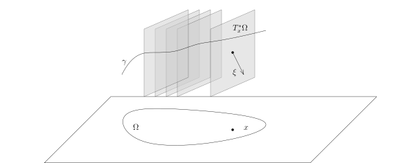
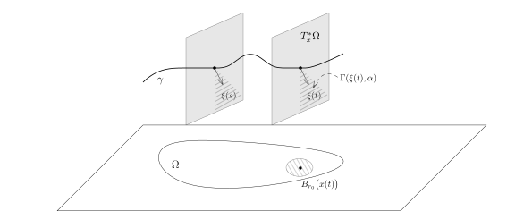

给定区域$\Omega$上的$m$-次微分算子$P$和分布
$u\in \mathcal{D}'(\Omega)$，假设$Pu=f$是光滑的，那么，
\[
WF(u)\subset Z\left(\sigma_m(P)\right),
\]
其中，$Z\left(\sigma_m(P)\right)$是$P$的主象征的零点集。
我们现在要进一步刻画$WF(u)$的几何结构，这就是所谓的奇性传播定理。

我们先引入一些定义：

::: definition
给定区域$\Omega$上的$m$-次微分算子$P$，我们把
\[
{\rm Char}(P):=Z\left(\sigma_m(P)\right)\subset
T^*\Omega=\Omega \times \mathbb{R}^n
\]
称作是$P$的**特征簇**（characteristic variety）。

给定$(x_0,\xi_0)\in {\rm Char}(P)$，
如果$p_m(x,\xi)=\sigma_m(P)$在$(x_0,\xi_0)$的一个邻域上是实值的并且
$\nabla_{x,\xi} p_m(x_0,\xi_0)$与$(\xi_0,0)$是线性无关的，
我们就称${\rm Char}(P)$在$(x_0,\xi_0)$处是**简单的**，
也称$P$在$(x_0,\xi_0)$处具有**简单特征**。

如果$P$在每个${\rm Char}(P)$上的点处都是简单的，
我们就称$P$具有**简单的特征簇**。
:::

::: remark*
假设微分算子$P$具有简单的特征簇，
那么，对每个$(x_0,\xi_0)\in {\rm Char}(P)$，
$p_m(x,\xi)$在$(x_0,\xi_0)$处的微分不是$0$，
这说明${\rm Char}(P)\subset T^*\Omega$是光滑子流形（余维数为$1$）。
:::

::: remark*
之前，我们按照如下的方式定义了主象征：如果
\[
P=\sum_{|\alpha|\leqslant m}p_\alpha(x)\partial^\alpha,
\]
那么，
\[
p_m(x,\xi)=\sigma_{m}(P)(x,\xi)
=\sum_{|\alpha|=m}p_\alpha(x)(-i\xi)^\alpha.
\]
从此之后，因为有上述关于$p_m(x,\xi)$是实值的要求，我们令
\[
p_m(x,\xi)=\sigma_{m}(P)(x,\xi)
=\sum_{|\alpha|=m}p_\alpha(x)(\xi)^\alpha.
\]
这对之前的证明没有影响。
:::

::: definition
给定区域$\Omega$上的$m$-次微分算子$P$，
我们假设它的象征$p_m(x,\xi)$是实数值的函数，
那么如下定义的$T^*\Omega$上的向量场
\[
\mathbf{H}_P=
\left(\frac{\partial p_m}{\partial \xi_1},
\cdots,\frac{\partial p_m}{\partial \xi_n},
-\frac{\partial p_m}{\partial x_1},\cdots,
-\frac{\partial p_m}{\partial x_n} \right)
\]
被称作是$P$所定义的Hamilton向量场。形式上，我们经常把这个向量场写成
\[
\mathbf{H}_P=\left(\frac{\partial p_m}{\partial \xi},
-\frac{\partial p_m}{\partial x} \right).
\]
我们通常把$H(x,\xi)=p_m(x,\xi)$称作是
$T^*\Omega$上的一个**Hamilton作用量**。
:::

假设
\[
\gamma: (-a,b)\rightarrow T^*\Omega
\]
是过$(x_0,\xi_0)\in T^*\Omega$的$\mathbf{H}_p$的一条积分曲线，
其中$a,b>0$。这指的是
\[
\gamma(t)=\big(x_1(t),x_2(t),\cdots,
x_n(t),\xi_1(t),\xi_2(t),\cdots,\xi_n(t)\big)
\]
并且
\[
\begin{cases}
x_1'(t)&=\frac{\partial p_m}{\partial \xi_1}
\big(x_1(t),\cdots,x_n(t),\xi_1(t),\cdots,\xi_n(t)\big),\\
x_2'(t)&=\frac{\partial p_m}{\partial \xi_2}
\big(x_1(t),\cdots,x_n(t),\xi_1(t),\cdots,\xi_n(t)\big),\\
&\cdots \cdots\\
x_n'(t)&=\frac{\partial p_m}{\partial \xi_n}
\big(x_1(t),\cdots,x_n(t),\xi_1(t),\cdots,\xi_n(t)\big),\\
\xi_1'(t)&=-\frac{\partial p_m}{\partial x_1}
\big(x_1(t),\cdots,x_n(t),\xi_1(t),\cdots,\xi_n(t)\big),\\
\xi_2'(t)&=-\frac{\partial p_m}{\partial x_2}
\big(x_1(t),\cdots,x_n(t),\xi_1(t),\cdots,\xi_n(t)\big),\\
&\cdots \cdots\\
\xi_n'(t)&=
-\frac{\partial p_m}{\partial x_n}
\big(x_1(t),\cdots,x_n(t),\xi_1(t),\cdots,\xi_n(t)\big),\\
\gamma(0)&=(x_0,\xi_0).
\end{cases}
\]

在上面这个图中，
我们把每个点$x\in \Omega$处的$\{x\}\times \mathbb{R}^n$
记作是$T^*_x\Omega$。我们经常把这个方程组简写成
\[
\begin{cases}
x'(t)&=\frac{\partial p_m}{\partial \xi}\big(x(t),\xi(t)\big),\\
\xi'(t)&=-\frac{\partial p_m}{\partial x}\big(x(t),\xi(t)\big),\\
\gamma(0)&=(x_0,\xi_0).
\end{cases}
\]
关于Hamilton向量场，我们有如下熟知的性质：

::: lemma
Hamilton作用量$p_m(x,\xi)$沿着$\mathbf{H}_P$的积分曲线是常数，即对任意的$\mathbf{H}_p$的积分曲线
\[
\gamma:(-a,b)\rightarrow T^*\Omega,
\]
我们有
\[
\frac{d}{dt}\left(p_m(x(t),\xi(t))\right)=0.
\]
:::

::: proof
我们只要利用$\gamma$的方程进行计算即可：
\[
\begin{aligned}
\frac{d}{dt}\left(p_m(x(t),\xi(t))\right)&=\frac{\partial p_m}{\partial x}\big(x(t),\xi(t)\big) x'(t)+\frac{\partial p_m}{\partial \xi}\big(x(t),\xi(t)\big) \xi'(t)\\
&=\frac{\partial p_m}{\partial x}\big(x(t),\xi(t)\big) \frac{\partial p_m}{\partial \xi}\big(x(t),\xi(t)\big)+\frac{\partial p_m}{\partial \xi}\big(x(t),\xi(t)\big) \left(-\frac{\partial p_m}{\partial x}\big(x(t),\xi(t)\big)\right)\\
&=0.
\end{aligned}
\]
命题成立。
:::

假设$\gamma$是$\mathbf{H}_P$的一条积分曲线，如果$\gamma\cap {\rm Char}(P)\neq \emptyset$，
根据上面的引理，那么，$p_m$在$\gamma$的每个点上的取值都是$0$，所以，$\gamma\subset {\rm Char}(P)$。

::: definition
我们把落在${\rm Char}(P)$中的$\mathbf{H}_P$的极大的一条积分曲线称作是微分算子$P$
的一条**双特征曲线**（bicharacteristics）。
:::

有了双特征曲线的概念，我们就可以陈述奇性传播定理了：

::: theorem [奇性传播定理]
给定区域$\Omega$上的$m$-次微分算子$P$，我们假设$P$具有简单的特征簇。
如果$\gamma$是$P$的一条双特征曲线并且
\[
\gamma\cap WF\big(Pu\big)=\emptyset,
\]
其中$u\in \mathcal{D}'(\Omega)$是分布，那么如下两种情形必居（且只居）其一：

- $\gamma\subset WF(u)$；

- $\gamma\cap WF(u)=\emptyset.$

:::

::: corollary [奇性传播定理]
算子$P$是区域$\Omega$上的$m$-次微分算子并且具有简单的特征簇，$u\in \mathcal{D}'(\Omega)$是分布。
如果$Pu$是光滑的，那么$WF(u)$是双特征曲线的无交并。
:::

为了证明这个定理，我们先做一番准备。我们定义相函数
\[
\phi(s,x,\xi):\mathbb{R}\times T^*\Omega\rightarrow \mathbb{R}.
\]
这是一个对于$\xi$是$1$次齐次的函数，它由如下的常微分方程所定义：
\[
\begin{cases}
&|\xi|^{m-1}\dfrac{\partial \phi}{\partial s}(s,x,\xi)=-p_m\left(x,\nabla_x\phi(s,x,\xi)\right),\\
&\phi(0,x,\xi)=x\cdot \xi.
\end{cases}
\]
其中，$m$为$P$的次数。特别地，由于$\phi$对于$\xi$的次数为$1$，所以，$\phi$可以被下面的方程刻画：
\[
\begin{cases}
&\dfrac{\partial \phi}{\partial s}(s,x,\xi)=-p_m\left(x,\nabla_x\phi(s,x,\xi)\right),\\
&\phi(0,x,\xi)=x\cdot \xi,
\end{cases}
\]
其中，$\xi\in \mathbf{S}^{n-1}$。这是因为
\[
p_m\left(x,\nabla_x\phi(s,x,\xi)\right)=p_m\left(x,\nabla_x\phi\left(s,x,\frac{\xi}{|\xi|}\right)|\xi|\right)=|\xi|^m p_m\left(x,\nabla_x\phi\left(s,x,\frac{\xi}{|\xi|}\right)\right).
\]

利用相函数$\phi(s,x,\xi)$，我们可以刻画双特征曲线：

::: lemma {@lem:characterization-of-bicharacteristics}
假设$\gamma(t)=\big(x(t),\xi(t)\big)$是$P$的一条双特征曲线，那么，对任意的$t\in\mathbb{R}$，我们有
\[
\xi(t)=\left(\nabla_x \phi\right)(t,x(t),\xi_0),
\]
其中，$\gamma(0)=(x_0,\xi_0)$。
:::

我们定义
\[
\zeta(t)=\left(\nabla_x \phi\right)(t,x(t),\xi_0).
\]
很明显，
\[
\zeta(0)=\nabla_x(x\cdot \xi_0)=\xi_0=\xi(0).
\]
我们将证明，对任意的$t$，我们都有
\[
\xi(t)=\zeta(t).
\]

::: proof
假设$|\xi|=1$，我们考虑$\zeta(t)$所满足的微分方程：
\[
\begin{aligned}
\zeta'(t)&=\dfrac{\partial^2 \phi}{\partial t\partial x}\big(t,x(t),\xi_0\big)+\dfrac{\partial^2 \phi}{\partial x^2}\big(t,x(t),\xi_0\big)x'(t).
\end{aligned}
\]
利用方程，我们有
\[
\dfrac{\partial^2 \phi}{\partial t\partial x}\big(t,x(t),\xi_0\big)=-\frac{\partial p_m}{\partial x}\left(x,\frac{\partial \phi}{\partial x}(t,x(t),\xi_0)\right)-\frac{\partial p_m}{\partial \xi}\left(x,\frac{\partial \phi}{\partial x}(t,x(t),\xi_0)\right)\frac{\partial^2 \phi}{\partial x^2} \left(t,x(t),\xi_0\right).
\]
所以，
\[
\begin{aligned}
\zeta'(t)&=-\frac{\partial p_m}{\partial x}\left(x(t),\zeta(t)\right)+\underbrace{\frac{\partial^2 \phi}{\partial x^2} \left(t,x(t),\xi_0\right)\cdot\left[x'(t)-\frac{\partial p_m}{\partial \xi}\left(x(t),\zeta(t)\right)\right]}_{\text{矩阵乘法}}\end{aligned}
\]
另外，根据定义，我们还有
\[
\begin{cases}
x'(t)&=\dfrac{\partial p_m}{\partial \xi}\left(x(t),\xi(t)\right),\\
\xi'(t)&=-\dfrac{\partial p_m}{\partial x}\left(x(t),\xi(t)\right).
\end{cases}.
\]
所以，
\[
\begin{aligned}
\zeta'(t)-\xi'(t)&=-\left[\frac{\partial p_m}{\partial x}\left(x(t),\zeta(t)\right)-\frac{\partial p_m}{\partial x}\left(x(t),\xi(t)\right)\right]\\
& \ \ \ -\frac{\partial^2 \phi}{\partial x^2} \left(t,x(t),\xi_0\right)\cdot\left[\frac{\partial p_m}{\partial \xi}\left(x(t),\zeta(t)\right)-\frac{\partial p_m}{\partial \xi}\left(x(t),\xi(t)\right)\right].
\end{aligned}
\]
根据Lagrange中值定理（我们用到了$p_m$是光滑函数并且其导数在$\gamma$附近是有界的），我们就有
\[
\begin{aligned}
|\zeta'(t)-\xi'(t)|&\leqslant C|\zeta(t)-\xi(t)|.
\end{aligned}
\]
由于
\[
|\zeta(t)-\xi(t)|\Big|_{t=0}=0,
\]
上面的微分不等式表明
\[
\zeta(t)\equiv \xi(t).
\]
命题得证。
:::

利用微分方程的解对初始值的光滑依赖性以及紧性，我们有如下的推论：

::: corollary {@lem:172}
我们考虑一段双特征曲线
\[
\gamma:[0,t_0]\rightarrow T^*\Omega.
\]
对任意给定$\alpha_0>0$，存在$r_0>0$和$\beta>0$，使得对任意的$t\in [0,t_0]$，
对任意的$(x,\xi)\in B_{r_0}\big(x(t)\big)\times \Gamma\big(\xi(t),\beta\big)$，我们都有
\[
\frac{\partial \phi}{\partial x}(t,x,\xi) \in  \Gamma\big(\xi(t),\alpha_0\big).
\]
:::

::: proof
对任意的$t\in [0,t_0]$，根据 @lem:characterization-of-bicharacteristics，
上述关系对于$(x(t),\xi(t))\in B_{r_0}\big(x(t)\big)\times \Gamma\big(\xi(t),\beta\big)$成立，
利用连续性，就对$B_{r_0}\big(x(t)\big)\times \Gamma\big(\xi(t),\beta\big)$中所有的点都成立。
由于所有可能的$t$所给出的$\big\{B_{r_0}\big(x(t)\big)\times \Gamma\big(\xi(t),\beta\big)\big\}$是
$\gamma$的开覆盖，利用紧性，我们就得到了结论。
:::

## 奇性传播定理的证明：条件

我们首先把条件
\[
\gamma\cap WF\big(Pu\big)=\emptyset,
\]
用分析的语言写清楚。

对任意的$t\leqslant t_0$，$\gamma(t)=\big(x(t),\xi(t))\notin WF(Pu)$，从而，
存在$\psi_0(x) \in C_0^\infty(\Omega)$，$\alpha(t)>0$，
使得$\psi_0$在$x(t)$附近恒为$1$并且对任意的$N>0$，存在$C_N$，
对任意的$\xi \in \Gamma(\xi(t),2\alpha(t))$，我们有
\[
\left|\widehat{\psi_0\cdot Pu}(\xi)\right|\leqslant \frac{C_N}{(1+|\xi|)^N}.
\]
所以，对任意的$\varphi\in C^\infty_{0}(B_{r(t)}(x(t)))$（半径$r(t)$很小），
其中$\psi_0\big|_{B_{r(t)}(x(t))}\neq 0$，对任意的$\xi \in \Gamma(\xi(t),\alpha(t))$，我们有
\[
\begin{aligned}
\left|\widehat{\varphi\cdot Pu}(\xi)\right|&=\left|\mathcal{F}\left(\varphi \cdot \psi_0 Pu\right)(\xi)\right|\\
&\leqslant \frac{C'_N}{(1+|\xi|)^N}\sup_{|\mu|\leqslant M(N)}\|\partial^\mu\varphi\|_{L^\infty}.
\end{aligned}
\]
最后的一步，我们用了 @lem:156，其中，$M(N)$是依赖于$N$的常数。
当$t$遍历$[0,t_0]$时（我们可以假设$t_0=1$），
我们知道$B_{r(t)}(x(t))\times \Gamma(\xi(t),\alpha(t))$覆盖了$\gamma([0,1])$，所以，
我们可以选出有限个$t_1,\cdots,t_l$，使得
\[
\gamma \subset \bigcup_{j\leqslant l}B_{r(t_j)}(x(t_j))\times \Gamma(\xi(t_j),\alpha(t_j)):=\Gamma(\gamma).
\]
所以，存在$r_0>0$和$\alpha_0>0$，对任意的$t\in [0,1]$，
$B_{r_0}(x(t))\times \Gamma(\xi(t),\alpha_0)\subset \Gamma(\gamma)$。
特别地，根据Lebesgue数的存在性（第一学期第11次课），对任意的$t$，
$B_{r_0}(x(t))\times \Gamma(\xi(t),\alpha_0)\\xi \in  \Gamma(\xi(t),\alpha_0)$必然落在某个
$B_{r(t_j)}(x(t_j))\times \Gamma(\xi(t_j),\alpha(t_j))$中（这里我们可以先在
$\Omega \times \mathbf{S}^{n-1}$这个紧集上考虑）。
通过选取最小的$C_N$和最大的$M(N)$，我们就得到了如下的结论：

::: lemma
存在$r_0>0$和$\alpha_0>0$，对任意的$t\in [0,1]$，使得对任意的$N>0$，存在常数$C_N$和$M_N$，
使得对任意的$\varphi \in C^\infty_0\big(B_{r_0}(x(t))\big)$，
对任意的$\xi \in \Gamma(\xi(t),\alpha_0)$，我们有
\[
\left|\widehat{\varphi\cdot Pu}(\xi)\right|\leqslant \frac{C_N}{(1+|\xi|)^N}\sup_{|\mu|\leqslant M_N}\|\partial^\mu\varphi\|_{L^\infty}.
\]
:::

我们不妨假设$\gamma(1)\notin WF(u)$，我们只要说明在另一个端点处$\gamma(0)\notin WF(u)$即可。
我们先在翻译$\gamma(1)\notin WF(u)$这个条件：存在$r_1>0$和$\alpha_1>0$，对任意的$N>0$，
存在常数$C_N$和$M_N$，使得对任意的$\varphi \in C^\infty_0\big(B_{r_1}(x(1))\big)$，
对任意的$\xi \in \Gamma(\xi(1),\alpha_1)$，我们有
\[
\left|\widehat{\varphi\cdot u}(\xi)\right|\leqslant \frac{C_N}{(1+|\xi|)^N}\sup_{|\mu|\leqslant M_N}\|\partial^\mu\varphi\|_{L^\infty}.
\]

作为总结（缩小$r_0$和$r_1$等），我们把奇性传播定理的条件总结如下：

存在$r_0>0$和$\alpha_0>0$，对任意的$t\in [0,1]$，使得对任意的$N>0$，存在常数$C_N$和$M_N$，使得

- 对任意的$\varphi \in C^\infty_0\big(B_{r_0}(x(t))\big)$，
  对任意的$\xi \in \Gamma(\xi(t),\alpha_0)$，我们有
  \[
  \left|\widehat{\varphi\cdot Pu}(\xi)\right|\leqslant \frac{C_N}{(1+|\xi|)^N}\sup_{|\mu|\leqslant M_N}\|\partial^\mu\varphi\|_{L^\infty}.
  \]

- 对任意的$\varphi \in C^\infty_0\big(B_{r_0}(x(1))\big)$，
  对任意的$\xi \in \Gamma(\xi(1),\alpha_0)$，我们有
  \[
  \left|\widehat{\varphi\cdot u}(\xi)\right|\leqslant \frac{C_N}{(1+|\xi|)^N}\sup_{|\mu|\leqslant M_N}\|\partial^\mu\varphi\|_{L^\infty}.
  \]

## 奇性传播定理的证明：拟解的构造

我们需要计算如下形式的导数：
\[
-e^{i\phi}
\left(|\xi|^{m-1}i
\frac{\partial}{\partial t}+{}^tP\right)
\left(e^{-i\phi} c\right)
\]
假设$c(t,x,\xi)$是阶为$d$，
那么，我们要将上面的式子写成三个部分，
第一个部分的阶为$d+m$，第二个部分的阶为$d+m-1$，
第三个部分的阶$\leqslant d+m-2$。

我们令$Q={}^tP$，那么
\[
\begin{aligned}
Qf&={}^tP f=\sum_{|\alpha|\leqslant m}q_\alpha(x)
\partial^\alpha f(x)\\
&=\sum_{|\alpha|\leqslant m}(-1)^\alpha
\partial^\alpha\big(p_\alpha(x) \cdot f(x)\big).
\end{aligned}
\]
利用归纳法，我们不难证明，对任意的多重指标$\mu$，我们有
\[
e^{i\phi}\partial^\mu\left(e^{-i\phi}\right)
=\sum_{\mu_1+\cdots+\mu_l=\mu, \atop \\
|\mu_1|\geqslant 1, \cdots,  |\mu_l|\geqslant 1}(-1)^l \partial^{\mu_1}\phi\cdot\partial^{\mu_2}\phi\cdots \partial^{\mu_l}\phi.
\]
所以，
\[
\begin{aligned}
e^{i\phi} {}^tP \left(e^{-i\phi} c\right)&
=e^{i\phi}\sum_{|\alpha|\leqslant m}q_\alpha(x)
\partial^\alpha\left( e^{-i\phi} c\right)\\
&=\sum_{|\alpha|\leqslant m}\sum_{\mu\leqslant \alpha}
{\alpha \choose \mu}q_\alpha(x) e^{i\phi}
\partial^\mu\left( e^{-i\phi} \right) \partial^{\alpha-\mu}c\\
&=\sum_{|\alpha|\leqslant m}\sum_{\mu\leqslant \alpha}\sum_{\mu_1+\cdots+\mu_l=\mu, |\mu_j|\geqslant 1} (-1)^l{\alpha \choose \mu}q_\alpha(x) \left(\partial^{\mu_1}\phi\cdots \partial^{\mu_l}\phi\right)\partial^{\alpha-\mu}c.
\end{aligned}
\]
在这个表达式中，每个$\partial^{\mu_j}\phi(t,x,\xi)$对于$\xi$都是$1$次的，所以，
上面所出现的关于$\xi$的最高阶项是$d+m$阶的，最低阶项是$d$阶的。
我们下面将对不同的阶数进行合并同类项。

- $d+m$阶项。

  此时，我们必须有$l=|\mu|=|\alpha|=m$，所以，这些项为
  \[
  \begin{aligned}
  &\sum_{|\alpha|= m} (-1)^m \sum_{\mu_1+\cdots+\mu_m=\alpha} q_\alpha(x) \left(\partial^{\mu_1}\phi\cdots \partial^{\mu_l}\phi\right)c\\
  =&\sum_{|\alpha|= m} (-1)^m q_\alpha(x) \left(\frac{\partial \phi}{\partial x}\right)^\alpha c(t,x,\xi)\\
  =&\sum_{|\alpha|= m} (-1)^m q_\alpha(x) \left(\frac{\partial \phi}{\partial x}\right)^\alpha c(t,x,\xi)\\
  =&p_m\left(x,\frac{\partial \phi}{\partial x}\right)\cdot c(t,x,\xi).
  \end{aligned}
  \]

- $d+m-1$阶项。

  此时，我们必须有$l=m-1$。所以，$|\mu|\geqslant m-1$。

  - 如果$|\mu|=m$，此时，$|\alpha|=m$，所以，这些项为
    \[
    \begin{aligned}
    &\sum_{|\mu|= m}\sum_{\mu_1+\cdots+\mu_{m-1}=\mu} (-1)^{m-1} q_\mu(x) \left(\partial^{\mu_1}\phi\cdots \partial^{\mu_l}\phi\right) c\\
    =&M_{\phi,P}\cdot c(t,x,\xi).
    \end{aligned}
    \]
    这里，
    \[
    M_{\phi,P}(t,x,\xi)=\sum_{|\mu|= m}\sum_{\mu_1+\cdots+\mu_{m-1}=\mu} (-1)^{m-1} q_\mu(x) \left(\partial^{\mu_1}\phi\cdots \partial^{\mu_l}\phi\right)
    \]
    对于$\xi$是一个次数为$m-1$的齐次函数，它的构造只依赖于$\phi$和$p_m$（主象征！）。

  - 如果$|\mu|=m-1$。
    我们定义多重指标$\delta_j=(0,\cdots,0,1,0,\cdots,0)$，其中只有在第$j$个位置是$1$。这些项为
    \[
    \begin{aligned}
    &\sum_{|\alpha|\leqslant m}\sum_{\mu\leqslant \alpha, |\mu|=m-1}(-1)^{m-1}{\alpha \choose \mu}q_\alpha(x) \left(\frac{\partial \phi}{\partial x}\right)^\mu \partial^{\alpha-\mu}c.
    \end{aligned}
    \]
    如果$|\alpha|=m-1$，这一类的项可以合并到上面的一项中（此时，
    我们要对$M_{\phi,P}(t,x,\xi)$进行修正，它的构造变得依赖于$\phi$和$P$）。
    所以，除去这些项之外，此时没有处理的项形如
    \[
    \begin{aligned}
    &\sum_{|\alpha|=m}\sum_{j=1}^n (-1)^{m-1}{\alpha \choose \alpha-\delta_j}q_\alpha(x) \left(\frac{\partial \phi}{\partial x}\right)^{\alpha-\delta_j} \partial^{\delta_j}c\\
    =&i\sum_{j=1}^n\frac{\partial p_m}{\partial \xi_j}\left(x,\frac{\partial \phi}{\partial x}\right)\frac{\partial c}{\partial x_j}.
    \end{aligned}
    \]

综上所述，我们就有
\[
e^{i\phi} {}^tP \left(e^{-i\phi} c\right)
=\underbrace{p_m\left(x,\frac{\partial \phi}{\partial x}\right)\cdot c}_{\text{$d+m$次}}+\underbrace{M_{\phi,P}\cdot c+i\sum_{j=1}^n\frac{\partial p_m}{\partial \xi_j}\left(x,\frac{\partial \phi}{\partial x}\right)\frac{\partial c}{\partial x_j}}_{\text{$d+m-1$次}}+c_{\leqslant d+m-2},
\]
其中，$c_{\leqslant d+m-2}(t,x,\xi)$是一些次数不超过$d+m-2$次的齐次函数的（有限）线性组合。

利用这个公式，我们就有
\[
\begin{aligned}
&-e^{i\phi}\left(|\xi|^{m-1}i\frac{\partial}{\partial t}+{}^tP\right)\left(e^{-i\phi} c\right)\\
=&-|\xi|^{m-1}i\frac{\partial c}{\partial t}-|\xi|^{m-1}\frac{\partial \phi}{\partial t}c\\
&- p_m\left(x,\frac{\partial \phi}{\partial x}\right)\cdot c-M_{\phi,P}\cdot c-i\sum_{j=1}^n\frac{\partial p_m}{\partial \xi_j}\left(x,\frac{\partial \phi}{\partial x}\right)\frac{\partial c}{\partial x_j}-c_{\leqslant d+m-2}\\
=&\frac{1}{i}\left(|\xi|^{m-1}{\partial_t}+\sum_{j=1}^n\frac{\partial p_m}{\partial \xi_j}\left(x,\frac{\partial \phi}{\partial x}\right){\partial_{x_j}}\right)c-\underbrace{\left(|\xi|^{m-1}\frac{\partial \phi}{\partial t}+p_m\left(x,\frac{\partial \phi}{\partial x}\right)\right)}_{=0, \ \ \text{根据$\phi$的定义}}c\\
&-M_{\phi,P}\cdot c-c_{\leqslant d+m-2}.
\end{aligned}
\]
所以，
\[
\begin{aligned}
&-e^{i\phi}\left(|\xi|^{m-1}i\frac{\partial}{\partial t}+{}^tP\right)\left(e^{-i\phi} c\right)=\frac{1}{i}L(c)+M_{\phi,P}\cdot c+c_{\leqslant d+m-2},
\end{aligned}
\]
其中，
\[
L=|\xi|^{m-1}{\partial_t}+\sum_{j=1}^n\frac{\partial p_m}{\partial \xi_j}\partial_{x_j}.
\]
作为总结，我们有

::: lemma
假设$c(t,x,\xi)$是关于$\xi$为$d$次齐次的光滑函数，那么，我们有
\[
\begin{aligned}
-e^{i\phi}\left(|\xi|^{m-1}i\frac{\partial}{\partial t}+{}^tP\right)\left(e^{-i\phi} c\right)=\frac{1}{i}L(c)+ \frac{1}{i}M_{\phi,P}\cdot c+c_{\leqslant d+m-2},
\end{aligned}
\]
其中，$L(c)$是$d+m-1$次的，$M_{\phi,P}$是次数为$m-1$的齐次函数（只依赖于$\phi$和$P$）。
:::

::: remark*
我们注意到$\phi$的构造方式恰好消去了上面可能出现的$d+m$次的项。
:::

::: lemma [拟解的构造]
对给定的正数$(r_0,\alpha_0)$，
存在$\rho_0>0$，使得$\rho_0<r_0$并且如下成立：

对任意的$\varphi \in C^\infty_0\big(B_{\rho_0}(x(0))\big)$，
存在函数序列
\[
\{b_k(t,x,\xi)\}_{k\geqslant 0},
\ \{R_k(t,x,\xi)\}_{k\geqslant 0}
\subset C^\infty\left([0,1]\times B(x(t),r_0)\times
\Gamma(\xi(t),\alpha_0)\right),
\]

- $b_k(t,x,\xi)$对于$\xi$是次数为$-k$的齐次函数并且对任意的$t$和$\xi$，如果$x\notin B(x(t),r_0)$，
  那么$b_k(t,x,\xi)=0$；

- $R_k(t,x,\xi)$是有限个次数不超过$m-k-2$的齐次函数（对于$\xi$）的和并且对任意的$t$和$\xi$，
  如果$x\notin B(x(t),r_0)$，那么$R_k(t,x,\xi)=0$；

- 我们令
  \[
  a_k(t,x,\xi)=\sum_{j=1}^k b_j(t,x,\xi).
  \]
  那么，我们有
  \[
  \begin{cases}
  &-i e^{i\phi} |\xi|^{m-1}\dfrac{\partial}{\partial t}
  \left(e^{-i\phi}a_k\right)=e^{i\phi}\cdot {}^tP\left(e^{-i\phi}a_k\right)+R_k,\\
  &a_k(0,x,\xi)=\varphi(x).
  \end{cases}
  \]

:::

::: proof
我们归纳地来构造。先考虑$k=0$的情形。
此时，我们定义$b_0(t,x,\xi)$为如下（常）微分方程的解：
\[
\begin{cases}
&L(b_0)+M_{\phi,P}\cdot b_0=0,\\
&b_0(0,x,\xi)=\varphi(x).
\end{cases}
\]
那么，$b_0$对于$\xi$是$0$次的齐次函数（可以先对$|\xi|=1$来解，然后进行齐次的扩张）。

假设对于$\leqslant k$的指标$j$，我们已经构造了$b_j$，那么，我们考虑
\[
\begin{aligned}
&-i e^{i\phi} |\xi|^{m-1}\dfrac{\partial}{\partial t}
\left(e^{-i\phi}\left(a_k+b_{k+1}\right)\right)
-e^{i\phi}\cdot {}^tP\left(e^{-i\phi}\left(a_k+b_{k+1}\right)\right)\\
=&R_k+\left(L(b_{k+1})+M_{\phi,P}\cdot b_{k+1}\right)+c_{\leq d+m-2}.
\end{aligned}
\]
其中$d$为$b_{k+1}$的次数。

由归纳假设，$R_k$是次数不超过$m-k-2$的齐次函数的线性组合，
我们假设它的$m-k-2$次分量为$R_k^{(m-k-2)}$。那么，我们令
\[
\begin{cases}
&L(b_{k+1})+M_{\phi,P}\cdot b_{k+1}=-R_k^{(m-k-2)},\\
&b_{k+1}(0,x,\xi)=0.
\end{cases}
\]
那么，$d=-(k+1)$，从而$c_{\leq d+m-2}$的次数不超过$m-k-3$。这就完成了证明。
:::

## 奇性传播定理的证明：完成

我们对方程
\[
\dfrac{\partial}{\partial t}\left(e^{-i\phi}a_k\right)=
i  |\xi|^{1-m}\cdot {}^tP\left(e^{-i\phi}a_k\right)
+i  |\xi|^{1-m} e^{-i\phi}R_k
\]
对$t$从$0$到$1$积分，由于$\phi(0,x,\xi)=x\cdot \xi$，我们就得到
\[
\begin{aligned}
e^{-ix\cdot \xi}\varphi(x)&=e^{-i\phi(1,x,\xi)}a_k(1,x,\xi)
- i  |\xi|^{1-m}\int_0^1 {}^tP\left(e^{-i\phi(t,x,\xi)}a_k(t,x,\xi)\right) dt\\
&\ \ \ \ -i  |\xi|^{1-m} \int_0^1 e^{-i\phi(t,x,\xi)}R_k(t,x,\xi)dt.
\end{aligned}
\]
所以，我们有
\[
\begin{aligned}
\widehat{\varphi\cdot u}(\xi)&
=\langle u,e^{-ix\cdot \xi}\varphi(x)\rangle\\
&=\left\langle u,e^{-i\phi(1,x,\xi)}a_k(1,x,\xi)\right\rangle- i  |\xi|^{1-m}\int_0^1 \left\langle u, {}^tP\left(e^{-i\phi(t,x,\xi)}a_k(t,x,\xi)\right) \right\rangle dt\\
&\ \ \ \ -i  |\xi|^{1-m} \int_0^1\left\langle u, e^{-i\phi(t,x,\xi)}R_k(t,x,\xi)\right\rangle dt\\
&=\underbrace{\left\langle u,e^{-i\phi(1,x,\xi)}a_k(1,x,\xi)\right\rangle}_{H(\xi)}- i  |\xi|^{1-m}\int_0^1 \underbrace{\left\langle Pu,  e^{-i\phi(t,x,\xi)}a_k(t,x,\xi)\right\rangle}_{I(\xi,t)} dt\\
&\ \ \ \ -i  |\xi|^{1-m} \int_0^1\underbrace{\left\langle u, e^{-i\phi(t,x,\xi)}R_k(t,x,\xi)\right\rangle}_{J(\xi,t)} dt.
\end{aligned}
\]
我们逐一地控制上面的三项：

- 控制$H(\xi)$。

  首先，由于$a_k(t,x,\xi)$对于$x\notin B(x(t),r_0)$是消失的，所以，
  我们可以用一个示性函数$\chi(x)$来记住这个事实（它在$B(x(1),r_0)$上恒为$1$）：
  \[
  \begin{aligned}
  H(\xi)&=\left\langle u,e^{-i\phi(1,x,\xi)}\chi(x)a_k(1,x,\xi)\right\rangle\\
  &=\int_{\mathbb{R}^n}e^{-i\phi(1,x,\xi)}a_k(1,x,\xi) \chi(x)u(x)dx.
  \end{aligned}
  \]

  我们选取相函数$\phi(1,x,\xi)$，振幅函数$a_k(1,x,\xi)$以及被作用函数$f(x)=\chi\cdot u(x)$，
  我们来验证它们满足非驻相法引理的基本数据的条件：

  (a) $\phi(1,x,\xi)\in C^\infty\left(\mathbb{R}_x^n\times (\mathbb{R}^n_\xi-\{0\})\right)$
      是实值的，变量$\xi$是1次齐次的并且当$\xi\neq 0$时，有$\nabla_x \phi(1,x,\xi)\neq 0$：

      为了说明后者，我们用$\phi(t,x,\xi)$满足的方程：
      \[
      \begin{cases}
      &\dfrac{\partial \phi}{\partial s}(s,x,\xi)=-p_m\left(x,\nabla_x\phi(s,x,\xi)\right),\\
      &\phi(0,x,\xi)=x\cdot \xi,
      \end{cases}
      \]
      其中$|\xi|=1$。对$x$求导数，我们就有
      \[
      \begin{aligned}
      \frac{\partial^2 \phi}{\partial  s\partial x}(s,x,\xi) =-\frac{\partial p_m}{\partial x}(x,\nabla_x\phi(s,x,\xi))-\underbrace{\frac{\partial p_m}{\partial \xi}(x,\nabla_x\phi(s,x,\xi))}_{F(s,x,\xi)}\frac{\partial^2 \phi}{\partial x^2}(s,x,\xi).
      \end{aligned}
      \]
      所以，
      \[
      \begin{aligned}
      \left|\left(\frac{\partial  }{\partial s}+F\frac{\partial }{\partial x}\right)\frac{\partial \phi}{\partial x}\right|=\left|-\frac{\partial p_m}{\partial x}(x,\nabla_x\phi(s,x,\xi))\right|\leqslant C \left|\frac{\partial \phi}{\partial x}\right|^m.\end{aligned}
      \]
      如果$\nabla_x \phi(1,x,\xi)= 0$，上述微分不等式表明$\nabla_x \phi(0,x,\xi)= \xi=0$，矛盾！

      上面的推理对于$t\neq 1$也成立。

  (b) 按照构造，对于任意的$t$，$b_j(t,x,\xi)$光滑，所以$a_k(t,x,\xi)$也光滑。
      另外，$a_k(t,x,\xi)$是一些次数不超过$0$的齐次函数的和，利用紧性，
      使得对任意的多重指标$\alpha$，
      存在常数$C_\alpha$，我们都有
      \[
      \left|\partial^\alpha_x a_k(t,x,\xi)\right|\leqslant C_\alpha.
      \]

  (c) 由于$(x(1),\xi(1))\notin WF(u)$，对任意的$N\geqslant 1$，存在常数$C_N$，
      使得对任意的$\xi \in \Gamma(\xi(1),\beta)$，都有
      我们就有
      \[
      \left|\widehat{f}(\xi)\right|\leqslant \frac{C_{N}}{\left(1+|\xi|\right)^N}.
      \]
      这里，$\eta_0=\dfrac{\xi(1)}{|\xi(1)|}$。

  根据 @lem:172 以及连续性，对任意的$(x,\xi)\in B(x(1),r_0)\times \Gamma(\xi(1),\alpha_0)$，我们有
  \[
  \left|\frac{\nabla_x \phi(x,\xi)}{|\nabla_x \phi(x,\xi)|}-\eta_0\right|<\beta.
  \]
  所以我们可以运用非驻相法引理，从而，

  此时，引理的结论表明，对任意的$N\geqslant 1$，存在$C_N>0$，使得对任意的$\Gamma(\xi(0),\alpha_0)$，
  有
  \[
  \left|H(\xi)\right|\leqslant \frac{C_{N}}{\left(1+|\xi|\right)^N}.
  \]

- 控制$I(\xi,t)$。

  这一部分的控制和$H(\xi)$是完全一致的，唯一的不同在于把$u$换成了$Pu$。
  另外，我们可以对$t$一致地选取$\chi$。
  重复上面的过程，我们就得到对任意的$N\geqslant 1$，存在$C_N>0$，
  使得对任意的$\Gamma(\xi(0),\alpha_0)$，有
  \[
  \left|I(\xi,t)\right|\leqslant \frac{C_{N}}{\left(1+|\xi|\right)^N}.
  \]

- 控制$J(\xi,t)$。

  利用分布的定义，存在常数$C_0$，使得，
  \[
  |J(\xi,t)|\leqslant C\sup_{|\alpha|\leqslant M,\atop \\ x\in B_{r_0}(x(t))}\left|\partial^\alpha\left(e^{-i\phi(t,x,\xi)}R_k(t,x,\xi)\right)\right|.
  \]

  $R_k(t,x,\xi)$是有限个$\xi$的次数$\leqslant m-k-2$的齐次函数的和，所以，
  根据Leibniz法则（以及$\phi$对$\xi$的次数为$1$），
  上面右端出现的是一些次数不超过$m-k-2+M$的齐次函数的和。
  利用$R_k$的光滑性，我们知道存在常数$C_M$，使得
  \[
  \sup_{|\alpha|\leqslant M,\atop \\ (x,\xi)\in  B_{r_0}(x(t))\times \mathbf{S}^{n-1}}|\partial^{\alpha}R_k(t,x,\xi)|\leqslant C_M.
  \]
  所以，
  \[
  |J(\xi,t)|\leqslant \frac{C'_M}{(1+|\xi|)^{k+2-M-m}},
  \]
  其中，$k$是任意的正整数。

综合上面的所有估计，我们就证明了
对任意的$N\geqslant 1$，存在$C_N>0$，使得对任意的$\Gamma(\xi(0),\alpha_0)$，有
\[
\left|\widehat{\varphi\cdot u}(\xi)\right|\leqslant \frac{C_{N}}{\left(1+|\xi|\right)^N}.
\]
这说明$(x_0,\xi_0)\notin WF(u)$，从而完成了奇性传播定理的证明。
