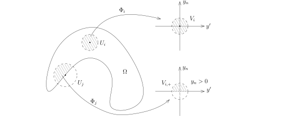

我们现在给出Sobolev函数的局部刻画。
假设$\Omega$是有界光滑带边的区域（$\overline{\Omega}$是紧集），
$\mathcal{U}=\{U_j\}_{j\leqslant N}$是$\overline{\Omega}$的一个开覆盖，
$\{\chi_j\}_{j\leqslant N}$是相应的一族单位分解。

::: proposition
给定$u\in \mathcal{D}'(\Omega)$，那么如下等价：

- 1\) $u\in H^1(\Omega)$；

- 2\) 对任意的$j\leqslant N$，$\chi_j\cdot u \in H^1(\Omega)$。

:::

::: proof
先证明$1)\Rightarrow 2)$：很明显，我们有
\[
\|\chi_j u\|_{L^2}\leqslant C \|u\|_{L^2},
\]
根据分布求导的Leibniz公式，我们有
\[
\|\nabla(\chi_j u)\|_{L^2}=\|(\nabla\chi_j) u+\chi_j \nabla u\|_{L^2}\leqslant C \left(\|u\|_{L^2}+\|\nabla u\|_{L^2}\right).
\]
所以，这个方向是成立的。

再证明$2)\Rightarrow 1)$：由于
\[
u =\sum_{j\leqslant N}\chi_j\cdot u,
\]
是有限个$H^1(\Omega)$中元素的线性组合，所以落在$H^1(\Omega)$中。
:::

::: remark*
这个命题对于空间$H^1_0(\Omega)$也成立：
假设$\{\varphi_p\}_{p\geqslant 1}\subset C_0^\infty(\Omega)$，
使得$\displaystyle \lim_{p\rightarrow \infty}\varphi_p\stackrel{H^1}{=}u$，那么，
\[
\displaystyle \lim_{p\rightarrow \infty}\chi_j \cdot \varphi_p\stackrel{H^1}{=}\chi_j \cdot u.
\]
证明是平凡的。
:::

对于$x\in \overline{\Omega}$，我们选取包含$x$的一个开的小球$U$，这些开集覆盖了$\overline{\Omega}$。
对于$x\in \partial \Omega$，我们要求$U$选取的足够小，使得存在微分同胚
\[
\Phi: U\rightarrow V\subset \mathbb{R}^{n-1}\times \mathbb{R},  \ \ x\mapsto (y',y_n)=(\Phi'(x),\Phi_n(x)),
\]
其中，$V$是$\mathbb{R}^n_y$中的开球，并且

- $\Phi( U\cap \Omega)=V_+=V\cap \{(y',y_n)|y_n> 0\}$；

- $\Phi(x)$的$y_n$坐标是$0$。

此时，$\Phi( U\cap \partial \Omega)\subset \{y_n=0\}$被实现为$\mathbb{R}^{n}$的超平面。

从这些开集中，我们可以选取$\overline{\Omega}$的一个有限开覆盖$\{U_j\}_{j\leqslant N}$，
与之对应的$\Phi$我们记做是$\Phi_j$。
我们注意到，这些$U_j$们分两种，一种是边界点给出的，另一种是内点给出的（与边界不相交）。

利用与$\{U_j\}_{j\leqslant N}$相适应的单位分解$\{\chi_j\}_{j\leqslant N}$，
对任意的$u\in H^1(\Omega)$和$u_0\in H_0^1(\Omega)$，我们知道$\chi_j\cdot u \in H^1(\Omega)$，
$\chi_j\cdot u_0 \in H_0^1(\Omega)$，通过复合，
我们得到了$(\chi_j \cdot u)\circ \Phi_j^{-1}$和$(\chi_j \cdot u_0)\circ \Phi_j^{-1}$，
这都是$V_j$或者$V_{j,+}$上的函数。我们不妨研究$u$和$V_{j,+}$的情形（其余类似）。我们现在来说明
\[
(\chi_j \cdot u)\circ \Phi_j^{-1} \in H^1(V_{j,+}).
\]
以下我们用$U_{j,+}$表示$U_j\cap \Omega$。根据换元积分公式，我们有
\[
\int_{V_{j,+}}\left| (\chi_j \cdot u)\circ \Phi_j^{-1}(y) \right|^2dy=\int_{U_{j,+}}\left| (\chi_j \cdot u)(x) \right|^2|{\rm Jac}(\Phi_j)(x)|dx.
\]
由于上述Jacobi行列式是有界的，所以
\[
\int_{V_{j,+}}\left| (\chi_j \cdot u)\circ \Phi_j^{-1}(y) \right|^2dy\leqslant C \int_{U_{j,+}}\left| (\chi_j \cdot u)(x) \right|^2dx.
\]
另外，根据链式求导公式，我们有
\[
\left|\partial_k\left((\chi_j \cdot u)\circ \Phi_j^{-1}(y) \right)\right| =\left|\sum_{\ell\leqslant n}\partial_\ell (\chi_j \cdot u)\cdot \partial_k\left(\Phi_j^{-1}{}_{\ell}\right)\right|\leqslant C\left|\nabla(\chi_j\cdot u)\right|.
\]
所以，重复上面的计算就知道
\[
\int_{V_{j,+}}\left| \nabla\left((\chi_j \cdot u)\circ \Phi_j^{-1}(y) \right)\right|^2dy\leqslant C \int_{U_{j,+}}\left| \nabla(\chi_j \cdot u)(x) \right|^2dx.
\]
综合上面的不等式，实际上我们证明了
\[
(\chi_j \cdot u)\circ \Phi_j^{-1} \in H^1(V_{j,+}) \ \ \Leftrightarrow \ \ \chi_j \cdot u \in H^1(U_{j,+}).
\]

通过限制，显然有连续线性映射
\[
{\rm Res}:H^1\left(\mathbb{R}^n\right)\rightarrow H^1\left(\Omega\right).
\]
利用上述关于Sobolev函数的局部描述，我们可以构造扩张映射：

::: lemma [从$H^1(\Omega)$到$H^1(\mathbb{R}^n)$扩张]
限制映射
\[
{\rm Res}:H^1\left(\mathbb{R}^n\right)\rightarrow H^1\left(\Omega\right)
\]
是连续的满的线性映射并且存在连续线性的扩张映射
\[
{\rm Ext}:H^1\left(\Omega\right)\rightarrow H^1\left(\mathbb{R}^n\right)
\]
使得
\[
{\rm Res} \circ{\rm Ext}={\rm id}_{H^1(\Omega)}.
\]
:::

::: remark*
上述扩张映射未必是唯一的，它依赖于局部坐标描述的选取等等，请参考证明。
:::

::: proof
我们把上述构造的覆盖$\mathcal{U}=\{U_j\}_{j\leqslant N}$分成两个部分
\[
\mathcal{U}=\mathcal{U}'\cup \mathcal{U}''=\{U'_{j'}\}_{j'\leqslant N'}\cup \{U''_{j''}\}_{j''\leqslant N''}.
\]
其中，$\mathcal{U}'$中的开集和边界不相交，$\mathcal{U}''$中的开集和边界相交。
那么，对任意的$u\in H^1(\Omega)$，我们有
\[
u=\sum_{j'\leqslant N'} \chi'_{j'} u +\sum_{j''\leqslant N''} \chi''_{j''} u.
\]
我们只要能对每个$\chi'_{j'} u$和$\chi''_{j''} u$进行延拓即可。

首先，由于$\chi'_{j'} u$的支集在$\Omega$中，所以我们用$0$进行延拓即可。
下面研究$\chi''_{j''} u$，为了书写简洁，我们仍然用$\chi_{j} u$表示这个函数，那么，
\[
v_j=(\chi_{j} u)\circ \Phi_j^{-1} \in H^1(V_{j,+}).
\]
在构造这些覆盖的时候，我们总是可以要求$V_j$是对称的，即$V_j=V_{j,+}\cup \left(-V_{j,+}\right)$。
对于$v_j$而言，我们可以用之前构造的对称的扩张${\rm Ext}_{_{\rm sym}}(v_j)$。
此时，由于${\rm supp}(v_j)\subset V_{j,+}$，所以，
\[
{\rm supp}\left({\rm Ext}_{_{\rm sym}}(v_j)\right)\subset V_j=\Phi_j(U_j)
\]
并且是$H^1$的函数。
那么，
\[
\widetilde{u_j}=\left({\rm Ext}_{_{\rm sym}}(v_j)\right)\circ \Phi_j^{-1}
\]
是支集在$U_j$中的具有紧支集的$H^1(U_j)$中的函数，我们可以再把它延拓到$\mathbb{R}^n$上去。

由于上述的覆盖是事先选定的，所以，上述构造的算子是线性的（每一步都是确定的）。
:::

作为推论，我们有

::: corollary [用全空间上的光滑函数逼近的$H^1(\Omega)$]
对任意的$u\in H^1(\Omega)$，存在$\{\varphi\}_{k\geqslant 1}\subset C^\infty_0(\mathbb{R}^n)$，
使得$u$可以被$\big\{\varphi_k\big|_{\Omega}\big\}_{k\geqslant 1}$逼近：
\[
\lim_{k \rightarrow \infty} \left\|\varphi_k\big|_{\Omega}-u\right\|_{H^1(\Omega)}=0.
\]
:::

::: proof
首先，在全空间中，我们能够找到$\{\varphi\}_{k\geqslant 1}\subset C^\infty_0(\mathbb{R}^n)$，使得
\[
\lim_{k \rightarrow \infty} \left\|\varphi_k -{\rm Ext}(u)\right\|_{H^1(\mathbb{R}^n)}=0.
\]
所以，
\[
\lim_{k \rightarrow \infty} \left\|\varphi_k\big|_{\Omega} -{\rm Ext}(u)\big|_{\Omega}\right\|_{H^1(\Omega)}=0.
\]
而${\rm Ext}(u)\big|_{\Omega}=u$，这就给出了证明。
:::

我们现在来定义$H^{\frac{1}{2}}(\partial \Omega)$空间。

一种可行的方式是利用局部覆盖：我们上面构造了一族关于$\overline{\Omega}$的覆盖，
我们现在只考虑那些和$\partial \Omega$相交的覆盖，不妨还记作是$\mathcal{U}=\{U_j\}_{j\leqslant N}$，
那么，对每个$j\leqslant N$，我们有微分同胚
\[
\phi_j: U_j\cap(\partial\Omega)\rightarrow V'\subset \mathbb{R}^{n-1}.
\]
这是之前的$\Phi_j$在$U_j\cap\partial\Omega$上的限制。
假设$u\in L^2(\partial\Omega)$，利用与$\mathcal{U}$相适应的单位分解$\{\chi_j\}_{j\leqslant N}$，
我们就有
\[
u =\sum_{j\leqslant N}\chi_j\cdot u =\sum_{j\leqslant N}u_j,
\]
其中${\rm supp}(u_j)\subset U_j\cap \partial\Omega$。

那么，当我们说$u\in H^{\frac{1}{2}}(\partial\Omega)$指的是对任意的$j\leqslant N$，
函数$u_j\circ \phi_j^{-1}$作为$V'_j$上的函数是$H^{\frac{1}{2}}$的，这里，
因为${\rm supp}(u_j\circ \phi_j^{-1})\subset V'_j$，所以，
我们可以通过延拓把$u_j\circ \phi_j^{-1}$看作是$\mathbb{R}^{n-1}$上的函数，
这就可以谈论$u_j\circ \phi_j^{-1}$是否是$H^\frac{1}{2}$的。在此基础上，我们定义
\[
\|u\|_{H^{\frac{1}{2}}(\partial \Omega),\mathcal{U}}=\sum_{j\leqslant N}\|u_j\circ \phi_j^{-1}\|_{H^\frac{1}{2}(\mathbb{R}^{n-1})}.
\]
当然，
这样定义的$\|u\|_{H^{\frac{1}{2}}(\partial \Omega)}$依赖于覆盖$\mathcal{U}$以及单位分解的选取。
我们不难证明（习题），如果采取另一种覆盖$\mathcal{U}$和单位分解，
新定义出来的范数与这种定义是等价的，所以，它们所定义的收敛（拓扑）概念是一致的。

我们现在采取另一种方式来定义$H^{\frac{1}{2}}(\partial\Omega)$
并且证明上面定义的范数与将要定义的范数是等价的（这就给出了$\|u\|_{H^{\frac{1}{2}}(\partial \Omega)}$
不依赖于覆盖$\mathcal{U}$以及单位分解的选取的一种证明）。
这个定义依赖于我们已经证明过的命题：当Sobolev指标$0<s<1$时，$u\in L^2(\mathbb{R}^n)$，
那么$u\in H^s(\mathbb{R}^n)$当且仅当
\[
\displaystyle \int\!\!\!\int_{\mathbb{R}^{n}\times \mathbb{R}^n}\frac{|u(x)-u(y)|^2}{|x-y|^{n+2s}}dxdy<\infty.
\]
其中，我们
\[
\|u\|^2_{H^s(\mathbb{R}^n)}\approx \|u\|^2_{L^2(\mathbb{R}^n)}+\int\!\!\!\int_{\mathbb{R}^{n}\times \mathbb{R}^n}\frac{|u(x)-u(y)|^2}{|x-y|^{n+2s}}dxdy.
\]

::: definition
我们用$d\sigma$表示$\partial \Omega$上的曲面测度。
对于任意的$u\in L^2(\partial\Omega)$，
如果如下的积分是有限的（注意到${\rm dim}\partial \Omega=n-1$）：
\[
\int\!\!\!\int_{\partial\Omega \times \partial \Omega}\frac{|u(x)-u(y)|^2}{|x-y|^{n}}d\sigma(x)d\sigma(y)<\infty,
\]
我们就说$u\in H^{\frac{1}{2}}(\partial \Omega)$。
对于$u\in H^{\frac{1}{2}}(\partial \Omega)$，我们定义范数
\[
\|u\|_{H^{\frac{1}{2}}(\partial \Omega)}^2=\|u\|_{L^2(\partial\Omega)}^2+\int\!\!\!\int_{\partial\Omega \times \partial \Omega}\frac{|u(x)-u(y)|^2}{|x-y|^{n}}d\sigma(x)d\sigma(y).
\]
我们可以很容易地验证三角不等式，从而，我们得到了一个范数。
:::

对任意的$\delta>0$，很明显，这个范数的定义等价于
\[
\|u\|_{H^{\frac{1}{2}}(\partial \Omega),\delta}^2=\|u\|_{L^2(\partial\Omega)}^2+\int\!\!\!\int_{\partial\Omega \times \partial \Omega}\frac{|u(x)-u(y)|^2}{|x-y|^{n}}\mathbf{1}_{|x-y|<\delta}d\sigma(x)d\sigma(y).
\]
（差一个大约是$\delta^{-(n+1)}$的常数）

利用单位分解我们还可以定义这种范数的局部版本：
\[
{\left\vert\kern-0.25ex\left\vert\kern-0.25ex\left\vert u \right\vert\kern-0.25ex\right\vert\kern-0.25ex\right\vert}_{H^{\frac{1}{2}}(\partial\Omega),\mathcal{U}}^2
=\sum_{j\leqslant N}\|\chi_j \cdot u\|^2_{H^\frac{1}{2}(\partial\Omega)},
\]
我们首先证明
${\left\vert\kern-0.25ex\left\vert\kern-0.25ex\left\vert \cdot \right\vert\kern-0.25ex\right\vert\kern-0.25ex\right\vert}_{H^{\frac{1}{2}}(\partial \Omega),
\mathcal{U}}$与范数
$\|\cdot\|_{H^{\frac{1}{2}}(\partial \Omega)}$是等价的。

我们选取$\partial\Omega$的开覆盖$\mathcal{U}$，
我们要求对任意的$U\in \mathcal{U}$，
都有${\rm diam}(U)<\dfrac{1}{2}\delta$（直径）。此时，我们有
\[
\|u\|^2_{H^\frac{1}{2}(\partial \Omega)}\leqslant
\sum_{j\leqslant N}\|\chi_j \cdot u\|^2_{H^\frac{1}{2}(\partial\Omega)}.
\]
另外，
\[
\begin{aligned}
&\int\!\!\!\int_{\partial\Omega \times \partial \Omega}\frac{|\chi_j(x)u(x)-\chi_j(y)u(y)|^2}{|x-y|^{n}}d\sigma(x)d\sigma(y)\\
\leqslant&2\int\!\!\!\int_{\partial\Omega \times \partial \Omega}\frac{|\chi_j(x)|^2|u(x)-u(y)|^2}{|x-y|^{n}}d\sigma(x)d\sigma(y)+2\int\!\!\!\int_{\partial\Omega \times \partial \Omega}\frac{|\chi_j(x)-\chi_j(y)|^2}{|x-y|^{n}}|u(y)|^2d\sigma(x)d\sigma(y)\\
\leqslant&2\int\!\!\!\int_{\partial\Omega \times \partial \Omega}\frac{|u(x)-u(y)|^2}{|x-y|^{n}}d\sigma(x)d\sigma(y)+C\int\!\!\!\int_{\partial\Omega \times \partial \Omega} \frac{1}{|x-y|^{n-2}}|u(y)|^2d\sigma(x)d\sigma(y).
\end{aligned}
\]
在上面的估计中，根据Lagrange中值定理，
我们用$C|x-y|$来控制了$\chi_j(x)-\chi_j(y)$
（这里用到了截断函数的光滑性，$u$没有这种光滑性）。

所以，
\[
\|\chi_j \cdot u\|^2_{H^\frac{1}{2}(\partial\Omega)}
\leqslant C\|u\|^2_{H^\frac{1}{2}(\partial\Omega)}+
C\int_{\partial \Omega} |u(y)|^2\left(\int_{\partial\Omega }
\frac{1}{|x-y|^{n-2}}d\sigma(x)\right)d\sigma(y).
\]

::: exercise*
证明，存在常数$C$，使得对任意的$y$，我们都有
\[
\int_{\partial\Omega } \frac{1}{|x-y|^{n-2}}d\sigma(x)\leqslant C.
\]
:::

据此，
\[
\|\chi_j \cdot u\|_{H^\frac{1}{2}(\partial\Omega)}
\leqslant C\|u\|^2_{H^\frac{1}{2}(\partial\Omega)}.
\]
因此范数
${\left\vert\kern-0.25ex\left\vert\kern-0.25ex\left\vert \cdot \right\vert\kern-0.25ex\right\vert\kern-0.25ex\right\vert}_{H^{\frac{1}{2}}(\partial\Omega),\mathcal{U}}$
与范数$\|\cdot\|_{H^{\frac{1}{2}}(\partial\Omega)}$是等价的。
我们下面说明它们都与下面已经定义的范数等价：
\[
\|u\|_{H^{\frac{1}{2}}(\partial \Omega),\mathcal{U}}=\sum_{j\leqslant N}\|u_j\circ \phi_j^{-1}\|_{H^\frac{1}{2}(\mathbb{R}^{n-1})}.
\]

为此，只要对任意的$j$，证明
\[
\|u_j\circ \phi_j^{-1}\|_{H^\frac{1}{2}(\mathbb{R}^{n-1})}\approx \|u_j\|_{H^\frac{1}{2}(\partial\Omega)}
\]
即可。这里，${\rm supp}(u_j)\subset U_j\cap \Omega$是紧的。
通过将覆盖加细，我们总是可以假设局部上$\partial \Omega$是函数的图像。

我们利用微分同胚
\[
\phi_j: U_i\cap(\partial\Omega)\rightarrow V'\subset \mathbb{R}^{n-1}.
\]
其中，$\phi_j$是$\Phi_j$在$\partial \Omega$上的限制。实际上，我们有
\[
\begin{aligned}
\|u_j\|^2_{H^\frac{1}{2}(\partial\Omega)}&=\int\!\!\!\int_{\phi_j^{-1}(V')\times \phi_j^{-1}(V')}\frac{|u_j(x)-u_j(x')|^2}{|x-x'|^{n}}d\sigma(x)d\sigma(x')\\
&\approx \int\!\!\!\int_{V'\times V'}\frac{\left|\left(u_j\circ \phi_j^{-1}\right)(y)-\left(u_j\circ \phi_j^{-1}\right)(y')\right|^2}{\left|\phi_j^{-1}(y)-\phi_j^{-1}(y')\right|^{n}}dydy'
\end{aligned}
\]
在上一个约等于号中，我们实际上先把测度用函数图像的形式表达，然后利用再乘上坐标变换的Jacobi矩阵。
这些操作只是在$dy$之前乘了一个上下有界的正的函数，所以我们有上面的约等于号。
另外，由于$\phi_j^{-1}$是微分同胚，所以
\[
\left|\phi_j^{-1}(y)-\phi_j^{-1}(y')\right|\approx \left|y-y'\right|.
\]
据此，我们知道
\[
\|u_j\|^2_{H^\frac{1}{2}(\partial\Omega)}\approx \int\!\!\!\int_{V'\times V'}\frac{\left|\left(u_j\circ \phi_j^{-1}\right)(y)-\left(u_j\circ \phi_j^{-1}\right)(y')\right|^2}{\left|y-y'\right|^{n-1+2\times\frac{1}{2}}}dydy'\approx \|u_j\circ \phi_j^{-1}\|_{H^\frac{1}{2}(\mathbb{R}^{n-1})}.
\]
这就证明了两个范数的等价性。

特别地，我们利用范数
\[
\|u\|_{H^{\frac{1}{2}}(\partial \Omega),\mathcal{U}}=\sum_{j\leqslant N}\|(\chi_j\cdot u)\circ \phi_j^{-1}\|_{H^\frac{1}{2}(\mathbb{R}^{n-1})},
\]
可以很方便地证明$H^{\frac{1}{2}}(\partial \Omega)$的完备性：
假设$\{u_p\}_{p\geqslant 1}\subset H^{\frac{1}{2}}(\partial \Omega)$是Cauchy列，那么，按照定义，
对任意的$j\leqslant N$，
$\{(\chi_j\cdot u_p)\circ \phi_j^{-1}\}_{p\geqslant 1}\subset H^\frac{1}{2}(\mathbb{R}^{n-1})$
是Cauchy列，所以，对每个$j$，存在具有紧支集的$v_j\in  H^\frac{1}{2}(V')$，使得
\[
\lim_{p\rightarrow \infty}\left\|(\chi_j\cdot u_p)\circ \phi_j^{-1}-v_j\right\|_{H^\frac{1}{2}(\mathbb{R}^{n-1})}=0.
\]
我们令
\[
u=\sum_{j\leqslant N} v_j\circ \phi_j.
\]
利用$\|\cdot \|_{H^\frac{1}{2}(\partial \Omega)}$这个范数，
很明显每个$v_j\circ \phi_j$都落在$H^\frac{1}{2}(\partial \Omega)$中，所以，
$u\in H^\frac{1}{2}(\partial \Omega)$。仍然利用这个范数，我们就有
\[
\begin{aligned}
\|u_p-u\|_{H^\frac{1}{2}(\partial \Omega)}&\leqslant \sum_{j\leqslant N} \|\chi_j\cdot u_p-v_j\circ \phi_j\|_{H^\frac{1}{2}(\partial \Omega)}\\
&\approx \sum_{j\leqslant N} \|\left(\chi_j\cdot u_p\right)\circ \phi_j^{-1}-v_j\|_{H^\frac{1}{2}(\mathbb{R}^{n-1})}\rightarrow 0
\end{aligned}
\]
从而，我们证明了

::: proposition
函数空间$\left(H^{\frac{1}{2}}(\partial\Omega), \|\cdot\|_{H^{\frac{1}{2}}(\partial\Omega)}\right)$
是完备内积空间，
其中，我们用如下物理空间上的内积
\[
\left(u_1,u_2\right)_{H^{\frac{1}{2}}(\partial \Omega)}=(u_1,u_2)_{L^2(\partial\Omega)}+\int\!\!\!\int_{\partial\Omega \times \partial \Omega}\frac{\left(u_1(x)-u_1(y)\right)\left(\overline{u_2(x)}-\overline{u_2(y)}\right)}{|x-y|^{n}}d\sigma(x)d\sigma(y).
\]
其中，$u_1,u_2\in H^{\frac{1}{2}}(\partial\Omega)$。
:::

我们现在来定义限制（迹）映射：

::: theorem
假设$n\geqslant 1$，$\Omega\subset \mathbb{R}^n$是有界带边区域。那么，限制映射
\[
{\rm Res}: \mathcal{D}(\mathbb{R}^n)\longrightarrow C^\infty(\partial\Omega)
\]
可以唯一地延拓成连续线性映射
\[
{\rm Res}: H^{1}(\Omega)\longrightarrow H^{ \frac{1}{2}}(\partial\Omega)
\]
使得如下的图表是交换的：
\[
\begin{tikzcd}
 \mathcal{D}(\mathbb{R}^n)\cap H^{1}(\Omega) \arrow[r,"{\rm Res}"] \arrow[d, hook, "\iota "swap]
   &  C^\infty(\partial\Omega)\arrow[d,hook,"\iota "]\\
H^{1}(\Omega) \arrow[r,"{\rm Res}"] & H^{ \frac{1}{2}}(\partial\Omega)\end{tikzcd}
\]
\[
0\rightarrow H_0^1(\Omega)\stackrel{\iota}{\longrightarrow}H^1(\Omega)\stackrel{{\rm Res}}{\longrightarrow} H^\frac{1}{2}\left(\partial\Omega\right)\rightarrow 0,
\]
也就是说${\rm Res}$是满射并且对任意的$u\in H^1(\Omega)$，
${\rm Res}(u)=0$当且仅当$u\in H_0^1(\Omega)$。
:::

::: proof
由于我们之前已经证明了$\mathcal{D}(\mathbb{R}^n)\cap H^{1}(\Omega)$是$H^{1}(\Omega)$的稠密子空间，
所以，我们只要证明存在常数$C>0$，使得对任意的光滑函数$u\in \mathcal{D}(\mathbb{R}^n)$，
我们有如下的不等式
\[
\|u\big|_{\partial \Omega}\|_{H^{\frac{1}{2}}(\partial \Omega)}\leqslant C\|u\|_{H^{1}( \Omega)}.
\]
首先，利用单位分解，我们把$u$写成
\[
u=\sum_{j\leqslant N}\chi_j \cdot u=\sum_{j\leqslant N} u_j.
\]
如果${\rm supp}(u_j)\cap \partial \Omega=\emptyset$，那么它对限制映射没有贡献。
所以，我们可以假设所有的${\rm supp}(u_j)$都与边界相交。对于一个特定的$u_j$，我们知道
\[
u_j\big|_{\partial \Omega}\circ \phi_j^{-1}=\left(u_j \circ \Phi_j\right)\big|_{y_n=0}.
\]
所以，
\[
\begin{aligned}\|u_j\big|_{\partial \Omega}\|_{H^\frac{1}{2}(\partial \Omega)}&=\|u_j\big|_{\partial \Omega}\circ \phi_j^{-1}\|_{H^\frac{1}{2}(\mathbb{R}^{n-1})}=\|\left(u_j \circ \Phi_j\right)\big|_{y_n=0}\|_{H^\frac{1}{2}(\mathbb{R}^{n-1})}\\
&\leqslant C\|u_j \circ \Phi_j\|_{H^1(\mathbb{H}^{n})}\leqslant C'\|u_j\|_{H^1(\Omega)} \leqslant C''\|u\|_{H^1(\Omega)}.
\end{aligned}
\]
对$j$求和，我们就得到了要证明的不等式。特别地，这就构造了连续的限制映射
\[
{\rm Res}: H^{1}(\Omega)\longrightarrow H^{ \frac{1}{2}}(\partial\Omega).
\]
正合列的单射部分是平凡的，我们现在证明如果${\rm Res}(u)=0$，那么$u\in H_0^1(\Omega)$：实际上，我们有
\[
{\rm Res}(\chi_j \cdot u)=\chi_j {\rm Res}(u)=0.
\]
所以，只要对$u_j$证明即可。
此时，考虑$u_j\circ \Phi_j^{-1}$，
它可以被$\{\varphi_p\}_{p\geqslant 1}\subset C^\infty_0(\mathbb{H}^n)$在$H^1(\mathbb{H}^n)$中逼近，
所以，$\{\varphi_p\circ \Phi_j\}_{p\geqslant 1}$在$H^1(\Omega)$中逼近$u_j$。
这说明$u_j\in H_0^1(\Omega)$，所以，
\[
u=\sum_{j\leqslant N}u_j\in H_0^1(\Omega).
\]
最后一个关于${\rm Res}$的满射性也可以同样的证明：对任意的$f\in H^{\frac{1}{2}}(\partial\Omega)$，
我们把它写成
\[
f=\sum_{j\leqslant N}\chi_j\cdot f=\sum_{j\leqslant N}f_j.
\]
我们只要对任意的$j$，找到一个$u_j\in H^1(\Omega)$，使得$u_j\big|_{\partial \Omega}=f_j$即可。

由于$f_j\in H^{\frac{1}{2}}(\partial \Omega \cap U_j)$，我们要转化到$V^+_j$上考虑问题，那么，
$f_j\circ \phi_j^{-1} \in H^{\frac{1}{2}}(V_j)$。
根据半空间上的限制定理，我们知道存在$u \in H^{1}(V_j)$并且${\rm supp}(u)\in H^1(V_j)$，
使得$u\big|_{y_n=0}=f_j\circ \phi_j^{-1}$，所以，$u_j=u\circ \Phi_j$即为所求。
:::

这个定理的证明可以原封不动地用来证明：

::: theorem
假设$n\geqslant 1$，$k\geqslant 1$是整数，$\Omega\subset \mathbb{R}^n$是有界带边区域。那么，限制映射
\[
{\rm Res}: \mathcal{D}(\mathbb{R}^n)\longrightarrow C^\infty(\partial\Omega)
\]
可以唯一地延拓成连续线性映射
\[
{\rm Res}: H^{k}(\Omega)\longrightarrow H^{k- \frac{1}{2}}(\partial\Omega)
\]
我们还有如下的正合列：
\[
0\rightarrow H_0^k(\Omega)\stackrel{\iota}{\longrightarrow}H^k(\Omega)\stackrel{{\rm Res}}{\longrightarrow} H^{k-\frac{1}{2}}\left(\partial\Omega\right)\rightarrow 0.
\]
:::
