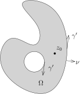
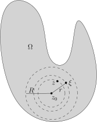
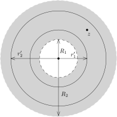
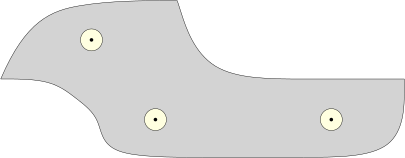

假设$\Omega\subset \mathbb{C}$是开集，$K\subset \Omega$是有界带边区域
（特别地，$K$是紧的），其边界$\gamma=\partial K$是$C^1$曲线（可以有多个连通分支）。

我们已经对复解析函数$F(z)$证明了Cauchy积分公式：如果$F(z)$在$\Omega$上是复解析的，
那么，对于$z_0\in \mathring{K}$（$K$的内部），我们有
\[
F(z_0)=\frac{1}{2\pi i}\int_\gamma \frac{F(z)}{z-z_0}dz.
\]

利用Cauchy公式，我们证明，复解析函数是“解析”的，也就是说可以在如下意义下写成幂级数的形式：

::: theorem
假设$F$为开集$\Omega\subset \mathbb{C}$上的复解析函数，
并且以$z_0$为圆心以$R$为半径的开球$B_R(z_0)\subset \Omega$。
那么，$F(z)$在$z_0$处的**解析半径**至少是$R$，也就是说，在$B_R(z_0)$上，我们有
\[
F(z)=a_0+a_1(z-z_0)+a_2(z-z_0)^2+\cdots+a_n(z-z_0)^n+\cdots,
\]
其中
\[
a_k=\frac{1}{2\pi i}\int_{|\xi-z_0|=r}\frac{F(\xi)}{(\xi-z_0)^k}d\xi, \ \ r<R.
\]
这里，等式右边的幂级数对任意的$z\in B_R(z_0)$都是收敛的。
上面系数定义中的$r$可以是$(0,R)$中的任意一个数。
:::

证明的想法很简单：我们把Cauchy积分公式
\[
F(z)=\frac{1}{2\pi i}\int_\gamma \frac{F(\xi)}{\xi-z}d\xi
\]
的右边的积分项强行展开即可。

::: proof
我们选取一个正实数$r$，使得$|z-z_0|<r<R$。我们任意给定$\xi$，使得$|\xi-z_0|=r$。

此时，我们有
\[
\begin{aligned}
\frac{1}{\xi-z}&=\frac{1}{(\xi-z_0)-(z-z_0)}=\frac{1}{\xi-z_0}\frac{1}{1-\frac{z-z_0}{\xi-z_0}}\\
&=\sum_{k=0}^\infty \frac{(z-z_0)^k}{(\xi-z_0)^{k+1}}.
\end{aligned}
\]
在上面的式子中，由于$\left|\dfrac{z-z_0}{\xi-z_0}\right|<1$，所以，我们有（级数收敛）：
\[
\frac{1}{1-\frac{z-z_0}{\xi-z_0}}=\sum_{k=0}^\infty \left(\frac{z-z_0}{\xi-z_0}\right)^k.
\]
这些级数显然是绝对收敛的，从而与积分可交换（也可以利用Lebesgue控制收敛定理）。
所以，代入Cauchy积分公式，我们就得到
\[
\begin{aligned}
F(z)&=\frac{1}{2\pi i}\int_{|\xi-z_0|=r} \sum_{k=0}^\infty  F(\xi)\frac{(z-z_0)^k}{(\xi-z_0)^{k+1}}d\xi\\
&= \sum_{k=0}^\infty   \left(\frac{1}{2\pi i}\int_{|\xi-z_0|=r}\frac{F(\xi)}{(\xi-z_0)^{k+1}}d\xi \right)(z-z_0)^k
\end{aligned}
\]
比较系数，这就给出了定理的证明。
:::

::: corollary [零点的离散性]
这里的假设与定理中是一致的。我们进一步假设$\Omega$是道路连通的，
即对任意的$z_1,z_2\in \Omega$，存在连续映射
\[
\gamma\colon[0,1]\rightarrow \Omega, \ \ t\mapsto \gamma(t),
\]
使得$\gamma(0)=z_1,\gamma(1)=z_2$。那么，复解析函数$F$在$\Omega$中的零点是离散的
（即如果$z_0$是$F$的一个零点，那么，存在$\varepsilon>0$，
使得对任意的$z$，$|z-z_0|<\varepsilon$，$F(z)\neq 0$），除非$F\equiv 0$。

特别地，给定$\Omega$上的两个复解析函数$F$和$G$，如果$F$和$G$在$Z\subset \Omega$上
取值相同，并且$Z$在$\Omega$中有聚点，那么，$F\equiv G$。
:::

::: proof
假设$z_0$是$F$的一个零点，即$F(z_0)=0$。根据$F$的解析表达式，
在$B_{R}(z_0)\subset \Omega$上，我们有
\[
F(z)=a_0 + a_{1}(z-z_0)+a_{2}(z-z_0)^2+\cdots+a_n(z-z_0)^n+\cdots.
\]
如果这些系数$a_i$全部为$0$，那么，$F$在$B_{R}(z_0)$上恒为$0$；
否则，假设$a_m$是第一个不是$0$的系数，那么，我们有
\[
F(z)=(z-z_0)^m\big(a_m + a_{m+1}(z-z_0)+a_{m+2}(z-z_0)^2+\cdots\big)=(z-z_0)^mG(z).
\]
根据定理的证明，级数
\[
G(z)=a_m + a_{m+1}(z-z_0)+a_{m+2}(z-z_0)^2+\cdots
\]
也是绝对收敛的，特别地，这是连续的，所以，当$z=z_0$时，$G(z_0)=a_m\neq 0$。
从而，存在$\delta$，使得$G$在$B_{\delta}(z_0)$上不会等于$0$，
此时，我们知道，$F$在$z_0$的附近（$B_{\delta}(z_0)$上）恰好有一个零点。

我们现在证明，如果$F$在$z_0$的一个邻域$B_{\delta}(z_0)$上恒为$0$，
那么，$F$在$\Omega$上恒为$0$：任意选取$z_1 \in \Omega$和曲线
\[
\gamma\colon[0,1]\rightarrow \Omega, \ \ t\mapsto \gamma(t),
\]
使得$\gamma(0)=z_0,\gamma(1)=z_1$。令
\[
t_*=\sup\big\{t\in [0,1]\bigm| F(\gamma(t)\big)\big|_{[0,t]}\equiv 0\big\}.
\]
由于$F$在$z_0$的一个邻域$B_{\delta}(z_0)$上恒为$0$，所以，$t_*>0$。我们现在证明$t_*=1$：
如果假设$t_*<1$，根据连续性，我们知道$F(\gamma(t_*))=0$。根据前面的构造，
由于$F$在$\gamma(t_*)$的任意一个小邻域中都有零点（因为和$\gamma^{-1}([0,t_*])$相交），
根据之前的推导，存在$\gamma(t_*)$一个邻域$B_{\delta_1}\big(\gamma(t_*)\big)$，
使得$F$在$B_{\delta_1}\big(\gamma(t_*)\big)$上恒为$0$，根据连续性，那么，
存在$\varepsilon>0$，使得$F(\gamma(t)\big)\big|_{[0,t_*+\varepsilon]}\equiv 0$，
这和$t_*$的最大性矛盾。

由于$t_*=1$，所以，$F(z_1)=0$，这就证明了在$\Omega$上，$F\equiv 0$。

定理中的第二个结论考虑$F-G$即可。
:::

::: corollary
这里的假设与定理中是一致的。那么，$F$的$n$次导数$F^{(n)}$仍然是解析函数。我们进一步有如下的公式：
\[
F^{(n)}(z)=\frac{n!}{2\pi i}\int_{|\xi-z|=r}\frac{F(\xi)}{(\xi-z)^{n+1}}d\xi.
\]
特别地，我们有如下的导数估计：
\[
|F^{(n)}(z)|\leqslant \frac{n!}{r^n}\sup_{|\xi-z|=r}|F(\xi)|.
\]
:::

::: proof
我们将$F$在$z_0=0$（不妨）处展开为级数
\[
F(z)=a_0+a_1z+a_2z^2+\cdots,
\]
其中，我们假设上面的级数的收敛半径至少是$R>0$，即对于$|z|<R$都是绝对收敛的。
根据定理中系数的计算，我们知道
\[
|a_k|\leqslant \frac{1}{r^k}\sup_{|\xi|=r}|F(\xi)|\leqslant \frac{1}{r^k}M, \ \ r<R.
\]
其中，$M$为$|F|$在半径为$r$的圆圈上的最大值。
从而，对$|z|\leqslant r'<r$，对任意的$k\geqslant 0$，我们有
\[
|ka_kz^{k-1}|\leqslant M\underbrace{\frac{k}{r}\left|\frac{r'}{r}\right|^{k-1}}_{b_k}.
\]
当$k$足够大的时候，比如说
\[
k>k_0=\left\lfloor {\left(1-\frac{r'}{r}\right)^{-1}} \right\rfloor
\]
时，我们有
\[
\frac{b_{k+1}}{b_k}= \left(1+\frac{1}{k}\right)\frac{r'}{r}<1,
\]
所以，$\{b_k\}_{k\geqslant k_0}$可以被一个公比小于$1$的几何级数来控制，从而，级数
\[
a_1+2a_2z^{1}+3a_3z^2+\cdots
\]
在$|z|<r'$时是绝对收敛，这表明可以逐项求微分（根据Lebesgue控制收敛定理的推论）。这说明
\[
F'(z)=a_1+2a_2z^{1}+3a_3z^2+\cdots
\]
对于$|z|<r'<r<R$成立。由于$r'$和$r$是任意选取的，所以，上面的式子对于$|z|<R$都成立。
特别地，我们证明了
\[
F'(z_0)=a_1.
\]
由归纳法，对任意的$k$，我们就有
\[
F^{(k)}(z_0)=k!a_k.
\]
再根据定理中的计算，这就证明了这个推论叙述中的公式。导数估计是显然的。
:::

::: theorem [Liouville]
假设$F(z)$是在整个$\mathbb{C}$上定义的复解析函数[^1]。
如果$F$是有界函数，那么$F$是常值函数。
:::

::: proof
我们只要证明$F'(z)\equiv 0$即可：根据$F$在一点处的展开，$F'(z)\equiv 0$，意味着定理中的系数
\[
a_1=2a_2=3a_3=\cdots =0.
\]
所以，$F$在一点附近恒为$a_0$，从而$F$为常数（一点附近的邻域有聚点）。

我们利用导数估计：
\[
|F'(z)|\leqslant \frac{1}{r}\sup_{|\xi-z|=r}|F(\xi)|\leqslant  \frac{\|F\|_\infty}{r}.
\]
由于$F$在整个$\mathbb{C}$上定义，从而可以将$r$取得任意大，
这表明对任意的$z\in \mathbb{C}$，$F'(z)=0$。
:::

::: corollary [代数基本定理]
对任意的次数非零的复系数多项式
\[
P(z)=z^n+a_{n-1}z^{n-1}+\cdots+a_1z+a_0,
\]
它在$\mathbb{C}$上必有一个根。
:::

::: proof
我们观察到$P$在整个$\mathbb{C}$上是复解析的，并且当$|z|\rightarrow \infty$时，我们有
\[
|P(z)|\rightarrow \infty.
\]
我们用反证法：如若不然，
\[
F(z)=P(z)^{-1}
\]
是在全平面$\mathbb{C}$上良好定义的函数。另外，我们有
\[
\overline{\partial}(F)=-P(z)^{-2}\overline{\partial}P=0.
\]
所以，$F$是复解析的。另外，当$|z|\rightarrow \infty$时，我们还有
\[
|F(z)|\rightarrow 0.
\]
这说明，$F$是有界的。根据Liouville定理，$F$为常数，从而$P$也是，那么它的次数是$0$，矛盾。
:::

Cauchy积分公式是复分析中最重要的公式，除了用来证明解析性，
它还有其他众多重要的推论，比如说关于复解析函数的极大模原理：

::: theorem [极大模原理]
假设$F(z)$是区域$\Omega\subset \mathbb{C}$上的复解析函数，
那么$|F(z)|$的最大值，如果能取到的话，一定在$\Omega$的边界$\partial \Omega$上取到。
进一步，如果$|F|$在$\Omega$的内部有最大值点，那么$F$一定是常值函数。
:::

::: proof
假设$z_0\in \mathring{\Omega}$是$|F|$的最大值点，即
\[
|F(z_0)|=\sup_{z\in \Omega}|F(z)|.
\]
根据Cauchy积分公式，（选取较小的$\varepsilon$，使得$B_\varepsilon(z_0)\subset \Omega$，
下面的$r$只要满足$r<\varepsilon$即可）我们有
\[
\begin{aligned}
|F(z_0)|&=\Big|\frac{1}{2\pi}\int_0^{2\pi}F(z_0+re^{i\theta})d\theta\Big|\\
&\leqslant \frac{1}{2\pi}\int_0^{2\pi}\|F\|_{L^\infty}d\theta\\
&= \frac{1}{2\pi}\int_0^{2\pi} |F(z_0)| d\theta\\
&=|F(z_0)|.
\end{aligned}
\]
这表明，上述不等式必须处处取等号，这表明在$z_0$的整个邻域$B_{\varepsilon}(z_0)$上，$|F(z)|$为常数。

我们现在证明$F$在$B_{\varepsilon}(z_0)$上为常数，不妨假设$z_0=0$。
如若不然，那么，我们当$\varepsilon$较小时，我们有解析表达式
\[
F(z)=a_0+ z^m(a_m+a_{m+1}z+a_{m+2}z^2+\cdots),
\]
其中$a_m\neq 0$。通过对$F(z)$乘以一个常数，我们还可以假设$a_0>0$
（如果$a_0=0$，那么$|F|$在$z_0$附近恒为零）。
选取$\xi$，使得$\xi^m=-\overline{a_m}$，所以，对于比较小的$\delta>0$，我们有
\[
F(\delta\xi)=a_0-\delta^m |a_m|^2 +O(\delta^{m+1}).
\]
令$\delta\rightarrow 0$，这就和$|F(z_0)|$最大矛盾。
所以，$F$在$B_{\varepsilon}(z_0)$上为常数，所以$F$为常数。
:::

::: theorem [Laurent展开]
$F$是环面$\big\{z\in \mathbb{C}\bigm|R_1<|z|<R_2\big\}$
（我们经常取$R_1=0$）上的复解析函数。
对每个整数$k\in \mathbb{Z}$，对任意的$R_1<r<R_2$，我们定义
\[
a_k=\frac{1}{2\pi i}\int_{|z|=r}\frac{F(z)}{z^{k+1}}dz
=\frac{1}{2\pi r^k}\int_{0}^{2\pi}e^{-ik\theta}F(re^{i\theta})d\theta.
\]
那么，对任意满足$R_1<|z|<R_2$的$z$，我们有（对每个固定的$z$，以下的级数绝对收敛）
\[
F(z)=\sum_{k=-\infty}^\infty a_kz^k.
\]
:::

::: proof
根据Cauchy积分公式，$a_k$与$r$在$(R_1,R_2)$中的选择无关。我们选取
\[
R_1<r_1'<r_1<|z|<r_2<r'_2<R_2
\]
并令$C'_{i}$为半径为$r'_i$并且中心在原点的圆，其中$i=1,2$。根据 Cauchy 积分公式，我们有
\[
F(z)=\frac{1}{2\pi i}\int_{C'_2}\frac{F(\xi)}{\xi-z}d\xi-\frac{1}{2\pi i}\int_{C'_1}\frac{F(\xi)}{\xi-z}d\xi.
\]
我们重复之前证明复解析函数能做解析展开的做法。

对于第一项，由于对任意的$\xi \in C'_2$，我们有$|z|<|\xi|$，我们有
\[
\frac{1}{\xi-z}=\frac{1}{\xi}\frac{1}{1-\frac{z}{\xi}}=\frac{1}{\xi}\sum_{k=0}^\infty\left(\frac{z}{\xi}\right)^k.
\]
第二项之中，由于$|z|>|\xi|$，其中$\xi \in C'_1$，我们有
\[
\frac{1}{\xi-z}=-\frac{1}{z}\frac{1}{1-\frac{\xi}{z}}=-\frac{1}{z}\sum_{k=0}^\infty\left(\frac{\xi}{z}\right)^k.
\]
将上面的两个展开代入$F(z)$的表达式，我们就有
\[
\begin{aligned}
F(z)=\frac{1}{2\pi i}\int_{C'_2}\frac{F(\xi)}{\xi}\sum_{k=0}^\infty\left(\frac{z}{\xi}\right)^kd\xi+\frac{1}{2\pi i}\int_{C'_1}\frac{F(\xi)}{z}\sum_{k=0}^\infty\left(\frac{\xi}{z}\right)^kd\xi.
\end{aligned}
\]
将求和与积分交换就得到了要证明的结论。
:::

::: definition
假定$F(z)$在区域$\{z\bigm|0<|z-z_0|<r\}$上是复解析的，其中$r>0$，
它的Laurent展开为
\[
F(z)=\sum_{k=-\infty}^\infty a_kz^k.
\]
我们称其中的$z^{-1}$的系数$a_{-1}$为$F$在$z_0$处的**留数**，并记作${\rm Res}(F;z_0)$。
:::

::: remark*
按照定义，我们有
\[
{\rm Res}(F;z_0)=\frac{1}{2\pi i}\int_{|z-z_0|=r} {F(z)}dz.
\]
这是因为Laurent展开中其它幂次的积分都是$0$。
:::

::: theorem [留数定理]
假定$\Omega\subset \mathbb{C}$是一个紧区域，$\Omega$边界为分段光滑的$C^1$-曲线。
除去点$z_1,\cdots,z_N\in \mathring{\Omega}$之外，
$F$为$\mathbb{C}-\{z_1,\cdots,z_N\}$上的复解析函数，那么，
\[
\sum_{k=1}^N{\rm Res}(F;z_k)=\frac{1}{2\pi i}\int_{\partial \Omega} {F(z)}dz.
\]
:::

::: proof
对每个$k\leqslant N$，先将每个$z_k$附近的小圆盘$B_{\varepsilon}(z_k)$从$\Omega$上抠掉，
使得$z\in \Omega-\bigcup_{k\leqslant N}B_\varepsilon(z_k)$。
我们在区域$\Omega-\bigcup_{k\leqslant N}B_\varepsilon(z_k)$上用Cauchy积分公式。

考虑到曲线的定向，我们有
\[
\frac{1}{2\pi i}\int_{\partial \Omega} {F(z)}dz-\sum_{k=1}^N\frac{1}{2\pi i}\int_{\partial B_{\varepsilon}(z_k)} {F(z)}dz=0.
\]
所以，
\[
\frac{1}{2\pi i}\int_{\partial \Omega} {F(z)}dz=\sum_{k=1}^N\frac{1}{2\pi i}\int_{\partial B_{\varepsilon}(z_k)} {F(z)}dz=\sum_{k=1}^N{\rm Res}(F;z_k).
\]
这就证明了留数定理。
:::

我们试举一个有趣的应用，其它在计算上的应用我们将在Fourier变换的一部分再做演示。

::: example*
我们在第一学期已经定义了三角函数
\[
\cos(z)=\frac{1}{2}\big(e^{iz}+e^{-iz}\big),\ \ \sin(z)=\frac{1}{2i}\big(e^{iz}-e^{-iz}\big).
\]
我们研究$\sin(z)$的零点，即找到$z_0$，使得
\[
e^{iz_0}-e^{-iz_0}=0 \ \ \Leftrightarrow \ \ e^{2iz_0}=1 \ \ \Leftrightarrow \ z_0\in \pi\mathbb{Z}.
\]
对任意的$a\notin \mathbb{Z}$，我们考虑
\[
F(z)=\frac{\pi\cot(\pi z)}{(z-a)^2}=\frac{\pi\cos(\pi z)}{\sin(\pi z)(z-a)^2}.
\]
那么，$F(z)$不解析的地方只能是$a$和$n\in \mathbb{Z}$。

在$z=a$处，要想有非平凡的留数，$\cot(\pi z)$需要贡献一个$z-a$的因子，所以
\[
\displaystyle {\rm Res}(F;a)=(\pi \cot(\pi z))'|_{z=a}=-\frac{\pi^2}{\sin^2(\pi a)}.
\]

在$z=n$处，由于$\sin(\pi z)'\big|_{z=n}\neq 0$，
所以，$\sin(\pi z)$的零点是$1$阶的，据此，我们知道
\[
\displaystyle {\rm Res}(F;n)=\frac{1}{(n-a)^2}.
\]

我们对于顶点在 $(\pm(n+\frac{1}{2}),\pm(n+\frac{1}{2}))$的正方形$Q_n$上用留数定理，
其中，$n$足够大使得$a\in Q_n$。所以，
\[
\sum_{|k|\leqslant n}\frac{1}{(k-a)^2}-\frac{\pi^2}{\sin^2(\pi a)}=\frac{1}{2\pi i}\int_{\partial Q_n} \frac{\pi\cos(\pi z)}{\sin(\pi z)(z-a)^2}dz.
\]
利用$z=x+iy$，我们很容易看出
\[
\frac{\pi\cos(\pi z)}{\sin(\pi z)(z-a)^2}=O(\frac{1}{n^2}).
\]
所以上面的积分项的贡献为
\[
\frac{1}{2\pi i}\int_{\partial Q_n} \frac{\pi\cos(\pi z)}{\sin(\pi z)(z-a)^2}dz= O(\frac{1}{n}).
\]
令$n\rightarrow \infty$，我们就得到了
\[
\sum_{n\in \mathbb{Z}}\frac{1}{(n-a)^2}=\frac{\pi^2}{\sin^2(\pi a)}.
\]
:::

利用上面例子中的分析，我们还可以证明Euler的著名公式。
首先，在$\mathbb{C}-\mathbb{Z}$上的任意一个紧集上，级数
\[
f(z)=\displaystyle \sum_{n\in \mathbb{Z}} \frac{1}{(z-n)^2}
\]
是一致收敛的，所以，$f(z)$是$\mathbb{C}-\mathbb{Z}$上的复解析函数（可逐项求导数）。
Euler观察到，函数
\[
g(z)= \frac{\pi^2}{\sin^2(\pi z)}
\]
也是$\mathbb{C}-\mathbb{Z}$上的复解析函数。进一步，由于$\sin(\pi z)$的零点是单零点，
所以，$g(z)$在每个$n\in \mathbb{Z}$处的Laurent展开的负幂和$f(z)$的是一致的。所以，
\[
F(z)=g(z)-f(z)=\frac{\pi^2}{\sin^2(\pi z)}-\sum_{n\in \mathbb{Z}} \frac{1}{(z-n)^2}
\]
是全平面上定义的复解析函数并且具有周期性$F(z+1)=F(z)$。

对于任意的$x\in[0,1]$，我们很容易证明下面的极限：
\[
\lim_{|y|\rightarrow \infty} F(x+iy)=0.
\]
利用周期性，我们就知道$F$是有界的，从而根据Liouville定理，我们得到$F\equiv 0$。这表明
\[
\frac{\pi^2}{\sin^2(\pi z)}=\sum_{n\in \mathbb{Z}} \frac{1}{(z-n)^2}.
\]
稍加变形，我们有
\[
\frac{\pi^2}{\sin^2(\pi z)}-\frac{1}{z^2}=\sum_{n\neq 0} \frac{1}{(z-n)^2}.
\]
左右在$z=0$处取极限，我们就证明了著名的Euler公式：
\[
\frac{1}{1^2}+\frac{1}{2^2}+\frac{1}{3^2}+\frac{1}{4^2}+\cdots =\frac{1}{6}\pi^2.
\]

[^1]: 这样的函数称作是**整函数**。
