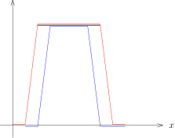

## Hölder连续函数的Bernstein定理

我们考虑 $f\in C^{\alpha}(\mathbf{T})$，其中 $\alpha\in (0,1)$。
按照定义，存在 $C>0$，使得对任意的 $x,y\in \mathbf{T}$，我们有
\[
|f(x)-f(y)|\leqslant C|x-y|^\alpha.
\]
令 $\|f\|_{C^{0,\alpha}}$ 是上述可能的常数 $C$ 的下确界，即
\[
\|f\|_{C^{0,\alpha}}=\inf_{x,y\in \mathbf{T},x\neq y} \frac{|f(x)-f(y)|}{|x-y|^\alpha}.
\]
从而，对任意的 $x,y\in \mathbf{T}$，我们有
\[
|f(x)-f(y)|\leqslant \|f\|_{C^{0,\alpha}}|x-y|^\alpha.
\]

::: proposition
假设 $f\in C^{\alpha}(\mathbf{T})$，其中我们假设 $\alpha \in [0,1]$（当 $\alpha=0$ 时，
我们只是假设 $f$ 是连续的；当 $\alpha=1$ 时，我们假设 $f$ 是Lipschitz函数）。那么，我们有
\[
\big|\widehat{f}(k)\big|=O(|k|^{-\alpha}),
\]
即序列 $\bigl\{|k|^\alpha\big|\widehat{f}(k)\big|\bigr\}_{k\geqslant 1}$ 是有界的。
:::

::: proof
我们不妨假设 $\alpha>0$（否则用Riemann–Lebesgue引理即可），按照定义，对任意的 $x,y\in \mathbf{T}$，
我们有
\[
|f(x)-f(y)|\leqslant \|f\|_{C^{0,\alpha}}|x-y|^\alpha.
\]
对任意的 $k\neq 0$，我们有
\[
\begin{aligned}
\widehat{f}(k)&=\int_{-\pi}^\pi f(x)e^{-ikx}\frac{dx}{2\pi}\\
&=-\int_{-\pi}^\pi f(x)e^{-ikx+i\pi}\frac{dx}{2\pi}\\
&=-\int_{-\pi}^\pi f(x)e^{-ik(x-\frac{\pi}{k})}\frac{dx}{2\pi}\\
&=-\int_{-\pi}^\pi f(x+\frac{\pi}{k})e^{-ixk}\frac{dx}{2\pi}.
\end{aligned}
\]
从而，
\[
\begin{aligned}
\widehat{f}(k)&=\frac{1}{2}\left(\int_{-\pi}^\pi f(x)e^{-ikx}\frac{dx}{2\pi}-\int_{-\pi}^\pi f(x+\frac{\pi}{k})e^{-ixk}\frac{dx}{2\pi}\right)\\
&=\int_{-\pi}^\pi \bigl(f(x+\frac{\pi}{k})-f(x)\bigr)e^{-ixk}\frac{dx}{4\pi}.
\end{aligned}
\]
所以，利用Hölder函数的定义，我们有
\[
\begin{aligned}
|\widehat{f}(k)|&\leqslant \frac{1}{4\pi}\int_{-\pi}^\pi |f(x+\frac{\pi}{k})-f(x)|dx\\
&\leqslant \frac{\|f\|_{C^{0,\alpha}}}{4\pi}\int_{-\pi}^\pi\left(\frac{\pi}{|k|}\right)^\alpha dx=\frac{\pi^\alpha \|f\|_{C^{0,\alpha}}}{2}\cdot \frac{1}{|k|^\alpha}.
\end{aligned}
\]
:::

::: remark*
上面命题中证明的关于 $C^\alpha$ 函数的Fourier系数的衰减估计是最佳的，
其中 $\alpha\in (0,1)$（实际上，对于 $\alpha \in (0,1)$，
这个衰减估计刻画了 $C^{\alpha}(\mathbf{T})$，我们这里不给出证明了）。

假设 $0<\alpha<1$，我们考虑如下的Fourier级数：
\[
f_\alpha(x)=\sum_{k=1}^\infty \frac{1}{2^{k\alpha}}e^{i2^k x}.
\]
很显然，这个级数是绝对收敛的，所以，$f_\alpha \in C^0(\mathbf{T})$。
特别地，
$\widehat{f_\alpha}(\ell)=|\ell|^{-\alpha}$ 并且 $\widehat{f_\alpha}(\ell)=o(|\ell|^{-\alpha})$
不成立。

如果我们可以说明 $f_\alpha\in C^{\alpha}(\mathbf{T})$，
这表明上述性质中对于Fourier系数的衰减估计是最佳的：

对于任意的 $x$ 和 $h$，以 $h$ 为频率的二进制尺度，我们有
\[
\begin{aligned}
f_\alpha(x+h)-f_\alpha(x)=\underbrace{\sum_{2^k\leqslant \frac{1}{100}|h|^{-1}} \frac{1}{2^{k\alpha}}\bigl(e^{i2^k (x+h)}-e^{i2^k x}\bigr)}_{I_1}
+\underbrace{\sum_{2^k > \frac{1}{100}|h|^{-1}} \frac{1}{2^{k\alpha}}\bigl(e^{i2^k (x+h)}-e^{i2^k x}\bigr)}_{I_2}.
\end{aligned}
\]
我们注意到第二项可以如下控制
\[
|I_2|\leqslant \sum_{2^k > \frac{1}{100}|h|^{-1}} \frac{2}{2^{k\alpha}}\leqslant C|h|^\alpha.
\]
对于第一项，我们有
\[
\begin{aligned}
|I_1|&\leqslant \sum_{2^k \leqslant \frac{1}{100}|h|^{-1}} \frac{1}{2^{k\alpha}}|e^{i2^kh}-1|\\
&\leqslant \sum_{2^k \leqslant \frac{1}{100}|h|^{-1}} \frac{C}{2^{k\alpha}}2^{k}|h|.
\end{aligned}
\]
我们用到了当 $|y|<1$ 时，$|e^{iy}-1|\leqslant C|y|$。从而，
\[
\begin{aligned}
|I_1|&\leqslant C |h| \sum_{2^k \leqslant \frac{1}{100}|h|^{-1}}2^{k(1-\alpha)}\\
&\leqslant  C |h| \times C' \bigl(\frac{1}{100}|h|^{-1}\bigr)^{1-\alpha}\\
&=C''|h|^\alpha.
\end{aligned}
\]
在这个估计中，我们用到了 $\alpha<1$。所以，
\[
|f_\alpha(x+h)-f_\alpha(x)|\leqslant |I_1|+|I_2|\leqslant C'''|h|^\alpha.
\]
这表明，$f_\alpha\in C^\alpha(\mathbf{T})$。
:::

我们已经介绍的几个关于Fourier级数逐点收敛的经典定理，都没有涉及到一致收敛性。
如果 $\alpha>\dfrac{1}{2}$，尽管对于 $f \in C^\alpha(\mathbf{T})$，
它的Fourier系数衰减得并不迅速（不是绝对收敛的），但是Bernstein有如下令人惊讶的结果：

::: theorem [Bernstein]
如果 $\alpha \in \big(\frac{1}{2},1\big]$，那么，对于任意的 $f\in C^\alpha(\mathbf{T})$，
其的Fourier级数
\[
\sum_{k\in \mathbb{Z}}\widehat{f}(k)e^{ikx}
\]
是绝对收敛的。
特别地，对于 $\alpha \in \big(\frac{1}{2},1\big]$，
函数序列 $\{S_N(f)\}_{N \geqslant 1}$ 一致收敛到 $f$。
:::

::: remark*
我们要强调，$\{S_N(f)\}_{N \geqslant 1}$ 不是在 $C^{0,\alpha}$ 的范数下收敛到 $f$。
:::

::: proof
受到上面评注里证明的启发，我们考虑
\[
g_h(x)=f(x+h)-f(x-h).
\]
从而，我们可以计算
\[
\widehat{g}_h(k)=(e^{ikh}-e^{-ikh})\widehat{f}(k)=2i\sin(kh) \widehat{f}(k).
\]
很明显，对任意的 $h\in \mathbb{R}$，我们有 $g_h(x)\in L^2(\mathbf{T})$。根据勾股定理，我们有
\[
\int_{-\pi}^\pi |g_h(x)|^2\frac{dx}{2\pi}=4\sum_{k\in \mathbb{Z}}|\sin(kh)|^2|\widehat{f}(k)|^2.
\]
另外，根据 $f\in C^\alpha$，我们还知道
\[
|g_h(x)|\leqslant \|f\|_{C^{0,\alpha}} (2h)^{\alpha}.
\]
所以，我们得到
\[
\sum_{k\in \mathbb{Z}}|\sin(kh)|^2|\widehat{f}(k)|^2\leqslant  C h^{2\alpha}
\]
特别地，如果令 $h=\dfrac{\pi}{2^{p+1}}$，我们得到
\[
\sum_{k\neq 0}|\sin(\frac{k\pi}{2^{p+1}})|^2|\widehat{f}(k)|^2\leqslant   \frac{C}{2^{2p\alpha}},
\]
其中，常数 $C$ 可能有所改变，但是这还是一个不依赖于 $f$ 的常数。在这个求和中，我们只选取一部分的和：
\[
\sum_{2^{p-1}\leqslant |k|<2^p}|\sin\left(\frac{k\pi}{2^{p+1}}\right)|^2|\widehat{f}(k)|^2\leqslant   \frac{C}{2^{2p\alpha}}.
\]
此时，由于 $\dfrac{k\pi}{2^{p+1}}\in \left[\dfrac{\pi}{4},\dfrac{\pi}{2}\right]$，
从而 $\left|\sin\dfrac{k\pi}{2^{p+1}}\right|^2 \geqslant 0.5$。从而，上面的不等式给出
\[
0.5\times \sum_{2^{p-1}\leqslant |k|<2^p} |\widehat{f}(k)|^2\leqslant   \frac{C}{2^{2p\alpha}}.
\]
所以，
\[
\sum_{2^{p-1}\leqslant |k|<2^p} |\widehat{f}(k)|^2\leqslant   \frac{C}{2^{2p\alpha}}.
\]
当然，这里的 $C$ 也改变了。
此时，我们利用Cauchy–Schwarz不等式（因为我们想得到 $|\widehat{f}(k)|$ 的和）可以得到
\[
\sum_{2^{p-1}\leqslant |k|<2^p} |\widehat{f}(k)| \leqslant 2^{\frac{p-1}{2}}\bigl(\sum_{2^{p-1}\leqslant |k|<2^p} |\widehat{f}(k)|^2\bigr)^{\frac{1}{2}}\leqslant   \frac{C}{2^{p(\alpha-\frac{1}{2})}}.
\]
所以，当 $\alpha>\frac{1}{2}$ 的时候，我们有
\[
\sum_{k\in \mathbb{Z}} |\widehat{f}(k)| \leqslant \sum_{p=1}^\infty\Bigl(\sum_{2^{p-1}\leqslant |k|<2^p} |\widehat{f}(k)| \Bigr) \leqslant \sum_{p=1}^\infty  \frac{C}{2^{p(\alpha-\frac{1}{2})}}<\infty.
\]
这表明，$\displaystyle\sum_{k\in \mathbb{Z}}\widehat{f}(k)e^{ikx}$ 绝对收敛。
:::

## Fourier级数的应用：等分布问题

考虑 $[0,1)$ 区间上的数列 $\{\xi_{k}\}_{k\geqslant 1}$，
我们要用数学的语言来描述这些数是“平均地”分布在 $[0,1)$ 区间上。

::: definition
如果对任意的 $a,b\in [0,1)$，我们有
\[
\lim_{n\rightarrow \infty}\frac{\big|\{k\leqslant n \mid \xi_k \in [a,b]\}\big|}{n}=b-a,
\]
即该序列中有百分之 $100(b-a)$ 那么多数落在 $[a,b)$ 中，
那么我们就说 $\{\xi_k\}_{k\geqslant 1}$ 在 $[0,1)$ 上是**等分布的**。
:::

::: remark*
如果 $\{\xi_k\}_{k\geqslant 1}$ 在 $[0,1)$ 上是等分布的，
那么 $\{\xi_k\}_{k\geqslant 1}$ 在 $[0,1)$ 上是稠密的：否则，存在开区间 $(a,b)\subset [0,1)$，
使得 $\{\xi_k\}_{k\geqslant 1}\cap (a,b)=\emptyset$，此时，
对任意的 $n\in \mathbb{Z}_{\geqslant 1}$，我们有
\[
\frac{\big|\{k\leqslant n\mid \xi_k \in [a,b]\}\big|}{n} =0,
\]
这与定义不符。

反之，如果 $\{\xi_k\}_{k\geqslant 1}$ 在 $[0,1)$ 上是稠密的，
$\{\xi_k\}_{k\geqslant 1}$ 在 $[0,1)$ 上是**不**一定是等分布的，我们把反例的构造留作本次作业。
:::

::: example*
如下的两个例子不是等分布的：

- 1\) 我们用 $\{x\}$ 表示实数 $x$ 的小数部分，即 $\{x\}=x-\left\lfloor {x} \right\rfloor$。
  对任意的有理数 $q$，数列 $\bigl\{\{k \cdot q\}\bigr\}_{k\geqslant 1}$ 不是等分布的，
  这是因为这个数列实际上只有有限项；

- 2\) 对任意的 $k\geqslant 1$，我们定义
  \[
  \xi_k=\left(\frac{1+\sqrt{5}}{2}\right)^k.
  \]
  那么，数列 $\{\xi_k\}_{k\geqslant 1}$ 不是等分布的：如果令
  \[
  F_{k+1}=\left(\frac{1+\sqrt{5}}{2}\right)^k+\left(\frac{1-\sqrt{5}}{2}\right)^k
  \]
  我们就得到了Fibonacci数列。
  由于 $\frac{1-\sqrt{5}}{2}\approx -0.618$，所以，$\xi_k\rightarrow 1$，从而不是稠密的。

:::

给定无理数 $\alpha\in \mathbb{R}-\mathbb{Q}$，
数列 $\bigl\{\{k\cdot \alpha\}\bigr\}_{k\geqslant 1}$ 是等分布的，这是等分布理论中最基本的例子，
我们仔细研究这个例子并发展一般的理论。令 $\xi_k=k \cdot \alpha$，其中 $k\geqslant 1$。
为了判定 $\{\xi_k\}_{k\geqslant 1}$ 在 $[0,1)$ 上是否为等分布的，我们有如下平凡但是重要的观察：
等分布性等价于
\[
\lim_{n\rightarrow \infty}\frac{1}{n}\sum_{k=1}^n \mathbf{1}_{[a,b]}(\xi_k)=\int_{0}^1 \mathbf{1}_{[a,b]}(x) dx .
\]
这是从集合到它的示性函数的过渡。
这使得我们联想到我们在积分理论中学到的东西，从集合的测度过渡到简单函数再过渡到一般的可积函数。
据此，我们猜想可能下面的结论也成立：
\[
\lim_{n\rightarrow \infty}\frac{1}{n}\left(\sum_{k=1}^n f(\xi_k)\right)= \int_{0}^1 f(x) dx,  \ \ \ \ \ \ \ \ \ \ \ (\star) .
\]
其中 $f$ 是连续函数或者Riemann可积的函数（请想一下对于Lebesgue意义下的 $L^1$ 函数会有什么问题？）。
这是这类问题的大思路：把算术问题转化为分析问题，从而可以尝试微积分和函数论中的工具。

根据上面的分析，我们尝试对 $f\in C{[0,1)}$ 来证明上面的极限 $(\star)$。
由于 $(\star)$ 左右两边对 $f$ 都是线性的，根据Fourier分析的基本想法，
如果 $f$ 是 $\mathbb{R}$ 上以 $1$ 为周期的函数（和我们之前的Fourier分析差了一个常数），
可以先考虑用有限的三角级数来逼近 $f$ 进行证明。
作为出发点，
可以先尝试用最基本的频率函数 $e_\ell(x)=e^{2\pi i \ell x}$（周期为
$1$）来验证命题（之后用线性组合以及逼近来证明一般的情况）。

当 $\ell=0$ 时，$(\star)$ 结论是显然的。

如果 $\ell\neq 0$，
我们注意到 $e_\ell(\{k\alpha\})=e_\ell(k\alpha)$（这是因为 $e_\ell$ 以 $1$ 为周期）。
利用 $\xi_k = k\cdot \alpha$，我们可以直接计算：
\[
\frac{1}{n}\sum_{k=1}^n e_\ell(\xi_k)=\frac{1}{n}\frac{1-e^{2\pi i n\ell \alpha}}{1-e^{2\pi i \ell \alpha}}e^{2\pi i \ell \alpha}.
\]
由于 $\alpha \notin \mathbb{Q}$，所以上式中的分母不是 $0$。从而，
\[
\Big|\frac{1}{n}\sum_{k=1}^n e_\ell(\xi_k)\Big|\leqslant \frac{2}{n}\frac{1}{|1-e^{2\pi i \ell \alpha}|},
\]
它的极限显然是 $0$。
我们还要指出，
这个证明唯一用到了 $\{\xi_k\}_{k\geqslant 1}$ 算术性质的地方是
$\alpha \notin \mathbb{Q}$（三角级数对此类问题之所以有效就是因为它和这些算术性质有关联）。

利用 $(\star)$ 的线性，对任何有限的三角级数 $Q$，结论都成立。
对于任意给定的 $\mathbb{R}$ 上的周期连续函数 $f$，根据Weierstrass–Stone定理，
对任意的 $\varepsilon>0$，
存在有限的三角级数 $Q=\displaystyle \sum_{|\ell|\leqslant K}c_\ell e^{2\pi i \ell x}$，使得
\[
\|Q-f\|_{L^\infty}<\frac{1}{3}\varepsilon.
\]
此时，根据上面的计算，选择 $N$，使得当 $n>N$ 时，对每个 $\ell \in \mathbb{Z}\cap [-K,K]$，$\ell\neq 0$，我们都有
\[
|c_\ell|\times \Big|\frac{1}{n}\sum_{k=1}^n e_\ell(\xi_k)\Big|<\frac{\varepsilon}{3(2K+1)}.
\]
由于 $\displaystyle\int_0^1 Q(x)dx=c_0$，所以，
\[
\Big|\frac{1}{n}\sum_{k=1}^n Q(\xi_k)-\int_0^1 Q(x)dx\Big|\leqslant\sum_{0<|\ell|\leqslant K}|c_\ell|\times \Big|\frac{1}{n}\sum_{k=1}^n e_\ell(\xi_k)\Big|<\frac{1}{3}\varepsilon.
\]
从而，当 $n>N$ 时，
\[
\begin{aligned}
\Big|\frac{1}{n}\sum_{k=1}^n f(\xi_k)-\int_0^1 f(x)dx\Big|\leqslant{}&\frac{1}{n}\sum_{k=1}^n |f(\xi_k)-Q(\xi_k)|+\Big|\frac{1}{n}\sum_{k=1}^n Q(\xi_k)-\int_0^1 Q(x)dx\Big|\\
&+\int_0^1|Q(x)-f(x)|dx<\varepsilon,
\end{aligned}
\]
从而 $(\star)$ 对于周期连续函数成立。

我们之前要研究的等分布问题是对函数 $f=\mathbf{1}_{[a,b]}$ 来陈述的，其中 $a\in [0,1)$，
$b\in (0,1)$，$a<b$。
这个函数并非连续函数，但是我们可以逼近它：对任意的 $\delta>0$（很小），我们定义

\[
f_+(x)=\begin{cases}1, \ & a\leqslant x \leqslant b;\\
0, \ & x\leqslant a-\delta~\text{或}~x\geqslant b+\delta;\\
\frac{1}{\delta}(x-b)+1, \ & b\leqslant x\leqslant b+\delta;\\
-\frac{1}{\delta}(x-a)+1, \ & a-\delta \leqslant x\leqslant a.
\end{cases}
\]
和
\[
f_-(x)=\begin{cases}1, \ & a+\delta \leqslant x \leqslant b-\delta;\\
0, \ & x\leqslant a~\text{或}~x\geqslant b;\\
\frac{1}{\delta}(x-b-\delta)+1, \ & b-\delta \leqslant x\leqslant b;\\
-\frac{1}{\delta}(x-a+\delta)+1, \ & a\leqslant x\leqslant a+\delta.
\end{cases}
\]
很明显，我们有
\[
f_-\leqslant \mathbf{1}_{[a,b]}\leqslant f_+,
\]
所以
\[
\frac{1}{n}\sum_{k=1}^n f_-(\xi_k)\leqslant \frac{1}{n}\sum_{k=1}^n \mathbf{1}_{[a,b]}(\xi_k)\leqslant \frac{1}{n}\sum_{k=1}^n f_+(\xi_k).
\]
由于
\[
0\leqslant  \int_{0}^1 f_+(x) dx- \int_{0}^1 f_-(x) dx \leqslant 2\delta.
\]
所以，当 $n\rightarrow \infty$ 时，我们有
\[
\lim_{n\rightarrow \infty}\frac{1}{n}\left(\sum_{k=1}^n \mathbf{1}_{[a,b]}(\xi_k)\right)-\int_{0}^1 \mathbf{1}_{[a,b]}(x) dx=O(\delta).
\]
令 $\delta \rightarrow 0$，命题成立。

我们可以进一步对Riemann可积的函数 $f\in \mathcal{R}$（根据线性，只要对实值函数证明）证明
\[
\displaystyle \frac{1}{n}\sum_{k=1}^n f(\xi_k)\longrightarrow \int_{0}^1 f(x) dx, \ \ f\in \mathcal{R}([0,1])
\]

为此，选取 $[0,1]$ 的分划 $\sigma\colon 0=x_0<x_1<\cdots<x_N=1$，
我们进一步要求分划点 $x_i$ 都是有理数（仍然可以保证 $|\sigma| \rightarrow 0$）。考虑如下两个阶梯函数
\[
\begin{aligned}
f_+(x)&=\sum_{k=0}^{N-1} \left(\sup_{y\in [x_k,x_{k+1}]}f(y)\right)\mathbf{1}_{[x_k,x_{k+1}]}(x), \\
 f_-(x)&=\sum_{k=0}^{N-1} \left(\inf_{y\in [x_k,x_{k+1}]}f(y)\right) \mathbf{1}_{[x_k,x_{k+1}]}(x).
 \end{aligned}
\]
按照定义，我们有
\[
\frac{1}{n}\sum_{k=1}^n f_-(\xi_k)\leqslant \frac{1}{n}\sum_{k=1}^n f(\xi_k)\leqslant \frac{1}{n}\sum_{k=1}^n f_+(\xi_k).
\]

由于结论对于 $\mathbf{1}_{[a,b]}$ 型的函数成立，所以对于 $f_\pm$ 也成立。
所以，对任意的 $\varepsilon>0$，先选较小的步长 $|\sigma|$，使得
\[
\Big|\int_0^1 f_\pm  -\int_0^1 f\Big|<\frac{1}{2}\varepsilon,
\]
然后选择足够大的 $N$，使得 $n\geqslant N$ 时，
\[
\Big|\frac{1}{n}\left(\sum_{k=1}^n f_\pm(\xi_k)\right)-\int_{0}^1 f_\pm \Big|<\frac{1}{2}\varepsilon.
\]
从而，
\[
\Big|\frac{1}{n}\left(\sum_{k=1}^n f(\xi_k)\right)-\int_{0}^1 f \Big|<\varepsilon.
\]
这就证明了结论。

事实上，上面证明的后半部分与 $\{\xi_k\}_{k\geqslant 1}$ 的具体选择没有关系，这是一个更一般的结论：

::: theorem [Weyl的等分布判别准则]
$\{\xi_{k}\}_{k\geqslant 1}$ 是 $[0,1)$ 区间上的数列。
那么，$\{\xi_k\}_{k\geqslant 1}$ 在 $[0,1)$ 上等分布当且仅当对任意的 $\ell \neq 0$，我们有
\[
\lim_{n\rightarrow \infty}\left(\frac{1}{n}\sum_{k=1}^n e^{2\pi i \ell \xi_k}\right)=0.
\]
:::

这个定理的进一步的推广就是动力系统理论中的Birkhoff遍历性定理。

有了Weyl判别准则，我们可以相对轻松地证明一些数列在 $[0,1)$ 区间上是等分布的：

::: example*
我们有其他几个等分布或者非等分布的例子：

- 1\) 任给非零实数 $a$，任意的实数 $\sigma \in (0,1)$，我们令 $\xi_k=\{a k^\sigma\}$（小数部分）。
  那么，$\{\xi_k\}_{k\geqslant 1}$ 在 $[0,1)$ 上等分布。

  根据Weyl判别准则，我们需要控制 $\displaystyle \sum_{k=1}^n e^{2\pi i \ell a k^\sigma}$ 的大小。
  如果令 $b=2\pi \ell a$，我们要证明
  \[
  \sum_{k=1}^n e^{i b k^\sigma}=o(n).
  \]
  我们用积分来逼近求和：
  \[
  \begin{aligned}
  \sum_{k=1}^n e^{i b k^\sigma}-\int_{0}^n e^{i b x^\sigma}dx&=\sum_{k=1}^{n} \int_{k-1}^{k}\Bigl(e^{i b k^\sigma}-e^{i b x^\sigma}\Bigr)dx.
  \end{aligned}
  \]
  根据Lagrange中值定理（对函数 $e^{ibx^\sigma}$ 的实部和虚部分别来做），对 $x\in [k,k+1]$，
  存在依赖于 $b$ 和 $\sigma$ 的常数 $C$，使得
  \[
  \big|e^{i b k^\sigma}-e^{i b x^\sigma}\big|\leqslant C k^{-1+\sigma}.
  \]
  从而，
  \[
  \begin{aligned}
  \Big|\sum_{k=1}^{n-1} e^{i b k^\sigma}-\int_{1}^{n-1} e^{i b x^\sigma}dx\Big|&\leqslant C\sum_{k=1}^n \int_{k}^{k+1} k^{-1+\sigma}dx\\
  &=O(n^\sigma)(=o(n)).
  \end{aligned}
  \]
  下面我们估计积分项 $\displaystyle \int_{1}^{n} e^{i b x^\sigma}dx$（对于 $n$ 和 $n-1$
  的差别可以忽略，因为这是 $O(1)$-项）：
  \[
  \begin{aligned}
  \int_{1}^n e^{i b x^\sigma}dx&=\frac{1}{i\sigma b}\int_{1}^{n-1} \Bigl(e^{i b x^\sigma}\Bigr)' x^{1-\sigma}dx\\
  &=\underbrace{e^{i b x^\sigma} x^{1-\sigma}\Big|_{x=1}^{x=n}}_{O(n^{1-\sigma})}-\frac{1-\sigma}{i\sigma b}\int_{1}^n e^{i b x^\sigma} x^{-\sigma}dx.
  \end{aligned}
  \]
  通过将指数函数用 $1$ 来控制，我们有
  \[
  \Big|\int_{1}^n e^{i b x^\sigma} x^{-\sigma}dx\Big|\leqslant \int_{1}^n  x^{-\sigma}dx=O(n^{1-\sigma}).
  \]
  最终，我们证明了
  \[
  \displaystyle \sum_{k=1}^n e^{2\pi i \ell a k^\sigma}=O(n^\sigma)+O(n^{1-\sigma}).
  \]
  根据Weyl判据，我们就说明了 $\{\xi_k\}_{k\geqslant 1}$ 在 $[0,1)$ 上等分布。

- 2\) 作为前一个例子的推论（$a=1$，$\sigma=0.5$），
  数列 $\bigl\{ \sqrt{k} \bigr\}_{k\geqslant 1}$ 的小数部分在 $[0,1)$ 上等分布。

- 3\) 任意给定 $a\in \mathbb{R}$，对任意的 $k\geqslant 1$，我们定义
  \[
  \xi_k= a \log(k).
  \]
  那么，$\{\xi_k\}_{k\geqslant 1}$ 在 $[0,1)$ 上**不是**等分布的。

  根据Weyl判别准则，我们估计 $\displaystyle \sum_{k=1}^n e^{2\pi i \ell a\log(k)}$。
  我们令 $b=2\pi \ell a$，现在用积分逼近求和
  \[
  \begin{aligned}
  \sum_{k=1}^n e^{i b\log(k)}-\int_{0}^n e^{i b \log(x)}dx&=\sum_{k=0}^{n-1} \int_{k}^{k+1}\Bigl(e^{i b\log(k)}-e^{i b\log(x)}\Bigr)dx.
  \end{aligned}
  \]
  根据Lagrange中值定理，对 $x\in [k,k+1]$，存在依赖于 $b$ 和 $\sigma$ 的常数 $C$，使得
  \[
  \big|e^{i b \log(k)}-e^{i b \log(x)}\big|\leqslant  \frac{C}{k}.
  \]
  所以，
  \[
  \begin{aligned}
  \Big|\sum_{k=1}^n e^{i b\log(k)}-\int_{0}^n e^{i b \log(x)}dx\Big|&\leqslant \sum_{k=0}^{n-1} \int_{k}^{k+1}\frac{C}{k}dx=O(\log(n)).
  \end{aligned}
  \]
  下面我们来估计积分 $\displaystyle \int_{1}^n e^{ib\log x}dx$，而这个积分可以通过分部积分直接计算：
  \[
  \begin{aligned}
  \int_{1}^n e^{ib\log x}dx&=xe^{ib\log x}\Big|_{x=1}^{x=n}-ib\int_{1}^n e^{ib\log x}dx.
  \end{aligned}
  \]
  从而，我们可以算出
  \[
  \int_{1}^n e^{ib\log x}dx=\frac{ne^{ib\log(n)}}{1+ib}+O(1).
  \]
  所以，
  \[
  \frac{1}{n}\int_{1}^n e^{ib\log x}dx+o(1)=\frac{e^{ib\log(n)}}{1+ib}.
  \]
  这个复数的模长是固定的，所以 $\displaystyle \int_{1}^n e^{ib\log x}dx \neq o(n)$。

:::
