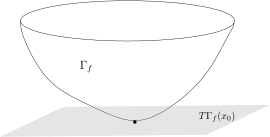

## Hesse矩阵与极值点的二阶导数判定

为了避免张量的概念，
我们考虑 $\mathbb{R}^n$ 中的开集 $\Omega$ 并假设 $\mathbb{R}^n$ 中已经选取坐标 $(x_1,\cdots,x_n)$。
我们假设 $f$ 是 $\Omega$ 上至少两次连续可微的函数。
对于给定的点 $p\in \Omega$，我们定义 $f$ 在 $p$ 处的 Hesse 矩阵为
\[
\nabla^2f(p)=H_f(p)=\left(\frac{\partial^2 f}{\partial x_i\partial x_j}(p) \right) =\begin{pmatrix}
\frac{\partial^2 f}{\partial x_1^2}(p)&   \frac{\partial^2 f}{\partial x_1\partial x_2}(p) &\cdots &  \frac{\partial^2 f}{\partial x_1\partial x_n}(p) \\
  \frac{\partial^2 f}{\partial x_2\partial x_1}(p) &   \frac{\partial^2 f}{\partial x_2^2}(p)  & \cdot &  \frac{\partial^2 f}{\partial x_2\partial x_n}(p)\\
  \cdots &\cdot &\cdots & \cdots\\
  \frac{\partial^2 f}{\partial x_n\partial x_1}(p)  &  \frac{\partial^2 f}{\partial x_n\partial x_2}(p) &\cdots &  \frac{\partial^2 f}{\partial x_n^2}(p)
\end{pmatrix}
\]
根据 Clairaut–Schwarz 的定理，这是一个对称矩阵。
另外，根据线性代数中所学的知识，我们还可以将 Hesse 矩阵看成是 $\mathbb{R}^n$ 上的二次型：
\[
H_f(p)\colon \mathbb{R}^n \otimes \mathbb{R}^n \rightarrow \mathbb{R}, \ \ (v,w)\mapsto \sum_{1\leqslant i,j\leqslant n} \frac{\partial^2 f}{\partial x_i\partial x_j} v_iw_j.
\]
我们假设在 $\mathbb{R}^n$ 给了内积 $\langle\cdot,\cdot\rangle$，
使得 $\left\{\frac{\partial}{\partial x_i}\right\}_{i\leqslant n}$ 恰好是标准正交基。
那么上面的二次型还可以写成
\[
H_f(v,w)=\langle v, \nabla^2f (w)\rangle.
\]
另外，我们的Taylor公式在 $2$ 阶的时候可以写成
\[
f(x)=f(x_0)+\langle \nabla f(x_0), x-x_0\rangle +\frac{1}{2}\langle x-x_0, \nabla^2f(x_0)(x-x_0)\rangle+o(|x-x_0|^2).
\]

对于实对称矩阵，我们可以讨论它是否正定／负定。
我们简单回忆线性代数中的概念：矩阵／二次型 $\nabla^2 f$ 是正定（半正定）的，
指的是它满足如下条件之一：

- 1\) 对任意的 $v \in \mathbb{R}^n$，$H_f(v,v)>0$（$H_f(v,v)\geqslant 0$）；

- 2\) 矩阵 $\nabla^2 f$ 的特征值都是正（非负）的。

我们用 $\nabla^2 f>0$ 和 $\nabla^2 f\geqslant 0$ 表示正定和半正定的二次型；负定的情形类似。

::: proposition
给定 $f\in C^2(\Omega)$，其中 $\Omega \subset \mathbb{R}^d$ 是开集，
如果 $x_0\in \Omega$ 是 $f$ 的最小值点，那么，
$\nabla f(x_0)=0$ 并且 $\nabla^2 f(x_0)\geqslant 0$（半正定）。
:::

::: proof
首先，$\nabla f(x_0)=0$ 即 $df(x_0)=0$，这是明显的。
为了说明 $\nabla^2f(x_0)\geqslant 0$，我们用反证法，假设 $\nabla^2 f$ 有一个负特征值 $\lambda<0$，
我们用 $v$ 表示相应的一个特征向量（非零）。考虑 $x=x_0+tv$ 并利用Taylor公式（一阶导数项自动为零）：
\[
\begin{aligned}
f(x)&=f(x_0)+\frac{1}{2}\langle tv, \nabla^2f(x_0)(tv)\rangle+o(|x-x_0|^2)\\
&=f(x_0)+\lambda \times \frac{|v|^2t^2}{2}+o(t^2|v|^2)
\end{aligned}
\]
根据 $o(|t|^2)$ 的定义，存在 $\varepsilon>0$，当 $|t|<\varepsilon$ 时，
我们有 $\displaystyle o(t^2|v|^2)<\frac{1}{2}|\lambda| \frac{|v|^2t^2}{2}$。根据 $\lambda<0$，从而
\[
\begin{aligned}
f(x)<f(x_0)+\lambda \times \frac{|v|^2t^2}{4}<f(x_0)
\end{aligned}
\]
这与 $x_0$ 是最小值矛盾。
:::

这个证明可以用来证明一个接近于上述命题逆命题的命题：

::: proposition
给定 $f\in C^2(\Omega)$，其中 $\Omega \subset \mathbb{R}^d$ 是开集，
如果 $x_0\in \Omega$ 满足 $\nabla f(x_0)=0$ 并且 $\nabla^2 f(x_0)> 0$（正定），那么，
$x_0$ 是 $f$ 的局部最小值点，即存在开集 $U\subset \Omega$，使得 $x_0$ 是 $f$ 在 $U$ 上的最小值。
:::

::: proof
由于 $\nabla^2 f(x_0)> 0$，
我们令 $0<\lambda_1\leqslant \lambda_2\leqslant \cdots \leqslant \lambda_n$ 是它的特征值，
其中 $\lambda_1$ 是最小的特征值。
根据线性代数的知识，我们可以选取相应于上述特征值的特征向量 $v_1,v_2,\cdots, v_n$，
其中它们都是单位向量并且两两正交。据此，对任意的 $w\in \mathbb{R}^n$，我们可以把 $w$ 写成
\[
w=a_1v_1+\cdots+a_nv_n, \ \ \sqrt{\sum_{i\leqslant n}(a_i)^2}=|w|.
\]
由于 $\nabla^2 f (x_0)(w)=\lambda_1 a_1 v_1+\cdots +\lambda_n a_n v_n$，所以，我们有
\[
|\nabla^2 f (x_0)(w)|= \sqrt{\sum_{i\leqslant n}(\lambda_i a_i)^2}\geqslant \lambda_1 |w|.
\]
根据 Taylor 公式（一阶导数项自动为零），我们有
\[
\begin{aligned}
f(x)&=f(x_0)+\frac{1}{2}\langle x-x_0, \nabla^2f(x_0)(x-x_0)\rangle+o(|x-x_0|^2)\\
&\geqslant f(x_0)+\lambda_1 |x-x_0|^2+o(|x-x_0|^2)
\end{aligned}
\]
根据 $o(|x-x_0|^2)$ 的定义，存在 $\varepsilon>0$，
当 $|x-x_0|<\varepsilon$ 时（我们就选取 $U=B_{\varepsilon}(x_0)$），
我们有 $\displaystyle o(|x-x_0|^2)<\frac{1}{2}|\lambda| \frac{|x-x_0|^2}{2}$。从而
\[
\begin{aligned}
f(x)>f(x_0)+\lambda \times \frac{|x-x_0|^2}{4}>f(x_0)
\end{aligned}
\]
这说明 $x_0$ 是 $U$ 中的最小值点。
:::

## 二阶导数与凸函数

给定凸集 $\Omega\subset \mathbb{R}^n$（即对任意的 $x,y\in \Omega$，对任意的 $t\in [0,1]$，
$tx+(1-t)y\in \Omega$），$f\colon \Omega\rightarrow \mathbb{R}$ 是在凸集上定义的函数，
如果对任意的 $x,y\in \Omega$，对任意的 $t\in [0,1]$，都有
\[
f\bigl(tx+(1-t)y\bigr)\leqslant tf(x)+(1-t)f(y).
\]
我们就称 $f$ 是**凸函数**。（如果 $-f$ 是凸函数，就称 $f$ 是**凹函数**）

另外，如果对任意的 $x,y\in \Omega$，对任意的 $t\in (0,1)$，都有
\[
f\bigl(tx+(1-t)y\bigr)< tf(x)+(1-t)f(y).
\]
我们就称 $f$ 是**严格凸的**。

换而言之，对于任意 $\Omega$ 中的线段，$f$ 在这个线段上的限制是 $1$ 维的凸函数。
另外，我们可以同样地证明 Jensen 不等式（请参见上学期第十八次课，证明完全可以照搬）：

::: proposition [Jensen 不等式]
假设 $f\colon \Omega\rightarrow \mathbb{R}$ 是凸函数，其中 $\Omega\subset \mathbb{R}^n$ 为凸集，
那么对任意的 $x_1,\cdots,x_n \in \Omega$ 和任意的 $t_1, \cdots, t_n \in [0,1]$，
其中 $t_1+t_2+\cdots+t_n=1$，我们有
\[
f(t_1x_1+\cdots +t_nx_n)\leqslant t_1f(x_1)+\cdots +t_nf(x_n).
\]
:::

::: example*
我们先看几个凸函数的例子（我们总假设 $\Omega\subset \mathbb{R}^n$ 是凸集）

- 1\) $f(x)=a_1x_1+\cdots+a_nx_n+b$ 是 $\Omega$ 上的线性函数。

- 2\) 假设 $\|\cdot\|\colon \mathbb{R}^n\rightarrow \mathbb{R}$ 是任意一个范数，那么，
  这是一个凸函数，因为
  \[
  \|tx+(1-t)y\|\leqslant \|tx\|+\|(1-t)y\|= t\|x\|+(1-t)\|y\|.
  \]

- 3\) 假设 $A$ 是一个 $n\times n$ 的半正定矩阵，那么，二次型
  \[
  f(x)=\langle x, Ax\rangle
  \]
  是凸函数。实际上，我们可以验证代数恒等式：
  \[
  (1-t)f(x)+tf(y)-f((1-t)x+ty)=t(1-t)f(x-y).
  \]
  右边的值是非负的。

:::

::: theorem [凸函数在开集上的连续性]
假设 $\Omega\subset \mathbb{R}^n$ 是凸的开集，$f\colon \Omega \rightarrow \mathbb{R}$ 是凸函数，
那么，$f$ 是连续函数。
:::

::: proof
假设 $0\in \Omega$，我们只要证明 $f$ 在 $0$ 处连续即可，其余的点类似。我们不妨假设如下的向量
\[
\pm e_1=(\pm 1,0,\cdots,0), \cdots, \pm e_n=(0,\cdots,0,\pm 1)
\]
都在 $\Omega$ 中（否则做适当的放缩即可，或者选取 $\varepsilon \pm e_i$ 来代替这些向量）。
我们注意到，当 $r$ 足够小时，任意的 $|x|<r$，如果 $x$ 在第一象限（即坐标都是非负的），
存在 $\lambda_1,\cdots,\lambda_n\in [0,1)$ 使得
\[
x=\lambda_1 e_1+\lambda_2 e_2+\cdots+\lambda_n e_n.
\]
如果 $r$ 足够小，我们还可以要求 $\lambda_1+\cdots+\lambda_n<1$，这是因为
\[
\lambda_1+\cdots+\lambda_n\leqslant \sqrt{n(\lambda_1^2+\cdots+\lambda_n^2)}=|x|\sqrt{n}.
\]
选定这样一个 $r$。此时，我们令 $\lambda_0=1-\lambda_1\cdots-\lambda_n$，所以
\[
x=\lambda_0 \cdot 0 +\lambda_1 e_1+\lambda_2 e_2+\cdots+\lambda_n e_n.
\]
根据凸函数的性质（Jensen不等式），我们就有
\[
\begin{aligned}
f(x)&\leqslant \lambda_0 f(0) +\lambda_1 f(e_1)+\lambda_2 f(e_2)+\cdots+\lambda_n f(e_n)\\
&=f(0)+\lambda_1 \left(f(e_1)-f(0)\right)+\cdots+\lambda_n \left(f(e_n)-f(0)\right).
\end{aligned}
\]
从而，
\[
\begin{aligned}
f(x)-f(0)&\leqslant \lambda_1 \left(f(e_1)-f(0)\right)+\cdots+\lambda_n \left(f(e_n)-f(0)\right)\\
&\leqslant \sqrt{\lambda_1^2+\cdots+\lambda_n^2}\sqrt{|f(e_1)-f(0)|^2+\cdots+|f(e_n)-f(0)|^2}.
\end{aligned}
\]
即（对其他象限类似可以证明）
\[
f(x)-f(0)\leqslant C|x|,  \ \ \text{对任意的}~|x|<r.
\]
我们还可以用 $x,-e_1,\cdots,-e_n$ 的凸组合来表示 $0$，实际上，利用 $x$ 的坐标，我们选取
\[
\lambda_0=\frac{1}{x_1+\cdots+x_n+1}, \ \ \lambda_i=\lambda_0 x_i, i\geqslant 1.
\]
此时，我们有
\[
0=\lambda_0 x +\lambda_1 (-e_1)+\lambda_2 (-e_2)+\cdots+\lambda_n (-e_n).
\]
所以，
\[
\begin{aligned}
f(0)&\leqslant \lambda_0 f(x) +\lambda_1 f(-e_1)+\lambda_2 f(-e_2)+\cdots+\lambda_n f(-e_n)\\
&=\lambda_0 \left(f(x) +x_1 f(-e_1)+x_2 f(-e_2)+\cdots+x_nf(-e_n)\right).
\end{aligned}
\]
从而，
\[
\begin{aligned}
f(0)-f(x)&\leqslant (\lambda_0-1) f(x) +\underbrace{\lambda_0\left(x_1 f(-e_1)+x_2 f(-e_2)+\cdots+x_nf(-e_n)\right)}_{\text{类似前述}, ~\leqslant C'|x|}.
\end{aligned}
\]
对于第一项，我们有
\[
\bigl| (\lambda_0-1) f(x) \bigr|\leqslant \frac{x_1+\cdots+x_n}{1+x_1+\cdots+x_n} |f(x)|\leqslant C''|x||f(x)|.
\]
从而，
\[
\begin{aligned}
f(0)-f(x) &\leqslant C''|x||f(x)|+C'|x|\\
&\leqslant C''|x||f(x)-f(0)|+C''|x||f(0)|+C'|x|.
\end{aligned}
\]
综合之前的不等式，我们就得到
\[
|f(x)-f(0)| \leqslant C''|x||f(x)-f(0)|+C''''|x|.
\]
不妨假设选取的 $|x|$ 使得 $C''|x|<0.5$，从而，
\[
|f(x)-f(0)| \leqslant 2C''''|x|.
\]
这就说明了 $f(x)$ 是连续的（实际上是局部Lipschitz的）。
:::

如果 $f$ 具有一阶导数的话，
我们可以用几何的方式（大约是切平面）来描述凸函数（请参考上学期第十八次课中凸函数的五个等价定义）：

::: proposition
假设 $\Omega\subset \mathbb{R}^n$ 是凸的开集，
$f\colon \Omega \rightarrow \mathbb{R}$ 是可微函数（即微分 $df$ 逐点存在），
我们用 $\Gamma_f$ 表示 $f$ 在 $\Omega\times \mathbb{R}\subset \mathbb{R}^n\times \mathbb{R}$
中的图像：
\[
\Gamma_f =\bigl\{(x,y)\in \mathbb{R}^n\times \mathbb{R}\bigm|x\in \Omega, y =f(x)\bigr\}.
\]
该图像在 $(x_0,f(x_0))$ 处的切平面我们定义为
\[
T\Gamma_f(x_0)=\bigl\{(x_0,f(x_0))+df(x_0)(x-x_0)\bigm|x\in \mathbb{R}^n\bigr\}.
\]
那么，如下命题是等价的：

- 1\) $f$ 是 $\Omega$ 上的凸函数；

- 2\) 对任意的 $x_0\in \Omega$，函数图像 $\Gamma_f$ 都在切平面 $T\Gamma_f(x_0)$“上方”，即
  \[
  f(x)\geqslant L_{x_0}(x),
  \]
  其中 $L_{x_0}(x)=f(x_0)+df(x_0)(x-x_0)$，$x\in \Omega$。

:::

::: proof
证明分两个方向：

- 1\) 假设 $f$ 是凸函数，所以对任意的 $x,y\in \Omega$，函数 $f(tx+(1-t)y)$ 是凸函数并且
  \[
  f((1-t)x+ty)\leqslant (1-t)f(x)+tf(y)=f(x)+t(f(y)-f(x)).
  \]
  另外，根据Taylor公式以及可微性，我们有
  \[
  f((1-t)x+ty)=f(x+t(y-x))=f(x)+tdf(x)(y-x)+o(t).
  \]
  令 $t\rightarrow 0$，我们就得到
  \[
  df(x)(y-x)\leqslant f(x).
  \]
  令 $x=x_0$，$y=x$，整理就得到 2) 中的不等式。

- 2\) 反过来，我们假设 2) 中不等式成立，对于给定的 $x,y\in \Omega$，$t\in [0,1]$，
  我们令 $z=(1-t)x+ty$。对 $z$ 用不等式，我们有
  \[
  f(w)\geqslant f(z)+df(z)(w-z).
  \]
  令 $w=x$ 和 $w=y$，我们得到
  \[
  \begin{aligned}
  &f(x)\geqslant f(z)-tdf(z)(y-x),  \\
  &f(y)\geqslant f(z)+(1-t)df(z)(y-x).
  \end{aligned}
  \]
  将第一个不等式乘 $(1-t)$，将第二个不等式乘 $t$，然后相加就得到所要的结论。

我们还可以将函数限制到线段上用1维结论直接说明等价性，这留给同学思考。
:::

如果我们的函数是二阶可微的，类似于 $1$ 维的情况，我们也有对凸函数的二阶导数的判定：

::: proposition
假设 $\Omega\subset \mathbb{R}^n$ 是凸的开集，
$f\colon \Omega \rightarrow \mathbb{R}$ 是 $C^2$ 的函数，那么，
$f$ 是凸函数当且仅当 $f$ 在每个点处的 Hesse 矩阵都是半正定的。
进一步，如果在每个点处 Hesse 矩阵都是正定的，那么 $f$ 是严格凸的。
:::

::: proof
首先假设 $f$ 是凸函数。我们在 $x_0$ 处将 $f$ 进行 Taylor 展开：
\[
\begin{aligned}
f(x)&=\underbrace{f(x_0)+\langle \nabla f(x_0), x-x_0\rangle }_{L_{x_0}(x-x_0)}+\frac{1}{2}\langle x-x_0, \nabla^2f(x_0)(x-x_0)\rangle+o(|x-x_0|^2)\\
&\geqslant L_{x_0}(x-x_0).
\end{aligned}
\]
从而，对任意的 $x\rightarrow x_0$，我们有
\[
\frac{1}{2}\langle x-x_0, \nabla^2f(x_0)(x-x_0)\rangle+o(|x-x_0|^2)\geqslant 0.
\]
令 $x-x_0=tv$，$t=|x-x_0|$，其中 $v$ 是任意的长为 $1$ 的向量，从而
\[
t^2\frac{1}{2}\langle v, \nabla^2f(x_0)(v)\rangle+o(t^2)\geqslant 0 \ \ \Rightarrow  \ \ \frac{1}{2}\langle v, \nabla^2f(x_0)(v)\rangle\geqslant o(1).
\]
令 $t\rightarrow 0$，我们就得到了
\[
\langle v, \nabla^2f(x_0)(v)\rangle\geqslant 0,
\]
其中 $v$ 是任意的长为 $1$ 的向量，所以 $\nabla^2f(x_0)$ 是半正定的。

反过来，我们假设在任何一点 $x_0\in \Omega$ 处，我们有 $\nabla^2f(x_0)\geqslant 0$。
此时，根据 Taylor 展开公式（Lagrange 余项），我们有
\[
\begin{aligned}
f(x)-L_{x_0}(x-x_0)&=\frac{1}{2}\langle x-x_0, \nabla^2f(x')(x-x_0)\rangle\geqslant 0,
\end{aligned}
\]
其中 $x'$ 位于 $x_0$ 与 $x$ 之间。根据前面一阶导数的命题，$f$ 是凸的。
:::
