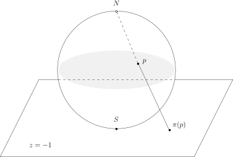

## 隐函数定理的习题

### 第三次作业 B3)

假设 $f\colon\mathbb{R}^n\rightarrow \mathbb{R}^n$ 是光滑映射，
$0$ 是 $f$ 的不动点，即 $f(0)=0$。假设 $1$ 不是 $f$ 在 $0$ 处的微分
\[
df(0)\colon\underbrace{T_{0}\mathbb{R}^n}_{\mathbb{R}^n}
\longrightarrow \underbrace{T_{0}\mathbb{R}^n}_{\mathbb{R}^n}
\]
的特征值。

- 证明，$0$ 是一个孤立的不动点，即存在开集 $U$，
  使得 $0\in U$，$f$ 在 $U$ 有且仅有 $0$ 为其不动点。

- 任意给定 $g\in C^1(\mathbb{R}^n,\mathbb{R}^n)$。对任意的 $\lambda\in \mathbb{R}$，我们定义映射
  \[
  f_\lambda\colon \mathbb{R}^n\longrightarrow \mathbb{R}^n, \ \ x\mapsto f(x)+\lambda g(x),
  \]
  证明，存在 $\varepsilon>0$，存在 $0$ 在 $\mathbb{R}^n$ 的开邻域 $V$ 以及 $C^1$ 的映射
  \[
  \omega\colon(-\varepsilon, \varepsilon)\rightarrow V,
  \ \ \lambda \mapsto \omega(\lambda),
  \]
  使得对任意的 $\lambda \in (-\varepsilon, \varepsilon)$，
  $f_\lambda$ 在 $V$ 中恰好有一个不动点 $\omega(\lambda)$。

### 第三次作业 D2)

（根对系数的光滑依赖性）
考虑实系数多项式 $P(X)= X^n + c_1 X^{n-1} + \cdots + c_n $。
如果对 $(c^*_1, \cdots, c^*_n) \in \mathbb{R}^n$，
$P(X)$ 恰好有 $n$ 个两两不同的实根
$z_1(c^*_1,\cdots,c^*_n)<\cdots<z_n(c^*_1,\cdots,c^*_n)$。
证明，存在 $(c^*_1, \cdots, c^*_n) \in \mathbb{R}^n$
的开邻域 $\Omega$ 和 $\Omega$ 上的光滑函数 $z_1,\cdots, z_n$，
使得对任意的 $(c_1,\cdots,c_n)\in \Omega$，我们有
\[
z_1(c_1,\cdots,c_n)< z_2(c_1,\cdots,c_n)<\cdots<z_n(c_1,\cdots,c_n)
\]
并且
\[
P(z_1(c_1,\cdots,c_n))=P(z_2(c_1,\cdots,c_n))=\cdots=P(z_n(c_1,\cdots,c_n))=0.
\]

## 子流形

### 子流形的切空间的线性结构（参考第六课讲义的脚注）

假设 $M\subset \mathbb{R}^n$ 是子流形，我们想要说明 $T_pM$ 是线性空间。
根据定义，存在开集 $U\subset \mathbb{R}^n$，$p\in U$，
存在开集 $V\subset \mathbb{R}^n$ 以及微分同胚，
使得 $\Phi\colon U\rightarrow V$ 是微分同胚。所以，我们有
\[
\Phi\colon M\cap U\rightarrow V \cap \mathbb{R}^d\times \{0\}.
\]
对于 $V \cap \mathbb{R}^d\times \{0\}\subset \mathbb{R}^n$ 这种情况，
我们课上已经计算了 $\Phi(p)$ 处的切空间，这是一个 $T_{\Phi(p)}\mathbb{R}^n$ 的 $d$ 维线性子空间。
另外，根据切空间的微分不变性，我们有
\[
\mathbb{R}^d \times \{0\}= T_{\Phi(p)} \Big(V \cap \mathbb{R}^d\times \{0\}\Big)= T_{\Phi(p)} \Phi(U\cap M)=d\Phi\Big|_{x=p}(T_p M).
\]
由于 $d\Phi(p)\colon T_p\mathbb{R}^n\rightarrow T_{\Phi(p)}\mathbb{R}^n$ 是线性同构，
所以，$T_p M$ 作为一个线性子空间的逆像还是线性子空间。

你是否能说明，$T_p M$ 作为线性空间结构不依赖于开集 $U\subset \mathbb{R}^n$，$p\in U$，
开集 $V\subset \mathbb{R}^n$ 以及微分同胚 $\Phi\colon U\rightarrow V$ 的选取？

### 球极投影（未完待续）

我们考虑 $\mathbb{R}^3$（用坐标 $(x,y,z)$）中的单位球面 $\mathbf{S}^2$，
令 $N=(0,0,1)$ 为其北极，$S=(0,0,-1)$ 为其南极。
我们知道，$T_S\mathbf{S}^2$ 就是平面 $z=-1$，我们用 $\Sigma$ 来表示这个平面。
对任意的 $p\in \mathbf{S}^2$，$p\neq N$，我们考虑从 $N$ 到 $p$ 的连线，
它与 $\Sigma$ 恰好相交于一个点 $\pi(p)$。于是，我们有映射
\[
\pi\colon \mathbf{S}^2-\{N\}\rightarrow \Sigma, \ \ p \mapsto \pi(p).
\]
这个映射被称作是从北极到南极切平面的**球极投影**。

- 证明，
  $\mathbb{R}^3$ 中的任意的平面（由某个线性函数 $ax+by+cz-d$ 的零点定义）与 $\mathbf{S}^2$
  的交是圆（如果非空的话，半径可以是 $0$）。我们称它们为球面上的圆。

- 证明，$\pi$ 是子流形之间的光滑映射并且给出了 $\mathbf{S}^2-\{N\}$ 与 $\Sigma$ 之间的微分同胚。

- 证明，对任意的 $p\in \mathbf{S}^2-\{N\}$，
  试计算微分 $d\pi(p)\colon T_p\mathbf{S}^2 \rightarrow \Sigma$。

- 证明，这个映射是所谓的共形映射，即它保持角度：对于任意的 $v,w \in T_p\mathbf{S}^2$，
  我们有（用 $\mathbb{R}^3$ 中的内积）
  \[
  \frac{\langle d\pi(p)(v), d\pi(p)(w)\rangle}{| d\pi(p)(v)| |d\pi(p)(w)|}=\frac{\langle v, w\rangle}{|v| |w|}.
  \]

- $\pi$ 把 $\mathbf{S}^2$ 上不过北极的圆映成圆，
  把过北极的圆映射成直线并且 $\Sigma$ 上的每个圆和直线都可以这么得到。

- 如果把 $\Sigma$ 换成其他点 $q$ 处的切空间，上面的结论是否成立？
