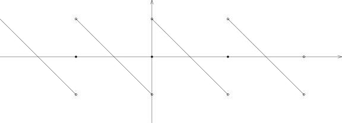
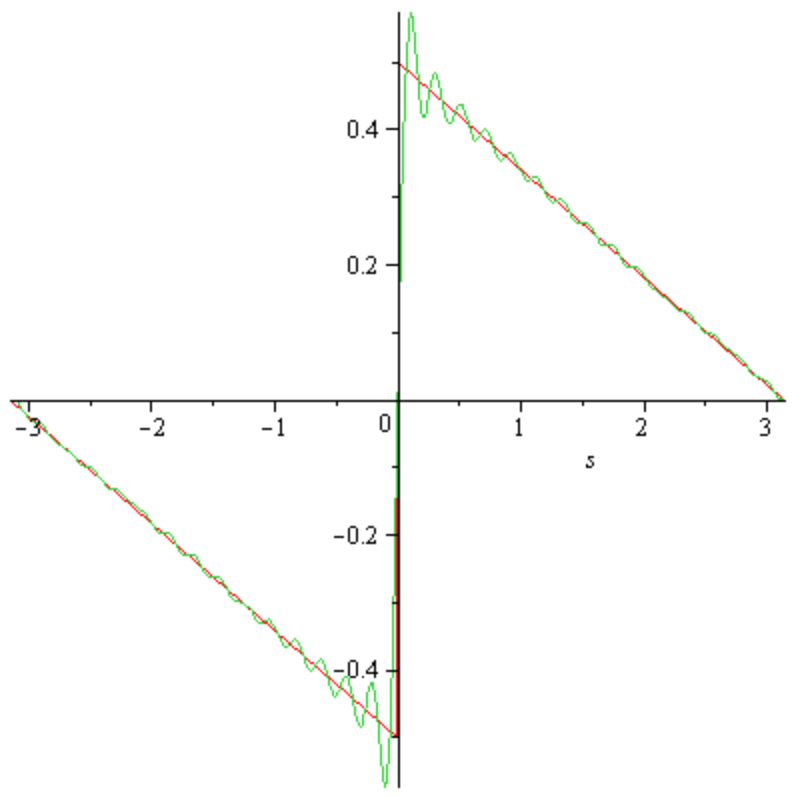

## Gibbs现象，Fourier级数

A1) 试构造数列 $\{\xi_k\}_{k\geqslant 1}\subset [0,1)$，使得它在 $[0,1)$ 上稠密却不是等分布的。

A2) 对任意的 $f,g\in L^1(\mathbf{T})$，证明，卷积在频率空间来看就是正常的乘积：
    \[
    \widehat{f*g}(k)=\widehat{f}(k)\widehat{g}(k).
    \]

A3) $f$ 是 $\mathbb{R}$ 上以 $2\pi$ 为周期的实值函数，它在 $[-\pi,\pi]$ 上是有界的单调函数。
    证明，存在常数 $C$，使得对任意的 $k\in\mathbb{Z}$，我们都有
    \[
    \big|\widehat{f}(k)\big|\leqslant \frac{C}{1+|k|}.
    \]
    （先证明 $[-\pi,\pi]$ 上有界的单调函数可以被形如
    $\displaystyle \sum_{k=1}^N \alpha_k \mathbf{1}_{[a_{k-1},a_k]}$ 的函数逼近，
    其中 $-\pi=a_0<a_1<\cdots<a_N=\pi$，$\alpha_1\leqslant \alpha_2\leqslant \cdots$）

A4) （Gibbs现象）我们定义墙头草形状的以 $2\pi$ 为周期的函数 $f$，其中，当 $x\in [0,2\pi)$ 时，
    我们有
    \[
    f(x)=\begin{cases}0, \ \ &x=0;\\
    \frac{\pi-x}{2}, \end{cases}
    \]

    

    此时，在间断点 $0$ 处，我们有 $f_+(0)-f_-(0)=\pi$。证明，$f$ 的Fourier级数可以写为
    \[
    \sum_{k\neq 0}\frac{1}{2ik}e^{ik\cdot x}=\sum_{k=1}^\infty \frac{\sin(kx)}{k}.
    \]

    {width=500}

    证明，对于部分和 $S_N(f)$，我们有
    \[
    \max_{x\in (0,\frac{\pi}{N}]}S_N(f)(x)-\frac{\pi}{2}=\int_0^\pi \frac{\sin(y)}{y}dy-\frac{\pi}{2}>0.
    \]
    这是分段 $C^1$ 函数在第一类间断点处Fourier系数收敛的典型行为，
    Fourier级数在间断点处起伏的最大值接比间断本身（$f_+(0)-f_-(0)=\pi$）要大 $8.9\%$。

A5) 假设 $f\in C(\mathbf{T})$，证明，级数
    \[
    \sum_{k\in \mathbb{Z}}\frac{\widehat{f}(k)}{k}
    \]
    是绝对收敛的。

A6) 我们定义级数
    \[
    S(x)=\sum_{n=1}^\infty\frac{\sin^3(nx)}{n!}.
    \]
    证明，$S(x)$ 是 $\mathbb{R}$ 上以 $2\pi$ 为周期的光滑函数。利用
    \[
    A(x)=\sum_{n=1}^\infty\frac{\sin(nx)}{n!},  \ \ B(x)=\sum_{n=1}^\infty\frac{\cos(nx)}{n!},
    \]
    证明，
    \[
    S(x)=\frac{3}{4}\sin\left(\sin(x)\right)e^{\cos(x)}-\frac{1}{4}\sin\left(\sin(3x)\right)e^{\cos(3x)}.
    \]

## 一个含参数积分的研究

B1) 证明，对任意的 $t\in \mathbb{R}$，如下积分是良好定义的：
    \[
    F(t)=\int_{0}^\infty \frac{1+t x^5+t^2 x^{11}}{1+t^4+x^{13}}dx.
    \]

B2) 证明，$F(t)$ 是 $t\in \mathbb{R}$ 的连续函数。

B3) 证明，$F(t)$ 是可导的。

B4) 试计算 $\displaystyle \lim_{t\rightarrow +\infty}F(t)$。

B5) 证明，对 $t\neq 0$，如下的积分是发散的：
    \[
    \int_{0}^\infty \frac{1+t x^5+t^2 x^{11}}{1+t^4+x^{12}}dx
    \]

B6) 证明，对任意的 $t\in \mathbb{R}$，如下在Riemann意义下的反常积分是良好定义的：
    \[
    G(t)=\int_{0}^\infty \frac{1+t x^5+t^2 x^{11}}{1+t^4+x^{12}}e^{ix}dx,
    \]
    即
    $\displaystyle \lim_{T\rightarrow \infty}\int_{0}^T \frac{1+t x^5+t^2 x^{11}}{1+t^4+x^{12}}e^{ix}dx$
    存在。

B7) 证明，$G(t)$ 是 $t\in \mathbb{R}$ 的连续函数。

B8) 试计算 $\displaystyle \lim_{t\rightarrow +\infty}G(t)$。

## Laplace变换的基本性质

C1) 假设 $f(t)$ 是 $\mathbb{R}_{> 0}$ 上定义的Lebesgue可积函数。我们定义它的Laplace变换为：
    \[
    (\mathcal{L} f \bigr)(x)=\int_{0}^\infty f(t)e^{-xt}dt,
    \]
    其中 $x> 0$。
    证明，$(\mathcal{L} f \bigr)(x)$ 是 $C^\infty$ 的函数。

C2) 证明，对任意的 $n\in\mathbb{Z}_{\geqslant 0}$，我们都有
    \[
    \left(\dfrac{d}{dx}\right)^n(\mathcal{L} f \bigr)(x)=\int_{0}^\infty (-t)^n f(t)e^{-xt}dt.
    \]

C3) 假设 $f(t)$ 和 $g(t)$ 是 $\mathbb{R}_{> 0}$ 上定义的Lebesgue可积函数，我们定义它们的“卷积”为
    \[
    (f\bullet g\bigr)(t)=\int_0^t f(\tau)g(t-\tau)d\tau.
    \]
    证明，$f\bullet g =g\bullet f$。

C4) 假设 $f(t)$ 和 $g(t)$ 是 $\mathbb{R}_{> 0}$ 上定义的Lebesgue可积函数。证明，
    \[
    \mathcal{L}\bigl(f\bullet g\bigr)(x)=(\mathcal{L} f \bigr)(x)(\mathcal{L} g \bigr)(x).
    \]

## Fourier级数几乎处处发散的 $L^1$-函数

::: remark*
1922年，Kolmogorov（19岁，
还在莫斯科大学读本科）在论文 *Une série de Fourier-Lebesgue divergente presque partout* 中构造一个
$L^1$ 函数，这个函数的Fourier级数的部分和几乎处处是发散的。
这个问题的目的就是重现这个著名反例的构造。
:::

先固定一个自然数 $n\geqslant 10000$（在接下来的过程中它会变化）。
我们任意选取 $n$ 个正的奇数
$\lambda_1<\lambda_2<\cdots<\lambda_n$（我们将在接下来的过程中确定它们的大小）。
定义如下的数组，函数和区间：

- $\{m_k\}_{1\leqslant k \leqslant n}$。我们令 $m_1=n$，并且归纳地定义 $2m_k+1 = \lambda_k (2n+1)$。

- $\{A_k\}_{1\leqslant k \leqslant n}$，其中 $A_k = \dfrac{4k\pi}{2n+1}$。

- $\phi_n(x)=\displaystyle \sum_{k=1}^n \frac{m_k^2}{n}\mathbf{1}_{\Delta_k}(x)$，
  其中区间 $\Delta_k = [A_k-m_k^{-2},A_k+m_k^{-2}]$。

- 对于 $k=2,3,\cdots,n$，我们定义区间 $\sigma_k=[A_{k-1}+2n^{-2},A_k-2n^{-2}]$。

根据Dirichlet核函数的基本性质，我们知道Fourier级数的部分和可以由下面的公式计算：
\[
S_{m_k} \phi_n (x)=\sum_{|j| \leqslant m_k} \widehat{\varphi_n}(j)e^{\sqrt{-1}jx}=\int_{0}^{2\pi} \phi_n(t) \frac{\sin\bigl((m_k+\frac{1}{2})(x-t)\bigr)}{\sin\bigl(\frac{1}{2}(x-t)\bigr)}\frac{dt}{2\pi}.
\]
仿照这个形式，我们定义
\[
I_{m_k,\Delta_s}(x)=\int_{\Delta_s} \frac{m_s^2}{n} \frac{\sin\bigl((m_k+\frac{1}{2})(x-t)\bigr)}{\sin\bigl(\frac{1}{2}(x-t)\bigr)}\frac{dt}{2\pi}
\]

K1) 证明，
    \[
    \int_{0}^{2\pi}\phi_n(x)=2 \ \ \text{并且}  \ \ S_{m_k} \phi_n (x)=\sum_{s=1}^n I_{m_k,\Delta_s}(x).
    \]

- K2**) 证明，
  $\displaystyle \sup_{N\in \mathbb{Z}_{\geqslant 0} \atop x\in [0,2\pi]}\big|\bigl(S_N\phi_n\bigr)(x)\big|<\infty$。
  （提示：可以参考关于有界变差函数的Fourier级数的Jordan定理的证明过程）

- K3*) 证明，我们可以归纳地选取（足够大的）正奇数 $\lambda_1<\lambda_2<\cdots<\lambda_n$，
  使得区间 $\{\sigma_\ell,\Delta_j\}_{\ell\leqslant n-1, j\leqslant n}$ 两两不相交并且对任意的
  $k\geqslant 2$ 和任意的 $x\in \sigma_k$，我们都有
  \[
  \big|\sum_{s=1}^{k-1} I_{m_k,\Delta_s}(x)\big|\leqslant 1.
  \]
  （提示：如果 $\lambda_1,\cdots, \lambda_{k-1}$ 已经选择好了，
  那么我们通过 $\lambda_k$ 的选择就可以使得 $m_k$ 足够大）

K4) 证明，
    Dirichlet核函数 $D_{m_k}(x)=\begin{cases}\dfrac{\sin\bigl((m_k+\frac{1}{2})x\bigr)}{\sin\bigl(\frac{x}{2}\bigr)}, \ \ x\neq0;\\
2m_k+1, \ \ x=0\end{cases}$ 满足
    \[
    \big|D_{m_k}'(x)\big|\leqslant 2m_k^2.
    \]

K5) 证明，当 $s\geqslant k$ 的时候，对任意的 $x\in \sigma_k$，
    我们可以将 $I_{m_k,\Delta_s}(x)$ 写成
    \[
    \begin{aligned}
    I_{m_k,\Delta_s}(x)&=\frac{1}{n\pi} \frac{\sin\bigl((m_k+\frac{1}{2})(x-A_s)\bigr)}{\sin\bigl(\frac{1}{2}(x-A_s)\bigr)}\\
    & \ \ +\overbrace{\int_{\Delta_s} \frac{m_s^2}{n} \left(\frac{\sin\bigl((m_k+\frac{1}{2})(x-t)\bigr)}{\sin\bigl(\frac{1}{2}(x-t)\bigr)}- \frac{\sin\bigl((m_k+\frac{1}{2})(x-A_s)\bigr)}{\sin\bigl(\frac{1}{2}(x-A_s)\bigr)}\right)\frac{dt}{2\pi}}^{\mathbf{I}_{k,s}},
    \end{aligned}
    \]
    并且我们有如下的控制：$|\mathbf{I}_{k,s}|\leqslant \dfrac{4}{n}$。

K6) 证明，对任意的 $x\in \sigma_k$，我们都有
    \[
    \big|\sum_{s = k}^n I_{m_k,\Delta_s}(x)\big| \geqslant \frac{\big|\sin\bigl((m_k+\frac{1}{2})(x-A_k)\bigr)\big|}{n\pi}\Big|\sum_{s=k}^n \frac{1}{\sin\bigl(\frac{1}{2}(x-A_s)\bigr)}\Big|-4.
    \]

K7) 证明，对任意的 $x\in \sigma_k$，我们有
    \[
    \frac{1}{n}\sum_{s=k}^n \frac{1}{\sin\bigl(\frac{1}{2}(x-A_s)\bigr)}\geqslant \frac{1}{\pi}\sum_{\ell=1}^{n-k} \frac{1}{\ell}.
    \]

K8) 证明，如果 $2\leqslant k\leqslant n-\sqrt{n}$，对任意的 $x\in \sigma_k$，我们有
    \[
    \big|\sum_{s = k}^n I_{m_k,\Delta_s}(x)\big| \geqslant \frac{\big|\sin\bigl((m_k+\frac{1}{2})(x-A_k)\bigr)\big|}{2\pi^2}\log(n)-8.
    \]

K9) 证明，如果 $m_2$ 选取的足够大，那么如下集合的Lebesgue测度满足
    \[
    m\Bigl(\Bigl\{x\in [A_{k-1},A_k] \Bigm| \big|\sin\bigl((m_k+\frac{1}{2})(x-A_k)\bigr)\big|< \frac{2\pi^2}{\sqrt{\log(n)}} \Bigr\}\Bigr)=O(\frac{1}{n\sqrt{\log(n)}}).
    \]

K10) 我们定义
     \[
     E_n=\bigcup_{2\leqslant k\leqslant n-\sqrt{n}} E_{n,k}, \ \text{其中} \ E_{n,k}=\Bigl\{x\in \sigma_k\Bigm|  \big|\sin\bigl((m_k+\frac{1}{2})(x-A_k)\bigr)\big|\geqslant \frac{2\pi^2}{\sqrt{\log(n)}} \Bigr\}
     \]
     证明，$\displaystyle \lim_{n\rightarrow \infty}m\bigl(E_n\bigr)=2\pi$。

K11) 证明，对任意的 $2\leqslant k \leqslant n-\sqrt{n}$ 和 $x\in E_{n,k}$，我们都有
     \[
     |S_{m_k} \phi_n (x)|\geqslant \sqrt{\log(n)}-9.
     \]

K12) 证明，存在以 $2\pi$ 为周期的函数列 $\{\phi_n(x)\}_{n\geqslant 10000}$，使得

     a) 对任意的 $n$，我们有 $\phi_n(x)\geqslant 0$，
        $\displaystyle \int_0^{2\pi} \phi_n=2$ 并且
        $\displaystyle \sup_{N\in \mathbb{Z}_{\geqslant 0}, \atop x\in [0,2\pi]}\big|\bigl(S_N\phi_n\bigr)(x)\big|<\infty$；

     b) 存在子区间序列 $\{E_n\}_{n\geqslant 10000}$，
        正整数序列 $\{q_n\}_{n\geqslant 10000}$ 以及单调上升的正数序列
        $\{M_n\}_{n\geqslant 10000}$，
        使得 $\displaystyle \lim_{n\rightarrow \infty}M_n=\infty$，
        $\displaystyle \lim_{n\rightarrow \infty}m\bigl(E_n)=2\pi$ 并且对任意的 $x\in E_n$，
        存在正整数 $N_x\leqslant q_n$，使得 $|S_{N_x} \phi_n (x)|\geqslant M_n$。

     （提示：选取 $q_n=m_n$ 即可）

K13) 证明，存在以 $2\pi$ 为周期的函数列 $\{\varphi_n(x)\}_{n\geqslant 1}$，
     子区间序列 $\{E_n\}_{n\geqslant 1}$，
     正整数序列 $\{q_n\}_{n\geqslant 1}$ 以及单调上升的正数序列 $\{M_n\}_{n\geqslant 1}$，使得

     a) $M_1\geqslant 2$ 并且对任意的 $n$，我们有 $M_n\geqslant 2M_{n-1}$；

     b) 对任意的 $n$，我们有 $\varphi_n(x)\geqslant 0$，
        $\displaystyle \int_0^{2\pi} \varphi_n=2$ 并且
        $\displaystyle \sum_{1\leqslant k\leqslant n-1}\sup_{N\in \mathbb{Z}_{\geqslant 0} \atop x\in [0,2\pi]}\big|\bigl(S_N\varphi_k \bigr)(x)\big|<\dfrac{\sqrt{M_n}}{2}$；

     c) $\displaystyle \sup_{1\leqslant k \leqslant n-1}q_k \leqslant \dfrac{\sqrt{M_n}}{2^n}$；

     d) $\displaystyle \lim_{n\rightarrow \infty}m\bigl(E_n)=2\pi$ 并且对任意的 $x\in E_n$，
        存在正整数 $N_x\leqslant q_n$，使得 $|S_{N_x} \varphi_n (x)|\geqslant M_n$。

     （提示：选取上面的题目中的函数的子序列）

K14) 利用上一个小题的结论，我们构造
     \[
     f(x)=\sum_{n=1}^\infty \frac{\varphi_n(x)}{\sqrt{M_n}}.
     \]
     证明，$f$ 在 $L^1([0,2\pi])$ 中是良好定义的并且这个级数对几乎处处的 $x\in [0,2\pi]$ 都收敛。

K15) 证明，$f(x)$ 的Fourier变换的部分和可以写成
     \[
     (S_N f)(x)= \Bigl(S_N \frac{\varphi_n(x)}{\sqrt{M_n}}\Bigr)(x)+ \sum_{s\leqslant n-1} \Bigl(S_N \frac{\varphi_s(x)}{\sqrt{M_s}}\Bigr)(x)+\sum_{s\geqslant n+1} \Bigl(S_N \frac{\varphi_s(x)}{\sqrt{M_s}}\Bigr)(x).
     \]

K16) 证明，对任意的 $x\in E_n$，都存在一个 $N_x\leqslant \dfrac{\sqrt{M_n}}{2^n}$，
     使得 $\Big|\Bigl(S_{N_x} \frac{\varphi_n(x)}{\sqrt{M_n}}\Bigr)(x)\Big|\geqslant \sqrt{M_n}$。

K17) 证明，对任意的 $N$，
     我们都有
     $\displaystyle\Big|\sum_{s\leqslant n-1} \Bigl(S_N \frac{\varphi_s(x)}{\sqrt{M_s}}\Bigr)(x)\Big|\leqslant \dfrac{1}{2}\sqrt{M_n}$。

K18) 证明，
     $\displaystyle\Big|\sum_{s\geqslant n+1} \Bigl(S_N \frac{\varphi_s(x)}{\sqrt{M_s}}\Bigr)(x)\Big|\leqslant \dfrac{100}{2^n}$。
     （提示：把Dirichlet核函数用它的最大值来控制）

K19) 证明，对几乎处处的 $x\in [0,2\pi]$，
     $\displaystyle \lim_{N\rightarrow \infty}(S_N f)(x)$ 都发散。

K20) 证明，$f\notin L^2([0,2\pi])$。

::: remark*
Lennart Carleson在1965年证明了一个著名的定理，这个定理完整地解决了Lusin猜想：
如果 $f\in L^2([0,2\pi])$，
那么 $\displaystyle \lim_{N\rightarrow \infty}(S_N f)(x)$ 几乎处处收敛到 $f(x)$。
这一项工作是Carleson获得了Wolf奖和Abel奖的最主要贡献之一。
Lusin是Kolmogorov在莫斯科读大学时数学分析的老师。
:::

::: remark* (寄语)
The purpose of computing is insight, not numbers.

<align right>
——Richard Hamming
</align>
:::
