## 课堂补充

- A1)（闭子空间）$(H,\langle\cdot, \cdot \rangle)$ 是Hilbert空间，$V\subset H$
  是其线性子空间。我们假设 $V$ 是 $H$ 中的闭集（相对于 $H$ 上由内积所定义的距离函数而言）。
  证明，对任意的 $v_1,v_2\in V$，如果我们仍用 $\langle v_1,v_2\rangle$ 作为 $V$ 上的内积，
  那么 $\bigl(V,\langle \cdot,\cdot\rangle\bigr)$ 是Hilbert空间。

  证明，对于 $H=L^2(\mathbb{R}^n)$，$V=C(\mathbb{R}^n)\cap L^2(\mathbb{R}^n)$ 不是闭子空间。

- A2) 给定 $L^2(X,\mathcal{A},\mu)$ 中的函数序列 $\{f_i\}_{i\geqslant 1}$，
  我们假设它们在 $L^2$ 范数下收敛到 $f$，即
  \[
  f_i \stackrel{L^2(X,\mathcal{A},\mu)}{\longrightarrow} f,  \  i\rightarrow \infty.
  \]
  那么，存在子函数序列 $\{f_{i_p}\}_{p\geqslant 1}$，使得对几乎处处的 $x\in X$，我们都有
  \[
  \lim_{p\rightarrow\infty }f_{i_p}(x)=f(x).
  \]

- A3) 证明，$\bigl(L^1(\mathbb{R}^n),*\bigr)$ 中没有单位元，
  即不存在 $e\in L^1(\mathbb{R}^n)$，使得对任意的 $f\in L^1(\mathbb{R}^n)$，都有 $e*f=f$。

- A4) 证明，$C^\infty_0(\mathbb{R}^n)$ 是 $L^2(\mathbb{R}^n)$ 的稠密子空间。

- A5) 举例说明 $C(\mathbb{R}^n)\subset L^\infty(\mathbb{R}^n)$ 不是稠密的。

- A6) 证明，$C^\infty(\mathbb{R}^n) \cap  L^\infty(\mathbb{R}^n)$
  在 $C(\mathbb{R}^n) \cap L^\infty(\mathbb{R}^n)$ 中稠密（对 $\|\cdot\|_{L^\infty}$ 而言）。

- A7) 假设 $(H,\langle\cdot, \cdot \rangle)$ 是Hilbert空间，$V\subset H$
  是线性子空间。证明，$V$ 在 $H$ 中稠密当且仅当对任意的 $x\perp V$ 一定有 $x=0$。

- A8) 试证明，$L^2(\mathbb{R}^n)$ 是可分的。（可以参考讲义中的提示）

- A9)（重要）假设 $f\in L^1(\mathbb{R}^n)$ 并且 $\displaystyle \int_{\mathbb{R}^n}f(x)dx=1$，
  我们定义
  \[
  f_\varepsilon(x)=\frac{1}{\varepsilon^n}f\left(\frac{x}{\varepsilon}\right).
  \]
  证明，对任意的有紧支集的连续函数 $\varphi$，我们都有如下的一致收敛：
  \[
  f_\varepsilon*\varphi \rightarrow \varphi, \ \ \varepsilon \rightarrow 0.
  \]

## 控制收敛与Fubini定理的复习

### 含参数积分的研究

- B1) 证明，对任意的 $t\in \mathbb{R}$，如下积分是良好定义的：
  \[
  F(t)=\int_{0}^\infty \frac{1+t x^5+t^2 x^{11}}{1+t^4+x^{13}}dx.
  \]

- B2) 证明，$F(t)$ 是 $t\in \mathbb{R}$ 的连续函数。

- B3) 证明，$F(t)$ 是可导的。

- B4) 试计算 $\displaystyle \lim_{t\rightarrow +\infty}F(t)$。

- B5) 证明，对 $t\neq 0$，如下的积分是发散的：
  \[
  \int_{0}^\infty \frac{1+t x^5+t^2 x^{11}}{1+t^4+x^{12}}dx
  \]

- B6) 证明，对任意的 $t\in \mathbb{R}$，如下在Riemann意义下的反常积分是良好定义的：
  \[
  G(t)=\int_{0}^\infty \frac{1+t x^5+t^2 x^{11}}{1+t^4+x^{12}}e^{ix}dx,
  \]
  即
  $\displaystyle \lim_{T\rightarrow \infty}\int_{0}^T \frac{1+t x^5+t^2 x^{11}}{1+t^4+x^{12}}e^{ix}dx$
  存在。

- B7) 证明，$G(t)$ 是 $t\in \mathbb{R}$ 的连续函数。

- B8) 试计算 $\displaystyle \lim_{t\rightarrow +\infty}G(t)$。

### Laplace变换的基本性质

- C1) 假设 $f(t)$ 是 $\mathbb{R}_{> 0}$ 上定义的Lebesgue可积函数。我们定义它的Laplace变换为：
  \[
  (\mathcal{L} f \bigr)(x)=\int_{0}^\infty f(t)e^{-xt}dt,
  \]
  其中 $x> 0$。
  证明，$(\mathcal{L} f \bigr)(x)$ 是 $C^\infty$ 的函数。

- C2) 证明，对任意的 $n\in\mathbb{Z}_{\geqslant 0}$，我们都有
  \[
  \left(\dfrac{d}{dx}\right)^n(\mathcal{L} f \bigr)(x)=\int_{0}^\infty (-t)^n f(t)e^{-xt}dt.
  \]

- C3) 假设 $f(t)$ 和 $g(t)$ 是 $\mathbb{R}_{> 0}$ 上定义的Lebesgue可积函数，我们定义它们的“卷积”为
  \[
  (f\bullet g\bigr)(t)=\int_0^t f(\tau)g(t-\tau)d\tau.
  \]
  证明，$f\bullet g =g\bullet f$。

- C4) 假设 $f(t)$ 和 $g(t)$ 是 $\mathbb{R}_{> 0}$ 上定义的Lebesgue可积函数。证明，
  \[
  \mathcal{L}\bigl(f\bullet g\bigr)(x)=(\mathcal{L} f \bigr)(x)(\mathcal{L} g \bigr)(x).
  \]

## Stokes公式的应用：波动方程的局部能量估计

假设 $u(t,x)$ 是 $\mathbb{R}\times \mathbb{R}^3$ 上的光滑函数，
这里空间变量 $x\in \mathbb{R}^3$，时间变量 $t\in \mathbb{R}$。我们假设 $u$ 满足波动方程：
\[
\Box u = 0,
\]
其中波动算子的定义如下：
\[
\Box = \displaystyle -\frac{\partial^2}{\partial t^2}+\triangle = -\frac{\partial^2}{\partial t^2}+\frac{\partial^2}{\partial x_1^2}+\frac{\partial^2}{\partial x_2^2}+\frac{\partial^2}{\partial x_3^2}.
\]
我们令 $u_0(x)=u(0,x)$，$u_1(x)=\displaystyle \frac{\partial u}{\partial t}(0,x)$，
这样的一对函数 $(u_0,u_1)$ 被称作是波动方程的**初始值**。

我们做如下的假设：对任意的时间 $t\in \mathbb{R}$，$u(t,x)$ 对 $x$ 而言有紧支集。

- D1) 我们定义波动方程的能量函数
  \[
  E(t)=\displaystyle \frac{1}{2}\int_{\mathbb{R}^3} \Big|\frac{\partial u}{\partial t}(t,x)\Big|^2+|\nabla u (t,x)|^2 dx.
  \]
  证明能量守恒定律：对任意的时刻 $t\in \mathbb{R}$，有
  \[
  E(t)=E(0).
  \]

- D2) 对于 $i=1,2,3$，我们定义波动方程的动量函数
  \[
  P_i(t)=\displaystyle  \int_{\mathbb{R}^3} \frac{\partial u}{\partial t} \frac{\partial u}{\partial x_i}dx.
  \]
  证明动量守恒定律：对任意的时间 $t$，有
  \[
  P_i(t)=P_i(0).
  \]

- D3)（解的唯一性）假设 $u(t,x)$ 和 $v(t,x)$ 都满足波动方程以及上面的假设。
  证明，如果它们具有相同的初始值，即 $u_0(x)=v_0(x)$，$u_1(x)=v_1(x)$，
  那么 $u(t,x)\equiv v(t,x)$。

- D4) 任意给定 $R>0$，假设 $r\leqslant R$。
  我们在时空 $\mathbb{R}\times \mathbb{R}^3$ 中定义如下的几何对象：

  

  - 实心锥 $\mathbf{D}=\{(t,x)\mid t\in [0, R], |x|\leqslant R-t\}$。
    这是顶点在 $(t,x)=(R,0)$ 处的一个实心锥。

  - 实心圆台
    $\mathbf{D}_{0\leqslant t \leqslant r}=\{(t,x)\mid t\in [0, r], |x|\leqslant R-t\}$（图中两个淡蓝色圆盘之间的区域）。

  - 圆锥截面
    $\mathbf{C}_{0\leqslant t \leqslant r}=\{(t,x)\mid t\in [0, r], |x| = R-t\}$（图中的灰色区域所代表的表面）。

  - 不同时刻的球面 $\mathbf{B}_t =\{(t,x)\mid|x|\leqslant R-t\}$（图中淡蓝色的圆盘区域）。

  给定 $(t_0,x_0) \in \mathbf{C}_{0\leqslant t \leqslant r}$。证明，
  $\mathbf{C}_{0\leqslant t \leqslant r}$ 在这一点处的切空间由以下三个向量张成（球坐标系）
  \[
  L=\frac{\partial}{\partial t}-\frac{\partial}{\partial r}, \ \ e_1= \frac{1}{r}\frac{\partial}{\partial \vartheta}, \ \ e_2=\frac{1}{r\sin\vartheta}\frac{\partial}{\partial \varphi}.
  \]
  作为传统的记号，我们记
  $|\mathbf{/}\!\!\!\!\nabla u|^2=|\nabla_{e_1} u|^2+|\nabla_{e_2} u|^2$。

- D5)\*\* 我们定义局部能量
  \[
  E_{\rm loc}(t)=\displaystyle \frac{1}{2}\int_{\mathbf{B}_t} \Big|\frac{\partial u}{\partial t}(t,x)\Big|^2+|\nabla u (t,x)|^2 dx.
  \]
  证明，对任意的 $r\leqslant R$，我们都有
  \[
  E_{\rm loc}(0)=E_{\rm loc}(r)+\int_{\mathbf{C}_{0\leqslant t \leqslant r}} |\nabla_L u|^2+|\mathbf{/}\!\!\!\!\nabla u|^2 d\sigma.
  \]
  （提示：对 $\Box u=0$ 两边同时乘以 $ \dfrac{\partial u}{\partial t}$
  并在区域 $\mathbf{D}_{0\leqslant t \leqslant r}$ 上积分，
  你需要运用Stokes公式来得到边界上的积分）

- D6)\*（波方程的有限传播速度）我们现在只假设 $u(t,x)$ 是光滑的。证明，
  如果 $u_0$ 和 $u_1$ 有紧支集，那么对任意的时刻 $t$，$u(t,x)$ 对 $x$ 有紧支集。

- D7)\* 假设 $u(t,x)$ 是光滑函数并且满足非线性波动方程
  \[
  -\frac{\partial^2}{\partial t^2}u+\triangle u = u^3.
  \]
  证明，如果 $u_0$ 和 $u_1$ 有紧支集，那么对任意的时刻 $t$，$u(t,x)$ 对 $x$ 有紧支集。

::: -remark [寄语]
In order to solve this differential equation you look at it until a solution occurs to you.

<align right>
——George Pólya
</align>
:::
