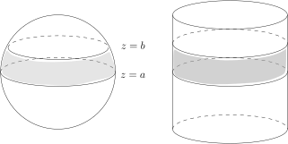
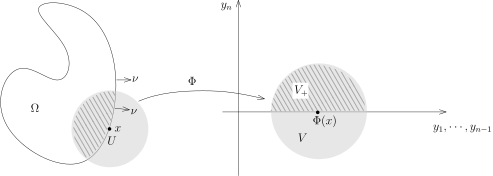
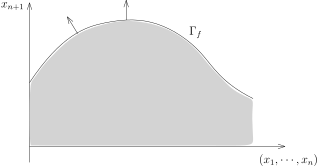
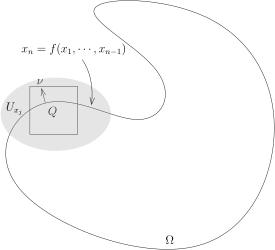

## Fubini公式的一个应用

先补充Fubini公式的一个应用：

::: example*
令 $c_n=m(B(1)\subset \mathbb{R}^n)$ 为 $\mathbb{R}^n$ 中单位球的体积，我们来计算所有的 $c_n$。
对于 $n\geqslant 1$，我们令
\[
B'_a=B(1)\cap \{x_n=a\}.
\]
它的半径长为 $\sqrt{1-a^2}$

此时，我们有
\[
\begin{aligned}
c_n&=m(B(1))=\int_{-1}^1 m(B'_{x_n})dx_n\\
&=2\int_{0}^1 (1-x_n^2)^{\frac {n-1} 2}c_{n-1}dx_n\\
&=2c_{n-1}\int_{0}^\frac{\pi}{2} \sin^n \theta d\theta.
\end{aligned}
\]
其中，我们用了变元替换 $x_n=\cos\theta$。
我们注意到，
$I_n=\displaystyle \int_0^{\frac{\pi}{2}}\sin^n \theta d\theta$ 是我们上个学期研究过的Wallis积分，
其中，
\[
I_{2p}=\frac{(2p)!}{2^{2p}(p!)^2}\frac{\pi}{2}, \ \ I_{2p+1}=\frac{2^{2p}(p!)^2}{(2p+1)!}.
\]
从而，我们可以递归地计算 $c_n$。特别地，我们有
\[
c_{2n}=\frac{\pi^n}{n!}.
\]
根据递归公式，我们很容易证明
\[
\lim_{n\rightarrow \infty}c_n=0.
\]
这说明当 $n$ 变大时，$\mathbb{R}^n$ 中单位球的体积趋于 $0$。
另外，如果借助计算器的话，我们可以很快看到 $c_5$ 是最大的。
:::

我们上次课讲过，如果给定函数图像 $\Gamma_f$，那么它上面的积分可以用如下的公式来计算：
\[
\int_{\Gamma_f}\varphi d\sigma = \int_{\mathbb{R}^{n-1}}\varphi\bigl(x,f(x)\bigr)\sqrt{1+|\nabla f(x)|^2}dx.
\]

我们现在来看几个经典的例题：

::: example* [Archimedes]
考虑 $\mathbf{S}^2\subset \mathbb{R}^3$ 是标准的单位球面，对于 $a,b\in [-1,1]$，我们令
\[
\mathbf{S}^2(a,b)=\bigl\{(x,y,z) \in\mathbf{S}^2\bigm| a\leqslant z \leqslant b\bigr\}.
\]
我们令 $\mathbf{C}$ 为与 $z$-轴平行的圆柱面，
并且这个圆柱面的直径是 $2$（恰好可以套在 $\mathbb{S}^2$ 上）。对于 $a,b\in [-1,1]$，我们令
\[
\mathbf{C}(a,b)=\bigl\{(x,y,z)\in \mathbb{R}^3\bigm| x^2+y^2=1, a\leqslant z \leqslant b\bigr\}.
\]

这是两个平行的平面在 $\mathbf{S}^2$ 或者 $\mathbf{C}$ 上所截出的带状区域（图中的灰色区域）。
Archimedes的一个著名定理说，$\mathbf{S}^2(a,b)$ 的面积和 $\mathbf{C}(a,b)$ 的面积相等。
我们来证明这个命题。

我们不妨假设 $a=0,b>0$（从这一点出发很容易证明Archimedes的定理，
这是因为我们将看到 $\mathbf{C}(a,b)$ 的面积正比于 $b-a$），此时，
$\mathbf{S}^2(a,b)$ 可以写成函数的图像：
\[
\mathbf{S}^2(0,b)=\bigl\{(x,y,z)\in \mathbb{R}^3\bigm| z=\sqrt{1-x^2-y^2}, 1\geqslant x^2+y^2\geqslant 1-b^2\bigr\}.
\]
此时，$f(x,y)=\sqrt{1-x^2-y^2}$，所以
\[
d\sigma= \sqrt{1+| \nabla f(x)|^2}dxdy=\sqrt{\frac{1}{1-x^2-y^2}}dxdy.
\]
所以，
\[
\begin{aligned}
\sigma(\mathbf{S}^2(0,b))&=\int_{1\geqslant x^2+y^2\geqslant 1-b^2}\sqrt{\frac{1}{1-x^2-y^2}}dxdy\\
&=\int_{\sqrt{1-b^2}}^1\int_0^{2\pi}\sqrt{\frac{1}{1-r^2}}rd\theta dr\\
&=2\pi \int_{\sqrt{1-b^2}}^1\sqrt{\frac{1}{1-r^2}}rdr\\
&=\pi \int_{{1-b^2}}^1\sqrt{\frac{1}{1-t}}dt\\
&=-2\pi\sqrt{1-t}\big|_{{1-b^2}}^1=2\pi b.
\end{aligned}
\]

现在计算 $\mathbf{C}(0,b)$ 的面积，由对称性，我们把 $x$ 看成是 $y$ 和 $z$ 的函数，由对称性，
我们假设 $x\geqslant 0$，所以，只要算如下图形的面积即可：
\[
\mathbf{C}^+(0,b)=\bigl\{(x,y,z)\in \mathbb{R}^3\bigm| x=\sqrt{1-y^2}, -1\leqslant y\leqslant 1, 0\leqslant z\leqslant b\bigr\}.
\]
所以，我们有 $f(y,z)=\sqrt{1-y^2}$，从而，
\[
d\sigma= \sqrt{\frac{1}{1-y^2}}dydz.
\]
所以，
\[
\begin{aligned}
\sigma(\mathbf{C}^+(0,b))&=\int_{[-1,1]\times [0,b]}\sqrt{\frac{1}{1-y^2}}dydz\\
&=b\int_{-1}^{1}\sqrt{\frac{1}{1-y^2}}dy\\
&=b\pi.
\end{aligned}
\]
从而，
\[
\sigma(\mathbf{C}(0,b))=2\sigma(\mathbf{C}^+(0,b))=\sigma(\mathbf{S}^2(0,b)).
\]

我们还可以采取参数化的形式来计算 $\mathbf{S}^{2}(a,b)$ 的面积，比如说，我们可以利用球面坐标系：
\[
\Phi\colon(0,\pi)\times (0,2\pi) \rightarrow \mathbf{S}^2,\ \ (\theta,\varphi)\mapsto (\sin(\theta)\cos(\varphi),\sin(\theta)\sin(\varphi),\cos(\theta)).
\]

由于 $z=\cos\theta$，所以 $\mathbf{S}^{2}(a,b)$ 由 $\theta\in [\arccos b,\arccos a]$ 所定义。
此时，我们有
\[
^t{\rm Jac}(\Phi) = \left( {\begin{array}{ccc}
\cos\theta \cos(\varphi)&     \cos\theta \sin(\varphi) & -\sin\theta \\
  -\sin\theta \sin(\varphi)&     \sin\theta \cos(\varphi) & 0\\
\end{array} } \right) \ \ \Rightarrow \ \ \operatorname{det} G_\Phi= \sin^2\theta.
\]
所以，$d\sigma = \sin\theta d\theta d\varphi$，从而
\[
\begin{aligned}
\sigma(\mathbf{S}^2(0,b))&=\int_{(0,\pi)\times (0,2\pi)}\sin\theta d\theta d\varphi\\
&=2\pi \int_{\arccos b}^{\arccos a} \sin\theta d\theta\\
&=2\pi (b-a).
\end{aligned}
\]

我们可以类似地计算 $\mathbf{C}(0,b)$ 的面积，考虑参数化
\[
\Phi\colon(0,2\pi)\times (a,b) \rightarrow \sigma(\mathbf{C}(0,b)),\ \ (\theta, s)\mapsto (\cos(\theta),\sin(\theta),s).
\]
从而，
\[
^t{\rm Jac}(\Phi) = \left( {\begin{array}{ccc}
-\sin\theta &     \cos\theta  &0 \\
  0 &   0& 1\\
\end{array} } \right) \ \ \Rightarrow \ \ \operatorname{det} G_\Phi= 1.
\]
所以，$d\sigma = d\theta ds$，从而
\[
\sigma(\mathbf{C}(0,b))=\int_{(0,2\pi)\times (a,b)} d\theta ds=2\pi (b-a).
\]
:::

## Stokes公式

我们先给出Stokes公式的第一个证明，其想法是把整体的公式转换为局部上的公式。
为此，我们先证明一种特殊形式的单位分解定理，这是一个技术性的引理。

::: remark* [截断函数的存在性]
我们在上个学期作业七习题F中（截断函数部分）构造了函数 $\psi(x)\in C^{\infty}(\mathbb{R})$，
使得 $\psi(x)\geqslant 0$，在 $[-1,1]$ 上恒为 $1$，在 $[-2,2]$ 之外恒为零。
另外，这个 $\psi$ 还是偶函数，并且在 $[1,2]$ 之间是单调下降的。

我们现在来构造 $\mathbb{R}^n$ 上的光滑截断函数 $\varphi(x)\in C^\infty(\mathbb{R}^n)$，其中
\[
\varphi(x)=\psi(x_1^2+\cdots+x^2_n)=\psi(r^2).
\]

很明显，$\varphi$ 只依赖于变量 $r$，它半径为 $2$ 的球之外恒为 $0$，
在半径为 $1$ 的球之上恒为 $1$ 并且这是一个对于半径 $r$ 递减的函数。

我们还可以构造 $\mathbb{R}^n$ 上的光滑截断函数 $\chi(x)\in C^\infty(\mathbb{R}^n)$，其中
\[
\chi(x)=\psi(x_1)\psi(x_2)\cdots\psi(x_n).
\]

很明显，这个函数是光滑的正函数，它在一个中心在原点并且边长为 $2$ 的正方体上恒为 $1$，
在中心在原点并且边长为 $4$ 的正方体之外恒为 $0$。

我们强调，这类函数具体构造并不重要，我们只用上面所列举的几条性质。
:::

我们要构造一个与格点 $\mathbb{Z}^n\subset \mathbb{R}^n$ 相容的单位分解。
为此，首先定义 $\mathbb{R}^n$ 上的函数：
\[
F(x)=\sum_{(k_1,\cdots,k_n)\in \mathbb{Z}^n}\chi(x_1+k_1, \cdots, x_n+k_n).
\]
这个函数是良好定义的：对于给定的 $x=(x_1,\cdots,x_n)\in \mathbb{R}^n$，这是一个有限和，
因为当某个 $|k_i+x_i|\geqslant 2$ 时，$\chi(x_1+k_1, \cdots, x_n+k_n)=0$，所以，
有贡献的项只是 $\mathbb{Z}^n$ 与中心在 $x$ 处边长为 $4$ 的正方体中的格点，这自然是一个有限集。

特别地，$F$ 是光滑函数并且以 $\mathbb{Z}^n$ 为周期的周期函数，
即对任意的 $(k_1,\cdots,k_n)\in \mathbb{Z}^n$，我们有
\[
F(x_1+k_1,\cdots,x_n+k_n)=F(x_1,\cdots,x_n).
\]

另外，根据 $\chi$ 的构造，对任意的 $x$，我们都有 $F(x)>0$。
据此，对每个 $\mathbf{k}=(k_1,\cdots,k_n)\in \mathbb{Z}^n$，我们可以定义
\[
F_{\mathbf{k}}(x_1,\cdots,x_n)=\frac{\chi(x_1-k_1,\cdots,x_n-k_n)}{F(x)},
\]
我们得到了一组有紧支集[^1]的光滑函数 $F_{\mathbf{k}}$，使得对任意的 $x\in \mathbb{R}^n$，我们有
\[
\displaystyle\sum_{\mathbf{k}\in \mathbb{Z}^n}F_{\mathbf{k}}(x)=1.
\]
对任意的 $\mathbf{k}\in \mathbb{Z}$，
${F}_{\mathbf{k}}$ 在某个中心在格点上面并且边长为 $4$ 的正方体之外恒为
$0$（本来在某个小一点的正方体上恒为 $1$ 的性质由于除以 $F$ 所以不再成立）。

我们现在任意固定一个（很大的）正整数 $N\geqslant 1$。对每个 $\mathbf{k}\in \mathbb{Z}$，我们定义
\[
\chi_{\mathbf{k}}(x)=F_{\mathbf{k}}(2^{N+1} x).
\]
那么，${\chi}_{\mathbf{k}}$ 在某个边长为 $2^{-N}$ 的正方体上恒为 $1$，
把这个正方体扩大一倍之后（边长为 $2^{-N+1}$），${\chi}_{\mathbf{k}}$ 在这个大正方体之外恒为 $0$。
特别地，这两个正方体的中心落在
$2^{-{N+1}}\mathbb{Z}^n$ 中（这是更密的格点）。
我们自然还有
\[
\sum_{\mathbf{k}\in \mathbb{Z}^n}\chi_{\mathbf{k}}\equiv 1.
\]
综合上面的讨论，我们得到了如下的单位分解定理，其中，所谓的单位分解，
指的是把 $1$ 这个单位函数分解成若干函数的和：

::: lemma [周期的单位分解]
对任意的 $N\geqslant 1$，令 $\Gamma_N=2^{-(N+1)}\mathbb{Z}^n$。
那么，存在一族有紧支集的非负的光滑函数 $\{\chi_{\mathbf{k}}(x)\}_{\mathbf{k}\in \Gamma_N}$，
满足如下的两个条件：

- 1\) 对任意的 $\mathbf{k}\in \Gamma_N$，
  ${\rm supp}\chi_{\mathbf{k}}$ 落在以 $\mathbf{k}$ 为中心边长为 $2^{-N+1}$ 的正方体中；

- 2\) 常值函数 $1$ 可以分解为：
  \[
  1=\sum_{\mathbf{k}\in \Gamma_N}\chi_{\mathbf{k}}.
  \]

:::

为了证明Stokes定理，我们还需要技术性的引理。
这个引理实际上大有渊源，它和Dirac $\delta$-函数有关，我们会在下个学期的课程中经常用到这个引理。

::: lemma
假设 $\chi(x)$ 是 $\mathbb{R}^1$ 上的有紧支集的光滑函数，
我们假设 $\displaystyle\int_{\mathbb{R}^1}\chi(x) dx=1$。那么，对任意的连续函数 $f(x)$，我们都有
\[
\lim_{\varepsilon \rightarrow 0^+}\left(\int_{\mathbb{R}}\frac{1}{\varepsilon}\chi\bigl(\frac{x}{\varepsilon}\bigr)f(x)dx\right)=  f(0).
\]
:::

::: proof
我们假设 ${\rm supp}(\chi)\subset [-M,M]$。根据变量替换公式，对任意的 $\varepsilon>0$，我们有
\[
\int_{\mathbb{R}}\frac{1}{\varepsilon}\chi\bigl(\frac{x}{\varepsilon}\bigr)dx=1.
\]
为了证明引理所要求的极限，我们做差：
\[
\begin{aligned}
\left|\int_{\mathbb{R}}\frac{1}{\varepsilon}\chi\bigl(\frac{x}{\varepsilon}\bigr)f(x)dx- f(0)\right|&=\left|\int_{\mathbb{R}}\frac{1}{\varepsilon}\chi\bigl(\frac{x}{\varepsilon}\bigr)f(x)dx- f(0)\int_{\mathbb{R}}\frac{1}{\varepsilon}\chi\bigl(\frac{x}{\varepsilon}\bigr)dx\right|\\
&=\left|\int_{\mathbb{R}}\frac{1}{\varepsilon}\chi\bigl(\frac{x}{\varepsilon}\bigr)\bigl(f(x)-f(0)\bigr)dx\right|\\
&=\left|\int_{-\varepsilon M}^{\varepsilon M}\frac{1}{\varepsilon}\chi\bigl(\frac{x}{\varepsilon}\bigr)\bigl(f(x)-f(0)\bigr)dx\right|.
\end{aligned}
\]
由于 $f$ 在 $0$ 处连续，所以对任意的 $\epsilon>0$，存在 $\delta>0$，使得当 $|x|<\delta$ 时，
$|f(x)-f(0)|<\epsilon$。
所以，当 $\varepsilon < \dfrac{\delta}{M}$ 时，上面的积分可以被下面的积分控制：
\[
\begin{aligned}
\left|\int_{\mathbb{R}}\frac{1}{\varepsilon}\chi\bigl(\frac{x}{\varepsilon}\bigr)f(x)dx- f(0)\right|&\leqslant \int_{-\varepsilon M}^{\varepsilon M}\frac{1}{\varepsilon}\chi\bigl(\frac{x}{\varepsilon}\bigr)\epsilon dx=\epsilon.
\end{aligned}
\]
所以，所要证明的极限成立。
:::

为了能够正确地陈述与证明Stokes公式，
我们需要引入 $\mathbb{R}^n$ 中的（有界）**带边的光滑区域**（或者 $C^1$-光滑）的概念。
很多教科书上在Stokes的证明方面语焉不详，很大程度上受制于没有正确地引入概念。

::: definition [有界带边光滑区域]
给定 $\mathbb{R}^n$ 中的紧集 $\Omega\subset \mathbb{R}^n$，我们假设对任意的 $x\in \Omega$，
如下两种情况必居其一：

- 1\) $x$ 是一个**内点**，即存在开集 $U\subset \Omega$，使得 $x\in U$；

- 2\) $x$ 是一个**边界点**，即存在开集 $U\subset \mathbb{R}^n$，$x\in U$，
  存在开集 $V\in \mathbb{R}^n$，存在微分同胚 $\Phi\colon U \rightarrow V$，
  其中 $U$ 上的坐标我们用 $x_1,\cdots,x_n$ 表示，$V$ 上的坐标我们用 $y_1,\cdots,y_n$ 表示使得

  - $\Phi( U\cap \Omega)=V_+=V\cap \{(y_1,\cdots,y_n)\mid y_n\geqslant 0\}$；

  - $\Phi(x)$ 的 $y_n$ 坐标是 $0$。

  

那么，我们把 $\Omega$ 称做是一个**有界带边光滑区域**。我们总是约定 $\Omega$ 的内点的集合非空。
:::

::: remark*
根据定义，一个边界点绝对不能是内点，因为它的任何一个邻域都与 $\Omega^c$ 相交。
我们将 $\Omega$ 所有内点的集合记为 $\mathring{\Omega}$，边界点的集合记作 $\partial\Omega$。
所以，
$\Omega=\mathring{\Omega}\cup\partial\Omega$ 并且 $\mathring{\Omega}\cap\partial\Omega=\emptyset$。

在边界点的定义中，$\Phi$ 将边界点映射到 $V_+$ 的边界上，
即 $\Phi^{-1}(V_+\cap \{y_n=0\}\})\subset \partial \Omega$。

实际上，$\partial \Omega$ 是余维数为 $1$ 的光滑子流形。
证明是直截了当的：局部上（在上述定义中的 $U$ 中），
$x\in \partial \Omega$ 都被一个微分同胚映射成了 $V$ 中 $y_n=0$ 的点，按照子流形的定义，
这是 $n-1$ 维的子流形。
:::

对于 $\mathbb{R}^n$ 中的余维数为 $1$ 的光滑子流形 $M$，对任意的 $x\in M$，
我们可以找到两个单位长的（法）向量 $\pm\nu$，使得它们和 $T_xM$ 是垂直的。

::: lemma
假设 $\Omega$ 是一个有界带边光滑区域。
对于任意的 $p \in \partial \Omega$，存在唯一的 $\nu(p)\in T_p\mathbb{R}^n=\mathbb{R}^n$，使得

- 1\) 这是 $\partial \Omega$ 的单位法向量，即 $\nu(p)\perp T_p \partial \Omega$ 并且 $|\nu(p)|=1$；

- 2\) 这个向量指向 $\Omega$ 的外部，即存在 $\varepsilon>0$，使得对任意的 $t\in (0,\varepsilon)$，
  $p-t\nu(p)\in \Omega$。

我们称 $\nu(p)$ 是 $\Omega$ 在 $p\in \partial \Omega$ 处的**单位外法向量**。
:::

::: proof
按照定义，存在开集 $p\in U\subset \mathbb{R}^n$，
$V\in \mathbb{R}^n$ 和微分同胚 $\Phi\colon U \rightarrow V$，
使得 $x\in U$ 并且 $\Phi(\partial \Omega \cap U)=V\cap \{y_n=0\} $ 并且 $\Phi( U\cap \Omega)=V_+$。
如果我们令
\[
f\colon U \rightarrow \mathbb{R}, \ \ x\mapsto f(x)=\Phi^*y_n=y_n(\Phi)=\Phi_n(x),
\]
其中 $\Phi(x)=(\Phi_1(x),\cdots,\Phi_n(x))$。那么，$f$ 的零点集就定义了 $\partial \Omega$ 而且
\[
\Omega=\bigl\{x\in U\bigm| f(x)\geqslant 0\bigr\}.
\]
此时，我们任意选取 $\mathbf{n}(p)$，
使得 $\mathbf{n}(p)\perp T_p \partial \Omega$ 并且 $|\mathbf{n}(p)|=1$。
为了决定到底哪一个 $\pm\mathbf{n}(p)$ 是外法向量，利用如下的性质
\[
\nabla_{\mathbf{n}(p)}f(p)\neq 0.
\]
（否则对任意的 $v\in \mathbb{R}^n$，$\nabla_v f=0$，从而 $df(p)=0$，
矛盾）通过选取 $\mathbf{n}$ 前面的符号，我们要求 $\bigl(\nabla_\nu(p) f\bigr)(p)<0$。
此时，对较小的 $\varepsilon>0$，对任意的 $t\in (0,\varepsilon)$，我们有
\[
f(p-t\nu(p))=f(p)-t\bigl(\nabla_{\nu(p)}f\bigr)(p)+O(t^2)>0.
\]
这表明 $p-t\nu(p)\in \Omega$。
:::

::: remark*
假设 $\Omega$ 是一个有界带边光滑区域，对任意的 $x\in \partial \Omega$，
我们都可以唯一地指定它的外法向量 $\nu(x)$，所以，我们有映射
\[
\nu\colon \partial\Omega \rightarrow \mathbb{R}^n,  \ \ x\mapsto \nu(x).
\]
这实际上是光滑子流形 $\partial \Omega$ 上定义的光滑函数：
这是因为每个余1维子流形局部上都可以写成函数图像的形式[^2]，从而我们可以用下面例子的结论。
:::

::: example*
给定 $\mathbb{R}^n$ 上的光滑函数 $f\colon\mathbb{R}^n\rightarrow \mathbb{R}$，
我们把 $\Omega\subset \mathbb{R}^{n+1}$ 定义为 $f$ 的图像 $\Gamma_f$
下的区域（下面图中的灰色区域），即
\[
\Omega = \bigl\{(x,x_n)\bigm| x\in \mathbb{R}^{n}, x_n \in \mathbb{R}, x_{n+1}\leqslant f(x)\bigr\}.
\]
我们计算 $\Omega$ 的单位外法向量（我们注意到 $\Omega$ 不是有界区域，但是这不影响我们计算法向量）。

:::

::: proof
很明显，$\partial \Omega =\Gamma_f$。
给定 $(x,f(x))\in\partial \Omega$，其中 $x\in \mathbb{R}^{n}$，我们已经计算过
\[
T_{(x,f(x))}\partial \Omega ={\rm span}\{e_1,\cdots,e_n\},  \ \ \text{其中} \ e_i=(\underbrace{0,\cdots,0,1,0,\cdots,0}_{\text{第 $i$ 个位置处为 $1$，其余为 $0$}},\frac{\partial f}{\partial x_i}(x)).
\]
据此，这个点处的单位外法向量必然是
\[
\nu=\pm\frac{1}{(1+|\nabla f|^2)^\frac{1}{2}}(-\nabla f,1)
\]
我们现在确定 $\nu$ 的符号：考虑 $h(x_1,\cdots,x_n)=x_{n+1}-f(x_1,\cdots,x_n)$，那么，
$\Omega=h^{-1}((-\infty,0])$。为了保证 $\nu$ 是外法向量，我们需要 $\nabla_{\nu} h>0$。我们计算
\[
\nabla_{\frac{(-\nabla f,1)}{(1+|\nabla f|^2)^\frac{1}{2}}}h=(1+|\nabla f|^2)^\frac{1}{2}.
\]
所以，
\[
{\color{red}\nu=\frac{1}{(1+|\nabla f|^2)^\frac{1}{2}}(-\nabla f,1).}
\]
特别地，此时，$\nu$ 对 $x$ 是光滑依赖的。
:::

我们现在叙述并证明Stokes公式：

::: theorem
假设 $\Omega$ 是一个有界带边光滑区域，
$\nu(x)=(\nu_1(x),\cdots,\nu_n(x))$ 为 $\partial \Omega$ 的单位外法向量，
$d\sigma$ 为 $\partial \Omega$ 上的曲面测度。
对任意的 $\varphi\in C^1(\mathbb{R}^n,\mathbb{C})$，我们有
\[
\int_\Omega \frac{\partial \varphi}{\partial x_i}(x)~dx = \int_{\partial \Omega} \varphi(x) \nu_i(x) ~d\sigma.
\]
如果用向量值的函数来写，我们有
\[
\int_\Omega \nabla \varphi dx=\int_{\partial \Omega} \varphi \cdot \nu d\sigma.
\]
:::

::: proof
证明分为四步，前两步是准备工作：

**第一步**，把 $\partial \Omega$ 写成若干个函数图像的并。

对于每个 $x\in \partial \Omega$，存在开集 $U_x\subset \mathbb{R}^n$，使得 $x\in U_x$，
$\partial \Omega\cap U_x$ 是函数的图像，即在 $U_x$ 上，存在 $k\leqslant n$，使得
$\partial \Omega$ 形如
\[
\partial \Omega \cap U_x=\bigl\{(x_1,\cdots,x_n)\bigm| x_k=f(x_1,\cdots, x_{k-1},x_{k+1},\cdots,x_n)\bigr\}.
\]
由于 $\partial \Omega$ 是紧集，所以存在有限个 $U_{x_1},\cdots, U_{x_m}$，
使得 $\partial \Omega = U_{x_1}\cup \cdots \cup U_{x_m}$。

特别地，对于足够大的 $N>0$，如果一个边长为 $2^{-N+1}$ 的正方体 $Q$ 与 $\partial \Omega$ 的交非空，
那么，存在 $x_i$，使得 $Q\subset U_{x_i}$。（请参考上学期第11次课关于Lebesgue数的讨论）

**第二步**，函数的局部化。

首先观察到，Stokes公式的左右两边对于 $\varphi$ 都是线性的。
我们利用单位分解将 $\varphi$ 限制到更小的开集上去：对任意的 $N\geqslant 1$，
我们有一族有紧支集的非负的光滑函数 $\{\chi_{\mathbf{k}}(x)\}_{\mathbf{k}\in \Gamma_N}$，
其中 $\Gamma_N=2^{-(N+1)}\mathbb{Z}^n$，使得对每个 $\mathbf{k}\in \Gamma_N$，
${\rm supp}\chi_{\mathbf{k}}$ 落在以 $\mathbf{k}$ 为中心边长为 $2^{-N+1}$ 的正方体中并且：
\[
1=\sum_{\mathbf{k}\in \Gamma_N}\chi_{\mathbf{k}}.
\]
从而，
\[
\varphi=\sum_{\mathbf{k}\in \Gamma_N}\underbrace{\chi_{\mathbf{k}}(x)\varphi(x)}_{=\varphi_\mathbf{k}(x)}.
\]
此时，每个 $\varphi_{\mathbf{k}}$ 在以 $\mathbf{k}$ 为中心边长为 $2^{-N+1}$ 的正方体之外恒为 $0$。
由于 $\Omega$ 是紧集，所以上述支集与 $\Omega$ 相交的函数的个数是有限个，所以，
我们只要对这些函数来证明即可。
我们仍然用 $\varphi$ 表示 $\varphi_\mathbf{k}$，
上面的讨论容许我们假设 ${\rm supp}(\varphi)$ 落在一个边长为 $2^{-N+1}$ 的正方体 $Q$ 中。

**第三步**，正方体 $Q$ 与边界 $\partial \Omega$ 不相交的情况：$Q\subset \mathring{\Omega}$。

此时，由于 $\varphi$ 在 $Q$ 之外恒为 $0$，
从而 $ \dfrac{\partial \varphi}{\partial x_i}$ 在 $Q$ 之外也恒为 $0$，所以，
我们可以把积分限制到 $Q$ 上：
\[
\begin{aligned}
\int_{\Omega} \frac{\partial \varphi}{\partial x_i} dx=\int_{Q} \frac{\partial \varphi}{\partial x_i} dx,
\end{aligned}
\]
其中，$dx=dx_1\cdots dx_n$。
我们不妨假设 $Q=I_1\times I_2\times \cdots \times I_n$，其中，$I_i=[a_i,b_i]$。
所以，根据Fubini公式和Newton–Leibniz公式，我们得到
\[
\begin{aligned}
\int_{Q} \frac{\partial \varphi}{\partial x_i} dx&=\int_{I_1\times \cdots \times \widehat{I_{i}}\times \cdots \times I_n} \left(\int_{a_i}^{b_i}\frac{\partial \varphi}{\partial x_i} dx_i\right)dx_1\cdots \widehat{dx_i}\cdots dx_n\\
&=\int_{I_1\times \cdots \times \widehat{I_{i}}\times \cdots \times I_n} \varphi(x_1,\cdots,b_i,\cdots,x_n)- \varphi(x_1,\cdots,a_i,\cdots,x_n)dx_1\cdots \widehat{dx_i}\cdots dx_n.
\end{aligned}
\]
上面表达式中，一个符号上面加上 $\widehat{}$ 表示这个符号不在那里。
由于 $\varphi$ 的支集在 $Q$ 中，所以
\[
\varphi(x_1,\cdots,b_i,\cdots,x_n)= \varphi(x_1,\cdots,a_i,\cdots,x_n)=0.
\]
从而上面的积分为 $0$。
另外，由于 $\varphi$ 在 $\partial \Omega$ 上为 $0$，
所以此时Stokes公式成立。

**第四步**，正方体 $Q$ 与边界 $\partial \Omega$ 相交的情况：
$Q\cap \partial\Omega\neq \emptyset$，此时，我们可以假设 $Q\subset U_{x_j}$，其中，
$U_{x_j}$ 是第一步中构造的开集。

由于 $\partial \Omega\cap U_{x_j}$ 为函数的图像，我们不妨假设
\[
\partial \Omega\cap U_{x_j} =\bigl\{(x_1,\cdots,x_{n-1},x_n)\bigm| x_n=f(x_1,\cdots,x_{n-1})\bigr\}.
\]
我们还假设 $\Omega$ 是函数图像下的部分，即 $ x_n\leqslant f(x_1,\cdots,x_{n-1})$。我们定义
\[
\rho(x_1,\cdots, x_n) = f(x_1,\cdots,x_{n-1})-x_n.
\]
并且选取函数光滑递增的单变量实函数 $\theta(x)$：
\[
\theta(x)=\begin{cases}1, \ \ &x\geqslant 1;\\
0,\ \ &x\leqslant -1.
\end{cases}
\]
（函数的存在性请参考上个学期作业七习题F）我们知道，当 $\varepsilon \rightarrow 0$ 时，
我们有函数的逐点收敛：
\[
\theta\left(\frac{\rho(x)}{\varepsilon}\right)\longrightarrow \mathbf{1}_{\Omega\cap Q}.
\]
根据Lebesgue控制收敛定理，我们有
\[
\begin{aligned}
\int_\Omega - \frac{\partial \varphi}{\partial x_i}(x) dx &=\int_Q - \frac{\partial \varphi}{\partial x_i}(x) dx \\
&\stackrel{Lebesgue}{=}\lim_{\varepsilon\rightarrow 0}\int_Q-\frac{\partial\varphi}{\partial x_i}(x) \theta\left(\frac{\rho(x)}{\varepsilon}\right)dx\\
&= \lim_{\varepsilon\rightarrow 0}\int_{Q}  \frac{1}{\varepsilon}\theta'\left(\frac{\rho(x)}{\varepsilon}\right)\frac{\partial \rho}{\partial x_i}(x)\varphi(x)dx.
\end{aligned}
\]
最后一个等号我们利用Fubini公式可以对 $x_i$ 变量进行分部积分，这和第三步中的计算一模一样。

为了可以利用Newton–Leibniz公式，我们构造一个微分同胚（坐标变换）把 $\Omega \cap Q$ 变成矩形。
我们变量替换
\[
H\colon\Omega \cap Q \rightarrow \mathbb{R}^n_-=\bigl\{(y_1\cdots,y_n)\bigm| y_n\leqslant 0\bigr\}, \ \ \left( {\begin{array}{c}
 x_1\\
 \cdots \\
x_{n-1}\\
x_n
 \end{array} } \right)\mapsto \left( {\begin{array}{c}
 y_1\\
 \cdots \\
y_{n-1}\\
y_n
 \end{array} } \right)=\left( {\begin{array}{c}
 x_1\\
 \cdots \\
x_{n-1}\\
x_n-f(x_1,\cdots,x_{n-1})
 \end{array} } \right).
\]
显然，我们有 $\mathbf{J}_H\equiv 1$，利用换元积分公式，我们有
\[
\begin{aligned}
\int_\Omega -\frac{\partial \varphi}{\partial x_i}(x) dx &= \lim_{\varepsilon\rightarrow 0}\int_{Q}  \frac{1}{\varepsilon}\theta'\left(\frac{y_n}{\varepsilon}\right)\bigl(\frac{\partial \rho}{\partial x_i}\bigr)(H^{-1}(y))\varphi(H^{-1}(y))dy\\
&\stackrel{Fubini}{=}\lim_{\varepsilon\rightarrow 0}\int_{I_1\times \cdots\times I_{n-1}} \left(\int_{I_n} {\color{blue}\frac{1}{\varepsilon}\theta'\left(\frac{y_n}{\varepsilon}\right)} \bigl(\frac{\partial \rho}{\partial x_i}\bigr)(H^{-1}(y))\varphi(H^{-1}(y))dy_n\right) dy_1 \cdots dy_{n-1}.
\end{aligned}
\]
蓝色项具有特殊的形式。
注意到 $\theta'(y_n)$ 这个函数的积分为 $1$，所以，
根据我们证明的第二个技术性引理（Dirac $\delta$-函数），我们就有
\[
\begin{aligned}
&\ \ \lim_{\varepsilon\rightarrow 0}\int_{I_n} \frac{1}{\varepsilon}\theta'\left(\frac{y_n}{\varepsilon}\right) \bigl(\frac{\partial \rho}{\partial x_i}\bigr)(H^{-1}(y))\varphi(H^{-1}(y))dy_n\\
&= \bigl(\frac{\partial \rho}{\partial x_i}\bigr)(H^{-1}(y_1,\cdots,y_{n-1},0))\varphi(H^{-1}(y_1,\cdots,y_{n-1},0)).
\end{aligned}
\]
我们注意到，$y_n=0$ 实际上就是超曲面 $\partial \Omega$。
为了书写简单，我们令 $Q'=I_1\times \cdots\times I_{n-1}$，$x'=(x_1,\cdots,x_{n-1})$。
所以，根据Lebesgue控制收敛定理（交换积分和极限），我们有
\[
\begin{aligned}
\int_\Omega -\frac{\partial \varphi}{\partial x_i}(x) dx&=\int_{Q'} \bigl(\frac{\partial \rho}{\partial x_i}\bigr)(H^{-1}(y_1,\cdots,y_{n-1},0))\varphi(H^{-1}(y_1,\cdots,y_{n-1},0))dy_1 \cdots dy_{n-1}\\
&=\int_{Q'} \bigl(\frac{\partial \rho}{\partial x_i}\bigr)(x_1,\cdots,x_{n-1},x_n)\Big|_{\rho=0}\varphi(x_1,\cdots,x_n)\Big|_{\rho=0}dx_1\cdots dx_{n-1}\\
&=\int_{Q'}\bigl(\frac{\partial \rho}{\partial x_i}\bigr)(x',x_n)\Big|_{\partial \Omega}\varphi(x', f(x')) dx'\\
&=\int_{Q'}\frac{1}{\sqrt{1+|\nabla f(x')|^2}}\bigl(\frac{\partial \rho}{\partial x_i}\bigr)(x',x_n)\Big|_{\partial \Omega} \varphi(x', f(x')) \sqrt{1+|\nabla f(x')|^2}dx'.
\end{aligned}
\]
我们注意到，
$\sqrt{1+|\nabla f(x')|^2}dx'$ 就是 $\partial \Omega$ 的曲面测度 $d\sigma$。
另外，根据之前的计算，
\[
\nu=\frac{1}{(1+|\nabla f|^2)^\frac{1}{2}}(-\nabla f,1),
\]
所以，
\[
\frac{1}{\sqrt{1+|\nabla f(x')|^2}}\bigl(\frac{\partial \rho}{\partial x_i}\bigr)(x',x_n)\Big|_{\partial \Omega} =-\nu_i.
\]
上式就可以写成
\[
\begin{aligned}
\int_\Omega -\frac{\partial \varphi}{\partial x_i}(x) dx&=\int_{\partial \Omega}-\nu_i \varphi d\sigma.
\end{aligned}
\]
这就对这种情况证明了Stokes公式，从而命题得证。
:::

::: remark*
上述证明的一个核心想法是把函数 $\varphi$ 拆成支集很小的函数的和来进行证明而不是把 $\Omega$
拆成更小的集合！也就是说，把 $\Omega$ 分成小块是更直观的看法，但是为了实现这个想法，
我们应该走到函数的层次上。
:::

[^1]: 函数 $f$ 的**支集**${\rm supp}f$ 为
  \[
  {\rm supp}f=\overline{\{x\in X\bigm| f(x)\neq 0\}},
  \]
  即 $f$ 的非零点集的闭包。
[^2]: 我们总是可以假设子流形局部上是由光滑 $f(x_1,\cdots,x_n)=0$ 给出的，其中 $df(x)\neq 0$。
  通过限制到更小的局部 $U$ 上，我们可以假设 $\dfrac{\partial f}{\partial x_n}(x)\neq 0$，
  根据隐函数定理，
  我们可以把 $f^{-1}(0)=M\cap U$ 写成 $x_n=h(x_1,\cdots,x_{n-1})$ 的形式这显然是函数图像。
  通过缩小这个区域，我们还可以假设它形如 $U'\times I$，其中 $U'\subset \mathbb{R}^{n-1}$ 为开集，
  $I\subset \mathbb{R}$ 为开区间
