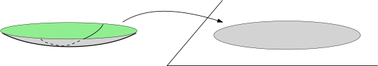
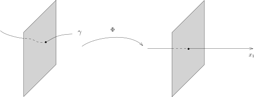
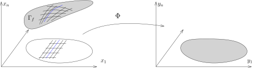
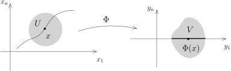
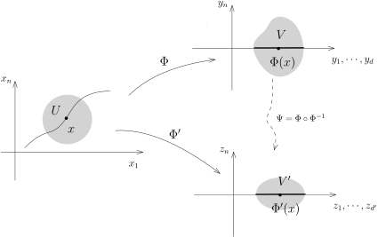

## 微分同胚与坐标变换

给定映射 $f\colon \Omega_1 \rightarrow \mathbb{R}^{n_2}$，
其中开区域 $\Omega_1\subset \mathbb{R}^{n_1}$，用坐标分量表示，我们有
\[
f=(f_1,f_2,\cdots,f_{n_2}).
\]
如果对任意的 $k\in \{1,\cdots,n_2\}$ 对任意的 $N\geqslant 1$，
对任意的 $N$ 个正整数 $k_1,k_2,\cdots,k_N \in \{1,2,\cdots, n_1\}$，偏导数
\[
\frac{\partial}{\partial x_{k_N}}\left( \frac{\partial }{\partial x_{k_{N-1}}} \left( \cdots \left(\frac{\partial f_k}{\partial x_{k_1}}\right)\cdots\right)\right)
\]
都存在并且是连续的，那么我们就称 $f$ 是**光滑的**。
如果 $n_2=1$，我们就称之为**光滑函数**，并记其全体为 $C^\infty(\Omega_1)$。

::: exercise*
证明以下三个关于光滑函数的基本性质：

- 1\) $C^\infty(\Omega_1)$ 是一个 $\mathbb{R}$-代数，即对任意的 $f,g \in C^\infty(\Omega_1)$，
  它们的任意实线性组合以及乘积都是光滑函数。

- 2\) 假设 $f\in C^\infty(\Omega_1)$。
  如果对任意的 $x\in \Omega_1$，$f(x)\neq 0$，那么 $\dfrac{1}{f}$ 也是光滑函数。

- 3\) 证明，对任意的 $i\in \{1,2,\cdots,n_1\}$，对任意的 $f\in C^\infty(\Omega_1)$，
  有 $\dfrac{\partial f}{\partial x_i}\in C^\infty(\Omega_1)$。

:::

对于两个开区域 $\Omega_1\subset \mathbb{R}^{n_1}$ 和 $\Omega_2\subset \mathbb{R}^{n_2}$，
如果存在双射映射 $f\colon \Omega_1\rightarrow \Omega_2$，使得
\[
f\colon \Omega_1\rightarrow \Omega_2, \ \ f^{-1}\colon \Omega_2 \rightarrow \Omega_1
\]
都是光滑的，我们就称 $\Omega_1$ 和 $\Omega_2$ 是**微分同胚的**（光滑同胚）。

我们把 $\Omega_1$ 到 $\Omega_2$ 之间的光滑映射的全体记作是 $C^{\infty}(\Omega_1,\Omega_2)$。
当然，光滑的映射不见得是光滑的同胚。

::: example*
考虑如下映射
\[
f\colon \mathbb{R}\rightarrow \mathbb{R},  \ \ x \mapsto x^3.
\]
很明显，$f$ 是光滑的并且是双射。但是 $f^{-1}(y)=\sqrt[3]{y}$ 不是光滑的。
:::

根据上次课逆映射微分的命题，我们一定有 $n_1=n_2$（维数相同）。

::: remark*
- 1\) *微分同胚*是两个区域的一种*等价*性，这个等价性是用光滑的双射定义的。
  一个好的类比是研究线性空间：两个线性空间之间等价指的是用线性的双射定义的*线性同构*。

- 2\) 两个区域微分同胚，但是上述的映射 $f$ 不一定唯一。
  比如说，令 $\Omega_1=\Omega_2=\mathbb{R}^n$，任意一个可逆的线性映射都可以被选作 $f$。

:::

有了微分同胚这个概念，我们可以讨论坐标变换。
考虑两个开区域 $\Omega_1\subset \mathbb{R}^{n_1}$ 和 $\Omega_2\subset \mathbb{R}^{n_2}$，
其中 $n_1=n_2=n$（为了区别起见）。
我们在第一个 $\mathbb{R}^{n_1}$ 上面用 $(x_1,\cdots,x_n)$ 作为坐标系，
在第二个 $\mathbb{R}^{n_2}$ 上面用 $(y_1,\cdots,y_n)$ 作为坐标系，假设存在光滑的同胚：
\[
\Phi\colon\Omega_1\rightarrow \Omega_2.
\]
我们认为通过 $\Phi$ 这个映射可以用 $\Omega_1$ 上的点来**参数化** $\Omega_2$ 上的点：
用 $(x_1,\cdots,x_n)$ 这个坐标系统也可以描述 $\Omega_2$ 上的点。
比如说，给定坐标 $(x_1,\cdots,x_n)$，它对应的 $\Omega_2$ 中的点是 $\Phi(x_1,\cdots,x_n)$；
根据双射的性质，对任意的 $p\in \Omega_2$，我们总能找到 $(x_1,\cdots,x_n)\in \Omega_1$，
使得 $\Phi(x_1,\cdots,x_n)=p$。
所以，我们有两种不同的方式描述 $\Omega_2$ 上的同一个点 $p\in \Omega_2$：

- 第一种方式是 $p$ 的 $y_i$-坐标 $(y_1(p),\cdots, y_n(p))$；

- 第二种是 $\Phi^{-1}(p)$ 的 $x_i$-坐标
  $(x_1\bigl(\Phi^{-1}(p)\bigr),\cdots,x_n\bigl(\Phi^{-1}(p)\bigr))$。

我们强调之前所谈论的坐标函数的含义：$x_i$ 和 $y_i$ 分别视作是 $\Omega_1$ 和 $\Omega_2$ 上的函数。

所以，给定了 $(x_1,\cdots,x_n)$ 来描述 $p\in \Omega_2$，它所对应的 $(y_1,\cdots,y_n)$ 的坐标应该是
\[
(\Phi_1(x_1,\cdots, x_n),\cdots, \Phi_n(x_1,\cdots,x_n)).
\]
很多文献习惯上将这个写成 $(y_1(x_1,\cdots,x_n),\cdots,y_n(x_1,\cdots,x_n))$。

同学们也许会发现，上面这段讨论实际上根本没有用到 $\Phi$ 和 $\Phi^{-1}$ 是光滑的，
只需要 $\Phi$ 是双射就好：实际上，光滑性保证了光滑函数的拉回还是光滑的。
当给定了 $\Omega_2$ 上的一个函数 $f\colon\Omega_2 \rightarrow \mathbb{R}$，通过复合映射，
我们可以将它看作是 $\Omega_1$ 上的函数，
我们通常将它记作 $\Phi^*f= f\circ\Phi$（称作是 $f$ 被 $\Phi$ 的**拉回**），
下面的交换图表给出了拉回的定义：
\[
\begin{tikzcd}
  \Omega_1 \ar[r,"\Phi"] \ar[dr, "\Phi^*f" description]
  & \Omega_2 \ar[d,"f"]\\
&\mathbb{R} \end{tikzcd}
\]

::: lemma
假设 $f\in C^{\infty}(\Omega_2)$（即 $f$ 是 $\Omega_2$ 上的光滑函数），
那么 $\Phi^*f \in C^{\infty}(\Omega_1)$。
:::

::: proof
我们只需证明对任意的 $\Omega_2$ 上的光滑函数，对任意的 $N$，$\Phi^*f$ 的各阶偏导数
\[
\frac{\partial}{\partial x_{k_N}}\left( \frac{\partial }{\partial x_{k_{N-1}}} \left( \cdots \left(\frac{\partial (f\circ \Phi)}{\partial x_{k_1}}\right)\cdots\right)\right)
\]
都存在且连续即可。对所求的偏导数的次数 $N$ 进行归纳。
如果 $N=0$，由于 $\Phi$ 是连续映射，根据连续映射的复合仍然连续，我们知道此时 $\Phi^*f$ 是连续的。
假设对任意的 $f$，$\Phi^*f$ 的连续 $N$ 次的偏导数存在且连续，那么根据链式法则，我们知道
\[
\frac{\partial (f\circ \Phi)}{\partial x_i}\Big|_{x=x_0}=\sum_{k=1}^n \frac{\partial \Phi_k}{\partial x_i}(x_0)\frac{\partial f}{\partial y_k}\bigl(\Phi(x_0)\bigr)=\sum_{k=1}^n \frac{\partial \Phi_k}{\partial x_i} \cdot \left(\Phi^* \frac{\partial f}{\partial y_k}\right)\Big|_{x=x_0}.
\]
此时，每一个 $\dfrac{\partial \Phi_k}{\partial x_i}$ 都是光滑函数，
对 $\dfrac{\partial f}{\partial y_k}$ 利用归纳假设（这是那个被拉回的函数），
对上述函数再求 $N$ 次偏导数也连续，所以命题成立。
:::

::: remark*
上面的证明仅仅用到了 $\Phi$ 的光滑性，换句话说，我们证明了如下的命题，如果 $f$ 是光滑函数，
$\Phi$ 是光滑映射，那么它们的复合 $f\circ \Phi$ 是光滑函数，其中，
我们假设 $f\colon\Omega_2\rightarrow \mathbb{R}$，$\Phi\colon \Omega_1\rightarrow \Omega_2$。
:::

最终，我们考虑常见的但是容易产生混淆的一种情形：
我们假设有两个坐标系统 $(x_i)$ 和 $(y_i)$ 来描述 $\Omega$ 中的点。
此时，我们把每一个坐标函数都理解为 $\Omega$ 上的函数，那么，
如果用第一个坐标系统来描述第二个坐标系统的坐标函数，我们就可以写成
\[
y_1=y_1(x_1,\cdots,x_n),\cdots, y_n=y_n(x_1,\cdots,x_n).
\]
反过来，我们可以用第二个坐标系统来描述第一个坐标系统的坐标函数：
\[
x_1=x_1(y_1,\cdots,y_n),\cdots, x_n=x_n(y_1,\cdots,y_n).
\]
假设 $f\colon\Omega\rightarrow \mathbb{R}$ 是 $\Omega$ 上的函数。
通过利用不同的坐标，我们可以将 $f$ 写成 $f(x_1,\cdots,x_n)$ 或者 $f(y_1,\cdots,y_n)$。
如此用变量来写函数很容易产生混乱。
当然，如果 $f$ 是用第二个坐标系统写的，即 $f(y_1,\cdots,y_n)$，我们所说的 $f(x_1,\cdots,x_n)$ 应该是
\[
f(x_1,\cdots,x_n)=f(y_1(x_1,\cdots,x_n),\cdots,y_n(x_1,\cdots,x_n)).
\]
事实上，我们应该将 $\Omega_1=\Omega$ 和 $\Omega_2=\Omega$ 区分开，
在 $\Omega_1\subset \mathbb{R}^{n_1}$ 中我们用 $(x_i)$ 作为坐标，
在 $\Omega_2\subset \mathbb{R}^{n_2}$ 中我们用 $(y_i)$ 作为坐标，其中 $n_1=n_2=n$。我们考虑映射
\[
\Phi\colon\Omega_1 \rightarrow \Omega_2, \ \  (x_1,\cdots,x_n)\mapsto \bigl(y_1(x_1,\cdots,x_n),\cdots, y_n(x_1,\cdots,x_n)\bigr).
\]
它的逆映射就是
\[
\Phi^{-1}\colon\Omega_2 \rightarrow \Omega_1, \ \  (y_1,\cdots,y_n)\mapsto \bigl(x_1(y_1,\cdots,y_n),\cdots, x_n(y_1,\cdots,y_n)\bigr).
\]
此时，上面谈到的函数 $f$ 是 $\Omega_2$ 上的函数。

另外 $f$ 的偏导数（或者微分）也可以用 $(x_i)$ 来表达，
这就是说要计算 $f\circ \Phi$ 的偏导数（用 $(y_i)$ 坐标来算，
就是 $\dfrac{\partial f}{\partial y_i}$）。

::: exercise* [重要]
利用链式法则证明：
\[
\dfrac{\partial f}{\partial x_i}=\sum_{j=1}^n \dfrac{\partial y_j}{\partial x_i}(x_1,\cdots,x_n)\dfrac{\partial f}{\partial y_j}(y_1(x_1,\cdots, x_n),\cdots, y_n(x_1,\cdots,x_n)).
\]
:::

据此可知，由偏导数的定义是依赖于坐标系的选取的。
特别地，在不同的坐标系之间它们的差别由坐标变换（即上述的 $\Phi$）的Jacobi矩阵决定。

::: remark*
偏导数的定义不是内蕴的，它依赖于具体坐标系的选取。
然而，微分 $df$（按定义）不依赖于坐标系统的选取，是内蕴的。
:::

我们现在回到学习的主线上来。
我们现在证明偏导数运算具有可交换性（这个定理的几何表述是函数的Hesse算子是对称的）：

::: theorem [Clairaut–Schwarz]
给定 $\mathbb{R}^n$ 上的开集 $\Omega$（$n\geqslant 2$）和函数
$f\colon\Omega \rightarrow \mathbb{R}$，$i,j\in \{1,2,\cdots,n\}$ 是两个不同的指标。
假设在 $\Omega$ 上，函数 $\dfrac{\partial f}{\partial x_i}(x)$，
$\dfrac{\partial f}{\partial x_j}(x)$ 和
$\dfrac{\partial }{\partial x_i}\left(\dfrac{\partial f}{\partial x_j}\right)(x)$ 存在并且**连续**。
那么，
$\dfrac{\partial }{\partial x_j}\left(\dfrac{\partial f}{\partial x_i}\right)(x)$ 也存在并且对任意的
$x\in \Omega$，我们有
\[
\dfrac{\partial }{\partial x_i}\left(\dfrac{\partial f}{\partial x_j}\right)(x)=\dfrac{\partial }{\partial x_j}\left(\dfrac{\partial f}{\partial x_i}\right)(x).
\]
:::

为了证明这个命题，我们从一个引理开始：

::: lemma
假设函数 $f\colon\mathbb{R}^2-\{(0,0)\}\rightarrow \mathbb{R}$ 在 $(0,0)\in \mathbb{R}^2$ 处的极限
$\displaystyle \lim_{(x,y)\rightarrow (0,0)}f(x,y)$ 存在。
如果存在 $\varepsilon_0>0$，使得对于任意给定的 $y_0 \in (-\varepsilon_0,\varepsilon_0)$，
极限 $\displaystyle \lim_{x\rightarrow 0}f(x,y_0)$ 都存在。
那么，极限 $\displaystyle\lim_{y\rightarrow 0}\big( \lim_{x\rightarrow 0}f(x,y)\big)$ 存在并且
\[
\displaystyle\lim_{y\rightarrow 0}\bigl( \lim_{x\rightarrow 0}f(x,y)\bigr)=\displaystyle \lim_{(x,y)\rightarrow (0,0)}f(x,y).
\]
:::

::: proof [引理的证明]
按照距离空间中函数极限存在的定义，
$\displaystyle \lim_{(x,y)\rightarrow (0,0)}f(x,y)$ 存在指的是存在 $L$，
使得对任意的 $\varepsilon>0$，存在 $\delta>0$，当 $\sqrt{x^2+y^2}<\delta$ 时，
有 $|f(x,y)-L|<\varepsilon$。

任意固定 $\varepsilon>0$。
在上述极限的定义中，我们现在选取 $\delta$ 使得 $\delta\leqslant \varepsilon_0$。
考虑任意一个 $y$，其中 $|y|<\delta$。下面认为 $y$ 是固定的。

那么，自然有 $x$，使得 $\sqrt{y^2+x^2}<\delta$。
此时，我们令 $x\rightarrow 0$，我们就有（因为 $|y|<\varepsilon_0$）：
\[
\bigl|\lim_{x\rightarrow 0}f(x,y)-L\bigr|\leqslant \varepsilon.
\]
即对任意的 $\varepsilon>0$，我们找到了 $\delta>0$，使得对任意的 $|y|<\delta$，上面的不等式成立。
按照极限的定义，
这就是说 $\displaystyle\lim_{y\rightarrow 0}\bigl( \lim_{x\rightarrow 0}f(x,y)\bigr)$ 存在并且等于
$L$。
:::

::: proof [Clairaut–Schwarz定理的证明]
不妨假设 $i=1$，$j=2$。为了简单起见，我们将函数 $f$ 记为
\[
f(x_1,x_2,\cdots,x_n)=f(x,y,Z),
\]
其中 $(x,y)=(x_1,x_2)$，$Z=(x_3,\cdots,x_n)\in \mathbb{R}^{n-2}$。
对任意的 $h,\ell \in \mathbb{R}$，定义
\[
\Delta(h,\ell)=f(x+h,y+\ell,Z)-f(x+h,y,Z)-f(x,y+\ell,Z)+f(x,y,Z).
\]
根据Lagrange中值定理，我们有
\[
\begin{aligned}
\frac{\Delta(h,\ell)}{h\ell}&=\frac{1}{h}\left(\frac{f(x+h,y+\ell,Z)-f(x+h,y,Z)}{\ell}-\frac{f(x,y+\ell,Z)-f(x,y,Z)}{\ell}\right)\\
&=\frac{1}{h}\left(\dfrac{\partial f}{\partial y}(x+h,y+\theta_1 \ell,Z)-\dfrac{\partial f}{\partial y}(x,y+\theta_2  \ell,Z)\right)
\end{aligned}
\]
其中 $\theta_1,\theta_2\in [0,1]$。当然，简单地运用中值定理不能保证 $\theta_1=\theta_2$。
为说明基本的想法，我们先假设 $\theta_1=\theta_2=\theta$。
此时，根据二阶导数存在，我们可以继续运用中值定理：
\[
\begin{aligned}
\frac{\Delta(h,\ell)}{h\ell}
&=\dfrac{\partial }{\partial x}\left(\dfrac{\partial f}{\partial y}\right)(x+\theta' h,y+\theta \ell,Z),
\end{aligned}
\]
其中，$\theta' \in [0,1]$。
再根据 $\dfrac{\partial }{\partial x}\left(\dfrac{\partial f}{\partial y}\right)$ 的连续性，
我们知道 $\displaystyle \lim_{(h,\ell)\rightarrow 0}\dfrac{\Delta(h,\ell)}{h\ell}$ 存在。

我们要对函数
\[
\mathbb{R}^2-\{(0,0)\}\rightarrow \mathbb{R}, \ \ (h,\ell)\mapsto \frac{\Delta(h,\ell)}{h\ell}
\]
来运用前面的引理。我们可以先令 $\ell\rightarrow 0$，根据定义，我们有
\[
\begin{aligned}
\lim_{h\rightarrow 0}\left(\lim_{\ell\rightarrow 0}\frac{\Delta(h,\ell)}{h\ell}\right)&=\lim_{h\rightarrow 0}\left(\frac{1}{h}\left(\frac{f(x+h,y+\ell,Z)-f(x+h,y,Z)}{\ell}-\frac{f(x,y+\ell,Z)-f(x,y)}{\ell}\right)\right)\\
&=\lim_{h\rightarrow 0}\frac{1}{h}\left(\dfrac{\partial f}{\partial y}(x+h,y,Z)-\dfrac{\partial f}{\partial y}(x,y,Z)\right)\\
&=\dfrac{\partial }{\partial x}\left(\dfrac{\partial f}{\partial y}\right)(x,y,Z).
\end{aligned}
\]
反过来，我们也可以先令 $h\rightarrow 0$。类似地，我们得到
\[
\begin{aligned}
\lim_{\ell\rightarrow 0}\left(\lim_{h\rightarrow 0}\frac{\Delta(h,\ell)}{h\ell}\right)=\dfrac{\partial }{\partial y}\left(\dfrac{\partial f}{\partial x}\right)(x,y,Z).
\end{aligned}
\]
根据引理，上面两式子左端的极限是相同的，这就证明了命题。

最终，我们解决上述 $\theta_1=\theta_2$ 的技术性问题。我们把函数写成：
\[
\begin{aligned}
\frac{\Delta(h,\ell)}{h\ell}&=\frac{1}{h}\left(\frac{\bigl[f(x+h,y+\ell,Z)-f(x,y+\ell,Z)\bigr]-\bigl[f(x+h,y,Z)-f(x,y,Z)\bigr]}{\ell}\right).
\end{aligned}
\]
我们只需要将 $f(x+h,y,Z)-f(x,y,Z)$ 作为整体视作是 $y$ 的函数（此时，
$x,h,Z$ 都是固定的）来运用Lagrange中值定理即可。
:::

::: remark*
基于这个命题，我们可以引入一个方便的记号来记多重的偏导数：
令 $\alpha=(\alpha_1,\cdots,\alpha_n)$ 为一个多重指标，也就是说对于每个 $i\leqslant n$，
有 $\alpha_i\in \mathbb{Z}_{\geqslant 0}$，
我们用 $\partial^\alpha f$ 表示 $\alpha_1$ 个 $\dfrac{\partial}{\partial x_1}$、
$\alpha_2$ 个 $\dfrac{\partial}{\partial x_2}$、$\cdots$、
$\alpha_n$ 个 $\dfrac{\partial}{\partial x_n}$ 作用在 $f$ 上，即
\[
\partial^\alpha f= \left(\frac{\partial}{\partial x_n}\right)^{\alpha_n}\circ \left(\frac{\partial}{\partial x_{n-1}}\right)^{\alpha_{n-1}}\circ \cdots \circ \left(\frac{\partial}{\partial x_1}\right)^{\alpha_1}\left(f\right).
\]
当 $f$ 足够多次连续可微时，上述命题保证了这些算子的复合不依赖于它们作用的顺序。我们还令
\[
|\alpha|=\alpha_1+\cdots+\alpha_n\leqslant k,
\]
传统上我们还把上面的多重偏导数 $\partial^\alpha$ 记作
\[
\dfrac{\partial^{|\alpha|}}{\partial x_1^{\alpha_1}\cdots \partial x_n^{\alpha_n}}.
\]
比如说，我们经常看到
\[
\frac{\partial^2 f}{\partial x^2}, \ \ \frac{\partial^2 f}{\partial x \partial y}.
\]
:::

::: example* [Clairaut–Schwarz的反例]
如果Clairaut–Schwarz定理中的连续性不成立，那么命题可能并不成立。考察函数

\[
f(x,y)=\begin{cases}\frac{xy(x^2-y^2)}{x^2+y^2}, \ \ &(x,y)\neq (0,0);\\
0, \ \  &(x,y)=(0,0).\end{cases}
\]
那么，我们有
\[
\frac{\partial f}{\partial x}(x,y) =\frac{x^4y+4x^2y^3-y^5}{(x^2+y^2)^2}.
\]
从而，我们有
\[
\begin{aligned}
 \frac{\partial }{\partial y}\left(\frac{\partial f}{\partial x}\right)(0,0)=\lim_{y\rightarrow 0}\frac{\frac{\partial f}{\partial x}(0,y) -\frac{\partial f}{\partial x}(0,0) }{y}=-1.
\end{aligned}
\]
类似地（利用对称性），我们有
\[
\begin{aligned}
 \frac{\partial }{\partial x}\left(\frac{\partial f}{\partial y}\right)(0,0)=1.
\end{aligned}
\]
这表明Clairaut–Schwarz定理并不成立。请思考定理中的哪个条件没有被满足。
:::

## 多元函数的Taylor展开

我们现在来证明高维空间Lagrange余项Taylor公式，也就是在一个点附近用高次的多项式函数来逼近函数。
证明的想法很直接：将问题沿不同的方向化为 $1$ 维的情形。其余余项的Taylor公式证明是类似的。

::: theorem
假设 $\Omega\subset \mathbb{R}^n$ 是凸的开集，
$f$ 在 $\Omega$ 上 $k+1$ 次可微分（我们通常要求更多的条件：$f$ 不超过 $k+1$ 阶的偏导数存在并且连续，
这对于应用来说是足够的）。
那么，对于任意的 $x,y \in \Omega$，其中 $x=(x_1,\cdots,x_n)$，$y=(y_1,\cdots,y_n)$，
存在 $\vartheta \in  [0,1]$（可能依赖于 $x$ 和 $y$），使得
\[
\begin{aligned}
f(y)&=\sum_{|\alpha|\leqslant k}\frac{\partial^\alpha f(x)}{\alpha!}(x-y)^{\alpha}+\sum_{|\alpha|= k+1}\frac{\partial^\alpha f\bigl(x+\vartheta (y-x)\bigr)}{\alpha!}(x-y)^{\alpha},
\end{aligned}
\]
其中，
\[
(x-y)^{\alpha}=(x_1-y_1)^{\alpha_1}\cdots(x_n-y_n)^{\alpha_n}, \ \ \alpha! = {\alpha_1!\cdots\alpha_n!}.
\]
:::

::: proof
我们考虑 $x$ 与 $y$ 之间的连线并把函数 $f$ 限制到这条线上。用分析的语言写，我们考虑函数
\[
g\colon (-\varepsilon, 1+\varepsilon)\rightarrow \mathbb{R}, \ \ g(t)=f\bigl(x+t(y-x)\bigr).
\]
这里用到了 $\Omega$ 的凸性。
我们首先来计算 $g$ 的 $k$-次导数（$k\geqslant 0$）：
\[
g^{(k)}(t)=\sum_{|\alpha|=k}\frac{k!}{\alpha!}(\partial^\alpha f)\bigl(x+t(y-x)\bigr)(y-x)^\alpha.
\]
这个式子可以用归纳法来证明：$k=0$ 是显然的。假设
\[
g^{(k-1)}(t)=\sum_{|\alpha|=k-1}\frac{(k-1)!}{\alpha!}(\partial^\alpha f)\bigl(x+t(y-x)\bigr)(y-x)^\alpha.
\]
根据方向导数的性质，对任意的函数 $f$，我们有
\[
\frac{d}{dt}f\bigl(x+tv\bigr)\big|_{t=0}= v^i \frac{\partial f}{\partial x_i}(x).
\]
所以，
\[
\begin{aligned}
g^{(k)}(t)&=\sum_{|\alpha|=k-1}\frac{(k-1)!}{\alpha!} \Bigl[ (\partial^\alpha f)\bigl(x+t(y-x)\bigr) \Bigr]' (y-x)^\alpha\\
&=\sum_{|\alpha|=k-1}\frac{(k-1)!}{\alpha!} \Bigl[ \sum_{m=1}^n (y_m-x_m) \Bigl( \frac{\partial}{\partial x_m}(\partial^\alpha f)\Bigr)\bigl(x+t(y-x)\bigr) \Bigr](y-x)^\alpha\\
&=\sum_{|\beta|=k}\frac{k!}{\beta!}(\partial^\beta f)\bigl(x+t(y-x)\bigr)(y-x)^\beta.
\end{aligned}
\]
最后一个等号需要搞清楚如下的组合性质：为了从前一步的某个 $|\alpha|=k-1$ 得到固定的 $\beta$，
其中 $|\beta|=k$，有如下 $n$ 种可能性：
\[
\alpha_1=(\beta_1-1,\cdots,\beta_n)\longrightarrow \beta, \ \alpha_2=(\beta_1,\beta_2-1, \cdots,\beta_n)\longrightarrow \beta, \cdots, \alpha_n=(\beta_1,\cdots,\beta_n-1)\longrightarrow \beta.
\]
所以，所求的系数应该是（这个等价于 $\beta_1+\cdots+\beta_n=k$）：
\[
\sum_{m=1}^n \frac{(k-1)!}{\alpha_m!}=\frac{k!}{\beta!}.
\]
现在对 $g$ 用Taylor公式（在 $0$ 和 $1$之间），我们有 $\vartheta \in  [0,1]$，使得
\[
g(1)=\sum_{\ell\leqslant k}\frac{g^{(\ell)}(0)}{\ell!}+\frac{g^{(k+1)}(\vartheta)}{(k+1)!}.
\]
将 $g^{(\ell)}(0)$ 的值代入即可。
:::

## $\mathbb{R}^n$ 中的光滑子流形：曲线和曲面的定义

在 $\mathbb{R}^n$ 中，我们考虑 $\mathbb{R}^{k}\subset \mathbb{R}^n$，
此时的 $\mathbb{R}^k$ 是按照下面精确的方式定义的
\[
\mathbb{R}^k =\bigl\{(x_1,\cdots, x_n)\,\bigm|\,x_n=x_{n-1}=\cdots=x_{k+1}=0\bigr\}.
\]
这是由 $n-k$ 个线性函数的零点定义出来的线性子空间。这就是**最基本的**$k$-维子流形的例子。
所谓的 $k$-维子流形，是 $\mathbb{R}^n$ 中的一个子集，在每个局部上来看，
它长得样子就像是线性的 $\mathbb{R}^k$ 落在 $\mathbb{R}^n$ 中一样。
我们可以设想 $\mathbb{R}^3$ 中的一个曲面，在一个点的附近，这个曲面和切平面很近，从而变化不大。
它的样子大概是

曲面的两面用灰色和绿色表示，其中绿色的一面上画有一条线。
这个曲面落在 $\mathbb{R}^3$ 中和右边的 $\mathbb{R}^3$ 中的 $\mathbb{R}^2$ 上的圆盘很相似。

为了理解子流形的概念，我们先看两个（不平凡的）例子，
它们维数或者余维数为 $1$（在 $\mathbb{R}^3$ 中这已经给出了所有的维数）。
维数为 $0$ 的基本例子是 $\mathbb{R}^n$ 中的点，余维数为 $0$ 的基本例子是 $\mathbb{R}^n$ 本身，
这些都没有太多的意思。另外，子流形是一个局部的概念，所以我们现在只关心局部的情况。

我们首先研究曲线。

假设 $\gamma\colon(-\varepsilon,\varepsilon)\rightarrow \mathbb{R}^n$ 是光滑的映射（$C^1$ 就可以），
我们要求对任意的 $t\in (-\varepsilon,\varepsilon)$，$\gamma'(t)\neq 0$。
这个条件称作是曲线的非退化条件，
一定程度上可以认为是要排除 $\gamma(t)\equiv p$ 这种极端的例子（此时，
我们得到的是一个点而不是曲线）。
由于 $\gamma'(0)\neq 0$，我们不妨假设 $\gamma_1'(0)>0$（$<0$ 的情况可以类似地讨论），
即 $\gamma(t)$ 的 $x_1$ 分量在 $0$ 附近（我们总可以假设 $\varepsilon$ 很小）是严格递增的。
我们要说明 $\gamma$ 在 $\gamma(0)$ 附近与 $x_1$ 轴 $\mathbb{R}^1=\{(x_1, 0,\cdots, 0)\}$ 非常相似。
事实上，我们构造映射
\[
\begin{aligned}
\Phi\colon&\mathbb{R}^n \rightarrow \mathbb{R}^n,  \ \ (x_1,x_2,\cdots, x_n)\mapsto (\gamma_1^{-1}(x_1), x_2-\gamma_2\bigl(\gamma_1^{-1}(x_1)\bigr),\cdots,x_n-\gamma_n\bigl(\gamma_1^{-1}(x_1)\bigr)).
\end{aligned}
\]
在 $0$ 附近，这是一个良好定义并且是可逆的映射：它的逆可以用下面的公式表达
\[
\begin{aligned}
\Phi^{-1}\colon&\mathbb{R}^n \rightarrow \mathbb{R}^n,  \ \ (y_1,y_2,\cdots, y_n)\mapsto (\gamma_1(y_1), y_2+\gamma_2(y_1),\cdots,y_n+\gamma_n(y_1)).
\end{aligned}
\]

不难看出，这是一个微分同胚。
所以，在用一个微分同胚把曲线（的像）拉直了之后或者说换到了 $(y_1,\cdots,y_n)$ 这个坐标系下看，
我们的曲线就是标准的 $x_1$-轴：

其次，我们研究由方程的图像定义的曲面。给定函数 $f\colon\mathbb{R}^{n-1} \rightarrow \mathbb{R}$。
我们考虑它的图像
\[
\Gamma_f=\{(x,f(x))\in\mathbb{R}^{n-1} \times \mathbb{R}= \mathbb{R}^{n}\mid x\in \Omega\}.
\]
这是 $\mathbb{R}^{n}$ 中的超曲面（余维数为 $1$）。我们定义映射
\[
\Phi\colon\mathbb{R}^n \rightarrow \mathbb{R}^n,  \ \ (x_1,x_2,\cdots, x_n)\mapsto (y_1,\cdots,y_n)=(x_1, x_2,\cdots,x_n-f(x_1,\cdots,x_{n-1})).
\]
很明显，$\Phi$ 是双射，其逆映射为
\[
\Phi^{-1}\colon\mathbb{R}^n \rightarrow \mathbb{R}^n,  \ \ (y_1,y_2,\cdots, y_n)\mapsto (x_1,\cdots,x_n)=(y_1, y_2,\cdots,y_n+f(y_1,\cdots,y_{n-1})).
\]
这两个映射显然是光滑的，所以 $\Phi$ 是微分同胚。
从而，通过用一个微分同胚把这个曲面拉直了之后或者说换到了 $(y_1,\cdots,y_n)$ 这个坐标系下看，
我们的曲面就是标准的 $\mathbb{R}^{n-1}$（由一个线性方程的零点给出）：

最终，我们再研究一个经典的例子，考虑 $3$ 维空间中的单位球面 $\mathbf{S}^2\subset \mathbb{R}^3$，
也即是
\[
\mathbf{S}^2=\bigl\{(x,y,z) \,\bigm|\, x^2+y^2+z^2=1\bigr\}.
\]
很明显，$\mathbf{S}^2$ 可以被写成 $6$ 个半球面的并：
\[
\mathbf{S}^2=\mathbf{S}^2_{x>0} \cup \mathbf{S}^2_{x<0}\cup \mathbf{S}^2_{y>0}\cup \mathbf{S}^2_{y<0}\cup \mathbf{S}^2_{z>0}\cup \mathbf{S}^2_{z<0}.
\]
每一个部分都是一个函数的图像，比如说，
\[
\mathbf{S}^2_{y<0}=\bigl\{\bigl(x,f(x,z),z\bigr)\big| f(x,z)=-\sqrt{1-x^2-z^2}, x^2+z^2<1\bigr\},
\]
其中，函数 $f$ 定义在 $(x,z)$ 平面的一个单位圆盘的内部。
所以说，$\mathbf{S}^2$ 在局部上来看是一个微分子流形。

::: exercise*
证明，$\mathbf{S}^2 \subset \mathbb{R}^3$ 在如下的意义下永远都不是一个函数的图像：不存在微分同胚
\[
\Phi\colon \mathbb{R}^3\rightarrow \mathbb{R}^2_{y_1,y_2}\times \mathbb{R}_{y_3}^1,
\]
和 $\mathbb{R}^2_{y_1,y_2}$ 中的区域（任意区域不一定是开集）$\Omega$ 以及 $\Omega$ 上的光滑函数
$f$，使得 $\Phi(\mathbf{S}^2)$ 是 $f$ 的图像
\[
\Gamma_f =\bigr\{(y_1,y_2,f(y_1,y_2))\in  \mathbb{R}^2_{y_1,y_2}\times \mathbb{R}_{y_3}^1\,\bigm|\, (y_1,y_2)\in \Omega\bigr\}.
\]
:::

将这些例子作为基本的图像，我们就可想办法定义 $\mathbb{R}^n$ 中的子流形了，
这是所有的那些在局部上复合一个微分同胚（换一下坐标系）之后就变成了线性子空间的一部分的那样的子集合：
[^1]

::: definition [$d$-维子流形]
假设 $M\subset \mathbb{R}^n$ 是非空子集，这个 $\mathbb{R}^n$ 中的坐标用 $(x_i)$ 表示。
如果存在整数 $d\geqslant 0$，使得对任意的 $x\in M$，存在开集 $U\subset \mathbb{R}^n$，
$x\in U$ 以及（可能是另外一个）$\mathbb{R}^n$ 中的开集（这个 $\mathbb{R}^n$ 中的坐标用 $(y_i)$
表示）$V$ 以及微分同胚
\[
\Phi\colon U \rightarrow V
\]
使得
\[
\Phi\colon U\cap M \to V \cap (\mathbb{R}^d \times \{0\}),
\]
其中我们把 $\mathbb{R}^n=\mathbb{R}^{d+(n-d)}$ 写成 $\mathbb{R}^d\times \mathbb{R}^{n-d}$，
上述的表达式要求后面的 $n-d$ 个坐标都取 $0$，
我们就称 $M$ 是 $\mathbb{R}^n$ 的一个 $d$-维的 **（微分）子流形**。
其中，$d$ 称作是 $M$ 的**维数**，记作 $\operatorname{dim} M$。
:::

::: remark*
我们还把 $\operatorname{codim} M=n-\operatorname{dim} M$ 称作是 $M$ 的**余维数**，
它有着如下具体的含义：存在 $\operatorname{codim} M$ 个函数，使得 $M$ 恰好是这些函数的公共零点集合。
实际上，我们可以取 $f_j=\Phi^*y_j$，其中 $j=d+1,d+2,\cdots,n$。
:::

我们需要说明维数 $d$ 是良好的定义。
换句话说，把 $M$ 局部上看成是某个 $d$ 维的线性子空间中的集合的方式有可能不唯一。
按照定义，对于给定的 $x$，我们有可能有（很明显有很多）另外的 $d'\geqslant 0$ 和开集 $U' $，
$x\in U'$ 以及（可能是另外一个）$\mathbb{R}^n$ 中的开集（这个 $\mathbb{R}^n$ 中的坐标用 $(z_i)$
表示）$V'$ 以及微分同胚
\[
\Phi'\colon U' \rightarrow V'
\]
使得
\[
\Phi'\colon U'\cap M \to V' \cap (\mathbb{R}^{d'} \times \{0\}),
\]
通过考虑 $U\cap U'$，我们可以要求 $U=U'$。

我们考虑映射
\[
\Psi=\Phi'\circ \Phi^{-1}\colon V\rightarrow V'.
\]
这是两个微分同胚的复合，所以还是微分同胚。
特别地，如果我们把映射 $\Psi$ 限制到 $V\cap  (\mathbb{R}^{d} \times \{0\})$ 上面，
我们就得到了微分同胚
\[
\Psi\colon V\cap (\mathbb{R}^{d} \times \{0\})\rightarrow V'\cap (\mathbb{R}^{d'} \times \{0\}).
\]
这是 $\mathbb{R}^d$ 和 $\mathbb{R}^{d'}$ 中的两个开集之间的微分同胚，
我们上周已经利用复合映射的链式法则证明了 $d=d'$。

[^1]: 根据Whitney的定理，这个定义实际上包含了所有的微分流形。
