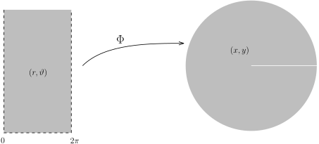

给定函数 $f\colon \Omega\rightarrow \mathbb{R}$，我们上次课定义它的微分 $df(x)$。
当 $x$ 给定的时候，这是一个 $\mathbb{R}^n$ 上的线性函数。
仿照一维的理论，对一阶导数求导就应该得到二阶导数。
然而，此时为了定义 $f$ 的二阶导数，我们就需要对 $x\mapsto df(x)$ 求微分。
此时，
（不严格地讲）映射 $f\colon x\mapsto df(x)$ 是一个从 $\Omega$ 到
${\rm Hom}(\mathbb{R}^n,\mathbb{R})\simeq \mathbb{R}^n$ 的映射，这是向量值的函数。
所以，我们自然地想到对向量值的函数 $f\colon \Omega \rightarrow \mathbb{R}^m$ 定义微分。
当然，我们还可以考虑 $df(x)$ 的每个分量（依赖于坐标系的选取）然后要求每个分量都可微，
至少从形式上看，后一种做法失于简洁和美观。

::: definition [微分]
假设 $\Omega$ 是 $\mathbb{R}^n$ 中的区域，$\Omega'$ 是 $\mathbb{R}^m$ 中的区域，
给定映射 $f\colon\Omega\rightarrow \Omega'$。如果存在线性映射
\[
df\big|_{x=x_0}=df(x_0)\colon\mathbb{R}^n\rightarrow \mathbb{R}^m,
\]
使得对于 $\mathbb{R}^n$ 中的 $v\rightarrow 0$ 时，我们有
\[
f(x_0+v)=f(x_0)+df(x_0)v+o(v),
\]
即
\[
\lim_{v\rightarrow 0}\frac{|f(x_0+v)-f(x_0)-df(x_0)v|}{|v|}=0,
\]
我们就称 $f$ 在 $x_0$ 处可微并且称线性映射 $df(x_0)$ 是 $f$ 在 $x_0$ 的**微分**。
如果 $f$ 在 $\Omega$ 的每个点处都可微，我们就称 $f$ 是 $\Omega$ 上面的**可微映射**。
:::

::: remark*
- 1\) 在上述微分的定义中，我们完全没有用到 $\mathbb{R}^n$ 和 $\mathbb{R}^m$ 上的坐标系。
  实际上，在下面的极限中
  \[
  \lim_{v\rightarrow 0}\frac{{\color{blue}|}\overbrace{f(\underbrace{x_0+v}_{\text{用到 $\mathbb{R}^n$ 上的加法结构}})-f(x_0)-df(x_0)v}^{\text{用到 $\mathbb{R}^m$ 上的加法结构}}{\color{blue}|}}{{\color{red}|}v{\color{red}|}}=0,
  \]
  我们只用到了 $\mathbb{R}^n$ 和 $\mathbb{R}^m$
  上的线性结构和它们上面的范数（我们分别用了蓝色和红色表示，
  其中红色的是定义域 $\mathbb{R}^n$ 上的范数，蓝色的是值域 $\mathbb{R}^m$ 上的范数）。

  据此，我们可以将上述定义进行推广：给定赋范线性空间 $(V_1,\|\cdot\|_1)$ 和 $(V_2,\|\cdot\|_2)$，
  $\Omega_1 \subset V_1$ 和 $\Omega_2 \subset V_2$ 是非空的开集，
  $f\colon \Omega_1\rightarrow \Omega_2$是映射。如果存在线性映射
  \[
  df\big|_{x=x_0}=df(x_0)\colon V_1\rightarrow V_2,
  \]
  使得对于 $V_1$ 中的 $v\rightarrow 0$ 时，我们有
  \[
  \lim_{v\rightarrow 0}\frac{\|f(x_0+v)-f(x_0)-df(x_0)v\|_2}{\|v\|_1}=0,
  \]
  我们就称 $f$ 在 $x_0$ 处可微并且称线性映射 $df(x_0)$ 是 $f$ 在 $x_0$ 的**微分**。

- 2\) 假设$f$在$\Omega$上可微。
  那么，给定$x\in \Omega$，
  $df(x) \in {\rm Hom}(\mathbb{R}^n,\mathbb{R}^m)\approx \mathbb{R}^{mn}$（可以视作是$m\times n$
  的矩阵，这里我们用坐标比较方便）也在一个向量空间中取值的。
  （然而，如果在一般的（无限维的）的赋范线性空间上定义微分，
  我们会要求 $df(x) \in {\rm Hom}(V,W)$ 是所谓的连续线性映射，这里不展开讨论，
  有兴趣的同学可以在泛函分析的课程上学习）。
  所以，当 $x$ 变化的时候，我们就得到一个映射
  \[
  \Omega \rightarrow \mathbb{R}^{nm},  \ \ x\mapsto df(x).
  \]
  我们可以对它求导数来定义它的微分。高阶的微分不是这门课程的重点。

- 3\) 假设 $f$ 在 $x_0\in \Omega$ 处可微分，我们就有映射
  \[
  df(x_0)\colon\mathbb{R}^n\rightarrow \mathbb{R}^m.
  \]
  由于这些映射依赖于点，特别地，依赖于 $x_0\in \Omega$（和 $f(x_0)\in \Omega'$），
  我们用 $T_{x_0}\Omega$ 代表它的定义域的线性空间 $\mathbb{R}^n$，
  用 $T_{f(x_0)}\Omega'$ 代表它的值域的线性空间 $\mathbb{R}^m$，这样子，我们形式上就有
  \[
  df(x_0)\colon T_{x_0} \Omega \rightarrow T_{f(x_0)}\Omega'.
  \]
  符号 $T_{x_0}\Omega$ 代表的是 $\Omega$ 在 $x_0$ 处的切空间（＝切平面），
  $T_{f(x_0)}\Omega'$ 代表的是 $\Omega'$ 在 $f(x_0)$ 处的切空间，
  我们会有专门的例子来理解这个对象，目前大家可以暂时将它们理解为好的记号。

:::

我们上次课定义了方向导数和偏导数，这都是一维的对象。
下面的命题表明，我们可以用偏导数这些一维的对象来描述 $df(x_0)$ 这个高维的对象：

::: proposition [微分的计算]
假设 $V=\mathbb{R}^n$ 和 $W=\mathbb{R}^m$，我们在 $V$ 上用坐标系 $\{x_i\}_{i=1,\cdots,n}$，
在 $W$ 上用坐标系 $\{y_j\}_{j=1,\cdots,m}$（把空间写成 $V$ 和 $W$
是强调这些空间可以不用具体的坐标来描述）。
考虑$f\colon V\rightarrow W$（我们也可以考虑 $f$ 定义在 $V$ 中某个区域上），用坐标来写，我们有：
\[
x\mapsto f(x)=\bigl(f_1(x_1,\cdots,x_n),f_2(x_1,\cdots,x_n),\cdots, f_m(x_1,\cdots,x_n)\bigr).
\]
有时候还写成
\[
y_1=f_1(x_1,\cdots,x_n), \ y_2=f_2(x_1,\cdots,x_n),\cdots, y_m=f_m(x_1,\cdots,x_n).
\]
那么，我们有

- 1\) 假设 $f$ 在 $x_0$ 处可微，那么每个分量函数 $f_j$ 在 $x_0$ 处都可微，其中 $j=1,2,\cdots, m$。

- 2\) 如果每个分量函数 $f_j$ 在 $x_0$ 处都可微（其中 $j=1,2,\cdots, m$），那么 $f$ 在 $x_0$处可微。

特别地，如果 $f$ 在 $x_0$ 处可微，
那么映射 $df(x_0)\colon\mathbb{R}^n\rightarrow \mathbb{R}^m$ 可以用 $m\times n$ 的矩阵
\[
\Bigl(\frac{\partial f_j}{\partial x_i}(x_0)\Bigr)_{i=1,\cdots,n \atop j=1,\cdots,m}
\]
来表示（我们将这个矩阵称作是 $f$ 在 $x$ 处的**Jacobi 矩阵**，
并记作 ${\rm Jac}(f)$ 或者 $\mathbf{J}(f)$，*它只是微分在一个特殊的坐标系下的表达*）。
:::

::: proof
我们首先证明，$f$ 在 $x_0$ 可微等价于每个分量 $f_j$（$j=1,\cdots,m$）都可微。
假设 $f$ 在 $x_0$ 处可微，此时 $df\colon\mathbb{R}^n\rightarrow \mathbb{R}^m$ 有定义并且是线性映射。
由于我们在 $\mathbb{R}^n$ 上选定了基 $\{\frac{\partial}{\partial x_i}\}_{i\leqslant n}$，
在 $\mathbb{R}^m$ 上选定了基 $\{\frac{\partial}{\partial y_j}\}_{j\leqslant m}$，
我们可以把这个线性映射用矩阵 $\bigl(J_{ji}\bigr)_{i\leqslant n, \atop j\leqslant m}$ 来表示。

首先，用分量表达，我们有
\[
\begin{aligned}
\frac{|f(x_0+v)-f(x_0)-df(x_0)v|}{|v|}&=\frac{\bigl|\bigl(\cdots, f_j(x_0+v)-f_j(x_0),\cdots\bigr)-\bigl(\cdots, \sum_{i=1}^n J_{ji} v_i ,\cdots\bigr)\bigr|}{|v|}\\
&=\frac{\sqrt{\sum\limits_{j=1}^m \bigl|f_j(x_0+v)-f_j(x_0)-\sum\limits_{i=1}^n J_{ji} v_i \bigr|^2 }}{|v|}.
\end{aligned}
\]

由于当 $v\rightarrow 0$ 时，上述左边为 $o(1)$，所以，限制到每个分量，我们就有
\[
o(1)\geqslant \frac{ \bigl|f_j(x_0+v)-f_j(x_0)- \sum\limits_{i=1}^n J_{ji} v_i \bigr| }{|v|}.
\]
按定义，这表明 $f_j$ 是可微分的（因为我们用线性映射在 $x_0$ 附近逼近了 $f_j$）。
反过来，假设对每个 $j\leqslant m$，我们都有
\[
\frac{ \bigl|f_j(x_0+v)-f_j(x_0)-\sum\limits_{i=1}^n J_{ji} v_i \bigr| }{|v|}=o(1),
\]
那么，
\[
\begin{aligned}
\frac{|f(x_0+v)-f(x_0)-df(x_0)v|}{|v|}&=\frac{\sqrt{\sum\limits_{j=1}^m  \bigl|f_j(x_0+v)-f_j(x_0)-\sum\limits_{i=1}^n J_{ji} v_i \bigr|^2 }}{|v|}\\
&\leqslant \sum_{j=1}^m \frac{\bigl|f_j(x_0+v)-f_j(x_0)-\sum\limits_{i=1}^n J_{ji} v_i \bigr| }{|v|}=m\times o(1)=o(1),
\end{aligned}
\]

所以 $df(x_0)$ 存在。

我们令 $v=t\frac{\partial}{\partial x_{i_0}}$，即 $v_{i_0}=t$ 而其它分量 $=0$。
此时，根据微分的定义，上面的式子的左边是 $o(1)$ 项（$t\rightarrow 0$）。计算右边，我们得到
\[
o(1)=\frac{\sqrt{\sum\limits_{j=1}^m \Bigl|f_j\bigl(x_0+\overbrace{(0,\cdots,0,t,0\cdots,0)}^{\text{只有第$i_0$个位置非$0$}}\bigr)-f_j\bigl(x_0\bigr)- J_{ji_0} t \Bigr|^2 }}{t}.
\]
对于一个特定的指标 $j_0$，我们自然有
\[
\begin{aligned}
&\sqrt{\sum\limits_{j=1}^m  \Bigl|f_j\bigl(x_0+ (0,\cdots,0,t,0\cdots,0)\bigr)-f_j\bigl(x_0\bigr)- J_{ji_0} t \Bigr|^2 }\\
\geqslant&\Bigr| f_{j_0}\bigl(x_0+ (0,\cdots,0,t,0\cdots,0)\bigr)-f_{j_0}\bigl(x_0\bigr)- J_{j_0i_0} t \Bigr|.
\end{aligned}
\]
所以，
\[
o(1)=\frac{\Bigl| f_{j_0}\bigl(x_0+ (0,\cdots,0,t,0\cdots,0)\bigr)-f_{j_0}\bigl(x_0\bigr)- J_{j_0i_0} t \Bigr|}{t}.
\]
按照定义，这表明 $f_{j_0}$ 的沿着 $x_{i_0}$ 偏导数存在并且等于 $J_{j_0i_0}$，这表明
\[
J_{ji}=\frac{\partial f_j}{\partial x_i}(x_0).
\]
命题得证。
:::

::: remark*
上述命题表明，映射可求微分等价于其分量可求微分，所以，
我们可以通过继续对分量求微分来引入
$k$-次可导的概念（就是每次求完微分之后这个微分的每个分量都能再求微分）。
所以，我们可以定义 $C^k(\Omega,\mathbb{R}^m)$，这是 $k$ 次微分仍然连续的映射的空间。
根据上次课程用偏导数判定微分存在性的定理，
我们知道只要 $f$ 的连续 $k$ 次偏导数（可能是沿着不同方向的）存在并且*连续*，那么映射就是 $C^k$ 的。
这是一个非常方便有效的判断方式。
:::

我们现在研究复合映射的微分，也就是所谓的链式法则。

::: proposition [链式法则]
假设 $\Omega_j \subset \mathbb{R}^{m_j}$ 是开集，其中 $j=1,2,3$，
$f\colon\Omega_1\rightarrow \Omega_2$，$g\colon\Omega_2\rightarrow \Omega_3$是映射。
假设 $f$ 在点 $x_1\in \Omega_1$ 处可微，$g$ 在点 $x_2=f(x_1)\in \Omega_2$ 处可微，
那么复合映射 $g \circ f$ 在 $x_1$ 处可微，并且
\[
\bigl(d (g\circ f) \bigr)(x_1)=(dg)(f(x_1))\circ df(x_1).
\]
:::

::: remark*
上述映射的复合可以用下面的交换图来表示：
\[
\begin{tikzcd}
  \Omega_1 \arrow[r,"f"] \arrow[dr, "g\circ f"']
  & \Omega_2 \arrow[d,"g"]\\
&\Omega_3 \end{tikzcd}
\]
那么，它们所对应的微分（在线性的层次上）也可以用类似的交换图来表示：
\[
\begin{tikzcd}
  \mathbb{R}^{m_1} \arrow[r,"df(x_1)"] \arrow[dr, "d(g\circ f)(x_1)"']
  &   \mathbb{R}^{m_2} \arrow[d,"dg(f(x_1))"]\\
&  \mathbb{R}^{m_3}\end{tikzcd}
\]
我们之前引入的符号更好的描述了这个场景：
对于映射 $df(x_1)\colon \mathbb{R}^{m_1}\rightarrow \mathbb{R}^{m_2}$，
我们将 $x_1$ 所对应的 $\mathbb{R}^{m_1}$ 记作 $T_{x_1}\Omega_1$，
将 $\mathbb{R}^{m_2}$ 记作是 $T_{f(x_1)}\Omega_2$，那么，我们有映射
\[
df\bigl|_{x=x_1}\colon T_{x_1}\Omega_1\rightarrow T_{f(x_1)}\Omega_2.
\]
从而，上面的交换图表可以写成
\[
\begin{tikzcd}
  T_{x_1}\Omega_1 \arrow[r,"df|_{x=x_1}"] \arrow[dr, "d(g\circ f)|_{x=x_1}"']
  &   \ T_{f(x_1)}\Omega_2 \arrow[d,"dg|_{x=f(x_1)}"]\\
&   T_{g(f(x_1))}\Omega_3 \end{tikzcd}
\]
:::

::: proof
链式法则的推导与一维的情形如出一辙：令 $x_2=f(x_1)\in \Omega_2$，按照定义有
\[
\begin{aligned}
&f(x_1+h)=f(x_1)+df(x_1)h+\delta(h), \\
&g\bigl(f(x_1)+\ell\bigr)=g\bigl(f(x_1)\bigr)+dg(x_2)\ell +\Delta(\ell),
\end{aligned}
\]
其中 $h\in \mathbb{R}^{m_1}$，$\ell\in \mathbb{R}^{m_2}$，
$\lim\limits_{h \rightarrow 0}\frac{|\delta(h)|}{|h|}=\lim_{\ell \rightarrow 0}\frac{|\Delta(\ell)|}{|\ell|}=0$。
据此，我们有
\[
\begin{aligned}
g(f(x_1+h))-g(f(x_1))&=g\bigl(f(x_1)+df(x_1)h+\delta(h)\bigr)-g(f(x_1))\\
&=dg(x_2)\bigl(df(x_1)h+\delta(h)\bigr)+\Delta(df(x_1)h+\delta(h))\\
&=\underbrace{dg(x_2)\bigl(df(x_1)h\bigr)}_{=dg(x_2)\circ df(x_1)(h)}+dg(x_2)\bigl(\delta(h)\bigr)+\Delta(df(x_1)h+\delta(h)).
\end{aligned}
\]
所以，
\[
\begin{aligned}
&\frac{g(f(x_1+h))-g(f(x_1))-dg(x_2)\circ df(x_1)(h)}{h}\\
=&\frac{dg(x_2)\bigl(\delta(h)\bigr)}{h}+\frac{\Delta(df(x_1)h+\delta(h))}{h}\\
\leqslant & C \Bigl|\frac{\delta(h)}{h}\Bigr|+\underbrace{\Bigl| \frac{\Delta(df(x_1)h+\delta(h))}{|df(x_1)h+\delta(h)|}\Bigr|}_{o(1)} \times \underbrace{\Bigl|\frac{|df(x_1)h+\delta(h)|}{h} \Bigr|}_{\leqslant C_1}.
\end{aligned}
\]
由此可见，这是一个 $o(1)$ 项，按照微分的定义，
\[
d(g\circ f)(x_1) = dg(x_2) \circ df(x_1).
\]
这就完成了证明。
:::

作为推论，我们可以计算反函数（逆映射）的微分：

::: corollary
给定区域 $\Omega_1\subset \mathbb{R}^{n_1}$ 和 $\Omega_2\subset \mathbb{R}^{n_2}$ 和可微映射
$f\colon \Omega_1 \rightarrow \Omega_2$。
假设 $f$ 是双射并且其逆映射 $f^{-1}\colon\Omega_2\rightarrow \Omega_1$ 是可微的，那么

- $n_1=n_2$；

- $df(x)$是可逆的（等价于 ${\rm Jac}(f)(x)$ 的行列式是非零的）。

此时，对于任意的 $y\in \Omega_2$，我们有
\[
df^{-1}(y)=\Bigl(df\big |_{x=f^{-1}(y)}\Bigr)^{-1}.
\]
:::

::: proof
我们令 $\Omega_3=\Omega_1$，$g=f^{-1}$，$x_1=x$，$x_2=y$，$g\circ f ={\rm Id}$，其中
\[
{\rm Id}\colon{\Omega_1}\rightarrow \Omega_1,  \ \ x\mapsto x,
\]
是单位映射，它的微分在每个点处都是单位映射（线性）。根据链式法则，我们就有
\[
{\rm Id}= dg(y) \circ df(x).
\]
根据矩阵的秩的理论，我们知道 $n_1\leqslant n_2$。
用 $f^{-1}$ 替换 $f$，我们就得到 $n_2\leqslant n_1$。这就证明了维数的部分。
上面的等式已经蕴含了逆映射的微分的计算。
:::

::: example* [指数映射的微分]
上个学期我们对于 $n\times n$ 的矩阵定义了指数映射
\[
\exp\colon\mathbf{M}_n(\mathbb{R}) \rightarrow\mathbf{M}_n(\mathbb{R}), \ A\mapsto e^A=\sum_{k=0}^\infty\frac{A^k}{k!}.
\]
我们现在计算它的微分 $d\exp$。固定 $A \in \mathbf{M}_n(\mathbb{R})$，我们要找到
\[
d\exp(A)\colon \mathbf{M}_n(\mathbb{R}) \rightarrow \mathbf{M}_n(\mathbb{R}),
\]
其中，我们把 $\mathbf{M}_n(\mathbb{R})$ 视作是 $\mathbb{R}^{n^2}$。
对于任意较小的 $V\in \mathbf{M}_n(\mathbb{R})$，我们有
\[
\begin{aligned}
e^{A+V}-e^A&=\sum_{n=0}^\infty \frac{1}{n!}\left((A+V)^n-A^n\right)
\end{aligned}
\]
现在强行展开 $(A+V)^n-A^n$（注意矩阵 $A$ 和 $V$ 的乘法未必交换）。
通过将 $V$ 的二次项（以及更高次数的项）放到一起，我们得到
\[
(A+V)^n-A^n=\sum_{k=0}^{n-1} A^k V A^{n-1-k}+Q_n(V).
\]
二项式展开的一共不超过 $2^n$ 项，所以 $Q_n(V)$ 中至多有 $2^n$ 项。
我们上学期证明过（无论你选取什么样的范数），存在常数 $c$（依赖于范数），
使得对任意的 $n\times n$ 的矩阵 $A$ 和 $B$，我们都有
\[
\|A\cdot B\|\leqslant c \|A\|\|B\|.
\]
上述 $Q_n(V)$ 的一个通项形如 $A AV VAA\cdots AA$，
这是一个由 $n$ 个 $A$ 和 $V$ 排出来的长度为 $n$ 的字符串，其中至少有 $2$ 个 $V$。
我们可以要求 $\|V\|\leqslant \|A\|$，因为最终我们会令 $V\rightarrow 0$（除非 $A=0$，
此时 $Q_n(V)=V^n$，下面的结论仍然成立），所以
\[
\|A AV VAA\cdots AA\|\leqslant c^{n-1} \|A\|\|A\|\|V\|\|V\|\|A\|\|A\|\cdots \|A\|\|A\|.
\]
那么，我们得到
\[
\|Q_n(V)\|\leqslant 2^n \times \bigl(c^{n-1} \|V\|^2\|A\|^{n-2}\bigr).
\]
从而，我们有
\[
\begin{aligned}
&\Bigl\|\exp(A+V)-\exp(A)-\sum_{n=0}^\infty \frac{1}{n!}\Bigl(\sum_{k=0}^{n-1} A^k V A^{n-1-k}\Bigr)\Bigr\|\\
\leqslant&\sum_{n=0}^\infty \Bigl\|\frac{1}{n!}Q_n(V)\Bigr\|\leqslant  \left(\sum_{n=0}^\infty\frac{(2c\|A\|)^n}{n!}\right)\frac{\|V\|^2}{c\|A\|^2}=\frac{e^{2c\|A\|}}{c\|A\|^2}\|V\|^2.
\end{aligned}
\]
那么，
我们注意到右端的项是 $o(\|V\|)$ 并且
$\sum\limits_{n=0}^\infty \frac{1}{n!}\Bigl(\sum_{k=0}^{n-1} A^k V A^{n-1-k}\Bigr)$ 是收敛的。所以，
\[
d\exp(A)(V)=\sum\limits_{n=0}^\infty \frac{1}{n!}\Bigl(\sum_{k=0}^{n-1} A^k V A^{n-1-k}\Bigr)
\]
特别地，如果 $A$ 和 $V$ 可交换，那么 $d\exp(A)(V)=\exp(A)V$。我们还有
\[
d\exp(0)={\rm Id}.
\]
:::

有了链式法则，我们可以讨论更换坐标系的问题。
这是个核心的话题，我们在中学的时候就已经在使用这个概念，
比如说我们经常在极坐标和Descartes坐标系之间转换。我们首先用映射的语言来描述极坐标：令
\[
\Omega_1 = \mathbb{R}^2-\bigl\{(x,0)\bigm| x\geqslant 0\bigr\} \subset \mathbb{R}^2,  \ \ \Omega_2=\mathbb{R}_{>0}\times (0,2\pi)=\bigl\{(r,\vartheta)\bigm| r>0, \vartheta \in (0,2\pi)\bigr\}.
\]

我们通常用的 $x=r\cos\vartheta$ 和 $y=r\sin \vartheta$ 可以用如下的映射来写：
\[
\Phi\colon \Omega_2\rightarrow \Omega_1, \ \ (r,\vartheta)\mapsto (r\cos\vartheta, r\sin \vartheta).
\]
由于在 $\Omega_1$ 上我们给定了 $(x,y)$ 作为坐标，
在 $\Omega_2$ 上我们给定了 $(r,\vartheta)$ 作为坐标，
所以我们可以用 Jacobi 矩阵来表示上述映射的微分：
\[
d\Phi = {\rm Jac}(\Phi) = \begin{pmatrix}
 \frac{\partial x}{\partial r}&  \frac{\partial x}{\partial \vartheta} \\
  \frac{\partial y}{\partial r} &  \frac{\partial y}{\partial \vartheta} \\
\end{pmatrix} = \begin{pmatrix}
\cos\vartheta&    -r\sin\vartheta \\
   \sin\vartheta &    r\cos\vartheta\\
\end{pmatrix}.
\]
这个线性映射自然是可逆的，它的行列式是 $r$。
