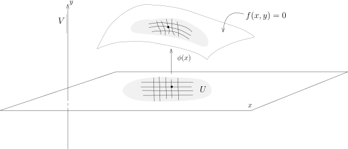
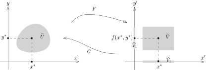
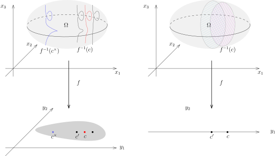
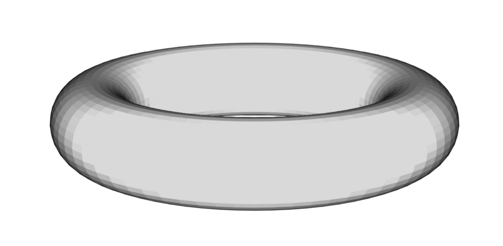
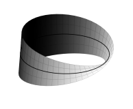

## 隐函数定理

我们假设 $\Omega\subset \mathbb{R}^{n+p}$ 是开集。
为了定理的叙述方便，我们将 $ \mathbb{R}^{n+p}$ 写成乘积结构 $\mathbb{R}^n\times\mathbb{R}^p$。
在 $\mathbb{R}^n$ 上面我们用坐标 $x=(x_1,\cdots,x_n)$，
在 $\mathbb{R}^p$ 上面我们用坐标 $y=(y_1,\cdots,y_p)$。
对于 $\Omega$ 上的映射／函数 $f$，我们用 $f(x,y)$ 这样的二元函数来表示，其中 $x\in \mathbb{R}^n$，
$y\in \mathbb{R}^p$。
为了行文方便，我们引入下面（不标准的）符号：将 $y$ 固定，我们就可以将 $f(x,y)$ 看作是 $x$ 的函数，即
\[
f(\cdot,y)\colon  \mathbb{R}^n \rightarrow \mathbb{R}^m,
\]
从而我们可以对 $x$ 求微分，我们将这个微分记作 $d_xf(x,y)$；类似地，我们可以定义 $d_yf(x,y)$。

我们首先给出隐函数定理的经典叙述（和证明），然后用子流形的语言就可以有更清晰的几何表述。

::: theorem [隐函数定理]
给定正整数 $n$ 和 $p$ 和非空开集 $\Omega \subset \mathbb{R}^n\times\mathbb{R}^p$，
映射 $f\colon \Omega\rightarrow \mathbb{R}^p$ 是连续可微的（$C^1$ 的）。

假设 $(x^*,y^*)\in \Omega$，使得 $f(x^*,y^*)=0$，其中 $x^*\in \mathbb{R}^n$，$y^*\in \mathbb{R}^p$，
$0\in \mathbb{R}^p$。
如果 $\bigl(d_y f\bigr)(x^*,y^*)$ 是可逆的，
即Jacobi矩阵 $\Bigl(\dfrac{\partial f_i}{\partial{y_j}}\Bigr)_{1\leqslant i,j\leqslant p}$ 在
$(x^*,y^*)$ 点是可逆的。
那么，存在开集 $U\subset \mathbb{R}^n$，$x^*\in U$，存在开集 $V\subset \mathbb{R}^p$，$y^*\in V$，
存在连续可微的映射 $\phi\colon U\rightarrow V$，使得对任意的点 $(x,y)\in \Omega$，如下两条是等价的：

- $(x,y)\in U\times V$ 并且 $f(x,y)=0$；

- $x\in U$ 并且 $y=\phi(x)$。

我们进一步还有 $d\phi(x)=-(d_yf(x,y))^{-1}\circ d_xf(x,y)$。
:::

::: remark*
“隐”函数说的是方程 $f(x,y)=0$ 实际上隐含地将 $y$ 定义成 $x$ 的函数，定理具体地将这个函数构造了出来：
$y=\phi(x)$。
当 $p=1$ 时，$f(x,y)=0$ 在空间中所定义的曲面局部上就可以表达成 $y=\phi(x)$ 的形式，
也就是说它局部上可以看成是函数的图像，从而是 $\mathbb{R}^{n+1}$ 中余 $1$ 维的子流形，
下面的图很好地总结了这个情形：
:::



::: example*
隐函数定理的叙述乍看起来晦涩难懂。
最简单的就是如下的情形：$\Omega=\mathbb{R}^n\times \mathbb{R}^p$，$f$ 是投影映射：
\[
f\colon  \mathbb{R}^{n}\times \mathbb{R}^p \rightarrow \mathbb{R}^p, \ \ (x_1,\cdots,x_n,y_1,\cdots,y_p) \mapsto (y_1,\cdots,y_p).
\]
此时，$U=\mathbb{R}^n$，$V=\mathbb{R}^p$ 而
\[
\phi\colon \mathbb{R}^n\rightarrow \mathbb{R}^p, \ \ x\mapsto 0.
\]
这显然满足定理的要求，因为 $f(x,y)=0 \Leftrightarrow  y=0$。
隐函数定理本质上说只要选取适当的坐标系这是唯一的例子。
:::

::: proof
我们利用反函数定理来证明隐函数定理。为此，我们通过把 $f$ 的值域空间加一些维数来定义一个新的映射。
注意到，对于 $x \in \mathbb{R}^n$，
$f(x,y)\in \mathbb{R}^p$（如果 $(x,y)$ 落在 $f$ 的定义域里的话）。所以，以下的映射是良好定义的：
\[
F\colon \Omega \rightarrow \mathbb{R}^n\times \mathbb{R}^p, \ (x,y)\mapsto F(x,y)=(x,f(x,y)).
\]
很明显，$F$ 是连续可微的（因为它的每个分量都是连续可微的）。
我们可以计算 $F$ 在 $(x,y)$ 处微分，用Jacobi矩阵来显然可以表达成：

```math
dF=\left(
  \begin{array}{cc}
    {\rm id} & 0 \\
    d_x f & d_y f\\
      \end{array}
\right),
```

这是一个 $(n+p)\times (n+p)$ 的方阵。
由于 $(d_y f)(x^*,y^*)$ 可逆，所以分块矩阵 $(dF)(x^*,y^*)$ 也是可逆的。
所以，我们可以对映射 $F$ 在 $(x^*,y^*)$ 处用反函数定理：存在开集 $\widetilde{U} \subset \Omega$，
$(x^*,y^*)\in \widetilde{U}$，
存在开集 $\widetilde{V} \subset \mathbb{R}^{n+p}$ 并且通过将它缩小我们可以假设它具有乘积结构
$\widetilde{V}=\widetilde{V_1}\times \widetilde{V_2}$ 以及连续可微的映射
$G\colon \widetilde{V}\rightarrow \widetilde{U}$（这是 $F$ 的逆），使得
\[
G\circ F ={\rm id}_{\widetilde{U}}, \ \ F\circ G ={\rm id}_{\widetilde{V}}.
\]
我们可以参考下面的示意图：



我们将 $F$ 的值域（即 $G$ 的定义域）上的坐标用 $(x',y')$ 来表示。按照分量的记法，可以将 $G$ 写成
\[
G(x',y')=(\overbrace{G_1(x',y')}^{\in \mathbb{R}^n},\overbrace{G_2(x',y')}^{\in \mathbb{R}^p}).
\]
我们把反函数定理给出的两个等式用分量写出来，就有
\[
\begin{aligned}
G\circ F ={\rm id}_{\widetilde{U}} \ \ &\Rightarrow \ \ G_1(x,f(x,y))=x, \ G_2(x,f(x,y))=y;\\
F\circ G ={\rm id}_{\widetilde{V}} \ \ &\Rightarrow \ \ G_1(x',y')=x', \ f(x',G_2(x',y'))=y'.
\end{aligned}
\]
总结一下，我们得到了
\[
\begin{cases}&G(x',y')=(x',G_2(x',y')),\\
&G_2(x,f(x,y))=y, \\
&f(x',G_2(x',y'))=y'.
\end{cases}
\]
按照 $F$ 和 $G$ 的定义，对于给定的 $(x,y)\in \widetilde{U}$，我们有如下的等价关系
\[
f(x,y)=0 \ \ \Leftrightarrow \ \ F(x,y)=(x,0)   \ \ \Leftrightarrow \ \ (x,y)=F^{-1}(x,0)=G(x,0)=(x,G_2(x,0)).
\]
所以，如果我们令 $\phi(x)=G_2(x,0)\colon V \rightarrow \mathbb{R}^p$，那么，
给定的 $(x,y)\in \widetilde{U}$，我们有如下的等价关系
\[
f(x,y)=0 \ \ \Leftrightarrow \ \ y=\phi(x).
\]
所以，我们可以取 $U=\widetilde{U}$，$V=\widetilde{V_1}$，这就证明了隐函数定理的主要论述。

最终，为了计算微分，我们对 $f(x,\phi(x))=0$ 求微分，即对映射
\[
U\rightarrow \mathbb{R}^p, \ \ x\mapsto f(x,\phi(x))
\]
求微分。我们得到
\[
df_x(x,y)+df_y(x,y)\cdot d\phi(x)=0, \ \ \text{其中} \ y=\phi(x).
\]
在 $(x^*,y^*)$ 的附近，$df_y(x,y)$ 是可逆的，所以 $d\phi(x)=-(d_yf(x,y))^{-1}\circ d_xf(x,y)$。
:::

::: remark*
如果我们把反函数定理条件中映射改为 $C^\infty$ 的，那么结论中的函数和映射也是 $C^\infty$ 的，
这从反函数定理的叙述就可以看出来。
:::

## 隐函数定理的子流形叙述

利用子流形这个概念，我们可以更形象地理解隐函数定理。
反过来，隐函数定理给出了一种非常实用的判断子流形的方法。

假设 $M\subset \mathbb{R}^N$ 是一个 $d$-维的子流形，所以对任意的 $x\in M$，
存在开集 $U\subset \mathbb{R}^N$ 包含 $x$，
$\mathbb{R}^n$ 中的开集 $V$ 以及微分同胚 $\varphi\colon  U \rightarrow V$
使得
\[
\varphi(U\cap M) = V \cap (\mathbb{R}^d \times \{0\}),
\]

我们现在沿用隐函数定理中的符号。我们令
\[
M=\bigl\{(x,y)\in \mathbb{R}^{n} \times \mathbb{R}^p\,\bigm|\,f(x,y)=0\bigr\}.
\]
由于 $f(x,y)=0$ 实际上是 $p$ 个方程（因为 $f\colon \mathbb{R}^{n+p}\rightarrow \mathbb{R}^p$），
所以，我们将上述集合看成 $\mathbb{R}^{n+p}$ 中由 $p$ 个方程的公共零点组成的集合。
如果 $f$ 的某些导数为非退化的（参考隐函数定理的叙述），
那么局部上这个 $M$ 可以表达成映射的图像的形式，即对任意的 $(x,y)\in M$，局部上都等价于 $y=\phi(x)$。
从另外一种观点来看，$M$ 可以被 $x$ 参数化，即给定 $x$，就唯一地确定了 $M$ 上的一个点。

为了说明 $M$ 实际上是微分子流形，
我们需要构造一个映射 $\Phi\colon  \mathbb{R}^{n+p}\rightarrow \mathbb{R}^{n+p}$，
使得 $\Phi$ 是微分同胚（局部上）并且将 $M$ 映射成右边 $\mathbb{R}^{n+p}$ 上的由 $y_1=\cdots=y_p=0$
所给出来的线性子空间。这个映射就是定理证明中的 $F$：
\[
F(x,y)=(x,f(x,y))=(x,0), \ \ \text{其中} \ \ (x,y)\in M.
\]
这样，我们就证明了 $M$ 实际上（局部上）是一个微分子流形。

我们把上面的讨论总结为如下的定理：

::: theorem [隐函数：子流形版本]
给定正整数 $n'$ 和 $p$（$n=n'+p$）和非空开集 $\Omega \subset \mathbb{R}^{n'+p}=\mathbb{R}^n$，
映射 $f\colon \Omega\rightarrow \mathbb{R}^p$ 是光滑的。令
\[
M=\bigl\{(x,y)\in \mathbb{R}^{n'} \times \mathbb{R}^p\,\bigm|\,f(x,y)=0\bigr\}.
\]
假设 $(x^*,y^*)\in M$ 使得Jacobi矩阵
$\Bigl(\dfrac{\partial f_i}{\partial{y_j}}\Bigr)_{1\leqslant i,j\leqslant p}$ 在 $(x^*,y^*)$
点是可逆的。
那么，存在开集 $U\subset \mathbb{R}^{n}$ 使得 $U\cap M$ 是 $\mathbb{R}^n$ 中的 $n'$ 维子流形。
:::

这个版本有如下重要的推论：

::: corollary [子流形的判断准则]
假设 $f\colon \Omega\rightarrow \mathbb{R}^p$ 是光滑映射，其中 $\Omega\subset \mathbb{R}^n$ 是开集，
$n\geqslant p$。对于 $c\in \mathbb{R}^p$，我们把 $c$ 上的**纤维**定义为 $c$ 在 $f$ 下的逆像：
\[
f^{-1}(c)=\{x\in \mathbb{R}^{n}|f(x)=c\}.
\]
如果对任意的 $x\in f^{-1}(c)$，$\operatorname{Rank}df(x)=p$。
那么，纤维 $f^{-1}(c)$ 是余维数为 $p$ 的子流形。
:::

::: proof
我们要在 $\mathbb{R}^n$ 上的选取坐标系 $x_1,\cdots, x_n$。
根据 $\operatorname{Rank}df(x)=p$，通过调整 $x_1,\cdots,x_n$ 的标号，
我们可以使得后面 $p$ 个坐标 $x_{n-p+1},\cdots,x_n$ 满足
\[
\det\Bigl(\dfrac{\partial f_i}{\partial{x_{n+1-j}}}\Bigr)_{1\leqslant i,j\leqslant p} (x)\neq 0,
\]
其中 $x$ 是任意选定的 $x\in f^{-1}(c)$ 上的点。
我们选取函数 $f-c$ 并且将后 $p$ 个坐标用 $y_1,\cdots,y_p$ 来表示，这就化成了隐函数定理的情况。
特别地，纤维 $f^{-1}(c)$ 在任意一点附近都是 $n-p$ 维子流形，
所以 $f^{-1}(c)$ 是 $n-p$ 维（余维数为 $p$）的子流形。
:::

::: remark*
我们注意到定理本身的叙述不需要任何的坐标系，
而证明本身很好地解释了不依赖于坐标和选取坐标系之间的关系。

我们应该和线性代数的情况做类比：给定 $n$ 维线性空间上的 $p$ 个齐次线性方程，
它们的公共零点是维数为 $n-p$ 的线性子空间当且仅当这 $p$ 个线性方程的秩是 $p$。
:::

::: remark* [几何图像]
我们可以用下图形象地记忆并表示这个命题，这是关于隐函数定理最干净最形象的表述：



左图代表是余维数为 $2$ 的情形。
我们假设 $f\colon \Omega\rightarrow f(\Omega)$，其中 $f(\Omega)$ 是下面灰色的区域。
对于每个 $c\in f(\Omega)$，我们可以把它的原像想象成插在这个点上面的一个纤维。
特别地，$\Omega$ 可以被写成这些纤维的无交并：
\[
\Omega = \coprod_{c\in f(\Omega)}f^{-1}(c).
\]
然而，我们需要在每个 $x\in f^{-1}(c)$ 点处要求一个非退化的条件才能保证 $f^{-1}(c)$ 是光滑的子流形。
上面的图形表示，在 $c$ 的纤维如果满足这个非退化的条件，
那么它附近的 $c'$ 处的纤维 $f^{-1}(c')$ 也是光滑的子流形：实际上，
我们需要对 $f^{-1}(c)$ 限制才可以（比如纤维是紧的），但是很多情况下这一点都成立，
大概的原因是 $\operatorname{Rank}df(x)=p$ 如果成立，就在附近的一个开集上面成立。
然而，离着 $c$ 比较远的点，这个条件就可能退化，比如说上面的蓝色 $c^\times$ 点，它的纤维就“打折”了。

右图代表是余维数为 $1$ 的情形，对于每个 $c$，我们形象地认为纤维是 $\Omega$ 的一个“切片”。
事实上，为了研究高维子流形的结构，我们经常通过这种切片化成低维数子流形的情况来研究。
在后面的课程和作业中，我们会用这个方法研究几个重要的例子。
:::

下面的命题是隐函数定理几何版本的逆命题：
子流形总是可以（在局部上）由 $\operatorname{codim} M=n-\operatorname{dim} M$ 个方程的零点来定义。
我们已经在第四次课的开始证明了这个结论，为了完备起见（也为了再次复习子流形的定义），
我们概述一下证明。

::: proposition
假设 $M^d\subset \mathbb{R}^n$ 是 $d$ 维的子流形。
那么，对任意的 $p\in M$，存在开集 $U\subset \mathbb{R}^n$，
$p\in U$ 和 $n-d$ 个光滑函数 $f_1,\cdots, f_{n-d}\in C^\infty(U)$，使得
\[
M^{d}=\bigl\{x\in U\,\bigm|\,f_1(x)=\cdots=f_{n-d}(x)=0\bigr\}.
\]
特别地，映射的微分
\[
f\colon U\rightarrow \mathbb{R}^{n-d}, \ x\mapsto (f_1(x),\cdots,f_{n-d}(x))
\]
在每个点 $x\in M$ 处的秩都是 $n-d$。
:::

::: proof
按子流形的定义，存在开集 $U\subset \mathbb{R}^n$ 包含 $p$，
$\mathbb{R}^n$ 中的开集 $V$ 以及微分同胚 $\varphi\colon  U \rightarrow V$，使得
\[
\varphi(U\cap M) = V \cap (\mathbb{R}^d \times \{0\}).
\]
我们用 $y_1,\cdots,y_n$ 表示 $V$ 上的坐标函数，
那么我们选取 $f_i =\varphi^*y_i=y_i\circ \varphi$ 即可，其中 $i=d+1,\cdots,n$。
:::

::: remark*
我们沿用命题中的记号，如果令
\[
M^{d+k}=\bigl\{x\in U\,\bigm|\,f_1(x)=\cdots=f_{n-d-k}(x)=0\bigr\},
\]
那么，$M^{d+k}$ 是 $d+k$ 维的子流形（作业中会证明）。
换句话说，每次加上一个 $f_j(x)=0$ 的限制，子流形的维数恰好降低 $1$ 维。
:::

我们现在给出隐函数定理的几个应用，首先是用来判定子流形，现在我们只需要做一些简单的代数计算即可：

- 1\) $\mathbb{R}^n$ 中的球面 $\mathbf{S}^{n-1}=\{x\in \mathbb{R}^n|x_1^2+\cdots+x_n^2=1\}$ 是一个
  $n-1$ 维的子流形。

  球面可以被视作是函数
  \[
  f(x_1,\cdots,x_n)=(x_1)^2+(x_2)^2+\cdots +(x_n)^2-1
  \]
  的零点集。所以，只要验证它的微分 $df(x)$ 的秩为 $1$ 即可。然而，用矩阵来写
  \[
  \begin{aligned}
  df(x)&=\left(\frac{\partial f}{\partial x_1}(x),\cdots,\frac{\partial f}{\partial x_n}(x)\right)\\
  &=2(x_1,\cdots,x_n).
  \end{aligned}
  \]
  由于在 $\mathbf{S}^{n-1}$ 上，$|x|=1$，上面的向量显然非零，所以这是光滑子流形。
  这比之前我们把球面 $\mathbf{S}^2$ 拆成六块（参见第三课讲义）并且将每块写成函数的图像要方便很多。

- 2\) 我们考虑 $\mathbb{R}^4=\mathbb{C}^2$ 中的曲面
  \[
  \mathbf{T}^2=\Bigl\{(z_1,z_2)\,\Bigm|\, |z_1|=1,|z_2|=1\Bigr\}.
  \]
  如果我们用 $(x,y,z,w)$ 作为坐标，那么这个曲面实际上是
  \[
  f(x,y,z,w)=x^2+y^2-1, \ \ g(x,y,z,w)=z^2+w^2-1
  \]
  这两个方程的公共零点集。我们需要计算
  \[
  \mathbb{R}^4\rightarrow \mathbb{R}^2, \ \ (x,y,z,w)\mapsto \bigl(f(x,y,z,w),g(x,y,z,w)\bigr),
  \]
  的Jacobi矩阵并判断它的秩。这个矩阵显然是
  \[
  \left( {\begin{array}{cccc}
  2x&    2y & 0 & 0\\
     0 &    0 & 2z &2w\\
  \end{array} } \right).
  \]
  由于在 $\mathbf{T}^2$ 上面，$x^2+y^2=1$，$z^2+w^2=1$，所以上面这个矩阵的秩是 $2$，
  从而 $\mathbf{T}^2$ 是 $2$ 维的子流形。它实际上是一个环面（甜甜圈）：

  {width=350}

## $\mathbb{R}^3$ 中由方程定义的曲线和曲面

在经典的微积分课程中，$\mathbb{R}^3$ 中由一个方程或者两个方程定义的曲线和曲面是最基本的几何对象。
我们首先引入如下的定义：

::: definition
假设 $M\subset \mathbb{R}^n$ 是子流形。
如果 $\operatorname{dim} M=1$，我们就称之为 $\mathbb{R}^n$ 中的一条**光滑曲线**；
如果 $\operatorname{dim} M=2$，我们就称之为 $\mathbb{R}^n$ 中的一个**光滑曲面**；
如果 $\operatorname{dim} M=n-1$，我们就称之为 $\mathbb{R}^n$ 中的一个**光滑超曲面**。
:::

::: remark*
这里曲线的概念和上个学期所讲的曲线略有不同：之前是所谓的参数化曲线，
即曲线是一个映射 $\gamma\colon I\rightarrow \mathbb{R}^n$，其中 $I\subset \mathbb{R}$ 是一个区间。
这里的曲线只是 $\mathbb{R}^n$ 中的一个子集，然而根据隐函数定理的结论，
我们在局部上可以给它一个参数化。
:::

我们关心的是如下的对象，它们有着更特殊的要求：

::: lemma
假设 $f\colon \mathbb{R}^n\rightarrow \mathbb{R}$ 是光滑函数，如果对于任意的 $x_0\in f^{-1}(0)$，
$df(x_0)\neq 0$，那么 $f^{-1}(0)$ 是超曲面。我们把这种超曲面称为*由一个方程整体定义的光滑超曲面*。
:::

我们把（显然的）证明留作作业。
特别地，在 $\mathbb{R}^3$ 中，我们有

::: lemma
假设 $f(x,y,z)$ 是 $\mathbb{R}^3$ 上的光滑函数，
如果对于任意满足 $f(x_0,y_0,z_0)=0$ 的点 $(x_0,y_0,z_0)$，我们有
\[
\left(\frac{\partial f}{\partial x},\frac{\partial f}{\partial y},\frac{\partial f}{\partial z}\right)(x_0,y_0,z_0)\neq 0,
\]
那么
\[
\bigl\{(x,y,z)\in \mathbb{R}^3\,\bigm|\, f(x,y,z)=0\bigr\}
\]
是光滑曲面。我们把这种超曲面称为*由一个方程整体定义的光滑曲面*。
:::

::: example*
$\mathbb{R}^3$ 中的柱面由如下方程
\[
x^2+y^2=1
\]
定义，这是一个光滑曲面：我们取 $f(x,y,z)=x^2+y^2-1$，此时，
\[
\left(\frac{\partial f}{\partial x},\frac{\partial f}{\partial y},\frac{\partial f}{\partial z}\right)=(2x,2y,0)\neq 0,
\]
:::

我们还有用两个方程定义的曲线：

::: lemma
假设 $f(x,y,z)$ 和 $g(x,y,z)$ 是 $\mathbb{R}^3$ 上的光滑函数，
如果对于任意同时满足 $f(x_0,y_0,z_0)=0$ 和 $g(x_0,y_0,z_0)=0$ 的点 $(x_0,y_0,z_0)$，
如果如下两个向量线性不相关：
\[
\left(\frac{\partial f}{\partial x},\frac{\partial f}{\partial y},\frac{\partial f}{\partial z}\right)(x_0,y_0,z_0), \ \ \ \left(\frac{\partial g}{\partial x},\frac{\partial g}{\partial y},\frac{\partial g}{\partial z}\right)(x_0,y_0,z_0),
\]
那么
\[
\bigl\{(x,y,z)\in \mathbb{R}^3\,\bigm|\, f(x,y,z)=0,  g(x,y,z)=0\bigr\}
\]
是光滑曲线。我们把这种曲线称为*由两个方程整体定义的光滑曲线*。
:::

我们把（显然的）证明留作作业。

在结束关于隐函数定理的几何讨论之前，我们给出隐函数定理的一个对偶版本。
这个版本本身和隐函数是无关的，之所以是对偶的，
是因为隐函数定理研究从 $\mathbb{R}^n$ 到 $\mathbb{R}^p$ 的映射，其中 $n\geqslant p$，
其结论说映射的逆像或者纤维是子流形。
而这个定理（证明非常简单，只要验证定义）研究从 $\mathbb{R}^n$ 到 $\mathbb{R}^{p'}$ 的映射，
其中 $n\leqslant p$，其结论说映射的像是子流形。

::: theorem [参数化子流形]
$\Omega \subset \mathbb{R}^n$ 是开集，$f\colon \Omega\rightarrow \mathbb{R}^{n+p}$ 是光滑映射。
假设对于点 $x^* \in \Omega$，有 $\operatorname{rank}df(x^*)=n$，那么，
存在开集 $U\subset \mathbb{R}^n$，$x^*\in U$，
使得 $f(U)\subset \mathbb{R}^{n+p}$ 是 $n$ 维的子流形。
:::

::: proof
在 $\Omega$ 上选取坐标系统 $x_1,\cdots,x_n$，
在 $\mathbb{R}^{n+p}$ 上选取坐标坐标系统 $y_1,\cdots,y_n,z_1,\cdots,z_p$。我们把 $f$ 用坐标分量写成
\[
f(x)=(f_1(x),\cdots,f_{n+p}(x)),
\]
其中每个 $f_i(x)$ 都是 $\Omega$ 上的光滑函数。
由于有 $\operatorname{rank}df(x^*)=n$，通过调换 $\{x_i\}$ 坐标的指标，我们不妨假设
\[
\operatorname{det}\left(\frac{\partial {f_i}}{\partial x_j}\right)_{i,j\leqslant n}(x^*)\neq 0.
\]
我们现在考虑 $F=\pi_y\circ f$，
其中 $\pi\colon \mathbb{R}^{n+p}\rightarrow \mathbb{R}^n$ 是取前 $n$ 个坐标，即
\[
\begin{tikzcd}
\Omega \ar[r,"f"] \ar[dr, below, "F"]
  &  \mathbb{R}^{n+p}\ar[d,"\pi_y"]\\
&   \mathbb{R}^n \end{tikzcd}
\]
换句话说，我们定义了 $F(x)=(f_{1}(x),f_{2}(x),\cdots,f_n(x))$。
根据上述行列式非零的条件，$F$ 为局部微分同胚（反函数定理）。
令 $U$ 为 $x$ 在 $\Omega$ 中的开集，$F\colon U\rightarrow F(U)$ 为这个微分同胚并令 $V=F(U)$。
此时，我们考察 $f(U)\subset \mathbb{R}^{n+p}$。
对于 $x\in U$，令 $y=F(x)$，$f(x)\in \mathbb{R}^{n+p}$ 可以写成
\[
\begin{aligned}
(f_1(x),\cdots,f_n(x);f_{n+1}(x),\cdots, f_{n+p}(x))&=(y;f_{n+1}(x),\cdots,f_{n+p}(x))\\
&=(y, f_{n+1}(F^{-1}(y)),f_{n+2}(F^{-1}(y)),\cdots,f_{n+p}(F^{-1}(y))).
\end{aligned}
\]
所以，
它可以被视作是 $V$ 上定义的向量值函数
$y\mapsto (f_{n+1}(F^{-1}(y)),f_{n+2}(F^{-1}(y)),\cdots,f_{n+p}(F^{-1}(y)))$ 的图像，
这是一个用 $y$ 作为坐标来参数化的子流形（在本次作业中证明）。
:::

在 $\mathbb{R}^3$ 中还有一个经典曲面：**$\mathcal{M}$öbius带**。我们用参数的方式可以把它写作
\[
\mathcal{M}=\left\{(x,y,z)\in \mathbb{R}^3\middle|\begin{cases}&x=(1+r\cos\frac{\theta}{2})\cos\theta,\\&y=(1+r\cos\frac{\theta}{2})\sin\theta,\\&z=r\sin\frac{\theta}{2} \end{cases}\ \ \theta\in [0,2\pi], r\in (-1,1)\right\}.
\]
适当改变一下书写方式更有启发：
\[
(x,y,z)=(\cos\theta,\sin\theta,0)+(r\cos\frac{\theta}{2} \cos\theta, r\cos\frac{\theta}{2} \sin\theta, r\sin\frac{\theta}{2}).
\]
当 $r=0$ 时，我们得到一个用 $\theta$ 来参数化的基本圆周 $(\cos\theta,\sin\theta,0)$。
给定 $\theta$，就给定了这个圆周上的一个点 $(\cos\theta,\sin\theta,0)$。
固定这个 $\theta$，当 $r$ 在 $(-1,1)$ 之间变化的时候，
我们就在这个点插上了一个小线段并且这个线段的方向的变化是 $\theta$ 的一半。
所以，当 $\theta$ 从 $0$ 变化到 $2\pi$，基本圆周上的点旅行了一周又回到了原来的点，
但是它上面所插的小线段只转动了 $180^\circ$。

{width=250}

我们下面证明一个不明显的命题，为此，我们先选择好的记号：把 $r=0$ 光滑圆周写成参数形式：
\[
\gamma\colon [0,2\pi]\rightarrow \mathbb{R}^3, \ \ \theta \mapsto (\cos\theta,\sin\theta,0).
\]
给定 $\theta$ 处，我们用 $e_0$ 表示 $\gamma$ 在 $\gamma(\theta)$ 处的切方向 $\gamma'(\theta)$，
即令 $e_0=(-\sin\theta,\cos\theta,0)$。和 $e_0$ 垂直的方向有两个，我们分别记作
\[
e_1(\theta)=(\cos\theta,\sin\theta,0), \ \ e_2(\theta)=(0,0,1).
\]
据此，我们把 $M$ 的参数化写成：
\[
\mathcal{M}=\left\{(x,y,z)=(\cos\theta,\sin\theta,0)+r\cos\frac{\theta}{2} e_1(\theta)+r\sin\frac{\theta}{2} e_2(\theta), \theta\in [0,2\pi], r\in (-1,1)\right\}.
\]
根据刚刚证明的定理，这是 $\mathbb{R}^3$ 中的一个光滑曲面（参见本次作业）。

::: proposition
**不存在**光滑函数 $f\in C^\infty(\mathbb{R}^3)$，使得
\[
\mathcal{M}=\bigl\{(x,y,z)\,\bigm|\,f(x,y,z)=0\bigr\}
\]
且 $df(x,y,z)$ 在 $\mathcal{M}$ 上的每点处不为零，
即 $\mathcal{M}$ 不能只用一个方程零点来**整体**定义。
:::

::: remark*
我们需要运用关于由一个方程定义的光滑曲面的特殊性质（基于连续函数的介值定理）：
给定 $f\in C^\infty(\mathbb{R}^3)$，假设对任意的 $x\in \Omega$，$df(x)\neq 0$，
$f^{-1}(0)\subset \Omega$ 是光滑子流形并且由一个方程定义。
任意选定 $x\in \Omega$，考虑 $x$ 处的邻域 $U$（足够小）。
由于 $df(x)\neq 0$，我们不妨选 $v\in \mathbb{R}^n$，使得
\[
\nabla_v f(x)=df(x)(v)>0.
\]
从而，在当 $\varepsilon>0$ 足够小时，$p_\pm=x\pm \varepsilon v\in U$ 并且 $f(p_+)>0$，$f(p_-)<0$。
我们声明，任何一条连接 $p_+$ 和 $p_-$ 的曲线都要经过 $f^{-1}(0)$，
即对任意的连续映射 $\gamma\colon [0,1] \rightarrow X$，
其中起点 $\gamma(0)=p_-$ 和终点 $\gamma(1)=p_+$，一定存在 $t_0\in (0,1)$，
使得 $\gamma(t_0)\in f^{-1}(0)$（等价于说 $f(\gamma(t_0))=0$）。
实际上，$f(\gamma(t))$ 为连续函数，按照 $p_\pm$ 的选取方式，我们有
\[
f(\gamma(0))=f(p_-)<0, \ \ f(\gamma(1))=f(p_+)>0,
\]
所以连续函数的介值定理就给出了 $t_0$。
:::

我们现在证明关于Möbius带的命题：

::: proof
我们给出证明的梗概，证明的细节留给同学们在作业中完成。
如若不然，假设 $f$ 是 $\mathcal{M}$ 的定义方程。
任选 $p=(\cos\theta,\sin\theta,0)\in \mathcal{M}$，
直观上（实际上也是）这个附近的小邻域 $U$ 被 $f$ 的图像分成了两个部分：在一部分中，$f>0$；
在另一部分中，$f<0$。我们选取在 $p$ 点处和整个曲面垂直的法向量
\[
\nu(\theta)=\cos\frac{\theta}{2} e_2(\theta)-\sin\frac{\theta}{2} e_1(\theta)
\]
我们考虑曲线
\[
\beta\colon [0,2\pi]\rightarrow \mathbb{R}^3, \ \ (\cos\theta,\sin\theta,0)+\varepsilon \nu(\theta).
\]
我们可以适当的选取比较小的 $\varepsilon$（可正可负），使得 $f(\beta(0))>0$。
然而，$\gamma(2\pi)=\gamma(0)$，曲线所对应的 $\varepsilon$ 却变换了符号，从而，$f(\beta(2\pi))<0$。
很明显，这条曲线与曲面 $\mathcal{M}$ 不相交，矛盾。
:::
