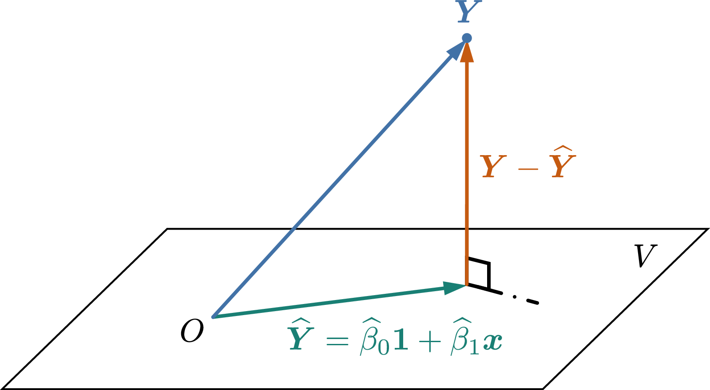

<problems>
- “最小二乘估计的偏差与均方误差”一节中，$\mathbb{E}\!\left[\widehat\beta_1\right]$ 的计算第三行含 $\beta_0$ 的一项似乎多除了一个 $S_{xx}$（该项为 $0$，不影响结果）。
- “最小二乘估计的偏差与均方误差”一节中，$\operatorname{Var}(\widehat\beta_0)$ 的计算里，展开后的交叉项似乎应为 $-\frac{2\overline{x}}{nS_{xx}}(x_i-\overline{x})$，下一行的 $\frac{\overline{x}^2}{S_{xx}}\sum_{i=1}^n (x_i-\overline{x})^2$ 似乎应为 $\frac{\overline{x}^2}{S_{xx}^2}\sum_{i=1}^n (x_i-\overline{x})^2$（不影响最终结果）。
</problems>

## 系数$\beta_0$与$\beta_1$的点估计*

**最小二乘估计**（least squares estimation, LSE）是对
线性回归模型 @eq:linear_regression_model1 中的
未知参数$\beta_0,\beta_1$进行点估计的经典方法。在最小二乘估计中，
我们考虑如下最优化问题：

```math {@eq:LSE_optimization}
\min_{\beta_0,\beta_1}\ \ \frac{1}{2}\sum_{i=1}^n
\left(Y_i-\beta_0-\beta_1x_i\right)^2,
```

在求解 @eq:LSE_optimization 时我们把各个$Y_i$看作定值，
则求得的最优解可看作$Y_1,\ldots,Y_n$的函数。我们将
@eq:LSE_optimization 的最优解记为$\widehat\beta_0$
与$\widehat\beta_1$，它们就是$\beta_0$与
$\beta_1$的**最小二乘点估计量**。我们先介绍如何求解
最优化问题 @eq:LSE_optimization，再对
@eq:LSE_optimization 给出的点估计的合理性进行解释。

首先注意到，最优化问题 @eq:LSE_optimization 中对
$\beta_0$与$\beta_1$的取值未做出其它约束，故可以考虑对目标函数
\[
S(\beta_0,\beta_1) = \frac{1}{2}\sum_{i=1}^n
\left(Y_i-\beta_0-\beta_1x_i\right)^2
\]
求偏导得到驻点，再验证驻点是否是最小值点。$S(\beta_0,\beta_1)$
的偏导数由
\[
\begin{aligned}
\frac{\partial S(\beta_0,\beta_1)}{\partial\beta_0}
={} & -\sum_{i=1}^n \left(Y_i-\beta_0-\beta_1 x_i\right), \\
\frac{\partial S(\beta_0,\beta_1)}{\partial\beta_1}
={} &
-\sum_{i=1}^n x_i\left(Y_i-\beta_0-\beta_1 x_i\right)
\end{aligned}
\]
给出，而$S(\beta_0,\beta_1)$的海塞矩阵（Hessian matrix）则为
\[
\mathbf{H}(\beta_0,\beta_1)
=
\begin{bmatrix}
\dfrac{\partial^2 S(\beta_0,\beta_1)}{\partial\beta_0^2}
& \dfrac{\partial^2 S(\beta_0,\beta_1)}{\partial\beta_0\partial\beta_1} \\[4pt]
\dfrac{\partial^2 S(\beta_0,\beta_1)}{\partial\beta_1\partial\beta_0} &
\dfrac{\partial^2 S(\beta_0,\beta_1)}{\partial\beta_1^2}
\end{bmatrix}
=\begin{bmatrix}
n & n\overline{x} \\
n\overline{x} & \sum_{i=1}^n x_i^2
\end{bmatrix}
\]
而由于$x_1,\ldots,x_n$不都等于同一个值，故
\[
\det \mathbf{H}(\beta_0,\beta_1)
=n\sum_{i=1}^n x_i^2 - n^2\overline{x}^2
=n\sum_{i=1}^n \left(x_i-\overline{x}\right)^2
>0,
\]
再注意到$\mathbf{H}(\beta_0,\beta_1)$的两个对角元均为正数，
可得$\mathbf{H}(\beta_0,\beta_1)$为正定矩阵，因此
$S(\beta_0,\beta_1)$是一个强凸的可微函数，由多元微积分知识可知，
$S(\beta_0,\beta_1)$仅存在唯一一个驻点，且该驻点就是它的最小值点。
由此可得最优化问题 @eq:LSE_optimization 的最优解满足方程组

```math {@eq:LSE_normal_equation}
\begin{aligned}
n\widehat\beta_0 + \left(\sum_{i=1}^n x_i\right)\widehat\beta_1 &= \sum_{i=1}^n Y_i, \\
\left(\sum_{i=1}^n x_i\right)\widehat\beta_0 + \left(\sum_{i=1}^n x_i^2\right)\widehat\beta_1 &=
\sum_{i=1}^n x_i Y_i,
\end{aligned}
```

该方程组也被称为normal equations[^1]。
解normal equations可得

```math {@eq:LSE_solution}
\begin{aligned}
\widehat\beta_0 &= \overline{Y} - \widehat\beta_1\overline{x}, \\
\widehat\beta_1 &=
\frac{\sum_{i=1}^n x_iY_i-n\overline{x}\cdot\overline{Y}}{\sum_{i=1}^n x_i^2 - n\overline{x}^2}
=\frac{\sum_{i=1}^n \left(x_i-\overline{x}\right)Y_i}{
\sum_{i=1}^n \left(x_i-\overline{x}\right)^2},
\end{aligned}
```

其中我们记
\[
\overline{x} = \frac{1}{n}\sum_{i=1}^n x_i,\qquad
\overline{Y} = \frac{1}{n}\sum_{i=1}^n Y_i.
\]
式 @eq:LSE_solution 给出的$\widehat\beta_0$
与$\widehat\beta_1$即为$\beta_0$与$\beta_1$的最小二乘估计量。
习惯上，我们还会引入如下记号：

```math {@eq:linear_regression_Sxx_Sxy}
\begin{aligned}
S_{xx} ={} & \sum_{i=1}^n (x_i-\overline{x})^2, \\
S_{xY} ={} & \sum_{i=1}^n \left(x_i-\overline{x}\right)Y_i = \sum_{i=1}^n \left(x_i-\overline{x}\right)\!\big(Y_i-\overline{Y}\big),
\end{aligned}
```

则$\widehat\beta_1$可表示为
\[
\widehat\beta_1=\frac{S_{xY}}{S_{xx}}.
\]
值得注意的是，$\widehat\beta_1$与$\widehat\beta_0$均可看作
$Y_1,\ldots,Y_n$的线性函数。在得到回归系数的点估计值以后，
我们可以进一步对回归函数在任意$x$处的取值进行点估计：
\[
\widehat\mu(x) = \widehat\beta_0+\widehat\beta_1 x
=\overline{Y} + \widehat\beta_1(x-\overline{x}).
\]
特别地，我们记
\[
\widehat{Y}_i = \widehat\mu(x_i) = \widehat\beta_0 + \widehat\beta_1 x_i,
\qquad i=1,\ldots,n.
\]
此外，我们将
\[
e_i = Y_i-\widehat{Y}_i = Y_i - \big(\widehat\beta_0 + \widehat\beta_1 x_i\big)
\]
称为第$i$个**残差**（residual）。

接下来，我们对最小二乘估计的合理性进行解释。

**最小二乘估计作为最大似然估计。** 在一开始的线性回归模型
@eq:linear_regression_model1 中，我们并未指定随机误差
$\varepsilon$的分布具有怎样的形式，而只是限定其期望为$0$且方差有限。
而在许多场合下，为了方便用概率论工具对最小二乘估计进行定量研究，
我们会进一步假定$\varepsilon$服从正态分布$\mathcal{N}(0,\sigma^2)$，
此时可以证明，最小二乘估计$\widehat\beta_0,\widehat\beta_1$也是
$\beta_0,\beta_1$的最大似然估计：注意到
$\varepsilon\sim\mathcal{N}(0,\sigma^2)$时，有
$Y_i\sim \mathcal{N}(\beta_0+\beta_1x_i,\sigma^2)$，
故$(Y_1,\ldots,Y_n)$的联合概率密度函数为
\[
f(\boldsymbol{y};\beta_0,\beta_1,\sigma^2,\boldsymbol{x})
=\prod_{i=1}^n\frac{1}{\sqrt{2\pi}\sigma}
\exp\!\left(
-\frac{(y_i-\beta_0-\beta_1x_i)^2}{2\sigma^2}
\right),
\]
其中记$\boldsymbol{x}=(x_1,\ldots,x_n)$，
$\boldsymbol{y}=(y_1,\ldots,y_n)$。而将
$f(\boldsymbol{y};\beta_0,\beta_1,\sigma^2,\boldsymbol{x})$
当中的$\boldsymbol{x}$与$\boldsymbol{y}$固定，并把未知参数
$\beta_0,\beta_1,\sigma^2$作为自变量，即可得到似然函数
$L(\beta_0,\beta_1,\sigma^2;\boldsymbol{x},\boldsymbol{y})$。
相应的对数似然函数为

```math {@eq:log_likelihood_simple_linear_regression}
\ln L(\beta_0,\beta_1,\sigma^2;\boldsymbol{x},\boldsymbol{y})
=-\frac{1}{2\sigma^2}\sum_{i=1}^n
\left(
y_i-\beta_0-\beta_1x_i
\right)^2
-\frac{n}{2}\ln(2\pi\sigma^2),
```

而关于$\beta_0$与$\beta_1$的对数似然方程则为
\[
\begin{aligned}
0 &= \frac{\partial\ln L(\beta_0,\beta_1,\sigma^2;\boldsymbol{x},\boldsymbol{y})}{\partial\beta_0}
=
\frac{1}{\sigma^2}\sum_{i=1}^n (y_i-\beta_0-\beta_1 x_i) , \\
0 &= \frac{\partial\ln L(\beta_0,\beta_1,\sigma^2;\boldsymbol{x},\boldsymbol{y})}{\partial\beta_1}
=
\frac{1}{\sigma^2}\sum_{i=1}^n x_i(y_i-\beta_0-\beta_1 x_i).
\end{aligned}
\]
立刻可看出上述方程组与normal equations @eq:LSE_normal_equation
具有相同的形式。由此可得如下结论：当随机误差$\varepsilon$服从
正态分布$\mathcal{N}(0,\sigma^2)$时，$\beta_0$与$\beta_1$的
最大似然估计量就是最小二乘估计量。

**（${}^\star$）最小二乘估计作为最佳无偏线性估计。** 我们还可以
从最佳无偏线性估计的角度解释最小二乘估计的合理性。设
$(x_1,Y_1),\ldots,(x_n,Y_n)$为一组样本，考虑$\beta_0$与
$\beta_1$的关于$Y_1,\ldots,Y_n$具有线性形式的点估计量：
\[
\hat\beta_1 = \sum_{i=1}^n a_i Y_i,
\qquad\hat\beta_0 = \sum_{i=1}^n b_i Y_i,
\]
其中$a_1,\ldots,a_n$与$b_1,\ldots,b_n$为待定系数，且要求它们
具有无偏性。我们希望在线性与无偏性的约束下，找到使得均方误差
\[
\begin{aligned}
\operatorname{MSE}_{\beta_1}(\hat\beta_1)
={} &
\mathbb{E}\!\left[
\big(\hat\beta_1-\beta_1\big)^2
\right]
\ \ \ \text{与}\ \ \
\operatorname{MSE}_{\beta_0}(\hat\beta_0)
=
\mathbb{E}\!\left[
\big(\hat\beta_0-\beta_0\big)^2
\right]
\end{aligned}
\]
对任意的$\beta_0,\beta_1$与$\sigma^2>0$均能取到最小值的系数
$a_1,\ldots,a_n$与$b_1,\ldots,b_n$。为了后面推导的方便，
我们罗列如下事实：

1. $Y_1,\ldots,Y_n$相互独立。

2. $\mathbb{E}[Y_i] = \beta_0+\beta_1 x_i$，
   $\operatorname{Var}(Y_i)=\sigma^2$。

首先考虑$\beta_1$的最佳无偏线性估计。
$\widehat\beta_1=\sum_{i=1}^n a_iY_i$的无偏性要求
\[
\beta_1 = \mathbb{E}\!\left[
\sum_{i=1}^n a_i Y_i
\right] = \beta_0\cdot\sum_{i=1}^n a_i+\beta_1\cdot\sum_{i=1}^n a_ix_i,
\qquad\forall \beta_0,\beta_1
\]
由$\beta_0$与$\beta_1$的任意性，可得到
\[
\sum_{i=1}^n a_i = 0,\qquad \sum_{i=1}^n a_ix_i = 1.
\]
接下来我们将均方误差$\operatorname{MSE}_{\beta_1}(\hat\beta_1)$
进行展开，并注意到$\hat\beta_1$的无偏性，可得
\[
\begin{aligned}
\operatorname{MSE}_{\beta_1}(\hat\beta_1)
={} &
\operatorname{Var}(\widehat\beta_1)
=\operatorname{Var}\!\left(
\sum_{i=1}^n a_i Y_i
\right) \\
={} &
\sum_{i=1}^n a_i^2\operatorname{Var}(Y_i)
=\sigma^2\sum_{i=1}^n a_i^2.
\end{aligned}
\]
因此$\beta_1$的最佳线性无偏估计的系数$a_1,\ldots,a_n$为
如下带约束最优化问题的解：
\[
\begin{aligned}
\min_{a_1,\ldots,a_n} \ \frac{1}{2}\sum_{i=1}^n a_i^2
\qquad
\text{s.t.}\ \  \sum_{i=1}^n a_i = 0,\ \
\sum_{i=1}^n a_ix_i = 1.
\end{aligned}
\]
上述问题是一个典型的凸优化问题，可以用拉格朗日乘子法求出最优解：
该问题的拉格朗日函数为
\[
\mathcal{L}(a_1,\ldots,a_n,\mu,\lambda)
=\frac{1}{2}\sum_{i=1}^n a_i^2 + \mu\sum_{i=1}^n a_i + \lambda\!\left(
\sum_{i=1}^n a_ix_i - 1\right).
\]
故最优性条件为
\[
\begin{aligned}
0 ={} & \frac{\partial \mathcal{L}(a_1,\ldots,a_n,\mu,\lambda)}{\partial a_i} = a_i  + \mu + \lambda x_i, \\
0 ={} & \sum_{i=1}^n a_i, \qquad\qquad
0 = \sum_{i=1}^n a_ix_i - 1.
\end{aligned}
\]
上述方程组的解为
\[
a_i = \frac{x_i-\overline{x}}{\sum_j x_j^2-n\overline{x}^2},
\qquad
\mu =\frac{\overline{x}}{\sum_j x_j^2-n\overline{x}^2},
\qquad
\lambda = -\frac{1}{\sum_j x_j^2-n\overline{x}^2}.
\]
不难发现由上述系数$a_1,\ldots,a_n$给出的线性估计量就是
$\beta_1$的最小二乘估计量。同理可证明$\beta_0$的最佳线性估计量
就是最小二乘估计量，相关的计算与验证过程交给读者完成。

::: remark {@remark:normal_equation}
（${}^\star$）Normal equations @eq:LSE_normal_equation
有非常直观的几何解释。设$(x_1,Y_1),\ldots,(x_n,Y_n)$为一组样本，
仍将$Y_1,\ldots,Y_n$看作是定值，则
$\boldsymbol{Y} = (Y_1,\ldots,Y_n)$可看作$\mathbb{R}^n$当中的
一个点或一个向量。记$\boldsymbol{x}=(x_1,\ldots,x_n)$，
并用$\mathbf{1}$表示分量均为$1$的$n$维向量。令
\[
V = \left\{\beta_0 \mathbf{1}+\beta_1\boldsymbol{x} \mid
\beta_0,\beta_1\in\mathbb{R}\right\},
\]
则当$\boldsymbol{x}$的元素不全相等时，$V$构成了$\mathbb{R}^n$的
一个二维子空间，而最优化问题 @eq:LSE_optimization 则可以
等价表示为
\[
\min_{\boldsymbol{z}\in V}\ \ \frac{1}{2}\|\boldsymbol{Y}-\boldsymbol{z}\|^2,
\]
其中$\|\cdot\|$表示欧氏空间$\mathbb{R}^n$当中的标准$\ell_2$范数。
换句话说，求解$\beta_0$与$\beta_1$的最小二乘估计量，等价于在
子空间$V$中找到一个点（我们将其记为$\widehat{\boldsymbol{Y}}$）
使得它与$\boldsymbol{Y}$的距离最小。由欧氏空间的几何关系，不难
理解这个与$\boldsymbol{Y}$的距离最小的点$\widehat{\boldsymbol{Y}}$
应当使得$\boldsymbol{Y}-\widehat{\boldsymbol{Y}}$与二维子空间$V$正交
（见图 1）。由于$\{\mathbf{1},\boldsymbol{x}\}$
是子空间$V$的一组基，可知$\boldsymbol{Y}-\widehat{\boldsymbol{Y}}$
与$V$正交当且仅当$\boldsymbol{Y}-\widehat{\boldsymbol{Y}}$
与$\boldsymbol{1}$和$\boldsymbol{x}$均正交，即
\[
\begin{aligned}
0 ={} & \mathbf{1}^\mathsf{T}\left(\boldsymbol{Y}-\widehat{\boldsymbol{Y}}\right), \\
0 ={} & \boldsymbol{x}^\mathsf{T}\left(\boldsymbol{Y}-\widehat{\boldsymbol{Y}}\right).
\end{aligned}
\]
将$\widehat{\boldsymbol{Y}} = \widehat\beta_0\mathbf{1}
+\widehat\beta_1\boldsymbol{x}$代入并进行化简，可得
\[
\begin{aligned}
0 ={} & \sum_{i=1}^n \big(Y_i - \widehat\beta_0 - \widehat\beta_1 x_i\big), \\
0 ={} & \sum_{i=1}^n x_i\big(Y_i - \widehat\beta_0 - \widehat\beta_1 x_i\big),
\end{aligned}
\]
上述方程组正是normal equations。
:::

{width=500}

## 最小二乘估计的偏差与均方误差*

本小节中，我们对$\beta_0$与$\beta_1$的最小二乘估计的偏差与
均方误差进行分析。设自变量$x$与因变量$Y$之间的确服从
@eq:linear_regression_model1 给出的线性回归模型。
注意到$\mathbb{E}[Y_i]=\beta_0+\beta_1x_i$，可得
\[
\begin{aligned}
\mathbb{E}\!\left[\widehat\beta_1\right]
={} &
\mathbb{E}\!\left[\sum_{i=1}^n\frac{x_i-\overline{x}}{S_{xx}} Y_i\right] \\
={} &
\sum_{i=1}^n \frac{x_i-\overline{x}}{S_{xx}}(\beta_0+\beta_1x_i)  \\
={} &
\frac{\beta_0}{S_{xx}}\sum_{i=1}^n\frac{x_i-\overline{x}}{S_{xx}}
+\frac{\beta_1}{S_{xx}}\sum_{i=1}^n\left(x_i^2-x_i\overline{x}\right) \\
={} &
\frac{\beta_1}{S_{xx}}\left(\sum_{i=1}^n x_i^2 - n\overline{x}^2\right)
=\beta_1,
\end{aligned}
\]
其中利用了$\sum_{i=1}^n (x_i-\overline{x})=0$，
故$\widehat\beta_1$是$\beta_1$的一个无偏估计量。
$\widehat\beta_1$的均方误差也就等于其方差，为
\[
\begin{aligned}
\operatorname{Var}(\widehat\beta_1)
={} & \operatorname{Var}\!\left(\sum_{i=1}^n \frac{(x_i-\overline{x})Y_i}{S_{xx}}\right) \\
={} &
\sum_{i=1}^n \frac{(x_i-\overline{x})^2}{S_{xx}^2} \operatorname{Var}(Y_i) \\
={} & \frac{\sum_{i=1}^n(x_i-\overline{x})^2}{S_{xx}^2}\cdot \sigma^2
= \frac{\sigma^2}{S_{xx}}.
\end{aligned}
\]

对于$\widehat\beta_0$则有
\[
\begin{aligned}
\mathbb{E}\!\left[\widehat\beta_0\right]
={} &
\mathbb{E}\!\left[
\overline{Y} - \widehat\beta_1\overline{x}
\right]
=(\beta_0+\beta_1\overline{x}) - \beta_1\overline{x}
=\beta_0,
\end{aligned}
\]
其中利用了$\mathbb{E}\!\left[\overline{Y}\right]=
\beta_0+\beta_1\overline{x}$以及$\widehat\beta_1$的无偏性，
故可得$\widehat\beta_0$是无偏的。而$\widehat\beta_0$的均方误差
也就等于其方差，为
\[
\begin{aligned}
\operatorname{Var}(\widehat\beta_0)
={} &
\operatorname{Var}\!\left(
\overline{Y} - \widehat\beta_1\overline{x}
\right) \\
={} &
\operatorname{Var}\!\left(
\sum_{i=1}^n\!\left(\frac{1}{n}-\frac{x_i-\overline{x}}{S_{xx}}\,\overline{x}\right) Y_i
\right) \\
={} & \sum_{i=1}^n \left(\frac{1}{n}-\frac{x_i-\overline{x}}{S_{xx}}\,\overline{x}\right)^{\!2} \operatorname{Var}(Y_i) \\
={} & \sigma^2 \sum_{i=1}^n \left(\frac{1}{n}-\frac{x_i-\overline{x}}{S_{xx}}\,\overline{x}\right)^{\!2},
\end{aligned}
\]
而
\[
\begin{aligned}
\sum_{i=1}^n \left(\frac{1}{n}-\frac{x_i-\overline{x}}{S_{xx}}\,\overline{x}
\right)^{\!2}
={} &
\sum_{i=1}^n
\left(\frac{1}{n^2} +
\frac{\overline{x}^2}{S_{xx}^2}(x_i-\overline{x})^2
-\frac{2\overline{x}}{n}(x_i-\overline{x})
\right) \\
={} &
\frac{1}{n} + \frac{\overline{x}^2}{S_{xx}}
\sum_{i=1}^n (x_i-\overline{x})^2
-\frac{2\overline{x}}{n}\sum_{i=1}^n(x_i-\overline{x}) \\
={} & \frac{1}{n} +
\frac{\overline{x}^2}{S_{xx}},
\end{aligned}
\]
故
\[
\operatorname{Var}(\widehat\beta_0)
=\sigma^2\!\left(\frac{1}{n} +
\frac{\overline{x}^2}{S_{xx}}\right).
\]

最后，我们对$\widehat\beta_0$与$\widehat\beta_1$的协方差进行计算：
\[
\begin{aligned}
\operatorname{Cov}(\widehat\beta_0,\widehat\beta_1)
={} & \operatorname{Cov}\big(
\overline{Y}-\widehat\beta_1\overline{x},\widehat\beta_1
\big) \\
={} &
\operatorname{Cov}\!\left(
\frac{1}{n}\sum_{i=1}^n Y_i, \frac{1}{S_{xx}}\sum_{j=1}^n (x_j-\overline{x})Y_j\right)
-\operatorname{Var}(\widehat\beta_1)\cdot \overline{x} \\
={} &
\frac{1}{nS_{xx}}\sum_{i,j=1}^n (x_j-\overline{x})\operatorname{Cov}(Y_i,Y_j) - \frac{\sigma^2\overline{x}}{S_{xx}} \\
={} &
\frac{1}{nS_{xx}}\sum_{i=1}^n (x_i-\overline{x})\sigma^2
-\frac{\sigma^2\overline{x}}{S_{xx}} \\
={} & -\frac{\sigma^2\overline{x}}{S_{xx}},
\end{aligned}
\]
其中倒数第二步是由于$Y_1,\ldots,Y_n$相互独立且
$\operatorname{Var}(Y_i)=\sigma^2$。

需要指出，上述推导均不需要假定$\varepsilon_1,\ldots,
\varepsilon_n$服从正态分布。

## 方差$\sigma^2$的点估计* {@subsection:linear_regression_variance_estimation}

为了对线性回归模型 @eq:linear_regression_model1 中
随机误差$\varepsilon$的方差$\sigma^2$进行估计，我们注意到，
若估计量$\widehat\beta_0,\widehat\beta_1$的值与
$\beta_0,\beta_1$的真值非常接近，则直观上可以认为
\[
\begin{aligned}
\varepsilon_i ={} & Y_i-\beta_0-\beta_1x_i \\
 \approx{} & Y_i-\widehat\beta_0-\widehat\beta_1x_i = e_i.
\end{aligned}
\]
注意到随机误差$\varepsilon_i$不可观测但$e_i$是一个可观测的统计量，
这提示着我们残差$e_i$在对$\sigma^2$的估计中将起到关键作用。
不难看出$e_i$的期望为$0$，而为了计算$e_i$的方差，我们注意到
\[
\begin{aligned}
e_i ={} &
Y_i - \big(\overline{Y}-\widehat\beta_1\overline{x}\big) - \widehat\beta_1 x_i
=Y_i - \overline{Y} - \widehat\beta_1(x_i-\overline{x}) \\
={} &
Y_i-\frac{1}{n}\sum_{j=1}^n Y_j
-\frac{x_i-\overline{x}}{S_{xx}}\sum_{j=1}^n (x_j-\overline{x})Y_j \\
={} &
\left(1-\frac{1}{n} - \frac{(x_i-\overline{x})^2}{S_{xx}}\right)Y_i
-\sum_{j\neq i}\left(\frac{1}{n} + \frac{(x_i-\overline{x})(x_j-\overline{x})}{S_{xx}}\right)Y_j,
\end{aligned}
\]
而由于$Y_1,\ldots,Y_n$之间相互独立，故
\[
\begin{aligned}
\operatorname{Var}(e_i)
={} & \!\left(1-\frac{1}{n} - \frac{(x_i-\overline{x})^2}{S_{xx}}\right)^{\!2}\operatorname{Var}(Y_i)
+\sum_{j\neq i}
\left(\frac{1}{n} + \frac{(x_i-\overline{x})(x_j-\overline{x})}{S_{xx}}\right)^{\!2}\operatorname{Var}(Y_j) \\
={} &
\left[
1+\left(\frac{1}{n}+\frac{(x_i-\overline{x})^2}{S_{xx}}\right)^2
-2\left(\frac{1}{n}+\frac{(x_i-\overline{x})^2}{S_{xx}}\right)
\right]\sigma^2 \\
& + \sum_{j\neq i}\left(\frac{1}{n}+\frac{(x_i-\overline{x})(x_j-\overline{x})}{S_{xx}}\right)^{\!2} \sigma^2\\
={} &
\sigma^2\!\left[
1
-2\left(\frac{1}{n}+\frac{(x_i-\overline{x})^2}{S_{xx}}\right)
+
\sum_{j=1}^n \left(\frac{1}{n}+\frac{(x_i-\overline{x})(x_j-\overline{x})}{S_{xx}}\right)^{\!2}
\right]
\\
={} &
\sigma^2\!\left[1-\frac{2}{n}
-\frac{2(x_i\!-\!\overline{x})^2}{S_{xx}}
+ \sum_{j=1}^n\!
\left(\frac{1}{n^2}
+\frac{(x_i\!-\!\overline{x})^2(x_j\!-\!\overline{x})^2}{S_{xx}^2}
+\frac{2(x_i\!-\!\overline{x})(x_j\!-\!\overline{x})}{nS_{xx}}\right)
\right]\\
={} &
\sigma^2
\!\left[
1-\frac{2}{n}-
\frac{2(x_i\!-\!\overline{x})^2}{S_{xx}}
+\frac{1}{n}
+\frac{(x_i\!-\!\overline{x})^2}{S_{xx}^2}\sum_{j=1}^n (x_j\!-\!\overline{x})^2
+\frac{2(x_i\!-\!\overline{x})}{nS_{xx}}\sum_{j=1}^n (x_j-\overline{x})
\right] \\
={} &
\sigma^2\left(
1-\frac{1}{n} - \frac{(x_i-\overline{x})^2}{S_{xx}}
\right),
\end{aligned}
\]
其中最后一步利用了$\sum_{j=1}^n(x_j-\overline{x})^2=S_{xx}$
以及$\sum_{j=1}^n (x_j-\overline{x})=0$。接下来，我们令

```math {@eq:linear_regression_RSS}
{SS}_{\text{Res}} =
\sum_{i=1}^n \left(Y_i-\widehat{Y}_i\right)^2
=\sum_{i=1}^n e_i^2,
```

并将其称为**残差平方和**（residual sum of squares），
则有
\[
\mathbb{E}\!\left[
{SS}_{\text{Res}}
\right]
=\sum_{i=1}^n\sigma^2\left(
1-\frac{1}{n} - \frac{(x_i-\overline{x})^2}{S_{xx}}
\right)
=(n-2)\sigma^2.
\]
由此可得$\sigma^2$的一个无偏估计量为

```math {@eq:simple_linear_regression_var_estimator}
\widehat{\sigma^2}
=\frac{1}{n-2}\,{SS}_\text{Res}
=\frac{1}{n-2}\sum_{i=1}^n\left(Y_i-\widehat\beta_0-\widehat\beta_1 x_i\right)^2.
```

残差平方和${SS}_\textrm{Res}$的一个更加便于计算的表达式为

```math {@eq:linear_regression_RSS2}
{SS}_\textrm{Res}
={SS}_\textrm{T} - \widehat{\beta}_1 S_{xY},
\qquad\text{其中}\ {SS}_\text{T} = \sum_{i=1}^n \left(Y_i-\overline{Y}\right)^2,
```

${SS}_\textrm{T}$被称为**校正平方和**（corrected sum of
squares）。我们将上式的证明留作习题。

需要说明的是，$\widehat{\sigma^2}$的无偏性并不需要假定
$\varepsilon$服从正态分布。

[^1]: 有的地方把normal equations译为“正规方程组”，但笔者认为这是错译，
    这里的normal实际上是法向或正交的意思，合适的译名应当为“法方程组”。
    感兴趣的读者可参阅 @remark:normal_equation 的进一步解释。
