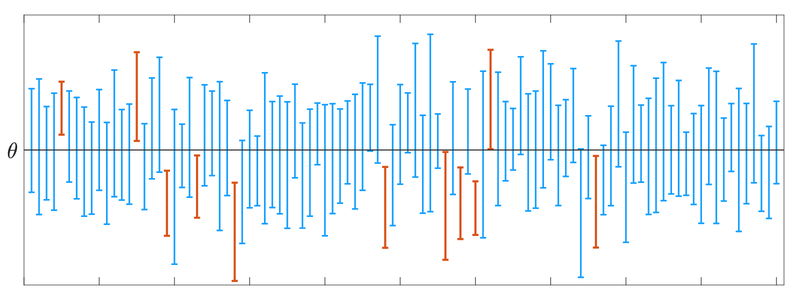
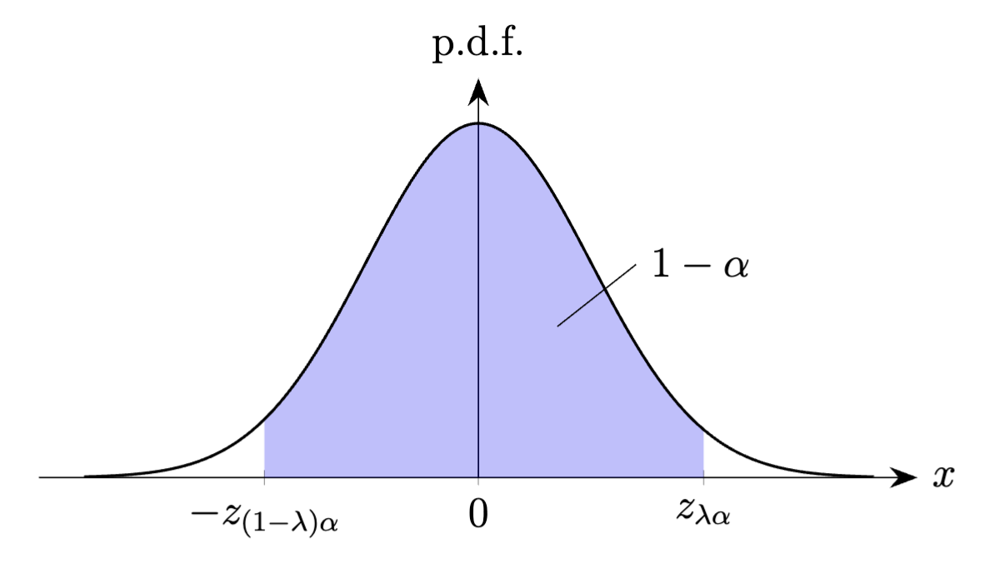

设总体的分布函数为$F(x;\theta)$，其中未知参数$\theta$的所有可能取值
构成集合$\Theta$，且为简单起见，设$\Theta$是$\mathbb{R}$上的
一个区间。在点估计问题中，我们通过构造合适的统计量$\hat\theta$，
基于获得的样本值来给出未知参数$\theta$的单个估计值。然而，
在某些实际问题中，我们可能不仅需要进行点估计，还希望基于样本
对这个点估计的精度进行某种推断。例如，我们可能希望找到一个阈值，
使得点估计值与真实值的距离能够以大概率小于等于该阈值，那么我们
就可以用这个阈值来代表估计的精度。由于真实的总体未知，我们也只能
基于样本值来给出这个阈值，故这个阈值也对应于一个统计量。将以上想法
进行整理后，我们就得到了如下问题：应当如何构造点估计量$\hat\theta$
以及一个阈值统计量$D=D(X_1,\ldots,X_n)$，使得不等式
\[
\mathbb{P}_\theta\big(|\hat\theta-\theta|\leq D\big)\geq 1-\alpha
\]
对任意$\theta\in\Theta$成立，其中$\alpha$是一个事先定好的
足够小的实数。不难看出上述问题也等价于如何构造统计量
$\underline{\theta}=\underline{\theta}(X_1,\ldots,X_n)$
与$\overline{\theta}=\overline{\theta}(X_1,\ldots,X_n)$，使得

```math {@eq:def_confidence_interval}
\mathbb{P}_\theta\big(\big[\mkern2mu\underline{\theta},\overline{\theta}\mkern2mu\big]\ni\theta\big)\geq 1-\alpha,\qquad\forall\theta\in\Theta,
```

其中$\alpha$是一个事先定好的足够小的实数。换句话说，我们希望找到一个
依赖于样本的区间$\big[\mkern2mu\underline{\theta},\overline{\theta}\mkern2mu\big]$，
使得无论总体的真实参数$\theta$是什么，这个区间能够覆盖住真实参数
$\theta$的概率至少为$1-\alpha$。我们把这一类问题称为**区间估计**
（interval estimation）问题，而将满足条件 @eq:def_confidence_interval
的端点为统计量的区间$\big[\mkern2mu\underline{\theta},
\overline{\theta}\mkern2mu\big]$称为$\theta$的**置信区间**
（confidence interval），并把$1-\alpha$叫作该置信区间的**置信
水平**（confidence level）[^1]。
我们还经常将$\underline{\theta}$与$\overline{\theta}$分别
称为**置信下限**与**置信上限**（lower/upper confidence limit）。

对于置信水平为$1-\alpha$的置信区间
$\big[\mkern2mu\underline{\theta},\overline{\theta}\mkern2mu\big]$，
我们可以认为$1-\alpha$衡量了区间估计的可靠性，而
$\overline{\theta}-\underline{\theta}$则衡量了区间估计的精度。
不难理解可靠性与精度之间是存在一定矛盾的，一般来说，在样本容量$n$
受限的情形下，我们不可能把区间估计的可靠性与精度都同时提升到一个
很高的水平。在经典的频率学派区间估计理论中，我们采取的方案是先给定
可靠性的一个下限（也即确定置信水平），在保证这个下限的前提下尽量提升
区间估计的精度[^2]。换句话说，在针对给定的$\alpha$求解置信区间
$\big[\mkern2mu\underline{\theta},\overline{\theta}\mkern2mu\big]$时，
我们会在保证其置信水平至少为$1-\alpha$的前提下，尽量让该区间的宽度
$\overline{\theta}-\underline{\theta}$取得越小越好。通常，
这将迫使我们让$\big[\mkern2mu\underline{\theta},
\overline{\theta}\mkern2mu\big]\ni\theta$的概率尽可能地
下探到$1-\alpha$（但不得低于$1-\alpha$）；特别是，当总体$X$
是连续型随机变量时，我们通常就按要求
\[
\inf_{\theta\in\Theta}\mathbb{P}_\theta\big(\big[\mkern2mu\underline{\theta},\overline{\theta}\mkern2mu\big]\ni\theta\big)= 1-\alpha
\]
来求置信区间。

需要注意的是，式 @eq:def_confidence_interval  当中
出现的参数$\theta$是被作为一个确定性的量处理的，也就是说，
我们目前是以频率学派的视角来对待区间估计问题的，而这也要求
我们在理解 @eq:def_confidence_interval  的含义时
需要格外小心。特别是，我们不能认为式 @eq:def_confidence_interval
体现了未知参数$\theta$的统计规律（因为$\theta$是一个确定性的量）。
一种解释 @eq:def_confidence_interval  含义的方式如下：
设总体的参数为某个确定性的$\theta$，而我们通过从这个总体中反复地抽样，
按照统计量$\underline{\theta}$与$\overline{\theta}$来大量重复
上述置信区间的构造流程（比方说重复$M$次），从而获得$M$个置信区间的结果。
由于每次抽样获得的样本值是不同的，这$M$个区间也互不相同。则平均而言，
在这大量的区间估计给出的结果中，把参数真值$\theta$覆盖住的区间
所占的比例将至少为$1-\alpha$；可参考图 1
给出的图示。

{width=750}

::: example [方差已知时正态总体期望的区间估计] {@example:normal_expectation_CI_var_known}
设总体$X$服从正态分布$\mathcal{N}(\mu,\sigma^2)$，其中
方差$\sigma^2$已知而期望$\mu$未知，$X_1,\ldots,X_n$为总体$X$的
一组样本，我们希望对期望$\mu$进行区间估计，找出其置信水平为
$1-\alpha$的一个置信区间。

注意到样本均值$\overline{X}=\frac{1}{n}\sum_{i=1}^n X_i$
服从正态分布$\mathcal{N}(\mu,\sigma^2/n)$，因而
\[
\frac{\overline{X}-\mu}{\sqrt{\sigma^2/n}} \sim \mathcal{N}(0,1).
\]
可以看出随机变量$\big(\overline{X}-\mu\big)/\sqrt{\sigma^2/n}$
的分布已不再依赖于未知参数$\mu$。现任取$\lambda\in\left]0,1\right[$，
依照标准正态分布上分位数的定义以及正态分布的对称性，可得
（见图 2）
\[
\mathbb{P}_\mu\!\left(
-z_{(1-\lambda)\alpha}\leq\frac{\overline{X}-\mu}{\sqrt{\sigma^2/n}}
\leq z_{\lambda\alpha}
\right) = 1-\alpha.
\]
对上式进行变形，得到
\[
\mathbb{P}_\mu\!\left(
\left[
\overline{X}-z_{\lambda\alpha}\frac{\sigma}{\sqrt{n}},
\overline{X}+z_{(1-\lambda)\alpha}\frac{\sigma}{\sqrt{n}}\right]
\ni \mu
\right) = 1-\alpha.
\]
由此可得，形如
\[
\left[
\overline{X}-z_{\lambda\alpha}\frac{\sigma}{\sqrt{n}},
\overline{X}+z_{(1-\lambda)\alpha}\frac{\sigma}{\sqrt{n}}\right].
\]
的随机区间均为$\mu$的置信水平为$1-\alpha$的置信区间。
但在所有这些置信区间中，令$\lambda=1/2$可以使置信区间的宽度达到最小，
因而我们通常就将

```math {@eq:normal_expectation_CI_var_known}
\left[
\overline{X}-z_{\alpha/2}\frac{\sigma}{\sqrt{n}},
\overline{X}+z_{\alpha/2}\frac{\sigma}{\sqrt{n}}\right]
```

作为$\mu$的置信水平为$1-\alpha$的置信区间。

{width=600}
:::

::: remark
@example:normal_expectation_CI_var_known  考虑的是
总体服从正态分布的情形。而若总体不服从正态分布但其方差$\sigma^2$已知，
且样本容量$n$足够大，则由中心极限定理可得
$\big(\overline{X}-\mu\big)/\sqrt{\sigma^2/n}$近似服从
标准正态分布，此时我们可以依照 @example:normal_expectation_CI_var_known
的步骤对期望$\mu$的置信区间进行近似求解，并最终得到其置信水平为
$1-\alpha$的置信区间可以近似由
式 @eq:normal_expectation_CI_var_known  给出。
:::

::: remark
对于某些场合，我们可能只是想估计出未知参数$\theta$的一个上界，
并在保证一定可靠性的前提下让这个上界尽可能接近参数的真值。换句话说，
给定$\alpha$，我们只需找到一个尽量小的统计量$\overline{\theta}$使得

```math {@eq:one-sided_upper_confidence_bound}
\mathbb{P}_\theta\!\left(\theta\leq\overline{\theta}\right)\geq 1-\alpha
```

即可。我们将满足 @eq:one-sided_upper_confidence_bound
的统计量$\overline{\theta}$称作置信水平为$1-\alpha$
的**单侧置信上界**（one-sided upper confidence bound）。
对于单侧置信上界，其估计精度可以直接由它的大小来衡量，即
单侧置信上界越小则估计精度越高。同理也可定义**单侧置信下界**
（one-sided lower confidence bound）的概念。此外，我们也将形如
\[
\left]-\infty,\overline{\theta}\mkern2mu\right]\quad\text{或}\quad
\left[\mkern2mu\underline{\theta},+\infty\right[
\]
的置信区间称作**单侧置信区间**（one-sided confidence interval）。

以 @example:normal_expectation_CI_var_known  考虑的
情形为例，给定置信水平$1-\alpha$，则未知参数$\mu$的两个单侧置信区间
可以分别取为
\[
\left]-\infty, \overline{X}+z_{\alpha}\frac{\sigma}{\sqrt{n}}\right]\quad\text{与}\quad
\left[\overline{X}-z_{\alpha}\frac{\sigma}{\sqrt{n}}, +\infty\right[
\]
（注意上式中用到的上分位数为$z_\alpha$而非$z_{\alpha/2}$）。
:::

我们可以将 @example:normal_expectation_CI_var_known
的区间估计步骤进行推广，得到求解置信区间的一个较为一般的方法：

1. 构造一个依赖于样本$X_1,\ldots,X_n$与参数值$\theta$
   的随机变量$h(X_1,\ldots,X_n;\theta)$，使得
   $h(X_1,\ldots,X_n;\theta)$的分布不再与未知参数有关
   （换句话说，$h(X_1,\ldots,X_n;\theta)$在取不同的$\theta$时
   所服从的分布都是相同的）。我们将该随机变量$h(X_1,\ldots,X_n;\theta)$
   称作一个**枢轴量**（pivotal quantity）。

   在 @example:normal_expectation_CI_var_known  当中，
   枢轴量即为$\big(\overline{X}-\mu\big)/\sqrt{\sigma^2/n}$。

2. 找出两个合适的常数$l$与$u$，使得
   \[
   \mathbb{P}_\theta\!\left(
   l\leq h(X_1,\ldots,X_n;\theta)\leq u
   \right)\geq 1-\alpha.
   \]
   特别是，若$h(X_1,\ldots,X_n;\theta)$为连续型随机变量，则找出满足
   \[
   \mathbb{P}_\theta\!\left(
   l\leq h(X_1,\ldots,X_n;\theta)\leq u
   \right)= 1-\alpha
   \]
   的常数$l,u$。

   在 @example:normal_expectation_CI_var_known  当中，
   由于枢轴量服从标准正态分布，故可以取$l=-z_{(1-\lambda)\alpha},
   u=z_{\lambda\alpha}$。而取$\lambda=1/2$可以使得最终构造出来的
   置信区间宽度最小。

3. 尝试将不等式$l\leq h(X_1,\ldots,X_n;\theta)\leq u$等价地
   变形为如下形式：
   \[
   \underline{\theta}(X_1,\ldots,X_n)\leq\theta
   \leq
   \overline{\theta}(X_1,\ldots,X_n).
   \]
   若这样的等价变形可行，则可知$\theta$的一个置信水平为$1-\alpha$的
   置信区间为
   \[
   \left[\underline{\theta}(X_1,\ldots,X_n),\overline{\theta}(X_1,\ldots,X_n)\right].
   \]

我们将上述求解置信区间的方法称作**枢轴量法**。需要注意的是，
枢轴量法并非万能，其中枢轴量的构造对于总体分布的形式较为复杂的情形
往往是比较困难的。

::: remark
若总体的未知参数为$\theta\in\Theta$（它可以是标量也可以是多维向量），
而我们想对$\eta = g(\theta)$进行区间估计，其中
$g:\Theta\rightarrow\mathbb{R}$为一个实值函数，
则此时$\eta$的置信水平为$1-\alpha$的置信区间
$\left[\mkern2mu\underline{\eta},\overline{\eta}\mkern2mu\right]$
需满足如下条件：
\[
\mathbb{P}_{\theta}\!\left(\left[\mkern2mu\underline{\eta},\overline{\eta}\mkern2mu\right]\ni g(\theta)\right)\geq 1-\alpha,
\qquad\forall \theta\in\Theta,
\]
其中区间端点$\underline{\eta},\overline{\eta}$仍要求为统计量。
此时依然可以考虑用枢轴量法构造置信区间，不过我们会要求枢轴量的形式为
$h(X_1,\ldots,X_n;g(\theta))$，也就是说它只和$X_1,\ldots,X_n$
与$g(\theta)$有关；另一方面，我们仍然要求
$h(X_1,\ldots,X_n;g(\theta))$的分布与$\theta$无关。此时通过
\[
\mathbb{P}_{\theta}
\!\left(l\leq h(X_1,\ldots,X_n;g(\theta))\leq u\right)\geq 1-\alpha
\]
即可构造$\eta=g(\theta)$的置信区间。

上述情形的一个特例是总体存在多个未知标量参数
$\theta,\lambda_1,\ldots,\lambda_k$，而我们想对其中一个未知
标量参数$\theta$进行区间估计。此时其余的参数
$\boldsymbol{\lambda}=(\lambda_1,\ldots,\lambda_k)$
被称为**多余参数**（nuisance parameter，其它中文称谓
还包括冗余参数、讨厌参数、干扰参数等）。存在多余参数
$\boldsymbol{\lambda}$时，$\theta$的置信水平为$1-\alpha$的
置信区间$\left[\mkern2mu\underline{\theta},
\overline{\theta}\mkern2mu\right]$则需满足如下条件：
\[
\mathbb{P}_{\theta,\boldsymbol{\lambda}}\!\left(\left[\mkern2mu\underline{\theta},\overline{\theta}\mkern2mu\right]\ni\theta\right)\geq 1-\alpha,
\qquad\forall \theta\in\Theta,\boldsymbol{\lambda}\in\Lambda,
\]
其中$\Theta$为$\theta$的取值范围，$\Lambda$为多余参数
$\boldsymbol{\lambda}$的取值范围。对于存在多余参数的情形，
若要用枢轴量法求$\theta$的置信区间，则要求枢轴量
$h(X_1,\ldots,X_n;\theta)$只和$X_1,\ldots,X_n$与$\theta$
有关而与$\boldsymbol{\lambda}$无关，但同时要求
$h(X_1,\ldots,X_n;\theta)$的分布与$\theta$和
$\boldsymbol{\lambda}$均无关。此时由
\[
\mathbb{P}_{\theta,\boldsymbol{\lambda}}
\!\left(l\leq h(X_1,\ldots,X_n;\theta)\leq u\right)\geq 1-\alpha
\]
构造的$\theta$的置信区间则可用于多余参数$\boldsymbol{\lambda}$
未知的情形。
:::

在接下来的几节中，我们将针对几类常见的区间估计问题，介绍其置信区间的
求解流程。我们只给出（双侧）置信区间的构造流程，但读者可自行推导相应的
单侧置信上界与单侧置信下界。

[^1]: 注意到若$1-\alpha$是$\big[\mkern2mu\underline{\theta}, \overline{\theta}\mkern2mu\big]$
    的置信水平，
    那么任何小于等于$1-\alpha$的正实数也都是
    $\big[\mkern2mu\underline{\theta}, \overline{\theta}\mkern2mu\big]$的置信水平。
    有些场合为了表意上的确切，当给定置信区间而谈论其置信水平时，
    我们是指满足 @eq:def_confidence_interval 的$1-\alpha$当中最大的那个值。
[^2]: 这套区间估计的范式是由统计学家 Jerzy Neyman 首先建立的。
