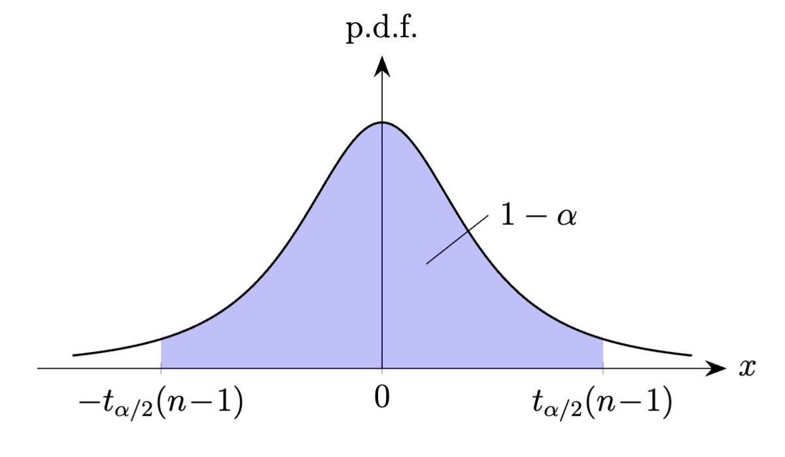
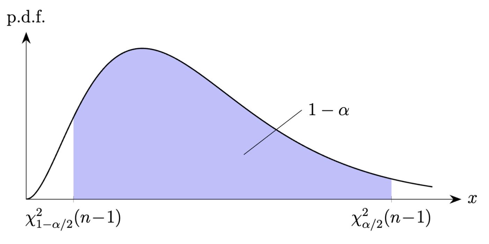

## 正态总体期望的区间估计*

**方差$\sigma^2$已知的情形。**
我们首先考虑总体服从正态分布$\mathcal{N}(\mu,\sigma^2)$，
且方差$\sigma^2$已知的情形。此时对期望$\mu$进行区间估计的步骤与结果
已经由 @example:normal_expectation_CI_var_known  给出了：
$\mu$的一个置信水平为$1-\alpha$的置信区间为

```math {@eq:normal_expectation_CI_var_known2}
\left[
\overline{X}-z_{\alpha/2}\frac{\sigma}{\sqrt{n}},
\overline{X}+z_{\alpha/2}\frac{\sigma}{\sqrt{n}}\right].
```

现在考虑这样一个问题：我们希望$\mu$的置信区间的宽度小于等于
$2\varepsilon$，其中$\varepsilon>0$为事先给定的表征估计精度的常数，
同时保证置信水平为$1-\alpha$，那么样本容量$n$应该至少取为多少？
对于这个问题，由式 @eq:normal_expectation_CI_var_known2
不难得到$n$所应当满足的不等式
\[
2z_{\alpha/2}\frac{\sigma}{\sqrt{n}}\leq 2\varepsilon,
\]
解得
\[
n\geq \left(\frac{z_{\alpha/2}\,\sigma}{\varepsilon}\right)^{\!2}.
\]

**方差$\sigma^2$未知的情形。**
现考虑总体服从正态分布$\mathcal{N}(\mu,\sigma^2)$，
且期望$\mu$与方差$\sigma^2$均未知的情形。注意到此时
$\sigma^2>0$为多余参数，而$\mu$的置信水平为$1-\alpha$
的置信区间$\left[\mkern2mu\underline{\mu},
\overline{\mu}\mkern2mu\right]$则应当满足
\[
\mathbb{P}_{\mu,\sigma^2}\!\left(
\big[\mkern2mu\underline{\mu},\overline{\mu}\mkern2mu\big]
\ni \mu
\right)\geq 1-\alpha,\qquad\forall\mu\in\mathbb{R},\sigma^2>0.
\]

我们仍采用枢轴量法来求$\mu$的置信区间。在方差$\sigma^2$未知的情况下，
我们考虑用样本方差$S^2=\frac{1}{n-1}\sum_{i=1}^n
\big(X_i-\overline{X}\big)^2$来代替$\sigma^2$以构造枢轴量，
从而让枢轴量表达式中不出现多余参数$\sigma^2$：
\[
T=\frac{\overline{X}-\mu}{\sqrt{S^2/n}}.
\]
由 @corollary:T_statistics  可知，$T$服从参数为$n-1$的
$t$分布，因而$T$的确可以作为一个枢轴量。那么在置信水平为$1-\alpha$时，
利用$t(n-1)$的上分位数可得
（见图 1）
\[
\mathbb{P}_{\mu,\sigma^2}
\!\left(
-t_{\alpha/2}(n\!-\!1)\leq T\leq t_{\alpha/2}(n\!-\!1)
\right)=1-\alpha,
\]
从而有
\[
\mathbb{P}_{\mu,\sigma^2}
\!\left(
\left[
\overline{X}-t_{\alpha/2}(n\!-\!1)\sqrt{\frac{S^2}{n}},
\overline{X}+t_{\alpha/2}(n\!-\!1)\sqrt{\frac{S^2}{n}}
\right]\ni \mu
\right)=1-\alpha,
\]
故$\mu$的一个置信水平为$1-\alpha$的置信区间为

```math {@eq:normal_expectation_CI_var_unknown}
\left[
\overline{X}-t_{\alpha/2}(n\!-\!1)\sqrt{\frac{S^2}{n}},
\overline{X}+t_{\alpha/2}(n\!-\!1)\sqrt{\frac{S^2}{n}}
\right].
```

{width=600}

::: remark
当样本容量$n$足够大（例如$n\geq 45$）时，可以在置信区间
@eq:normal_expectation_CI_var_unknown  中
近似取$t_{\alpha/2}(n\!-\!1)\approx z_{\alpha/2}$。
:::

::: remark
当总体不再服从正态分布时，即使样本容量$n$很大，我们通常也不能用
上述方法求出方差未知时期望的一个近似置信区间，这是因为$\overline{X}$
与$S^2$一般来说不再相互独立，从而 @corollary:T_statistics
一般来说不再成立。
:::

## 正态总体方差的区间估计*

现考虑总体服从正态分布$\mathcal{N}(\mu,\sigma^2)$的情形，
其中期望$\mu$与方差$\sigma^2$均未知，我们想对方差$\sigma^2$
进行区间估计，则此时$\mu$成为多余参数。

仍考虑用枢轴量法求解置信区间。@theorem:sample_variance_chi_squared
提示我们，可以尝试将$(n-1)S^2/\sigma^2$作为枢轴量，其中$S^2$为
样本方差，则有
\[
\frac{(n-1)S^2}{\sigma^2}\sim \chi^2(n-1).
\]
利用$\chi^2(n-1)$的上分位数，可得
（见图 2）
\[
\mathbb{P}_{\mu,\sigma^2}
\!\left(
\chi^2_{1-\alpha/2}(n\!-\!1)
\leq \frac{(n-1)S^2}{\sigma^2}
\leq
\chi^2_{\alpha/2}(n\!-\!1)
\right)
=1-\alpha,
\]
从而有
\[
\mathbb{P}_{\mu,\sigma^2}\!
\left(
\left[\frac{(n-1)S^2}{\chi^2_{\alpha/2}(n\!-\!1)},
\frac{(n-1)S^2}{\chi^2_{1-\alpha/2}(n\!-\!1)}
\right]\ni \sigma^2
\right)=1-\alpha,
\]
故方差$\sigma^2$的一个置信水平为$1-\alpha$的置信区间为

```math {@eq:normal_var_CI_mu_unknown}
\left[\frac{(n-1)S^2}{\chi^2_{\alpha/2}(n\!-\!1)},
\frac{(n-1)S^2}{\chi^2_{1-\alpha/2}(n\!-\!1)}
\right].
```

{width=700}

::: remark
虽然$\chi^2$分布的概率密度函数不具有对称性，但在利用
服从$\chi^2$分布的枢轴量$h(X_1,\ldots,X_n;\theta)$构造
（双侧）置信区间时，通常仍取$l,u$使得
\[
\mathbb{P}\!\left(
h(X_1,\ldots,X_n;\theta)\leq l
\right)=
\mathbb{P}\!\left(
h(X_1,\ldots,X_n;\theta)\geq u
\right)=\frac{\alpha}{2},
\]
也就是说我们将$h(X_1,\ldots,X_n;\theta)$不属于$[l,u]$的概率
等分到区间$[l,u]$的两侧。
:::

::: remark
若正态总体的期望$\mu$已知，则枢轴量可以取为
\[
\frac{1}{\sigma^2}\sum_{i=1}^n \left(X_i-\mu\right)^2,
\]
该枢轴量服从参数为$n$的$\chi^2$分布。接下来$\sigma^2$置信区间的构造
我们留给读者完成。
:::

## 大样本情形下比例的区间估计* {@section:large_sample_proportion_CI}

本小节中我们考虑这样一个情形：总体$X$服从参数为$p$的伯努利分布，
但$p\in\left[0,1\right]$未知，我们希望对$p$进行区间估计。
在一些实际问题中，若我们想要考察某类对象中满足某个特定条件的对象
所占比例如何，则可以认为总体$X$服从参数为$p$的伯努利分布，
其中$p$就代表待估计的比例。

我们只考虑样本容量$n$足够大的情形。此时由中心极限定理可知
\[
\frac{\overline{X}-p}{\sqrt{p(1-p)/n}}
\]
近似服从标准正态分布$\mathcal{N}(0,1)$，故我们可以尝试将其作为枢轴量
进行置信区间的计算。利用标准正态分布的上分位数，可得
\[
\mathbb{P}\!\left(
-z_{\alpha/2}\leq \frac{\overline{X}-p}{\sqrt{p(1-p)/n}}
\leq z_{\alpha/2}
\right) \approx 1-\alpha.
\]
注意到上式括号中的不等式等价于

```math {@eq:proportion_CI_temp}
\left|\frac{\overline{X}-p}{\sqrt{p(1-p)/n}}\right|
\leq z_{\alpha/2},
```

我们可以直接对该不等式两边进行平方，得到它等价于
\[
\left(1+\frac{z_{\alpha/2}^2}{n}\right)p^2
-\left(2\overline{X}+\frac{z_{\alpha/2}^2}{n}\right)p + \overline{X}^2\leq 0.
\]
求解该关于$p$的一元二次不等式，可得
\[
\underline{p}
\leq p\leq \overline{p},
\]
其中
\[
\begin{aligned}
\underline{p}
={} &
\left(1+\frac{z_{\alpha/2}^2}{n}\right)^{\!-1}
\left(
\overline{X}+\frac{z_{\alpha/2}^2}{2n}
- z_{\alpha/2}\sqrt{\frac{\overline{X}\big(1-\overline{X}\big)}{n}+\frac{z_{\alpha/2}^2}{4n^2}}\right), \\
\overline{p}
= &
\left(1+\frac{z_{\alpha/2}^2}{n}\right)^{\!-1}
\left(
\overline{X}+\frac{z_{\alpha/2}^2}{2n}
+ z_{\alpha/2}\sqrt{\frac{\overline{X}\big(1-\overline{X}\big)}{n}+\frac{z_{\alpha/2}^2}{4n^2}}\right).
\end{aligned}
\]
由于$\underline{p}$与$\overline{p}$的表达式过于繁琐，
考虑到样本容量$n$比较大，我们将$\underline{p}$与$\overline{p}$
泰勒展开到$1/\sqrt{n}$的一阶项，可得
\[
\begin{aligned}
\underline{p}
={} & \overline{X} - z_{\alpha/2}\sqrt{\frac{\overline{X}\big(1-\overline{X})}{n}} + o\!\left(\frac{1}{\sqrt{n}}\right), \\
\overline{p}
={} & \overline{X} + z_{\alpha/2}\sqrt{\frac{\overline{X}\big(1-\overline{X})}{n}} + o\!\left(\frac{1}{\sqrt{n}}\right).
\end{aligned}
\]
故不等式 @eq:proportion_CI_temp  在$n$非常大时的近似解为
\[
\overline{X} - z_{\alpha/2}\sqrt{\frac{\overline{X}\big(1-\overline{X})}{n}}
\leq p\leq \overline{X} + z_{\alpha/2}\sqrt{\frac{\overline{X}\big(1-\overline{X})}{n}}.
\]
由此可得
\[
\mathbb{P}\!\left(
\left[\mkern2mu\overline{X} - z_{\alpha/2}\sqrt{\frac{\overline{X}\big(1-\overline{X})}{n}},
\overline{X} + z_{\alpha/2}\sqrt{\frac{\overline{X}\big(1-\overline{X})}{n}}\mkern2mu\right]\ni p
\right) \approx 1-\alpha.
\]
也就是说，当样本容量$n$非常大时，$p$的置信水平为$1-\alpha$的
置信区间可以近似取为
\[
\left[\mkern2mu\overline{X} - z_{\alpha/2}\sqrt{\frac{\overline{X}\big(1-\overline{X})}{n}},
\overline{X} + z_{\alpha/2}\sqrt{\frac{\overline{X}\big(1-\overline{X})}{n}}\mkern2mu\right].
\]

::: remark {@remark:large_sample_propostion_CI_quick_approach}
实际上，不等式 @eq:proportion_CI_temp  的近似解也可通过
如下方法得到：显然不等式 @eq:proportion_CI_temp  等价于
\[
\overline{X}-z_{\alpha/2}\sqrt{\frac{p(1-p)}{n}}
\leq p
\leq \overline{X}+z_{\alpha/2}\sqrt{\frac{p(1-p)}{n}}.
\]
以上不等式中最左端与最右端均依赖于未知参数$p$，故不能作为统计量
给出置信区间的端点，但由于已经假设$n$非常大，根据大数定律，
可以认为$\overline{X}$的取值将与$p$非常接近，因而可以在
上述不等式的最左端与最右端中把$p$替换为$\overline{X}$，
由此得到不等式 @eq:proportion_CI_temp  的如下近似解：
\[
\overline{X}-z_{\alpha/2}\sqrt{\frac{\overline{X}\big(1-\overline{X}\big)}{n}}
\leq p
\leq \overline{X}+z_{\alpha/2}\sqrt{\frac{\overline{X}\big(1-\overline{X}\big)}{n}}.
\]
这个结果与之前先严格求解不等式再用泰勒展开近似所得到的结果是一致的。
:::
