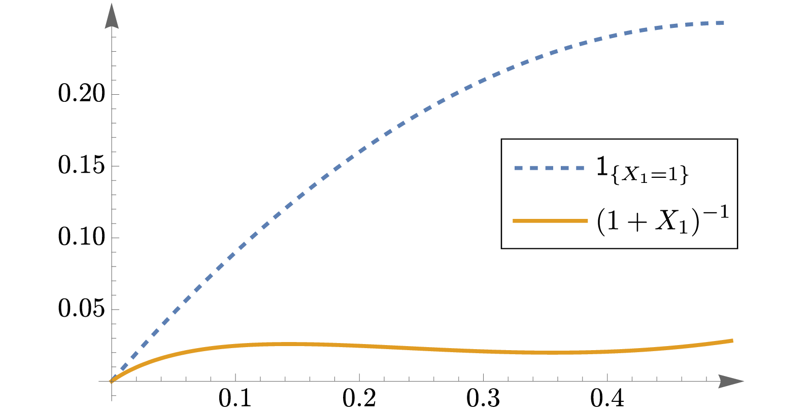

在数理统计学中，未知参数的统计推断理论被分为频率学派与贝叶斯学派两种。
在频率学派的理论中，我们将总体的未知参数$\theta$作为一个确定性的量
来处理，这种观点下，我们对未知参数推断所下的结论通常类似于“若
未知参数的取值满足某某条件，那么相应的总体生成我们当前所观测到的样本
是大概率/正常事件”。而在贝叶斯学派的理论中，我们将总体的未知参数
$\theta$作为一个随机变量来处理，认为它首先服从一个先验分布
（prior distribution），这种观点下，我们对未知参数推断所下的结论
通常类似于“在给定观测到的样本数据的条件下，未知参数以很大的概率
满足某某条件”。本课程中，我们将主要关注频率学派的理论。

## 点估计的偏差与均方误差；无偏性与有效性*

在频率学派的理论中，对小样本情形下点估计量的评价主要是以偏差和
均方误差为基础。简单起见，我们假设未知参数$\theta$是一个实数（标量），
且它就是我们待估计的参数，但相关概念不难推广到对未知参数的函数
$g(\theta)$进行估计的情况。

::: definition {@definition:bias_MSE_point_estimator}
设总体的分布函数为$F(x;\theta)$，其中$\theta\in\Theta$为未知参数，
并设$\hat{\theta}:\mathbb{R}^n\rightarrow\mathbb{R}$为一个
$n$元函数。现任取$\theta\in\Theta$，并设$X_1,\ldots,X_n$
为总体$F(x;\theta)$的一组样本，令

```math {@eq:point_estimator_bias}
b_\theta(\hat{\theta}) = \mathbb{E}\!\left[
\hat{\theta}(X_1,\ldots,X_n)
\right]-\theta,
```

```math {@eq:point_estimator_MSE}
\operatorname{MSE}_\theta(\hat{\theta})
= \mathbb{E}\!\left[
\big(
\hat{\theta}(X_1,\ldots,X_n)
-\theta
\big)^{\!2}
\right]
```

我们称$b_\theta(\hat{\theta})$为点估计量
$\hat{\theta}(X_1,\ldots,X_n)$关于$\theta$的**偏差**
（bias），$\operatorname{MSE}_\theta(\hat{\theta})$为点估计量
$\hat{\theta}(X_1,\ldots,X_n)$关于$\theta$的**均方误差**
（mean square error, MSE）。
:::

需要注意，给定点估计量$\hat{\theta}(X_1,\ldots,X_n)$后，
它的偏差$b_\theta(\hat{\theta})$与均方误差
$\operatorname{MSE}_\theta(\hat{\theta})$都与$\theta$的取值有关；
在针对给定的$\theta\in\Theta$计算$b_\theta(\hat{\theta})$
与$\operatorname{MSE}_\theta(\hat{\theta})$时，相应的样本
$X_1,\ldots,X_n$则是从参数为$\theta$的总体$F(x;\theta)$中
抽样而来的。之所以需要考虑任意$\theta\in\Theta$所对应的偏差
与均方误差，是因为我们并不知道真实的总体对应的是哪个$\theta$，
保险起见我们需要考虑所有可能的参数取值，并希望点估计量在
参数$\theta\in\Theta$任取的情况下都能具有较优的性能。
为了强调样本$X_1,\ldots,X_n$与参数$\theta$的依赖关系，
我们有时会用如下形式的记号
\[
\mathbb{E}_\theta\!\left[\hat{\theta}(X_1,\ldots,X_n)\right]
\qquad\text{与}\qquad
\mathbb{P}_\theta\!\left(\hat{\theta}(X_1,\ldots,X_n)\in B\right)
\]
来强调样本$X_1,\ldots,X_n$来自于参数为$\theta$的总体。

直观上看，均方误差通常是评价点估计量好坏的一个比较恰当的定量指标；
可以认为点估计量的均方误差越小，则给出的估计值越集中于真实值。
不难验证点估计量$\hat\theta$的均方误差满足如下等式：
\[
\operatorname{MSE}_\theta(\hat\theta)
=\big[b_\theta(\hat\theta)\big]^2
+\operatorname{Var}_\theta(\hat\theta),
\qquad\forall\theta\in\Theta,
\]
其中$\operatorname{Var}_\theta(\hat\theta)$表示样本
$X_1,\ldots,X_n$来自于参数为$\theta$的总体时
$\hat\theta(X_1,\ldots,X_n)$的方差。
该等式被称为均方误差的**偏差—方差分解**
（bias–variance decomposition）。上式意味着点估计量的均方误差
由偏差与方差两部分组成。理想情况下，当我们设计点估计量时，
我们希望能够同时让偏差$b_\theta(\hat\theta)$与方差
$\operatorname{Var}_\theta(\hat\theta)$对任意的
$\theta\in\Theta$都取得足够小，然而在许多实际问题中，
点估计量的偏差$b_\theta(\hat\theta)$与方差
$\operatorname{Var}_\theta(\hat\theta)$之间通常会存在一定冲突，
当我们把一个量取得非常小的时候，可能导致另一个量出现明显的增大。
这意味着，如果我们以均方误差作为评价点估计量好坏的指标，
那么为了对每个可能的$\theta\in\Theta$均取得足够小的均方误差，
我们通常需要在偏差与方差之间进行权衡。

然而，在经典的频率学派点估计理论中，对于偏差恒为$0$这种情形的
点估计量的研究占据了比较重要的位置。

::: definition
考虑 @definition:bias_MSE_point_estimator 的设定。
若对于任意的$\theta\in\Theta$，点估计量
$\hat{\theta}(X_1,\ldots,X_n)$关于$\theta$的偏差都等于$0$，即
\[
b_\theta(\hat{\theta})=0,\qquad\forall\theta\in\Theta,
\]
则称$\hat{\theta}(X_1,\ldots,X_n)$是$\theta$的
一个**无偏估计量**（unbiased estimator）。
:::

::: example
设总体的未知参数为$\theta\in\Theta$，而$\sigma^2(\theta)$
给出了参数为$\theta$时相应总体的方差。现考虑样本$X_1,\ldots,X_n$的
样本方差
\[
S^2 = \frac{1}{n-1}\sum_{i=1}^n
\left(X_i-\frac{1}{n}\sum_{j=1}^n X_j\right)^2,
\]
则不难验证
\[
\mathbb{E}_\theta\!\left[S^2\right]=\sigma^2(\theta)
\]
对任意$\theta$均成立。因此样本方差$S^2$是总体方差
$\sigma^2(\theta)$的一个无偏估计量。
:::

根据均方误差的偏差—方差分解，在限制点估计量的偏差恒为零以后，
其点估计量的方差即等于它的均方误差：
\[
\operatorname{MSE}_\theta(\hat\theta)
=\operatorname{Var}_\theta(\hat\theta).
\]
因此在对两个无偏估计量的好坏进行比较时，我们就可以考虑以它们的方差为依据。
不过，由于点估计量的方差依赖于参数$\theta$的值，而参数的真实值
又是未知的，因此在比较两个点估计量的方差时，我们通常需要考虑所有可能的
参数$\theta$的取值。这就引入了如下有效性的定义。

::: definition
设$\hat\theta_1(X_1,\ldots,X_n)$与
$\hat\theta_2(X_1,\ldots,X_n)$为参数$\theta$的两个无偏估计量。
我们称$\hat\theta_1$较$\hat\theta_2$**有效**
（$\hat\theta_1$ is more efficient than $\hat\theta_2$），若
\[
\operatorname{Var}_\theta(\hat\theta_1)
\leq \operatorname{Var}_\theta(\hat\theta_2)
\]
对任意$\theta\in\Theta$都成立，且存在某个$\theta\in\Theta$使得
上述不等式中的不等号能够取为严格不等号。
:::

基于以上无偏估计量与有效性的定义，频率学派的统计学家们进一步发展了一套
关于一致最小方差无偏估计量（uniformly minimum variance unbiased estimator, UMVUE）
的理论[^1]。这套理论从数学的角度上看是比较优美的，这也是
无偏估计量在经典的频率学派点估计理论中占据重要位置的原因之一。
但需要指出的是，无偏性并不是点估计量所必须满足的性质。对于某些具体问题，
无偏性可能是必要的，或是能带来一些额外的优势（到底是何种优势
则需要具体问题具体分析）；但对于其它一些情形，适当程度地放弃无偏性
可能会换来更小的均方误差。

::: example
（${}^\star$）
考虑一个对总体$X$的未知参数$\theta$进行在线点估计的场景：
假设在每个离散时刻$t\in\mathbb{N}_+$，我们能够从总体$X$中
获取一组新的样本$X^{t}_1,\ldots,X^{t}_n$。考虑如下点估计流程：
首先构造一个$n$元函数$g:\mathbb{R}^n\rightarrow\mathbb{R}$，
并做初始化$\hat\theta_0=0$。接下来在每个$t$时刻，令
\[
\hat\theta_t = \frac{t-1}{t}\hat\theta_{t-1} + \frac{1}{t}g(X_1^t,\ldots,X_n^t),
\]
并将$\hat\theta_t$作为$t$时刻参数$\theta$的点估计结果。
不难看出上式实际上是对$g(X_1^\tau,\ldots,X_n^\tau),\,
\tau=1,\ldots,t$在线求平均的过程，从而
\[
\hat\theta_t = \frac{1}{t}\sum_{\tau=1}^t g(X_1^\tau,\ldots,X_n^\tau).
\]
若$\mathbb{E}_\theta\!\left[g(X_1,\ldots,X_n)\right]$存在，
则由大数定律可得
\[
\hat\theta_t\xrightarrow{a.s.} \mathbb{E}_\theta[g(X_1,\ldots,X_n)],
\]
其中$X_1,\ldots,X_n$相互独立且与$X$同分布。不难看出在上述设定下，
$g(X_1,\ldots,X_n)$的无偏性将是一个合理的要求，否则
$\hat\theta_t$与$\theta$真值之间的差无法通过让更新轮次$t$足够大
而接近于$0$。
:::

::: example
（${}^\star$）
设总体$X$服从几何分布
\[
\mathbb{P}_\theta(X=k)=(1-\theta)^{k-1}\theta,\qquad k=1,2,\ldots,
\]
其中$\theta$为未知参数，其取值范围为$\left]0,0.5\right]$。
现假设$X_1$为来自该总体的一个容量为$1$的样本，我们希望设计一个
$\theta$的点估计量$\hat\theta(X_1)$。由于$X_1$的取值为正整数，
我们只需考虑函数$\hat\theta$在自变量为正整数时的取值即可。

若要求$\hat\theta(X_1)$是无偏的，则有
\[
\mathbb{E}_\theta\!\left[\hat\theta(X_1)\right]
=\sum_{k=1}^\infty\hat\theta(k)\cdot (1-\theta)^{k-1}\theta
=\theta,\qquad\forall\theta\in\left]0,0.5\right],
\]
即
\[
1 = \sum_{k=0}^\infty \hat\theta(k+1)\cdot (1-\theta)^k,\qquad\forall\theta\in\left]0,0.5\right].
\]
可以证明满足上式的$\hat\theta$只能是
\[
\hat{\theta}(k) = \begin{cases}
1, & \text{若}\ k=1, \\
0, & \text{若}\ k=2,3,\ldots
\end{cases}
\]
因此对$\theta$的无偏估计量只可能是
\[
\hat{\theta}(X_1) = \mathsf{1}_{\{X_1=1\}},
\]
也就是说$X_1=1$时点估计的值为$1$，而$X_1$取其它值时点估计的值为$0$，
从而无偏估计量的均方误差为
\[
\mathbb{E}_\theta\!\left[
(\mathsf{1}_{X_1=1}-\theta)^2
\right]
=(1-\theta)^2\cdot\theta + \sum_{k=2}^\infty \theta^2\cdot (1-\theta)^{k-1}\theta
=\theta(1-\theta).
\]

然而，如果考虑如下点估计量
\[
\hat\theta(X_1) = (1+X_1)^{-1},
\]
则它的均方误差为
\[
\begin{aligned}
\mathbb{E}_\theta\!\left[\left((1+X_1)^{-1}-\theta\right)^{\!2}\right]
={} & \sum_{k=1}^\infty \left((1+k)^{-1}-\theta\right)^{\!2}
\cdot (1-\theta)^{k-1}\theta.
\end{aligned}
\]
上式右端的求和没有初等表达式，需要用特殊函数来表示，
但通过理论分析可以证明，当$0<\theta\leq 0.5$时，上式右端
总是小于$\theta(1-\theta)$。图 1
展示了两种点估计量的均方误差在$0<\theta\leq 0.5$时的值。这说明，
若以均方误差作为点估计量优劣的评价指标，则对于所考虑的参数范围
$0<\theta\leq 0.5$，有偏的估计量$(1+X_1)^{-1}$均优于
无偏估计量$\mathsf{1}_{\{X_1=1\}}$。

{width=600}

本例部分取自[@cox1974theoretical]的Example 8.1。
:::

::: remark
虽然经典的频率学派理论中关于一致最小方差无偏估计的理论方法
在实际问题中应用有限，但它们为大样本情形下点估计量的设计与分析，
特别是最大似然估计法的性能分析建立了部分基础。
:::

## 点估计的相合性*

点估计的相合性考虑的是样本容量逐渐增大时，一套点估计方法能否给出
收敛于真实参数值的估计量。换句话说，我们考虑的不再是单个点估计量
$\hat\theta$，而是考虑一列点估计量$\hat\theta^{(1)},
\hat\theta^{(2)},\ldots,\hat\theta^{(n)},\ldots$，
其中每个$\hat\theta^{(n)}=\hat\theta^{(n)}(X_1,\ldots,X_n)$
给出的是样本容量为$n$时的点估计量，我们希望$n\rightarrow\infty$时，
点估计量$\hat{\theta}^{(n)}$作为随机变量能够（在某种方式下）收敛于
真实参数值$\theta$。

::: definition
设$\theta\in\Theta$为未知参数，$\hat\theta^{(1)},\ldots,
\hat\theta^{(n)},\ldots$为参数$\theta$的一列点估计量，
其中$\hat\theta^{(n)}=\hat\theta^{(n)}(X_1,\ldots,X_n)$。
我们称这列点估计量是**相合**的 (consistent)，若对任意的
$\theta\in\Theta$，均有$\hat\theta^{(n)}\xrightarrow{P}\theta$，
换句话说
\[
\lim_{n\rightarrow\infty}\mathbb{P}_\theta\!\left(\big|\hat\theta^{(n)}(X_1,\ldots,X_n)-\theta\big|>\epsilon\right)=0
\]
对任意$\epsilon>0$以及$\theta\in\Theta$均成立。
:::

与无偏性不同，相合性是对一套点估计方法（也就是对任意样本容量$n$构造
点估计量$\hat\theta^{(n)}$的方法）的最基本要求。如果一套点估计方法
没有相合性，那么直观上看，无论样本容量有多大，我们也难以把未知参数
估计到任意高的精度，这样的点估计方法对于大多数问题都是不可取的。

[^1]: 感兴趣的读者可参阅[@casella2024statistical; @schervish1995theory; @cox1974theoretical]等更高阶的数理统计教材。
