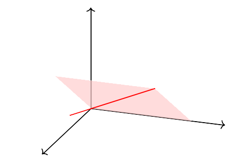

## 线性空间的基*

线性空间中的元素可以通过一些更基本的向量来线性表达。这个想法给出了“基”的概念。

::: definition
线性空间$V$的一组向量$\mathbf{v}_1,\cdots, \mathbf{v}_n$称为$V$的一组基，如果它们线性无关，
并且$V$中的每个向量都可以通过它们来线性表达，即
$$
V=\operatorname{Span}\{\mathbf{v}_1,\cdots, \mathbf{v}_n\}.
$$
:::

我们只考虑有限个向量构成一组基的情况。
有时候还需要无穷个向量来构成一组基（例如量子力学中的态空间），这个是泛函分析里讨论的内容。
我们这里不考虑无穷的情况。

考虑实线性空间$V$。
如果$\mathbf{v}_1,\cdots, \mathbf{v}_n$构成$V$的一组基，那么$V$中任一向量$\mathbf{u}$可以唯一地写成
$$
\mathbf{u}=\lambda_1 \mathbf{v}_1+\cdots+ \lambda_n \mathbf{v}_n, \quad \lambda_i\in \mathbb{R}
$$
反之，给定实数$\lambda_1,\cdots,\lambda_n$，上述公式给出了$V$中的一个向量。由此我们证明了如下结论。

::: proposition
设$\mathbf{v}_1,\cdots, \mathbf{v}_n$是$V$的一组基。则映射
\[
\begin{aligned}
\varphi: \mathbb{R}^n &\to V\\
   (\lambda_1,\cdots, \lambda_n)& \mapsto \lambda_1 \mathbf{v}_1+\cdots+\lambda_n\mathbf{v}_n
\end{aligned}
\]
给出了$\mathbb{R}^n$和$V$之间的一一对应。
:::

因此，如果我们找到$V$的一组基，
那么就可以用一串数字$\lambda_1,\cdots, \lambda_n$来唯一的表示$V$中的向量。

::: example
$\mathbb{R}^3$中相互垂直的单位向量
$$
\vec{i}=(1,0,0)\quad \vec{j}=(0,1,0)\quad \vec{k}=(0,0,1)
$$
构成$\mathbb{R}^3$的一组基。任一向量$(a,b,c)$可以表达为
$$
(a,b,c)=a \vec{i}+ b\vec{j}+ c\vec{k}
$$
因此向量$(a,b,c)$可以通过$a,b,c$这$3$个数字来标记。
:::

::: example
类似的，$\mathbb{R}^n$中的一组向量
\[
\begin{aligned}
\vec{e}_1&=(1,0,\cdots,0)\\
\vec{e}_2&=(0,1,\cdots,0)\\
& \cdots\\
\vec{e}_n&=(0,0,\cdots,1)
\end{aligned}
\]
构成了$\mathbb{R}^n$的一组基，称为$\mathbb{R}^n$的标准基。
:::

::: example
$V=\mathbb{R}^2$中的向量$\vec{v}_1=(1,0)$和$\vec{v}_2=(1,1)$构成一组基。
对于向量$\vec{u}=(a,b)$，我们把它线性表达为
$$
(a,b)=\lambda_1\vec{v}_1+\lambda_2\vec{v}_2=(\lambda_1+\lambda_2, \lambda_2)
$$
这组基给出了一个一一对应
\[
\begin{aligned}
\varphi: \mathbb{R}^2 &\quad \to \qquad \qquad V\\
 (\lambda_1, \lambda_2) &\quad \mapsto \lambda_1\vec{v}_1+\lambda_2\vec{v}_2=(\lambda_1+\lambda_2,\lambda_2)
\end{aligned}
\]

```tikz
\begin{tikzpicture}
  \draw[->, thin] (-1,0) -- (4,0);
  \draw[->, thin] (0,-1) -- (0,3);
  \draw[->, thick, red] (0,0) -- (1,0) node[below, midway] {$\vec{v}_1$};
  \draw[->, thick, red] (0,0) -- (1,1) node[above left, midway] {$\vec{v}_2$};
  \draw[->, thick, red] (1,0) -- (3,2) node[right, midway] {$2\vec{v}_2$};
  \draw[->, thick, blue] (0,0) -- (3,2) node[above right] {$(3,2)={\color{red}{1}}\vec{v}_1+{\color{red}{2}}\vec{v}_2$};
\end{tikzpicture}
```

这里$\varphi$将基坐标$(1,2)$对应到向量$1\vec{v}_1+2\vec{v}_2$
$$
\varphi: (1,2)\to 1\vec{v}_1+2\vec{v}_2=(3,2)
$$
:::

## 维数*

自然有如下两个问题。第一，如何构造一组基？第二，注意到基的选取并不唯一，那么不同的基之间是什么关系？

假设$\{\mathbf{v}_1,\mathbf{v}_2,\cdots,\mathbf{v}_n\}$是$V$的一组基，
$\{\mathbf{u}_1,\cdots,\mathbf{u}_m\}$是$V$的另一组基。
我们下面证明$n=m$，即不同基中的向量个数一定是一样的。

::: lemma {@lem:replace}
假设非零向量$\mathbf{u}$可以由一组向量$\{\mathbf{v}_1,\mathbf{v}_2,\cdots,\mathbf{v}_n\}$线性表达，
则存在$i$使得
$$
\text{$\{\mathbf{v}_1,\cdots,\mathbf{v}_n\}$
与$\{\mathbf{v}_1,\cdots,\mathbf{v}_{i-1},\mathbf{u},\mathbf{v}_{i+1},\cdots,\mathbf{v}_n\}$线性等价。}
$$
:::

::: proof
$\mathbf{u}=\lambda_1 \mathbf{v}_1+\cdots+\lambda_n \mathbf{v}_n$。不妨设$\lambda_i\neq 0$，则
$$
\mathbf{v}_i=-{1\over \lambda_i}\left(\lambda_1 \mathbf{v}_1+\cdots+ \lambda_{i-1}\mathbf{v}_{i-1}-\mathbf{u}+\cdots+\lambda_n \mathbf{v}_n\right)
$$
因此
$$
\{\mathbf{v}_1,\cdots,\mathbf{v}_n\}\subset \operatorname{Span}\{\mathbf{v}_1,\cdots,\mathbf{v}_{i-1},\mathbf{u},\mathbf{v}_{i+1},\cdots,\mathbf{v}_n\}
$$

另一方面显然有
$$
\{\mathbf{v}_1,\cdots,\mathbf{v}_{i-1},\mathbf{u},\mathbf{v}_{i+1},\cdots,\mathbf{v}_n\}\subset\operatorname{Span}\{\mathbf{v}_1,\cdots,\mathbf{v}_n\}
$$
:::

::: proposition {@prop-replace}
假设$\{\mathbf{u}_1,\cdots,\mathbf{u}_m\}$线性无关，
并可以由一组向量$\{\mathbf{v}_1,\mathbf{v}_2,\cdots,\mathbf{v}_n\}$线性表达。
则可以用$\{\mathbf{u}_1,\cdots,\mathbf{u}_m\}$替换掉
$\{\mathbf{v}_1,\mathbf{v}_2,\cdots,\mathbf{v}_n\}$中的某$m$个向量并保持其与
$\{\mathbf{v}_1,\mathbf{v}_2,\cdots,\mathbf{v}_n\}$线性等价。特别的，我们有$m\leq n$。
:::

::: proof
由假设$\mathbf{u}_1\in \operatorname{Span}\{\mathbf{v}_1,\mathbf{v}_2,\cdots,\mathbf{v}_n\}$。
由 @lem:replace 知存在某个$\mathbf{v}_i$，不妨设是$\mathbf{v}_1$，使得
$$
\operatorname{Span}\{\mathbf{v}_1,\mathbf{v}_2,\cdots,\mathbf{v}_n\}=\operatorname{Span}\{\mathbf{u}_1,\mathbf{v}_2,\cdots,\mathbf{v}_n\}
$$

下面考虑$\mathbf{u}_2$。
由假设$\mathbf{u}_2\in \operatorname{Span}\{\mathbf{u}_1,\mathbf{v}_2,\cdots,\mathbf{v}_n\}$，于是
$$
\mathbf{u}_2=\lambda_1\mathbf{u}_1+\lambda_2 \mathbf{v}_2+\cdots \lambda_{n}\mathbf{v}_n
$$
其中$\lambda_2,\cdots, \lambda_n$不能全为$0$，
否则$\mathbf{u}_2=\lambda_1 \mathbf{u}_1$与$\mathbf{u}_1,\mathbf{u}_2$线性无关的假设矛盾。
不妨设$\lambda_2\neq 0$，则由 @lem:replace 知
$$
\operatorname{Span}\{\mathbf{u}_1,\mathbf{v}_2,\cdots,\mathbf{v}_n\}=\operatorname{Span}\{\mathbf{u}_1,\mathbf{u}_2,\mathbf{v}_3\cdots,\mathbf{v}_n\}.
$$

重复这个过程，
我们证明可以用$\{\mathbf{u}_1,\cdots,\mathbf{u}_m\}$替换掉
$\{\mathbf{v}_1,\mathbf{v}_2,\cdots,\mathbf{v}_n\}$中的$m$个向量并保持线性等价性。特别的必然有$
m\leq n$。
:::

::: proposition {@prop-dim-equal}
假设$\{\mathbf{v}_1,\mathbf{v}_2,\cdots,\mathbf{v}_n\}$是$V$的一组基，
$\{\mathbf{u}_1,\cdots,\mathbf{u}_m\}$是$V$的另一组基，则$n=m$。
:::

::: proof
由假设，$\{\mathbf{v}_1,\mathbf{v}_2,\cdots,\mathbf{v}_n\}$线性无关，
并且可以被$\{\mathbf{u}_1,\cdots,\mathbf{u}_m\}$线性表达。由 @prop-replace 知
$$
n\leq m.
$$
同理知$m\leq n$。因此$n=m$。
:::

::: definition
设$\{\mathbf{v}_1,\cdots,\mathbf{v}_n\}$是线性空间$V$的一组基，则$n$称为$V$的维数，记为
$$
\dim V=n.
$$
$V$称为一个$n$维线性空间。
:::

由 @prop-dim-equal 知，这样定义的维数其实与基的选取没有关系，是$V$本身的性质。
当然也存在无穷维的线性空间，我们这里只讨论有限维的情况。

::: example
$\mathbb{R}^n$中的一组基为
\[
\begin{aligned}
\vec{e}_1&=(1,0,\cdots,0)\\
\vec{e}_2&=(0,1,\cdots,0)\\
& \vdots\\
\vec{e}_n&=(0,0,\cdots,1)
\end{aligned}
\]
因此$\mathbb{R}^n$的维数是$n$。
:::

::: example
微分方程
$$
f''(x)+f(x)=0
$$
解构成的空间$V$的一组基是
$
\{\cos(x),\sin(x)\}
$，因此
$
\dim V=2
$。
:::

::: proposition
设$V$是$n$维线性空间，$\{\mathbf{v}_1,\cdots,\mathbf{v}_n\}$是$n$个线性无关的向量。
则它们构成$V$的一组基。
:::

::: proof
由定义，$V$存在一组基$\{\mathbf{u}_1,\cdots,\mathbf{u}_n\}$。
由于$\{\mathbf{v}_1,\cdots,\mathbf{v}_n\}$线性无关，
且可以由$\{\mathbf{u}_1,\cdots,\mathbf{u}_n\}$线性表达，
由 @prop-replace 知可以用$\{\mathbf{v}_1,\cdots,\mathbf{v}_n\}$替换
$\{\mathbf{u}_1,\cdots,\mathbf{u}_n\}$中的$n$个向量（即全部替换），使得
$$
\operatorname{Span}\{\mathbf{v}_1,\cdots,\mathbf{v}_n\}=\operatorname{Span}\{\mathbf{u}_1,\cdots,\mathbf{u}_n\}=V
$$
因此$\{\mathbf{v}_1,\cdots,\mathbf{v}_n\}$是$V$的一组基。
:::

因此在$n$维空间里找一组基，等价于找$n$个线性无关的向量。

::: example
$\mathbb{R}^3$中任意$3$个不共面的向量$\{\vec{u}_1,\vec{u}_2,\vec{u}_3\}$线性无关，
因此构成$\mathbb{R}^3$的一组基。
:::

::: proposition
设$V$是一个$n$维线性空间，$U$是线性子空间，则
$$
\dim U=m\leq \dim V=n
$$
并且$U$的任意一组基$\{\mathbf{u}_1,\cdots,\mathbf{u}_m\}$可以扩展为$V$的一组基
$\{\mathbf{u}_1,\cdots,\mathbf{u}_m,\mathbf{v}_{m+1},\cdots,\mathbf{v}_n\}$。
:::

::: proof
选$U$的基$\{\mathbf{u}_1,\cdots,\mathbf{u}_m\}$，$V$的基$\{\mathbf{v}_1,\cdots,\mathbf{v}_n\}$。
由于$U\subset V$，
则$\{\mathbf{u}_1,\cdots,\mathbf{u}_m\}$线性无关且可以由$\{\mathbf{v}_1,\cdots,\mathbf{v}_n\}$
线性表达。
由 @prop-replace 知$m\leq n$，
并且可以用$\{\mathbf{u}_1,\cdots,\mathbf{u}_m\}$替换$\{\mathbf{v}_1,\cdots,\mathbf{v}_n\}$中$m$
个向量构成$V$的基，从而扩展性得证。
:::

::: example
设$H$是$\mathbb{R}^3$中过原点的一个平面，$L$是$H$中过原点的一条直线。
则$L\subset H\subset \mathbb{R}^3$
$$
\dim L=1 < \dim H=2<\dim \mathbb{R}^3=3.
$$

{width=300}
:::

## 向量组的秩*

::: definition
设$S$是$V$的一组向量。
如果$S$中的向量$\{\mathbf{u}_1,\cdots,\mathbf{u}_r\}$线性无关，并且对任意$\mathbf{u}\in S$，
向量$\{\mathbf{u},\mathbf{u}_1,\cdots,\mathbf{u}_r\}$均线性相关。
我们称$\{\mathbf{u}_1,\cdots,\mathbf{u}_r\}$是$S$的一个极大线性无关组。
:::

::: proposition
$S$中的向量$\{\mathbf{u}_1,\cdots,\mathbf{u}_r\}$构成$S$的一个极大线性无关组当且仅当它们是
$\operatorname{Span} S$的一组基。因此
$$
r=\dim \operatorname{Span} S
$$
:::

::: proof
假设$\{\mathbf{u}_1,\cdots,\mathbf{u}_r\}$是$\operatorname{Span}\{S\}$的一组基。
则任意$\mathbf{u}\in S$可以写成$\mathbf{u}=\lambda_1 \mathbf{u}_1+\cdots \lambda_r \mathbf{u}_r $，
于是$\{\mathbf{u},\mathbf{u}_1,\cdots,\mathbf{u}_r\}$线性相关。
由$\{\mathbf{u}_1,\cdots,\mathbf{u}_r\}$是线性无关的，因此它们是极大线性无关组。

反之，假设$\{\mathbf{u}_1,\cdots,\mathbf{u}_r\}$是极大线性无关组。
则对任意$\mathbf{u}\in S$，$\{\mathbf{u},\mathbf{u}_1,\cdots,\mathbf{u}_r\}$是线性相关的，即存在
$$
\lambda_0 \mathbf{u}+\lambda_1\mathbf{u}_1+\cdots+\lambda_r\mathbf{u}_r=\mathbf{0}
$$
这里$\lambda_i$不全为$0$。
如果$\lambda_0=0$，
由$\{\mathbf{u}_1,\cdots,\mathbf{u}_r\}$线性无关知$\lambda_1=\cdots=\lambda_r=0$，矛盾。
故$\lambda_0\neq 0$，因此$\mathbf{u}$可以由$\{\mathbf{u}_1,\cdots,\mathbf{u}_r\}$线性表达。
由$\mathbf{u}$的任意性知$S$中元素均可以由$\{\mathbf{u}_1,\cdots,\mathbf{u}_r\}$线性表达，因此
$$
\operatorname{Span} S=\operatorname{Span}\{\mathbf{u}_1,\cdots,\mathbf{u}_r\}.
$$
这说明$\{\mathbf{u}_1,\cdots,\mathbf{u}_r\}$构成$\operatorname{Span} S$的一组基。
:::

由此我们知道，不同的极大线性无关组包含的向量个数是一样的，都是$S$张成的线性空间的维数。
$S$的一组极大线性无关组刨除了$S$中的冗余向量，并保留了$S$中包含的所有线性信息。

::: definition
一组向量$\{\mathbf{v}_1,\cdots, \mathbf{v}_m\}$的极大线性无关组的向量个数
$r=\dim\operatorname{Span}\{\mathbf{v}_1,\cdots, \mathbf{v}_m\}$称为向量组
$\{\mathbf{v}_1,\cdots, \mathbf{v}_m\}$的秩，记为
$$
r=\operatorname{rank}\{\mathbf{v}_1,\cdots, \mathbf{v}_m\}.
$$
:::

一组向量的秩描述了它们张成线性空间的维数。

::: example
如果一组向量$\{\mathbf{v}_1,\cdots, \mathbf{v}_m\}$是线性无关的，那么
$$
\operatorname{rank}\{\mathbf{v}_1,\cdots, \mathbf{v}_m\}=m.
$$
:::

::: example
考虑$\mathbb{R}^3$中的一组向量
$$
\vec{v}_1=(1,-1,0),\quad \vec{v}_2=(0,1,-1), \quad \vec{v}_3=(-1,0,1)
$$
它们满足
$$
\vec{v}_1+\vec{v}_2+\vec{v}_3=\mathbf{0}
$$
容易看出$\{\vec{v}_1,\vec{v}_2\}$构成极大线性无关组。比如$\vec{v}_3$可以线性表达为$
\vec{v}_3=-\vec{v}_1-\vec{v}_2
$。同理$\{\vec{v}_1,\vec{v}_3\}$或者$\{\vec{v}_2,\vec{v}_3\}$均是极大线性无关组。这组向量的秩是$2$。
:::
