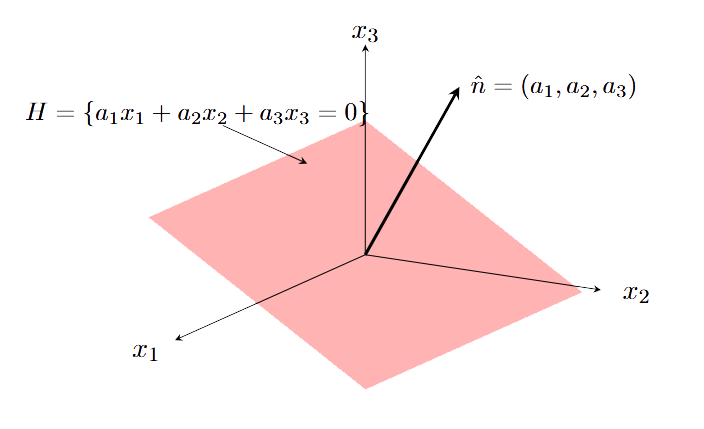
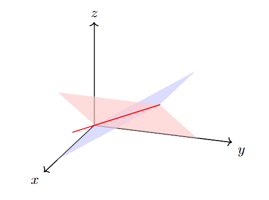

## 线性空间*

什么是“线性”？我们先了解如何描述一条直线。平面上的一条直线可以通过如下函数刻画：

```tikz
\begin{tikzpicture}[scale=0.8]
    \draw[<->] (-3,0) -- (3,0) node[right] {$t$};
    \draw[<->] (0,-3) -- (0,3) node[above] {$y$};
    \draw[blue, thick] (-2,-1) -- (2,3);
    \node at (5,2) {{\color{red}{$y=at+b$}}};
\end{tikzpicture}
```

这里把$t$看作时间，$a,b$是常数。
当$t$跑遍$\mathbb{R}$时，这个函数关系在$(t,y)$平面上的轨迹是一条直线。
类似的，$\mathbb{R}^3$中的直线可以用函数关系表示：

```tikz
\begin{tikzpicture}[scale=1.5]
    \draw[thick,->] (0,0,0) -- (2,0,0) node[right] {$y$};
    \draw[thick,->] (0,0,0) -- (0,2,0) node[above] {$z$};
    \draw[thick,->] (0,0,0) -- (0,0,3) node[left] {$x$};
    \draw[blue, thick] (-2,0,0) -- (3,3,3);
    \node at (3.5,1.5,0) {{\color{red}{$\vec{r}=t\vec{a}+\vec{b}$}}};
\end{tikzpicture}
```

这里$\vec{r}=(x,y,z)$是空间向量，$\vec{a}, \vec{b}$是两个常数向量，$t\in \mathbb{R}$是参数。
当$t$跑遍$\mathbb{R}$时，这个参数关系在3维空间中的轨迹是一条（经过$\vec{b}$，
沿着$\vec{a}$方向的）直线。

由上述讨论知道，描述直线关系$
\vec{r}=t\vec{a}+\vec{b}$ 我们需要如下两个操作：

1. 加法：可以把两个向量相加，即：$\vec{a}+\vec{b}$。

2. 数乘：可以把一个数乘以一个向量，即：$t\vec{a}$。

简单来说，线性结构就是关于“加法”和“数乘”的结构。
一个集合如果有“加法”和“数乘”这两个运算，我们称其为线性空间。
为了讨论完备，我们以下给出线性空间的完整数学定义。
定义看似很复杂，实际上列出的性质都是比较自然的，很容易在具体例子中检验。

::: definition
一个数域$k$（$k=\mathbb{R}$或者$\mathbb{C}$）上的线性空间（或称向量空间）指的是一个集合$V$
以及二元运算

加法：$V\times V \stackrel{+}{\to} V\quad $  数乘：$k\times V\to V$

使得对任何$\mathbf{u},\mathbf{v},\mathbf{w}\in V, a, b\in k$，下列性质成立：

1. 加法交换律：$\mathbf{u}+\mathbf{v}=\mathbf{v}+\mathbf{u}$

2. 加法结合律：$(\mathbf{u}+\mathbf{v})+\mathbf{w}=\mathbf{u}+(\mathbf{v}+\mathbf{w})$

3. 零元素：存在唯一元素$\mathbf{0}\in V$使得$\mathbf{0}+\mathbf{u}=\mathbf{u}$

4. 负元素：存在唯一的$-\mathbf{u}\in V$使得$\mathbf{u}+(-\mathbf{u})=\mathbf{0}$

5. 单位元：对$k$中的单位元$1$，满足$1 \mathbf{u}=\mathbf{u}$

6. 数乘结合律：$a(b\mathbf{u})=(ab)\mathbf{u}$

7. 分配律（向量加法）：$a(\mathbf{u}+\mathbf{v})=a\mathbf{u}+a\mathbf{v}$

8. 分配律（数量加法）：$(a+b)\mathbf{u}=a\mathbf{u}+b\mathbf{u}$

线性空间$V$中的元素称为一个向量。

:::

如不特殊说明，我们考虑实线性空间（即$k=\mathbb{R}$）。

::: example
$3$维空间$\mathbb{R}^3$是一个实线性空间

- 加法：对于向量$\mathbf{u}=(u_1, u_2, u_3), \mathbf{v}=(v_1,v_2,v_3)$

  $$
  \mathbf{u}+\mathbf{v}=(u_1+v_1, u_2+v_2, u_3+v_3)
  $$

- 数乘：对$\lambda\in \mathbb{R}$和向量$\mathbf{u}=(u_1, u_2, u_3)$

  $$
  \lambda \mathbf{u}=(\lambda u_1, \lambda u_2, \lambda u_3)
  $$

:::

::: example
线性空间$\mathbb{R}^n$中的一个向量表达为
$$
\mathbf{u}=(u_1,u_2, \cdots, u_n), \quad u_i\in \mathbb{R}
$$

- 加法：
  $$
  \mathbf{u}+\mathbf{v}=(u_1+v_1, u_2+v_2, \cdots, u_n+v_n)
  $$

- 数乘：对$\lambda\in \mathbb{R}$
  $$
  \lambda \mathbf{u}=(\lambda u_1, \lambda u_2, \cdots,\lambda u_n)
  $$

:::

::: example
所有的一元多项式组成的集合$\mathbb{R}[x]$构成一个线性空间。
给定两个多项式$f(x),g(x)$，加法即为多项式相加$f(x)+g(x)$，数乘即为多项式的数乘$\lambda f(x)$。

类似的，所有的一元光滑函数构成的空间（记为$C^\infty(\mathbb{R})$）是一个线性空间。
:::

::: example
一个$n$次多项式指的是如下的多项式
\[
\begin{aligned}
f(x)=a_n x^n+a_{n-1}x^{n-1}+\cdots+ a_1 x+a_0, \quad \text{其中}\ a_n\neq 0
\end{aligned}
\]

- 所有$n$次多项式（$n\geq 1$）构成的集合在多项式加法和数乘下，不构成一个线性空间。
  例如两个$n$次多项式相减可能不再是$n$次多项式。特别地，这个集合不包含零多项式。

- 所有次数$\leq n$的多项式构成的集合在多项式加法和数乘下构成一个线性空间。

:::

::: example
量子力学和经典力学的一个本质区别是量子物理态构成一个复线性空间（Hilbert空间）。
例如一个量子自旋系统，
一个自旋向上的态${\left| \uparrow \right>}$和一个自旋向下的态${\left| \downarrow \right>}$
可以叠加得到一个新的物理态
$$
\frac{1}{\sqrt{2}} {\left| \uparrow \right>} +\frac{1}{\sqrt{2}} {\left| \downarrow \right>}
$$
又例如干涉现象的本质也是做线性叠加。
:::

::: example
设$D=a_n(x){d^n\over dx^n}+\cdots+a_1(x){d\over dx}+a_0(x)$是一个微分算子。
则所有满足如下微分方程的函数$f(x)$
$$
\{f(x)| D f(x)=0\}
$$
构成一个线性空间。这是因为如果$f(x),g(x)$满足方程，则
\[
\begin{array}{rcl}
D(f(x)+g(x))=Df(x)+ Dg(x)=0 &
  \Longrightarrow  &  f(x)+g(x)\ \text{满足方程}\\
 D(c f(x))=cDf(x)=0 &  \Longrightarrow & c f(x)\ \text{满足方程}
\end{array}
\]
:::

## 直和*

给定两个线性空间$V, W$，我们可以定义一个新的线性空间$V\oplus W$称为$V$和$W$的直和。作为集合
$$
V\oplus W=\{(v,w)| v\in V, w\in W\}
$$
加法和数乘定义为
\[
\begin{aligned}
 (v_1, w_1)+(v_2, w_2)&:=(v_1+v_2,w_1+w_2)\\
  \lambda (v,w)&:=(\lambda v, \lambda w)
\end{aligned}
\]

类似可以定义$m$个线性空间$V_1,\cdots, V_m$的直和
$$
V_1\oplus V_2\oplus \cdots \oplus V_m
$$
直和中的元素可以表示为$(u_1,\cdots, u_m), u_i\in V_i$。

::: example
线性空间$\mathbb{R}^n$可以写成$n$个$\mathbb{R}$的直和
$$
\mathbb{R}^n= \underbrace{\mathbb{R}\oplus \mathbb{R}\oplus \cdots \oplus \mathbb{R}}_{n}
$$
如果$n=m+k$，我们也可以写成
$$
\mathbb{R}^n=\mathbb{R}^m\oplus \mathbb{R}^k
$$
:::

## 线性子空间*

::: definition
设$V$是一个数域$k$上的线性空间。
$V$的一个子集$W$称为$V$的一个线性子空间，如果$W$中的元素在加法和数乘运算下封闭，即

- 对任意$w_1, w_2\in W$，则$w_1+w_2\in W$。

- 对任意$w\in W$和$\lambda\in k$，则$\lambda w\in W$。

:::

::: proposition
$V$的线性子空间是一个线性空间。
:::

::: proof
设$W$是$V$的线性子空间。
验证$\mathbf{0}\in W$：
$$
\mathbf{0}=w+(-w)\in W \quad \text{这里}\ w\in W
$$
容易检验$W$在$V$的加法和数乘运算下构成线性空间。
:::

::: example
考虑$\mathbb{R}^2$的子集$L=\{(x,y)| y=ax+b\}\subset \mathbb{R}^2$，

```tikz
\begin{tikzpicture}[scale=0.8]
    \draw[<->] (-3,0) -- (3,0) node[right] {$x$};
    \draw[<->] (0,-3) -- (0,3) node[above] {$y$};
    \draw[blue, thick] (-2,-1) -- (2,3) node[above] {\small $L$};
    \node at (5,2) {\small {\color{red}{$y=ax+b$}}};
\end{tikzpicture}
```

则$L$是$\mathbb{R}^2$的线性子空间当且仅当$L$过原点。

```tikz
\begin{tikzpicture}[scale=0.8]
    \draw[<->] (-3,0) -- (3,0) node[right] {$x$};
    \draw[<->] (0,-3) -- (0,3) node[above] {$y$};
    \draw[blue, thick] (-2,-1) -- (2,1) node[above] {\small $L$};
    \node at (5,2) {\small {\color{red}{$y=ax$}}};
\end{tikzpicture}
```

:::

实际上，原点$\mathbf{0}=(0,0)$是$\mathbb{R}^2$的零元素，如果$L$是线性子空间则一定包含原点。
反之，如果$L$过原点，则直线方程为
$$
L=\{(x,y)| y=ax\}
$$

若$(x_1,y_1), (x_2, y_2)\in L$，则$(x_1+x_2, y_1+y_2)\in L$
$$
y_1+y_2= ax_1+ a x_2=a(x_1+x_2)
$$
并且$(\lambda x_1, \lambda y_1)\in L$，即
$$
\lambda y_1= \lambda (ax_1)= a(\lambda x_1)
$$
因此$L$在加法和数乘下封闭。

::: example
空间$\mathbb{R}^3$中的平面$H=\{(x_1,x_2,x_3)\in \mathbb{R}^3|a_1x_1+a_2x_2+a_3 x_3=b\}$是
$\mathbb{R}^3$的线性子空间当且仅当$H$过原点，即$b=0$。

{width=500}
:::

::: example
$V=\mathbb{R}[x]$，$W=\{\text{次数$\leq$n的一元多项式}\}$。则
$
W\subset V
$
是一个线性子空间。
:::

::: example
$V=\mathbb{R}[x]$，$W_{x_0}=\{f(x)\in V| f(x_0)=0\}, x_0\in \mathbb{R}$。则
$
W_{x_0}\subset V
$
是线性子空间。对任意$f(x), g(x)\in W_{x_0}$
\[
\begin{aligned}
  (f+g)(x_0)=f(x_0)+g(x_0)=0
\end{aligned}
\]
因此$f+g\in W_{x_0}$。类似可证对$\lambda\in \mathbb{R}$，$\lambda f\in W_{x_0}$。
:::

::: example
$V=\mathbb{R}[x]$，
$
W=\{f(x)\in V| f(0)=1\}
$不是$V$的线性子空间。例如零函数不在$W$中。
:::

::: example
考虑两个线性空间的直和 $V\oplus W$。则
\[
\begin{aligned}
V\oplus \mathbf{0}&=\{(v,\mathbf{0})| v\in V, \ \ \mathbf{0}\in W \ \text{是零元}\} \\
\mathbf{0} \oplus W&=\{(\mathbf{0}, w)| w\in W, \ \ \mathbf{0}\in V \ \text{是零元}\}
\end{aligned}
\]
是$V\oplus W$的线性子空间。这是因为零元满足
$$
\mathbf{0}+\mathbf{0}=\mathbf{0}, \quad \lambda \mathbf{0}=\mathbf{0}.
$$
:::

::: example
$V=C^\infty(\mathbb{R})$，$W$为$V$中满足如下微分方程的解
$$
f'(x)=2f(x)
$$
$W$是$V$的线性子空间。不难解出
$$
W=\{c e^{2x} \}_{c\in \mathbb{R}}
$$
:::

::: example
$V=C^\infty(\mathbb{R})$，$W$为$V$中满足如下微分方程的解
$$
f\ ''(x)+f(x)=0
$$
$W$是$V$的线性子空间。不难解出
$$
W=\{a \sin(x)+ b\cos(x) \}_{a,b\in \mathbb{R}}
$$
:::

::: example
在量子力学中，满足定态薛定谔方程
$$
\left(-\frac{\hbar^2}{2m}\nabla^2 + V(x)\right)\psi(x)=E\psi(x)
$$
的波函数$\psi(x)$构成态空间的线性子空间。$E$ 称为“能量本征值”，对应子空间包含能量$E$的量子态。
:::

::: example
真空中麦克斯韦方程

$$
\begin{cases}
\nabla \cdot \vec E = 0      \\
\nabla \cdot \vec B =0
\end{cases}
\begin{cases}
 \nabla \times \vec E= -{\partial\vec B \over \partial t}  \\
\nabla \times \vec B ={1\over c^2} {\partial \vec E \over \partial t}
\end{cases}
$$
的解是一个线性空间。固定波矢$\vec{k}$的如下解
$$
\{\vec{E}|\vec{E}=\vec{u} \cos(\vec{k}\cdot \vec{r}-\omega t)\}_{\vec{u}\text{与}\vec{k}\text{垂直}}
$$
是一个由线偏振光构成的线性子空间。

```tikz
\begin{tikzpicture}[x=0.75pt,y=0.75pt,yscale=-1,xscale=1]
\draw    (171.49,158.78) -- (237.41,158.78) ;
\draw [shift={(239.41,158.78)}, rotate = 180] [color={rgb, 255:red, 0; green, 0; blue, 0 }  ][line width=0.75]    (10.93,-3.29) .. controls (6.95,-1.4) and (3.31,-0.3) .. (0,0) .. controls (3.31,0.3) and (6.95,1.4) .. (10.93,3.29)   ;
\draw    (171.49,158.78) -- (171.49,92.87) ;
\draw [shift={(171.49,90.87)}, rotate = 90] [color={rgb, 255:red, 0; green, 0; blue, 0 }  ][line width=0.75]    (10.93,-3.29) .. controls (6.95,-1.4) and (3.31,-0.3) .. (0,0) .. controls (3.31,0.3) and (6.95,1.4) .. (10.93,3.29)   ;
\draw    (171.49,158.78) -- (123.87,193.32) ;
\draw [shift={(122.25,194.5)}, rotate = 324.05] [color={rgb, 255:red, 0; green, 0; blue, 0 }  ][line width=0.75]    (10.93,-3.29) .. controls (6.95,-1.4) and (3.31,-0.3) .. (0,0) .. controls (3.31,0.3) and (6.95,1.4) .. (10.93,3.29)   ;
\draw    (425.39,236.77) -- (425.39,82.1) ;
\draw [shift={(425.39,80.1)}, rotate = 90] [color={rgb, 255:red, 0; green, 0; blue, 0 }  ][line width=0.75]    (10.93,-3.29) .. controls (6.95,-1.4) and (3.31,-0.3) .. (0,0) .. controls (3.31,0.3) and (6.95,1.4) .. (10.93,3.29)   ;
\draw  [draw opacity=0] (425.39,160.76) .. controls (425.39,160.76) and (425.39,160.76) .. (425.39,160.76) .. controls (412.7,171.41) and (402.41,166.61) .. (402.41,150.04) .. controls (402.41,133.47) and (412.7,111.41) .. (425.39,100.76) -- (425.39,130.76) -- cycle ; \draw  [color={rgb, 255:red, 255; green, 0; blue, 0 }  ,draw opacity=1 ] (425.39,160.76) .. controls (425.39,160.76) and (425.39,160.76) .. (425.39,160.76) .. controls (412.7,171.41) and (402.41,166.61) .. (402.41,150.04) .. controls (402.41,133.47) and (412.7,111.41) .. (425.39,100.76) ;
\draw  [draw opacity=0][dash pattern={on 0.84pt off 2.51pt}] (425.42,161.42) .. controls (425.42,161.42) and (425.42,161.42) .. (425.42,161.42) .. controls (431.4,156.4) and (436.85,154.81) .. (440.94,156.27) -- (425.42,191.42) -- cycle ; \draw  [color={rgb, 255:red, 255; green, 0; blue, 0 }  ,draw opacity=1 ][dash pattern={on 0.84pt off 2.51pt}] (425.42,161.42) .. controls (425.42,161.42) and (425.42,161.42) .. (425.42,161.42) .. controls (431.4,156.4) and (436.85,154.81) .. (440.94,156.27) ;
\draw [color={rgb, 255:red, 255; green, 0; blue, 0 }  ,draw opacity=1 ]   (425.31,119.98) -- (405.01,137.02) ;
\draw [shift={(403.48,138.3)}, rotate = 320] [color={rgb, 255:red, 255; green, 0; blue, 0 }  ,draw opacity=1 ][line width=0.75]    (10.93,-3.29) .. controls (6.95,-1.4) and (3.31,-0.3) .. (0,0) .. controls (3.31,0.3) and (6.95,1.4) .. (10.93,3.29)   ;
\draw [color={rgb, 255:red, 255; green, 0; blue, 0 }  ,draw opacity=1 ]   (425.2,141.77) -- (405.73,158.78) ;
\draw [shift={(404.23,160.1)}, rotate = 318.85] [color={rgb, 255:red, 255; green, 0; blue, 0 }  ,draw opacity=1 ][line width=0.75]    (10.93,-3.29) .. controls (6.95,-1.4) and (3.31,-0.3) .. (0,0) .. controls (3.31,0.3) and (6.95,1.4) .. (10.93,3.29)   ;
\draw  [draw opacity=0] (442.02,156.76) .. controls (445.94,158.85) and (448.35,164.11) .. (448.36,172.12) .. controls (448.37,188.69) and (438.1,210.76) .. (425.42,221.42) -- (425.39,191.42) -- cycle ; \draw  [color={rgb, 255:red, 255; green, 0; blue, 0 }  ,draw opacity=1 ] (442.02,156.76) .. controls (445.94,158.85) and (448.35,164.11) .. (448.36,172.12) .. controls (448.37,188.69) and (438.1,210.76) .. (425.42,221.42) ;
\draw [color={rgb, 255:red, 255; green, 0; blue, 0 }  ,draw opacity=1 ]   (425.4,202.86) -- (445.68,185.81) ;
\draw [shift={(447.21,184.52)}, rotate = 139.95] [color={rgb, 255:red, 255; green, 0; blue, 0 }  ,draw opacity=1 ][line width=0.75]    (10.93,-3.29) .. controls (6.95,-1.4) and (3.31,-0.3) .. (0,0) .. controls (3.31,0.3) and (6.95,1.4) .. (10.93,3.29)   ;
\draw [color={rgb, 255:red, 255; green, 0; blue, 0 }  ,draw opacity=1 ]   (425.54,181.08) -- (444.71,164.73) ;
\draw [shift={(446.23,163.43)}, rotate = 139.54] [color={rgb, 255:red, 255; green, 0; blue, 0 }  ,draw opacity=1 ][line width=0.75]    (10.93,-3.29) .. controls (6.95,-1.4) and (3.31,-0.3) .. (0,0) .. controls (3.31,0.3) and (6.95,1.4) .. (10.93,3.29)   ;
\draw  [draw opacity=0] (425.36,221.42) .. controls (408.8,221.42) and (395.36,207.99) .. (395.36,191.42) .. controls (395.36,180.91) and (400.77,171.67) .. (408.94,166.31) -- (425.36,191.42) -- cycle ; \draw  [color={rgb, 255:red, 0; green, 0; blue, 255 }  ,draw opacity=1 ] (425.36,221.42) .. controls (408.8,221.42) and (395.36,207.99) .. (395.36,191.42) .. controls (395.36,180.91) and (400.77,171.67) .. (408.94,166.31) ;
\draw [color={rgb, 255:red, 0; green, 0; blue, 255 }  ,draw opacity=1 ]   (425.54,181.08) -- (399.19,181.4) ;
\draw [shift={(397.19,181.42)}, rotate = 359.3] [color={rgb, 255:red, 0; green, 0; blue, 255 }  ,draw opacity=1 ][line width=0.75]    (10.93,-3.29) .. controls (6.95,-1.4) and (3.31,-0.3) .. (0,0) .. controls (3.31,0.3) and (6.95,1.4) .. (10.93,3.29)   ;
\draw [color={rgb, 255:red, 0; green, 0; blue, 255 }  ,draw opacity=1 ]   (425.4,202.86) -- (399.23,202.86) ;
\draw [shift={(397.23,202.86)}, rotate = 360] [color={rgb, 255:red, 0; green, 0; blue, 255 }  ,draw opacity=1 ][line width=0.75]    (10.93,-3.29) .. controls (6.95,-1.4) and (3.31,-0.3) .. (0,0) .. controls (3.31,0.3) and (6.95,1.4) .. (10.93,3.29)   ;
\draw  [draw opacity=0] (425.31,101.42) .. controls (425.31,101.42) and (425.31,101.42) .. (425.31,101.42) .. controls (441.88,101.39) and (455.34,114.8) .. (455.36,131.37) .. controls (455.39,147.94) and (441.99,161.39) .. (425.42,161.42) -- (425.36,131.42) -- cycle ; \draw  [color={rgb, 255:red, 0; green, 0; blue, 255 }  ,draw opacity=1 ] (425.31,101.42) .. controls (425.31,101.42) and (425.31,101.42) .. (425.31,101.42) .. controls (441.88,101.39) and (455.34,114.8) .. (455.36,131.37) .. controls (455.39,147.94) and (441.99,161.39) .. (425.42,161.42) ;
\draw [color={rgb, 255:red, 0; green, 0; blue, 255 }  ,draw opacity=1 ]   (425.2,141.77) -- (451.55,141.4) ;
\draw [shift={(453.55,141.37)}, rotate = 179.2] [color={rgb, 255:red, 0; green, 0; blue, 255 }  ,draw opacity=1 ][line width=0.75]    (10.93,-3.29) .. controls (6.95,-1.4) and (3.31,-0.3) .. (0,0) .. controls (3.31,0.3) and (6.95,1.4) .. (10.93,3.29)   ;
\draw [color={rgb, 255:red, 0; green, 0; blue, 255 }  ,draw opacity=1 ]   (425.31,119.98) -- (451.48,119.94) ;
\draw [shift={(453.48,119.94)}, rotate = 179.9] [color={rgb, 255:red, 0; green, 0; blue, 255 }  ,draw opacity=1 ][line width=0.75]    (10.93,-3.29) .. controls (6.95,-1.4) and (3.31,-0.3) .. (0,0) .. controls (3.31,0.3) and (6.95,1.4) .. (10.93,3.29)   ;
\draw  [draw opacity=0][dash pattern={on 0.84pt off 2.51pt}] (410.26,165.49) .. controls (414.7,162.91) and (419.86,161.42) .. (425.36,161.42) .. controls (425.36,161.42) and (425.36,161.42) .. (425.36,161.42) -- (425.36,191.42) -- cycle ; \draw  [color={rgb, 255:red, 0; green, 0; blue, 255 }  ,draw opacity=1 ][dash pattern={on 0.84pt off 2.51pt}] (410.26,165.49) .. controls (414.7,162.91) and (419.86,161.42) .. (425.36,161.42) .. controls (425.36,161.42) and (425.36,161.42) .. (425.36,161.42) ;
\draw (137.44,195.7) node [anchor=north west][inner sep=0.75pt]   [align=left] {\scriptsize$\vec u$};
\draw (237.37,166.86) node [anchor=north west][inner sep=0.75pt]   [align=left] {\scriptsize$\vec k\times \vec u$};
\draw (183.57,86.9) node [anchor=north west][inner sep=0.75pt]   [align=left] {\scriptsize$\vec k$};
\draw (435.63,75.7) node [anchor=north west][inner sep=0.75pt]   [align=left] {\scriptsize$\vec k$};
\draw (386.24,128.5) node [anchor=north west][inner sep=0.75pt]  [color={rgb, 255:red, 255; green, 0; blue, 0 }  ,opacity=1 ] [align=left] {\scriptsize$\vec E$};
\draw (460.57,111.66) node [anchor=north west][inner sep=0.75pt]  [color={rgb, 255:red, 0; green, 0; blue, 255 }  ,opacity=1 ] [align=left] {\scriptsize$\vec B$};
\end{tikzpicture}
```

:::

::: proposition
$V$的任意个线性子空间的交是线性子空间。
:::

::: proof
设$\{W_\alpha\}_{\alpha \in I}$是$V$的线性子空间。设
$$
v_1, v_2\in \bigcap\limits_{\alpha\in I}W_\alpha
$$
则对每个$\alpha\in I$，我们有$v_1+v_2\in W_\alpha$，因此
$$
v_1+v_2\in \bigcap\limits_{\alpha\in I}W_\alpha
$$
类似可证$\lambda v_1\in \bigcap\limits_{\alpha\in I}W_\alpha$。
:::

::: example
$\mathbb{R}^3$中不平行的两个平面的交是一条直线

{width=400}
:::

::: example
$V=C^\infty(\mathbb{R})$，$U$为$V$中满足如下方程的解
$$
f''(x)+f(x)=0, \quad f(0)=0.
$$
$U$是$V$的两个线性子空间$\{f\in V|f''(x)+f(x)=0\}$ 和$\{f\in V |f(0)=0\}$的交，因此是线性子空间。
具体而言
$$
U=\{a \sin(x)\}_{a\in \mathbb{R}}.
$$
:::
