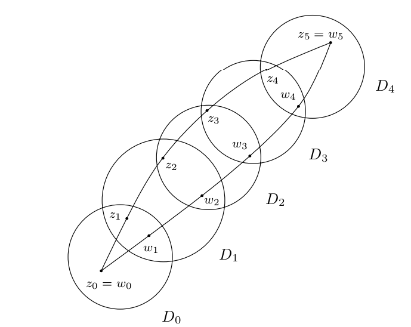

<disambiguation>
注意与[[Cauchy 积分公式]]、[[Cauchy 重积分公式]]区分。
</disambiguation>

**Cauchy 积分定理**（也称为 **Cauchy–Goursat 定理**）说明，
[[复平面]]上[[全纯函数]]的[[曲线积分]]在曲线的[[同伦]]下不变。
特别地，全纯函数沿[[零伦]][[闭曲线]]的积分为 $0$。

## 定理陈述

::: theorem [Cauchy 积分定理] {@C}
设

- $U \subset \mathbb{C}$ 是[[开集]]。

- $f \colon U \to \mathbb{C}$ 是[[全纯函数]]。

- $\gamma_0, \gamma_1 \colon [a, b] \to U$
  是两条连接 $x, y \in U$ 的[[可求长曲线]]，
  且它们（固定端点）[[同伦]]。

则
\[
\int_{\gamma_0} f (z) \, \mathrm{d} z =
\int_{\gamma_1} f (z) \, \mathrm{d} z.
\]
特别地，如果 $\gamma$ 是在 $U$ 中[[零伦]]的[[闭曲线]]，
那么
\[
\oint_{\gamma} f (z) \, \mathrm{d} z = 0.
\]
:::

## 定理证明

先建立如下的引理。

::: lemma [曲线的折线逼近] {@1}
设 $U \subset \mathbb{C}$ 是开集，$\gamma \colon [a,b] \to U$ 是可求长曲线，
$f \colon U \to \mathbb{C}$
是[[连续函数]]。则对于任意 $\varepsilon > 0$，存在一条 $U$ 中的折线 $P$，使得

1. $P,\gamma$ 有相同的起点和终点，$P$ 的顶点都在 $\gamma$ 上；

2. $P$ 与 $\gamma$ 同伦；

3. 成立估计式
   \[
   \left|\int_{\gamma} f(z) \, \mathrm{d} z - \int_{P} f(z) \, \mathrm{d} z\right| < \varepsilon.
   \]

:::

::: proof
令 $\rho = \operatorname{dist}(\gamma, \partial U) > 0$。作一个紧集 $G$ 使得
$\gamma \subset G \subset U$。因为 $f$ 在 $G$ 内是[[一致连续函数]]，故对任意
$\varepsilon > 0$，存在 $\delta > 0$，使得如果 $|z - w| < \delta$，则有
$|f(z) - f(w)| < \varepsilon / (2L)$，其中 $L = \operatorname{length}(\gamma)$
是曲线长度。在 $\gamma$ 上取分点 $z_1, \cdots, z_n$，使得 $\gamma$ 被这些分点
分得的曲线弧长度均小于 $\eta = \min(\delta, \rho)$，且 $z_1, z_n$ 分别是起点和终点。
显见 $|z_{k+1} - z_k| < \eta \leq \rho$，于是把分点连起来得到折线 $P$，它在 $U$ 内部。

关于同伦，可以简单地取直线同伦 $H(s,t) = (1-s) \gamma(t) + s P(t)$。下面主要证明
估计式。

记 $\gamma_k$ 表示第 $k$ 段曲线弧，$P_k$ 表示第 $k$ 条线段。则
\[
\begin{aligned}
  \left|\int_{\gamma_k} f(z) \, \mathrm{d} z - \int_{P_k} f(z) \, \mathrm{d} z\right|
  &\leq \left|\int_{\gamma_k} f(z) \, \mathrm{d} z - f(z_k) (z_{k+1} - z_k)\right|
  + \left|\int_{P_k} f(z) \, \mathrm{d} z - f(z_k) (z_{k+1} - z_k)\right|\\
  &= \left|\int_{\gamma_k} (f(z) - f(z_k)) \, \mathrm{d} z\right| +
  \left|\int_{P_k} (f(z) - f(z_k)) \, \mathrm{d} z\right|\\
  &\leq \int_{\gamma_k} |f(z) - f(z_k)| \, \mathrm{d} z +
  \int_{P_k} |f(z) - f(z_k)| \, \mathrm{d} z\\
  &< \frac{\varepsilon}{2L} (\operatorname{length}(\gamma_k) + \operatorname{length}(P_k))\\
  &\leq \frac{\varepsilon}{L}\operatorname{length}(\gamma_k).
\end{aligned}
\]
对其求和，得到
\[
\left|\int_{\gamma} f(z) \, \mathrm{d} z - \int_{P} f(z) \, \mathrm{d} z\right|
< \frac{\varepsilon}{L}\sum_{k=1}^{n-1}\operatorname{length}(\gamma_k) = \varepsilon.
\]
得证。
:::

这个引理允许我们把一般的曲线替换为分段可微的曲线（实际上证明了更强的折线）。
当然，也可以用 [[Stone–Weierstraß 定理]]得到。

::: lemma [Goursat] {@2}
设 $U \subset \mathbb{C}$ 是开集，$T \subset U$ 是一个逆时针旋转的三角形，
则对任意全纯函数 $f \colon U \to \mathbb{C}$：
\[
\int_{T} f(z) \, \mathrm{d} z = 0.
\]
:::

::: proof
我们通过如下的操作不断把三角形缩小。

```tikz
\begin{tikzpicture}[scale=1.5]
    \coordinate (A) at (0,0);
    \coordinate (B) at (3,0);
    \coordinate (C) at (1,2);
    \draw (A) -- (B) -- (C) -- cycle;
    \coordinate (AB) at (barycentric cs:A=1,B=1);
    \coordinate (BC) at (barycentric cs:B=1,C=1);
    \coordinate (CA) at (barycentric cs:C=1,A=1);
    \draw (AB) -- (BC) -- (CA) -- cycle;
\end{tikzpicture}
```

如图，设 $T_0 = T$。联结 $T_0$ 三条边的中点，可以得到四个全等的三角形 $T_{1,i}(i=1,2,3,4)$。
规定它们都是逆时针旋转。于是
\[
\int_{T_0} f(z) \, \mathrm{d} z = \sum_{i=1}^4 \int_{T_{1,i}} f(z) \, \mathrm{d} z.
\]
取 $T_1$ 为这四个三角形中使得
\[
\left|\int_{T_{1,i}} f(z) \, \mathrm{d} z\right|
\]
最大的三角形，则
\[
\left|\int_{T_{0}} f(z) \, \mathrm{d} z\right| \leq 4\left|\int_{T_{1}} f(z) \, \mathrm{d} z\right|.
\]
对 $T_1$ 也可以如此炮制。一直下去，得到一列三角形 $(T_n)$，满足
\[
\left|\int_{T_{0}} f(z) \, \mathrm{d} z\right| \leq 4^n\left|\int_{T_{n}} f(z) \, \mathrm{d} z\right|.
\]
设 $d_n, p_n$ 分别代表 $T_n$ 的直径和周长，则 $d_n = 2^{-n} d_0, p_n = 2^{-n} p_0$。
设 $\mathcal{T}_n$ 表示 $T_n$ 的内部和周界的点集，它们当然是闭集，且
\[
\mathcal{T}_0 \supset \mathcal{T}_1 \supset \cdots \supset \mathcal{T}_n \supset \cdots,
\]
其直径 $\operatorname{diam}(\mathcal{T}_n) = d_n \to 0$。
根据[[闭集套定理]]，所有的 $\mathcal{T}_n$ 交于单点集 $\{z_0\}$。
根据 $f$ 的全纯性，可以写出
\[
f(z) = f(z_0) + f'(z_0)(z-z_0) + \psi(z)(z-z_0),
\]
其中 $\psi(z) = o(1),\ z \to z_0$。简单计算可知
\[
\int_{T_n} f(z) \, \mathrm{d} z = \int_{T_n} \psi(z)(z-z_0) \, \mathrm{d} z.
\]
当 $n$ 充分大时，$|\psi(z)| \leq \epsilon_n \to 0, z \in T_n$，从而
\[
\left|\int_{T_n} f(z) \, \mathrm{d} z\right| \leq \epsilon_n d_np_n = 4^{-n}\epsilon_n d_0p_0,
\]
从而
\[
\left|\int_{T_0} f(z) \, \mathrm{d} z\right| \leq \epsilon_n d_0p_0 \to 0.
\]
引理得证。
:::

这个引理实际上就是 Cauchy 积分定理对三角形的特殊情况。据此，不难推出 Cauchy 积分定理对
矩形也成立。

::: lemma {@3}
设 $D \subset \mathbb{C}$ 是圆盘，$f \colon D \to \mathbb{C}$ 是全纯函数，
则 $f$ 在 $D$ 内存在[[原函数]]，即
存在全纯函数 $F$ 使得对任意 $z \in D$：
\[
F'(z) = f(z).
\]
此时，对分段可微曲线 $\gamma \colon [a,b] \to D$，有
\[
\int_{\gamma} f(z) \, \mathrm{d} z = F(\gamma(b)) - F(\gamma(a)).
\]
:::

::: proof
先证明第一个命题。不失一般性，假设 $D$ 的圆心是原点。对任意 $z \in D$，考虑下图所示的折线
$\gamma_z$：

```tikz
\usetikzlibrary{decorations.markings}
\begin{tikzpicture}[scale=.6]
    \draw (0,0) circle (4);
    \node[above right] at (2,2) {$z$};
    \node[below] at (2,0) {$\mathrm{Re}(z)$};
    \node[below] at (0,0) {$O$};
    \tikzset{
      midarrow/.style={postaction={decorate,decoration={markings,mark=at position 0.5 with {\arrow{>}}}}}
    }
    \draw[midarrow] (0,0) -- (2,0);
    \draw[midarrow] (2,0) -- (2,2);
    \fill (0,0) circle (2pt);
    \fill (2,2) circle (2pt);
\end{tikzpicture}
```

定义
\[
F(z) = \int_{\gamma_z} f(w) \, \mathrm{d} w,
\]
我们来证明这就是 $f$ 的原函数。为此，需要计算 $F(z+h) - F(z)$。同时做出 $\gamma_z, \gamma_{z+h}$：

```tikz
\usetikzlibrary{decorations.markings}
\begin{tikzpicture}[scale=.6]
    \draw (0,0) circle (4);
    \node[left] at (2,2) {$z$};
    \node[below] at (2,0) {$\mathrm{Re}(z)$};
    \node[below] at (0,0) {$O$};
    \tikzset{
      midarrow/.style={postaction={decorate,decoration={markings,mark=at position 0.5 with {\arrow{>}}}}}
    }
    \draw[midarrow] (0,0) -- (2,0);
    \draw[midarrow] (2,0) -- (2,2);
    \fill (0,0) circle (2pt);
    \fill (2,2) circle (2pt);
    \fill (3,2.3) circle (2pt);
    \node[below right] at (3,0) {$\mathrm{Re}(z+h)$};
    \node[right] at (3,2) {$z + \mathrm{Re}(h)$};
    \node[above] at (3,2.3) {$z+h$};
    \draw[midarrow] (2,0) -- (3,0);
    \draw[midarrow] (3,0) -- (3,2.3);
    \draw[midarrow] (2,2) -- (3,2);
    \draw[midarrow] (2,2) -- (3,2.3);
\end{tikzpicture}
```

首先，根据 @2，因为矩形上的积分为零，所以 $\gamma_{z+h}$ 上的积分比起 $\gamma_z$ 多出来的
是从 $z$ 到 $z+\operatorname{Re}(h)$ 再到 $z+h$ 的折线上的积分；再因为三角形上的积分为零，这段积分
还等于 $z$ 到 $z+h$ 的线段上的积分。记这条线段是 $\eta$，则
\[
F(z+h) - F(z) = \int_{\eta} f(w) \, \mathrm{d} w.
\]
因为 $f$ 是连续的，所以 $f(w) = f(z) + \psi(w)$，其中 $\psi(w) \to 0,\ w\to z$。
此时
\[
\int_{\eta} f(w) \, \mathrm{d} w = f(z)h + \int_{\eta} \psi(w) \, \mathrm{d} w.
\]
进一步：
\[
\left|\int_{\eta} \psi(w) \, \mathrm{d} w\right| \leq \max_{w \in \eta}|\psi(w)| \cdot |h|,
\]
当 $h \to 0$时，上式为 $o(h)$，即 $F(z+h) - F(z) = f(z)h + o(h),\ h \to 0$。也就是
$F'(z) = f(z)$。第一个命题得证。

对于第二个命题，如果 $\gamma$ 是可微的，则简单地通过链式法则可得
\[
\int_{\gamma} f(z) \, \mathrm{d} z = \int_a^b f(\gamma(t))\gamma'(t) \, \mathrm{d} t = F(\gamma(b)) - F(\gamma(a)).
\]
如果不是，设 $\gamma$ 在区间 $[a_0,a_1],[a_1,a_2],\cdots, [a_{n-1},a_n]$ 可微，
其中 $a_0=a, a_n=b$。这时
\[
\int_{\gamma} f(z) \, \mathrm{d} z = \sum_{k=0}^{n-1} (F(\gamma(a_{k+1})) - F(\gamma(a_k))) = F(\gamma(b)) - F(\gamma(a)).
\]
第二个命题得证。
:::

::: proof [@C 的证明]
根据 @1，可不妨设 $\gamma_0, \gamma_1$ 分段可微。设它们之间有同伦 $H : [0,1] \times [a,b] \to U$，
并令 $\gamma_s(t) = H(s,t)$。
$H$ 是[[紧集]] $[0,1] \times [a,b]$ 上的[[连续函数]]，其像 $K$ 也是紧集。

由 $K$ 的紧性，取 $\epsilon > 0$，
使得任何以 $K$ 中的点为中心，$4 \epsilon$ 为半径的圆盘都在 $U$ 内。

因为 $H$ 是[[一致连续函数]]，对上述 $\epsilon$，
可以找到 $\delta > 0$ 使得只要 $|s_1 - s_2|<\delta$，就有
\[
\sup_{t \in [a,b]}|\gamma_{s_1}(t) - \gamma_{s_2}(t)| < \epsilon.
\]
对任何上述 $s_1,s_2$，找一组半径为 $2\epsilon$ 的圆盘
$D_0, D_1, \cdots, D_n$，以及分别位于 $\gamma_{s_1},\gamma_{s_2}$ 上的两组点
$z_0, \cdots, z_{n+1}; w_0, \cdots, w_{n+1}$，使得 $z_0 = w_0, z_{n+1} = w_{n+1}$
分别是 $\gamma_{s_1},\gamma_{s_2}$ 的起点和终点，且
\[
z_i, z_{i+1}, w_i, w_{i+1} \in D_i, \quad i=0,\cdots, n.
\]
例如，下图展示了 $n=4$ 的情况。

{width=400}

这些圆盘都包含在 $U$ 内。对每个 $D_i$，其内部可以找到 $f$ 的一个原函数 $F_i$，这是因为 @3。
在 $D_i \cap D_{i+1}$ 中，$F_i, F_{i+1}$ 是同一个函数的两个原函数，
所以相差一个常数。于是
\[
F_{i+1}(z_{i+1}) - F_i(z_{i+1}) = F_{i+1}(w_{i+1}) - F_i(w_{i+1}), \quad 0 \leq i \leq {n-1},
\]
也就是
\[
F_{i+1}(z_{i+1}) - F_{i+1}(w_{i+1}) = F_{i}(z_{i+1}) - F_i(w_{i+1}), \quad 0 \leq i \leq {n-1}.
\]
这导致

\[
\begin{aligned}
  \int_{\gamma_{s_1}} f(z)\, \mathrm{d} z - \int_{\gamma_{s_2}} f(z)\, \mathrm{d} z
  &= \sum_{i=0}^n (F_i(z_{i+1}) - F_i(z_i)) - \sum_{i=0}^n (F_i(w_{i+1}) - F_i(w_i))\\
  &= \sum_{i=0}^n \big(F_i(z_{i+1}) - F_i(w_{i+1}) - (F_i(z_i) - F_i(w_i))\big)\\
  &= F_n(z_{n+1}) - F_n(w_{n+1}) - (F_0(z_0) - F_0(w_0))\\
  &= 0,
\end{aligned}
\]
也就是 $\int_{\gamma_{s_1}} f = \int_{\gamma_{s_2}} f$。

最后，考虑一列数 $(s_n)_{0 \leq n \leq N}$，满足 $s_0 = 0, s_N = 1$，且
$0< s_{n+1} - s_n < \delta$，$N > 1/\delta$。于是
\[
\int_{\gamma_{s_0}} f(z)\, \mathrm{d} z = \int_{\gamma_{s_1}} f(z)\, \mathrm{d} z= \cdots = \int_{\gamma_{s_N}} f(z)\, \mathrm{d} z,
\]
定理得证。
:::

## 推论

### 原函数

在之前的引理中提到，在圆盘内全纯的函数总有原函数，并且证明了类似于 [[Newton–Leibniz 公式]]
的结果。证明了 Cauchy 积分定理以后，这种结论能被推广至[[单连通]]集合。

::: proposition [原函数]
设 $U \subset \mathbb{C}$ 是[[单连通]]开集，则任何 $U \to \mathbb{C}$ 的全纯函数都有原函数。
:::

单连通的条件是不能去掉的。比如：$f(z) = 1/z$ 在 $B(0,1) \setminus \{0\}$ 全纯，
如果它存在原函数，则对内部包含原点的光滑曲线 $\gamma$ 有 $\int_{\gamma} f(z) \, \mathrm{d} z = 0$；
但是这个积分等于 $2\pi\mathrm i$，矛盾。出现问题的原因在于 $B(0,1) \setminus \{0\}$
不是单连通的。

```terms
Cauchy 积分定理:
  en: Cauchy's integral theorem
  de: cauchyscher Integralsatz :m
  fr: théorème intégral de Cauchy :m
```
