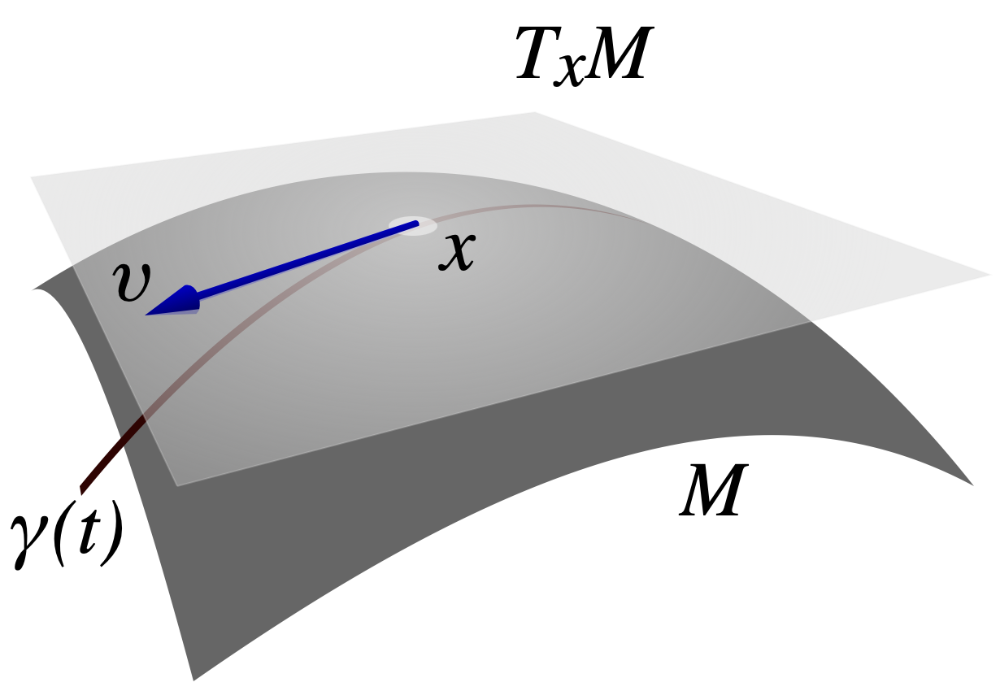

<problems>
- “对复流形”一节需要扩充。
- “一般定义”一节的例子中，$\gamma' (0) \, (f)$ 的定义式似乎缺少在 $t = 0$ 处取值。
</problems>

[[光滑流形]] $X$ 在某点 $x \in X$ 处的**切空间**，
记为 $\mathrm{T}_x X$，
是由该点处所有“与 $X$ 相切的[[向量]]”构成的[[实数|实]][[向量空间]]。
该向量空间的维数与 $X$ 的维数相等，
其元素称为**切向量**。
例如，曲线的切线、曲面的切平面都是切空间的特例。

{width=200}

将光滑流形 $X$ 在所有点处的切空间粘起来，可以得到 $X$ 上的[[光滑向量丛]] $\mathrm{T} X$，
称为其[[切丛]]。

## 定义

切空间可以对一般的[[光滑流形]]定义，但该定义比较抽象。
另一方面，对 [[Euclid 空间]]
$\mathbb{R}^N$ 的[[子流形]] $X \subset \mathbb{R}^N$ 而言，
切空间具有更直观的定义。
我们先叙述这种直观的定义，再叙述更抽象的一般定义。

### 对 Euclid 空间的子流形

::: definition [切空间] {@thm:对-Euclid-空间的子流形}
设 $N$ 是[[自然数]]，$X \subset \mathbb{R}^N$ 是[[子流形]]，
并设 $x \in X$。
则 $X$ 在 $x$ 处的**切空间**定义为[[向量空间]]
\[
\mathrm{T}_x X = \Set{
  v \in \mathbb{R}^N |
  \begin{array}{ll}
    \text{存在光滑曲线 } \gamma \colon \mathopen{]} -1, 1 \mathclose{[} \to X, \\
    \text{使得 }\gamma (0) = x, \ \gamma' (0) = v
  \end{array}
}.
\]
:::

由上述定义，只能看出切空间为 $\mathbb{R}^N$ 的子集，
而不能直接得出其为[[子向量空间]]。

::: proposition
@thm:对-Euclid-空间的子流形 中的切空间 $\mathrm{T}_x X$
确实是 $\mathbb{R}^N$ 的子向量空间，其维数等于 $X$ 的维数。
:::

另一方面，这一定义取决于流形在 Euclid 空间中的嵌入，
而不能直接看出切空间是流形内蕴的信息。
下面的一般定义解决了这一问题。

### 一般定义

对[[光滑流形]] $X$，记 $C^\infty (X)$ 为所有[[光滑函数]]
$f \colon X \to \mathbb{R}$ 构成的[[实数|实]][[向量空间]]。

::: definition [切空间] {@thm:一般定义}
设 $X$ 是[[光滑流形]]，设 $x \in X$。则

- $X$ 在 $x$ 处的**切向量**是指一个[[线性函数]]
  \[
  v \colon C^\infty (X) \to \mathbb{R},
  \]
  满足对任意 $f, g \in C^\infty (X)$，有 [[Leibniz 法则]]
  \[
  v (f g) = f (x) \cdot v (g) + g (x) \cdot v (f).
  \]
  这里，我们把 $v (f)$ 理解成函数 $f$
  在点 $x$ 处沿着向量 $v$ 的[[方向导数]]。

- $X$ 在 $x$ 处的**切空间** $\mathrm{T}_x X$
  是 $X$ 在 $x$ 处的所有切向量构成的[[向量空间]]。

:::

::: example {@曲线切向量}
若 $\gamma \colon \mathopen{]} -1, 1 \mathclose{[} \to X$
为[[光滑映射]]，即 $X$ 上的光滑曲线，
我们可以将 $\gamma' (0)$ 以如下方式视为 $X$ 的切向量（@thm:一般定义）：
对 $f \in C^\infty (X)$，定义
\[
\gamma' (0) \, (f) = \frac{d}{d t} f ( \gamma (t) ).
\]
这也就是 $f$ 沿 $\gamma' (0)$ 的方向导数。
不难验证这一定义满足 Leibniz 法则，从而确实给出了 $X$ 的切向量。
这一例子实际上是[[切映射]]的特例。
:::

### 对复流形

## 性质

### 基本性质

我们首先验证一些初步的性质。
例如，我们证明切空间的维数等于流形维数，
并验证每个切向量都可以通过光滑曲线以类似 @thm:对-Euclid-空间的子流形
的方式给出，从而该定义确实等价于 @thm:一般定义。

::: lemma
设 $X$ 是光滑流形，$x \in X$，
设 $v \in \mathrm{T}_x X$ 是切向量（@thm:一般定义）。
则对 $f \in C^\infty (X)$ 而言，$v (f)$ 只取决于 $f$ 在 $x$ 附近的取值。
换言之，如果 $f, g \in C^\infty (X)$ 在 $x$ 的一个邻域内相同，
那么 $v (f) = v (g)$。
:::

::: proof
注意到如果 $a, b \in C^\infty (X)$ 满足 $a (x) = b (x) = 0$，
那么 $v (a b) = 0$。
而根据假设，$f - g$ 在 $x$ 附近为 $0$，
从而能写成两个 $x$ 处取值为 $0$ 的函数的乘积。
:::

::: lemma {@坐标卡}
设 $X$ 是 $n$ 维光滑流形，$x \in X$。
则有向量空间同构 $\mathrm{T}_x X \simeq \mathrm{T}_0 \mathbb{R}^n$。
:::

::: proof
我们记 $C^\infty (X)_x = C^\infty (X) / {\sim}_x$，
其中 $f \sim_x g$ 当且仅当 $f, g$ 在 $x$ 的某个邻域中相同。
设 $\varphi \colon \mathbb{R}^n \to X$ 为一个坐标卡，满足 $\varphi (0) = x$。
则有交换图
\[
\begin{tikzcd}[column sep={4em,between origins}]
  C^\infty (X)_x
  \ar[rr, "\varphi^*", "\simeq"'] \ar[dr, "f \mapsto f(x)"'] &&
  C^\infty (\mathbb{R}^n)_0 \ar[dl, "f \mapsto f(0)"] \\
  & \mathbb{R} \rlap{\ ,}
\end{tikzcd}
\]
从而 $C^\infty (X)_x$ 与 $C^\infty (\mathbb{R}^n)_0$
上满足 Leibniz 法则的线性函数的空间也同构。
:::

::: lemma {@Euclid-空间切空间}
向量空间 $\mathrm{T}_0 \mathbb{R}^n$ 的维数是 $n$，它的一组基是
\[
\frac{\partial}{\partial x^i} \Big|_{x = 0} \quad
(i = 1, \dotsc, n).
\]
:::

::: proof
不难验证 $\frac{\partial}{\partial x^i}$
确实是 $\mathrm{T}_0 \mathbb{R}^n$ 的元素，且线性无关。
我们说明任何切向量都是这些元素的线性组合。
若 $v \in \mathrm{T}_0 \mathbb{R}^n$，对任意 $f \in C^\infty (\mathbb{R}^n)$，
以及 $x \in \mathbb{R}^n$，由 [[Taylor 定理]]，
\[
f (x) = f (0) +
\sum_{i=1}^n x^i \frac{\partial f}{\partial x^i} (0) +
\sum_{i,j=1}^n O (x^i x^j).
\]
我们有 $v (f (0)) = 0$，并且 $v (O (x^i x^j)) = 0$，
因为 $O (x^i x^j)$ 能写成两个在 $0$ 处取值为 $0$ 的函数的乘积。
因此，
\[
v (f) = \sum_{i=1}^n v(x^i) \frac{\partial f}{\partial x^i} (0).
\]
由于 $f$ 是任意的，我们有
\[
v = \sum_{i=1}^n v (x^i) \cdot \frac{\partial}{\partial x^i} \Big|_{x=0},
\]
也就是说，$v$ 确实是 $\frac{\partial}{\partial x^i}$ 的线性组合。
:::

::: corollary
设 $X$ 是 $n$ 维光滑流形，$x \in X$。
则切空间 $\mathrm{T}_x X$（@thm:一般定义）
是 $n$ 维实向量空间。
:::

::: proof
由 @坐标卡 和 @Euclid-空间切空间 立刻得出。
:::

::: corollary
设 $X$ 是光滑流形，设 $x \in X$。
则对每个 $v \in \mathrm{T}_x X$（@thm:一般定义），
存在光滑曲线 $\gamma \colon \mathopen{]} -1, 1 \mathclose{[} \to X$，
使得 $\gamma (0) = x$，且 $\gamma' (0) = v$，
其中 $\gamma' (0)$ 是 @曲线切向量 中定义的切向量。

特别地，若 $X \subset \mathbb{R}^N$ 是子流形，
则 $X$ 的切空间确实由 @thm:对-Euclid-空间的子流形 给出。
更特别地，@thm:对-Euclid-空间的子流形 定义的切空间确实是实向量空间。
:::

::: proof
由 @Euclid-空间切空间，
$\mathbb{R}^n$ 的每个切向量都可以由某条曲线（例如直线）给出。
取 $X$ 的坐标卡，则 @坐标卡 将 $v$ 对应于 $\mathbb{R}^n$
的某切向量，故在该坐标卡中就可以找到所需的曲线。
:::

```terms
切空间:
  en: tangent space
  fr: espace tangent
```
