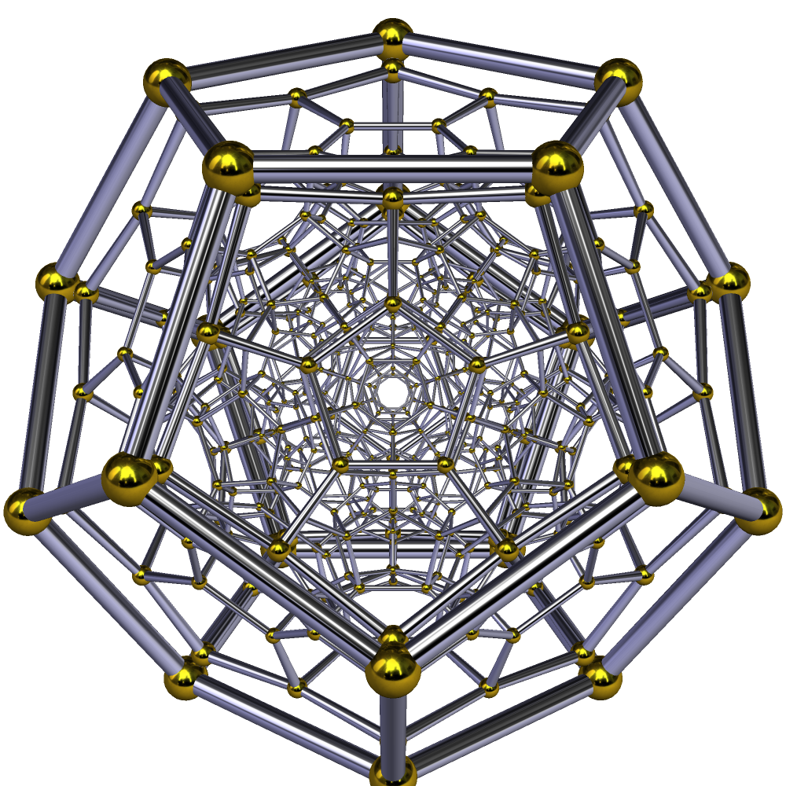

<problems>
- “定义”一节需要扩充。
</problems>

**正一百二十胞体**是一种 [[Euclid 空间]]中的[[正多胞体]]，
其透视投影为

{width=200}

## 定义

## 性质

正一百二十胞体满足如下性质

::: proposition
- 其含有 600 个 $0$-胞腔（即顶点），
  1200 个 $1$-胞腔，
  720 个 $2$-胞腔，
  120 个 $3$-胞腔。

- 其 Schläfli 符号为 $\{ 5, 3, 3 \}$。

- 其[[对偶多胞体]]为[[正六百胞体]]。

- 其 [[Coxeter 图]]为 $H_4$，即
  \[
  \begin{tikzcd}[arrows=-]
    \bullet \ar[r] & \bullet \ar[r] & \bullet
    \ar[r,"5"] & \bullet.
  \end{tikzcd}
  \]

:::

```terms
正一百二十胞体:
  en: 120-cell
```
