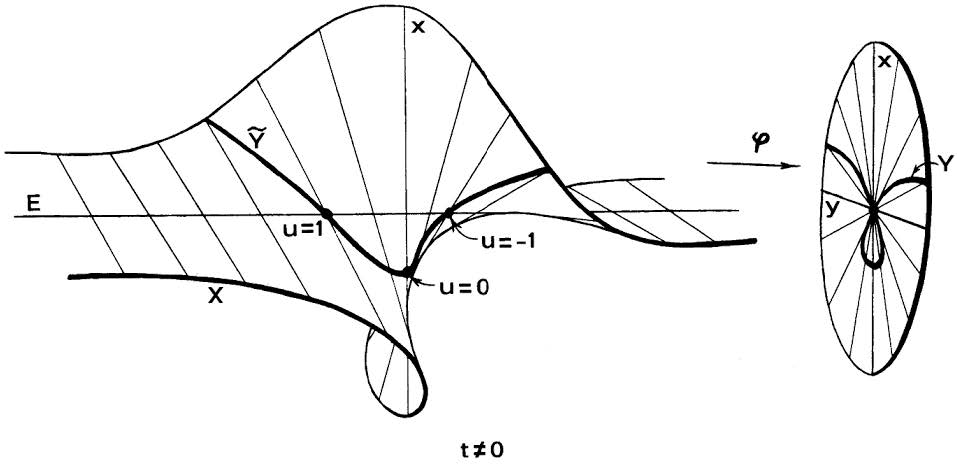

**爆破**是[[几何学]]中的一种构造，
在[[代数几何]]中尤为重要。
给定[[代数簇]] $X$ 及[[闭子簇]] $Z \subset X$，
则 $X$ 沿 $Z$ 的爆破 $\tilde{X}$
是在 $X$ 中将 $Z$ 中每点 $z$ 替换为该点处
$Z$ 的[[法空间]]的[[射影空间]]，
而得到的新代数簇。
例如，下图展示了[[仿射空间 (代数几何)|仿射空间]] $\mathbb{A}^2$
沿着原点 $\{ 0 \}$ 的爆破。图中左侧为爆破后的空间，而右侧为爆破之前的空间。
可以看出，$\mathbb{A}^2$ 中每条经过原点的直线
都对应爆破后的一条直线，
而原点则被拉开成一条[[射影直线]] $\mathbb{P}^1$，
记录经过该点的所有可能的方向。
图中粗线是 $\mathbb{A}^2$ 中的一条[[代数曲线]]，
它在原点具有[[结点]]，从而不光滑，但爆破后该曲线变成了[[光滑曲线]]。

{width=600}

（图取自 [@Hartshorne1977]）

爆破常常视为[[态射]]，即从爆破后的代数簇到原来代数簇的态射。
该态射是[[双有理态射]]、[[射影态射]]。
该态射下 $Z$ 的[[原像]]，也就是爆破的操作改变的那一部分，
称为**例外除子**。

爆破在[[双有理几何]]中，特别是[[奇点消解]]理论中，具有重要应用。
奇点消解理论的主要结论说明，[[特征 (代数)|特征]] $0$ [[域]]上的任何代数簇
都可以通过一系列的爆破，最终成为[[光滑簇|光滑]]的。

## 定义

### 对概形

::: definition [爆破]
设 $X$ 是[[概形]]，$\mathcal{I} \subset \mathcal{O}_X$ 是[[拟凝聚层|拟凝聚]][[理想层]]。
则 $X$ 沿 $\mathcal{I}$ 的**爆破**是指概形
\[
\mathrm{Bl}_{\mathcal{I}} (X) = \mathbf{Proj}_X \biggl(
  \bigoplus_{n = 0}^{\infty} \mathcal{I}^n
\biggr),
\]
其中 $\mathbf{Proj}_X$ 是[[相对射影谱]]，
括号内的部分视为[[分次环]]层，
$\mathcal{I}^n \subset \mathcal{O}_X$ 的次数为 $n$。

特别地，若 $Z \subset X$ 为[[闭子概形]]，
则 $X$ 沿 $Z$ 的**爆破** $\mathrm{Bl}_Z (X)$
是指 $X$ 沿 $Z$ 的理想层 $\mathcal{I}_Z$ 的爆破。
:::

## 例子

- 设 $X$ 是代数簇，
  $Z \subset X$ 是由方程 $f_1 = \cdots = f_m = 0$ 定义的闭子簇，
  其中各 $f_i \colon X \to \mathbb{A}^1$ 是[[正则函数]]。
  则爆破 $\mathrm{Bl}_Z (X)$ 可以视为 $X \times \mathbb{P}^{m-1}$ 的闭子簇：
  \[
  \mathrm{Bl}_Z (X) = \Bigl\{
    (x, [a_1 : \cdots : a_m]) \in X \times \mathbb{P}^{m-1}
    \Bigm|
    a_i f_j (x) = a_j f_i (x), \ \forall i, j
  \Bigr\} .
  \]

## 参考文献

```bibliography
Hartshorne1977:
  type: book
  author: 'Hartshorne, Robin'
  title: Algebraic geometry
  series: Grad. Texts Math.
  number: 52
  publisher: Springer
  year: 1977
  doi: 10.1007/978-1-4757-3849-0
```

```terms
爆破:
  en: blow-up
  fr: éclatement :m
  de: Aufblasung :f
  ja: ブローアップ
  ko: 부풀리기
```
