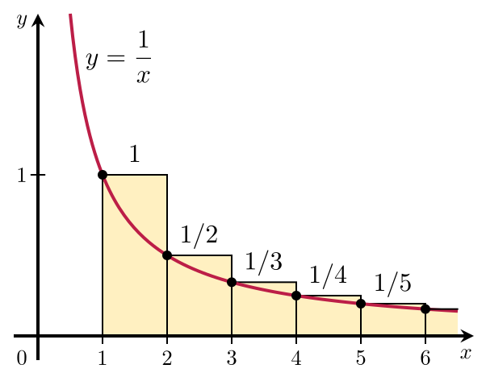

<problems>
- “渐近展开”一节需要扩充。
</problems>

**调和级数**是一个发散的[[级数]]，表达式为：
\[
\sum_{k=1}^\infty \frac{1}{k} =
1 + \frac{1}{2} + \frac{1}{3} + \frac{1}{4} + \cdots
\]

## 发散性

### 比较审敛法

\[
\begin{aligned}
  \sum_{k=1}^\infty \frac{1}{k} &=
  1 + \left(\frac{1}{2}\right) + \left(\frac{1}{3} + \frac{1}{4}\right) + \left(\frac{1}{5} + \frac{1}{6} + \frac{1}{7} + \frac{1}{8}\right) + \left(\frac{1}{9}+\cdots\right.\\
  &\ge \sum_{k=1}^\infty 2^{-\lceil \log_2 k \rceil}\\
  &= 1 + \left(\frac{1}{2}\right) + \left(\frac{1}{4} + \frac{1}{4}\right)
  + \left(\frac{1}{8} + \frac{1}{8} + \frac{1}{8} + \frac{1}{8}\right) + \left(\frac{1}{16}+\cdots\right.\\
  &=1 + \frac{1}{2} + \frac{1}{2} + \frac{1}{2} + \cdots = \infty.
\end{aligned}
\]

因此该级数发散。

### 积分判别法

{width=250}

通过将调和级数的和与一个[[瑕积分]]作比较可证此级数发散。考虑上图中长方形的排列。
每个长方形宽1个单位、高$\frac{1}{n}$个单位（换句话说，每个长方形的面积都是$\frac{1}{n}$），
所以所有长方形的总面积就是调和级数的和：
\[
\text{矩形面积和}= 1 + \frac{1}{2} + \frac{1}{3} + \frac{1}{4} + \frac{1}{5} + \cdots.
\]
而曲线$y=\frac{1}{x}$以下、从1到正无穷部分的面积由以下瑕积分给出：
\[
\text{曲线下面积}= \int_1^\infty\frac{1}{x}\,dx = \infty.
\]
由于这一部分面积真包含于（换言之，小于）长方形总面积，长方形的总面积也必定趋于无穷。
更准确地说，这证明了：
\[
\sum_{n=1}^k \frac{1}{n} > \int_1^{k+1} \frac{1}{x}\,dx = \ln(k+1).
\]

## 渐近展开

```terms
调和级数:
  en: harmonic series
  fr: série harmonique
  de: harmonische Reihe
```
